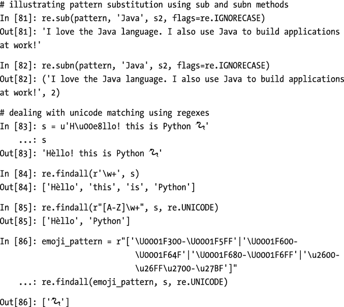

# Python 字符串与正则表达式

## 创建与匹配字符串

```python
# 创建一些字符串
s1 = 'Python is an excellent language'
s2 = 'I love the Python language. I also use Python to build applications at work!'
# 由于大小写不匹配，未找到匹配项
In [61]: import re
...:
...: pattern = 'python'
...: # match 仅在字符串开头找到正则匹配时才返回匹配对象
...: re.match(pattern, s1)
# 模式是小写的，因此忽略大小写标志有助于匹配不同大小写的相同模式
In [62]: re.match(pattern, s1, flags=re.IGNORECASE)
Out[62]:
```

```python
# 打印匹配的字符串及其在原字符串中的索引
In [64]: m = re.match(pattern, s1, flags=re.IGNORECASE)
...: print('在原字符串 "{}" 中，找到从索引 {} 到 {} 的匹配项 "{}"'.format(m.group(0), m.start(), m.end(), s1))
Found match Python ranging from index 0 - 6 in the string "Python is an excellent language"
# 当模式不在字符串 s2 的开头时，match 不起作用
In [65]: re.match(pattern, s2, re.IGNORECASE)
```

## `find()` 与 `search()` 方法

现在让我们看一些示例，说明 `find(...)` 和 `search(...)` 方法在正则表达式中的工作方式：

```python
# 使用 re 模块演示 find 和 search 方法
In [66]: re.search(pattern, s2, re.IGNORECASE)
Out[66]:
In [67]: re.findall(pattern, s2, re.IGNORECASE)
Out[67]: ['Python', 'Python']
In [68]: match_objs = re.finditer(pattern, s2, re.IGNORECASE)
...: match_objs
Out[68]:
In [69]: print("字符串:", s2)
...: for m in match_objs:
...:     print('找到从索引 {} 到 {} 的匹配项 "{}"'.format(m.start(), m.end(), m.group(0)))
String: I love the Python language. I also use Python to build applications at work!
Found match "Python" ranging from index 11 - 17
Found match "Python" ranging from index 39 - 45
```

## 使用正则表达式进行文本替换

用于文本替换的正则表达式非常有用，可以查找并替换字符串中的特定文本标记。我们通过几个示例来说明这一点：



至此，我们关于字符串及其各种方面（包括表示和操作）的讨论结束了。这应该能让你了解如何利用字符串处理文本数据，以及字符串如何构成文本处理的基础，而文本处理是文本分析中的一个重要组成部分。现在我们介绍一个基本的文本处理案例研究，其中我们将基于前面章节学到的内容，将所有这些知识整合在一起。