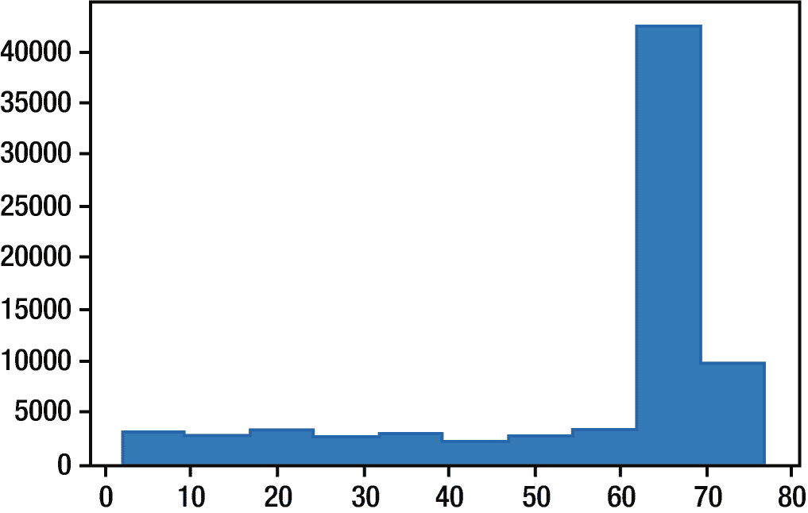
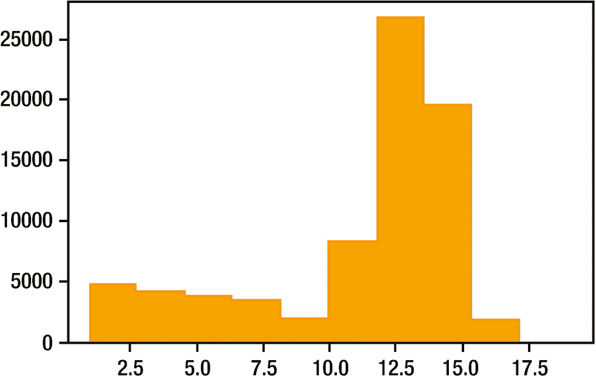

# 基本文本处理与分析：综合应用

让我们利用本章以及前一章学到的知识，构建并解决一个基本的文本处理问题。为此，我们从 NLTK 中的 Gutenberg 语料库加载《英王钦定版圣经》。以下代码展示了如何加载圣经语料库并显示其中的前几行。

```python
from nltk.corpus import gutenberg
import matplotlib.pyplot as plt
% matplotlib inline
bible = gutenberg.open('bible-kjv.txt')
bible = bible.readlines()
bible[:5]
['[The King James Bible]\n',
'\n',
'The Old Testament of the King James Bible\n',
'\n',
'The First Book of Moses:  Called Genesis\n']
```

在前面的输出中，我们可以清楚地看到圣经语料库的前几行。让我们进行一些基本的预处理，方法是移除语料库中的所有空换行符，并去掉其他行中的换行符。

```python
In [88]: len(bible)
Out[88]: 99805
In [89]: bible = list(filter(None, [item.strip('\n') for item in bible]))
...: bible[:5]
Out[89]:
['[The King James Bible]',
'The Old Testament of the King James Bible',
'The First Book of Moses:  Called Genesis',
'1:1 In the beginning God created the heaven and the earth.',
'1:2 And the earth was without form, and void; and darkness was upon']
In [90]: len(bible)
Out[90]: 74645
```

我们可以清楚地看到，语料库中有很多空换行符，我们已经成功地将它们移除。现在让我们对语料库进行一些基本的频率分析。假设我们想要可视化圣经中典型句子或行长的整体分布。我们可以通过计算每个句子的长度，然后使用直方图进行可视化，如图 2-9 所示。



*图 2-9. 可视化圣经中的句子长度分布*

```python
line_lengths = [len(sentence) for sentence in bible]
h = plt.hist(line_lengths)
```

根据图 2-9 所描绘的图表，大多数句子的长度似乎在 65-70 个字符左右。现在让我们来看看每句的总词数分布。为了得到这个分布，首先让我们研究一下对语料库中每个句子进行分词的方法。

```python
In [95]: tokens = [item.split() for item in bible]
...: print(tokens[:5])
[['[The', 'King', 'James', 'Bible]'], ['The', 'Old', 'Testament', 'of', 'the', 'King', 'James', 'Bible'], ['The', 'First', 'Book', 'of', 'Moses:', 'Called', 'Genesis'], ['1:1', 'In', 'the', 'beginning', 'God', 'created', 'the', 'heaven', 'and', 'the', 'earth.'], ['1:2', 'And', 'the', 'earth', 'was', 'without', 'form,', 'and', 'void;', 'and', 'darkness', 'was', 'upon']]
```

现在我们已经对每个句子进行了分词，只需要计算每个句子的长度，即可获得每句的总词数，并绘制直方图来可视化这个分布。参见图 2-10。



*图 2-10. 可视化圣经中每句总词数的分布*

```python
In [96]: total_tokens_per_line = [len(sentence.split()) for sentence in bible]
...: h = plt.hist(total_tokens_per_line, color="orange")
```

根据图 2-10 所描绘的可视化结果，我们可以清楚地得出结论：圣经中的大多数句子大约包含 12-15 个单词（或词元）。现在让我们尝试确定圣经语料库中最常见的单词。我们已经将句子分词为单词（单词列表）。第一步是将这个大的列表的列表（每个列表是一个已分词的句子）展平成一个大的单词列表。


```python
words = [word for sentence in tokens for word in sentence]
print(words[:20])
['[The', 'King', 'James', 'Bible]', 'The', 'Old', 'Testament', 'of', 'the', 'King', 'James', 'Bible', 'The', 'First', 'Book', 'of', 'Moses:', 'Called', 'Genesis', '1:1']
```

好极了！我们现在拥有了语料库中的大词元列表。不过，你可以看到这些词元并非完全干净，部分单词中还包含一些我们不想要的符号和特殊字符。现在，让我们利用正则表达式的强大功能来移除它们。

```python
words = list(filter(None, [re.sub(r'[^A-Za-z]', ", word) for word in words]))
print(words[:20])
['The', 'King', 'James', 'Bible', 'The', 'Old', 'Testament', 'of', 'the', 'King', 'James', 'Bible', 'The', 'First', 'Book', 'of', 'Moses', 'Called', 'Genesis', 'In']
```

基于我们在前一段代码中使用的正则表达式，我们移除了所有非字母字符。因此，所有数字和特殊字符都被删除了。现在，我们可以用以下代码来确定频率最高的单词。

```python
In [99]: from collections import Counter
...:
...: words = [word.lower() for word in words]
...: c = Counter(words)
...: c.most_common(10)
Out[99]:
[('the', 64023),
('and', 51696),
('of', 34670),
('to', 13580),
('that', 12912),
('in', 12667),
('he', 10419),
('shall', 9838),
('unto', 8997),
('for', 8970)]
```

我们看到，代词、冠词等大量通用填充词是频率最高的词，这完全合乎情理。但这并没有传达太多信息。如果我们能移除这些词，专注于更有趣的词，会怎么样呢？一种方法是移除这些填充词（通常称为停用词），然后按如下方式计算频率。

```python
In [100]: import nltk
...:
...: stopwords = nltk.corpus.stopwords.words('english')
...: words = [word.lower() for word in words if word.lower() not in stopwords]
...: c = Counter(words)
...: c.most_common(10)
Out[100]:
[('shall', 9838),
('unto', 8997),
('lord', 7830),
('thou', 5474),
('thy', 4600),
('god', 4442),
('said', 3999),
('ye', 3983),
('thee', 3826),
('upon', 2748)]
```

因此，我们看到结果比以前更好；然而，许多词仍然是填充词或停用词。这是因为它们是更口语化的英语，不属于标准英语停用词列表，所以没有被移除。我们总是可以根据需要构建自定义的停用词列表。（更多关于停用词的内容，请参见第 3 章。）这应该能让您清楚地了解我们如何利用与字符串、方法和转换相关的所有方面来处理和分析文本数据。

## 自然语言处理框架

我们之前提到，Python 生态系统是多样化的，并在不同领域支持各种各样的库、框架和模块。由于我们将要分析文本数据并解决多个相关用例，因此有专门用于自然语言处理和文本分析的开源框架和库，您可以像使用 Python 标准库中的任何其他内置模块一样，直接安装并使用它们。这些框架经过了长时间的构建，并且通常仍在积极开发中。评估一个框架的方式通常是看其开发者社区的活跃程度。

每个框架都包含各种用于操作文本、获取洞察以及为后续分析（例如对预处理后的文本数据应用机器学习算法）准备数据的方法、能力和特性。利用这些框架可以节省大量编写模板代码来处理、操作和转换文本数据所需的工作和时间。因此，这使得开发人员和研究人员能够更专注于解决实际问题以及所需的逻辑和算法。我们已经在第一章中初步了解了`nltk`库。以下列出了一些最流行的文本分析框架库，我们将在本书中多次使用到它们。

*   `nltk`：自然语言工具包是一个完整的平台，包含超过 50 个语料库和词汇资源，例如 WordNet。除此之外，它还提供了必要的工具、接口和方法来处理和分析文本数据。NLTK 框架自带一套高效的模块，用于分类、分词、词干提取、词形还原、词性标注、句法分析和语义推理。它是业界任何 NLP 项目的标准主力工具。

*   `pattern`：`pattern`项目在此获得荣誉提名，因为我们在本书的第一版中广泛使用了它。然而，由于缺乏官方支持或 Python 3.x 版本，我们本版将不再使用它。它最初是安特卫普大学计算语言学与心理语言学研究中心的一个研究项目。它提供了用于网络挖掘、信息检索、自然语言处理、机器学习和网络分析的工具和接口。

*   `spacy`：与其他框架相比，这是相对较新的库之一，但或许是用于 NLP 的最佳库之一。我们可以保证，spaCy 通过提供每种技术和算法的最佳实现，提供了工业级的自然语言处理能力，使得 NLP 任务在性能和实现方面都高效。事实上，spaCy 擅长大规模信息抽取任务。它从头开始使用高效、内存管理的 Cython 编写。广泛的研究也证实 spaCy 是世界上最快的。spaCy 还能与 TensorFlow、PyTorch、Scikit-Learn、Gensim 等深度学习及机器学习框架，以及 Python 其余优秀的 AI 生态系统无缝协作。最棒的是，spaCy 支持多种语言，并提供了预训练的词向量！

*   `gensim`：`gensim`库拥有丰富的语义分析能力，包括主题建模和相似性分析。但最棒的部分是，它包含了谷歌非常流行的 Word2Vec 模型的 Python 移植版（最初以 C 语言包的形式提供），该模型是一个神经网络模型，用于学习单词的分布式表示，使得语义相似的单词彼此靠近出现。因此，Gensim 既可用于语义分析，也可用于特征工程！

*   `textblob`：这是另一个提供多种能力的库，包括文本处理、短语提取、分类、词性标注、文本翻译和情感分析。TextBlob 通过其极其直观且易于使用的 API，将许多困难的事情变得非常简单，包括语言翻译和情感分析。

除此之外，还有其他几个框架和库并非专门用于文本分析，但当您想对文本数据使用机器学习或深度学习技术时，它们会很有用。这些包括 Scikit-Learn、NumPy 和 SciPy 技术栈，它们对于文本特征工程、以矩阵形式处理特征集，甚至执行流行的机器学习任务（如相似性计算、文本分类和聚类）都极为有用。

除此之外，如果您想构建基于深度神经网络、卷积神经网络、序列模型和生成模型的高级深度学习模型，那么像 PyTorch、TensorFlow 和 Keras 这样的深度学习和基于张量的库也会派上用场。您可以在命令提示符或终端中使用`pip install <library>`命令来安装这些库中的大部分。我们将在后续章节使用这些库时，讨论任何需要注意的特殊事项。


## 总结

本章对整个 Python 生态系统及其在处理文本数据方面的能力提供了高屋建瓴但又足够详细的概述。你了解了 Python 语言背后的起源以及它是如何随着时间不断演进的。该语言具有开源的优势，这使得拥有一个活跃的开发者社区，他们不断努力改进该语言并添加新功能。

现在，你也知道了何时应该使用 Python，以及与该语言相关的缺点，这些是每个开发者在构建系统和应用程序时都应该牢记的。本章还清晰地阐述了如何设置自己的 Python 环境以及如何处理多个虚拟环境。从最基础的知识开始，我们深入探讨了如何使用字符串数据类型及其各种语法、方法、操作和格式来处理文本数据。我们还了解了正则表达式的强大之处，以及它们在模式匹配和替换中是多么有用。

为了总结我们的讨论，我们审视了各种流行的文本分析和自然语言处理框架，这些框架有助于解决和处理与自然语言处理、分析以及从文本数据中提取见解相关的任务问题。这应该能让你开始使用 Python 编程并处理文本数据。在下一章中，我们将在本章的基础上，开始理解、处理并以可用的格式解析文本数据。

