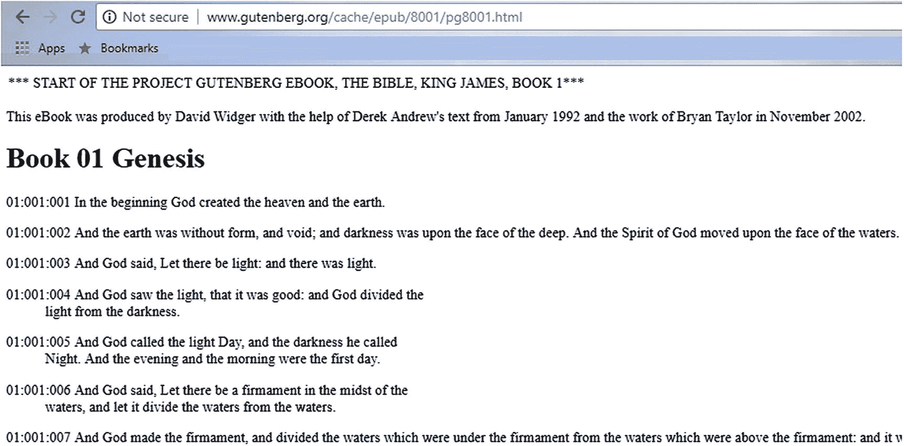

# 3. 处理与理解文本

在前面的章节中，我们利用关键的术语和概念，对整个自然语言处理和文本分析领域有了初步的了解。除此之外，我们还介绍了 Python 编程语言、基本结构和语法，并学习了如何使用字符串来管理文本数据。为了使用机器学习或深度学习算法对文本执行复杂操作，你需要将文本数据处理并解析成更易于解释的格式。所有机器学习算法，无论是监督技术还是非监督技术，都使用输入特征，而这些特征本质上是数字型的。虽然这是特征工程下的一个独立主题，我们将在下一章中详细探讨，但要达到这一步，你需要对原始文本数据进行清洗、标准化和预处理。

原始的文本语料库和其他文本数据通常格式不规范、不标准，当然我们应该预料到这一点，毕竟文本数据是高度非结构化的！文本处理，或者更具体地说是预处理，包含了多种技术，这些技术将原始文本转换为具有标准结构和符号的、定义明确的语言组件序列。通常还存在以注释形式呈现的额外元数据，用于为文本组件（如标签）赋予更多含义。以下列表让我们了解了一些最流行的文本预处理和理解技术，我们将在本章中探讨这些技术。

- 移除 HTML 标签
- 分词
- 移除不必要的标记和停用词
- 处理缩写
- 纠正拼写错误
- 词干提取
- 词形还原
- 词性标注
- 组块分析
- 句法分析

除了这些技术之外，你还需要执行一些基本操作，例如大小写转换、处理无关组件以及根据要解决的问题去除噪声。需要记住的一个重要点是，一个健壮的文本预处理系统始终是任何 NLP 和文本分析应用的重要组成部分。其主要原因是，预处理后获得的所有文本组件——无论是单词、短语、句子还是任何其他标记——都构成了输入的基本构建块，这些输入会被送入应用程序的后续阶段，以执行更复杂的分析，包括学习模式和提取信息。因此，“垃圾进，垃圾出！”这句话在这里很贴切，因为如果我们没有正确处理文本，最终会从我们的应用和系统中得到不想要且不相关的结果。

此外，文本处理有助于文本的清洗和标准化，这不仅有助于分析系统（例如提高分类器的准确性），而且我们还能以注释的形式获得额外的信息和元数据。它们对于提供关于文本的更多信息非常有用。在本章中，我们将涉及使用各种技术（包括清洗、移除不必要的标记、词干和词形）来标准化文本。

另一个重要方面是在处理和标准化文本数据之后对其理解。这将涉及重新审视第 1 章中有关语言语法和结构的一些概念，我们在那里讨论了句子、短语、词性、浅层解析和语法。在本章中，我们将寻找实现这些概念并将其应用于真实数据的方法。我们在本章中遵循一条结构化和明确的路径，从文本处理开始，逐步探索与之相关的各种概念和技术，然后继续理解文本结构和语法。由于本书专门面向实践者，因此各种代码片段和实际示例也为你提供了合适的工具和框架，以便在解决实际问题中实现这些概念。本章中展示的所有代码示例均可在本书的官方 GitHub 仓库中找到，你可以通过以下链接访问：[`https://github.com/dipanjanS/text-analytics-with-python/tree/master/New-Second-Edition`](https://github.com/dipanjanS/text-analytics-with-python/tree/master/New-Second-Edition)。

## 文本预处理与整理

文本整理（也称为预处理或标准化）是一个过程，它由一系列步骤组成，旨在将文本数据整理、清洗和标准化为能够被其他由机器学习和深度学习驱动的自然语言处理和智能系统所消费的形式。常见的预处理技术包括清洗文本、分词、移除特殊字符、大小写转换、拼写纠正、移除停用词和其他不必要的术语、词干提取以及词形还原。在本节中，我们将基于本章开头提到的列表，讨论常用于文本整理的各种技术。关键思想是从一个语料库（或多个语料库）中的一个或多个文本文档中移除不必要的内容，并获得干净的文本文档。

### 移除 HTML 标签

通常，非结构化文本包含大量噪声，特别是当你使用网页抓取或屏幕抓取等技术从网页、博客和在线存储库中检索数据时。HTML 标签、JavaScript 和 Iframe 标签通常对理解和分析文本没有太大价值。我们的主要目的是从网络提取的数据中抽取出有意义的文本内容。让我们看一个网页片段，它展示了《钦定版圣经》的内容，该内容由古登堡计划免费提供，如图 3-1 所示。



**图 3-1** – 显示《圣经》章节的网页片段

现在，我们将利用 `requests` 来获取该网页的内容。这被称为网页抓取，以下代码可帮助我们实现这一目标。

```python
import requests
data = requests.get('http://www.gutenberg.org/cache/epub/8001/pg8001.html')
content = data.content
print(content[1163:2200])
```

从上述输出中我们可以清楚地看到，由于存在大量不必要的 HTML 标签，解读网页中的实际文本内容极其困难。我们需要移除这些标签。`BeautifulSoup` 库为我们提供了一些方便的函数，可以轻松地移除这些不必要的标签。

```python
import re
from bs4 import BeautifulSoup
def strip_html_tags(text):
    soup = BeautifulSoup(text, "html.parser")
    [s.extract() for s in soup(['iframe', 'script'])]
    stripped_text = soup.get_text()
    stripped_text = re.sub(r'[\r|\n|\r\n]+', '\n', stripped_text)
    return stripped_text
clean_content = strip_html_tags(content)
print(clean_content[1163:2045])
```

你可以将此输出与原始网页内容进行比较，会发现我们已经成功移除了不必要的 HTML 标签。现在我们得到了一个干净的文本主体，更易于解读和理解。

### 文本标记化

第 1 章阐述了文本结构、其组成部分和标记。标记是独立且最小的文本组成部分，具有明确的语法和语义。一个段落或文本文档包含多个组成部分，包括句子，而句子又可以进一步分解为从句、短语和单词。最流行的标记化技术包括句子标记化和单词标记化，它们用于将文本文档（或语料库）分解为句子，并将每个句子分解为单词。因此，标记化可以定义为将文本数据分解或拆分为更小、更有意义的组件（称为*标记*）的过程。在接下来的几节中，我们将介绍一些将文本标记化为句子和单词的方法。

#### 句子标记化

*句子标记化*是将文本语料库拆分为句子的过程，这些句子构成了语料库的第一级标记。这也被称为句子分割，因为我们试图将文本分割成有意义的句子。任何文本语料库都是一个文本主体，其中每个段落包含多个句子。执行句子标记化的方法有多种。基本技术包括查找句子之间的特定分隔符，例如句号（`.`）或换行符（`\n`），有时甚至是分号（`;`）。我们将使用 `NLTK` 框架，该框架提供了多种用于执行句子标记化的接口。我们主要关注以下句子标记化器：

*   `sent_tokenize`
*   预训练的句子标记化模型
*   `PunktSentenceTokenizer`
*   `RegexpTokenizer`

在标记化句子之前，我们需要一些文本作为操作对象。我们将加载一些示例文本以及 `NLTK` 中提供的部分古登堡语料库。我们使用以下代码片段加载必要的依赖项。

```markdown
```python
import nltk
from nltk.corpus import gutenberg
from pprint import pprint
import numpy as np

# 加载文本语料库
alice = gutenberg.raw(fileids='carroll-alice.txt')
sample_text = ("US unveils world's most powerful supercomputer, beats China. "
               "The US has unveiled the world's most powerful supercomputer called 'Summit', "
               "beating the previous record-holder China's Sunway TaihuLight. With a peak performance "
               "of 200,000 trillion calculations per second, it is over twice as fast as Sunway TaihuLight, "
               "which is capable of 93,000 trillion calculations per second. Summit has 4,608 servers, "
               "which reportedly take up the size of two tennis courts.")
sample_text
```

## 我们可以使用以下代码片段检查《爱丽丝梦游仙境》语料库的长度及其前几行。

```python
# 爱丽丝梦游仙境的总字符数
len(alice)

# 语料库中的前 100 个字符
alice[0:100]
```
```