# 纠正重复字符

我们之前提到，单词中常包含多个重复字符，这可能是拼写错误、俚语，甚至是人们想要表达强烈情感所致。这里介绍一种结合语法和语义的方法来纠正这些单词。我们先从纠正这些单词的语法入手，然后再处理语义问题。

我们算法的第一步是使用正则表达式模式识别单词中的重复字符，然后通过替换逐一移除这些字符。以之前例子中的单词 "finalllyyy" 为例。模式 `r'(\w*)(\w)\2(\w*)'` 可用于识别单词中连续出现两次的字符。在每一步中，我们尝试利用正则表达式的匹配组（组 1、组 2 和组 3）通过模式 `r'\1\2\3'` 对匹配项进行替换，从而消除其中一个重复字符。然后我们不断重复这个过程，直到没有剩余重复字符为止。以下代码片段说明了这个过程。

```
old_word = 'finalllyyy'
repeat_pattern = re.compile(r'(\w*)(\w)\2(\w*)')
match_substitution = r'\1\2\3'
step = 1
while True:
# remove one repeated character
new_word = repeat_pattern.sub(match_substitution,
old_word)
if new_word != old_word:
print('Step: {} Word: {}'.format(step, new_word))
step += 1 # update step
# update old word to last substituted state
old_word = new_word
continue
else:
print("Final word:", new_word)
break
Step: 1 Word: finalllyy
Step: 2 Word: finallly
Step: 3 Word: finally
Step: 4 Word: finaly
Final word: finaly
```

这段代码展示了在每个阶段如何移除一个重复字符，并最终得到单词 "finaly"。然而，这个单词是不正确的，正确的单词是我们在第三步得到的 "finally"。现在，我们将利用 WordNet 语料库在每个阶段检查有效单词，并在获得正确单词后终止循环。这为我们算法引入了所需的语义纠正，如下面的代码片段所示。

```
from nltk.corpus import wordnet
old_word = 'finalllyyy'
repeat_pattern = re.compile(r'(\w*)(\w)\2(\w*)')
match_substitution = r'\1\2\3'
step = 1
while True:
# check for semantically correct word
if wordnet.synsets(old_word):
print("Final correct word:", old_word)
break
# remove one repeated character
new_word = repeat_pattern.sub(match_substitution,
old_word)
if new_word != old_word:
print('Step: {} Word: {}'.format(step, new_word))
step += 1 # update step
# update old word to last substituted state
old_word = new_word
continue
else:
print("Final word:", new_word)
break
Step: 1 Word: finalllyy
Step: 2 Word: finallly
Step: 3 Word: finally
Final correct word: finally
```

因此，我们从这段代码中看到，代码在第三步后正确终止，我们得到了既符合语法又符合语义的正确单词。我们可以通过将逻辑写入一个函数来构建此代码的更好版本，如下所示，使其更通用，能够处理来自标记列表中的错误标记。

```
from nltk.corpus import wordnet
def remove_repeated_characters(tokens):
repeat_pattern = re.compile(r'(\w*)(\w)\2(\w*)')
match_substitution = r'\1\2\3'
def replace(old_word):
if wordnet.synsets(old_word):
return old_word
new_word = repeat_pattern.sub(match_substitution, old_word)
return replace(new_word) if new_word != old_word else new_word
correct_tokens = [replace(word) for word in tokens]
return correct_tokens
```

在这个代码片段中，我们使用内部函数 `replace()` 来模拟我们之前展示的算法行为，然后在外部函数 `remove_repeated_characters()` 中对句子中的每个标记重复调用它。我们可以在下面带有例句的代码片段中看到实际运行效果。

```
sample_sentence = 'My schooool is realllllyyy amaaazingggg'
correct_tokens = remove_repeated_characters(nltk.word_tokenize(sample_sentence))
' '.join(correct_tokens)
'My school is really amazing'
```

从这个输出中我们可以看到，我们的函数按预期执行，替换了每个标记中的重复字符，并给出了我们想要的正确标记。


#### 纠正拼写

我们在处理词语时遇到的第二个问题是因人为错误甚至机器错误导致的拼写不正确，你可能在自动更正文本等功能中见过这种情况。有多种方法可以处理不正确的拼写，其最终目标是获得拼写正确的文本标记。我们将讨论由谷歌研究总监彼得·诺维格开发的一种著名算法。你可以在 [`http://norvig.com/spell-correct.html`](http://norvig.com/spell-correct.html) 找到详细解释该算法及其研究结果的完整文章，我们将在本节中探讨它。

本练习的主要目标是，给定一个有问题的单词，我们需要找出该单词最有可能的正确形式。我们采用的方法是生成一组与输入单词相近的候选单词，并从这组单词中选出最有可能的单词作为正确单词。在此过程中，我们使用一个包含正确英语单词的语料库，根据候选单词在语料库中的频率，从与输入单词距离最近的最终候选集合中识别出正确的单词。这个距离衡量一个单词与输入单词的接近程度，也称为*编辑距离*。

我们使用的输入语料库是一个包含古腾堡计划中多本书籍以及来自维基词典和英国国家语料库的常用词列表的文件。你可以在本章的代码资源中找到名为 `big.txt` 的文件，或者你也可以直接从诺维格的链接 [`http://norvig.com/big.txt`](http://norvig.com/big.txt) 下载并使用它。我们使用以下代码片段生成英语中常用词及其出现次数的映射。

```
import re, collections
def tokens(text):
"""
从语料库中获取所有单词
"""
return re.findall('[a-z]+', text.lower())
WORDS = tokens(open('big.txt').read())
WORD_COUNTS = collections.Counter(WORDS)
# 语料库中的前 10 个单词
WORD_COUNTS.most_common(10)
[('the', 80030), ('of', 40025), ('and', 38313), ('to', 28766), ('in', 22050),
('a', 21155), ('that', 12512), ('he', 12401), ('was', 11410), ('it', 10681)]
```

一旦我们有了词汇表，我们就定义三个函数，分别计算与输入单词相距零、一和两次编辑距离的单词集合。这些编辑操作可以通过插入、删除、替换和转置来实现。以下代码定义了这些函数。

```
def edits0(word):
"""
返回与输入单词相距零次编辑的所有字符串
（即单词本身）。
"""
return {word}
def edits1(word):
"""
返回与输入单词相距一次编辑的所有字符串。
"""
alphabet = 'abcdefghijklmnopqrstuvwxyz'
def splits(word):
"""
返回构成输入单词的所有可能的（第一部分，剩余部分）对。
"""
return [(word[:i], word[i:])
for i in range(len(word)+1)]
pairs      = splits(word)
deletes    = [a+b[1:]           for (a, b) in pairs if b]
transposes = [a+b[1]+b[0]+b[2:] for (a, b) in pairs if len(b) > 1]
replaces   = [a+c+b[1:]         for (a, b) in pairs for c in alphabet if b]
inserts    = [a+c+b             for (a, b) in pairs for c in alphabet]
return set(deletes + transposes + replaces + inserts)
def edits2(word):
"""
返回与输入单词相距两次编辑的所有字符串。
"""
return {e2 for e1 in edits1(word) for e2 in edits1(e1)}
```

我们还定义了一个名为 `known()` 的函数，该函数根据候选词是否出现在我们的词汇字典 `WORD_COUNTS` 中，从编辑函数获得的候选词集合中返回一个子集。这从我们的候选词集合中给出了一个有效单词列表。

```
def known(words):
"""
返回实际存在于我们的 WORD_COUNTS 字典中的单词子集。
"""
return {w for w in words if w in WORD_COUNTS}
```

我们可以在以下代码片段中看到这些函数在测试输入单词上的运行结果，该代码片段展示了基于与输入单词编辑距离的可能候选词列表。

```
# 输入单词
word = 'fianlly'
# 与输入单词编辑距离为 0
edits0(word)
{'fianlly'}
# 返回空集，因为它不是一个有效单词
known(edits0(word))
set()
# 与输入单词编辑距离为 1
edits1(word)
{'afianlly',
'aianlly',
.
.
'yianlly',
'zfianlly',
'zianlly'}
# 从上述集合中获取正确单词
known(edits1(word))
{'finally'}
# 与输入单词编辑距离为 2
edits2(word)
{'fchnlly',
'fianjlys',
.
.
'fiapgnlly',
'finanlqly'}
# 从上述集合中获取正确单词
known(edits2(word))
{'faintly', 'finally', 'finely', 'frankly'}
```

此输出显示了一组有效的候选词，它们可能是错误输入单词的潜在替换词。我们通过优先选择与输入单词编辑距离最小的单词来从列表中选择候选词。以下代码片段说明了这一点。

```
candidates = (known(edits0(word)) or
known(edits1(word)) or
known(edits2(word)) or
[word])
candidates
{'finally'}
```

如果候选词出现平局，我们使用 `max(candidates, key=WORD_COUNTS.get)` 函数选择词汇字典 `WORD_COUNTS` 中出现频率最高的单词来解决。因此，我们现在使用这个逻辑定义我们的单词纠正函数。

```
def correct(word):
"""
获取输入单词的最佳正确拼写
"""
# 优先考虑编辑距离为 0，然后是 1，然后是 2
# 否则默认为输入单词本身。
candidates = (known(edits0(word)) or
known(edits1(word)) or
known(edits2(word)) or
[word])
return max(candidates, key=WORD_COUNTS.get)
```

我们可以直接对不正确的单词使用该函数进行纠正，如下面的代码片段所示。

```
correct('fianlly')
'finally'
correct('FIANLLY')
'FIANLLY'
```

我们看到这个函数是区分大小写的，并且对于非小写单词会纠正失败，因此我们编写以下函数使其适用于单词的大小写情况，并正确纠正其拼写。这里的逻辑是保留单词的原始大小写，将其转换为小写，纠正其拼写，最后使用 `case_of` 函数将其转换回原始大小写。

```
def correct_match(match):
"""
对匹配中的单词进行拼写纠正，
并保留正确的大写/小写/标题大小写格式。
"""
word = match.group()
def case_of(text):
"""
返回适用于文本的大小写函数：
大写到、小写、标题式或仅保留原样。：
"""
return (str.upper if text.isupper() else
str.lower if text.islower() else
str.title if text.istitle() else
str)
return case_of(word)(correct(word.lower()))
def correct_text_generic(text):
"""
纠正文本中的所有单词，
返回纠正后的文本。
"""
return re.sub('[a-zA-Z]+', correct_match, text)
```

我们现在可以无视单词的大小写，使用该函数进行纠正，如下面的代码片段所示。

```
correct_text_generic('fianlly')
'finally'
correct_text_generic('FIANLLY')
'FINALLY'
```

当然，这种方法并非总是完全准确，如果某些单词没有出现在我们的词汇字典中，它们可能无法被纠正。在这种情况下，只要我们的词汇表能覆盖不同单词的正确拼写，使用更多数据会有所帮助。同样的算法可以在 TextBlob 库中开箱即用。如下面的代码片段所示。

```
from textblob import Word
w = Word('fianlly')
w.correct()
'finally'
# 查看建议
w.spellcheck()
[('finally', 1.0)]
# 另一个例子
w = Word('flaot')
w.spellcheck()
[('flat', 0.85), ('float', 0.15)]
```


除此之外，Python 中还有其他几个功能强大的库可用，包括基于 `enchant` 库的 `PyEnchant`（[`http://pythonhosted.org/pyenchant/`](http://pythonhosted.org/pyenchant/)）、可在 [`https://github.com/phatpiglet/autocorrect/`](https://github.com/phatpiglet/autocorrect/) 找到的 `autocorrect`，以及 `aspell-python`，后者是流行 GNU Aspell 的一个 Python 封装。随着深度学习的出现，结合词嵌入的 RNN 和 LSTM 等序列模型往往比这些传统方法表现更优。我还建议读者关注一下 `DeepSpell`，可在 [`https://github.com/MajorTal/DeepSpell`](https://github.com/MajorTal/DeepSpell) 找到。它利用深度学习来构建拼写纠正器。请随意查看并使用它们来纠正单词拼写！

## 词干提取

要理解词干提取的过程，我们需要了解词干代表什么。在第 1 章中，我们讨论了语素，它是任何自然语言中最小的独立单元。语素由词干和词缀等单元组成。词缀是诸如前缀、后缀等单元，它们附加在词干上以改变词义或创造全新的单词。词干通常也被称为单词的基本形式，我们可以通过附加词缀来创造新单词。这个过程被称为*屈折变化*。其逆过程是从单词的屈折变化形式中获得其基本形式，这被称为*词干提取*。

以单词 `JUMP` 为例，你可以添加词缀形成几个新单词，如 `JUMPS`、`JUMPED` 和 `JUMPING`。在这种情况下，基本词是 `JUMP`，这就是词干。如果我们对其三个屈折变化形式中的任何一个进行词干提取，我们都会得到其基本形式。这一点在图 3-2 中更清晰地展示出来。

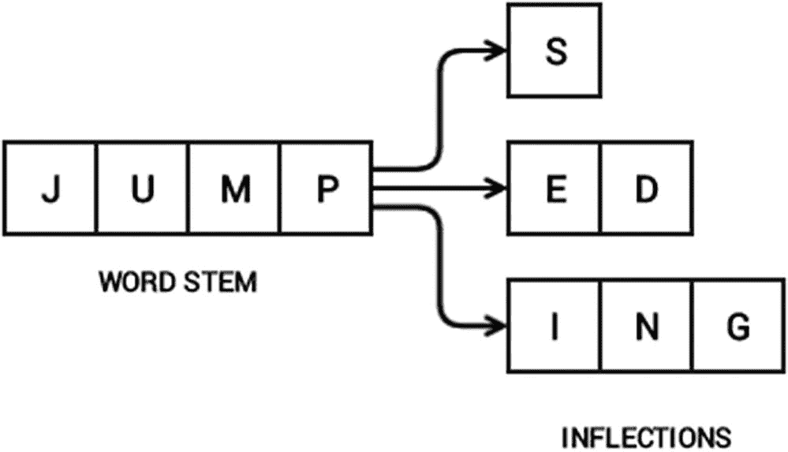

图 3-2

词干与屈折变化形式

图 3-2 展示了词干如何存在于其所有屈折变化形式中，因为它是每个屈折变化形式通过词缀构建的基础。词干提取帮助我们标准化单词，使其回归基本词干，而无论其屈折变化形式如何，这有助于许多应用，例如文本分类或聚类，甚至是信息检索。搜索引擎广泛使用此类技术来提供更准确的结果，无论单词形式如何。NLTK 包有几种词干提取器的实现。这些词干提取器在 `stem` 模块中实现，该模块继承了 `nltk.stem.api` 模块中的 `StemmerI` 接口。你甚至可以使用这个类（严格来说是接口）作为基类来创建你自己的词干提取器。最流行的词干提取器之一是 Porter 词干提取器，它基于其发明者 Martin Porter 开发的算法。最初，该算法据说有总共五个不同的阶段来将屈折变化形式还原为词干，每个阶段都有一套自己的规则。还存在一个 Porter2 算法，这是 Dr. Martin Porter 提出了一些改进后的原始词干提取算法。你可以在以下代码片段中看到 Porter 词干提取器的实际应用。

```
# Porter 词干提取器
In [458]: from nltk.stem import PorterStemmer
...: ps = PorterStemmer()
...: ps.stem('jumping'), ps.stem('jumps'), ps.stem('jumped')
(jump, jump, jump)
In [460]: ps.stem('lying')
'lie'
In [461]: ps.stem('strange')
'strang'
```

Lancaster 词干提取器基于 Lancaster 词干提取算法，通常也被称为 Paice/Husk 词干提取器，由 Chris D. Paice 发明。这个词干提取器是一个迭代式词干提取器，拥有超过 120 条规则，这些规则指定了特定的词缀移除或替换方式，以获取词干。以下代码片段展示了 Lancaster 词干提取器的实际应用。

```
# Lancaster 词干提取器
In [465]: from nltk.stem import LancasterStemmer
...: ls = LancasterStemmer()
...:  print ls.stem('jumping'), ls.stem('jumps'), ls.stem('jumped')
(jump, jump, jump)
In [467]: ls.stem('lying')
'lying'
In [468]: ls.stem('strange')
'strange'
```

你可以看到，这个词干提取器的行为与之前的 Porter 词干提取器不同。除了这两者之外，还有其他几种词干提取器，包括 `RegexpStemmer`（你可以基于用户定义的规则构建自己的词干提取器）和 `SnowballStemmer`（除英语外，还支持 13 种不同语言的词干提取）。以下代码片段展示了使用它们进行词干提取的一些方法。`RegexpStemmer` 使用正则表达式来识别单词中的形态学词缀，并移除匹配到的任何字符串部分。

```
# 基于正则表达式的词干提取器
In [471]: from nltk.stem import RegexpStemmer
...: rs = RegexpStemmer('ing$|s$|ed$', min=4)
...:  rs.stem('jumping'), rs.stem('jumps'), rs.stem('jumped')
(jump, jump, jump)
In [473]: rs.stem('lying')
'ly'
In [474]: rs.stem('strange')
'strange'
```

你可以看到词干提取结果与之前的词干提取器有何不同，它完全基于我们基于正则表达式自定义的规则。以下代码片段展示了我们如何使用 `SnowballStemmer` 对其他语言的单词进行词干提取。你可以在 [`http://snowballstem.org/`](http://snowballstem.org/) 找到关于 Snowball 项目的更多详细信息。

```
# Snowball 词干提取器
In [486]: from nltk.stem import SnowballStemmer
...: ss = SnowballStemmer("german")
...: print('Supported Languages:', SnowballStemmer.languages)
Supported Languages: (u'danish', u'dutch', u'english', u'finnish', u'french', u'german', u'hungarian', u'italian', u'norwegian', u'porter', u'portuguese', u'romanian', u'russian', u'spanish', u'swedish')
# 对德语单词进行词干提取
# autobahnen -> 汽车（复数）
# autobahn -> 汽车（单数）
In [488]: ss.stem('autobahnen')
'autobahn'
# springen -> 跳跃（现在分词形式）
# spring -> 跳跃（基本形式）
In [489]: ss.stem('springen')
'spring'
```

Porter 词干提取器使用最频繁，但你应该根据你的问题并通过反复试验来选择词干提取器。以下是一个可用于文本词干提取的基本函数。

```
def simple_stemmer(text):
ps = nltk.porter.PorterStemmer()
text = ' '.join([ps.stem(word) for word in text.split()])
return text
simple_stemmer("My system keeps crashing his crashed yesterday, ours crashes daily")
'My system keep crash hi crash yesterday, our crash daili'
```

请随意利用这个函数来满足你自己的词干提取需求。此外，如果需要，你甚至可以根据自己定义的规则构建自己的词干提取器！


### 词形还原

词形还原的过程与词干提取非常相似，都是去除单词词缀以得到单词的基本形式。但在此过程中，这种基本形式也被称为*词根*，而非词干。二者的区别在于，词干可能不总是词典学上正确的单词，即它可能不在字典中；而词根，也称为词元（lemma），则始终会出现在字典中。

词形还原过程比词干提取慢得多，因为其中包含一个额外步骤：只有当词元存在于字典中时，才会通过去除单词词缀来形成词根形式或词元。NLTK 包拥有一个强大的词形还原模块，它利用 WordNet 以及单词的句法和语义（如词性和上下文）来获取词根或词元。还记得第 1 章中我们讨论词性的时候吗？自然语言中出现频率最高的三种实体是名词、动词和形容词。以下代码片段展示了如何对属于这些类型的单词使用词形还原。

```
In [514]: from nltk.stem import WordNetLemmatizer
...: wnl = WordNetLemmatizer()
# 对名词进行词形还原
In [515]: print(wnl.lemmatize('cars', 'n'))
...: print(wnl.lemmatize('men', 'n'))
car
men
# 对动词进行词形还原
In [516]: print(wnl.lemmatize('running', 'v'))
...: print(wnl.lemmatize('ate', 'v'))
run
eat
# 对形容词进行词形还原
In [517]: print(wnl.lemmatize('saddest', 'a'))
...: print(wnl.lemmatize('fancier', 'a'))
sad
fancy
```

这段代码展示了如何使用词形还原将每个单词转换为其基本形式，这有助于我们统一词汇。该代码利用了 `WordNetLemmatizer` 类，该类内部使用了属于 `WordNetCorpusReader` 类的 `morphy()` 函数。此函数基本通过检查 WordNet 语料库，利用单词及其词性找到给定单词的基本形式或词元，并采用递归技术去除单词的词缀，直到在 WordNet 中找到匹配项。如果找不到匹配项，则原样返回输入的单词。词性极其重要，因为如果词性错误，词形还原将失效，如下方代码片段所示。

```
# 无效的词形还原
In [518]: print wnl.lemmatize('ate', 'n')
...: print wnl.lemmatize('fancier', 'v')
ate
fancier
```

SpaCy 则让事情变得简单得多，因为它会自动对文本文档中的每个词元进行词性标注和有效的词形还原，无需担心是否能有效使用词形还原。借助 spaCy，我们可以使用以下函数执行有效的词形还原！

```
import spacy
nlp = spacy.load('en_core', parse=True, tag=True, entity=True)
text = 'My system keeps crashing his crashed yesterday, ours crashes daily'
def lemmatize_text(text):
text = nlp(text)
text = ' '.join([word.lemma_ if word.lemma_ != '-PRON-' else word.text for word in text])
return text
lemmatize_text("My system keeps crashing! his crashed yesterday, ours crashes daily")
'My system keep crash ! his crash yesterday , ours crash daily'
```

你可以利用 NLTK 或 spaCy 构建自己的词形还原器。请随意使用你自己的数据对这些函数进行试验。

### 去除停用词

`停用词` 是指那些意义很小或没有意义的词，在处理文本时通常被移除，以便保留具有最大意义和上下文信息的词。如果根据单一词元聚合文本语料库并检查其频率，停用词通常出现得最为频繁。像 "a"、"the"、"and" 等词都属于停用词。停用词没有通用或详尽的列表，通常每个领域或语言都有自己的停用词集合。我们在以下代码片段中展示了一种过滤并去除英文停用词的方法。

```
from nltk.tokenize.toktok import ToktokTokenizer
tokenizer = ToktokTokenizer()
stopword_list = nltk.corpus.stopwords.words('english')
def remove_stopwords(text, is_lower_case=False):
tokens = tokenizer.tokenize(text)
tokens = [token.strip() for token in tokens]
if is_lower_case:
filtered_tokens = [token for token in tokens if token not in stopword_list]
else:
filtered_tokens = [token for token in tokens if token.lower() not in stopword_list]
filtered_text = ' '.join(filtered_tokens)
return filtered_text
remove_stopwords("The, and, if are stopwords, computer is not")
', , stopwords , computer'
```

没有通用的停用词列表，但我们使用了来自 NLTK 的标准英文停用词列表。你也可以根据需要添加自己领域特定的停用词。在上一个函数中，我们利用了 NLTK 提供的英文停用词列表，并据此过滤掉所有属于停用词的词元。输出结果显示，与之前相比，词元数量有所减少，你可以对比并检查被作为停用词移除的词元。要查看 NLTK 词汇表中的所有英文停用词列表，可以打印 `nltk.corpus.stopwords.words('english')` 的内容以了解各种停用词。需要记住的重要一点是，像 "not" 和 "no" 这样的否定词在此例中（第一句中）会被移除，而在诸如情感分析等应用中，保留这些词对于保持句子原意至关重要。因此，在这些场景下，你需要确保不要移除这些词。


### 融会贯通：构建文本规范化器

现在，我们将学到的所有知识整合起来，串联这些操作，构建一个文本规范化器，用于预处理文本数据。我们专注于在自定义函数中包含文本处理中常用的主要组件。

```
def normalize_corpus(corpus, html_stripping=True, contraction_expansion=True,
accented_char_removal=True, text_lower_case=True,
text_lemmatization=True, special_char_removal=True,
stopword_removal=True, remove_digits=True):
normalized_corpus = []
# 对语料库中的每个文档进行规范化
for doc in corpus:
# 去除 HTML 标签
if html_stripping:
doc = strip_html_tags(doc)
# 去除重音字符
if accented_char_removal:
doc = remove_accented_chars(doc)
# 展开缩写
if contraction_expansion:
doc = expand_contractions(doc)
# 转换为小写
if text_lower_case:
doc = doc.lower()
# 去除多余换行符
doc = re.sub(r'[\r|\n|\r\n]+', ' ',doc)
### 词形还原
if text_lemmatization:
doc = lemmatize_text(doc)
# 去除特殊字符和/或数字
if special_char_removal:
# 在特殊字符之间插入空格以隔离它们
special_char_pattern = re.compile(r'([{.(-)!}])')
doc = special_char_pattern.sub(" \\1 ", doc)
doc = remove_special_characters(doc, remove_digits=remove_digits)
# 去除多余空格
doc = re.sub(' +', ' ', doc)
### 去除停用词
if stopword_removal:
doc = remove_stopwords(doc, is_lower_case=text_lower_case)
normalized_corpus.append(doc)
return normalized_corpus
```

现在，让我们来实际运用这个函数！我们将使用之前章节中的示例文本作为输入文档，并通过上述函数对其进行预处理。

```
{'Original': sample_text,
'Processed': normalize_corpus([sample_text])[0]}
{'Original': "US unveils world's most powerful supercomputer, beats China. The US has unveiled the world's most powerful supercomputer called 'Summit', beating the previous record-holder China's Sunway TaihuLight. With a peak performance of 200,000 trillion calculations per second, it is over twice as fast as Sunway TaihuLight, which is capable of 93,000 trillion calculations per second. Summit has 4,608 servers, which reportedly take up the size of two tennis courts.",
'Processed': 'us unveil world powerful supercomputer beat china us unveil world powerful supercomputer call summit beat previous record holder chinas sunway taihulight peak performance trillion calculation per second twice fast sunway taihulight capable trillion calculation per second summit server reportedly take size two tennis court'}
```

由此可见，我们的文本预处理器是如何帮助预处理示例新闻文章的！在下一节中，我们将探讨如何分析和理解文本数据的句法属性与结构。

## 理解文本句法与结构

我们在第 1 章中详细讨论了语言句法和结构。如果你不记得基础知识，请前往第 1 章中“语言句法与结构”一节，快速浏览以了解分析和理解文本数据句法与结构的各种方法。为了唤起你的记忆，让我们简要回顾一下文本句法和结构的重要性。

对于任何语言而言，句法和结构通常密不可分，它们由一组特定的规则、惯例和原则构成，决定了词语如何组合成短语、短语如何组合成从句、从句如何组合成句子。本节将专门讨论英语的句法和结构。在英语中，词语通常组合成其他构成单位。这些构成单位包括词语、短语、从句和句子。句子“The brown fox is quick and he is jumping over the lazy dog”由一组词语组成。仅看这些词语本身，我们获取的信息非常有限（参见图 3-3）。

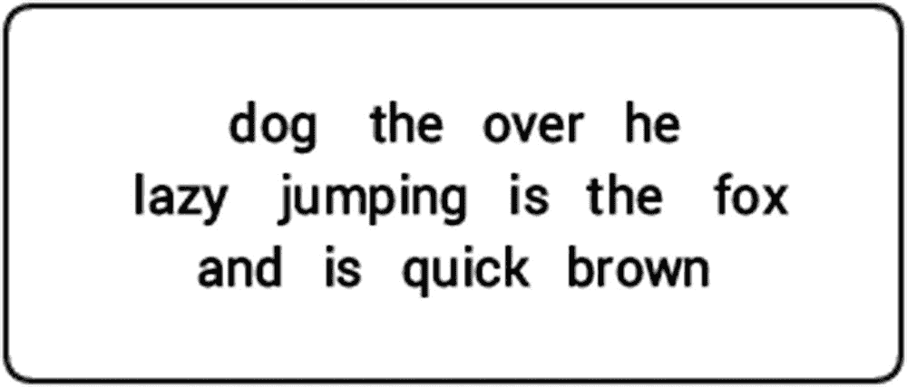

**图 3-3** 一组无序的词语无法传达太多信息

关于语言结构和句法的知识在文本处理、标注和解析等多个领域非常有用，可用于诸如文本分类或摘要等后续操作。在本节中，我们将实现一些用于理解文本句法和结构的概念与技术。这在自然语言处理中极为重要，通常在文本处理与整理之后进行。我们将重点实现以下技术：

- 词性标注
- 浅层解析或组块分析
- 依存句法分析
- 成分句法分析

本书面向实践者，强调并专注于在现实问题中实施和使用技术与算法的最佳方法。因此，在接下来的章节中，我们将探讨如何最佳地利用如`NLTK`和`spaCy`等库来实现其中一些技术。此外，鉴于你可能对内部原理以及自行实现这些技术感兴趣，我们也会介绍实现方法。在深入细节之前，我们先了解所需库的依赖关系和安装细节，因为其中一些库的安装并不十分简单。


### 安装必要的依赖

我们将利用多个库和依赖：

- `nltk` 库
- `spacy` 库
- Stanford Parser
- Graphviz 及用于可视化的必要库

我们在第 1 章中简要介绍了安装 NLTK。你可以直接打开终端或命令提示符，输入 `pip install nltk` 来下载并安装它。请务必安装版本不低于 3.2.4 的库。下载并安装 NLTK 后，记得下载语料库，我们在第 1 章中也讨论过这一点。关于下载和安装 NLTK 的更多详细信息，你可以参考 [`http://www.nltk.org/install.html`](http://www.nltk.org/install.html) 和 [`http://www.nltk.org/data.html`](http://www.nltk.org/data.html) 上的信息，其中说明了如何安装数据依赖。启动 Python 解释器并使用以下代码片段。

```
import nltk
# 下载所有依赖和语料库
nltk.download('all', halt_on_error=False)
# 或者使用基于 GUI 的下载器并选择依赖
nltk.download()
```

要安装 spaCy，请在终端中输入 `pip install spacy` 或 `conda install spacy`。安装完成后，使用命令 `python -m spacy.en.download` 从终端下载英文语言模型，该命令将在 spaCy 包的目录中下载约 500MB 的数据。更多详情，请参考链接 [`https://spacy.io/docs/#getting-started`](https://spacy.io/docs/#getting-started)，其中介绍了如何开始使用 spaCy。我们将使用 spaCy 进行标记和基于依赖关系的句法分析。但是，如果加载 spaCy 语言模型时遇到问题，请按照此处强调的步骤来解决。我曾在某台电脑上遇到过此问题，但并非始终出现。

```
# 可选：仅在 SPACY 无法加载语言模型时使用
# 使用以下命令安装 spaCy
> pip install -U spacy
或者
> conda install -c conda-forge spacy
# 下载以下语言模型并存储在磁盘中
https://github.com/explosion/spacy-models/releases/tag/en_core_web_md-2.0.0
# 将其链接到 spaCy
> python -m spacy link ./spacymodels/en_core_web_md-2.0.0/en_core_web_md en_core Linking successful
./spacymodels/en_core_web_md-2.0.0/en_core_web_md --> ./Anaconda3/lib/site-packages/spacy/data/en_core
你现在可以通过 spacy.load('en_core') 加载该模型
```

Stanford Parser 是斯坦福大学开发的一款基于 Java 的语言解析器实现，它有助于解析句子以理解其底层结构。我们将使用 Stanford Parser 和 NLTK 进行基于依存语法和短语结构语法的解析，NLTK 提供了一个出色的封装器，使我们能够从 Python 中直接使用该解析器，而无需编写 Java 代码。你可以参考 [`https://github.com/nltk/nltk/wiki/Installing-Third-Party-Software`](https://github.com/nltk/nltk/wiki/Installing-Third-Party-Software) 上的官方安装指南，其中说明了如何下载和安装 Stanford Parser 并将其与 NLTK 集成。我个人曾遇到过一些问题，尤其是在 Windows 系统中；因此，我将提供一种广为人知的安装 Stanford Parser 及其必要依赖的方法。

首先，请确保你已通过访问 [`http://www.oracle.com/technetwork/java/javase/downloads/index.html?ssSourceSiteId=otnjp`](http://www.oracle.com/technetwork/java/javase/downloads/index.html?ssSourceSiteId=otnjp) 下载并安装了 Java Development Kit（不仅仅是 JRE，即 Java 运行时环境）。使用通常为 Java SE `8u101` / `8u102` 或更高版本的任何版本。我使用的是 `8u102`，因为我已经有一段时间没有升级 Java 了。安装完成后，确保已通过将 Java 添加到 `path` 系统环境变量中来设置其路径。你也可以创建一个指向 JDK 的 `java.exe` 文件的 `JAVA_HOME` 环境变量。

根据我的经验，在从 Python 运行代码时，这两种方法对我都不起作用，我不得不显式使用 Python 的 `os` 库来设置环境变量，这在之后深入探讨实现细节时会展示。安装 Java 后，从 [`http://nlp.stanford.edu/software/stanford-parser-full-2015-04-20.zip`](http://nlp.stanford.edu/software/stanford-parser-full-2015-04-20.zip) 下载官方 Stanford Parser，该版本运行良好。你可以通过访问 [`http://nlp.stanford.edu/software/lex-parser.shtml#Download`](http://nlp.stanford.edu/software/lex-parser.shtml#Download) 并查看“发布历史”部分来尝试更新的版本。下载后，将其解压缩到文件系统中的已知位置。完成后，你就可以使用 NLTK 中的解析器了，我们很快就会探索这一点！

Graphviz 并非必需，我们仅用它来查看由 Stanford Parser 生成的依存句法树。你可以从 Graphviz 的官方网站 [`http://www.graphviz.org/Download_windows.php`](http://www.graphviz.org/Download_windows.php) 下载并安装它。接下来，你需要安装 `pygraphviz`，你可以根据你的系统架构和 Python 版本从 [`http://www.lfd.uci.edu/~gohlke/pythonlibs/#pygraphviz`](http://www.lfd.uci.edu/%257Egohlke/pythonlibs/#pygraphviz) 下载 wheel 文件来获取它。然后，对于运行 Python 3.x 的 64 位系统，使用命令 `pip install pygraphviz-1.3.1-cp34-none-win_amd64.whl` 进行安装。安装完成后，`pygraphviz` 即可工作。有些人报告遇到了额外的问题，你可能需要按照相同的顺序，在终端中使用以下代码片段安装 `pydot-ng` 和 `graphviz`。

```
pip install pydot-ng
pip install graphviz
```

我们还利用 NLTK 的绘图功能在 Jupyter Notebook 中可视化句法树。要启用此功能，如果 NLTK 抛出错误，你可能需要安装 [`ghostscript`](https://www.ghostscript.com/download/gsdnld.html)。安装和设置说明如下所示。

```
## 从 https://www.ghostscript.com/download/gsdnld.html 下载并安装 ghostscript
# 通常需要手动添加到路径中（针对 Windows）
os.environ['PATH'] = os.environ['PATH']+";C:\\Program Files\\gs\\gs9.09\\bin\\"
```

至此，我们已经完成了必要依赖的安装，可以开始实现并查看实际示例了。但我们还不能马上开始。在深入代码和示例之前，我们需要了解一些机器学习的基本概念。


### 重要的机器学习概念

在接下来的部分，我们将利用语料库并借助现有标注工具，来构建和训练一些我们自己的标注器。有一些与分析和机器学习相关的重要概念，你必须了解它们才能更清晰地理解这些实现过程。

- **数据准备：** 通常包括在提取特征和训练之前对数据进行预处理。
- **特征提取：** 从原始数据中提取有用特征的过程，这些特征用于训练机器学习模型。
- **特征：** 数据的各种有用属性（例如，对于个人数据，可以是年龄、体重等）。
- **训练数据：** 用于训练模型的一组数据点。
- **测试/验证数据：** 用于测试和评估预训练模型性能的一组数据点。
- **模型：** 通过结合数据/特征与机器学习算法（可以是监督式或非监督式）构建而成。
- **准确率：** 模型预测结果的好坏程度（还有其他详细的评估指标，如精确率、召回率和 `F1-score`）。

这些术语足够让你入门。深入细节超出了当前的范围；不过，如果你有兴趣进一步探索，可以在网上找到大量关于机器学习的资源。如果你希望通过动手实践的方式学习机器学习，我们推荐阅读*《Python 机器学习实战》*（Apress 2018 年出版）。此外，我们将在后续章节中介绍与文本数据相关的监督式和非监督式学习。

### 词性标注

词性（POS）是指根据单词的句法上下文和作用分配给它们的特定词汇类别。如果你还记得第 1 章的内容，我们曾介绍过一些词性的基础知识，提到了主要的词性包括名词、动词、形容词和副词。对单词进行分类并标注词性标签的过程被称为词性标注（POS tagging）。

词性标签用于注解单词并描述其词性，这在后续基于 NLP 的应用中需要使用相同注解文本时非常有用，因为我们可以按特定词性进行筛选，并利用这些信息执行特定的分析。我们可以缩小名词范围，并确定哪些名词最为突出。以我们之前的例句“The brown fox is quick and he is jumping over the lazy dog”为例，如果我们使用基本词性标签对其进行注解，结果将如图 3-4 所示。

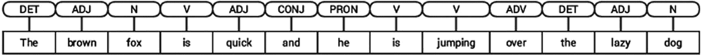

图 3-4

句子的词性标注

因此，一个句子通常遵循由以下组成部分构成的层级结构：句子 → 从句 → 短语 → 单词。

我们将使用宾夕法尼亚树库（Penn Treebank）的标记法进行词性标注，大多数推荐的词性标注工具也采用这一标记法。你可以访问 [`http://www.cis.uni-muenchen.de/~schmid/tools/TreeTagger/data/Penn-Treebank-Tagset.pdf`](http://www.cis.uni-muenchen.de/%257Eschmid/tools/TreeTagger/data/Penn-Treebank-Tagset.pdf) 了解各种词性标签及其标记法的更多信息，该文档中提供了详细的说明，并用示例解释了每个标签。宾夕法尼亚树库项目是宾夕法尼亚大学的一部分，其网页位于 [`https://catalog.ldc.upenn.edu/docs/LDC95T7/treebank2.index.html`](https://catalog.ldc.upenn.edu/docs/LDC95T7/treebank2.index.html)，可提供有关该项目的更多信息。请记住，有各种不同的标签，例如分配给单词的词性标签（POS tags），通常分配给短语的组块标签（chunk tags），以及一些用于描述关系的次要标签。

如果你不想通读宾夕法尼亚树库标签的详细文档，表 3-1 提供了不同标签的详细概述及其示例。你可以随时将其作为参考，以便更好地理解词性标签和解析树。

表 3-1

词性标签

| 序号 | **标签** | 描述 | **示例** |
| --- | --- | --- | --- |
| 1 | `CC` | 并列连词 | and, or |
| 2 | `CD` | 基数词 | five, one, 2 |
| 3 | `DT` | 限定词 | a, the |
| 4 | `EX` | 存在性 *there* | there were two cars |
| 5 | `FW` | 外来词 | d'hoevre, mais |
| 6 | `IN` | 介词/从属连词 | of, in, on, that |
| 7 | `JJ` | 形容词 | quick, lazy |
| 8 | `JJR` | 形容词，比较级 | quicker, lazier |
| 9 | `JJS` | 形容词，最高级 | quickest, laziest |
| 10 | `LS` | 列表项标记 | 2) |
| 11 | `MD` | 动词，情态 | could, should |
| 12 | `NN` | 名词，单数或集合名词 | fox, dog |
| 13 | `NNS` | 名词，复数 | foxes, dogs |
| 14 | `NNP` | 名词，专有单数 | John, Alice |
| 15 | `NNPS` | 名词，专有复数 | Vikings, Indians, Germans |
| 16 | `PDT` | 前位限定词 | both cats |
| 17 | `POS` | 所有格结尾 | boss's |
| 18 | `PRP` | 代词，人称 | me, you |
| 19 | `PRP$` | 代词，所有格 | our, my, your |
| 20 | `RB` | 副词 | naturally, extremely, hardly |
| 21 | `RBR` | 副词，比较级 | better |
| 22 | `RBS` | 副词，最高级 | best |
| 23 | `RP` | 副词，小品词 | about, up |
| 24 | `SYM` | 符号 | %, $ |
| 25 | `TO` | 不定式 to | how to, what to do |
| 26 | `UH` | 感叹词 | oh, gosh, wow |
| 27 | `VB` | 动词，原形 | run, give |
| 28 | `VBD` | 动词，过去式 | ran, gave |
| 29 | `VBG` | 动词，动名词/现在分词 | running, giving |
| 30 | `VBN` | 动词，过去分词 | given |
| 31 | `VBP` | 动词，非第三人称单数现在时 | I think, I take |
| 32 | `VBZ` | 动词，第三人称单数现在时 | he thinks, he takes |
| 33 | `WDT` | Wh-限定词 | which, whatever |
| 34 | `WP` | Wh-代词，人称 | who, what |
| 35 | `WP$` | Wh-代词，所有格 | whose |
| 36 | `WRB` | Wh-副词 | where, when |
| 37 | `NP` | 名词短语 | the brown fox |
| 38 | `PP` | 介词短语 | in between, over the dog |
| 39 | `VP` | 动词短语 | was jumping |
| 40 | `ADJP` | 形容词短语 | warm and snug |
| 41 | `ADVP` | 副词短语 | also |
| 42 | `SBAR` | 从属连词 | whether or not |
| 43 | `PRT` | 小品词 | up |
| 44 | `INTJ` | 感叹词 | hello |
| 45 | `PNP` | 介词性名词短语 | over the dog, as of today |
| 46 | `-SBJ` | 句子主语 | the fox jumped over the dog |
| 47 | `-OBJ` | 句子宾语 | the fox jumped over the dog |

该表格展示了宾夕法尼亚树库中使用的主要词性标签集，这也是各种文本分析和 NLP 应用中使用最广泛的词性标签集。在接下来的章节中，我们将探讨一些词性标注的实践实现方法。


### 构建词性标注器

我们将利用 NLTK 和 spaCy，它们均使用 [*宾州树库标注集*](http://www.cis.uni-muenchen.de/~schmid/tools/TreeTagger/data/Penn-Treebank-Tagset.pdf) 进行词性标注。为了演示工作原理，我们将使用前几节示例新闻文章中的一个新闻标题。让我们看看如何使用 spaCy 实现词性标注。见图 3-5。

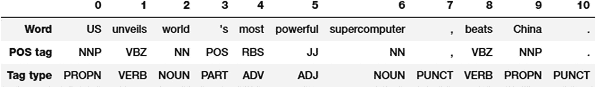

图 3-5 — 使用 spaCy 对新闻标题进行词性标注

```
sentence = "US unveils world's most powerful supercomputer, beats China."
import pandas as pd
import spacy
nlp = spacy.load('en_core', parse=True, tag=True, entity=True)
sentence_nlp = nlp(sentence)
# POS tagging with Spacy
spacy_pos_tagged = [(word, word.tag_, word.pos_) for word in sentence_nlp]
pd.DataFrame(spacy_pos_tagged, columns=['Word', 'POS tag', 'Tag type']).T
```

因此，我们可以在图 3-5 中清晰地看到，示例新闻标题中每个标记的词性标注（由 spaCy 定义）完全合乎逻辑。让我们尝试使用 NLTK 完成相同的任务（见图 3-6）。

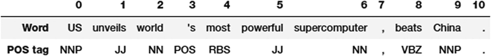

图 3-6 — 使用 NLTK 对新闻标题进行词性标注

```
# POS tagging with nltk
import nltk
nltk_pos_tagged = nltk.pos_tag(nltk.word_tokenize(sentence))
pd.DataFrame(nltk_pos_tagged, columns=['Word', 'POS tag']).T
```

图 3-6 的输出提供了严格遵循宾州树库格式的标签，更详细地指定了形容词、名词或动词的具体形式。

现在，我们将探索一些构建自定义词性标注器的技巧！我们将利用 NLTK 提供的一些类。为了评估我们标注器的性能，我们将使用 NLTK 中 `treebank` 语料库的一些测试数据。我们还将使用一些训练数据来训练部分标注器。首先，我们需要通过读取已标注的 `treebank` 语料库，获取训练和评估标注器所需的数据。

```
from nltk.corpus import treebank
data = treebank.tagged_sents()
train_data = data[:3500]
test_data = data[3500:]
print(train_data[0])
[('Pierre', 'NNP'), ('Vinken', 'NNP'), (',', ','), ('61', 'CD'), ('years', 'NNS'), ('old', 'JJ'), (',', ','), ('will', 'MD'), ('join', 'VB'), ('the', 'DT'), ('board', 'NN'), ('as', 'IN'), ('a', 'DT'), ('nonexecutive', 'JJ'), ('director', 'NN'), ('Nov.', 'NNP'), ('29', 'CD'), ('.', '.')]
```

我们将使用测试数据来评估标注器，并通过使用示例句子的标记作为输入，观察它们在该句子上的表现。我们将从 NLTK 中使用的所有标注器都属于 `nltk.tag` 包。每个标注器都是基类 `TaggerI` 的子类，并且每个标注器都实现了一个 `tag()` 函数，该函数接收一个句子标记列表作为输入，并返回相同的单词列表及其词性标注作为输出。除了标注之外，还有一个 `evaluate()` 函数，用于评估标注器的性能。其做法是：对每个输入测试句子进行标注，然后将结果与句子的实际标签进行比较。我们将使用相同的函数来测试我们的标注器在 `test_data` 上的性能。

我们将首先了解 `DefaultTagger`，它继承自 `SequentialBackoffTagger` 基类，并为每个单词分配相同的用户输入词性标签。这看起来可能非常简单，但这是构建基准词性标注器并在此基础上进行改进的绝佳方法。

```
# default tagger
from nltk.tag import DefaultTagger
dt = DefaultTagger('NN')
# accuracy on test data
dt.evaluate(test_data)
0.1454158195372253
# tagging our sample headline
dt.tag(nltk.word_tokenize(sentence))
[('US', 'NN'), ('unveils', 'NN'), ('world', 'NN'), ("'s", 'NN'), ('most', 'NN'),
('powerful', 'NN'), ('supercomputer', 'NN'), (',', 'NN'), ('beats', 'NN'),
('China', 'NN'), ('.', 'NN')]
```

从该输出中可以看出，我们在正确标注 treebank 测试数据集的单词方面获得了 14% 的准确率，这并不高。我们示例句子的输出标签都是名词，正如我们所料，因为我们向标注器提供了相同的标签。现在我们将使用正则表达式和 `RegexpTagger`，看看是否能够构建一个性能更好的标注器。

```
# regex tagger
from nltk.tag import RegexpTagger
# define regex tag patterns
patterns = [
(r'.*ing$', 'VBG'),               # gerunds
(r'.*ed$', 'VBD'),                # simple past
(r'.*es$', 'VBZ'),                # 3rd singular present
(r'.*ould$', 'MD'),               # modals
(r'.*\'s$', 'NN$'),               # possessive nouns
(r'.*s$', 'NNS'),                 # plural nouns
(r'^-?[0-9]+(.[0-9]+)?$', 'CD'),  # cardinal numbers
(r'.*', 'NN')                     # nouns (default) ...
]
rt = RegexpTagger(patterns)
# accuracy on test data
rt.evaluate(test_data)
0.24039113176493368
# tagging our sample headline
rt.tag(nltk.word_tokenize(sentence))
[('US', 'NN'), ('unveils', 'NNS'), ('world', 'NN'), ("'s", 'NN$'), ('most', 'NN'),
('powerful', 'NN'), ('supercomputer', 'NN'), (',', 'NN'), ('beats', 'NNS'),
('China', 'NN'), ('.', 'NN')]
```

此输出显示准确率已提升至 24%，但我们能否做得更好？现在我们将训练一些 n-gram 标注器。如果你还不知道，n-gram 是指来自文本或语音序列中连续的 **n** 个项目序列。这些项目可以包含单词、音素、字母、字符或音节。Shingles 是指项目仅包含单词的 n-gram。我们将使用大小为 1、2 和 3 的 n-gram，它们分别被称为一元模型（unigram）、二元模型（bigram）和三元模型（trigram）。`UnigramTagger`、`BigramTagger` 和 `TrigramTagger` 类继承自基类 `NGramTagger`，而 `NGramTagger` 本身继承自 `ContextTagger` 类，`ContextTagger` 又继承自 `SequentialBackoffTagger` 类。我们将使用 `train_data` 作为训练数据，基于句子标记及其词性标注来训练 n-gram 标注器。然后，我们将在 `test_data` 上评估训练好的标注器，并查看它们在标注示例句子时的结果。

```
## N gram taggers
from nltk.tag import UnigramTagger
from nltk.tag import BigramTagger
from nltk.tag import TrigramTagger
ut = UnigramTagger(train_data)
bt = BigramTagger(train_data)
tt = TrigramTagger(train_data)
# testing performance of unigram tagger
print(ut.evaluate(test_data))
print(ut.tag(nltk.word_tokenize(sentence)))
0.8619421047536063
[('US', 'NNP'), ('unveils', None), ('world', 'NN'), ("'s", 'POS'), ('most', 'JJS'), ('powerful', 'JJ'), ('supercomputer', 'NN'), (',', ','), ('beats', None), ('China', 'NNP'), ('.', '.')]
# testing performance of bigram tagger
print(bt.evaluate(test_data))
print(bt.tag(nltk.word_tokenize(sentence)))
0.1359279697937845
[('US', None), ('unveils', None), ('world', None), ("'s", None), ('most', None), ('powerful', None), ('supercomputer', None), (',', None), ('beats', None), ('China', None), ('.', None)]
# testing performance of trigram tagger
print(tt.evaluate(test_data))
print(tt.tag(nltk.word_tokenize(sentence)))
0.08142124116565011
[('US', None), ('unveils', None), ('world', None), ("'s", None), ('most', None), ('powerful', None), ('supercomputer', None), (',', None), ('beats', None), ('China', None), ('.', None)]
```


这个输出清晰地表明，仅使用一元标注器，我们在测试集上就获得了 86% 的准确率，与我们上一个标注器相比，这个结果非常出色。`None` 标签表示标注器无法标注该单词，其原因是它无法在训练数据中找到相似的词元。二元和三元模型的准确率要低得多，因为训练数据中观察到的相同的二元和三元组，在测试数据中并不总是以相同的方式出现。

现在我们来看一种通过创建一个包含标注器列表的组合标注器并结合所有标注器的方法，并使用一个回退标注器。本质上，我们会创建一个标注器链，如果某个标注器无法标注输入的词元，它就会回退到下一个标注器。

```
def combined_tagger(train_data, taggers, backoff=None):
for tagger in taggers:
backoff = tagger(train_data, backoff=backoff)
return backoff
ct = combined_tagger(train_data=train_data,
taggers=[UnigramTagger, BigramTagger, TrigramTagger],
backoff=rt)
# 评估带有回退标注器的新组合标注器
print(ct.evaluate(test_data))
print(ct.tag(nltk.word_tokenize(sentence)))
0.9108335753703166
[('US', 'NNP'), ('unveils', 'NNS'), ('world', 'NN'), ("'s", 'POS'), ('most', 'JJS'), ('powerful', 'JJ'), ('supercomputer', 'NN'), (',', ','), ('beats', 'NNS'), ('China', 'NNP'), ('.', '.')]
```

现在我们在测试数据上获得了 91% 的准确率，这非常棒。此外，我们看到这个新的标注器能够成功标注我们示例句子中的所有词元（尽管其中几个不正确，比如 `beats` 应该是一个动词）。

对于我们的最终标注器，我们将使用有监督分类算法来训练它。`ClassifierBasedPOSTagger` 类使我们能够通过 `classifier_builder` 参数使用有监督学习算法来训练标注器。该类继承自 `ClassifierBasedTagger`，并拥有一个 `feature_detector()` 函数，该函数构成了训练过程的核心。这个函数用于从训练数据中生成各种特征，例如单词、前一个单词、标签、前一个标签、大小写等等。事实上，你甚至可以构建自己的特征检测器函数，并在实例化 `ClassifierBasedPOSTagger` 类的对象时，将其传递给 `feature_detector` 参数。

我们将要使用的分类器是 `NaiveBayesClassifier`。它利用贝叶斯定理构建了一个概率分类器，并假设特征之间是独立的。你可以在 [`https://en.wikipedia.org/wiki/Naive_Bayes_classifier`](https://en.wikipedia.org/wiki/Naive_Bayes_classifier) 了解更多相关信息，因为深入探讨该算法的细节超出了我们当前的范围。以下代码片段展示了一种基于分类的方法来构建和评估词性标注器。

```
from nltk.classify import NaiveBayesClassifier, MaxentClassifier
from nltk.tag.sequential import ClassifierBasedPOSTagger
nbt = ClassifierBasedPOSTagger(train=train_data,
classifier_builder=NaiveBayesClassifier.train)
# 在测试数据和示例句子上评估标注器
print(nbt.evaluate(test_data))
print(nbt.tag(nltk.word_tokenize(sentence)))
0.9306806079969019
[('US', 'PRP'), ('unveils', 'VBZ'), ('world', 'VBN'), ("'s", 'POS'), ('most', 'JJS'), ('powerful', 'JJ'), ('supercomputer', 'NN'), (',', ','), ('beats', 'VBZ'), ('China', 'NNP'), ('.', '.')]
```

使用这个标注器，我们在测试数据上获得了 93% 的准确率，这是我们所有标注器中最高的。此外，如果你观察示例句子的输出标签，你会发现它们是正确的，并且完全合乎逻辑。这让我们了解到基于分类器的词性标注器可以多么强大和有效！你可以随意使用像 `MaxentClassifier` 这样的不同分类器，并与这个标注器的性能进行比较。我们在笔记本中包含了代码，以便操作更简单。

使用 NLTK 和其他包，还有许多其他方法来构建和使用词性标注器。尽管并非必需，并且这些内容应该足以满足你的词性标注需求，但你也可以继续探索其他方法，与这些方法进行比较，以满足你的好奇心。

## 浅层解析或组块分析

*浅层解析*，也称为*轻量解析*或*组块分析*，是一种分析句子结构的技术，旨在将句子分解成最小的组成部分（如单词等词元），并将它们组合成更高级别的短语。在浅层解析中，重点更多地放在识别这些短语或组块上，而不是深入探讨每个组块内部的语法结构和关系，就像我们在通过深层解析获得的基于语法的解析树中看到的那样。浅层解析的主要目标是获取具有语义意义的短语，并观察它们之间的关系。

你可以查看第 1 章的“语言语法和结构”部分，以重新了解单词和短语如何为包含一组单词的句子构建结构。基于我们之前描述的层次结构，单词组构成了短语。短语有五大主要类别：

- **名词短语（NP）：** 这些短语中，名词作为中心词。名词短语充当动词的主语或宾语。

- **动词短语（VP）：** 这些短语是词汇单元，其中动词作为中心词。通常，动词短语有两种形式。一种形式包含动词成分以及作为宾语一部分的其他实体，如名词、形容词或副词。

- **形容词短语（ADJP）：** 这些短语以形容词作为中心词。它们的主要作用是描述或限定句子中的名词和代词，并且它们会放在名词或代词的前面或后面。

- **副词短语（ADVP）：** 这些短语的作用类似于副词，因为副词在其中作为中心词。副词短语用作名词、动词或副词的修饰语，提供进一步描述或限定它们的细节。

- **介词短语（PP）：** 这些短语通常包含一个介词作为中心词，以及其他词汇成分，如名词、代词等。它们的作用类似于形容词或副词，用于描述其他单词或短语。

图 3-7 展示了一个示例句子的浅层解析树，以帮助你重新回忆其结构。

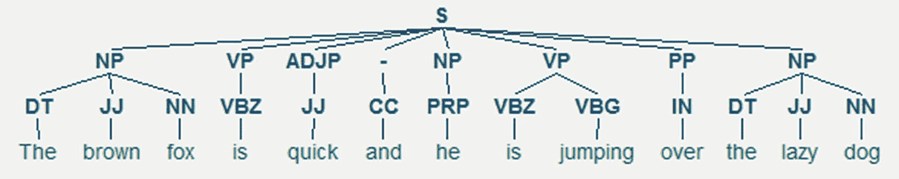

图 3-7

一个浅层解析的示例，展示了更高层次的短语标注

现在，我们将探讨如何利用多种技术对文本数据实施浅层解析，包括正则表达式、组块化、去组块化和基于标签的训练。


#### 构建浅层解析器

我们使用正则表达式和基于标注的学习者等多种技术来构建自己的浅层解析器。与词性标注类似，如果需要，我们会使用一些训练数据来训练解析器，并在一些测试数据和示例句子上评估所有解析器的性能。NLTK 中的`treebank`语料库包含组块标注。我们加载该语料库，然后使用以下代码片段准备训练和测试数据集。

```python
from nltk.corpus import treebank_chunk
data = treebank_chunk.chunked_sents()
train_data = data[:3500]
test_data = data[3500:]
# view sample data
print(train_data[7])
(S
(NP A/DT Lorillard/NNP spokewoman/NN)
said/VBD
,/,
``/``
(NP This/DT)
is/VBZ
(NP an/DT old/JJ story/NN)
./.)
```

从这个输出可以看出，我们的数据点是句子，并且已经用短语和词性标注元数据进行了标注，这些元数据在训练浅层解析器时非常有用。我们首先使用组块和去块的概念，通过正则表达式进行浅层解析。使用*组块*过程，我们可以指定特定的模式来识别我们想要在句子中组块或分割的内容，例如基于特定元数据的短语。*去块*是组块的逆过程，我们指定哪些特定的词元不希望成为任何组块的一部分，然后排除这些词元形成必要的组块。让我们考虑一个简单的句子（我们的新闻标题）并使用正则表达式。我们利用`RegexpParser`类来创建浅层解析器，以说明名词短语的组块和去块。

```python
from nltk.chunk import RegexpParser
# get POS tagged sentence
tagged_simple_sent = nltk.pos_tag(nltk.word_tokenize(sentence))
print('POS Tags:', tagged_simple_sent)
# illustrate NP chunking based on explicit chunk patterns
chunk_grammar = """
NP: {<DT|NN|NNP|JJ>*<NN>}
"""
rc = RegexpParser(chunk_grammar)
c = rc.parse(tagged_simple_sent)
# print and view chunked sentence using chunking
print(c)
c
(S
(NP US/NNP)
(NP unveils/JJ world/NN)
's/POS
most/RBS
(NP powerful/JJ supercomputer/NN)
,/,
beats/VBZ
(NP China/NNP)
./.)
```

我们可以看到浅层解析树在图 3-8 中的样子，它仅使用组块来识别名词短语。现在让我们看看如何使用去块来构建它。

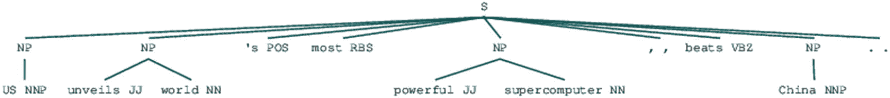

**图 3-8** – 使用组块的浅层解析

```python
# illustrate NP chunking based on explicit chink patterns
chink_grammar = """
NP:
{<.*>+}             # Chunk everything as NP
}<VBD|VBZ|JJ|IN>+{  # Chink sequences of VBD\VBZ\JJ\IN
"""
rc = RegexpParser(chink_grammar)
c = rc.parse(tagged_simple_sent)
# print and view chunked sentence using chinking
print(c)
c
(S
(NP US/NNP)
unveils/JJ
(NP world/NN 's/POS most/RBS)
powerful/JJ
(NP supercomputer/NN ,/,)
beats/VBZ
(NP China/NNP ./.))
```

我们可以看到浅层解析树在图 3-9 中的样子，动词和形容词形成了去块区域，并将名词短语分隔开来。请记住，*组块*是包含在一个集体组（块）中的词元序列，而*去块*是从组块中排除的词元或词元序列。现在我们将训练一个更通用的基于正则表达式的浅层解析器，并在我们的测试`treebank`数据上测试其性能。在内部执行此解析需要执行几个步骤。NLTK 中用于表示解析后句子的`Tree`结构会被转换为`ChunkString`对象。我们使用定义的组块和去块规则创建一个`RegexpParser`对象。`ChunkRule`和`ChinkRule`类的对象有助于基于指定的模式，使用必要的组块创建完整的浅层解析树。以下代码片段表示一个使用基于正则表达式模式的浅层解析器。

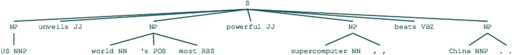

**图 3-9** – 使用去块的浅层解析

```python
# create a more generic shallow parser
grammar = """
NP: {<DT|NN|NNP|JJ>*<NN>}
ADJP: {<JJ|JJS|JJR>}
ADVP: {<RB|RBR|RBS>}
PP: {<IN>}
VP: {<MD|VB|VBD|VBG|VBN|VBZ|VBP>+}
"""
rc = RegexpParser(grammar)
c = rc.parse(tagged_simple_sent)
# print and view shallow parsed sample sentence
print(c)
c
(S
(NP US/NNP)
(NP unveils/JJ world/NN)
's/POS
(ADVP most/RBS)
(NP powerful/JJ supercomputer/NN)
,/,
(VP beats/VBZ)
(NP China/NNP)
./.)
```

我们可以看到浅层解析树在图 3-10 中的样子，它对特定短语使用了更具体的规则。让我们看看这个解析器在我们之前构建的测试数据集上的表现如何。

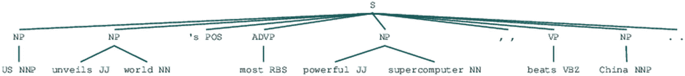

**图 3-10** – 使用更具体规则的浅层解析

```python
# Evaluate parser performance on test data
print(rc.evaluate(test_data))
ChunkParse score:
IOB Accuracy:  46.1%%
Precision:     19.9%%
Recall:        43.3%%
F-Measure:     27.3%%
```

从输出中可以看出，我们示例句子的解析树与上一节中从即用型解析器获得的解析树非常相似。此外，整体测试数据的准确率为 54.5%，对于一个开始来说已经相当不错了。要了解每个性能指标的具体含义，可以参考第 5 章中的“评估分类模型”部分。

还记得我们说过文本的标注元数据在许多方面都很有用吗？现在我们使用带有组块和标注的`treebank`训练数据来构建一个浅层解析器。我们利用两个组块工具函数——`tree2conlltags`来获取每个词元的词、词性标签和组块标签三元组，以及`conlltags2tree`来从这些词元三元组生成解析树。

稍后我们将使用这些函数来训练我们的解析器。首先，让我们看看这两个函数是如何工作的。请记住，组块标签使用一种流行的格式，即 IOB 格式。在这种格式中，你会注意到一些带有`I`、`O`和`B`前缀的新符号，这是组块中流行的 IOB 符号。它表示内部（Inside）、外部（Outside）和开始（Beginning）。标签前的`B-`前缀表示这是组块的开始；`I-`前缀表示它在组块内部。`O`标签表示该词元不属于任何组块。当后面有相同类型的后续标签，且它们之间没有`O`标签时，总是使用`B-`标签。

```python
from nltk.chunk.util import tree2conlltags, conlltags2tree
# look at a sample training tagged sentence
train_sent = train_data[7]
print(train_sent)
(S
(NP A/DT Lorillard/NNP spokewoman/NN)
said/VBD
,/,
``/``
(NP This/DT)
is/VBZ
(NP an/DT old/JJ story/NN)
./.)
# get the (word, POS tag, Chunk tag) triples for each token
wtc = tree2conlltags(train_sent)
wtc
[('A', 'DT', 'B-NP'),
('Lorillard', 'NNP', 'I-NP'),
('spokewoman', 'NN', 'I-NP'),
('said', 'VBD', 'O'),
(',', ',', 'O'),
('``', '``', 'O'),
('This', 'DT', 'B-NP'),
('is', 'VBZ', 'O'),
('an', 'DT', 'B-NP'),
('old', 'JJ', 'I-NP'),
('story', 'NN', 'I-NP'),
('.', '.', 'O')]
# get shallow parsed tree back from the WTC triples
tree = conlltags2tree(wtc)
print(tree)
(S
(NP A/DT Lorillard/NNP spokewoman/NN)
said/VBD
,/,
``/``
(NP This/DT)
is/VBZ
(NP an/DT old/JJ story/NN)
./.)
```

现在我们知道了这些函数的工作原理，我们定义一个名为`conll_tag_chunks()`的函数来从带有组块标注的句子中提取词性标签和组块标签，并复用词性标注中的`combined_taggers()`函数来训练多个具有回退标注器的标注器，如下面的代码片段所示。

```python
def conll_tag_chunks(chunk_sents):
    tagged_sents = [tree2conlltags(tree) for tree in chunk_sents]
    return [[(t, c) for (w, t, c) in sent] for sent in tagged_sents]

def combined_tagger(train_data, taggers, backoff=None):
    for tagger in taggers:
        backoff = tagger(train_data, backoff=backoff)
    return backoff
```


现在我们定义一个 `NGramTagChunker` 类，该类将以带有词性标注的句子作为训练输入，提取其 WTC 三元组（单词、词性标签、组块标签），并使用 `UnigramTagger` 作为后备标注器来训练一个 `BigramTagger`。我们还定义了一个 `parse()` 函数，用于对新句子执行浅层句法分析（shallow parsing）。

```
from nltk.tag import UnigramTagger, BigramTagger
from nltk.chunk import ChunkParserI
class NGramTagChunker(ChunkParserI):
def __init__(self, train_sentences,
tagger_classes=[UnigramTagger, BigramTagger]):
train_sent_tags = conll_tag_chunks(train_sentences)
self.chunk_tagger = combined_tagger(train_sent_tags, tagger_classes)
def parse(self, tagged_sentence):
if not tagged_sentence:
return None
pos_tags = [tag for word, tag in tagged_sentence]
chunk_pos_tags = self.chunk_tagger.tag(pos_tags)
chunk_tags = [chunk_tag for (pos_tag, chunk_tag) in chunk_pos_tags]
wpc_tags = [(word, pos_tag, chunk_tag) for ((word, pos_tag), chunk_tag)
in zip(tagged_sentence, chunk_tags)]
return conlltags2tree(wpc_tags)
```

在这个类中，构造函数 `__init__()` 用于基于每个句子的 WTC 三元组，通过 n-gram 标注来训练浅层句法分析器。其内部接收一个带有组块解析树元数据注释的训练句子列表作为输入。它使用我们之前定义的 `conll_tag_chunks()` 函数，从每个组块解析树中获取一个 WTC 三元组列表。最后，它利用这些三元组训练一个以 `UnigramTagger` 作为后备标注器的 `BigramTagger`，并将训练模型存储在 `self.chunk_tagger` 中。

请记住，你可以通过使用 `tagger_classes` 参数来解析其他基于 n-gram 的标注器进行训练。训练完成后，`parse()` 函数可用于在测试数据上评估标注器的性能，并对新句子进行浅层句法分析。其内部接收一个带有词性标注的句子作为输入，从句子中分离出词性标签，然后使用我们训练好的 `self.chunk_tagger` 获取该句子的 IOB 组块标签。接着，将这些标签与原始句子标记结合，并使用 `conlltags2tree()` 函数得到最终的浅层句法分析树。下面的代码片段展示了我们的分析器运行效果。见图 3-11。

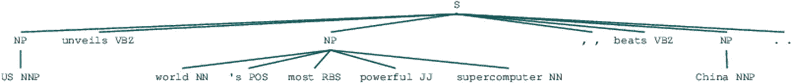

**图 3-11** 基于 n-gram 组块划分对树库数据进行浅层句法分析的新闻标题

```
# 训练浅层句法分析器
ntc = NGramTagChunker(train_data)
# 在测试数据上测试分析器性能
print(ntc.evaluate(test_data))
ChunkParse score:
IOB Accuracy:  97.2%%
Precision:     91.4%%
Recall:        94.3%%
F-Measure:     92.8%%
# 解析我们的示例句子
sentence_nlp = nlp(sentence)
tagged_sentence = [(word.text, word.tag_) for word in sentence_nlp]
tree = ntc.parse(tagged_sentence)
print(tree)
tree
(S
(NP US/NNP)
unveils/VBZ
(NP world/NN 's/POS most/RBS powerful/JJ supercomputer/NN)
,/,
beats/VBZ
(NP China/NNP)
./.)
```

这个输出展示了我们的分析器在树库测试集数据上的性能，总体准确率达到了 99.6%，非常出色！图 3-11 也向我们展示了示例新闻标题的解析树形态。

现在，让我们在 `conll2000` 语料库上训练并评估我们的分析器。该语料库包含来自《华尔街日报》的摘录，是一个规模大得多的语料库。我们将在前 10,000 个句子上训练分析器，并在剩余的 940 多个句子上测试其性能。下面的代码片段描述了这一过程。

```
from nltk.corpus import conll2000
wsj_data = conll2000.chunked_sents()
train_wsj_data = wsj_data[:10000]
test_wsj_data = wsj_data[10000:]
# 查看语料库中的一个示例句子
print(train_wsj_data[10])
(S
(NP He/PRP)
(VP reckons/VBZ)
(NP the/DT current/JJ account/NN deficit/NN)
(VP will/MD narrow/VB)
(PP to/TO)
(NP only/RB #/# 1.8/CD billion/CD)
(PP in/IN)
(NP September/NNP)
./.)
# 训练浅层句法分析器
tc = NGramTagChunker(train_wsj_data)
# 在测试数据上测试性能
print(tc.evaluate(test_wsj_data))
ChunkParse score:
IOB Accuracy:  89.1%%
Precision:     80.3%%
Recall:        86.1%%
F-Measure:     83.1%%
```

这个输出显示，我们的分析器实现了约 89% 的总体准确率，考虑到这个语料库比 `treebank` 语料库大得多，这个结果已经相当不错了。让我们看看它如何对我们的示例新闻标题进行组块划分。

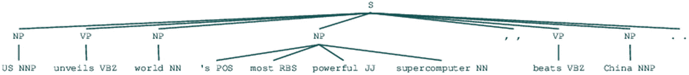

**图 3-12** 基于 n-gram 组块划分对 `conll2000` 数据进行浅层句法分析的新闻标题

```
# 解析我们的示例句子
tree = tc.parse(tagged_sentence)
print(tree)
tree
(S
(NP US/NNP)
(VP unveils/VBZ)
(NP world/NN)
(NP 's/POS most/RBS powerful/JJ supercomputer/NN)
,/,
(VP beats/VBZ)
(NP China/NNP)
./.)
```

图 3-12 向我们展示了示例新闻标题的解析树形态。与之前的解析树相比，此处定义了更明确的动词短语。你还可以考虑利用 `ClassifierBasedTagger` 类，通过其他技术（如监督式分类器）来实现浅层句法分析器。


### 依存句法分析

在基于依存句法的分析中，我们尝试使用依存语法来分析和推断句子中词元之间的结构关系、语义依存关系以及关联。请参考第 1 章“语言句法与结构”部分中“语法”下的“依存语法”小节，以加深记忆。依存语法帮助我们为句子标注依存标签，这些标签是词元之间的一一对应关系，用以表示它们之间的依存性。基于依存语法的句法树表示，更精确地说，是一个带标签的有向树或图。节点始终是词汇词元，而有标签的边则描述了核心词与其从属词之间的依存关系。边上的标签指明了从属词的语法角色。

依存语法的基本原则是：在语言的任何句子中，除了一个词之外，其他所有词都与句子中的其他词存在某种关系或依存性。那个没有依存关系的词被称为句子的*根*。在大多数情况下，动词被视为句子的根。所有其他词都通过表示依存关系的链接直接或间接地与根动词相连。如果我们想为句子“The brown fox is quick and he is jumping over the lazy dog”绘制依存句法树，我们将得到如图 3-13 所示的结构。

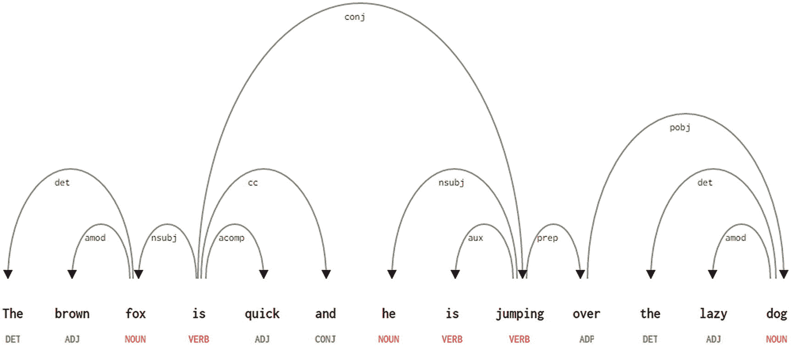

图 3-13

一个示例句子的依存句法树

这些依存关系各自具有特定含义，并且是通用依存类型列表的一部分。这方面在一篇题为“[Universal Stanford Dependencies: A Cross-Linguistic Typology](https://nlp.stanford.edu/pubs/USD_LREC14_paper_camera_ready.pdf)”的原始论文[作者：de Marneffe 等人，2014](https://nlp.stanford.edu/pubs/USD_LREC14_paper_camera_ready.pdf)中有所讨论。您可以在[`http://universaldependencies.org/u/dep/index.html`](http://universaldependencies.org/u/dep/index.html)查看依存类型及其含义的详尽列表。为了加深记忆，我们观察一些依存类型，理解它们并不难。

-   依存标签 `det` 很直观——它表示名词性核心词与限定词之间的限定关系。通常，带有 `POS` 标签 `DET` 的词也会具有 `det` 依存标签关系。示例包括 `fox → the` 和 `dog → the`。
-   依存标签 `amod` 代表形容词修饰语，表示任何修饰名词含义的形容词。示例包括 `fox → brown` 和 `dog → lazy`。
-   依存标签 `nsubj` 代表充当小句主语或施动者的实体。示例包括 `is → fox` 和 `jumping → he`。
-   依存关系 `cc` 和 `conj` 更多与并列连词连接的词之间的关联有关。示例包括 `is → and` 和 `is → jumping`。
-   依存标签 `aux` 表示小句中的助动词或次要动词。示例：`jumping → is`。
-   依存标签 `acomp` 代表形容词补足语，充当句子中动词的补足语或宾语。示例：`is → quick`。
-   依存标签 `prep` 表示介词修饰语，通常修饰名词、动词、形容词或介词的含义。通常，这种表示用于具有名词或名词短语补足语的介词。示例：`jumping → over`。
-   依存标签 `pobj` 用于表示介词的宾语。这通常是句子中介词后名词短语的核心词。示例：`over → dog`。

让我们看看构建依存句法分析器来解析非结构化文本的一些方法！

### 构建依存句法分析器

我们将使用包括 NLTK 和 spaCy 在内的几个最先进的库，来生成基于依存句法的句法树，并在我们的示例新闻标题上进行测试。*SpaCy* 根据您使用的语言模型，有两种类型的英语依存句法分析器。您可以在 [`https://spacy.io/api/annotation#section-dependency-parsing`](https://spacy.io/api/annotation#section-dependency-parsing) 找到更多详细信息。基于语言模型，您可以使用[通用依存方案](http://universaldependencies.org/u/dep/index.html)或 [CLEAR 风格依存方案](http://www.mathcs.emory.edu/~choi/doc/cu-2012-choi.pdf)，后者现在也可以在 [NLP4J](https://emorynlp.github.io/nlp4j/components/dependency-parsing.html) 中使用。我们现在利用 spaCy 并打印新闻标题中每个词元的依存关系。

```
dependency_pattern = '{left}{right}\n--------'
for token in sentence_nlp:
print(dependency_pattern.format(word=token.orth_,
w_type=token.dep_,
left=[t.orth_
for t
in token.lefts],
right=[t.orth_
for t
in token.rights]))
[][]

['US']['supercomputer', ',', 'beats', '.']

[]["'s"]

[][]

[][]

['most'][]

['world', 'powerful'][]

[][]

[]['China']

[][]

[][]
```

此输出为我们提供了每个词元及其依存类型。左箭头指向其左侧的依存关系，右箭头指向其右侧的依存关系。很明显，动词 `beats` 是根，因为它与其他词元相比没有其他依存关系。要了解每个标注的更多信息，您可以随时参考 [`https://emorynlp.github.io/nlp4j/components/dependency-parsing.html`](https://emorynlp.github.io/nlp4j/components/dependency-parsing.html) 上的 CLEAR 依存方案。我们还可以使用以下代码以更好的方式可视化这些依存关系。见图 3-14。

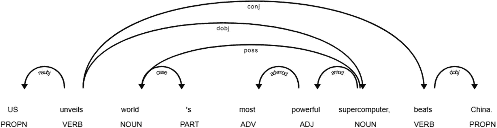

图 3-14

使用 spaCy 可视化我们的新闻标题依存树

```
from spacy import displacy
displacy.render(sentence_nlp, jupyter=True,
options={'distance': 110,
'arrow_stroke': 2,
'arrow_width': 8})
```

您还可以利用 NLTK 和 Stanford Dependency Parser 来可视化和构建依存树。我们以原始形式和带注释形式展示依存树。我们首先构建带注释的依存树，并使用 Graphviz 显示它。见图 3-15。

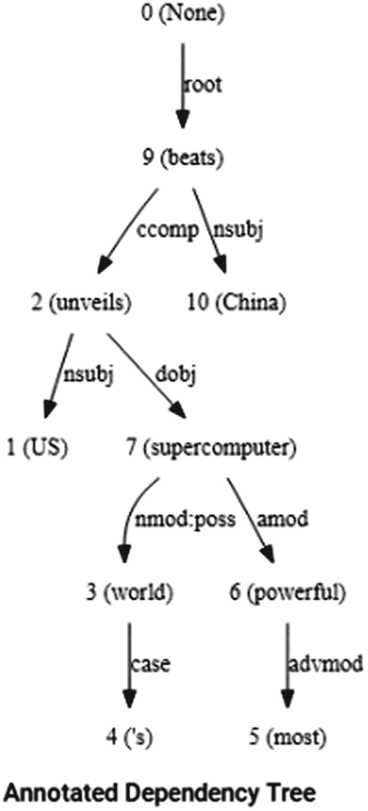

图 3-15

使用 NLTK 和 Stanford Dependency Parser 可视化我们带注释的新闻标题依存树

```
from nltk.parse.stanford import StanfordDependencyParser
sdp = StanfordDependencyParser(path_to_jar='E:/stanford/stanford-parser-full-2015-04-20/stanford-parser.jar', path_to_models_jar='E:/stanford/stanford-parser-full-2015-04-20/stanford-parser-3.5.2-models.jar')
# perform dependency parsing
result = list(sdp.raw_parse(sentence))[0]
# generate annotated dependency parse tree
result
```

我们还可以使用以下代码片段以三元组的形式查看实际的依存成分。

```
# generate dependency triples
[item for item in result.triples()]
[(('beats', 'VBZ'), 'ccomp', ('unveils', 'VBZ')),
(('unveils', 'VBZ'), 'nsubj', ('US', 'NNP')),
(('unveils', 'VBZ'), 'dobj', ('supercomputer', 'NN')),
(('supercomputer', 'NN'), 'nmod:poss', ('world', 'NN')),
(('world', 'NN'), 'case', ("'s", 'POS')),
(('supercomputer', 'NN'), 'amod', ('powerful', 'JJ')),
(('powerful', 'JJ'), 'advmod', ('most', 'RBS')),
(('beats', 'VBZ'), 'nsubj', ('China', 'NNP'))]
```

这让我们可以详细了解每个词元以及词元之间的依存关系。现在让我们构建并可视化原始的依存树。见图 3-16。


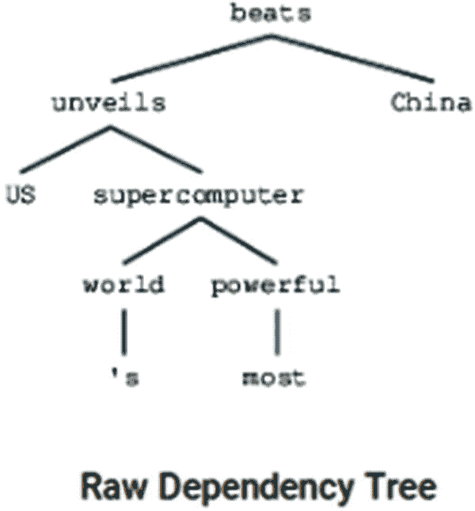

**图 3-16** 使用 NLTK 和斯坦福依存句法分析器可视化新闻标题的原始依存树

```python
# 打印简单的依存句法分析树
dep_tree = result.tree()
print(dep_tree)
(beats (unveils US (supercomputer (world 's) (powerful most))) China)
# 可视化简单的依存句法分析树
dep_tree
```

请注意该树与我们之前在图 3-15 中得到的树之间的相似性。注释有助于理解不同词元之间的依存关系类型。您还可以看到，我们可以多么轻松地为句子生成依存句法分析树，并分析和理解词元之间的关系和依存关系。斯坦福解析器非常稳定且健壮，与 NLTK 的集成也很好。我们推荐使用 NLTK 或 spaCy 解析器，因为两者都相当出色。

### 成分句法分析

基于成分的语法用于分析和确定句子由哪些成分构成。除了确定成分外，另一个重要目标是确定这些成分的内部结构以及它们之间的连接方式。通常，根据短语所能包含的成分类型，存在多种规则，我们可以利用这些规则构建句法分析树。请参阅第 1 章“语言语法与结构”部分中“语法”下的“成分语法”小节，以回顾记忆并查看一些句法分析树示例。

通常，基于成分的语法有助于指定如何将句子分解为各种成分。完成这一步后，它会帮助将这些成分进一步细分；此过程重复进行，直到达到单个词元或单词的级别。通常，这些语法类型可用于根据句子成分的层次有序结构来建模或表示句子的内部结构。在这种结构中，每个单词通常属于特定的词汇类别，并构成不同短语的中心词。这些短语根据称为短语结构规则的规则形成。

*短语结构规则*构成了成分语法的核心，因为它们讨论了语法和规则，这些规则支配着句子中各种成分的层次结构和顺序。这些规则主要满足两件事：

-   它们确定使用哪些单词来构建短语或成分。
-   它们确定我们需要如何排列这些成分。

短语结构规则的通用表示为 `S → AB`，它表明结构 `S` 由成分 `A` 和 `B` 组成，且顺序为先 `A` 后 `B`。虽然有多种规则（如需深入了解，请参考第 1 章），但最重要的规则描述了如何划分句子或从句。短语结构规则将句子或从句的二分法表示为 `S → NP VP`，其中 `S` 是句子或从句，它被分为主语（由名词短语 `NP` 表示）和谓语（由动词短语 `VP` 表示）。

这些语法具有各种生成规则，通常使用上下文无关文法 (CFG) 或短语结构文法就足够了。可以基于这些语法/规则构建成分分析器，这些规则通常作为上下文无关文法或短语结构文法共同提供。解析器将根据这些规则处理输入的句子，并帮助构建句法分析树。图 3-17 展示了一个示例树。

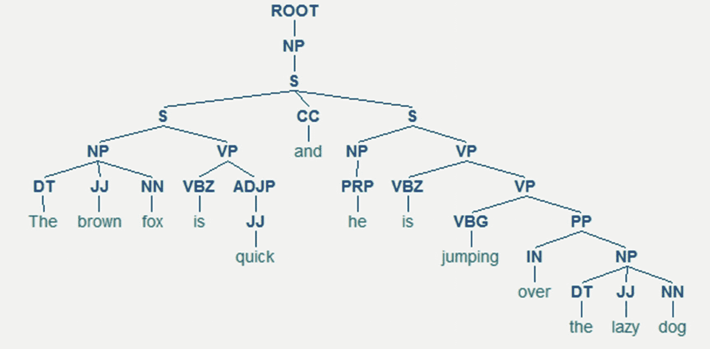

**图 3-17** 一个展示嵌套层次结构的成分句法分析示例

解析器让语法活了起来，可以看作是对语法的过程式解释。有多种类型的句法分析算法，以下列举了一些：

-   递归下降解析
-   移进-归约解析
-   图表解析
-   自底向上解析
-   自顶向下解析
-   PCFG 解析

在当前的篇幅内，详细讨论这些算法是不可能的。然而，NLTK 在其官方书籍 [`http://www.nltk.org/book/ch08.html`](http://www.nltk.org/book/ch08.html) 上提供了一些极好的相关信息。我们简要介绍其中一些解析器，并在稍后实现自己的解析器时详细探讨 PCFG 解析。

-   *递归下降解析*通常采用自顶向下的解析方法；它从输入句子中读取词元，并尝试将它们与语法生成规则中的终结符进行匹配。它每次向前看一个词元，并在匹配成功时向前移动输入读取指针。
-   *移进-归约解析*采用自底向上的解析方法，它找到与语法生成式右侧对应的词元（单词/短语）序列，然后将其替换为该规则的左侧部分。此过程持续进行，直到整个句子被归约为一个句法分析树。
-   *图表解析*使用动态规划来存储中间结果，并在需要时重用它们，以获得显著的效率提升。在这种情况下，图表解析器存储部分解决方案，并在需要得到完整解决方案时进行查找。

#### 构建成分句法分析器

我们将使用 NLTK 和斯坦福解析器来生成句法分析树，因为它们是最先进的工具，并且运行效果非常好。


### 前提条件

从 [`http://nlp.stanford.edu/software/stanford-parser-full-2015-04-20.zip`](http://nlp.stanford.edu/software/stanford-parser-full-2015-04-20.zip) 下载官方斯坦福解析器，该版本运行效果良好。你也可以访问 [`http://nlp.stanford.edu/software/lex-parser.shtml#Download`](http://nlp.stanford.edu/software/lex-parser.shtml#Download) 并查看“发布历史”部分，尝试更新的版本。下载完成后，将其解压到文件系统中已知的位置。完成这些操作后，你就可以通过 NLTK 使用该解析器了，我们稍后将进行探索。

斯坦福解析器通常使用*PCFG（概率上下文无关文法）解析器*。PCFG 是一种上下文无关文法，为其每条产生式规则关联一个概率。由 PCFG 生成的解析树的概率，就是生成该树所用各产生式各自概率的乘积。现在，让我们实际运行这个解析器！参见图 3-18。

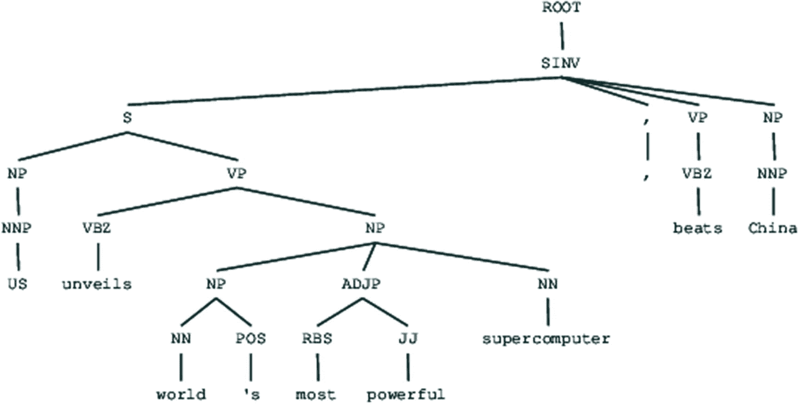

**图 3-18** 对示例新闻标题进行成分分析

```
# 设置 java 路径
import os
java_path = r'C:\Program Files\Java\jdk1.8.0_102\bin\java.exe'
os.environ['JAVAHOME'] = java_path
# 创建解析器对象
from nltk.parse.stanford import StanfordParser
scp = StanfordParser(path_to_jar='E:/stanford/stanford-parser-full-2015-04-20/stanford-parser.jar',
path_to_models_jar='E:/stanford/stanford-parser-full-2015-04-20/stanford-parser-3.5.2-models.jar')
# 获取解析树
result = list(scp.raw_parse(sentence))[0]
# 打印成分分析树
print(result)
(ROOT
(SINV
(S
(NP (NNP US))
(VP
(VBZ unveils)
(NP
(NP (NN world) (POS 's))
(ADJP (RBS most) (JJ powerful))
(NN supercomputer))))
(, ,)
(VP (VBZ beats))
(NP (NNP China))
(. .)))
# 可视化解析树
from IPython.display import display
display(result)
```

在上述输出中，我们可以看到成分的嵌套层次结构，这与浅层分析中的扁平结构形成对比。如果你对 SINV 的含义感到好奇，它表示*倒装陈述句*，即主语位于限定动词或情态动词之后的句子。如有需要，可参考 [`https://web.archive.org/web/20130517134339/http://bulba.sdsu.edu/jeanette/thesis/PennTags.html`](https://web.archive.org/web/20130517134339/http://bulba.sdsu.edu/jeanette/thesis/PennTags.html) 上的“[Penn Treebank 参考手册](https://web.archive.org/web/20130517134339/http:/bulba.sdsu.edu/jeanette/thesis/PennTags.html)”来查询其他标签。

构建你自己的成分解析器有多种方法，包括创建你自己的 CFG 产生式规则，然后使用某个解析器来应用该文法。要构建你自己的 CFG，可以使用 `nltk.CFG.fromstring` 函数输入你自己的产生式规则，然后使用诸如 `ChartParser` 或 `RecursiveDescentParser` 等解析器，它们都属于 NLTK 包。你可以随意构建一些玩具文法，并用这些解析器进行实践。

现在，我们来看一种构建可扩展且高效成分解析器的方法。常规 CFG 解析器（如图表解析器和递归下降解析器）的问题在于，它们很容易因可能的解析总数过多而不堪重负，变得极其缓慢。在这种情况下，像 PCFG（概率上下文无关文法）这样的加权文法和像 Viterbi 解析器这样的概率解析器被证明更有效。

PCFG 是一种上下文无关文法，为其每条产生式规则关联一个概率。由 PCFG 生成的解析树的概率，就是生成该树所用各产生式各自概率的乘积。我们将使用 NLTK 的 `ViterbiParser`，基于 `treebank` 语料库训练一个解析器，该语料库为其中的每个句子都提供了带标注的解析树。此解析器是一个自底向上的 PCFG 解析器，使用动态规划在每一步找出最可能的解析。我们通过加载必要的训练数据和依赖关系，开始构建自己的解析器。

```
import nltk
from nltk.grammar import Nonterminal
from nltk.corpus import treebank
# 加载并查看训练数据
training_set = treebank.parsed_sents()
print(training_set[1])
(S
(NP-SBJ (NNP Mr.) (NNP Vinken))
(VP
(VBZ is)
(NP-PRD
(NP (NN chairman))
(PP
(IN of)
(NP
(NP (NNP Elsevier) (NNP N.V.))
(, ,)
(NP (DT the) (NNP Dutch) (VBG publishing) (NN group))))))
(. .))
```

现在，我们通过从带标注的训练句子中提取产生式并将其添加，来构建文法的产生式规则。

```
# 提取所有带标注训练句子的产生式
treebank_productions = list(
set(production
for sent in training_set
for production in sent.productions()
)
)
# 查看部分产生式规则
treebank_productions[0:10]
[VP -> VB NP-2 PP-CLR ADVP-MNR,
NNS -> 'foods',
NNP -> 'Joanne',
JJ -> 'state-owned',
VP -> VBN PP-LOC,
NN -> 'turmoil',
SBAR -> WHNP-240 S,
QP -> DT VBN CD TO CD,
NN -> 'cultivation',
NNP -> 'Graham']
# 为每个单词和词性标签添加产生式
for word, tag in treebank.tagged_words():
t = nltk.Tree.fromstring("("+ tag + " " + word  +")")
for production in t.productions():
treebank_productions.append(production)
# 基于 PCFG 构建文法
treebank_grammar = nltk.grammar.induce_pcfg(Nonterminal('S'), treebank_productions)
```

现在我们已经拥有了包含产生式规则的必要文法，接下来使用以下代码片段，通过在该文法上训练来创建解析器，然后尝试在我们的示例新闻标题上对其进行评估。

```
# 构建解析器
viterbi_parser = nltk.ViterbiParser(treebank_grammar)
# 获取示例句子的令牌
tokens = nltk.word_tokenize(sentence)
# 获取示例句子的解析树
result = list(viterbi_parser.parse(tokens))

ValueError                                Traceback (most recent call last)
 in ()

17 # get parse tree for sample sentence
---> 18 result = list(viterbi_parser.parse(tokens))
ValueError: Grammar does not cover some of the input words: "'unveils', 'beats'".
```

不幸的是，当我们尝试用新构建的解析器解析示例句子的令牌时，出现了错误。从错误信息中可以明显看出原因：示例句子中的某些单词未被基于 Treebank 的文法覆盖，因为它们不在我们的 `treebank` 语料库中。由于这种基于成分的文法使用词性标签和短语标签，根据训练数据构建树，因此我们需要将示例句子的令牌和词性标签添加到文法中，并重新构建解析器。

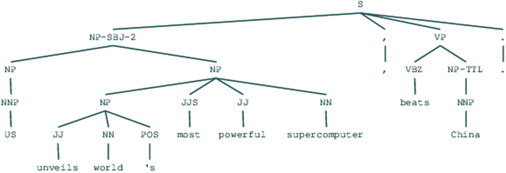

**图 3-19** 基于 Treebank 标注的示例新闻标题成分分析树


