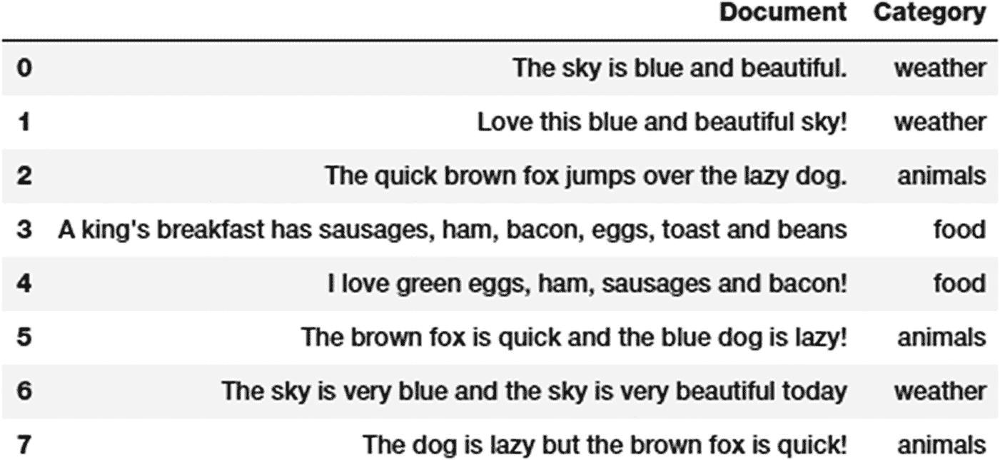

# 构建文本语料库

我们需要一个文本语料库来进行操作，并演示不同的特征工程和表示方法。为了保持简单易懂，我们将在本节中构建一个简单的文本语料库。首先，在你的 Jupyter notebook 中加载以下依赖项。

```python
import pandas as pd
import numpy as np
import re
import nltk
import matplotlib.pyplot as plt
pd.options.display.max_colwidth = 200
%matplotlib inline
```

现在，让我们构建一个示例文档语料库，我们将在本章中对其运行大部分分析。*语料库*通常是指属于一个或多个主题或话题的文本文档的集合。下面的代码帮助我们创建这个语料库。你可以在图 4-1 的输出中看到这个示例文本语料库。



图 4-1

我们的示例文本语料库

```python
# 构建文档语料库
corpus = ['天空湛蓝而美丽。',
'喜欢这蓝色美丽的天空！',
'那只敏捷的棕色狐狸跳过了懒惰的狗。',
"国王的早餐有香肠、火腿、培根、鸡蛋、吐司和豆子",
'我喜欢绿色鸡蛋、火腿、香肠和培根！',
'那只棕色狐狸很敏捷，而那只蓝色狗很懒惰！',
'今天天空很蓝，天空非常美丽',
'那条狗很懒，但那只棕色狐狸很敏捷！'
]
labels = ['天气', '天气', '动物', '食物', '食物', '动物', '天气', '动物']
corpus = np.array(corpus)
corpus_df = pd.DataFrame({'文档': corpus, '类别': labels})
corpus_df = corpus_df[['文档', '类别']]
corpus_df
```

图 4-1 显示，我们已经为我们的示例语料库选取了几个属于不同类别的示例文本文档。在讨论特征工程之前，我们需要进行一些数据预处理和整理，以删除不必要的字符、符号和词元。