# 预处理我们的文本语料库

清理和预处理文本数据有多种方法。以下几点我们重点介绍自然语言处理（NLP）流程中常用的一些最重要方法。如果你已阅读过第 3 章，其中大部分内容可作为复习。

- **移除标签：** 我们的文本通常包含像 HTML 标签这类无必要的内容，它们在文本分析时价值不大。`BeautifulSoup` 库在提供相应函数方面表现出色。
- **移除重音字符：** 在任何文本语料库中，尤其是处理英语时，可能会遇到带重音的字符/字母。因此，需要确保这些字符被转换并标准化为 ASCII 字符。一个简单的例子是将 `é` 转换为 `e`。
- **扩展缩写：** 在英语中，缩写本质上是单词或音节的简写形式，通过移除特定字母和发音形成。例如 `do not` 缩写为 `don’t`，`I would` 缩写为 `I’d`。将每个缩写扩展为其原始完整形式通常有助于文本标准化。
- **移除特殊字符：** 通常是非字母数字字符的特殊字符和符号，往往会增加非结构化文本中的额外噪音。很多时候，简单的正则表达式即可实现此目的。
- **词干提取与词形还原：** 词干是可能单词的基本形式，通过向词干附加前缀和后缀等词缀来创建新词，这被称为屈折变化。获取单词基本形式的反向过程被称为`词干提取`。一个简单的例子是单词 `watches`、`watching` 和 `watched`，它们都以 `watch` 作为词根词干。`词形还原`与`词干提取`非常相似，都是移除单词词缀以获取单词的基本形式。不过，在这种情况下，基本形式被称为根词而非根词干。区别在于根词始终是词典中存在的词汇学上正确的单词，而根词干则可能并不总是正确。
- **移除停用词：** 在从文本中构建有意义的特征时，意义很小或没有意义的单词被称为停用词。如果在一个语料库中进行简单的词频统计，这些词通常最终出现频率最高。像 “a”、“an”、“the” 等词被认为是停用词。虽然没有通用的停用词列表，但我们使用来自 `NLTK` 的标准英语停用词列表。你也可以根据需要添加自己领域特定的停用词。

你还可以进行其他标准操作，如分词、移除多余空白、文本小写化，以及更高级的操作，如拼写纠正、语法错误纠正、移除重复字符等。如果感兴趣，可以查看第 3 章中关于文本预处理和整理的详细章节。

由于本文的重点是特征工程，我们构建一个简单的文本预处理器，其核心功能是移除特殊字符、多余空白、数字、停用词，然后将文本语料库转换为小写。

```
wpt = nltk.WordPunctTokenizer()
stop_words = nltk.corpus.stopwords.words('english')
def normalize_document(doc):
# 小写化并移除特殊字符/空白
doc = re.sub(r'[^a-zA-Z\s]', '', doc, re.I|re.A)
doc = doc.lower()
doc = doc.strip()
# 对文档进行分词
tokens = wpt.tokenize(doc)
# 从文档中过滤停用词
filtered_tokens = [token for token in tokens if token not in stop_words]
# 从过滤后的分词重新创建文档
doc = ' '.join(filtered_tokens)
return doc
normalize_corpus = np.vectorize(normalize_document)
```

一旦基本预处理流程准备就绪，就将其应用到示例语料库上，以便用于特征工程。

```
norm_corpus = normalize_corpus(corpus)
norm_corpus
array(['sky blue beautiful', 'love blue beautiful sky',
'quick brown fox jumps lazy dog',
'kings breakfast sausages ham bacon eggs toast beans',
'love green eggs ham sausages bacon',
'brown fox quick blue dog lazy', 'sky blue sky beautiful today',
'dog lazy brown fox quick'], dtype='<U51')
```

这个输出应能让你清楚了解预处理后每个示例文档的样子。现在，让我们探索各种特征工程技术！

### 传统特征工程模型

用于文本数据的传统（基于计数）特征工程策略属于一类统称为词袋模型的模型。这包括词频、TF-IDF（词频-逆文档频率）、N-gram、主题模型等。虽然这些是从文本中提取特征的有效方法，但由于模型本质上只是一个非结构化单词的集合，我们会丢失额外信息，如每个文本文档中附近单词的语义、结构、顺序和上下文。还有更先进的模型可以处理这些方面，我们将在本章后续章节中介绍。传统特征工程模型是使用数学和统计方法论构建的。我们将研究其中一些模型，并将其应用于示例语料库。


### 词袋模型

这或许是最简单的非结构化文本向量空间表示模型。向量空间模型本质上是一种数学模型，能将非结构化文本（或其他数据）表示为数值向量，其中向量的每一维都代表一个特定的特征/属性。词袋模型将每个文本文档表示为一个数值向量，其中每个维度对应语料库中的一个特定词语，其值可以是该词在文档中的频率、出现情况（用 1 或 0 表示），甚至可以是加权值。这个模型之所以得名，是因为每个文档被字面意义上地视为“一袋”它自己的词语，而忽略了词语顺序、序列和语法。

```
from sklearn.feature_extraction.text import CountVectorizer
# 以稀疏格式获取词袋特征
cv = CountVectorizer(min_df=0., max_df=1.)
cv_matrix = cv.fit_transform(norm_corpus)
cv_matrix
```

```
<42x20 sparse matrix of type '<class 'numpy.int64'>'
with 42 stored elements in Compressed Sparse Row format>
```

```
# 查看稀疏矩阵中的非零特征位置
print(cv_matrix)
(0, 2)     1
(0, 3)     1
(0, 17)    1
(1, 14)    1
...
...
(6, 17)    2
(7, 6)     1
(7, 13)    1
(7, 8)     1
(7, 5)     1
(7, 15)    1
```

特征矩阵传统上以稀疏矩阵形式表示，因为随着每个文档中不同词语成为特征，特征数量会惊人地增加。上述输出展示了每个 (`x`, `y`) 对的计数。其中，`x`代表一个文档，`y`代表一个特定的词语/特征，其值表示`y`在`x`中出现的次数。我们可以利用以下代码以稠密矩阵形式查看输出。

```
# 查看稠密表示形式
# 注意：如果数据量过大，可能导致内存错误
cv_matrix = cv_matrix.toarray()
cv_matrix
```

```
array([[0, 0, 1, 1, 0, 0, 0, 0, 0, 0, 0, 0, 0, 0, 0, 0, 0, 1, 0, 0],
[0, 0, 1, 1, 0, 0, 0, 0, 0, 0, 0, 0, 0, 0, 1, 0, 0, 1, 0, 0],
[0, 0, 0, 0, 0, 1, 1, 0, 1, 0, 0, 1, 0, 1, 0, 1, 0, 0, 0, 0],
[1, 1, 0, 0, 1, 0, 0, 1, 0, 0, 1, 0, 1, 0, 0, 0, 1, 0, 1, 0],
[1, 0, 0, 0, 0, 0, 0, 1, 0, 1, 1, 0, 0, 0, 1, 0, 1, 0, 0, 0],
[0, 0, 0, 1, 0, 1, 1, 0, 1, 0, 0, 0, 0, 1, 0, 1, 0, 0, 0, 0],
[0, 0, 1, 1, 0, 0, 0, 0, 0, 0, 0, 0, 0, 0, 0, 0, 0, 2, 0, 1],
[0, 0, 0, 0, 0, 1, 1, 0, 1, 0, 0, 0, 0, 1, 0, 1, 0, 0, 0, 0]], dtype=int64)
```

因此，你可以看到这些文档已被转换为数值向量，这样每个文档都由特征矩阵中的一个向量（行）表示，每一列则代表一个独特的词语作为特征。以下代码以更易于理解的格式展示了这一点。请参见图 4-2。

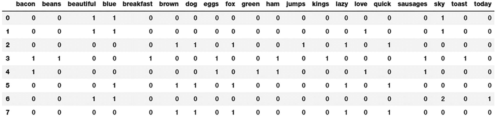

图 4-2

基于词袋模型的文档特征向量

```
# 获取语料库中所有不重复的词语
vocab = cv.get_feature_names()
# 展示文档特征向量
pd.DataFrame(cv_matrix, columns=vocab)
```

图 4-2 应该能让你更清楚！你可以清晰地看到，特征向量中的每一列或每一维都代表语料库中的一个词语，每一行则代表我们的一个文档。任何一个单元格中的值都表示该词语（由列表示）在特定文档（由行表示）中出现的次数。一个简单的例子是，第一个文档中的单词 blue、beautiful 和 sky 各出现一次，因此在上述输出的第一行中，相应的特征值都为 1。因此，如果一个文档语料库在所有文档中共包含 N 个不重复的词语，那么每个文档都会得到一个 N 维的向量。

### 词袋 N 元模型

一个词语通常是一个单独的标记，常被称为*一元组*或*1-gram*。我们已经知道词袋模型不考虑词语顺序。但如果我们还想考虑按顺序出现的短语或词语集合呢？N 元组（N-grams）就能帮助我们做到这一点。N 元组本质上是从文本文档中提取的一组连续的词语标记，这些标记之间是连续的并按顺序出现。二元组指的是阶数为 2 的 N 元组（两个词），三元组指的是阶数为 3 的 N 元组（三个词），以此类推。词袋 N 元模型只是词袋模型的一个扩展，它利用了基于 N 元组的特征。下面的示例展示了每个文档特征向量中基于二元组的特征。请参见图 4-3。

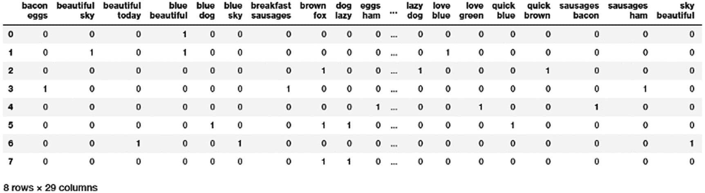

图 4-3

使用词袋 N 元模型生成的基于二元组的特征向量

```
# 你可以将 n-gram 范围设置为(1,2)，以同时获取一元组和二元组
bv = CountVectorizer(ngram_range=(2,2))
bv_matrix = bv.fit_transform(norm_corpus)
bv_matrix = bv_matrix.toarray()
vocab = bv.get_feature_names()
pd.DataFrame(bv_matrix, columns=vocab)
```

这为我们的文档生成了特征向量，其中每个特征都包含一个二元组，代表两个词的序列，其值表示该二元组在文档中出现的次数。我们鼓励你尝试调整 `ngram_range` 参数。试着将 `ngram_range` 设置为 `(1, 3)` 并观察输出结果！


### TF-IDF 模型

当词袋模型应用于大型语料库时，可能会出现一些潜在问题。由于特征向量基于绝对词频，可能会出现某些词在所有文档中频繁出现，从而在特征集合中掩盖其他词的情况。尤其是那些不常出现，但作为识别特定类别的特征可能更有趣且更有效的词。这时，TF-IDF 就应运而生了。TF-IDF 代表*词频-逆文档频率*。它是两个指标的组合：词频 (`tf`) 和逆文档频率 (`idf`)。该技术最初是作为一种根据用户查询对搜索引擎结果进行排序的指标而开发的，现已成为信息检索和文本特征提取的一部分。

现在让我们正式定义 TF-IDF，并在深入其实现之前，先看看其数学表示。数学上，TF-IDF 是两个指标的乘积，可以表示如下：

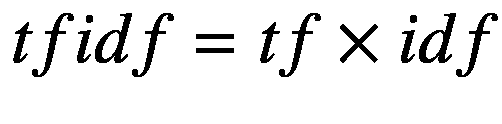

其中，词频 (`tf`) 和逆文档频率 (`idf`) 代表了我们刚刚讨论的两个指标。*词频*，由 `tf` 表示，就是我们上一节在词袋模型中计算的内容。任何文档向量中的词频都由该词在特定文档中的原始频率值表示。数学上可以表示如下：

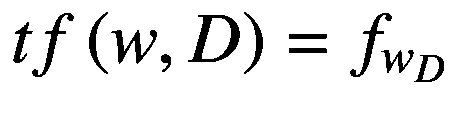

其中 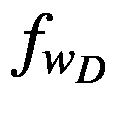 表示词 `w` 在文档 `D` 中的频率，这即为词频 (`tf`)。有时你也可以使用对数或平均频率来对绝对原始频率进行归一化。在我们的计算中，我们使用原始频率。

*逆文档频率*，由 `idf` 表示，是每个词文档频率的倒数，其计算方式是将语料库中的文档总数除以每个词的文档频率，然后对结果进行对数缩放。在我们的实现中，我们会为每个词的文档频率加 1，以表示我们的语料库中还多了一个文档，该文档实质上包含了词汇表中的每一个词。这是为了防止潜在的除以零错误，并平滑逆文档频率。我们还会在 `idf` 计算结果上加 1，以避免忽略那些可能 `idf` 为零的词。数学上，我们对 `idf` 的实现可以表示如下：

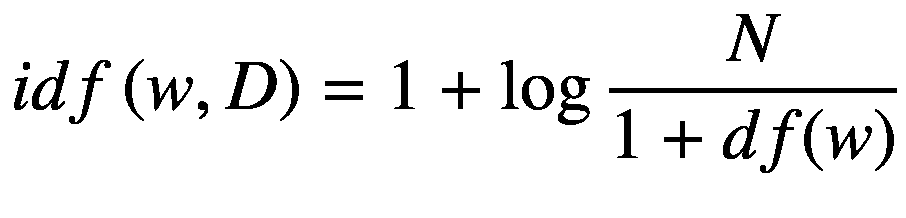

其中，`idf`(`w`, `D`) 表示词 `w` 在文档 `D` 中的 `idf`，`N` 表示语料库中的文档总数，`df`(`t`) 表示包含词 `w` 的文档数量。

因此，词频-逆文档频率可以通过将这两个度量相乘来计算。我们将使用的最终 TF-IDF 指标，是 `tf` 和 `idf` 乘积得到的 `tfidf` 矩阵的归一化版本。我们将 `tfidf` 矩阵除以其 L2 范数（也称为欧几里得范数，即每个词 `tfidf` 权重的平方和再开平方根）来进行归一化。数学上，我们可以将最终的 `tfidf` 特征向量表示如下：

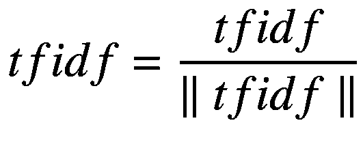

其中，`∥tfidf∥` 表示 `tfidf` 矩阵的欧几里得 L2 范数。这个模型有多种变体，但它们最终都能得到相似的结果。现在让我们将其应用到我们的语料库中！

### 使用 `TfidfTransformer`

假设我们已经从前述章节中获得了基于词袋模型的特征向量，以下代码展示了获取基于 `tfidf` 的特征向量的实现。见图 4-4。

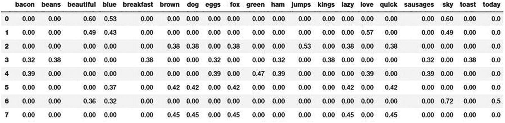

图 4-4：使用 `TfidfTransformer` 基于我们的 TF-IDF 模型生成的文档特征向量

```python
from sklearn.feature_extraction.text import TfidfTransformer
tt = TfidfTransformer(norm='l2', use_idf=True)
tt_matrix = tt.fit_transform(cv_matrix)
tt_matrix = tt_matrix.toarray()
vocab = cv.get_feature_names()
pd.DataFrame(np.round(tt_matrix, 2), columns=vocab)
```

您可以看到，我们在参数中使用了 L2 范数选项，并确保平滑了 IDF，以便为可能具有零 IDF 的词赋予权重，从而避免忽略它们。

### 使用 `TfidfVectorizer`

在工程化 TF-IDF 特征之前，并不总是需要使用词袋或基于计数的模型来预先生成特征。Scikit-Learn 的 `TfidfVectorizer` 使我们能够直接以原始文档作为输入，在内部计算词频和逆文档频率，从而直接计算出 `tfidf` 向量。这消除了使用 `CountVectorizer` 基于词袋模型计算词频的需要。此外，它还支持向特征向量中添加 n-gram。我们可以在以下代码片段中看到该函数的使用。见图 4-5。


图 4-5：使用 `TfidfVectorizer` 基于我们的 TF-IDF 模型生成的文档特征向量

```python
from sklearn.feature_extraction.text import TfidfVectorizer
tv = TfidfVectorizer(min_df=0., max_df=1., norm="l2",
use_idf=True, smooth_idf=True)
tv_matrix = tv.fit_transform(norm_corpus)
tv_matrix = tv_matrix.toarray()
vocab = tv.get_feature_names()
pd.DataFrame(np.round(tv_matrix, 2), columns=vocab)
```

您可以看到，和之前一样，我们在参数中使用了 L2 范数选项，并确保平滑了 `idfs`。从输出中可以看出，`tfidf` 特征向量与我们之前获得的相匹配。


#### 理解 TF-IDF 模型

本节专为机器学习专家以及那些对幕后工作原理充满好奇的读者们而设！我们首先加载必要的依赖项，并为我们的示例语料库计算词频（`TF`）。见图 4-6。

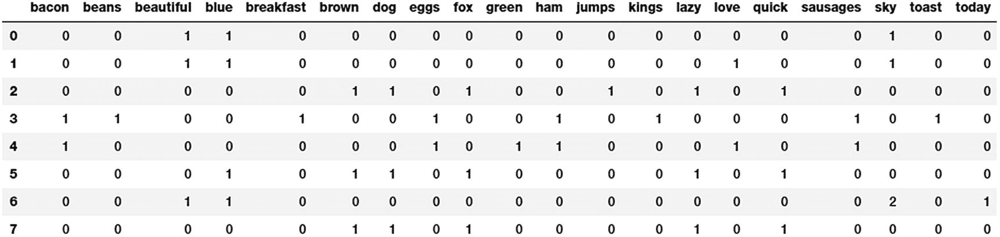

图 4-6

从零开始为我们的语料库构建基于计数的词袋特征

```
# 获取独特词汇作为特征名称
unique_words = list(set([word for doc in [doc.split() for doc in norm_corpus]
for word in doc]))
def_feature_dict = {w: 0 for w in unique_words}
print('特征名称:', unique_words)
print('默认特征字典:', def_feature_dict)
特征名称: ['lazy', 'fox', 'love', 'jumps', 'sausages', 'blue', 'ham', 'beautiful', 'brown', 'kings', 'eggs', 'quick', 'bacon', 'breakfast', 'toast', 'beans', 'green', 'today', 'dog', 'sky']
默认特征字典: {'lazy': 0, 'fox': 0, 'kings': 0, 'love': 0, 'jumps': 0, 'sausages': 0, 'breakfast': 0, 'today': 0, 'brown': 0, 'ham': 0, 'beautiful': 0, 'green': 0, 'eggs': 0, 'blue': 0, 'bacon': 0, 'toast': 0, 'beans': 0, 'dog': 0, 'sky': 0, 'quick': 0}
from collections import Counter
# 为每个文档构建词袋特征 - 词频
bow_features = []
for doc in norm_corpus:
bow_feature_doc = Counter(doc.split())
all_features = Counter(def_feature_dict)
bow_feature_doc.update(all_features)
bow_features.append(bow_feature_doc)
bow_features = pd.DataFrame(bow_features)
bow_features
```

现在，我们根据每个词项出现的文档数量来计算其文档频率（`DF`）。以下代码片段展示了如何从我们的词袋特征中获取该信息。见图 4-7。

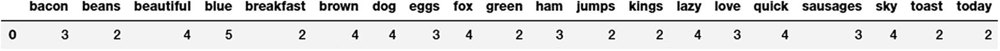

图 4-7

我们语料库中每个特征的文档频率

```
import scipy.sparse as sp
feature_names = list(bow_features.columns)
# 构建文档频率矩阵
df = np.diff(sp.csc_matrix(bow_features, copy=True).indptr)
df = 1 + df # 为后续平滑化 idf 加 1
# 显示平滑后的文档频率
pd.DataFrame([df], columns=feature_names)
```

这告诉我们每个词项的文档频率（`DF`），你可以通过我们示例语料库中的文档进行验证。请记住，我们为每个频率值都加了 1，以便后续平滑 IDF 值，并假设存在一个包含所有词项一次的文档（虚构的），从而防止除以零错误。因此，如果你在语料库中检查，会发现“bacon”出现了 2(+1) 次，“sky”出现了 3(+1) 次，依此类推（考虑到 (+1) 用于平滑处理）。

现在我们有了文档频率，接下来使用之前定义的公式来计算逆文档频率（IDF）。请注意，为了平滑 IDF，我们需要在语料库的总文档数上加 1，这对应了我们之前假设的那个包含所有词项至少一次的文档。见图 4-8。

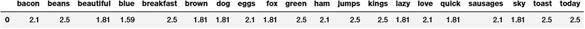

图 4-8

我们语料库中每个特征的逆文档频率

```
# 计算逆文档频率
total_docs = 1 + len(norm_corpus)
idf = 1.0 + np.log(float(total_docs) / df)
# 显示平滑后的 idf
pd.DataFrame([np.round(idf, 2)], columns=feature_names)
```

因此，我们可以看到图 4-8 描绘了我们语料库中每个特征的（平滑后）逆文档频率。现在我们将其转换为一个矩阵，以便于后续计算整体 TF-IDF 分数。见图 4-9。

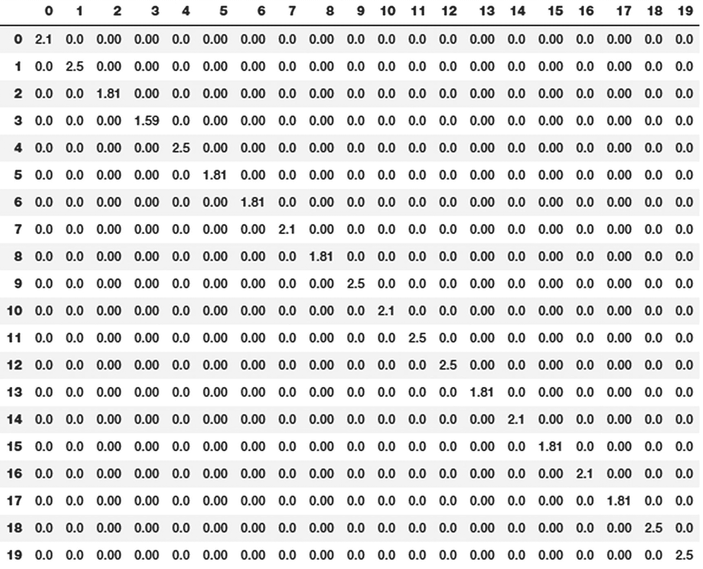

图 4-9

为我们语料库中的每个特征构建一个 n 维逆文档频率对角矩阵

```
# 计算 idf 对角矩阵
total_features = bow_features.shape[1]
idf_diag = sp.spdiags(idf, diags=0, m=total_features, n=total_features)
idf_dense = idf_diag.todense()
# 打印 idf 对角矩阵
pd.DataFrame(np.round(idf_dense, 2))
```

你现在可以看到我们基于数学公式创建的 `idf` 矩阵。我们还将其转换为一个对角矩阵，这在后续需要与词频计算乘积时会很有帮助。现在，我们有了 TF 和 IDF，便可以使用矩阵乘法来计算原始 TF-IDF 特征矩阵，如下所示。见图 4-10。

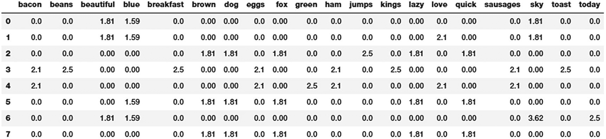

图 4-10

从 TF 和 IDF 分量构建原始 TF-IDF 矩阵

```
# 计算 tfidf 特征矩阵
tf = np.array(bow_features, dtype="float64")
tfidf = tf * idf
# 查看原始 tfidf 特征矩阵
pd.DataFrame(np.round(tfidf, 2), columns=feature_names)
```

现在我们就得到了 `tfidf` 特征矩阵，但是等等！如果你还记得我们之前展示的公式，我们还需要将其除以 L2 范数。以下代码片段计算了每个文档的 `tfidf` 范数，然后将 `tfidf` 权重除以该范数，以得到最终所需的 `tfidf` 矩阵。见图 4-11。

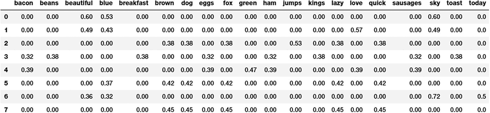

图 4-11

构建最终归一化的 TF-IDF 矩阵

```
from numpy.linalg import norm
# 计算 L2 范数
norms = norm(tfidf, axis=1)
# 打印每个文档的范数
print (np.round(norms, 3))
[ 3.013  3.672  4.761  6.534  5.319  4.35   5.019  4.049]
# 计算归一化的 tfidf
norm_tfidf = tfidf / norms[:, None]
# 显示最终的 tfidf 特征矩阵
pd.DataFrame(np.round(norm_tfidf, 2), columns=feature_names)
```

如果你将图 4-11 中为语料库文档得到的 `tfidf` 特征矩阵与之前使用 `TfidfTransformer` 或 `TfidfVectorizer` 得到的特征矩阵进行比较，会发现它们完全一致，从而验证了我们的数学实现是正确的。实际上，Scikit-Learn 在后台正是采用了相同的实现，并进行了更多优化。

### 为新文档提取特征

假设你构建了一个用于分类和归类新闻文章的机器学习模型，并且该模型目前正在生产环境中运行。你如何为完全新的文档生成特征，以便将其输入到机器学习模型中进行预测？Scikit-Learn API 为我们之前讨论过的向量化器提供了 `transform(...)` 函数，我们可以利用它为那些不在我们语料库中的全新文档（即训练模型时未包含的文档）获取特征。见图 4-12。

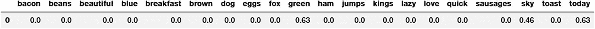

图 4-12

为一个全新的文档生成 TF-IDF 特征向量

```
new_doc = 'the sky is green today'
pd.DataFrame(np.round(tv.transform([new_doc]).toarray(), 2),
columns=tv.get_feature_names())
```

因此，始终利用 `fit_transform(...)` 函数来为语料库中的所有文档构建特征矩阵。这通常会成为训练特征集，你将在此基础上构建和训练预测模型或其他机器学习模型。一旦准备就绪，就利用 `transform(...)` 函数来生成新文档的特征向量。然后，这些特征向量可以被输入到你训练好的模型中，以按需生成洞察。


