# 文档相似度

`文档相似度`是一个过程，它利用基于距离或相似度的度量方法，根据从文档中提取的特征（如词袋或 TF-IDF）来识别一个文本文档与任何其他文档的相似程度。因此，你可以看到我们可以基于上一节中设计的 TF-IDF 特征进行构建，并使用它们来生成新特征。像搜索引擎、文档聚类和信息检索等领域都可以利用这些基于相似度的特征。

语料库中的两两文档相似度涉及计算语料库中每一对文档的文档相似度。因此，如果你的语料库中有 `C` 个文档，你最终会得到一个 `C` x `C` 的矩阵，其中每一行和每一列代表一对文档的相似度得分。这分别表示行和列的索引。有多种相似度和距离度量方法可用于计算文档相似度。这些包括余弦距离/相似度、欧几里得距离、曼哈顿距离、BM25 相似度、杰卡德距离等。在我们的分析中，我们使用最流行和广泛使用的相似度度量之一——余弦相似度，并基于其 TF-IDF 特征向量比较两两文档相似度。请参见图 4-13。

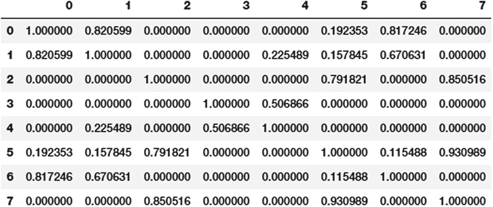

图 4-13

两两文档相似度矩阵（余弦相似度）

```python
from sklearn.metrics.pairwise import cosine_similarity
similarity_matrix = cosine_similarity(tv_matrix)
similarity_df = pd.DataFrame(similarity_matrix)
similarity_df
```

余弦相似度为我们提供了一个度量，表示两个文本文档特征向量表示之间夹角的余弦值。文档之间的夹角越小，它们就越接近、越相似，如图 4-13 中的得分以及图 4-14 中的一些示例文档向量所示。

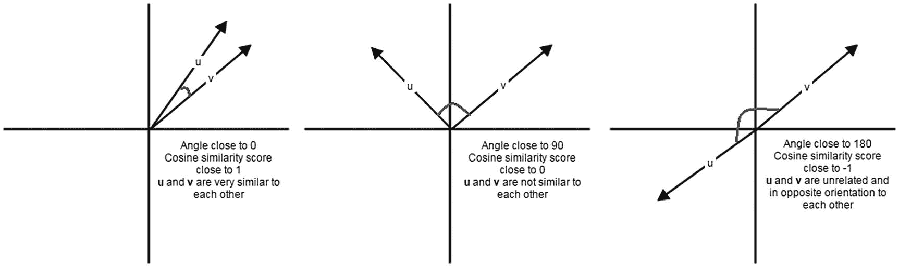

图 4-14

文本文档特征向量的余弦相似度示意图

仔细观察图 4-13 中的相似度矩阵，你可以清楚地看到文档 0、1、6 与文档 2、5、7 彼此非常相似，而文档 3 和 4 彼此略微相似。这必然表明这些相似的文档具有一些相似的特征。这是一个通过无监督学习解决分组或聚类问题的完美示例，尤其是在处理包含数百万文本文档的庞大语料库时。

## 基于相似度特征的文档聚类

我们已经构建了许多特征，现在让我们将其中的一些用于一个现实世界的问题：对相似文档进行分组！聚类利用无监督学习将数据点（在此场景中为文档）分组或聚类。我们在此利用一种无监督的层次聚类算法，通过利用我们之前生成的文档相似度特征，尝试对我们的小型语料库中的相似文档进行分组。

层次聚类算法有两种类型——凝聚型和分裂型。我们使用凝聚型聚类算法，这是一种采用自下而上方法的层次聚类，即每个观测值或文档从自己的聚类开始，然后使用度量数据点之间距离的度量标准和链接合并准则依次合并聚类。图 4-15 展示了一个示例示意图。

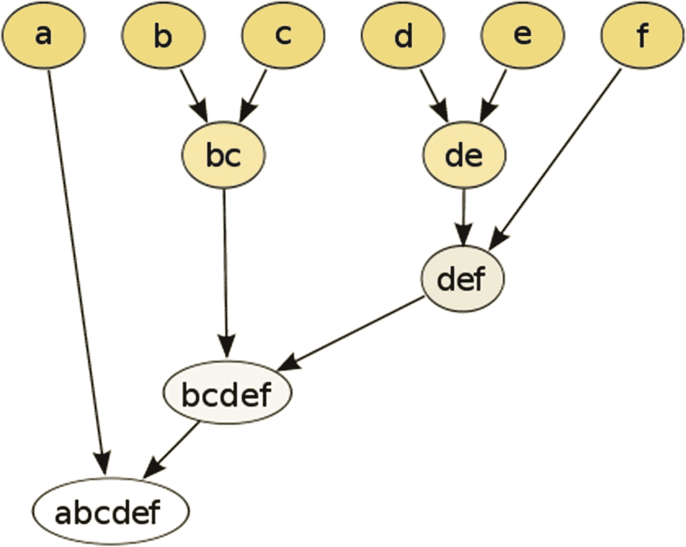

图 4-15

凝聚型层次聚类

链接准则的选择决定了合并策略。一些链接准则的例子包括 Ward 法、完全链接、平均链接等。此准则对于在每一步选择要合并的聚类对（在最低层是单个文档，在更高层是聚类）非常有用，这基于目标函数的最优值。我们选择 Ward 最小方差法作为我们的链接准则，以最小化总的聚类内方差。因此，在每一步，我们找到合并后导致总的聚类内方差增量最小的聚类对。由于我们已经有了相似度特征，让我们在我们的示例文档上构建链接矩阵。请参见图 4-16。

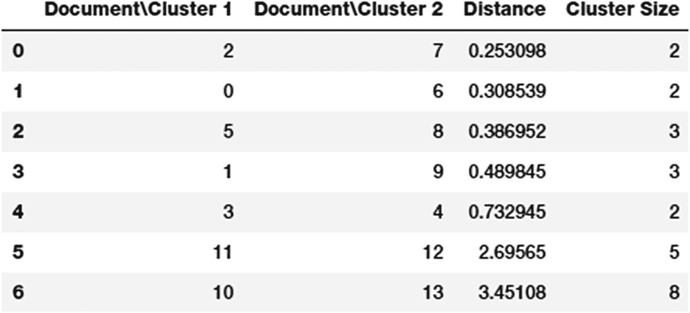

图 4-16

我们语料库的链接矩阵

```python
from scipy.cluster.hierarchy import dendrogram, linkage
Z = linkage(similarity_matrix, 'ward')
pd.DataFrame(Z, columns=['文档\聚类 1', '文档\聚类 2',
'距离', '聚类大小'], dtype="object")
```

如果仔细查看图 4-16 中的链接矩阵，你可以看到链接矩阵的每一步（行）告诉我们哪些数据点（或聚类）被合并了。如果你有 `n` 个数据点，链接矩阵 `Z` 的形状将是 `(n − 1) × 4`，其中 `Z[i]` 会告诉我们在第 `i` 步合并了哪些聚类。每行有四个元素；前两个元素是数据点标识符或聚类标签（在矩阵的后面部分，一旦多个数据点被合并），第三个元素是前两个元素（数据点或聚类）之间的聚类距离，最后一个元素是合并完成后聚类中元素/数据点的总数。我们建议你参考 SciPy 文档，其中有详细解释。现在让我们将此矩阵可视化为树状图，以便更好地理解这些元素！请参见图 4-17。

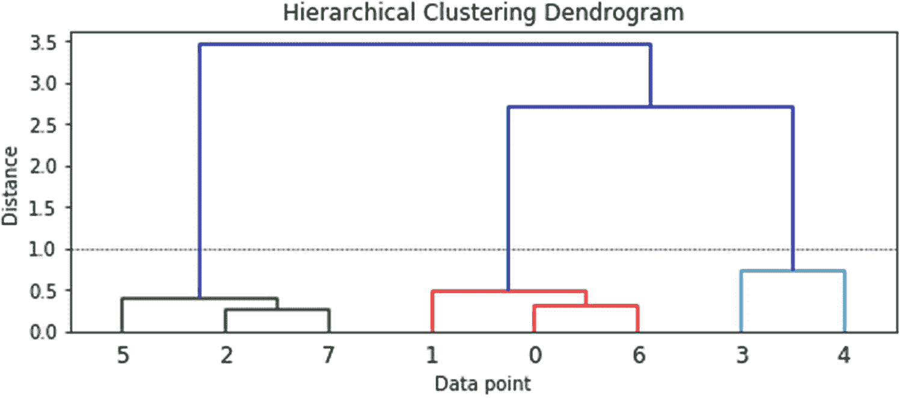

图 4-17

可视化层次聚类过程的树状图

```python
plt.figure(figsize=(8, 3))
plt.title('层次聚类树状图')
plt.xlabel('数据点')
plt.ylabel('距离')
dendrogram(Z)
plt.axhline(y=1.0, c="k", ls="--", lw=0.5)
```

我们可以看到每个数据点如何从一个单独的聚类开始，并逐渐与其他数据点合并形成聚类。从颜色和树状图的高级角度来看，如果你考虑距离度量大约为 1.0 或以上（由虚线表示），你可以看到模型已正确识别出三个主要的聚类。利用这个距离，我们得到了聚类标签。请参见图 4-18。

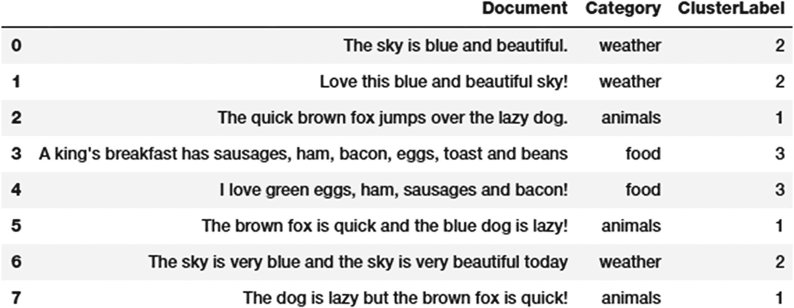

图 4-18

通过层次聚类将我们的文档分组到聚类中

```python
from scipy.cluster.hierarchy import fcluster
max_dist = 1.0
cluster_labels = fcluster(Z, max_dist, criterion="distance")
cluster_labels = pd.DataFrame(cluster_labels, columns=['聚类标签'])
pd.concat([corpus_df, cluster_labels], axis=1)
```

因此，你可以清楚地看到，基于分配给文档的聚类标签，我们的算法已正确识别出文档中的三个不同类别。这应该让你很好地了解我们的 TF-IDF 特征如何被用于构建相似度特征，而这些特征反过来又帮助我们对文档进行聚类。将来你可以使用这个流程来对你的文档进行聚类。我们将在本书后面的章节中，使用更多模型和示例进一步详细讨论文本聚类。


### 主题模型

尽管我们会在本书的独立章节中详细讨论主题建模，但若未谈及主题模型，关于特征工程的讨论便不算完整。我们可以利用一些摘要技术，从文本文档中提取基于主题或概念的特征。主题模型的核心思想在于从文档语料库中提取关键主题或概念，这些主题或概念以“主题”的形式呈现。每个主题可以表示为文档语料库中词语/术语的集合。这些术语共同指代特定的主题、议题或概念，并且每个主题都能通过这些术语所传达的语义含义与其他主题轻松区分开来。

然而，根据数据的不同，你常常会得到一些相互重叠的主题。这些概念涵盖范围很广，从简单的事实陈述到观点和看法。主题模型在总结大型文本文档语料库以提取和描述关键概念方面极为有用。它们同样有助于从文本数据中提取能捕捉数据中潜在模式的特征。参见图 4-19。

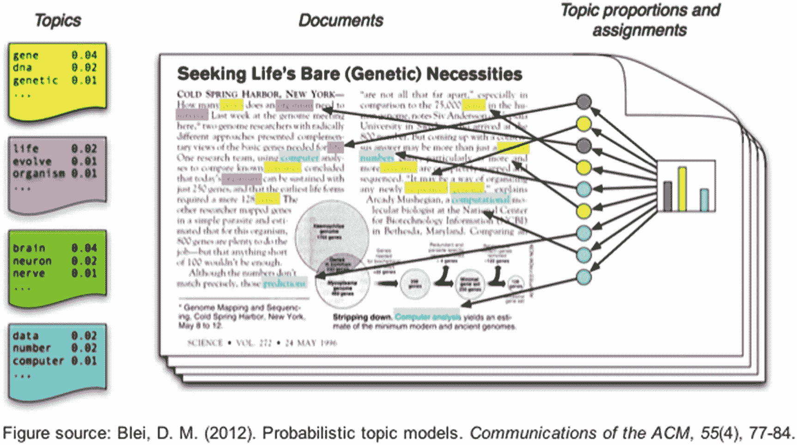

图 4-19：使用层次聚类将文档分组

主题建模有多种技术，其中大部分涉及某种形式的矩阵分解。一些技术，如潜在语义索引（LSI），会使用矩阵分解操作，更具体地说是奇异值分解。我们采用另一种称为潜在狄利克雷分配（LDA）的技术，它使用生成式概率模型，其中每个文档由若干主题的组合构成，并且每个术语或单词可以归属于特定主题。这类似于基于 pLSI 的模型（概率潜在语义索引）。在 LDA 中，每个潜在主题上都有一个狄利克雷先验分布。该技术背后的数学原理相当复杂，所以我在此尽量简化说明。我们还会在后续章节中详细讨论主题建模！参见图 4-20。

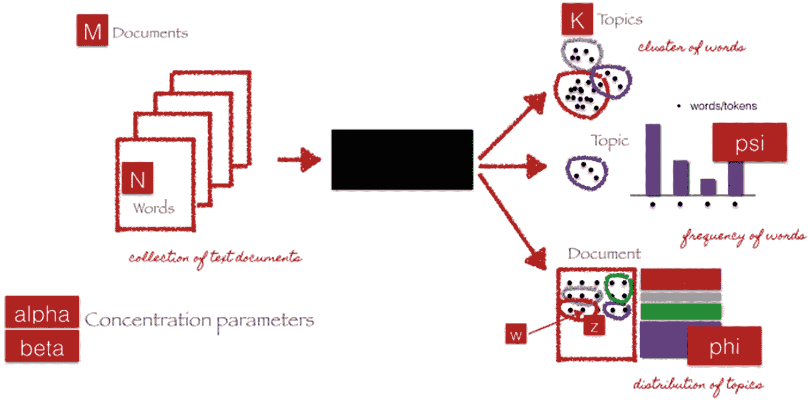

图 4-20：端到端 LDA 框架（图片由 C. Doig 提供，源自《Python 主题建模入门》）

图 4-20 中的黑盒代表了核心算法，该算法使用前述参数从 `M` 个文档中提取 `K` 个主题。图 4-22 中概述的步骤对幕后的工作原理进行了简单解释。

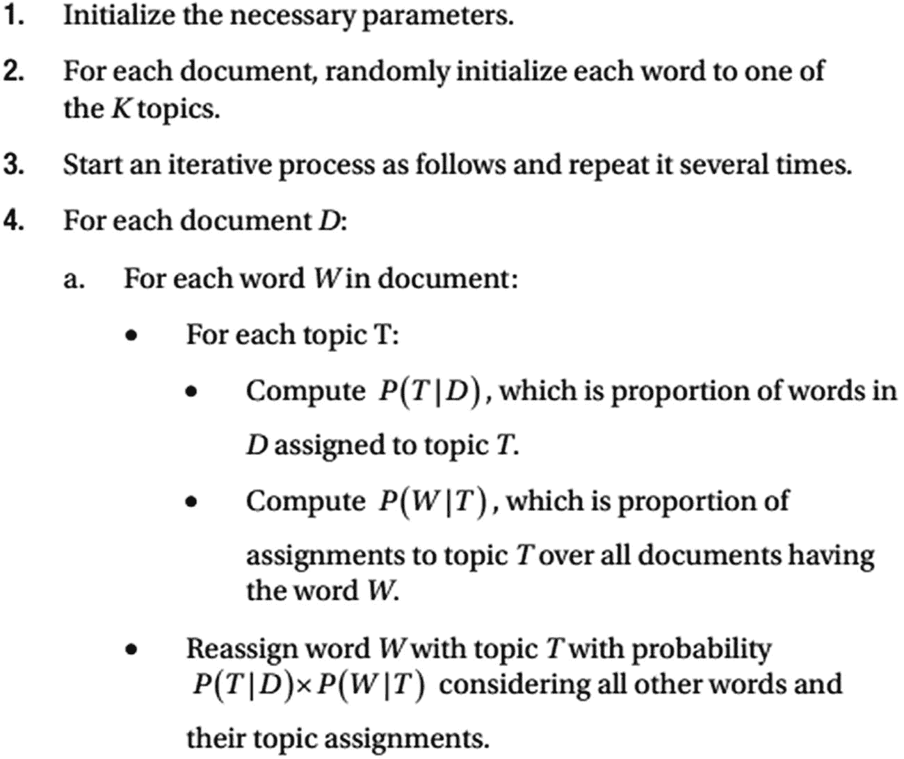

图 4-21：LDA 主题建模算法的主要步骤

经过多次迭代后，我们应该能得到每个文档的主题混合分布，然后根据指向每个主题的术语生成该主题的组成部分。像 `Gensim` 或 `Scikit-Learn` 这样的框架使我们能够利用 LDA 模型生成主题。就本章旨在探讨的特征工程而言，你需要记住：当 LDA 应用于文档-术语矩阵（TF-IDF 或词袋特征矩阵）时，它会被分解成两个主要部分。

*   一个**文档-主题矩阵**，即我们需要的特征矩阵。
*   一个**主题-术语矩阵**，有助于我们查看语料库中的潜在主题。

现在，我们利用 `Scikit-Learn` 来获取文档-主题矩阵，操作如下。该矩阵可用作任何后续建模需求的特征。参见图 4-22。

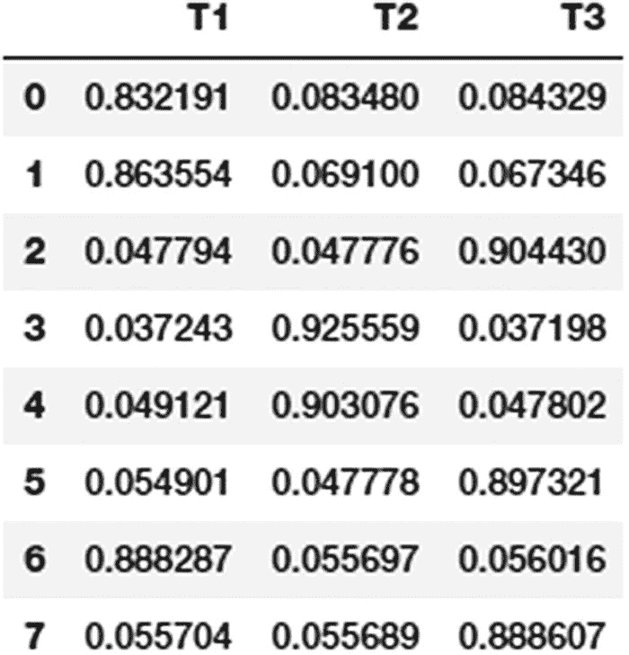

图 4-22：从 LDA 模型生成的文档-主题特征矩阵

```
from sklearn.decomposition import LatentDirichletAllocation
lda = LatentDirichletAllocation(n_topics=3, max_iter=10000, random_state=0)
dt_matrix = lda.fit_transform(cv_matrix)
features = pd.DataFrame(dt_matrix, columns=['T1', 'T2', 'T3'])
features
```

在此输出中，你可以清晰地看到每个文档对这三个主题各自的贡献程度。你可以通过以下方式查看主题及其主要组成部分。

```
tt_matrix = lda.components_
for topic_weights in tt_matrix:
    topic = [(token, weight) for token, weight in zip(vocab, topic_weights)]
    topic = sorted(topic, key=lambda x: -x[1])
    topic = [item for item in topic if item[1] > 0.6]
    print(topic)
    print()
[('sky', 4.3324395825632624), ('blue', 3.373753174831771), ('beautiful', 3.3323652405224857), ('today', 1.3325579841038182), ('love', 1.3304224288080069)]
[('bacon', 2.332695948479998), ('eggs', 2.332695948479998), ('ham', 2.332695948479998), ('sausages', 2.332695948479998), ('love', 1.335454457601996), ('beans', 1.332773525378464), ('breakfast', 1.332773525378464), ('kings', 1.332773525378464), ('toast', 1.332773525378464), ('green', 1.3325433207547732)]
[('brown', 3.3323474595768783), ('dog', 3.3323474595768783), ('fox', 3.3323474595768783), ('lazy', 3.3323474595768783), ('quick', 3.3323474595768783), ('jumps', 1.3324193736202712), ('blue', 1.2919635624485213)]
```

因此，根据其组成术语，你可以清楚地看到这三个主题彼此之间具有很高的区分度。第一个主题谈论天气，第二个关于食物，最后一个则关于动物。为主题建模选择主题数量本身是一门完整的技术，既是一门艺术，也是一门科学。有多种方法和启发式策略可以获取最佳的主题数量，但由于这些技术细节繁多，我们在此不做讨论。


### 高级特征工程模型

传统的（基于计数的）文本数据特征工程策略涉及一系列模型，通常被称为词袋模型。这包括词频、`TF-IDF`（词频-逆文档频率）、`N-Grams`（N 元组）等。虽然它们是有效的文本特征提取方法，但由于模型本质上只是非结构化单词的袋子，我们会丢失每个文本文档中诸如语义、结构、顺序以及周围单词的上下文等额外信息。这足以激励我们去探索更复杂的模型，这些模型能够捕捉这些信息，并为我们提供作为单词向量表示的特征，通常被称为*嵌入*。

虽然这听起来有些道理，但我们为什么要有足够的动力去学习和构建这些词嵌入呢？对于语音或图像识别系统而言，所有信息已经以丰富密集的特征向量形式存在，这些向量嵌入在高维数据集中，比如音频频谱图和图像像素强度。然而，对于原始文本数据，尤其是像词袋这样的基于计数的模型，我们处理的是可能具有自己标识符的单个单词，并且无法捕捉单词之间的语义关系。这会导致文本数据产生巨大的稀疏词向量，因此，如果没有足够的数据，我们可能会得到糟糕的模型，甚至由于维数灾难而导致过拟合。见图 4-23。

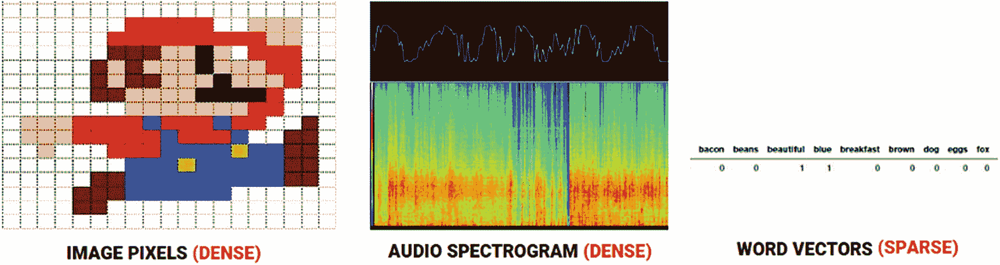

图 4-23

音频、图像和文本的特征表示对比

为了克服词袋模型的缺点，我们需要使用*向量空间模型（VSM）*，以便能够基于语义和上下文相似性将词向量嵌入到这个连续向量空间中。事实上，*分布式语义学*领域的*分布假说*告诉我们，出现在并用于相同上下文中的单词在语义上彼此相似，并且具有相似的含义。简单来说，“一个词由它所处的环境所表征”。

一篇详细讨论这些语义词向量及各种类型的著名论文是 Baroni 等人的《不要计数，要预测！上下文计数与上下文预测语义向量的系统比较》。我们不会深入探讨，但简而言之，有两种主要的上下文词向量方法。*基于计数的方法*，如*潜在语义分析（LSA）*，可用于计算语料库中单词与其相邻单词共现频率的统计度量，然后根据这些度量为每个单词构建密集词向量。*预测方法*，如*基于神经网络的语言模型*，则通过观察语料库中的单词序列，试图从其相邻单词中预测单词。在此过程中，它学习了分布式表示，从而为我们提供了密集的词嵌入。我们在本节中重点介绍这些预测方法。

### 加载圣经语料库

为了训练并展示这些基于深度学习的先进特征表示模型的部分能力，我们通常需要一个更大的语料库。虽然我们仍将使用之前的语料库进行演示，但我们也将使用 `NLTK` 加载另一个基于詹姆斯国王版本的圣经语料库。然后我们对文本进行预处理，以便根据我们稍后实现的模型，展示可能更相关的示例。

```
from nltk.corpus import gutenberg
from string import punctuation
bible = gutenberg.sents('bible-kjv.txt')
remove_terms = punctuation + '0123456789'
norm_bible = [[word.lower() for word in sent if word not in remove_terms] for sent in bible]
norm_bible = [' '.join(tok_sent) for tok_sent in norm_bible]
norm_bible = filter(None, normalize_corpus(norm_bible))
norm_bible = [tok_sent for tok_sent in norm_bible if len(tok_sent.split()) > 2]
print('总行数:', len(bible))
print('\n 样本行:', bible[10])
print('\n 处理后的行:', norm_bible[10])
```

以下输出显示了语料库中的总行数以及预处理在圣经语料库上的工作方式。

```
总行数: 30103
样本行: ['1', ':', '6', 'And', 'God', 'said', ',', 'Let', 'there', 'be', 'a', 'firmament', 'in', 'the', 'midst', 'of', 'the', 'waters', ',', 'and', 'let', 'it', 'divide', 'the', 'waters', 'from', 'the', 'waters', '.']
处理后的行: god said let firmament midst waters let divide waters waters
```

现在，让我们来看一些流行的词嵌入模型，并从我们的语料库中提炼出有意义的特征吧！

### Word2Vec 模型

该模型由谷歌于 2013 年创建，是一个基于深度学习的预测模型，用于计算和生成高质量、分布式且连续的密集词向量表示，这些表示能够捕捉上下文和语义相似性。本质上，这些是无监督模型，可以接收海量文本语料库，创建可能的词汇表，并为向量空间中代表该词汇表的每个单词生成密集的词嵌入。通常，您可以指定词嵌入向量的大小，而向量的总数基本上等于词汇表的大小。这使得这个密集向量空间的维度比使用传统词袋模型构建的高维稀疏向量空间低得多。

`Word2Vec` 可以利用两种不同的模型架构来创建这些词嵌入表示。它们包括：

- 连续词袋（`CBOW`）模型
- 跳字模型

这些模型由 Mikolov 等人提出，我建议感兴趣的读者阅读围绕这些模型的原始论文，包括 Mikolov 等人的《词语和短语的分布式表示及其组合性》以及 Mikolov 等人的《向量空间中词表示的高效估计》，以获取深入视角。

#### 连续词袋（CBOW）模型

`CBOW` 模型（见图 4-24）架构试图基于源上下文单词（周围单词）来预测当前目标单词（中心词）。考虑一个简单的句子，“the quick brown fox jumps over the lazy dog”，这可以形成 (context_window, target_word) 的对，其中如果我们考虑大小为 2 的上下文窗口，我们有这样的示例：(`[quick, fox]`, `brown`)、(`[the, brown]`, `quick`)、(`[the, dog]`, `lazy`) 等等。因此，该模型试图基于 `context_window` 单词来预测 `target_word`。

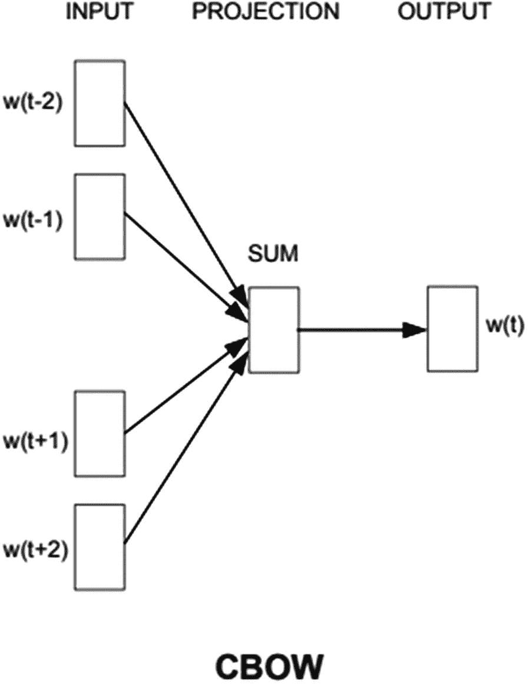

图 4-24

`CBOW` 模型架构（来源：[`https://arxiv.org/pdf/1301.3781.pdf`](https://arxiv.org/pdf/1301.3781.pdf) Mikolov 等人）

由于 `Word2Vec` 系列模型是无监督的，你只需给它一个语料库，无需额外的标签或信息，它就能从语料库中构建稠密的词嵌入。但是，一旦你拥有了这个语料库，你仍然需要利用一种有监督的分类方法才能获得这些嵌入。我们仅通过语料库本身来做到这一点，无需任何辅助信息。我们可以将这种 `CBOW` 架构建模为深度学习分类模型，其中我们将上下文单词作为我们的输入 `X`，并试图预测目标单词 `Y`。事实上，构建这种架构比跳字模型更简单，后者试图从一个源目标单词预测一大堆上下文单词。


### 实现连续词袋（CBOW）模型

虽然使用像 Gensim 这样具备 Word2Vec 模型的强大框架非常棒，但我们不妨从头开始实现一次，以便更深入地理解其背后的运作原理。我们将利用存储在 `norm_bible` 变量中的圣经语料库来训练模型。实现过程将聚焦于以下四个部分：

- 构建语料库词汇表
- 构建 CBOW（上下文，目标词）生成器
- 构建 CBOW 模型架构
- 训练模型
- 获取词嵌入

闲言少叙，我们马上开始！

#### 构建语料库词汇表

首先，我们将构建语料库词汇表，从中提取每个唯一的单词，并为其映射一个唯一的数字标识符。

```python
from keras.preprocessing import text
from keras.utils import np_utils
from keras.preprocessing import sequence
tokenizer = text.Tokenizer()
tokenizer.fit_on_texts(norm_bible)
word2id = tokenizer.word_index
# 构建唯一单词的词汇表
word2id['PAD'] = 0
id2word = {v:k for k, v in word2id.items()}
wids = [[word2id[w] for w in text.text_to_word_sequence(doc)] for doc in norm_bible]
vocab_size = len(word2id)
embed_size = 100
window_size = 2 # 上下文窗口大小
print('词汇表大小:', vocab_size)
print('词汇表样例:', list(word2id.items())[:10])
词汇表大小: 12425
词汇表样例: [('base', 2338), ('feller', 10771), ('sanctuary', 455), ('plunge', 10322), ('azariah', 1120), ('enlightened', 4438), ('horns', 838), ('kareah', 2920), ('nursing', 5943), ('baken', 3492)]
```

由此可见，我们为语料库中的唯一单词创建了一个词汇表，并建立了单词到其唯一标识符（以及反向映射）的映射。`PAD` 项通常用于在必要时将上下文单词填充到固定长度。

#### 构建 CBOW（上下文，目标词）生成器

我们需要由目标中心词及其周围上下文单词组成的配对。在我们的实现中，目标词长度为 1，周围上下文长度为 2 × *window*_*size*，即取语料库中目标词前后的各 `window_size` 个单词。通过下面的例子，这一点会更清楚。

```python
def generate_context_word_pairs(corpus, window_size, vocab_size):
    context_length = window_size*2
    for words in corpus:
        sentence_length = len(words)
        for index, word in enumerate(words):
            context_words = []
            label_word   = []
            start = index - window_size
            end = index + window_size + 1
            context_words.append([words[i]
                                 for i in range(start, end)
                                 if 0 <= i < sentence_length
                                 and i != index])
            label_word.append(word)
            x = sequence.pad_sequences(context_words, maxlen=context_length)
            y = np_utils.to_categorical(label_word, vocab_size)
            yield (x, y)
i = 0
for x, y in generate_context_word_pairs(corpus=wids, window_size=window_size, vocab_size=vocab_size):
    if 0 not in x[0]:
        print('上下文 (X):', [id2word[w] for w in x[0]], '-> 目标词 (Y):', id2word[np.argwhere(y[0])[0][0]])
        if i == 10:
            break
        i += 1
上下文 (X): ['old','testament','james','bible'] -> 目标词 (Y): king
上下文 (X): ['first','book','called','genesis'] -> 目标词 (Y): moses
上下文 (X): ['beginning','god','heaven','earth'] -> 目标词 (Y): created
上下文 (X): ['earth','without','void','darkness'] -> 目标词 (Y): form
上下文 (X): ['without','form','darkness','upon'] -> 目标词 (Y): void
上下文 (X): ['form', 'void', 'upon', 'face'] -> 目标词 (Y): darkness
上下文 (X): ['void', 'darkness', 'face', 'deep'] -> 目标词 (Y): upon
上下文 (X): ['spirit', 'god', 'upon', 'face'] -> 目标词 (Y): moved
上下文 (X): ['god', 'moved', 'face', 'waters'] -> 目标词 (Y): upon
上下文 (X): ['god', 'said', 'light', 'light'] -> 目标词 (Y): let
上下文 (X): ['god', 'saw', 'good', 'god'] -> 目标词 (Y): light
```

上述输出应该能让你更清楚地了解 `X` 如何构成上下文单词，以及我们如何根据这些上下文预测目标中心词 `Y`。例如，假设原始文本是“in the beginning god created heaven and earth”，经过预处理和停用词移除后，变成了“beginning god created heaven earth”。给定 [beginning, god, heaven, earth] 作为上下文，本例中的目标中心词就是“created”。

#### 构建 CBOW 模型架构

现在，我们利用基于 TensorFlow 的 Keras 来构建 CBOW 模型的深度学习架构。为此，我们的输入将是上下文单词，它们被传递到一个嵌入层（使用随机权重初始化）。词嵌入被传递到一个 lambda 层，在那里我们对词嵌入进行平均（因此被称为 CBOW，因为平均时我们并不真正考虑上下文单词的顺序或序列）。然后，我们将这个平均后的上下文嵌入传递到一个密集的 softmax 层，该层预测我们的目标词。我们将此与实际目标词进行匹配，利用 `categorical_crossentropy` 损失函数计算损失，并在每个训练周期执行反向传播，以更新过程中的嵌入层。以下代码展示了模型架构。见图 4-25。

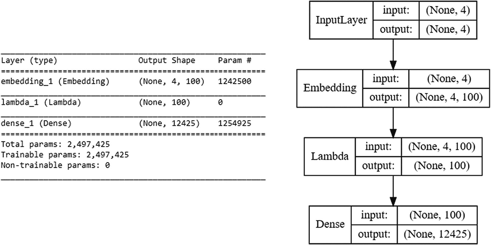

**图 4-25.** CBOW 模型摘要与架构

```python
import keras.backend as K
from keras.models import Sequential
from keras.layers import Dense, Embedding, Lambda
# 构建 CBOW 架构
cbow = Sequential()
cbow.add(Embedding(input_dim=vocab_size, output_dim=embed_size, input_length=window_size*2))
cbow.add(Lambda(lambda x: K.mean(x, axis=1), output_shape=(embed_size,)))
cbow.add(Dense(vocab_size, activation="softmax"))
cbow.compile(loss='categorical_crossentropy', optimizer="rmsprop")
# 查看模型摘要
print(cbow.summary())
# 可视化模型结构
from IPython.display import SVG
from keras.utils.vis_utils import model_to_dot
SVG(model_to_dot(cbow, show_shapes=True, show_layer_names=False,
                 rankdir='TB').create(prog='dot', format="svg"))
```

如果你仍然难以可视化这个深度学习模型，我建议你阅读我前面提到的论文。我试着用简单的术语总结这个模型的核心概念。我们输入维度为 (2 × *window*_*size*) 的上下文单词，并将它们传递给大小为 (*vocab*_*size* × *embed*_*size*) 的嵌入层，这将为每个上下文单词生成密集的词嵌入（每个单词为 1 × *embed*_*size*）。接着，我们使用一个 lambda 层对这些嵌入进行平均，得到一个平均的密集嵌入（1 × *embed*_*size*），然后将其发送到密集的 softmax 层，该层输出最可能的目标词。我们将其与实际目标词进行比较，计算损失，反向传播误差以调整权重（在嵌入层中），并对所有（上下文，目标词）配对重复此过程多个训练周期。图 4-26 试图解释这个过程。

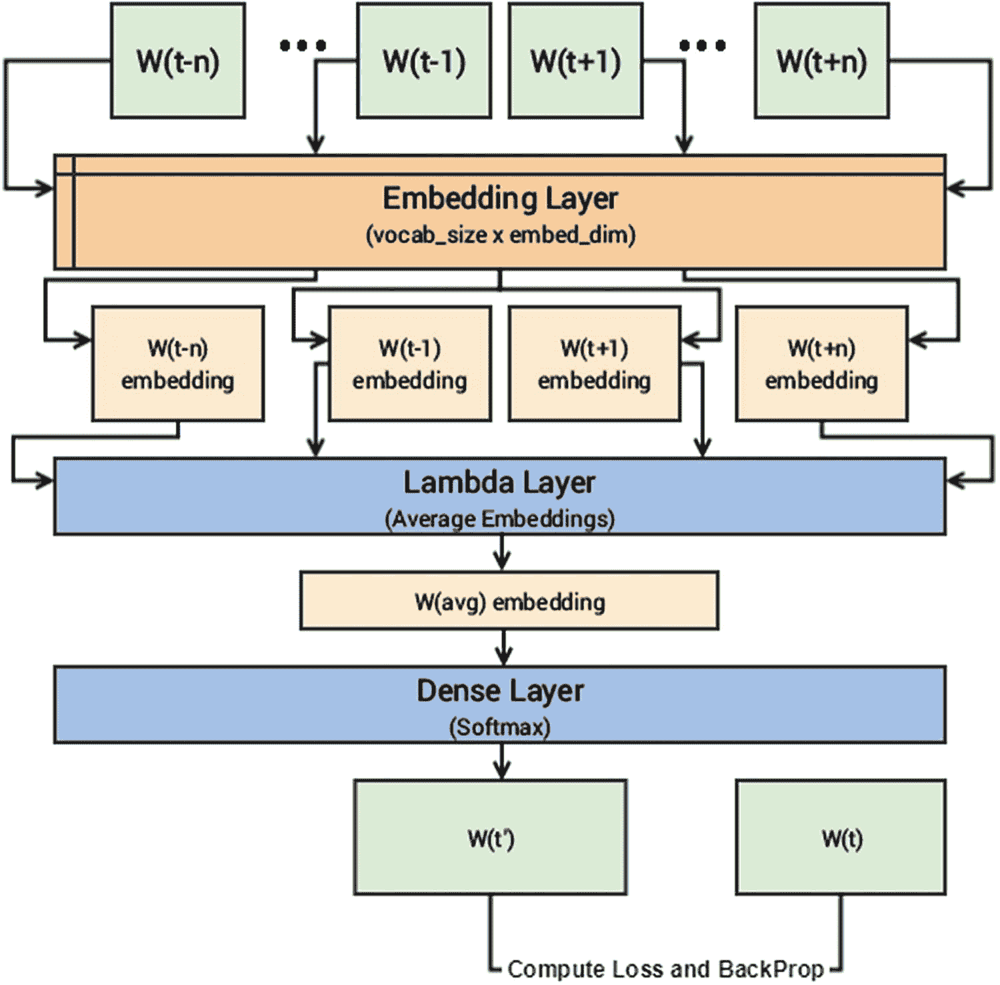

**图 4-26.** CBOW 深度学习模型的视觉描述

现在，我们已经准备好使用我们的数据生成器向模型输入（上下文，目标词）配对，在语料库上训练这个模型了。

### 训练模型

在完整的语料库上运行模型需要相当长的时间，所以我只运行了五个训练周期。你可以使用以下代码，并在必要时增加训练周期。

```python
for epoch in range(1, 6):
    loss = 0.
    i = 0
    for x, y in generate_context_word_pairs(corpus=wids, window_size=window_size, vocab_size=vocab_size):
        i += 1
        loss += cbow.train_on_batch(x, y)
        if i % 100000 == 0:
            print('已处理 {} 对 (上下文, 单词) 配对'.format(i))
    print('训练周期:', epoch, '\t 损失:', loss)
    print()
训练周期: 1     损失: 4257900.60084
训练周期: 2     损失: 4256209.59646
训练周期: 3     损失: 4247990.90456
训练周期: 4     损失: 4225663.18927
训练周期: 5     损失: 4104501.48929
```

### 注意
运行此模型计算量很大，如果使用 GPU 进行训练，效果会更好。我在一个配备 Tesla K80 GPU 的 AWS p2.x 实例上进行了训练，仅五个训练周期就花了将近 1.5 小时！

一旦此模型训练完成，相似的单词在嵌入层中应具有相似的权重。


### 获取词嵌入

要获取整个词汇表的词嵌入，我们可以通过以下代码从嵌入层中提取。我们不提取位置 0 处的嵌入，因为它属于填充（`PAD`）词，并非我们真正感兴趣的词。见图 4-27。

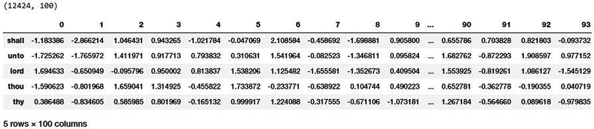

图 4-27

基于 CBOW 模型的词汇表词嵌入

```
weights = cbow.get_weights()[0]
weights = weights[1:]
print(weights.shape)
pd.DataFrame(weights, index=list(id2word.values())[1:]).head()
```

因此，你可以清晰地看到每个词都有一个大小为（1×100）的密集嵌入，如图 4-27 的输出所示。让我们尝试基于这些嵌入为特定感兴趣的词找到一些上下文相似的词。为此，我们基于密集嵌入向量构建词汇表中所有词之间的成对距离矩阵，然后基于最短（欧几里得）距离找到每个感兴趣词的 n 个最近邻。

```
from sklearn.metrics.pairwise import euclidean_distances
# 计算成对距离矩阵
distance_matrix = euclidean_distances(weights)
print(distance_matrix.shape)
# 查看上下文相似的词
similar_words = {search_term: [id2word[idx]
for idx in distance_matrix[word2id[search_term]-1].argsort()[1:6]+1]
for search_term in ['god', 'jesus', 'noah', 'egypt', 'john', 'gospel', 'moses','famine']}
similar_words
(12424, 12424)
{'egypt': ['destroy', 'none', 'whole', 'jacob', 'sea'],
'famine': ['wickedness', 'sore', 'countries', 'cease', 'portion'],
'god': ['therefore', 'heard', 'may', 'behold', 'heaven'],
'gospel': ['church', 'fowls', 'churches', 'preached', 'doctrine'],
'jesus': ['law', 'heard', 'world', 'many', 'dead'],
'john': ['dream', 'bones', 'held', 'present', 'alive'],
'moses': ['pharaoh', 'gate', 'jews', 'departed', 'lifted'],
'noah': ['abram', 'plagues', 'hananiah', 'korah', 'sarah']}
```

你可以清晰地看到其中一些在上下文中有意义（god 与 heaven，gospel 与 church 等），而有些则不然。通常，训练更多的周期会得到更好的结果。我们现在来探索 Skip-Gram 架构，它通常比 CBOW 能给出更好的结果。

### Skip-Gram 模型

Skip-Gram 模型架构试图实现 CBOW 模型的反向功能。它试图根据一个目标词（中心词）来预测源上下文词（周围词）。考虑我们之前的简单句子“the quick brown fox jumps over the lazy dog”。如果我们使用 CBOW 模型，我们会得到（`context_window`， `target_word`）对，例如，如果考虑大小为 2 的上下文窗口，我们会得到诸如（`[quick, fox]`， `brown`）、（`[the, brown]`， `quick`）、（`[the, dog]`， `lazy`）等示例。现在，考虑到 Skip-Gram 模型的目标是从目标词预测上下文，该模型通常会反转上下文和目标，并试图从每个目标词预测每个上下文词。因此任务变成了根据目标词`brown`预测上下文`[quick, fox]`，或根据目标词`quick`预测上下文`[the, brown]`，依此类推。因此，模型试图基于`target_word`预测`context_window`中的词。见图 4-28。

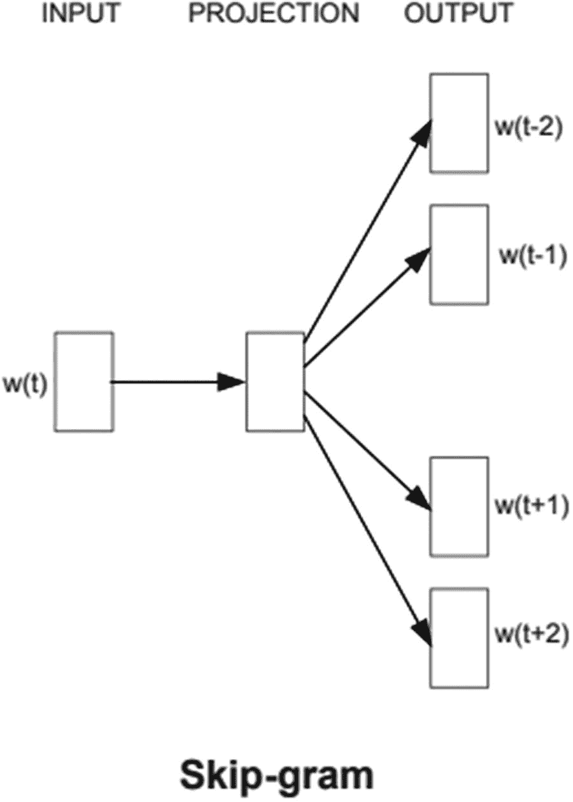

图 4-28

Skip-Gram 模型架构（来源：[`https://arxiv.org/pdf/1301.3781.pdf`](https://arxiv.org/pdf/1301.3781.pdf) Mikolov 等人）

正如我们在 CBOW 模型中讨论的，我们需要将这个 Skip-Gram 架构建模为一个深度学习分类模型，因此我们将目标词作为输入，并尝试预测上下文词。这变得稍微复杂，因为我们的上下文中有多个词。我们通过将每个(*target*, *context*_*words*)对分解为(*target*, *context*)对来进一步简化，这样上下文只包含一个词。因此我们之前的数据集被转换为类似（`brown`， `quick`）、（`brown`， `fox`）、（`quick`， `the`）、（`quick`， `brown`）等对。但是，我们如何监督或训练模型来知道什么是上下文相关的，什么不是呢？

为此，我们向 Skip-Gram 模型提供（*X*， *Y*）对，其中*X*是输入，*Y*是标签。我们通过使用[(*target*, *context*)， 1]对作为正输入样本来实现这一点，其中`target`是我们感兴趣的词，`context`是出现在目标词附近的上下文词。*正标签 1*表示这是一个上下文相关的对。我们还输入[(*target*, *random*)， 0]对作为负输入样本，其中`target`同样是我们感兴趣的词，但`random`是从词汇表中随机选择的一个词，与我们的目标词没有上下文或关联。因此*负标签 0*表示这是一个上下文无关的对。我们这样做是为了让模型能够学习哪些词对是上下文相关的，哪些不是，然后为语义相似的词生成相似的嵌入。

### 实现 Skip-Gram 模型

现在让我们尝试从头实现这个模型，以深入了解其内部工作原理，并能够将其与我们实现的 CBOW 模型进行比较。我们照常使用包含在`norm_bible`变量中的圣经语料库来训练我们的模型。实现将集中在五个部分：

- 构建语料库词汇表
- 构建 Skip-Gram [(目标词， 上下文词)， 相关性]生成器
- 构建 Skip-Gram 模型架构
- 训练模型
- 获取词嵌入

让我们开始着手构建我们的 Skip-Gram Word2Vec 模型吧！

#### 构建语料库词汇表

首先，我们按照标准流程构建语料库词汇表，从词汇表中提取每个唯一的词并分配一个唯一标识符，类似于我们在 CBOW 模型中所做的。我们还维护映射关系，以便在词及其唯一标识符之间进行转换。

```
from keras.preprocessing import text
tokenizer = text.Tokenizer()
tokenizer.fit_on_texts(norm_bible)
word2id = tokenizer.word_index
id2word = {v:k for k, v in word2id.items()}
vocab_size = len(word2id) + 1
embed_size = 100
wids = [[word2id[w] for w in text.text_to_word_sequence(doc)] for doc in norm_bible]
print('Vocabulary Size:', vocab_size)
print('Vocabulary Sample:', list(word2id.items())[:10])
Vocabulary Size: 12425
Vocabulary Sample: [('base', 2338), ('feller', 10771), ('sanctuary', 455), ('plunge', 10322), ('azariah', 1120), ('enlightened', 4438), ('horns', 838), ('kareah', 2920), ('nursing', 5943), ('baken', 3492)]
```

语料库中的每个唯一词现在都是我们词汇表的一部分，并拥有一个唯一的数字标识符。


### 构建 Skip-Gram `[(目标词, 上下文词), 相关性]`生成器

现在，我们来构建 Skip-Gram 生成器，它将为我们提供词对及其相关性，正如我们之前讨论的。幸运的是，Keras 有一个便捷的 Skip-Grams 工具可以直接使用，我们无需像在 CBOW 中那样手动实现这个生成器。

`skipgrams(...)` 函数位于 `keras.preprocessing.sequence` 中。该函数将词索引序列（整数列表）转换为以下形式的词元组：

1.  `(词, 同一窗口内的词)`，标签为 1（正样本）。
2.  `(词, 词汇表中的随机词)`，标签为 0（负样本）。

```python
from keras.preprocessing.sequence import skipgrams
# 生成 skip-grams
skip_grams = [skipgrams(wid, vocabulary_size=vocab_size, window_size=10) for wid in wids]
# 查看 skip-grams 样本
pairs, labels = skip_grams[0][0], skip_grams[0][1]
for i in range(10):
    print("({:s} ({:d}), {:s} ({:d})) -> {:d}".format(
        id2word[pairs[i][0]], pairs[i][0],
        id2word[pairs[i][1]], pairs[i][1],
        labels[i]))
(bible (5766), stank (5220)) -> 0
(james (1154), izri (9970)) -> 0
(king (13), bad (2285)) -> 0
(king (13), james (1154)) -> 1
(king (13), lucius (8272)) -> 0
(james (1154), king (13)) -> 1
(james (1154), bazluth (10091)) -> 0
(james (1154), bible (5766)) -> 1
(king (13), bible (5766)) -> 1
(bible (5766), james (1154)) -> 1
```

因此，你可以看到我们已经成功生成了所需的 Skip-Grams，并且基于上述输出中的 Skip-Grams 样本，你可以根据标签（0 或 1）清晰地看出哪些是相关的，哪些是不相关的。

### 构建 Skip-Gram 模型架构

现在，我们利用 TensorFlow 之上的 Keras 来构建 Skip-Gram 模型的深度学习架构。为此，我们的输入将是目标词和上下文词或随机词对。每个输入都将传入各自的嵌入层（使用随机权重初始化）。一旦我们获得目标词和上下文词的词嵌入，我们将其传递到一个合并层，在该层中计算这两个向量的点积。然后，我们将这个点积值传递到一个密集的 sigmoid 层，该层根据词对是上下文相关还是随机词，预测结果是 1 或 0。

我们将其与实际相关性标签进行比较，利用`mean_squared_error`损失函数计算损失，并在每个训练周期执行反向传播，以更新嵌入层。以下代码展示了我们的模型架构。见图 4-29。

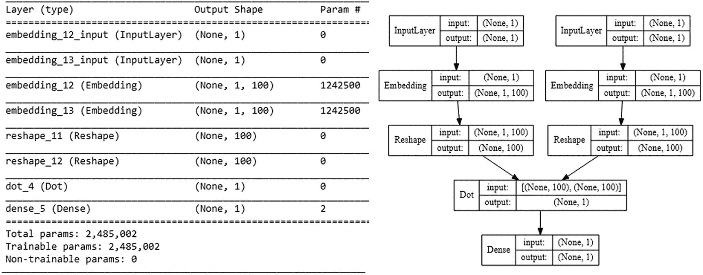

**图 4-29** Skip-Gram 模型概要及架构

```python
from keras.layers import Dot
from keras.layers.core import Dense, Reshape
from keras.layers.embeddings import Embedding
from keras.models import Sequential
from keras.models import Model
# 构建 skip-gram 架构
word_model = Sequential()
word_model.add(Embedding(vocab_size, embed_size, embeddings_initializer="glorot_uniform", input_length=1))
word_model.add(Reshape((embed_size, )))
context_model = Sequential()
context_model.add(Embedding(vocab_size, embed_size, embeddings_initializer="glorot_uniform", input_length=1))
context_model.add(Reshape((embed_size,)))
model_arch = Dot(axes=1)([word_model.output, context_model.output])
model_arch = Dense(1, kernel_initializer="glorot_uniform", activation="sigmoid")(model_arch)
model = Model([word_model.input, context_model.input], model_arch)
model.compile(loss="mean_squared_error", optimizer="rmsprop")
# 查看模型概要
print(model.summary())
# 可视化模型结构
from IPython.display import SVG
from keras.utils.vis_utils import model_to_dot
SVG(model_to_dot(model, show_shapes=True, show_layer_names=False, rankdir='TB').create(prog='dot', format="svg"))
```

理解这个深度学习模型相当直接。不过，我将尽力用简单的术语总结这个模型的核心概念，以便于理解。对于每个训练样本，我们有一对输入词，包括一个具有唯一数字标识符的输入目标词和一个具有唯一数字标识符的上下文词。如果是正样本，则该词具有上下文意义，是一个上下文词，我们的标签 Y = 1。否则，如果是负样本，则该词没有上下文意义，只是一个随机词，我们的标签 Y = 0。我们将每个词传递给它们各自的嵌入层，其大小为（`vocab_size` × `embed_size`），这将为这两个词生成稠密的词嵌入（每个词对应`1` × `embed_size`）。

接下来，我们使用一个合并层来计算这两个嵌入的点积，并得到点积值。然后发送到密集的 sigmoid 层，该层输出 1 或 0。我们将其与实际标签 Y（1 或 0）进行比较，计算损失，反向传播误差以调整权重（在嵌入层中），并对所有`(目标词, 上下文词)`对重复此过程，进行多个训练周期。图 4-30 试图解释这个过程。

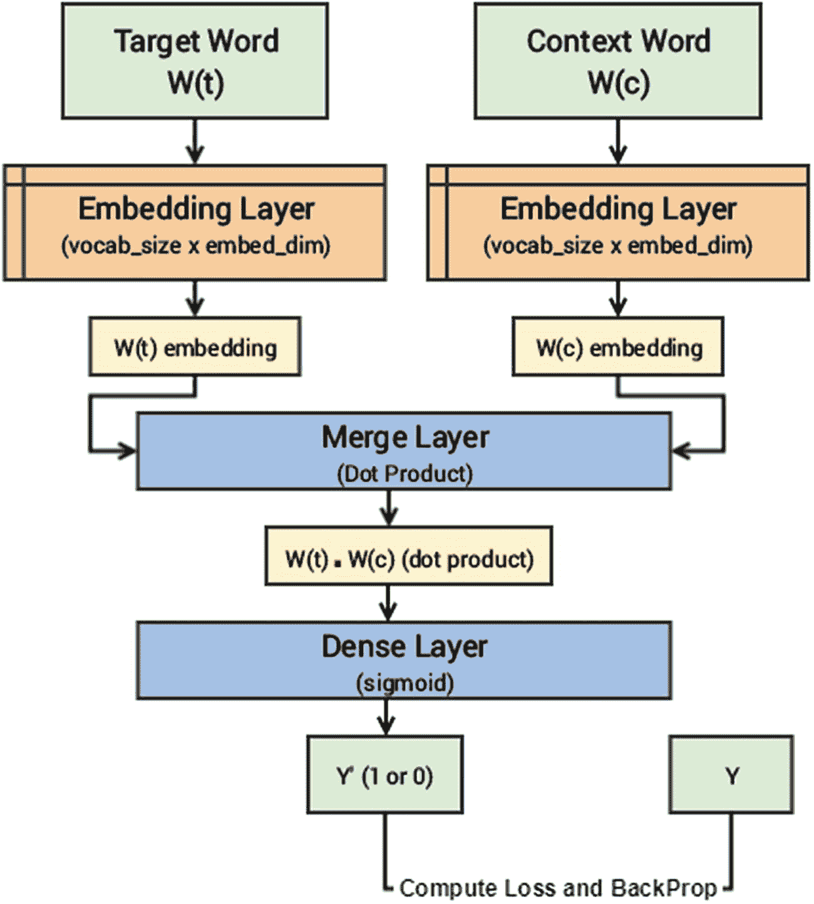

**图 4-30** Skip-Gram 深度学习模型的可视化描述

现在，让我们开始使用我们的 Skip-Grams 来训练模型。

### 训练模型

在完整语料库上运行模型需要相当多的时间，但比 CBOW 模型要快。我运行了五个训练周期。你可以利用以下代码，并在需要时运行更多周期。

```python
for epoch in range(1, 6):
    loss = 0
    for i, elem in enumerate(skip_grams):
        pair_first_elem = np.array(list(zip(*elem[0]))[0], dtype="int32")
        pair_second_elem = np.array(list(zip(*elem[0]))[1], dtype="int32")
        labels = np.array(elem[1], dtype="int32")
        X = [pair_first_elem, pair_second_elem]
        Y = labels
        if i % 10000 == 0:
            print('已处理 {} 个 (skip_first, skip_second, relevance) 对'.format(i))
        loss += model.train_on_batch(X,Y)
    print('训练周期:', epoch, '损失:', loss)
Epoch: 1 Loss: 4474.41281086
Epoch: 2 Loss: 3750.71884749
Epoch: 3 Loss: 3752.47489296
Epoch: 4 Loss: 3793.9177565
Epoch: 5 Loss: 3718.15081862
```

模型训练完成后，基于嵌入层，相似的词应具有相似的权重。


### 获取词嵌入

要获取整个词汇表的词嵌入，我们可以通过以下代码从嵌入层中提取。请注意，我们只关心目标词嵌入层，因此我们从 `word_model` 嵌入层提取嵌入向量。我们不采用位置 0 的嵌入，因为词汇表中没有任何词的数值标识符为 0。参见图 4-31。

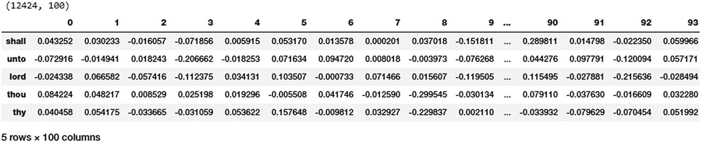

图 4-31 – 基于 Skip-Gram 模型的词汇表词嵌入

```
word_embed_layer = model.layers[2]
weights = word_embed_layer.get_weights()[0][1:]
print(weights.shape)
pd.DataFrame(weights, index=id2word.values()).head()
```

因此，你可以清晰地看到每个词都拥有一个大小为 (1 × 100) 的稠密嵌入，如上文输出所示。这与我们从 CBOW 模型中得到的结果类似。现在，我们在这些稠密嵌入向量上应用欧几里得距离度量，为词汇表中的每个词生成成对距离度量。然后，我们可以基于最短（欧几里得）距离来确定每个目标词的 n 个最近邻，这与我们在 CBOW 模型嵌入上的操作类似。

```
from sklearn.metrics.pairwise import euclidean_distances
distance_matrix = euclidean_distances(weights)
print(distance_matrix.shape)
similar_words = {search_term: [id2word[idx]
for idx in distance_matrix[word2id[search_term]-1].argsort()[1:6]+1]
for search_term in ['god', 'jesus', 'noah', 'egypt', 'john', 'gospel', 'moses','famine']}
similar_words
(12424, 12424)
{'egypt': ['taken', 'pharaoh', 'wilderness', 'gods', 'became'],
'famine': ['moved', 'awake', 'driven', 'howl', 'snare'],
'god': ['strength', 'given', 'blessed', 'wherefore', 'lord'],
'gospel': ['preached', 'must', 'preach', 'desire', 'grace'],
'jesus': ['disciples', 'christ', 'dead', 'peter', 'jews'],
'john': ['peter', 'hold', 'mountain', 'ghost', 'preached'],
'moses': ['commanded', 'third', 'congregation', 'tabernacle', 'tribes'],
'noah': ['ham', 'terah', 'amon', 'adin', 'zelophehad']}
```

从结果中可以清晰地看到，每个目标词的许多相似词都是合理的，并且与我们的 CBOW 模型相比，我们获得了更好的结果。现在，让我们使用 t-SNE（*t-分布随机邻域嵌入*）来可视化这些词嵌入。这是一种流行的降维技术，用于在低维空间（例如二维）中可视化高维空间。参见图 4-32。

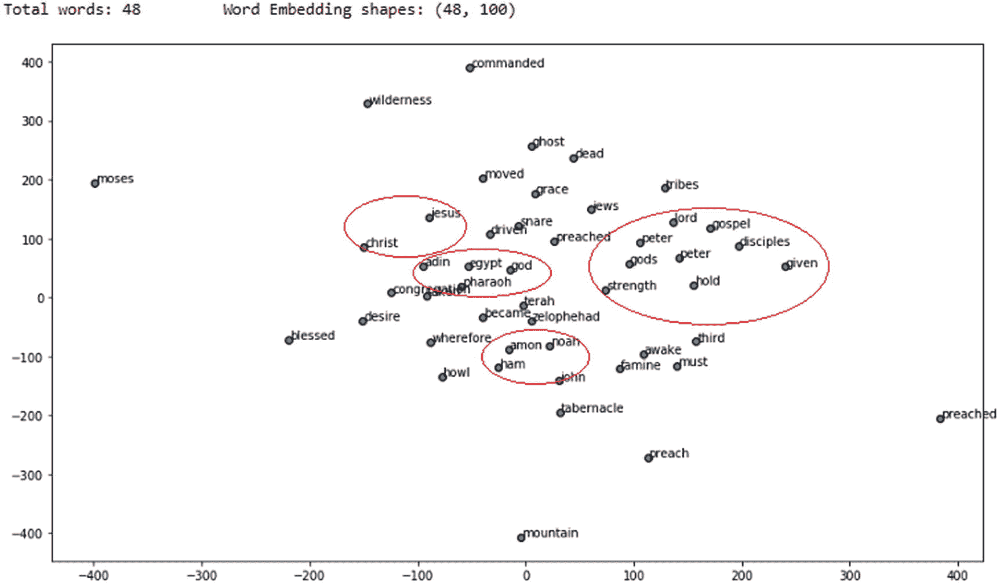

图 4-32 – 使用 t-SNE 可视化 Skip-Gram Word2Vec 词嵌入

```
from sklearn.manifold import TSNE
words = sum([[k] + v for k, v in similar_words.items()], [])
words_ids = [word2id[w] for w in words]
word_vectors = np.array([weights[idx] for idx in words_ids])
print('Total words:', len(words), '\tWord Embedding shapes:', word_vectors.shape)
tsne = TSNE(n_components=2, random_state=0, n_iter=10000, perplexity=3)
np.set_printoptions(suppress=True)
T = tsne.fit_transform(word_vectors)
labels = words
plt.figure(figsize=(14, 8))
plt.scatter(T[:, 0], T[:, 1], c="steelblue", edgecolors="k")
for label, x, y in zip(labels, T[:, 0], T[:, 1]):
plt.annotate(label, xy=(x+1, y+1), xytext=(0, 0), textcoords='offset points')
```

图 4-32 中的圆圈显示了在向量空间中彼此邻近、上下文语义相似的词。如果你发现其他有趣的规律，欢迎随时告知！

### 使用 Gensim 构建鲁棒的 Word2Vec 模型

虽然我们的实现还算不错，但它们并未针对在大型语料库上高效运行进行优化。由 Radim Řehůřek 创建的 *Gensim* 框架包含一个鲁棒、高效且可扩展的 Word2Vec 模型实现。我们将在圣经语料库上利用它。在我们的工作流程中，我们将对标准化后的语料库进行分词，然后重点关注 Word2Vec 模型中的以下四个参数进行构建。基本思想是提供文档语料库作为输入，并为输出获取特征向量。

在内部，它会根据输入的文本文档构建一个词汇表，并基于我们之前提到的各种技术学习词的向量表示。完成后，它会构建一个模型，可用于提取文档中每个词的词向量。使用诸如平均加权或 TF-IDF 加权等多种技术，我们可以利用文档的词向量来计算其平均向量表示。你可以在 [`http://radimrehurek.com/gensim/models/word2vec.html`](http://radimrehurek.com/gensim/models/word2vec.html) 获取有关 Gensim 的 Word2Vec 实现接口的更多详情。当我们基于示例训练语料库构建模型时，将主要关注以下参数。

- `size`：此参数用于设置词向量的大小或维度，范围可以从几十到几千。你可以尝试不同的维度，看看哪种效果最佳。
- `window`：此参数用于设置上下文或窗口大小，该大小指定算法在训练时视为上下文的词窗口长度。
- `min_count`：此参数指定词汇表中考虑一个词所需的最小词频。这有助于移除那些可能不太重要、因为在文档中出现频率极低的特定词。
- `sample`：此参数用于对高频词的降采样效果进行设置。通常在 0.01 到 0.0001 之间的值比较理想。

构建模型后，我们将使用感兴趣的目标词来查看每个词对应的最相似词。

```
from gensim.models import word2vec
# tokenize sentences in corpus
wpt = nltk.WordPunctTokenizer()
tokenized_corpus = [wpt.tokenize(document) for document in norm_bible]
# Set values for various parameters
feature_size = 100    # Word vector dimensionality
window_context = 30          # Context window size
min_word_count = 1   # Minimum word count
sample = 1e-3   # Downsample setting for frequent words
w2v_model = word2vec.Word2Vec(tokenized_corpus, size=feature_size,
window=window_context, min_count=min_word_count,
sample=sample, iter=50)
# view similar words based on gensim's model
similar_words = {search_term: [item[0]
for item in w2v_model.wv.most_similar([search_term], topn=5)]
for search_term in ['god', 'jesus', 'noah', 'egypt', 'john', 'gospel', 'moses','famine']}
similar_words
{'egypt': ['pharaoh', 'egyptians', 'bondage', 'rod', 'flowing'],
'famine': ['pestilence', 'peril', 'blasting', 'mildew', 'morever'],
'god': ['lord', 'promised', 'worldly', 'glory', 'reasonable'],
'gospel': ['faith', 'afflictions', 'christ', 'persecutions', 'godly'],
'jesus': ['peter', 'messias', 'apostles', 'immediately', 'neverthless'],
'john': ['baptist', 'james', 'peter', 'galilee', 'zebedee'],
'moses': ['congregation', 'children', 'aaron', 'ordinance', 'doctor'],
'noah': ['shem', 'japheth', 'ham', 'noe', 'henoch']}
```

这些相似词与我们的目标词关联更紧密，这也是意料之中的，因为我们让模型运行了更多迭代，这必然会产生更好且更具上下文关联的嵌入。你是否注意到了任何有趣的关联？参见图 4-33。


图 4-33


