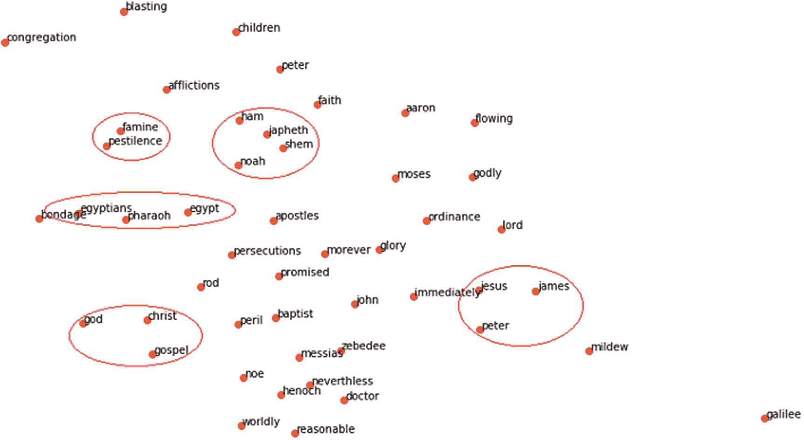
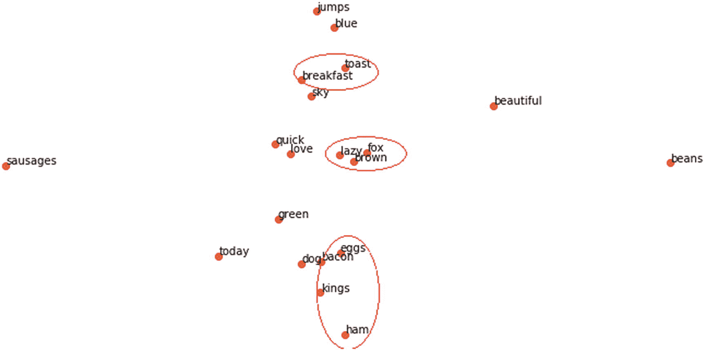
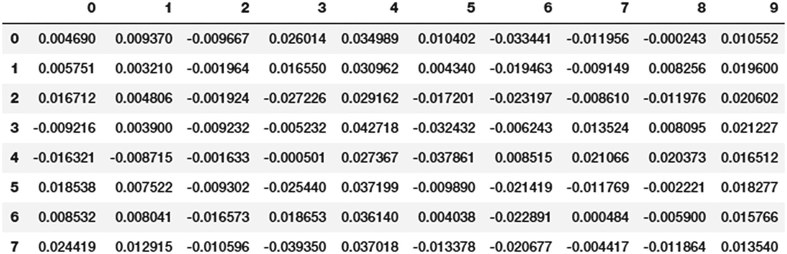
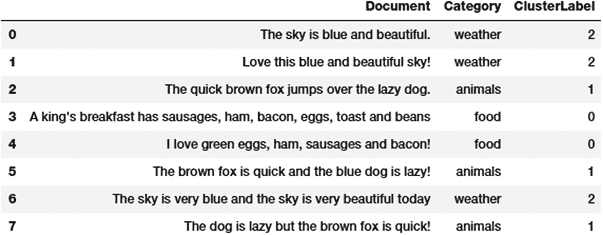
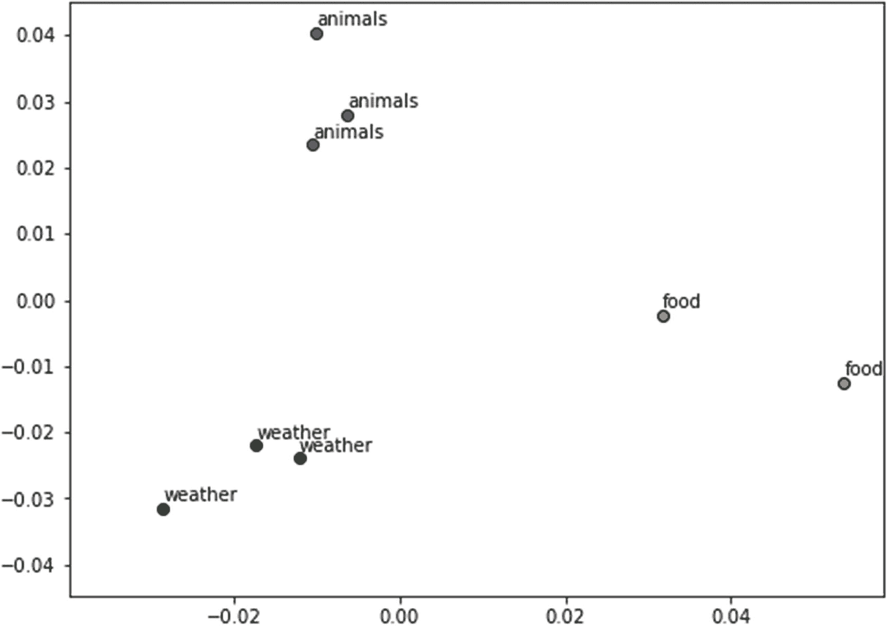

# 诺亚的儿子与词嵌入

诺亚的儿子们成为我们模型中最具上下文相似性的实体！

接下来，我们使用词嵌入向量，通过 `t-SNE` 降维至二维空间，可视化目标词汇及其相似词汇。见图 4-34。



**图 4-34** – 使用 `t-SNE` 可视化我们的 Word2Vec 词嵌入

```python
from sklearn.manifold import TSNE
words = sum([[k] + v for k, v in similar_words.items()], [])
wvs = w2v_model.wv[words]
tsne = TSNE(n_components=2, random_state=0, n_iter=10000, perplexity=2)
np.set_printoptions(suppress=True)
T = tsne.fit_transform(wvs)
labels = words
plt.figure(figsize=(14, 8))
plt.scatter(T[:, 0], T[:, 1], c="orange", edgecolors="r")
for label, x, y in zip(labels, T[:, 0], T[:, 1]):
    plt.annotate(label, xy=(x+1, y+1), xytext=(0, 0), textcoords='offset points')
```

圆圈是我手动绘制的，用于指出一些有趣的关联。根据我之前的描述，可以清楚看到，基于我们模型的词嵌入，诺亚和他的儿子们在空间上非常接近。

## 应用 Word2Vec 特征于机器学习任务

如果你还记得本章前一节的内容，你可能会看到我使用特征执行了一些实际的机器学习任务，例如聚类。让我们利用另一个语料库，尝试取得类似的结果。首先，我们在该语料库上构建一个简单的 `Word2Vec` 模型，并可视化嵌入向量。见图 4-35。



**图 4-35** – 在另一个示例语料库上可视化 `Word2Vec` 词嵌入

```python
# build word2vec model
wpt = nltk.WordPunctTokenizer()
tokenized_corpus = [wpt.tokenize(document) for document in norm_corpus]
# Set values for various parameters
feature_size = 10    # Word vector dimensionality
window_context = 10          # Context window size
min_word_count = 1   # Minimum word count
sample = 1e-3   # Downsample setting for frequent words
w2v_model = word2vec.Word2Vec(tokenized_corpus, size=feature_size,
window=window_context, min_count = min_word_count, sample=sample, iter=100)
# visualize embeddings
from sklearn.manifold import TSNE
words = w2v_model.wv.index2word
wvs = w2v_model.wv[words]
tsne = TSNE(n_components=2, random_state=0, n_iter=5000, perplexity=2)
np.set_printoptions(suppress=True)
T = tsne.fit_transform(wvs)
labels = words
plt.figure(figsize=(12, 6))
plt.scatter(T[:, 0], T[:, 1], c="orange", edgecolors="r")
for label, x, y in zip(labels, T[:, 0], T[:, 1]):
    plt.annotate(label, xy=(x+1, y+1), xytext=(0, 0), textcoords='offset points')
```

请记住，我们的语料库非常小，因此为了获得有意义的词嵌入，并使模型获取更多上下文和语义信息，我们需要更多的数据。那么在这种场景下，什么是词嵌入？它通常是每个单词对应的稠密向量，如下面针对单词“sky”的示例所示。

```python
w2v_model.wv['sky']
# array([ 0.04576328,  0.02328374, -0.04483001,  0.0086611 ,  0.05173225,
#         0.00953358, -0.04087641, -0.00427487, -0.0456274 ,  0.02155695], dtype=float32)
```

### 获取文档嵌入的策略

现在，假设我们想要对我们的玩具语料库中的八个文档进行聚类。我们需要从每个文档中包含的每个单词中获取文档级嵌入。一种策略是对文档中每个单词的词嵌入取平均值。这是一个非常有用的策略，你可以将其应用到自己的问题中。让我们在语料库上应用这种方法来获取每个文档的特征。见图 4-36。



**图 4-36** – 文档级嵌入

```python
def average_word_vectors(words, model, vocabulary, num_features):
    feature_vector = np.zeros((num_features,),dtype="float64")
    nwords = 0.
    for word in words:
        if word in vocabulary:
            nwords = nwords + 1.
            feature_vector = np.add(feature_vector, model[word])
    if nwords:
        feature_vector = np.divide(feature_vector, nwords)
    return feature_vector

def averaged_word_vectorizer(corpus, model, num_features):
    vocabulary = set(model.wv.index2word)
    features = [average_word_vectors(tokenized_sentence, model, vocabulary, num_features) for tokenized_sentence in corpus]
    return np.array(features)

# get document level embeddings
w2v_feature_array = averaged_word_vectorizer(corpus=tokenized_corpus, model=w2v_model, num_features=feature_size)
pd.DataFrame(w2v_feature_array)
```

现在我们已经获得了每个文档的特征，接下来使用亲和传播算法对这些文档进行聚类。这是一种基于数据点之间“消息传递”概念的聚类算法。它不需要显式指定簇的数量，而这是基于划分的聚类算法通常需要的。更详细的讨论请参见第 7 章。见图 4-37。



**图 4-37** – 基于 `Word2Vec` 文档特征分配的簇

```python
from sklearn.cluster import AffinityPropagation
ap = AffinityPropagation()
ap.fit(w2v_feature_array)
cluster_labels = ap.labels_
cluster_labels = pd.DataFrame(cluster_labels, columns=['ClusterLabel'])
pd.concat([corpus_df, cluster_labels], axis=1)
```

可以看到，我们的算法基于`Word2Vec`特征成功将每个文档聚类到了正确的组中，非常巧妙！我们还可以使用`主成分分析 (PCA)`将特征维度降至二维，然后通过颜色编码每个簇来可视化每个文档在簇中的位置。见图 4-38。



**图 4-38** – 可视化我们的文档簇

```python
from sklearn.decomposition import PCA
pca = PCA(n_components=2, random_state=0)
pcs = pca.fit_transform(w2v_feature_array)
labels = ap.labels_
categories = list(corpus_df['Category'])
plt.figure(figsize=(8, 6))
for i in range(len(labels)):
    label = labels[i]
    color = 'orange' if label == 0 else 'blue' if label == 1 else 'green'
    annotation_label = categories[i]
    x, y = pcs[i]
    plt.scatter(x, y, c=color, edgecolors="k")
    plt.annotate(annotation_label, xy=(x+1e-4, y+1e-3), xytext=(0, 0),
                 textcoords='offset points')
```

一切看起来井井有条，因为每个簇中的文档彼此靠近，与其他簇相距较远。