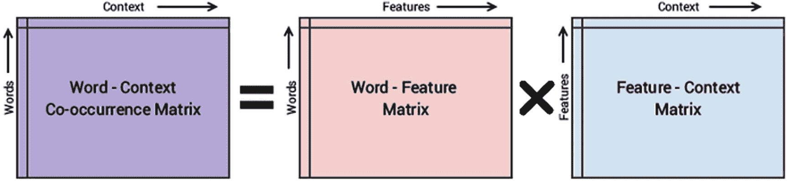
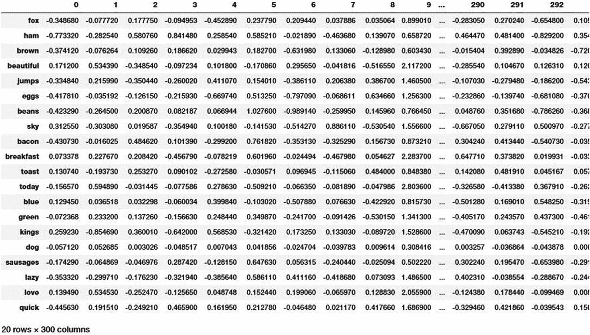
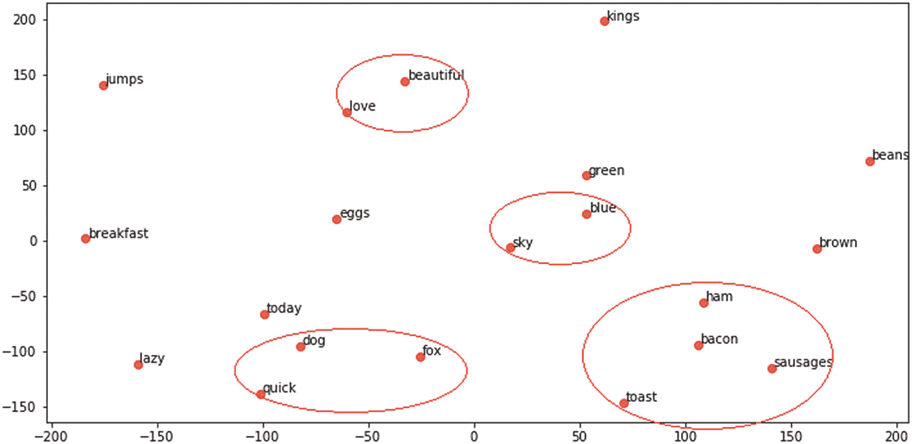
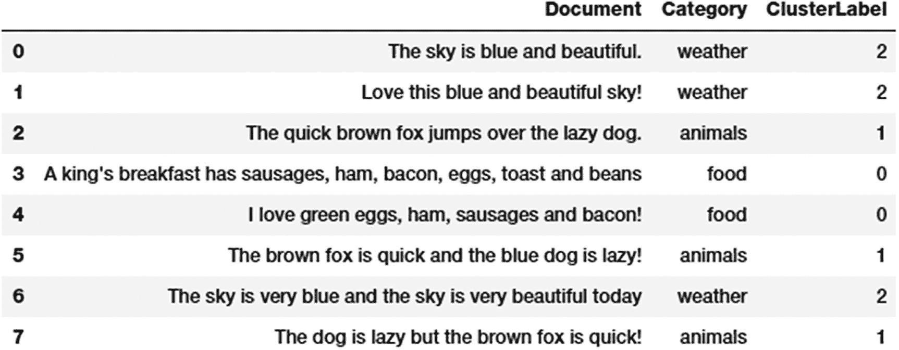
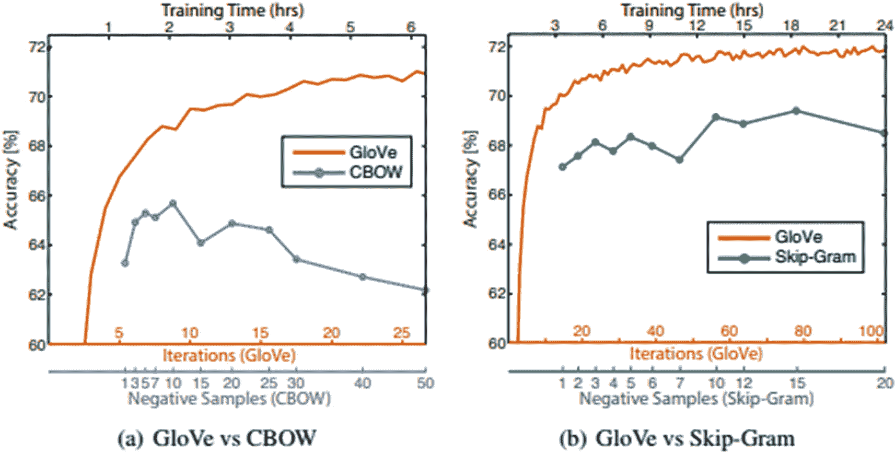

# GloVe 模型

GloVe（*全局向量*）模型是一种无监督学习模型，可用于获取类似于 `Word2Vec` 的稠密词向量。不过，其技术有所不同，训练是在聚合的全局“词-词”共现矩阵上进行的，从而为我们提供一个具有有意义子结构的向量空间。该方法由斯坦福大学的 Pennington 等人发明，我建议你阅读关于 GloVe 的原始论文，即 Pennington 等人所著的《GloVe: Global Vectors for Word Representation》，这是一篇极好的读物，能让你深入了解该模型的工作原理。

我们不会过于详细地从头实现该模型，但如果你对实际代码感兴趣，可以查看官方的 GloVe 页面：[`https://nlp.stanford.edu/projects/glove/`](https://nlp.stanford.edu/projects/glove/)。这里我们保持简单，并尝试理解 GloVe 模型背后的基本概念。

我们讨论过基于计数的矩阵分解方法（如 `LSA`）以及预测方法（如 `Word2Vec`）。论文指出，目前这两类方法都存在显著缺陷。像 `LSA` 这类方法能高效利用统计信息，但在词类比任务（例如寻找语义相似的词）上表现相对较差。像 `Skip-Gram` 这类方法在类比任务上可能表现更好，但它们未能很好地全局利用语料库的统计信息。

GloVe 模型的基本方法是：首先创建一个巨大的“词-上下文”共现矩阵，由（词，上下文）对组成，矩阵中的每个元素代表一个词与上下文（可以是一个词序列）共同出现的频次。然后，其思路是应用矩阵分解来近似这个矩阵，如图 4-39 所示。



**图 4-39** GloVe 模型实现的概念模型

考虑“词-上下文”（`WC`）矩阵、“词-特征”（`WF`）矩阵和“特征-上下文”（`FC`）矩阵，我们尝试进行因式分解：


其目标是通过将 `WF` 和 `FC` 相乘来重构 `WC`。为此，我们通常用一些随机权重初始化 `WF` 和 `FC`，尝试将它们相乘得到 `WC'`（`WC` 的近似值），并衡量其与 `WC` 的接近程度。我们使用*随机梯度下降法*（`SGD`）多次重复此过程以最小化误差。

最后，“词-特征矩阵”（`WF`）为每个词提供了词嵌入，其中 `F` 可以预设为特定的维度数。需要记住的一个非常重要点是，`Word2Vec` 和 `GloVe` 模型在工作方式上非常相似。两者都旨在构建一个向量空间，其中每个词的位置都受到其相邻词（基于它们的上下文和语义）的影响。`Word2Vec` 从局部的单个词共现对示例开始，而 `GloVe` 从语料库中所有词的全局聚合共现统计开始。

## 将 GloVe 特征应用于机器学习任务

让我们尝试将基于 GloVe 的嵌入用于我们的文档聚类任务。非常流行的 `spaCy` 框架具备基于不同语言模型利用 GloVe 嵌入的能力。你也可以从斯坦福 NLP 网站（[`https://nlp.stanford.edu/projects/glove/`](https://nlp.stanford.edu/projects/glove/)）获取预训练的词向量，并使用 `Gensim` 或 `spaCy` 按需加载。我们将安装 `spaCy` 并使用 `en_vectors_web_lg` 模型（[`https://spacy.io/models/en#en_vectors_web_lg`](https://spacy.io/models/en#en_vectors_web_lg)），该模型包含在 Common Crawl（[`http://commoncrawl.org/`](http://commoncrawl.org/)）上使用 GloVe 训练的 300 维词向量稠密嵌入。

```
# 使用以下命令安装 spaCy
> pip install -U spacy
或
> conda install -c conda-forge spacy
# 下载以下语言模型并将其存储在磁盘上
https://github.com/explosion/spacy-models/releases/tag/en_vectors_web_lg-2.0.0
# 将其链接到 spaCy
> python -m spacy link ./spacymodels/en_vectors_web_lg-2.0.0/en_vectors_web_lg en_vecs
链接成功
./spacymodels/en_vectors_web_lg-2.0.0/en_vectors_web_lg --> ./Anaconda3/lib/site-packages/spacy/data/en_vecs
你现在可以通过 spacy.load('en_vecs') 加载模型
```

在 `spaCy` 中也有自动安装模型的方法。如果需要，你可以查看 [`https://spacy.io/usage/models`](https://spacy.io/usage/models) 上的“模型与语言”页面了解更多信息。我在使用自动安装时遇到了一些问题，所以不得不手动加载它们。现在我们使用 `spaCy` 加载我们的语言模型。

```
import spacy
nlp = spacy.load('en_vecs')
total_vectors = len(nlp.vocab.vectors)
print('词向量总数:', total_vectors)
词向量总数: 1070971
```

这验证了一切正常且有序。现在让我们为玩具语料库中的每个词获取 GloVe 嵌入。见图 4-40。



**图 4-40** 样本语料库中词的 GloVe 嵌入

```
unique_words = list(set([word for sublist in [doc.split() for doc in norm_corpus] for word in sublist]))
word_glove_vectors = np.array([nlp(word).vector for word in unique_words])
pd.DataFrame(word_glove_vectors, index=unique_words)
```

现在我们可以使用 t-SNE 来可视化这些嵌入，类似于我们使用 `Word2Vec` 嵌入所做的操作。见图 4-41。



**图 4-41** 在样本语料库上可视化 GloVe 词嵌入

```
from sklearn.manifold import TSNE
tsne = TSNE(n_components=2, random_state=0, n_iter=5000, perplexity=3)
np.set_printoptions(suppress=True)
T = tsne.fit_transform(word_glove_vectors)
labels = unique_words
plt.figure(figsize=(12, 6))
plt.scatter(T[:, 0], T[:, 1], c="orange", edgecolors="r")
for label, x, y in zip(labels, T[:, 0], T[:, 1]):
plt.annotate(label, xy=(x+1, y+1), xytext=(0, 0), textcoords='offset points')
```

`spaCy` 的妙处在于，它自动为每个文档中的词提供平均嵌入，而无需我们像在 `Word2Vec` 中那样实现一个函数。我们现在将利用 `spaCy` 为我们的语料库获取文档特征，并使用 k-means 聚类对文档进行聚类。见图 4-42。



**图 4-42** 基于 GloVe 文档特征分配的聚类


```python
doc_glove_vectors = np.array([nlp(str(doc)).vector for doc in norm_corpus])
km = KMeans(n_clusters=3, random_state=0)
km.fit_transform(doc_glove_vectors)
cluster_labels = km.labels_
cluster_labels = pd.DataFrame(cluster_labels, columns=['ClusterLabel'])
pd.concat([corpus_df, cluster_labels], axis=1)
```

我们看到与从 `Word2Vec` 模型获得的结果一致的聚类，这很好！如图 4-43 所示（该图来自 Pennington 等人的原始论文），`GloVe` 模型声称在许多场景下表现优于 `Word2Vec` 模型。



**图 4-43** GloVe 与 Word2Vec 性能对比（来源：Pennington 等人发表于 [`https://nlp.stanford.edu/pubs/glove.pdf`](https://nlp.stanford.edu/pubs/glove.pdf) 的论文）

这些实验是在相同的 6B 词元语料库（Wikipedia 2014 + Gigaword 5）上训练 300 维向量，使用相同的 40 万词词汇表以及大小为 10 的对称上下文窗口（如果你对细节感兴趣）进行的。

### FastText 模型

`FastText` 模型由 Facebook 于 2016 年推出，作为基础 `Word2Vec` 模型的扩展和预期改进。它基于 Mikolov 等人题为 *《利用子词信息丰富词向量》* 的原始论文，该论文是深入理解该模型工作原理的极佳读物。总体而言，`FastText` 是一个用于学习词表示并执行鲁棒、快速且准确文本分类的框架。该框架由 Facebook 在 GitHub 上开源，并声称具有以下特点：

*   最新的最先进英语词向量
*   在 Wikipedia 和 Crawl 上训练的 157 种语言的词向量
*   用于语言识别和各种监督任务的模型

虽然我没有从头实现这个模型，但根据研究论文，我了解到以下关于该模型工作原理的内容。通常，像 `Word2Vec` 这样的预测模型将每个词视为一个独立的实体（例如，where），并为该词生成一个密集嵌入。然而，这对手词汇量庞大、罕见词众多的语言来说是一个严重的限制。`Word2Vec` 模型通常会忽略每个词的形态结构，将词视为单一实体。`FastText` 模型则将每个词视为一个字符 n-gram 的袋。这在论文中也被称为*子词*模型。

我们在词的开头和结尾添加特殊的边界符号 `<` 和 `>`。这使我们能够区分前缀和后缀与其他字符序列。我们还将字母 `w` 包含在其 n-gram 集合中，以便学习每个词的表示（除了其字符 n-gram）。以词 "where" 和 `n=3`（三字符组）为例，它将被表示为字符 n-gram：`<wh`、`whe`、`her`、`ere`、`re>` 以及代表整个词的特殊序列 `<where>`。请注意，对应于词 `<her>` 的序列与三字符组 "her" 以及词 "where" 是不同的。

在实践中，论文建议提取 `n ≥ 3` 和 `n ≤ 6` 的所有 n-gram。这是一种非常简单的方法，也可以考虑不同的 n-gram 集合，例如取所有前缀和后缀。我们通常为每个词的每个 n-gram 关联一个向量表示（嵌入）。因此，我们可以通过求其 n-gram 向量表示之和或这些 n-gram 嵌入的平均值来表示一个词。由于这种基于字符从单个词中利用 n-gram 的效果，罕见词获得良好表示的可能性更高，因为基于字符的 n-gram 应该会出现在语料库的其他词中。

### 将 FastText 特征应用于机器学习任务

`Gensim` 包提供了包装器，可以借助 `gensim.models.fasttext` 模块下的 `FastText` 模型接口。我们再次将其应用于圣经语料库，查看感兴趣的词及其最相似的词。

```python
from gensim.models.fasttext import FastText
wpt = nltk.WordPunctTokenizer()
tokenized_corpus = [wpt.tokenize(document) for document in norm_bible]
# 设置各种参数的值
feature_size = 100    # 词向量维度
window_context = 50          # 上下文窗口大小
min_word_count = 5   # 最小词频
sample = 1e-3   # 高频词的下采样设置
# sg 决定是否使用 skip-gram 模型 (1) 或 CBOW (0)
ft_model = FastText(tokenized_corpus, size=feature_size, window=window_context, min_count=min_word_count, sample=sample, sg=1, iter=50)
# 基于 gensim 的 FastText 模型查看相似词
similar_words = {search_term: [item[0] for item in ft_model.wv.most_similar([search_term], topn=5)] for search_term in ['god', 'jesus', 'noah', 'egypt', 'john', 'gospel', 'moses','famine']}
similar_words
```
输出：
```
{'egypt': ['land', 'pharaoh', 'egyptians', 'pathros', 'assyrian'],
 'famine': ['pestilence', 'sword', 'egypt', 'dearth', 'blasted'],
 'god': ['lord', 'therefore', 'jesus', 'christ', 'truth'],
 'gospel': ['preached', 'preach', 'christ', 'preaching', 'gentiles'],
 'jesus': ['christ', 'god', 'disciples', 'paul', 'grace'],
 'john': ['baptist', 'baptize', 'peter', 'philip', 'baptized'],
 'moses': ['aaron', 'commanded', 'congregation', 'spake', 'tabernacle'],
 'noah': ['shem', 'methuselah', 'creepeth', 'adam', 'milcah']}
```

你可以看到结果中有很多相似之处（见图 4-44）。你是否注意到任何有趣的关联和相似性？


**图 4-44** 摩西、他的兄弟亚伦以及摩西的会幕在我们的模型中作为相似实体出现

有了这些嵌入，我们可以执行一些有趣的自然语言任务。其中之一是确定不同词（实体）之间的相似度。

```python
print(ft_model.wv.similarity(w1='god', w2="satan"))
print(ft_model.wv.similarity(w1='god', w2="jesus"))
```
输出：
```
0.333260876685
0.698824900473
```
```python
st1 = "god jesus satan john"
print('Odd one out for [',st1, ']:', ft_model.wv.doesnt_match(st1.split()))
st2 = "john peter james judas"
print('Odd one out for [',st2, ']:', ft_model.wv.doesnt_match(st2.split()))
```
输出：
```
Odd one out for [ god jesus satan john ]: satan
Odd one out for [ john peter james judas ]: judas
```

我们可以看到，根据圣经语料库的文本，“god”与“jesus”的关联比与“satan”更紧密。在其他词中找出异常实体的两种情况下，都可以看到类似的结果。


## 总结

本章涵盖了丰富多样的特征工程技术及模型，包括传统与先进的文本表示新模型。请记住，传统策略基于数学、信息检索和自然语言处理的概念。因此，这些经过时间检验的可靠方法已在各种数据集和问题上证明了其成功之处。我们广泛介绍了传统的特征工程模型，包括`词袋模型`、`N 元词袋模型`、`TF-IDF`、`相似度`和主题模型。我们还从零开始实现了一些模型，以便通过动手示例更好地理解这些概念。

传统模型存在一些局限性，比如稀疏表示会导致特征爆炸，从而引发维度灾难，并丢失文本数据中相关词汇的语境、顺序和序列关系。这正是我们引入先进特征工程模型的原因——这些模型利用深度学习与神经网络，为任何语料库中的每个单词生成稠密嵌入。

我们深入探讨了`Word2Vec`，甚至从零训练了深度学习模型，以展示`CBOW`和`Skip-Gram`模型的工作原理。理解如何在现实世界中应用特征工程模型同样重要，我们演示了如何提取和构建文档级特征，并将其用于文本聚类。最后，我们介绍了另外两种先进特征工程模型——`GloVe`和`FastText`——的核心概念与详细示例。我们鼓励您尝试将这些模型应用到自己的问题中。在下一章关于文本分类的内容中，我们也将继续使用这些模型！

