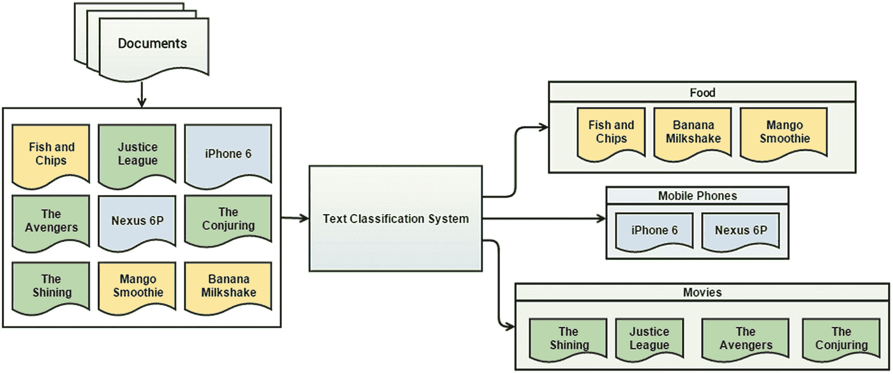

# 什么是文本分类？

在定义文本分类之前，我们需要了解文本数据的范围以及“分类”的含义。这里涉及的文本数据可以是短语、句子，甚至是包含段落文本的完整文档，其来源可以是语料库、博客、网络上的任何地方，甚至企业数据仓库。文本分类也常被称为*文档分类*，目的是用术语*“文档”*涵盖所有形式的文本内容。虽然*“文档”*一词可以定义为思想或事件的某种具体表现形式，可以是书面文字、录音、绘图或演示文稿，但我们在此使用*“文档”*一词来代表文本数据，例如属于英语的句子或段落（只要你能解析并处理该语言，也欢迎将其扩展到其他语言！）。

文本分类也常被称为*文本归类*。然而，我们特意使用*“分类”*一词，原因有二。第一个原因是，它表达了与文本归类相同的本质，即我们希望对文档进行分类。第二个原因是，它表明我们正在使用*分类*或*监督式机器学习方法*来对文本进行分类或归类。文本归类可以通过多种方式实现。我们则明确专注于使用监督式方法进行分类。分类过程并不仅限于文本，在科学、医疗、天气和技术等其他领域也经常使用。

## 形式化定义

既然我们已经理清了所有背景假设，现在可以正式定义文本分类的任务及其整体范围。文本或文档分类被定义为：假设我们有一组预定义的类别，将文本文档分配到一个或多个类别或标签的过程。文档是文本形式的，每个文档可以包含一个句子甚至一个段落的单词。一个文本分类系统可以根据文档的内在属性，成功地将每个文档划分到其正确的类别中。

从数学角度，我们可以将其定义如下：给定某个文档 `D` 的描述和属性 `d`，其中 `d ∈ D`，并给定一组预定义的类别或标签 `C = {c[1], c[2], c[3], …, c[n]}`。实际文档 `D` 可能具有许多内在属性和特征，这使其成为高维空间中的一个实体。通过使用该空间的一个子集（包含由 `d` 所表示的有限描述和特征），我们应该能够使用文本分类系统 `T`，成功地将原始文档 `D` 分配到其正确的类别 `C[x]`。这可以表示为 `T : D → C[x]`。我们将在后续章节中更详细地讨论文本分类系统。图 5-1 展示了文本分类过程的高级概念表示图。

*图 5-1* 文本分类概念概览

在图 5-1 中，我们可以看到有多个文档，它们可以被分配到食品、手机和电影等不同类别。最初，这些文档都混合在一起，就像一个文本语料库中包含各种文档一样。当它们通过一个以黑盒形式表示的文本分类系统后，我们可以看到每个文档都被分配到了我们先前定义的某个特定类别。在真实数据中，这些文档仅以其名称表示；它们可以包含每个产品的描述、特定属性（如电影类型）、产品规格、成分等等，这些本质上都是可以在文本分类系统中用作特征、从而简化文档识别和分类的属性。

## 主要的文本分类变体

文本分类有多种类型。我们介绍两种基于文档内容类型的主要分类。它们如下所示。

-   基于内容的分类

-   基于需求的分类

这些更像是文本分类方法背后的不同理念，而非具体的算法或技术流程。*基于内容的分类*是一种文本分类方式，它会为文本内容中的特定主题或话题赋予优先级或权重，从而帮助确定文档的类别。一个概念性的例子是：一本书中超过 30% 的内容关于食物准备，那么它可能被归类为烹饪/食谱类。*基于需求的分类*则受到用户需求的影响，并针对特定的用户群体和受众。这种分类方式受制于基于用户行为和决策的特定策略与理念。