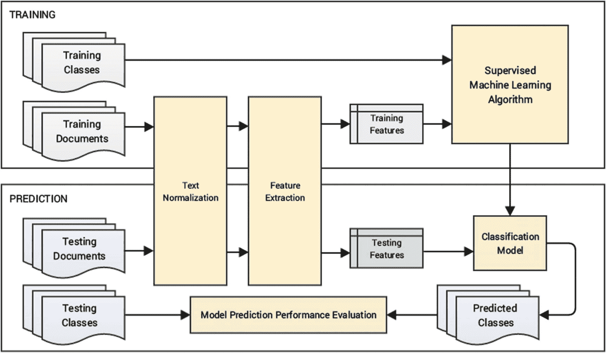

# 自动化文本分类

我们已经了解了文本分类的定义和范畴，也从概念和数学上对其进行了正式定义，其中提到“文本分类系统”能够将文本文档归类到各自的类别或分类中。想象一下，如果有数名人类审查员逐一处理并分类每一篇文档，他们将成为我们所说的文本分类系统的一部分。然而，一旦我们需要在短时间内对数百万篇文本文档进行分类，这种人工方式就无法有效扩展。为了让流程更高效、更快速，我们可以将文本分类任务自动化，这就引出了自动化文本分类。为了实现自动化文本分类，我们使用了多种机器学习技术和概念。与解决此问题相关的主要机器学习技术有两种，如下所示：

- 监督式机器学习
- 非监督式机器学习

除了这两种技术，还有其他类型的学习算法，例如`强化学习`和`半监督学习`。我们将从机器学习的角度以及如何利用它们对文本文档进行分类这两个方面，更详细地探讨监督式和非监督式学习算法。

`非监督式学习`指的是那些不需要任何预先标注的训练数据样本来构建模型的特定机器学习技术或算法。其重点更多地在于模式挖掘和发现数据中的潜在子结构，而非预测性分析。我们通常会有一组数据点，根据要解决的问题，这些数据点可能是文本形式或数字形式。我们通过一个称为`特征工程`的过程从每个数据点中提取特征，然后将每个数据点的特征集输入到算法中，并尝试从数据中提取有意义的模式，例如使用聚类等技术将相似的数据点分组，或根据主题模型总结文档。

这在文本文档分类中非常有用，也被称为`文档聚类`。在这种方法中，我们根据文档的特征、相似度和属性将它们聚类成组，而无需在任何先前标记过的数据上训练模型。我们将在后续章节讨论主题模型、文档摘要、相似度分析和聚类时，更深入地探讨非监督式学习。

`监督式学习`指的是那些在预先标注的数据样本（称为训练数据）及相应的训练标签/类别上进行训练的特定机器学习技术或算法。通过特征工程从这些数据中提取特征，每个数据点都有自己的特征集和对应的类别/标签。算法从训练数据中学习每种类别类型的各种模式。一旦这个过程完成，我们就得到了一个训练好的模型。随后，当我们将新测试数据样本的特征输入模型时，该模型就可以用来预测其所属类别。因此，机器实际上是基于先前的训练数据样本学会了如何预测未见过的、新数据样本的类别。监督式学习算法主要有两种类型，描述如下：

- **分类**：当需要预测的结果是不同类别时，监督式学习算法被称为分类算法，因此在这种情况下，结果变量是一个分类变量。例如新闻类别和电影类型。
- **回归**：当需要预测的结果是一个连续的数值变量时，监督式学习算法被称为回归算法。例如房价和天气温度。

我们专门针对我们的问题聚焦于分类，因为本章的名称不言而喻。我们正尝试将文本文档分类到不同的类别中。在我们的实施过程中，我们将遵循监督式学习方法，使用不同的分类模型。

## 正式定义

现在，我们准备用数学方式来定义自动化或基于机器学习的文本分类过程。假设我们有一个训练文档集，每个文档都标有相应的类别或分类。这可以用 `TS` 来表示，`TS` 是一个由成对的文档和标签组成的集合，`TS = {(d[1], c[1]), (d[2], c[2]), … , (d[n], c[n])}`，其中 `d[1], d[2], … , d[n]` 是文本文档的列表。它们对应的标签是 `c[1], c[2], … , c[n]`，且 `c[x] ∈ C = {c1, c2, … , cn}`，这里 `c[x]` 表示文档 `x` 的类别标签，`C` 表示所有可能的不同类别的集合，每个文档的类别可以是其中任何一个。假设我们有了训练集，我们可以定义一个监督式学习算法 `F`，当它在我们的训练数据集 `TS` 上训练时，我们就构建了一个分类模型或分类器 `γ`，并且 `F(TS) = γ`。因此，监督式学习算法 `F` 将输入的成对（文档，类别）集合 `TS` 进行处理，并给出训练好的分类器 `γ`，这就是我们的模型。这个过程被称为训练过程。然后，这个模型可以接收一篇新的、未曾见过的文档 `ND`，并预测其类别 `c[ND]`，使得 `c[ND] ∈ C`。这个过程被称为`预测过程`，可以用 `γ : TD → c[ND]` 来表示。因此，我们可以看到监督式文本分类过程有两个主要阶段：

- 训练
- 预测

需要记住的重要一点是，监督式文本分类需要一些人工标注的训练数据。所以，尽管我们讨论的是自动化文本分类，但为了启动这个过程，我们仍需要一些人工努力。当然，这样做的好处是多方面的，因为一旦我们有了训练好的分类器，就可以持续使用它来预测和分类新的文档，所需的人工努力和监督极少。有各种不同的学习方法或算法，我们将在后续章节中讨论。这些学习算法并非专门针对文本数据，而是通用的机器学习算法，在经过适当的预处理和特征工程后，可以应用于多种类型的数据。我们将涉及几种监督式机器学习算法，并使用它们来解决实际的文本分类问题。

这些算法通常在训练数据集上训练，并且通常还会使用一个可选的验证集，以防止训练后的模型过拟合训练数据。过拟合基本上意味着模型将无法很好地泛化，也无法对新文本文档实例进行正确的预测。通常，基于学习算法，并通过评估验证集上的准确性等各种性能指标，或使用交叉验证（通过随机抽样将训练数据集拆分为训练集和验证集），模型会根据其几个内部参数（称为`超参数`）进行调整。这构成了训练过程的一部分，其结果产生一个完全训练好的、可用于预测的模型。在预测阶段，我们通常会有来自测试数据集的新数据点。在对这些数据进行归一化和特征工程处理后，我们可以将它们输入模型，并通过评估其预测性能来观察模型的表现如何。

### 文本分类任务的变体

根据待预测的类别数量及预测性质，文本分类任务存在以下几种变体：

- 二分类
- 多分类
- 多标签分类

这些分类类型基于数据集、该数据集所涉及的类别数量，以及任何数据点可被预测的类别数量。`Binary classification`（二分类）是指不同类别总数为二，且每次预测结果只能是这两类中的一个。`Multi-class classification`（多分类）也称为多项式分类，指的是类别总数超过两个，且每次预测结果为一个类别，该类别可以是其中任意一个。这是对二分类问题的扩展，其中类别总数超过两个。`Multi-label classification`（多标签分类）指的是对于任何数据点，每次预测可以产生多个结果/预测类别的问题。

## 文本分类蓝图

在了解了自动文本分类的基本范围后，本节将呈现构建自动文本分类器系统的完整工作流蓝图。这包含一系列在训练和测试阶段必须遵循的步骤。要构建一个文本分类系统，我们需要确保拥有数据源并检索到数据，以便开始将其输入系统。假设我们的数据集已经下载并准备好使用，以下主要步骤勾勒出了文本分类系统的典型工作流。

- 准备训练集和测试集（可选地准备验证集）
- 预处理和标准化文本文档
- 特征提取与工程
- 模型训练
- 模型预测与评估
- 模型部署

以上是按顺序执行以构建文本分类器的主要步骤。图 5-2 展示了文本分类系统的详细工作流，其中训练和预测过程中的主要组件已高亮显示。

图 5-2 构建自动文本分类系统的蓝图

从图 5-2 中，我们注意到有两个主要方框，称为训练和预测，这是构建文本分类器涉及的两个主要阶段。通常，我们拥有的数据集通常被分成两个或三个部分，称为训练集、验证集（可选）和测试集。请注意图 5-2 中两个过程的“文本标准化”模块和“特征提取”模块存在重叠。这表明，无论我们要分类和预测哪个文档，它都必须经过训练和预测过程中相同的一系列转换。每个文档首先被预处理和标准化，然后提取与该文档相关的特定特征。这些过程在“训练”和“预测”过程中始终保持一致，以确保我们的分类模型在其预测中表现一致。

在“训练”过程中，每个文档都有其对应的类别/分类，这些类别是事先手动标记或整理好的。这些训练文本文档在“文本标准化”模块中进行预处理和标准化，从而得到干净、标准化的训练文本文档。然后，它们被传递到“特征提取”模块，在该模块中，使用不同的特征提取或工程化技术从处理后的文本文档中提取有意义的特征。常见的特征提取技术已在第 4 章中详细讨论，本章将使用其中的一些技术！这些特征通常是数值数组或向量，原因是标准的机器学习算法只能处理数值向量，而无法处理像文本这样的原始非结构化数据。一旦我们拥有了特征，我们选择一个或多个监督式机器学习算法来训练我们的模型。

训练模型涉及将来自文档的特征向量和相应的标签输入，以便算法能够学习与每个类别/分类相对应的各种模式，并能够重用这些知识来预测未来新文档的类别。通常，会使用一个可选的验证数据集来评估分类算法的性能，以确保其在训练过程中能很好地泛化数据。这些特征与机器学习算法的结合产生了一个分类模型，这是“训练”过程的最终产物或输出。通常，该模型会通过一个称为`超参数`调整的过程，使用各种模型参数进行调优，以构建性能更优的最优模型。我们将在动手实践的示例中很快探讨这一点。

## 预测与部署

“预测”过程涉及尝试为新文档预测类别，或评估对新的、之前未见过的测试数据的预测效果。测试数据集文档将经历相同的标准化、特征提取和工程化过程。然后，测试文档的特征向量被传递给训练好的`分类模型`，该模型根据先前学习的模式（此处不进行训练——除非您拥有能从反馈中学习的模型）为每个文档预测可能的类别。如果您拥有这些文档的真实类别标签（已手动标记），则可以通过使用`准确性`、`精确率`、`召回率`和`F1 分数`等各种指标，比较真实标签与预测标签来评估模型的预测性能。这会让您了解模型基于其对新文档的预测的表现如何。

一旦我们拥有一个稳定且能正常工作的模型，最后一步就是部署模型，这通常包括保存模型及其必要的依赖项，并将其部署为服务、API 或运行中的程序。它可以作为批处理作业，或者（如果作为 Web 服务访问）根据用户请求来为新文档预测类别。有多种部署机器学习模型的方式，这通常取决于您将来希望如何访问它。我们现在将讨论此蓝图中的每个主要模块和组件，并实现/重用这些模块，以便我们可以将它们集成起来，构建一个真实世界的自动文本分类器。