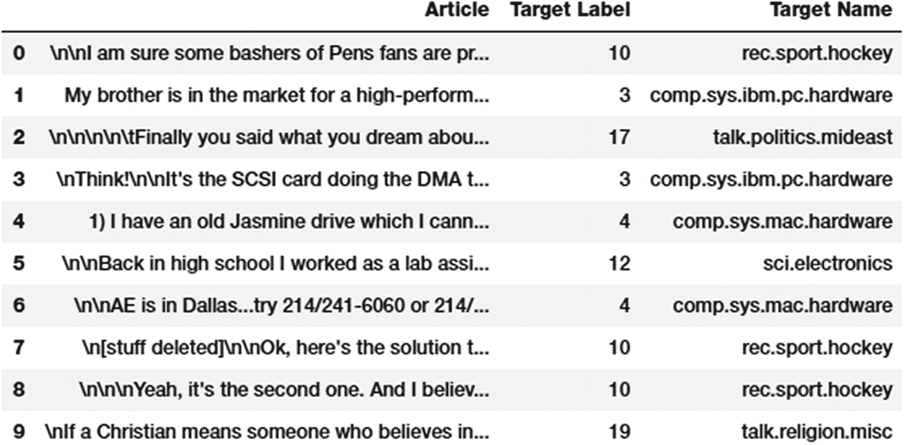

# 数据检索

显然，任何数据科学或机器学习流程的第一步都是访问并检索所需数据，以便进行分析和构建机器学习模型。为此，我们将使用非常流行但具有一定挑战性的 20 Newsgroups 数据集，该数据集可直接通过 `Scikit-Learn` 下载。20 Newsgroups 数据集包含约 18,000 篇新闻组帖子，分布在 20 个不同的类别或主题中，因此构成了一个 20 类的分类问题。与预测电子邮件中的垃圾邮件相比，这显然更具挑战性。请记住，类别数量越多，构建准确分类器的难度就越大。

有关该数据集的详细信息，请访问 [`scikit-learn.org/0.19/datasets/twenty_newsgroups.html`](http://scikit-learn.org/0.19/datasets/twenty_newsgroups.html)。建议移除文本文档中的页眉、页脚和引用，以防止模型因某些特定的页眉或电子邮件地址而过拟合或泛化能力不佳。幸运的是，`Scikit-Learn` 认识到了这个问题，加载 20 Newsgroups 数据的函数提供了一个名为 `remove` 的参数，用于指定要从每个文件中剥离哪些类型的信息。`remove` 参数应是一个元组，可包含 `('headers', 'footers', 'quotes')` 的任意子集，分别用于指示移除页眉、签名块和引用块。

在数据预处理阶段，我们还会移除在移除这三项后为空或没有任何内容的文档，因为尝试从空文档中提取特征毫无意义。让我们从加载必要的数据集并定义构建训练和测试数据集的函数开始。我们将加载常用的依赖项，包括在第三章中构建的文本预处理与规范化模块，名为 `text_normalizer`。

```python
from sklearn.datasets import fetch_20newsgroups
import numpy as np
import text_normalizer as tn
import matplotlib.pyplot as plt
import pandas as pd
import warnings
warnings.filterwarnings('ignore')
%matplotlib inline
```

现在，我们利用 `Scikit-Learn` 的辅助函数来获取所需数据。获取数据后，我们将这些数据转换为易于使用的 DataFrame。见图 5-3。



**图 5-3** 20 Newsgroups 数据集

```python
data = fetch_20newsgroups(subset='all', shuffle=True,
remove=('headers', 'footers', 'quotes'))
data_labels_map = dict(enumerate(data.target_names))
Downloading 20news dataset. This may take a few minutes.
Downloading dataset from https://ndownloader.figshare.com/files/5975967 (14 MB)
# 构建 DataFrame
corpus, target_labels, target_names = (data.data, data.target,
[data_labels_map[label] for label in data.target])
data_df = pd.DataFrame({'Article': corpus, 'Target Label': target_labels, 'Target Name': target_names})
print(data_df.shape)
data_df.head(10)
(18846, 3)
```

从该数据集中，我们可以看到每个文档都有一些文本内容，并且标签可以用一个特定数字表示，该数字映射到一个新闻组类别名称。图 5-3 展示了一些数据样本。