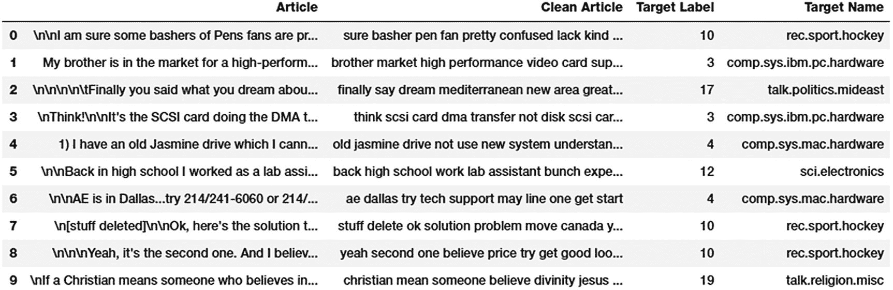
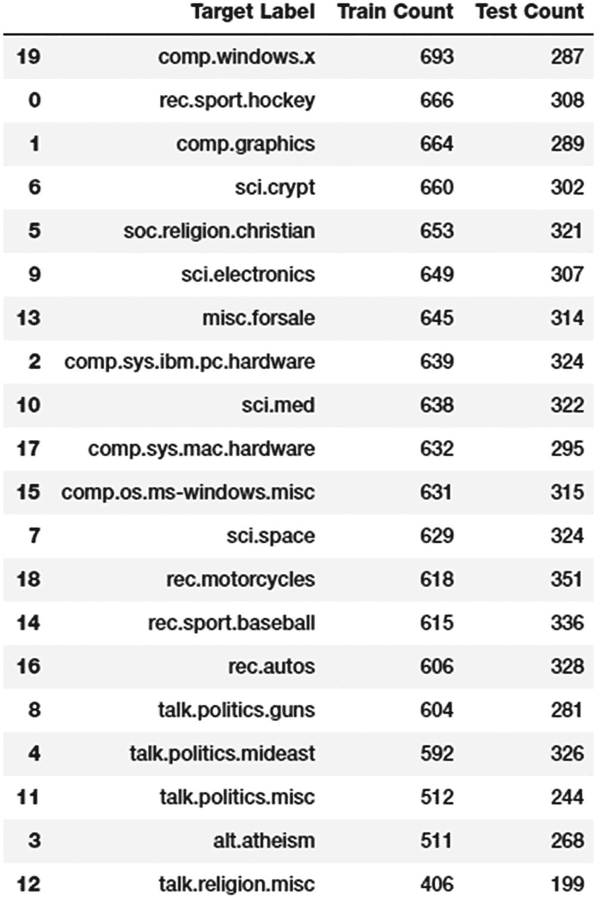

# 数据预处理与规范化

在对文档进行预处理和规范化之前，我们先查看数据集中可能存在的空文档并将其移除。

```python
total_nulls = data_df[data_df.Article.str.strip() == "].shape[0]
print("Empty documents:", total_nulls)
Empty documents: 515
```

现在，我们可以使用一个简单的 pandas 过滤操作，移除所有文章中没有文本内容的记录，如下所示。

```python
data_df = data_df[~(data_df.Article.str.strip() == ")]
data_df.shape
(18331, 3)
```

这很简洁！现在我们需要考虑一般的文本预处理或整理阶段。这包括清洗、预处理和规范化文本，将句子、短语和词语等文本成分转换为某种标准格式。这有助于在整个文档语料库中实现标准化，从而构建有意义的特征并减少噪声。噪声可能由多种因素引入，例如不相关的符号、特殊字符、XML 和 HTML 标签等。我们已经在第三章中详细讨论过这一点。不过，为了简要回顾，我们的文本规范化流程中的主要组成部分描述如下。请记住，它们都可以在 `text_normalizer` 模块中找到，该模块位于 `text_normalizer.py` 文件中。

- `清洗文本：` 我们的文本通常包含不必要的内容，比如 HTML 标签，这些内容在分析情感时没有太大价值。因此，我们需要确保在提取特征之前将其移除。`BeautifulSoup` 库为此提供了非常出色的函数。我们的 `strip_html_tags(...)` 函数负责清理并移除 HTML 代码。

- `移除带重音符号的字符：` 在我们的数据集中，我们处理的是英文评论，因此需要确保任何其他格式的字符，尤其是带重音符号的字符，都被转换并标准化为 ASCII 字符。一个简单的例子是将 é 转换为 e。我们的 `remove_accented_chars(...)` 函数在这方面提供了帮助。

- `扩展缩写词：` 在英语中，缩写词本质上是单词或音节的缩略形式。这些现有单词或短语的缩略形式是通过移除特定字母和发音来创建的。通常情况下，单词中的元音会被移除。例如 `do not` 变为 `don't`，`I would` 变为 `I'd`。缩写词给文本规范化带来了问题，因为我们需要处理像撇号这样的特殊字符，还必须将每个缩写词转换为其扩展后的原始形式。`expand_contractions(...)` 函数使用正则表达式以及 `contractions.py` 模块中映射的各种缩写词，来扩展我们文本语料库中的所有缩写词。

- `移除特殊字符：` 文本清洗和规范化中的另一个重要任务是移除特殊字符和符号，这些字符和符号常常会增加非结构化文本中的额外噪声。可以使用简单的正则表达式来实现这一点。我们的函数 `remove_special_characters(...)` 有助于移除特殊字符。在我们的代码中，我们保留了数字，但如果你不希望规范化后的语料库中出现数字，也可以将其移除。

### 词干提取与词形还原

词干通常是可能通过附加词缀（如前缀和后缀）而创建的基础单词形式，这一过程被称为*屈折变化*。获取单词基础形式的反向过程被称为*词干提取*。一个简单的例子是“watches”、“watching”和“watched”，它们的基础词干是“watch”。NLTK 包提供了广泛的词干提取器，例如 `PorterStemmer` 和 `LancasterStemmer`。

词形还原与词干提取非常相似，都是通过去除单词词缀来获取基础形式。然而，此处的基础形式被称为词根，而非词干。不同之处在于，词根始终是一个符合词汇规范的正确单词（存在于词典中），而词干可能并不正确。我们在规范化流程中仅使用词形还原来保留符合词汇规范的正确单词。函数 `lemmatize_text(...)` 在这方面可以帮助我们。

### 去除停用词

在从文本构建有意义的特征时，那些几乎没有或根本没有意义的单词被称为停用词。如果你在文档语料库中进行简单的词频统计，这些单词通常最终会具有最高的出现频率。像“a”、“an”、“the”等单词都是停用词。虽然没有通用的停用词列表，但我们使用来自 NLTK 的标准英语停用词列表。如果需要，你可以添加特定领域的自定义停用词。函数 `remove_stopwords(...)` 有助于去除停用词，并保留语料库中最具意义和上下文的单词。

我们将所有这些组件整合到名为 `normalize_corpus(...)` 的函数中，该函数可用于接收文档语料库作为输入，并返回经过清洗和规范化文本处理的同一语料库。这在我们的文本规范化模块中已经提供。现在让我们来测试一下！见图 5-4。



`图 5-4` – 经过文本预处理后的 20 个新闻组数据集

```python
import nltk
stopword_list = nltk.corpus.stopwords.words('english')
# 仅为了在二元组中保留否定词（如果有的话）
stopword_list.remove('no')
stopword_list.remove('not')
# 规范化我们的语料库
norm_corpus = tn.normalize_corpus(corpus=data_df['Article'], html_stripping=True,
contraction_expansion=True, accented_char_removal=True,
text_lower_case=True, text_lemmatization=True,
text_stemming=False, special_char_removal=True,
remove_digits=True, stopword_removal=True,
stopwords=stopword_list)
data_df['Clean Article'] = norm_corpus
# 查看样本数据
data_df = data_df[['Article', 'Clean Article', 'Target Label', 'Target Name']]
data_df.head(10)
```

现在我们拥有一个经过良好预处理和规范化的文章语料库。但等等，还没结束！有些文档在预处理后最终可能变为空值或空。我们使用以下代码来验证这个假设，并从语料库中移除这些文档。

```python
data_df = data_df.replace(r'^(\s?)+$', np.nan, regex=True)
data_df.info()

Int64Index: 18331 entries, 0 to 18845
Data columns (total 4 columns):
Article          18331 non-null object
Clean Article    18304 non-null object
Target Label     18331 non-null int64
Target Name      18331 non-null object
dtypes: int64(1), object(3)
memory usage: 1.3+ MB
```

经过预处理操作后，我们确实得到了一些空文章。我们可以安全地使用以下代码移除这些空文档。

```python
data_df = data_df.dropna().reset_index(drop=True)
data_df.info()

RangeIndex: 18304 entries, 0 to 18303
Data columns (total 4 columns):
Article          18304 non-null object
Clean Article    18304 non-null object
Target Label     18304 non-null int64
Target Name      18304 non-null object
dtypes: int64(1), object(3)
memory usage: 572.1+ KB
```

我们现在可以使用这个数据集来构建文本分类系统。如有需要，可以随意使用以下代码存储数据集，这样就不必每次都运行预处理步骤。

```python
data_df.to_csv('clean_newsgroups.csv', index=False)
```

## 构建训练集和测试集

为了构建机器学习系统，我们需要在训练数据上构建模型，然后在测试数据上测试和评估其性能。因此，我们将数据集拆分为训练集和测试集。我们采用训练集与测试集拆分比例为总数据的 67%/33%。

```markdown
## 特征工程技术

有多种特征提取或特征工程技术可以应用于文本数据，但在深入探讨它们之前，让我们简要回顾一下特征的含义、为什么需要特征以及它们如何发挥作用。在一个数据集中，通常有许多数据点，通常是数据集的行；而列则是数据集的各种特征或属性，每一行或每个观察值都有特定的值。在机器学习术语中，特征是数据集中每个观察值或数据点的独特可测量属性或特性。特征本质上是数值型的，可以是绝对数值，也可以是分类特征。分类特征可以通过一种称为`独热编码`的过程，编码为列表中每个类别的二进制特征。它们也可以通过一种称为`标签编码`的过程，表示为不同的数值实体。提取和选择特征的过程既是一门艺术也是一门科学，这个过程被称为`特征提取`或`特征工程`。

特征工程非常重要，通常被称为创建卓越且性能更优机器学习模型的秘诀。提取的特征被输入到机器学习算法中，用于学习模式，这些模式可以应用于未来的新数据点以获取洞察。这些算法通常期望特征以数值向量的形式出现，因为每个算法本质上都是一个数学优化过程，在尝试从数据点和观察值中学习模式时，它要最小化损失和误差。因此，处理文本数据带来了额外的挑战，即如何从文本数据中转换和提取数值特征。

我们在第 4 章中详细介绍了文本数据的最新特征工程技术。在接下来的章节中，我们简要回顾本章所使用的方法。但为了深入学习，我建议读者查阅第 4 章。

### 传统特征工程模型

针对文本数据的传统（基于计数）特征工程策略涉及一系列模型，这些模型通常统称为词袋模型（Bag of Words model）。虽然它们是有效的文本特征提取方法，但由于模型本质仅是一个无序词的集合，我们会丢失额外信息，例如每篇文本文档中单词的语义、结构、顺序以及附近单词的上下文。

- **词袋（词频）模型（Bag of Words (term frequency) model）**：词袋模型将每篇文本文档表示为一个数值向量，其中每个维度对应语料库中的一个特定单词，其值可以是该单词在文档中的词频、是否出现（用 1 或 0 表示），甚至可以是加权值。该模型得名于此，因为每篇文档都按字面意思被表示为其自身单词的一个词袋，而忽略了单词顺序、序列和语法。

- **词袋 N-gram 模型（Bag of N-Grams model）**：N-gram 本质上是从文本文档中提取的一组连续且按序列出现的词元。二元组（Bi-grams）指阶数为 2（两个单词）的 n-gram，三元组（tri-grams）指阶数为 3（三个单词）的 n-gram，以此类推。词袋 N-gram 模型只是词袋模型的一个扩展，因此我们也可以利用基于 N-gram 的特征。

- **TF-IDF 模型（TF-IDF model）**：TF-IDF 代表词频-逆文档频率（Term Frequency-Inverse Document Frequency），它是两个指标的组合：词频（TF）和逆文档频率（IDF）。该技术最初是作为一种根据用户查询展示搜索引擎结果的指标而开发的，现已成为信息检索和文本特征提取的一部分。

### 高级特征工程模型

针对文本数据的传统（基于计数）特征工程策略涉及一系列模型，这些模型通常统称为词袋模型。这包括词频、TF-IDF（词频-逆文档频率）、N-gram 等。虽然它们是有效的文本特征提取方法，但存在严重的局限性，即我们会丢失额外信息，例如每篇文本文档中单词的语义、结构、顺序以及附近单词的上下文。这足以成为我们探索更复杂模型的动力，这些模型能够捕获这些信息，并提供以单词向量表示（通常称为`词嵌入`）为形式的特征。我们使用预测性方法，例如基于神经网络的语言模型，通过观察语料库中的单词序列，尝试从其相邻单词中预测单词。在此过程中，模型学习分布式表示，从而得到密集的词嵌入。这些模型通常也被称为词嵌入模型。

- **Word2Vec 模型（Word2Vec model）**：该模型由 Google 于 2013 年创建，是一个基于预测的深度学习模型，用于计算和生成高质量、分布式且连续的单词密集向量表示，能够捕获上下文和语义相似性。您通常可以指定词嵌入向量的大小，而向量的总数实质上就是词汇表的大小。这使得密集向量空间的维度远低于使用传统词袋模型构建的高维稀疏向量空间。Word2Vec 可以利用两种不同的模型架构来创建这些词嵌入表示。其中包括连续词袋模型（CBOW）和跳字模型（Skip-Gram）。

- **GloVe 模型（GloVe model）**：GloVe 模型代表全局向量（Global Vectors）。它是一种无监督学习模型，可用于获取密集的词向量，类似于 Word2Vec。然而，其技术不同，训练是在一个全局词-词共现矩阵上进行的，从而为我们提供一个具有有意义子结构的向量空间。

- **FastText 模型（FastText model）**：FastText 模型由 Facebook 于 2016 年提出，作为原始 Word2Vec 模型的扩展和所谓的改进。它基于 Mikolov 等人撰写的原始论文《利用子词信息丰富词向量》（Enriching Word Vectors with Subword Information），该论文对于深入理解该模型的工作原理来说是一份极佳的读物。总的来说，FastText 是一个用于学习单词表示并执行稳健、快速且准确的文本分类的框架。Word2Vec 模型通常忽略每个单词的形态结构，将单词视为单个实体。而 FastText 模型将每个单词视为一个字符 N-gram 的词袋。这在论文中也被称为`子词`模型。

以上内容应能让我们充分了解本文中使用的特征工程技术类型，从而能够将非结构化文本数据有效地表示为结构化的数值向量特征。在下一节中，我们将快速概念性地了解一些常见的监督学习/分类模型，稍后我们将使用它们来构建文本分类系统。

```python
from sklearn.model_selection import train_test_split
train_corpus, test_corpus, train_label_nums, test_label_nums, train_label_names, test_label_names = train_test_split(np.array(data_df['Clean Article']),
np.array(data_df['Target Label']),
np.array(data_df['Target Name']),
test_size=0.33, random_state=42)
train_corpus.shape, test_corpus.shape
((12263,), (6041,))
```

你还可以使用以下代码，通过不同的新闻组类别观察各类文章的分布情况。然后我们可以了解有多少文档将用于训练模型，以及有多少用于测试模型。见图 5-5。



`图 5-5` – 20 个新闻组中训练和测试文章的分布情况

```python
from collections import Counter
trd = dict(Counter(train_label_names))
tsd = dict(Counter(test_label_names))
(pd.DataFrame([[key, trd[key], tsd[key]] for key in trd],
columns=['Target Label', 'Train Count', 'Test Count'])
.sort_values(by=['Train Count', 'Test Count'],
ascending=False))
```
```