# 分类模型

分类模型是一种监督式机器学习算法，用于根据过去观察到的数据点进行分类、归类或打标签。每个分类算法都属于监督学习算法，因此需要训练数据。这些训练数据由一组训练观测值组成，每个观测值都是一个数据对，包含一个输入数据点（通常是我们之前提到的特征向量）以及该输入观测值对应的输出结果。在建模阶段，分类算法需要经历三个步骤：

- 训练
- 评估
- 调优

`训练` 是监督学习算法试图从训练数据中推断模式的过程，以便识别出哪些模式会导致特定的结果。这些结果通常被称为类别标签/类别变量/响应变量。在训练之前，我们通常会进行特征提取或特征工程，从原始数据中提取有意义的特征。这些特征集被输入到我们选择的算法中，然后算法会尝试从这些特征及其对应的结果中识别模式。其结果是得到一个推断出的函数，称为模型或分类模型。该模型期望能充分地从训练集的模式中学习泛化，以便能够预测未来新数据点的类别或结果。

`评估` 涉及尝试测试我们模型的预测性能，以查看它在训练数据集上的训练和学习效果。为此，我们使用一个验证数据集，通过在该数据集上进行预测，并将我们的预测结果与实际类别标签（也称为 `ground truth`）进行比较，来测试模型的性能。我们还经常使用交叉验证，将数据分成若干折，其中一部分用于训练，剩余部分用于验证已训练的模型。

需要记住的一点是，我们也会根据验证结果对模型进行调优，以达到最优配置，从而获得最高的准确率和最低的误差。我们还会针对一个保留集或测试集来评估模型，但绝不会针对该数据集对模型进行调优，因为这会导致模型产生偏差或过拟合测试数据集中某些非常具体的特征。保留集或测试集在某种程度上是未来真实数据样本的代表性样本，模型将对这些样本生成预测，并显示出它可能在这些新数据样本上的表现。我们将在后续章节中介绍用于评估和衡量模型性能的各种常用指标。

`调优` 也称为超参数调优或优化，我们专注于尝试优化模型，以最大化其预测能力并减少误差。每个模型本质上都是一个数学函数，具有多个决定模型复杂度、学习能力等的参数。这些被称为 `超参数`，因为它们不能直接从数据中学习，必须在运行和训练模型之前设置好。因此，选择一组最优的模型超参数，以使模型的性能达到良好预测准确率的过程，被称为 `模型调优`，我们可以通过多种方式进行，例如随机搜索和网格搜索。在我们的实践操作中会介绍一些模型调优的方面。

通常，有各种各样的分类算法，但我们不会深入探讨每个算法的细节，因为本章的范围与文本分类相关，而这并非一本仅关注机器学习的书。不过，我们将会简要介绍一些算法，这些算法稍后将在构建分类模型时使用。

- 多项式朴素贝叶斯
- 逻辑回归
- 支持向量机
- 随机森林
- 梯度提升机

还有其他几种分类算法；然而，这些是用于文本数据的一些最常见和最流行的算法。此列表中提到的最后两个模型是集成技术，它们使用模型集合或集成来学习和预测结果，包括随机森林和梯度提升。除此之外，基于深度学习的技术最近也变得流行起来，这些技术使用多个隐藏层并结合多个神经网络模型来构建复杂的分类模型。现在，在使用这些算法解决我们的分类问题之前，我们先简要介绍一些围绕这些算法的基本概念。


### 多项式朴素贝叶斯

这是流行的朴素贝叶斯算法的一种特例，专门用于处理预测和分类任务中类别超过两类的情况。在探讨多项式朴素贝叶斯之前，我们先了解朴素贝叶斯算法的定义和公式。朴素贝叶斯算法是一种监督学习算法，它应用了非常著名的贝叶斯定理。然而，这里有一个“朴素”的假设，即每个特征与其他特征完全独立。从数学角度，我们可以这样表述：给定一个响应类别变量 `y` 和一组由 `n` 个特征组成的特征向量 `{x[1], x[2], … , x[n]}`，利用贝叶斯定理，我们可以表示在给定这些特征时 `y` 出现的概率如下：

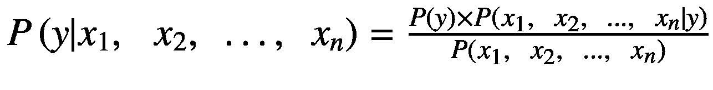

并且假设

`P(x[i]|y, x[1], x[2], … , x[i-1], x[i+1], … , x[n]) = P(x[i]|y)`

对于所有 `i` 成立，我们可以将其表示为：

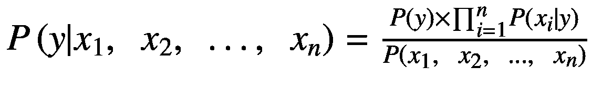

其中 `i` 的取值范围是从 1 到 `n`。简单来说，可以写成：


由于 `P(x[1], x[2], … , x[n])` 是常数，该模型可以表达为：

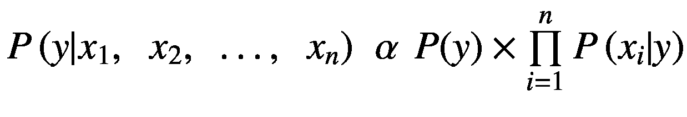

这意味着，在之前关于特征之间相互独立（每个特征在条件上独立于其他所有特征）的假设下，待预测的类别变量 `y` 上的条件分布可以用以下数学方程表示：

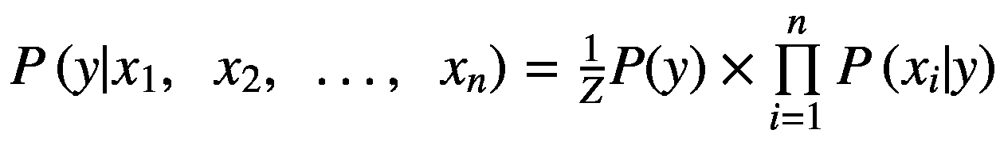

其中，证据度量 `Z = p(x)` 是一个依赖于特征变量的常数缩放因子。基于这个方程，我们可以结合一个称为 MAP 决策规则（即最大后验概率）的规则来构建朴素贝叶斯分类器。在当前范围内深入探讨统计细节是不可能的，但通过使用该规则，分类器可以表示为一个数学函数，该函数可以使用以下表达式为某个 `k` 分配预测类别标签 `ŷ = C_k`：

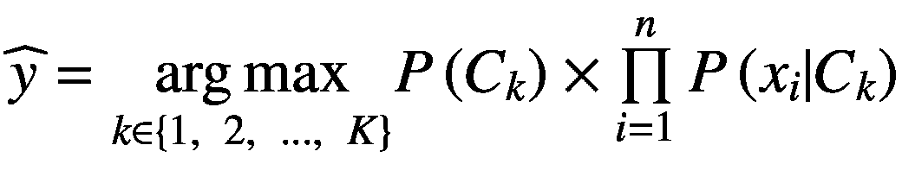

这个分类器通常被认为很简单，从其名称和我们对数据和特征所做的（在现实世界中可能不成立的）几个假设中就可以明显看出。尽管如此，该算法在许多与分类相关的用例中仍然表现得非常出色，包括多类文档分类、垃圾邮件过滤等。与其他分类器相比，它们训练速度非常快，并且即使没有足够的训练数据也能表现良好。当模型拥有大量特征时，通常性能不佳，这种现象被称为**维度诅咒**。朴素贝叶斯通过解耦与类别变量相关的条件特征分布来应对这个问题，从而使每个分布都能被独立地估计为一维分布。

多项式朴素贝叶斯是该算法的一种扩展，用于预测和分类数据点，其中不同类别或结果的数量超过两个。在这种情况下，特征向量通常被假定为来自词袋模型的词频统计，但基于 TF-IDF 的权重也同样适用。一个限制是，基于负权重的特征不能输入到该算法中。对于每个类别标签 `y`，该分布可以表示为 `p[y] = {p[y1], p[y2], … , p[yn]}`，总特征数为 `n`，在文本分析中可表示为不同单词或术语的总词汇量。从方程中，`p[yi] = P(x[i]|y)` 表示在结果或类别为 `y` 的任何观测样本中特征 `i` 的概率。参数 `p[y]` 可以通过一种平滑版本的最大似然估计（基于相对出现频率）来估算，并表示为：

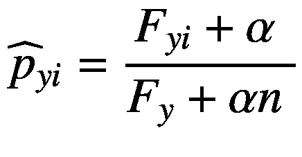

其中 `F_yi = Σ_{x∈TD} x_i` 是训练数据集 `TD` 中类别标签为 `y` 的样本中特征 `i` 出现的频率，而 `F_y = Σ_{i=1}^{|TD|} F_yi` 是类别标签 `y` 的所有特征的总频率。借助先验 `α ≥ 0` 进行了一定程度的平滑处理，这考虑了学习数据点中不存在的特征，有助于消除与零概率相关的问题。该参数有一些常用的特定设置。`α = 1` 的值被称为*拉普拉斯平滑*，而 `α < 1` 被称为*利德斯通平滑*。Scikit-Learn 库在 `MultinomialNB` 类中提供了多项式朴素贝叶斯的优秀实现，我们稍后在构建文本分类器时将利用它。请记住，不要盲目将 `α` 值设置得过高，因为这可能因过度平滑而导致模型错误地认为某些不存在的特征对于预测特定类别是重要的。


### 逻辑回归

逻辑回归模型实际上是由统计学家戴维·考克斯于 1958 年提出的一种统计模型。由于它使用逻辑函数（通常也称为 sigmoid 函数）来估算参数值，因此也被称为 logit 模型或逻辑模型。这些参数是所有特征的系数，其目标是在预测结果（在本例中为新闻组类别）时使总体损失最小化。不过，我们关注的并非误差，而是利用极大似然估计法，最大化预测值与观测值之间的似然性。

考虑一个二分类问题：预测类别为 0 或 1。在逻辑模型中，标记为 1 的类别的对数几率（odds 的对数）本质上是线性回归模型的方程（一个或多个独立特征的线性组合，这些特征可以是类别型或连续型）。然而，我们需要预测的是离散的类别。因此，标记为 1 的类别对应的概率值可以在 0 到 1 之间变化，以此表示预测的置信度。将对数几率转换为概率的函数就是逻辑函数。标准 sigmoid 函数或逻辑函数可以用以下公式进行数学表示：

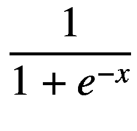

其中，`e` 是自然常数（欧拉数），`x` 代表典型方程，它可以从我们尝试估算特征系数的线性回归方程中推导出来。该函数通常呈现为 S 形曲线，如图 5-6 所示。

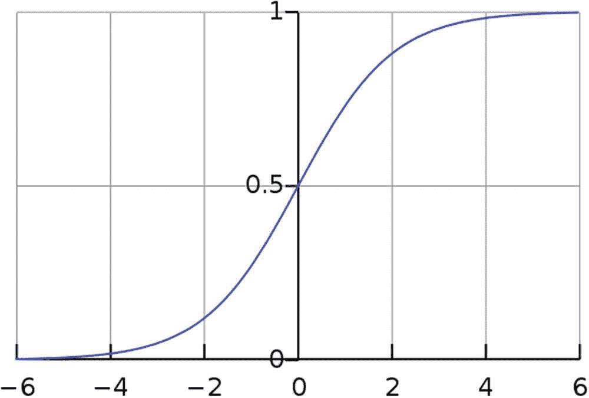

图 5-6

标准 sigmoid 函数或逻辑函数

对数几率尺度的标准测量单位称为`logit`，即逻辑单位的缩写，因此该模型也有这些别名。要理解这个模型的工作原理，需要深入钻研数学，而本书的目的并非提供机器学习课程。不过，为了面向更偏好数学的读者，我们会简要介绍这部分内容。考虑一个标准的多重线性回归模型，表示如下：

`y = β[0] + β[1]x[1] + β[2]x[2] + … + β[n]x[n]`

其中 `{x[1], x[2], …, x[n]}` 是我们的特征，我们尝试估算系数 `{β[1], β[2], …, β[n]}`。考虑到我们需要预测类别，我们可以将其表示为对数几率，即使用概率 `p` 的 `logit` 函数：

`logodds = logit(p) = β[0] + β[1]x[1] + β[2]x[2] + … + β[n]x[n]`

这意味着，如果 `p` 是预测某个特定类别的概率，那么该事件发生的几率是 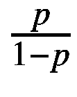，这本质上是有利结果与不利结果的比率。同样地，`p` 的 `logit` 本质上就是对数几率。因此，我们可以用数学方法推导如下：

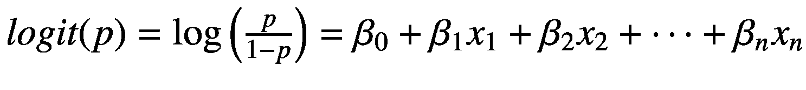

如果我们想得到逻辑回归模型输出的类别概率值，可以推导出以下方程，这也是逻辑回归模型的核心：

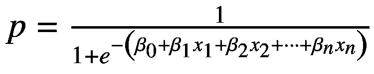

最后，我们可以使用极大似然估计法来优化并估算每个特征的最优系数，这有助于最大化似然函数。在 Scikit-Learn 中，可以利用`LogisticRegression`模型来应用逻辑回归模型进行分类。`LogisticRegression`类中实现的求解器包括`"liblinear"`、`"newton-cg"`、`"lbfgs"`、`"sag"`和`"saga"`。每个求解器都有其独特的实现方式。在多分类问题中（正如我们这里的问题），如果`multi_class`选项设置为`ovr`，训练算法会使用一对多方案；如果`multi_class`选项设置为`multinomial`，则会使用交叉熵损失。


### 支持向量机

在机器学习中，支持向量机（通常被称为`SVM`）是一种监督学习算法。它们用于分类、回归、新颖性、异常以及离群点检测。考虑一个二分类问题，如果我们有训练数据，且每个数据点或观测值属于特定的类别，就可以基于这些数据训练`SVM`算法，使其能够将未来的数据点分配到两个类别之一。该算法将训练数据样本表示为空间中的点，使得属于任一类的点可以通过它们之间的宽间隙（超平面）分开，待预测的新数据点则根据它们落在此超平面的哪一侧来分配类别。这个过程是一个典型的线性分类过程。然而，`SVM`也可以通过一种称为**核技巧**的有趣方法执行非线性分类，其中使用核函数在非线性可分离的高维特征空间上进行操作。通常，特征空间中数据点之间的内积有助于实现这一点。

`SVM`算法接收一组训练数据点，并为高维特征空间构建一个超平面（或一组超平面）。超平面的间隔越大，分离效果越好，这会导致分类器的泛化误差更低。让我们正式且数学化地表示这一点。考虑一个包含**n**个数据点的训练数据集：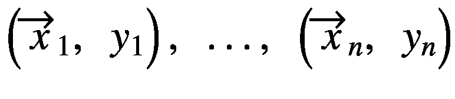，其中类别变量`y[i] ∈ {-1, 1}`，每个值表示点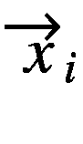对应的类别。每个数据点是一个特征向量。`SVM`算法的目标是找到最大间隔超平面，该超平面将类别标签为`y[i] = 1`的数据点集与类别标签为`y[i] = -1`的数据点集分开，同时最大化超平面与离它最近的任一类样本数据点之间的距离。这些样本数据点被称为**支持向量**。图 5-7 展示了带有超平面的向量空间的样子。

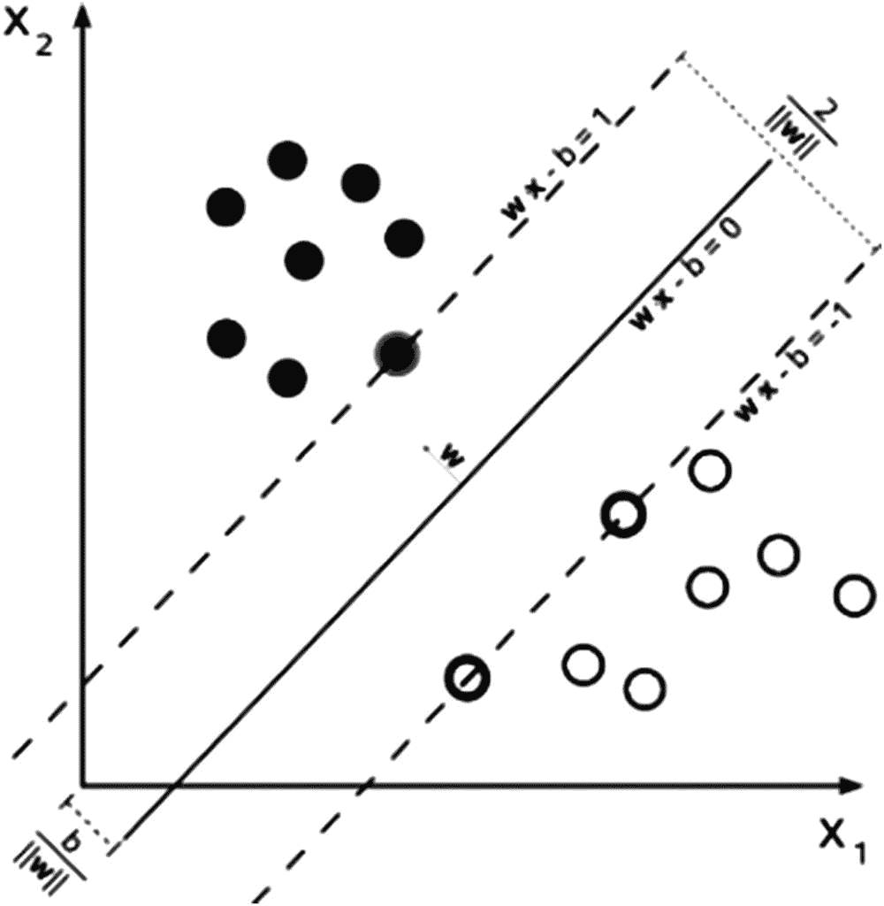

**图 5-7**
二分类`SVM`描绘了超平面和支持向量

从图 5-7 中可以清晰地看到超平面和支持向量。超平面可以定义为满足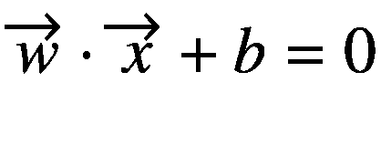的点集，其中是超平面的法向量，而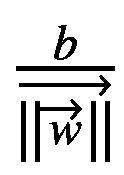给出了超平面从原点到图 5-7 中高亮显示的支持向量的偏移量。主要有两种类型的间隔有助于分离属于不同类别的数据点。

当数据是线性可分离的（如图 5-7 所示）时，我们可以使用硬间隔，它基本上由虚线表示的两个平行超平面来表示。这有助于分离属于两个不同类别的数据点。这是通过考虑它们之间的距离尽可能大来实现的。由这两个超平面界定的区域形成了间隔，而最大间隔超平面位于中间。这些超平面的方程为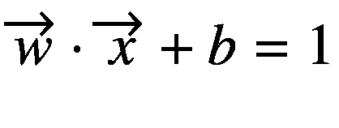和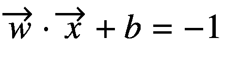。

通常，数据点不是线性可分离的，此时我们可以使用铰链损失函数，它可以表示为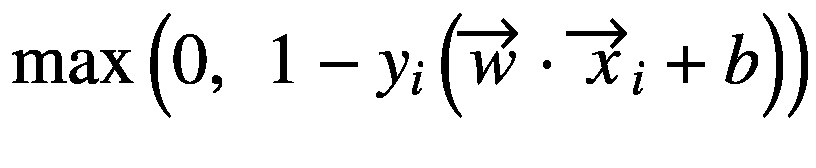。事实上，`Scikit-Learn`实现的`SVM`可以在`SVC`、`LinearSVC`或`SGDClassifier`中找到，我们使用`hinge`损失函数（默认设置）来优化和构建模型。这个损失函数帮助我们获得软间隔，通常被称为**软间隔 SVM**。你还可以使用不同的核函数将现有的特征空间转换为更高维的特征空间，使得数据可以在其中被线性分离。这就是`SVM`中广为人知的**核技巧**！但是，我们不建议在文本数据问题上过多地使用它，因为从一开始你就已经要处理大量的维度。

对于多类分类问题，如果我们有**n**个类别，则会为每个类别训练和学习一个二分类器，这有助于将每个类别与其他`n-1`个类别分开。在预测期间，计算每个分类器的得分（到超平面的距离），并选择最大得分来确定类别标签。在`SVM`算法中，常使用随机梯度下降来最小化损失函数。图 5-8 展示了如何在非常著名的鸢尾花数据集上为一个三分类`SVM`问题训练总共三个分类器。此图使用`Scikit-Learn`模型构建，来源于其官方文档，可在[`http://scikit-learn.org/`](http://scikit-learn.org/)获取。

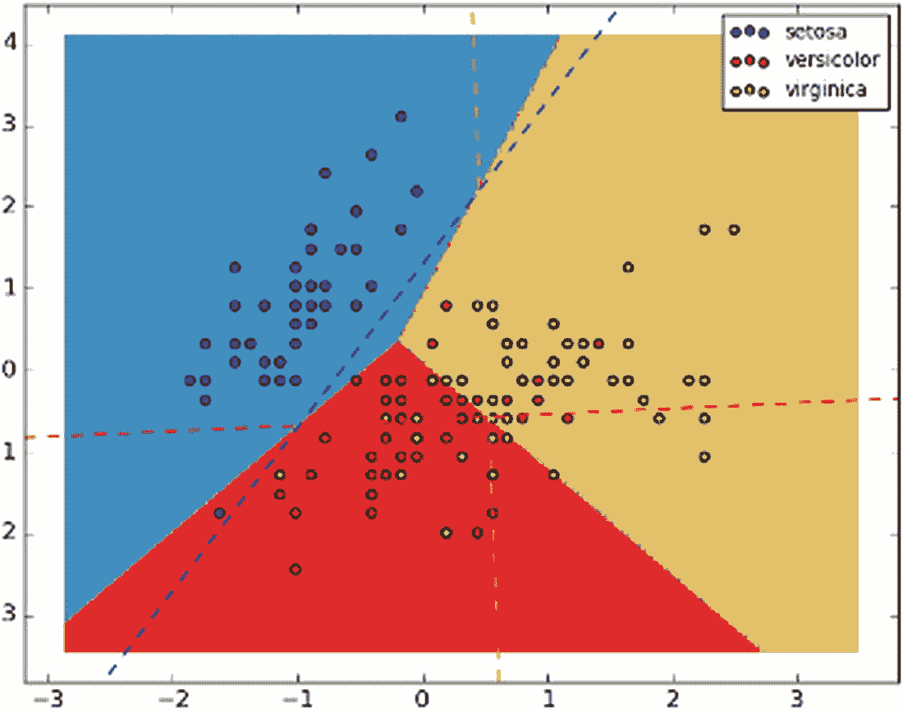

**图 5-8**
针对三个类别的多分类 SVM（致谢：[scikit-learn.​org](http://scikit-learn.org)）

从图 5-8 中可以清晰地看到，总共为三个类别中的每一个训练了三个`SVM`分类器。它们被组合起来进行最终预测，以便正确标记属于每个类别的数据点。因此，多分类支持是按照一对多的方案处理的，类似于逻辑回归模型。


### 集成模型

集成模型本质上是字面意义上由其他模型或估计器组成的模型或元估计器。这些子模型是简单的估计器，可能无法像组合多个估计器后那样做出准确预测。以随机森林为例，其子模型是决策树。通常，随机森林会训练许多决策树，并将它们组合起来生成一个单一的预测。集成模型的种类非常丰富。我们简要提及其中的两类，因为接下来将分别介绍这两类中的一个示例。

-   **装袋法**：一种非常流行的集成建模技术。在装袋法中，你会提取数据的子集（通常是自助样本），并同时在每个子集上训练一个模型。然后，这些子集被允许对结果进行*同时*投票，最终结果通常是平均聚合。随机森林模型可能是装袋法模型中最著名的例子。
-   **提升法**：另一种集成技术。与装袋法并行构建多个模型不同，提升法采用顺序建模，并试图通过前一个模型的错误来改进当前模型！提升法通常以一种*序贯*处理的形式，将一个模型的输出作为下一个模型的输入。梯度提升机是最流行的提升模型之一。

### 随机森林

决策树是一类监督式机器学习算法，能够从底层数据中自动表示和解释规则集。它们使用信息增益和基尼指数等指标来构建树。然而，决策树的一个主要缺点是，由于它们是非参数模型，数据越多，树的深度就越大。我们最终可能会得到非常庞大且深的树，这些树容易过拟合。该模型可能在训练数据上表现非常好，但它并不是在学习，而只是记住了所有的训练样本，并为它们构建了非常具体的规则。因此，它在测试数据上表现非常差。随机森林试图解决这个问题。

随机森林是一种元估计器或集成模型，它在数据集的各种子样本上拟合多个决策树分类器，并使用平均化来提高预测准确性并控制过拟合。子样本的大小始终与原始输入样本大小相同，但样本是放回抽取的（自助样本）。在随机森林中，所有树都是并行训练的（装袋模型/自助聚合）。除此之外，集成中的每棵树都是通过从训练集中放回抽取的样本（即自助样本）构建的。此外，在树的构建过程中，当分裂一个节点时，选择的分裂不再是所有特征中的最佳分裂；相反，所选的分裂是特征随机子集中的最佳分裂。因此，随机森林中引入的随机性既来自于数据的随机抽样，也来自于每棵树分裂节点时特征选择的随机性。所以，由于这种随机性，森林的偏差通常会略有增加（相对于单个非随机决策树的偏差）。然而，由于进行了平均化，模型整体方差的降低幅度远大于偏差的增加幅度，因此最终为我们提供了一个整体上更好的模型。

在构建随机森林时，你可以为基本决策树和整个森林设置特定的模型参数。对于树，你通常可以设置与普通决策树模型相同的参数，如树深度、叶子节点数、每次分裂的特征数、每个叶子节点的样本数、节点分裂标准、信息增益和基尼不纯度。对于森林，你可以调整所需的树的总数、每棵树要使用的特征数量等。

### 梯度提升机

梯度提升机，通常称为 GBM，可用于回归和分类。通常，GBM 会以向前逐步序贯的方式构建一个加性模型；它们允许优化任意的可微损失函数。GBM 通常可以处理任何模型（弱学习器）和损失函数的组合。Scikit-Learn 使用 GBRT（梯度提升回归树），这是一种广义的提升模型，可以应用于任意的可微损失函数。该模型的美妙之处在于它很准确，并且可以用于回归和分类问题。GBRT 考虑加性模型，其数学表示如下：

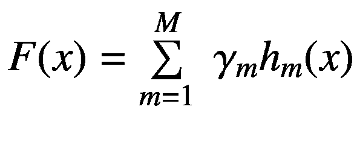

其中`hm`可以被定义为基模型或弱学习器——在这里是决策树。与其他提升算法类似，GBRT 以向前逐步序贯的方式构建加性模型。数学上可以表示如下：

`Fm = Fm - 1 + γ[m]hm`

在每个阶段，选择下一个决策树`hm`来最小化给定前一个决策树模型`F[m - 1]`及其拟合结果`Fm - 1`的损失函数`L`。其表示如下：

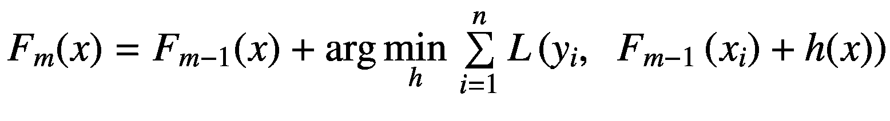

通常，决策树被用作基础模型，我们最终会最小化残差（回归树）或负对数似然（分类树）。

有许多资源和书籍完全致力于监督式机器学习和分类。我们鼓励读者查阅这些资料，以更深入地了解这些技术的工作原理以及如何将它们应用于分析中的各种问题。我们还建议读者查看最新、最先进的集成模型，例如 XGBoost、CatBoost 和 LightGBM。

## 评估分类模型

训练、调优和构建模型是整个分析生命周期的重要组成部分，但了解这些模型的性能甚至更为重要。分类模型的性能通常取决于它们对新的数据点预测结果的好坏。通常，这种性能通过测试集或保留数据集来衡量，该数据集由从未以任何方式影响或训练分类器的数据点组成。这个测试数据集包含多个观测值及其对应的标签。我们以与训练模型时相同的方式提取特征。将这些特征输入到已经训练好的模型中，我们便得到每个数据点的预测结果。然后，将这些预测结果与实际标签进行比对，以查看模型预测的效果或准确度。有多种指标可用于确定模型的预测性能。我们主要关注以下指标。

-   准确率
-   精确率
-   召回率
-   F1 分数

让我们举一个非常经典的例子——威斯康星州乳腺癌诊断数据集。该数据集有 30 个属性或特征，以及每个数据点（乳腺肿块）对应的标签，表示其是否患有癌症（恶性：标签值为 1）或没有癌症（良性：标签值为 0）。假设我们已经拥有这些数据，并将构建一个基本的逻辑回归模型并对其进行评估。我们假设训练数据集中有 398 个观测值，测试数据集中有 171 个观测值。我们将利用一个为模型评估创建的实用模块。它名为 `model_evaluation_utils`，你可以连同本章的代码文件和笔记本一起找到它。我们建议你查看该代码，它利用了 Scikit-Learn 的 `metrics` 模块来计算大多数评估指标和图表。


### 混淆矩阵

`混淆矩阵`是评估分类模型最常用的方法之一。虽然矩阵本身并非一个指标，但矩阵的表示形式可用于定义各种指标，所有指标在某些特定案例或场景中都变得至关重要。混淆矩阵可以针对二分类和多分类模型创建。

混淆矩阵是通过将数据点的预测类别标签与其实际类别标签进行比较而创建的。此比较会针对整个数据集重复进行，比较结果会以矩阵或表格形式汇总。生成的矩阵就是我们的混淆矩阵。在进一步深入之前，我们先在乳腺癌数据集上构建一个逻辑回归模型，并查看模型在测试数据集上的预测混淆矩阵。

```
from sklearn import linear_model
# 训练并构建模型
logistic = linear_model.LogisticRegression()
logistic.fit(X_train,y_train)
# 对测试数据进行预测并查看混淆矩阵
import model_evaluation_utils as meu
y_pred = logistic.predict(X_test)
meu.display_confusion_matrix(true_labels=y_test, predicted_labels=y_pred, classes=[0, 1])
预测值：
0    1
实际值：0         59    4
1          2  106
```

上述输出展示了带有必要注释的混淆矩阵。我们可以看到，在标签为 `0`（良性）的 63 个观测值中，我们的模型正确预测了 59 个。同样，在标签为 `1`（恶性）的 108 个观测值中，我们的模型正确预测了 106 个。更详细的分析即将呈现！

### 理解混淆矩阵

虽然名字本身听起来相当吓人，但只要掌握了基础知识，理解混淆矩阵并不那么令人困惑！为了重申我们在上一节中学到的内容，混淆矩阵是一种表格结构，用于记录正确分类和错误分类。这对于评估分类模型的性能非常有用，我们知道模型的真实数据标签，并可以将其与预测的数据标签进行比较。混淆矩阵中的每一列代表基于模型预测的分类实例计数，矩阵中的每一行代表基于实际/真实类别标签的实例计数。这种结构也可以反过来，即用行表示预测，用列表示真实标签。在一个典型的二分类问题中，我们通常有一个被定义为正类别的类别标签，这基本上是我们感兴趣的类别。例如，在我们的乳腺癌数据集中，我们感兴趣的是检测乳腺癌，因此标签 `1` 是我们的正类别。图 5-9 展示了一个典型的二分类问题混淆矩阵，其中 `p` 代表正类别，`n` 代表负类别。

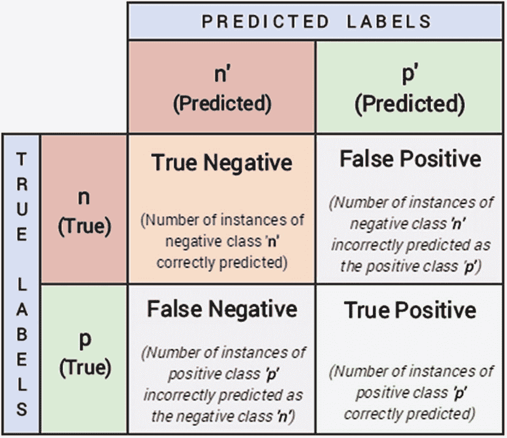

**图 5-9** 混淆矩阵的典型结构

图 5-9 应该能让混淆矩阵的结构更加清晰。通常，我们有一个正类别（如前所述），另一个类别是负类别。基于这种结构，我们可以清楚地看到四个重要的术语。

*   **真正例 (TP):** 这是来自正类别的实例总数，其真实类别标签等于预测类别标签，即我们模型正确预测正类别标签的总实例数。
*   **假正例 (FP):** 这是来自负类别的实例总数，我们的模型错误地将它们预测为正类别。因此得名“假”正例。
*   **真负例 (TN):** 这是来自负类别的实例总数，其真实类别标签等于预测类别标签，即我们模型正确预测负类别标签的总实例数。
*   **假负例 (FN):** 这是来自正类别的实例总数，我们的模型错误地将它们预测为负类别。因此得名“假”负例。

基于这些信息，你能根据模型在乳腺癌测试数据上的预测结果，为我们的混淆矩阵计算出这些指标吗？

```
positive_class = 1
TP = 106
FP = 4
TN = 59
FN = 2
```


