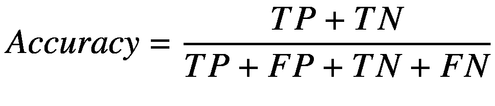
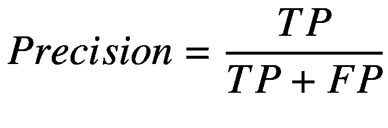
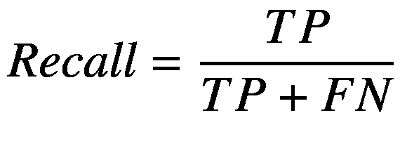
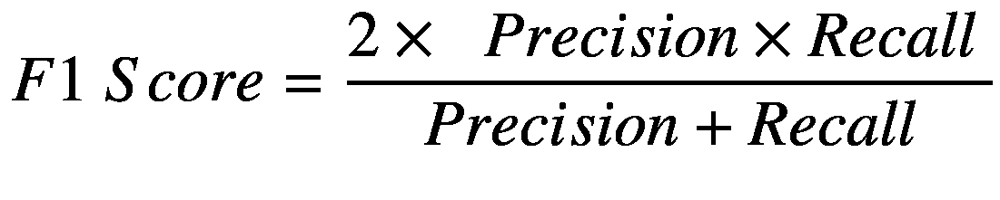

# 性能指标

混淆矩阵本身并非分类模型的性能度量标准，但它可用于计算多种适用于不同场景的有效指标。我们将说明如何从混淆矩阵计算主要指标，通过必要公式手动计算，将结果与`Scikit-Learn`提供的函数在预测结果上的输出进行对比，并直观解释每种指标适用的场景。

`准确率`是衡量分类器性能最常用的指标之一，定义为模型正确预测的总体比例。从混淆矩阵计算准确率的公式如下：



当类别分布基本均衡且各类别正确预测的重要性相同时，通常使用准确率。以下代码计算了模型预测的准确率。

```
fw_acc = round(meu.metrics.accuracy_score(y_true=y_test, y_pred=y_pred), 5)
mc_acc = round((TP + TN) / (TP + TN + FP + FN), 5)
print('框架准确率:', fw_acc)
print('手动计算准确率:', mc_acc)
框架准确率: 0.96491
手动计算准确率: 0.96491
```

`精确率`（亦称阳性预测值）是另一个可从混淆矩阵派生的指标。它定义为在所有基于正类的预测中，实际正确或相关的预测数量。精确率的公式如下：



与较低精确率的模型相比，高精确率的模型能识别更高比例的正类。当我们更关注找出最大数量的正类（即使总体准确率下降）时，精确率变得尤为重要。以下代码计算了模型预测的精确率。

```
fw_prec = round(meu.metrics.precision_score(y_true=y_test, y_pred=y_pred), 5)
mc_prec = round((TP) / (TP + FP), 5)
print('框架精确率:', fw_prec)
print('手动计算精确率:', mc_prec)
框架精确率: 0.96364
手动计算精确率: 0.96364
```

`召回率`（亦称`灵敏度`）是衡量模型识别相关数据点百分比的指标。它定义为正确预测的正类实例数量，也被称为命中率、覆盖率或灵敏度。召回率的公式如下：



当我们希望捕获某个类别的大多数实例（即使这会增加假阳性）时，召回率就成为分类器性能的重要衡量指标。例如，银行欺诈检测场景中，高召回率的模型会给出更多潜在欺诈案例，但同样有助于对大多数可疑情况发出警报。以下代码计算了模型预测的召回率。

```
fw_rec = round(meu.metrics.recall_score(y_true=y_test, y_pred=y_pred), 5)
mc_rec = round((TP) / (TP + FN), 5)
print('框架召回率:', fw_rec)
print('手动计算召回率:', mc_rec)
框架召回率: 0.98148
手动计算召回率: 0.98148
```

在某些情况下，我们需要精确率和召回率的平衡优化。`F1 分数`是精确率和召回率的调和平均数，有助于优化分类器实现两者的均衡性能。

`F1 分数`的公式如下：



下面使用以下代码计算模型预测结果的`F1 分数`。

```
fw_f1 = round(meu.metrics.f1_score(y_true=y_test, y_pred=y_pred), 5)
mc_f1 = round((2*mc_prec*mc_rec) / (mc_prec+mc_rec), 5)
print('框架 F1 分数:', fw_f1)
print('手动计算 F1 分数:', mc_f1)
框架 F1 分数: 0.97248
手动计算 F1 分数: 0.97248
```

由此可见，我们手动计算的指标与`Scikit-Learn`函数所得结果完全吻合。这将帮助您深入理解如何利用这些指标评估分类模型。

## 构建与评估文本分类器

我们已经学习了构建分类系统所需的全部步骤，包括数据检索、数据整理、文本预处理与标准化、特征提取与工程、分类模型以及模型性能评估。本节将整合所有知识，构建并评估我们的文本分类系统！训练集和测试集已完成清洗，可直接使用。我们将采用以下工作流程构建文本分类器：

-   传统特征表示（`词袋模型`、`TF-IDF`）与分类模型
-   高级特征表示（`Word2Vec`、`GloVe`、`FastText`）与分类模型

同时使用交叉验证和网格搜索技术对最优模型进行评估和调优。

### 词袋特征与分类模型

首先使用基础的`词袋模型`（基于词频的特征工程模型）从训练集和测试集中提取特征。

```
from sklearn.feature_extraction.text import CountVectorizer
from sklearn.model_selection import cross_val_score
# 构建训练文章的词袋特征
cv = CountVectorizer(binary=False, min_df=0.0, max_df=1.0)
cv_train_features = cv.fit_transform(train_corpus)
# 将测试文章转换为特征
cv_test_features = cv.transform(test_corpus)
print('词袋模型:> 训练特征形状:', cv_train_features.shape,
 ' 测试特征形状:', cv_test_features.shape)
词袋模型:> 训练特征形状: (12263, 66865)  测试特征形状: (6041, 66865)
```

现在，我们利用这些特征在训练数据上构建多个分类器，使用前述所有分类模型在测试数据集上评估其性能。同时通过五折交叉验证检查模型准确率的一致性，以确认模型在数据的不同验证折上表现稳定（后续将采用相同策略进行模型调优）。


