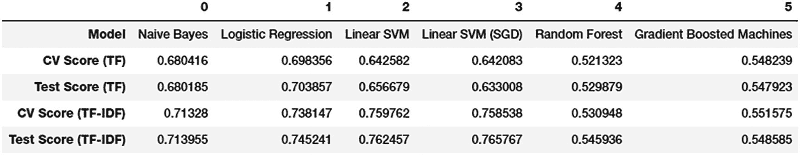
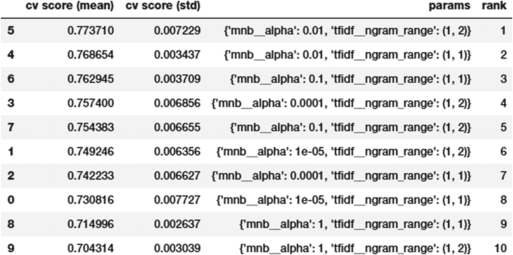
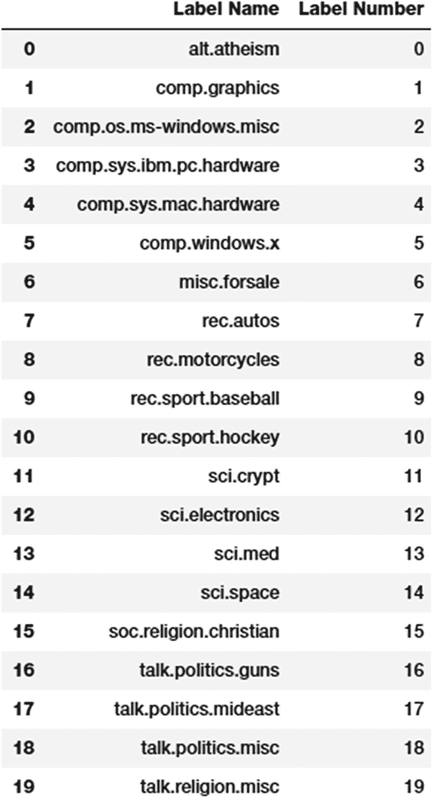
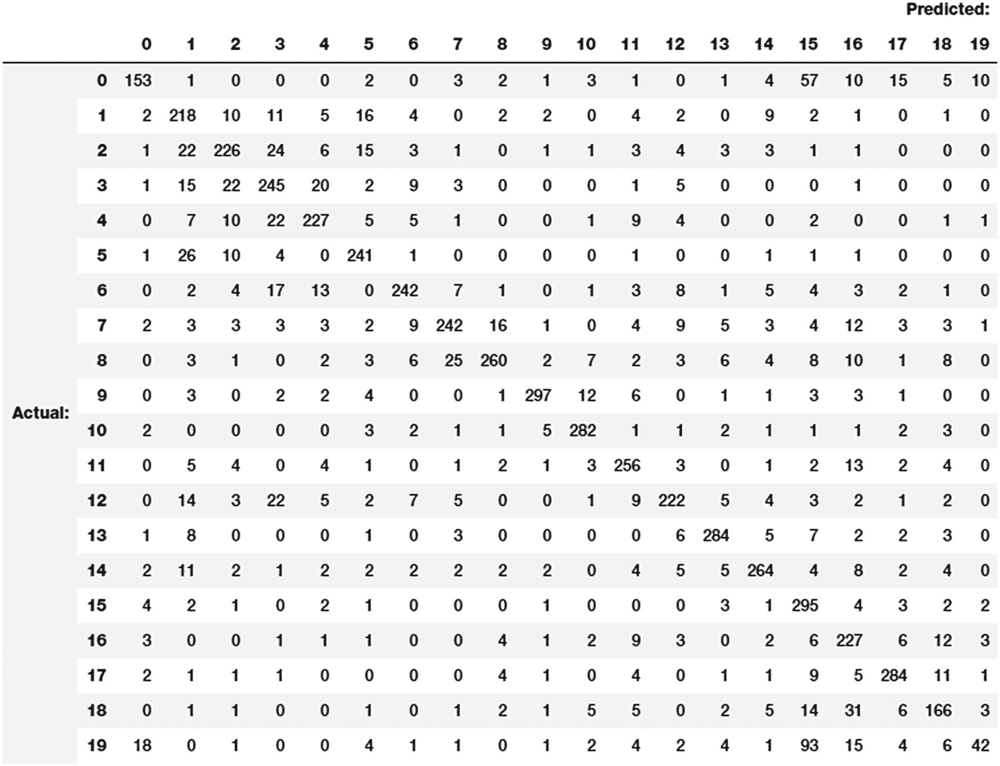
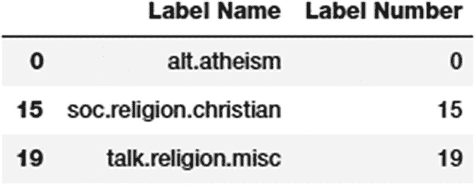
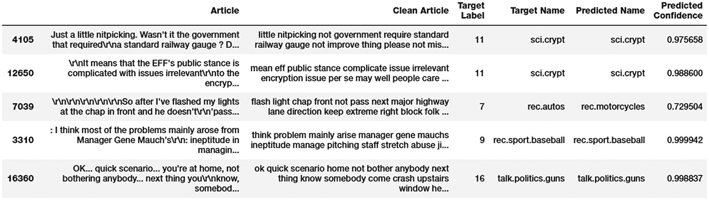
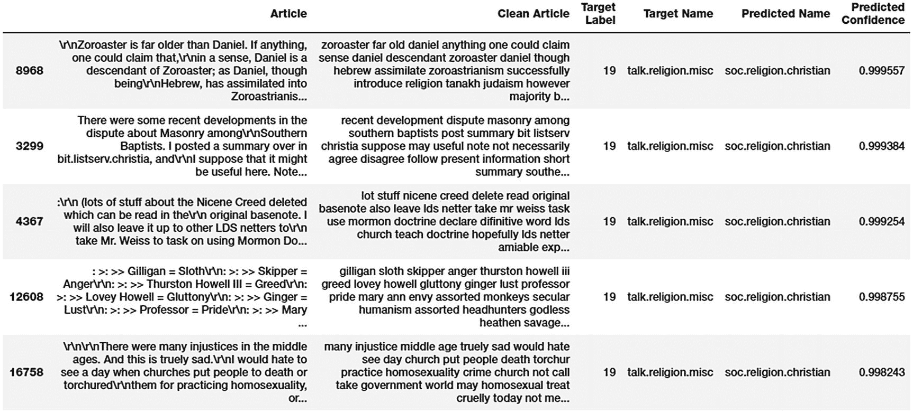
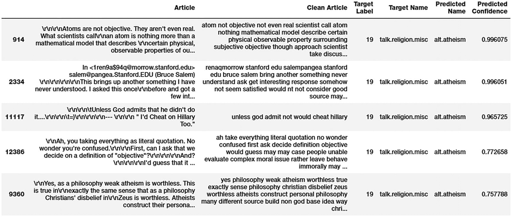

# 梯度提升

```
gbc = GradientBoostingClassifier(n_estimators=10, random_state=42)
gbc.fit(tv_train_features, train_label_names)
gbc_tfidf_cv_scores = cross_val_score(gbc, tv_train_features, train_label_names, cv=5)
gbc_tfidf_cv_mean_score = np.mean(gbc_tfidf_cv_scores)
print('CV Accuracy (5-fold):', gbc_tfidf_cv_scores)
print('Mean CV Accuracy:', gbc_tfidf_cv_mean_score)
gbc_tfidf_test_score = gbc.score(tv_test_features, test_label_names)
print('Test Accuracy:', gbc_tfidf_test_score)
CV Accuracy (5-fold): [ 0.55790329  0.53827362  0.55768447  0.55859535  0.54541735]
Mean CV Accuracy: 0.551574813725
Test Accuracy: 0.548584671412
```

有趣的是，几个模型的整体准确率都有相当幅度的提升，包括逻辑回归、朴素贝叶斯和 SVM。而有趣的是，集成模型的表现却不尽人意。使用更多的估计器可能会改善它们的表现，但即便如此，其效果可能仍然不及其他模型，并且会耗费大量的训练时间。

## 模型性能对比评估

现在，我们可以对目前为止尝试过的所有模型，结合两种不同的特征工程技术，进行一次漂亮的对比。我们将根据建模结果创建一个数据框，并比较这些结果。见图 5-10。



**图 5-10** — 模型性能对比评估

```
pd.DataFrame([['Naive Bayes', mnb_bow_cv_mean_score, mnb_bow_test_score,
mnb_tfidf_cv_mean_score, mnb_tfidf_test_score],
['Logistic Regression', lr_bow_cv_mean_score, lr_bow_test_score, lr_tfidf_cv_mean_score, lr_tfidf_test_score],
['Linear SVM', svm_bow_cv_mean_score, svm_bow_test_score,
svm_tfidf_cv_mean_score, svm_tfidf_test_score],
['Linear SVM (SGD)', svmsgd_bow_cv_mean_score, svmsgd_bow_test_score, svmsgd_tfidf_cv_mean_score, svmsgd_tfidf_test_score],
['Random Forest', rfc_bow_cv_mean_score, rfc_bow_test_score,
rfc_tfidf_cv_mean_score, rfc_tfidf_test_score],
['Gradient Boosted Machines', gbc_bow_cv_mean_score, gbc_bow_test_score, gbc_tfidf_cv_mean_score, gbc_tfidf_test_score]],
columns=['Model', 'CV Score (TF)', 'Test Score (TF)',
'CV Score (TF-IDF)', 'Test Score (TF-IDF)'],
).T
```

图 5-10 清晰地表明，表现最佳的模型是 SVM，其次是逻辑回归和朴素贝叶斯。集成模型在此数据集上的表现不佳。


### 基于 Word2Vec 嵌入的分类模型

接下来，我们尝试将更新的高级特征工程技术应用于分类模型。首先，从生成 Word2Vec 嵌入开始。这里需要注意的一点是，词嵌入模型会为每个单词生成一个固定长度的稠密嵌入向量。因此，我们需要某种方案来为每个文档生成固定长度的嵌入。一种方法是对文档中所有单词的词嵌入进行平均（甚至可以计算 TF-IDF 加权平均值！）。下面我们来构建一个方案，通过平均词嵌入来生成文档嵌入。

```
def document_vectorizer(corpus, model, num_features):
vocabulary = set(model.wv.index2word)
def average_word_vectors(words, model, vocabulary, num_features):
feature_vector = np.zeros((num_features,), dtype="float64")
nwords = 0.
for word in words:
if word in vocabulary:
nwords = nwords + 1.
feature_vector = np.add(feature_vector, model.wv[word])
if nwords:
feature_vector = np.divide(feature_vector, nwords)
return feature_vector
features = [average_word_vectors(tokenized_sentence, model, vocabulary, num_features) for tokenized_sentence in corpus]
return np.array(features)
```

我们使用优秀的 Python 框架 `Gensim`，为语料库中的所有单词生成 Word2Vec 嵌入。

```
# 对语料库进行分词
tokenized_train = [tn.tokenizer.tokenize(text)
for text in train_corpus]
tokenized_test = [tn.tokenizer.tokenize(text)
for text in test_corpus]
# 生成 word2vec 词嵌入
import gensim
# 构建 word2vec 模型
w2v_num_features = 1000
w2v_model = gensim.models.Word2Vec(tokenized_train, size=w2v_num_features, window=100, min_count=2, sample=1e-3, sg=1, iter=5, workers=10)
# 生成文档级嵌入
# 请记住，我们仅使用训练数据集的词汇嵌入
# 这样测试数据集才能保持真正不可见的状态
# 从 word2vec 模型生成平均词向量特征
avg_wv_train_features = document_vectorizer(corpus=tokenized_train, model=w2v_model, num_features=w2v_num_features)
avg_wv_test_features = document_vectorizer(corpus=tokenized_test, model=w2v_model, num_features=w2v_num_features)
print('Word2Vec model:> Train features shape:', avg_wv_train_features.shape,' Test features shape:', avg_wv_test_features.shape)
Word2Vec model:> Train features shape: (12263, 1000)  Test features shape: (6041, 1000)
```

接下来，我们尝试使用我们表现最好的模型之一（基于 SGD 的 SVM），在测试数据上检查模型性能。

```
from sklearn.svm import LinearSVC
from sklearn.model_selection import cross_val_score
from sklearn.linear_model import SGDClassifier
svm = SGDClassifier(loss='hinge', penalty="l2", random_state=42, max_iter=500)
svm.fit(avg_wv_train_features, train_label_names)
svm_w2v_cv_scores = cross_val_score(svm, avg_wv_train_features, train_label_names, cv=5)
svm_w2v_cv_mean_score = np.mean(svm_w2v_cv_scores)
print('CV Accuracy (5-fold):', svm_w2v_cv_scores)
print('Mean CV Accuracy:', svm_w2v_cv_mean_score)
svm_w2v_test_score = svm.score(avg_wv_test_features, test_label_names)
print('Test Accuracy:', svm_w2v_test_score)
CV Accuracy (5-fold): [0.76026006 0.74796417 0.73746433 0.73989383 0.74386252]
Mean CV Accuracy: 0.7458889820674891
Test Accuracy: 0.7381228273464658
```

模型性能确实不错，但仍然不如我们基于 TF-IDF 的模型，后者在测试集上取得了更好的准确率。

### 基于 GloVe 嵌入的分类模型

现在，我们为每个单词生成基于 GloVe 的词嵌入，生成文档级嵌入，并使用我们的 SVM 模型来测试模型性能。我们使用 spaCy 基于 Common Crawl 语料库生成的默认词嵌入。

```
# 使用 GloVe 模型进行特征工程
train_nlp = [tn.nlp(item) for item in train_corpus]
train_glove_features = np.array([item.vector for item in train_nlp])
test_nlp = [tn.nlp(item) for item in test_corpus]
test_glove_features = np.array([item.vector for item in test_nlp])
print('GloVe model:> Train features shape:', train_glove_features.shape,
' Test features shape:', test_glove_features.shape)
GloVe model:> Train features shape: (12263, 300)  Test features shape: (6041, 300)
# 构建我们的 SVM 模型
svm = SGDClassifier(loss='hinge', penalty="l2", random_state=42, max_iter=500)
svm.fit(train_glove_features, train_label_names)
svm_glove_cv_scores = cross_val_score(svm, train_glove_features, train_label_names, cv=5)
svm_glove_cv_mean_score = np.mean(svm_glove_cv_scores)
print('CV Accuracy (5-fold):', svm_glove_cv_scores)
print('Mean CV Accuracy:', svm_glove_cv_mean_score)
svm_glove_test_score = svm.score(test_glove_features, test_label_names)
print('Test Accuracy:', svm_glove_test_score)
CV Accuracy (5-fold): [ 0.68996343  0.67711726  0.67101508  0.67006942  0.66448445]
Mean CV Accuracy: 0.674529928944
Test Accuracy: 0.666777023672
```

看起来性能并不理想，这可能是因为我们使用了预生成的词嵌入。现在，让我们来看看 FastText！

### 基于 FastText 嵌入的分类模型

现在我们再次利用 Gensim，但使用 Facebook 的 FastText 模型来生成词嵌入，并基于这些嵌入构建我们的文档嵌入。

```
from gensim.models.fasttext import FastText
ft_num_features = 1000
# sg 决定使用 skip-gram 模型 (1) 还是 CBOW 模型 (0)
ft_model = FastText(tokenized_train, size=ft_num_features, window=100,
min_count=2, sample=1e-3, sg=1, iter=5, workers=10)
# 从 word2vec 模型生成平均词向量特征
avg_ft_train_features = document_vectorizer(corpus=tokenized_train, model=ft_model, num_features=ft_num_features)
avg_ft_test_features = document_vectorizer(corpus=tokenized_test, model=ft_model, num_features=ft_num_features)
print('FastText model:> Train features shape:', avg_ft_train_features.shape,
' Test features shape:', avg_ft_test_features.shape)
FastText model:> Train features shape: (12263, 1000)  Test features shape: (6041, 1000)
```

现在，就像之前的流程一样，我们在这组特征上训练并评估我们的 SVM 模型。

```
svm = SGDClassifier(loss='hinge', penalty="l2", random_state=42, max_iter=500)
svm.fit(avg_ft_train_features, train_label_names)
svm_ft_cv_scores = cross_val_score(svm, avg_ft_train_features, train_label_names, cv=5)
svm_ft_cv_mean_score = np.mean(svm_ft_cv_scores)
print('CV Accuracy (5-fold):', svm_ft_cv_scores)
print('Mean CV Accuracy:', svm_ft_cv_mean_score)
svm_ft_test_score = svm.score(avg_ft_test_features, test_label_names)
print('Test Accuracy:', svm_ft_test_score)
CV Accuracy (5-fold): [0.76391711 0.74307818 0.74194863 0.74724377 0.74795417]
Mean CV Accuracy: 0.7488283727085712
Test Accuracy: 0.7434199635821884
```

这无疑是所有基于词嵌入的模型中表现最好的，但仍然不及我们基于 TF-IDF 的模型。我们快速构建一个双隐藏层的神经网络，看看是否能获得更好的模型性能。

```
from sklearn.neural_network import MLPClassifier
mlp = MLPClassifier(solver='adam', alpha=1e-5, learning_rate="adaptive", early_stopping=True, activation = 'relu', hidden_layer_sizes=(512, 512), random_state=42)
mlp.fit(avg_ft_train_features, train_label_names)
svm_ft_test_score = mlp.score(avg_ft_test_features, test_label_names)
print('Test Accuracy:', svm_ft_test_score)
Test Accuracy: 0.7328256911107432
```

这告诉我们什么？词嵌入模型或深度学习模型可能很好，但这并不意味着它们是解决所有问题的万能药。通常，传统模型可能表现更优，具体取决于问题和上下文！


### 模型调优

模型调优或许是机器学习流程中的关键阶段之一，能够带来性能更优的模型。任何机器学习模型通常都包含**超参数**，这些超参数就像设备上的旋钮一样，是你可以调节的高级配置概念！一个非常重要的点是：超参数是模型参数，但并非在评估器（estimator）内部直接学习得到，也不依赖于底层数据（这与模型参数或系数不同，例如逻辑回归的系数会根据底层训练数据而改变）。

我们可以在超参数空间中搜索以获取最佳的交叉验证分数，这不仅是可行的，而且是推荐的。为此，我们采用五折交叉验证方案，并结合网格搜索来寻找最优的超参数值。在调优过程中，搜索最佳超参数值通常包含以下主要组件：

*   一个模型或评估器，例如 Scikit-Learn 中的 `LogisticRegression`
*   一个可以定义具体值和范围的超参数空间
*   一种搜索或采样候选超参数的方法，例如网格搜索
*   一个交叉验证方案，例如五折交叉验证
*   一个评分函数，例如用于分类模型的准确率

Scikit-Learn 中还提供了两种非常常见的采样搜索候选对象的方法。我们有 `GridSearchCV`，它会穷尽地考虑用户设定的所有参数组合。然而，`RandomizedSearchCV` 通常根据指定的分布从参数空间中采样给定数量的候选对象，而不是采用所有组合。我们在调优实验中使用网格搜索。

为了进行调优实验，我们还使用了 Scikit-Learn 的 `Pipeline` 对象，这是一种将多个组件串联起来的极好方式。我们依次应用一系列变换，例如数据预处理器、特征工程方法以及用于预测的模型评估器。Pipeline 的中间步骤必须是某种形式的“变换器”，也就是说，它们必须实现 `fit` 和 `transform` 方法。

使用 Pipeline 的目的是能够将特征工程和建模等多个组件组装起来，这样在设置网格搜索的不同超参数值时，这些组件可以一起进行交叉验证。让我们开始调优我们的朴素贝叶斯模型吧！

```
# 调优我们的多项朴素贝叶斯模型
from sklearn.pipeline import Pipeline
from sklearn.model_selection import GridSearchCV
from sklearn.naive_bayes import MultinomialNB
from sklearn.feature_extraction.text import TfidfVectorizer
mnb_pipeline = Pipeline([('tfidf', TfidfVectorizer()),
('mnb', MultinomialNB())
])
param_grid = {'tfidf__ngram_range': [(1, 1), (1, 2)],
'mnb__alpha': [1e-5, 1e-4, 1e-2, 1e-1, 1]
}
gs_mnb = GridSearchCV(mnb_pipeline, param_grid, cv=5, verbose=2)
gs_mnb = gs_mnb.fit(train_corpus, train_label_names)
Fitting 5 folds for each of 10 candidates, totalling 50 fits
[CV] mnb__alpha=1e-05, tfidf__ngram_range=(1, 1) .....................
[Parallel(n_jobs=1)]: Using backend SequentialBackend with 1 concurrent workers.
[CV] ...... mnb__alpha=1e-05, tfidf__ngram_range=(1, 1), total=   1.5s
[CV] mnb__alpha=1e-05, tfidf__ngram_range=(1, 1) .....................
...
...
[CV] mnb__alpha=1, tfidf__ngram_range=(1, 2) .........................
[CV] .......... mnb__alpha=1, tfidf__ngram_range=(1, 2), total=   6.2s
[Parallel(n_jobs=1)]: Done  50 out of  50 | elapsed:  4.7min finished
```

现在，我们可以使用以下代码检查为最佳评估器/模型选择的超参数值。

```
gs_mnb.best_estimator_.get_params()
{'memory': None,
'steps': [('tfidf',
TfidfVectorizer(analyzer='word', max_df=1.0, min_df=1, ngram_range=(1, 2),
norm='l2', ...,  use_idf=True),
('mnb', MultinomialNB(alpha=0.01, class_prior=None, fit_prior=True))],
'tfidf': TfidfVectorizer(analyzer='word', max_df=1.0, min_df=1, ngram_range=(1, 2),
norm='l2', ...,  use_idf=True),
'mnb': MultinomialNB(alpha=0.01, class_prior=None, fit_prior=True),
'tfidf__analyzer': 'word', 'tfidf__binary': False, 'tfidf__decode_error': 'strict',
'tfidf__dtype': numpy.float64, 'tfidf__encoding': 'utf-8', 'tfidf__input': 'content',
'tfidf__lowercase': True, 'tfidf__max_df': 1.0, 'tfidf__max_features': None,
'tfidf__min_df': 1, 'tfidf__ngram_range': (1, 2), 'tfidf__norm': 'l2',
'tfidf__preprocessor': None, 'tfidf__smooth_idf': True, 'tfidf__stop_words': None,
'tfidf__strip_accents': None, 'tfidf__sublinear_tf': False,
'tfidf__token_pattern': '(?u)\\b\\w\\w+\\b', 'tfidf__tokenizer': None, 'tfidf__use_idf': True,
'tfidf__vocabulary': None, 'mnb__alpha': 0.01, 'mnb__class_prior': None,
'mnb__fit_prior': True}
```

现在你可能会好奇，这些超参数是如何具体被选为最佳评估器参数的？嗯，决策是基于模型性能做出的，具体来说，是在交叉验证过程中，使用这些超参数值在五折验证数据上评估的表现。见图 5-11。



**图 5-11** 超参数空间中不同超参数值对应的模型性能

```
cv_results = gs_mnb.cv_results_
results_df = pd.DataFrame({'rank': cv_results['rank_test_score'],
'params': cv_results['params'],
'cv score (mean)': cv_results['mean_test_score'],
'cv score (std)': cv_results['std_test_score']}
)
results_df = results_df.sort_values(by=['rank'], ascending=True)
pd.set_option('display.max_colwidth', 100)
results_df
```

从图 5-11 的表格中，你可以看到包括二元词组 TF-IDF 特征在内的最佳超参数如何带来了最佳的交叉验证准确率。请注意，我们从不基于测试数据分数来调整模型，因为这会导致模型偏向测试数据集。现在，我们可以检查调优后的模型在测试数据上的性能。

```
best_mnb_test_score = gs_mnb.score(test_corpus, test_label_names)
print('Test Accuracy :', best_mnb_test_score)
Test Accuracy : 0.7735474259228604
```

看来我们实现了 77.3% 的模型准确率，比基础模型提升了 6%！现在让我们看看逻辑回归模型的表现如何。

```
# 调优我们的逻辑回归模型
lr_pipeline = Pipeline([('tfidf', TfidfVectorizer()),
('lr', LogisticRegression(penalty='l2', max_iter=100, random_state=42))
])
param_grid = {'tfidf__ngram_range': [(1, 1), (1, 2)],
'lr__C': [1, 5, 10]
}
gs_lr = GridSearchCV(lr_pipeline, param_grid, cv=5, verbose=2)
gs_lr = gs_lr.fit(train_corpus, train_label_names)
Fitting 5 folds for each of 6 candidates, totalling 30 fits
[CV] lr__C=1, tfidf__ngram_range=(1, 1) ..............................
[CV] ............... lr__C=1, tfidf__ngram_range=(1, 1), total=   5.9s
[Parallel(n_jobs=1)]: Done   1 out of   1 | elapsed:    7.1s remaining:    0.0s
[CV] lr__C=1, tfidf__ngram_range=(1, 1) ..............................
[CV] ............... lr__C=1, tfidf__ngram_range=(1, 1), total=   6.5s
...
...
[CV] lr__C=10, tfidf__ngram_range=(1, 2) .............................
[CV] .............. lr__C=10, tfidf__ngram_range=(1, 2), total=  47.8s
[Parallel(n_jobs=1)]: Done  30 out of  30 | elapsed: 13.0min finished
# 在测试数据集上评估最佳调优模型
best_lr_test_score = gs_lr.score(test_corpus, test_label_names)
print('Test Accuracy :', best_lr_test_score)
Test Accuracy : 0.766926005628
```


我们得到了大约 77%的总体测试准确率，相比基础逻辑回归模型提升了近 2.5%。最后，让我们调优两个顶级 SVM 模型——常规线性 SVM 模型和基于随机梯度下降的 SVM（SVM with SGD）。

```
# Tuning the Linear SVM model
svm_pipeline = Pipeline([('tfidf', TfidfVectorizer()),
('svm', LinearSVC(random_state=42))
])
param_grid = {'tfidf__ngram_range': [(1, 1), (1, 2)],
'svm__C': [0.01, 0.1, 1, 5]
}
gs_svm = GridSearchCV(svm_pipeline, param_grid, cv=5, verbose=2)
gs_svm = gs_svm.fit(train_corpus, train_label_names)
# evaluating best tuned model on the test dataset
best_svm_test_score = gs_svm.score(test_corpus, test_label_names)
print('Test Accuracy :', best_svm_test_score)
Test Accuracy : 0.77685813607
```

这绝对是我们迄今为止获得的最高总体准确率！然而，相比默认线性 SVM 模型，提升并不大。基于 SGD 的 SVM 模型调优后的准确率为 76.8%。

## 模型性能评估

选择最佳模型进行部署取决于多种因素，如模型速度、准确率、易用性、可理解性等。基于我们构建的所有模型，朴素贝叶斯模型训练速度最快，尽管 SVM 模型在测试集上的准确率可能略高，但 SVM 以速度慢且通常难以扩展而闻名。让我们在测试数据集上对我们最佳调优后的朴素贝叶斯模型进行详细的性能评估。我们使用便捷的`model_evaluation_utils`模块进行模型评估。

```
import model_evaluation_utils as meu
mnb_predictions = gs_mnb.predict(test_corpus)
unique_classes = list(set(test_label_names))
meu.get_metrics(true_labels=test_label_names, predicted_labels=mnb_predictions)
Accuracy: 0.7735
Precision: 0.7825
Recall: 0.7735
F1 Score: 0.7696
```

很高兴看到分类指标具有良好的一致性。除了查看模型性能指标的宏观视图，通常更细致地查看每个类别的模型性能指标也很有帮助。让我们来看一下。

```
meu.display_classification_report(true_labels=test_label_names,
predicted_labels=mnb_predictions,
classes=unique_classes)
precision    recall  f1-score   support
comp.os.ms-windows.misc       0.76      0.72      0.74       315
talk.politics.misc       0.72      0.68      0.70       244
comp.graphics       0.64      0.75      0.69       289
comp.windows.x       0.79      0.84      0.81       287
talk.religion.misc       0.67      0.21      0.32       199
comp.sys.ibm.pc.hardware       0.69      0.76      0.72       324
comp.sys.mac.hardware       0.78      0.77      0.77       295
sci.crypt       0.79      0.85      0.82       302
talk.politics.mideast       0.85      0.87      0.86       326
misc.forsale       0.83      0.77      0.80       314
sci.med       0.88      0.88      0.88       322
rec.motorcycles       0.88      0.74      0.80       351
sci.electronics       0.80      0.72      0.76       307
rec.sport.hockey       0.88      0.92      0.90       308
talk.politics.guns       0.65      0.81      0.72       281
sci.space       0.84      0.81      0.83       324
rec.sport.baseball       0.94      0.88      0.91       336
alt.atheism       0.80      0.57      0.67       268
rec.autos       0.82      0.74      0.78       328
soc.religion.christian       0.57      0.92      0.70       321
micro avg       0.77      0.77      0.77      6041
macro avg       0.78      0.76      0.76      6041
weighted avg       0.78      0.77      0.77      6041
```

这为我们提供了每个新闻组类别模型性能的概览，有趣的是，像宗教、基督教和无神论等类别的性能略低。是不是模型将这些类别混淆了？混淆矩阵是检验这一假设的好方法。我们先来看一下新闻组名称与数字的映射关系。参见图 5-12。



图 5-12：类别标签名称与数字之间的映射

```
label_data_map = {v:k for k, v in data_labels_map.items()}
label_map_df = pd.DataFrame(list(label_data_map.items()),
columns=['Label Name', 'Label Number'])
label_map_df
```

现在我们可以构建一个混淆矩阵，来展示每个类别标签的正确分类和错误分类实例。由于类别名称较长，我们在显示时使用数字表示。参见图 5-13。



图 5-13：我们的朴素贝叶斯模型在测试数据上预测结果的混淆矩阵


```python
unique_class_nums = label_map_df['Label Number'].values
mnb_prediction_class_nums = [label_data_map[item] for item in mnb_predictions]
meu.display_confusion_matrix_pretty(true_labels=test_label_nums,
predicted_labels=mnb_prediction_class_nums, classes=unique_class_nums)
```

我们的混淆矩阵对角线集中了大部分数值，这表明大多数预测与实际类别标签是匹配的！有趣的是，类别标签 `0`、`15` 和 `19` 似乎存在大量错误分类。让我们仔细查看这些类别标签，了解它们对应的新闻组名称。如图 5-14 所示。



**图 5-14** – 错误分类的新闻组类别标签编号与名称

```python
label_map_df[label_map_df['Label Number'].isin([0, 15, 19])]
```

正如我们所推测，所有与宗教不同方面相关的新闻组都存在更多错误分类，这表明模型可能在这些类别中误判了实例。让我们更深入地探究这一点，并分析一些具体实例。

```python
# 提取测试文档行号
train_idx, test_idx = train_test_split(np.array(range(len(data_df['Article']))), test_size=0.33, random_state=42)
test_idx
array([ 4105, 12650,  7039, ...,  4772,  7803,  9616])
```

现在，我们在测试数据集的 DataFrame 中添加两列。第一列是朴素贝叶斯模型的预测标签，第二列是模型进行预测时的置信度，本质上是模型预测的概率。如图 5-15 所示。



**图 5-15** – 向测试数据集中添加包含模型预测和置信度分数的额外元数据

```python
predict_probas = gs_mnb.predict_proba(test_corpus).max(axis=1)
test_df = data_df.iloc[test_idx]
test_df['Predicted Name'] = mnb_predictions
test_df['Predicted Confidence'] = predict_probas
test_df.head()
```

基于图 5-15 中展示的 DataFrame 快照，测试数据集中的文章、真实标签、预测标签和置信度分数看起来都井井有条。现在，让我们查看一些原本来自 `talk.religion.misc` 新闻组，但模型以最高置信度预测为 `soc.religion.christian` 的文章。如图 5-16 所示。



**图 5-16** – 查看 `religion.misc` 和 `religion.christian` 的主要错误分类实例

```python
pd.set_option('display.max_colwidth', 200)
res_df = (test_df[(test_df['Target Name'] == 'talk.religion.misc')
& (test_df['Predicted Name'] == 'soc.religion.christian')]
.sort_values(by=['Predicted Confidence'], ascending=False).head(5))
res_df
```

这能让您深入了解哪些实例可能被错误分类及其原因。看起来这些文章中的某些内容确实提到了基督教的某些方面，导致模型预测为 `soc.religion.christian` 类别。现在，让我们查看一些原本来自 `talk.religion.misc` 新闻组，但模型以最高置信度预测为 `alt.atheism` 的文章。如图 5-17 所示。



**图 5-17** – 查看 `religion.misc` 和 `alt.atheism` 的主要错误分类实例

```python
pd.set_option('display.max_colwidth', 200)
res_df = (test_df[(test_df['Target Name'] == 'talk.religion.misc')
& (test_df['Predicted Name'] == 'alt.atheism')]
.sort_values(by=['Predicted Confidence'], ascending=False).head(5))
res_df
```

考虑到无神论和宗教在人们讨论时（尤其是在在线论坛上）有多个方面的关联，这应该是显而易见的。您是否注意到了其他有趣的模式？请继续深入探索数据！至此，我们关于文本分类系统的讨论和实现就告一段落了。欢迎使用其他创新的特征提取技术或有监督学习算法实现更多模型，并比较它们的性能。

## 应用

文本分类与归类在多个真实场景和应用中都有使用。其中包括：

*   新闻分类
*   垃圾邮件过滤
*   音乐或电影类型分类
*   情感分析
*   语言检测

文本数据的可能性确实是无穷无尽的，您只需付出一点努力，就能应用分类方法来解决各种问题，并自动化原本耗时耗力的操作和场景。

## 总结

文本分类确实是一个强大的工具，我们在本章中涵盖了与之相关的几乎所有方面。我们的旅程从了解文本分类的定义和范围开始。接着，我们将自动文本分类定义为一个有监督学习问题，并介绍了文本分类的多种类型。我们还简要介绍了与各种算法相关的机器学习概念。此外，我们还定义了一个典型的文本分类系统蓝图，描述了构建端到端文本分类器所涉及的各个模块和步骤。随后，我们对蓝图中的每个模块进行了展开说明。

上一章已详细讨论了文本预处理和标准化，我们专门为文本分类构建了一个标准化模块。我们回顾了第 4 章中关于文本数据的各种特征提取和工程技术，包括词袋、TF-IDF 以及先进的词嵌入技术。现在，您不仅应该清楚其数学表示和概念，还应该了解如何实现它们。

我们讨论了各种有监督学习方法，重点介绍了最先进的分类器，如多项式朴素贝叶斯、逻辑回归、支持向量机，以及随机森林和梯度提升等集成模型。我们甚至一瞥了神经网络模型！我们还探讨了评估分类模型性能的方法，并实现了这些评估指标。最后，我们将所学的一切整合在一起，构建了一个稳健的 20 类文本分类系统，应用于真实数据，并评估了多种模型，详细分析了模型性能。我们通过介绍文本分类的一些常见应用领域来结束本次讨论。我们才刚刚触及文本分析和自然语言处理的表面，在后续章节中，我们将探讨更多从文本数据中分析和提取见解的方法。


