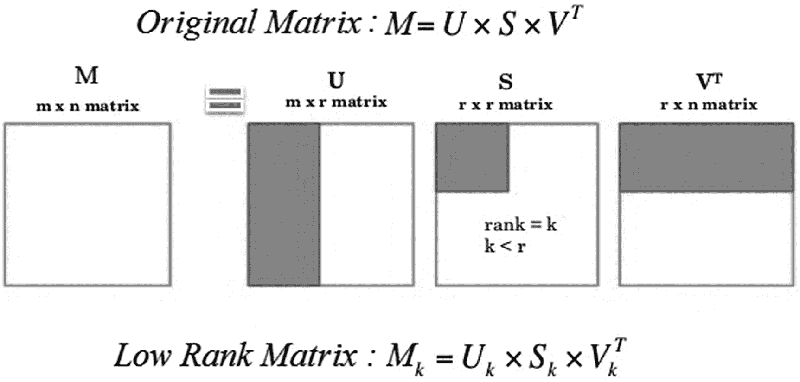
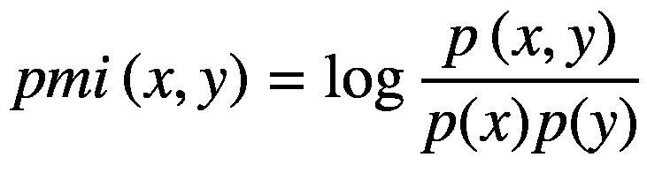

# 6. 文本摘要与主题模型

在文本分析和自然语言处理的世界中，我们已经走过了一段相当长的旅程。你已经了解了如何为各种应用处理和标注文本数据。我们还探讨了结合特征工程的最新文本表示方法。此外，我们深入了机器学习的领域，并利用各种特征提取技术和监督式机器学习算法构建了属于自己的多类文本分类系统。在本章中，我们将处理文本分析领域一个略有不同的问题——信息摘要。

世界在技术、商业、贸易和媒体方面正迅速发展。我们等待报纸送到家中以了解世界各地种种事件的日子已经一去不复返了。随着互联网和社交媒体的出现，我们迎来了所谓的“信息时代”。如今，我们通过各种社交媒体了解日常事件、与亲朋好友及世界保持联系。像 Facebook 和 Twitter 这样的社交媒体通过短消息或状态更新，为信息共享和消费创造了全新的维度。人类的注意力持续时间往往很短，这导致我们在阅读冗长的文档和文章时容易感到厌倦。

这就引出了**文本摘要**，它在文本分析中是一个极其重要的概念。企业和分析公司都使用它来缩短和概括冗长的文档，从而保留文档的核心主题。通常，我们会将这些摘要信息呈现给消费者和客户，以便他们在几秒钟内就能理解这些信息。这类似于“电梯演讲”，你需要提供一个快速的总结，来描述一个流程、产品、服务或业务，并确保它保留了核心的重要主题和价值。这个想法源于演讲时间应相当于乘坐电梯所需的时间，从几秒到几分钟不等。

想象一下，你拥有一整个文本文档语料库，任务是从中提取有意义的见解。乍一看，这似乎很困难，因为你甚至不知道该如何处理这些文档，更不用说对其应用 NLP 或数据科学方法了。由于这更多是关于模式挖掘而非预测性分析，一个好的起点是使用专门针对文本摘要和信息提取的无监督学习方法。总的来说，可以对文本文档执行几种操作，如下所示：

- **关键短语提取：** 专注于从文档中提取关键性的重要短语。
- **主题建模：** 提取文档中存在的各种不同的概念或主题，并保留这些文档的主要主题。
- **文档摘要：** 对整个文本文档进行摘要，以提供一个包含整个语料库重要部分的梗概。

我们将涵盖所有这三种主要技术的基本概念、技术和实际实现。

在本章中，我们首先详细讨论各种摘要和信息提取技术，并涵盖一些基础概念，这对于理解后续的实践示例至关重要。我们将介绍三种主要技术，包括关键短语提取、主题模型和自动化文档摘要。本章展示的所有代码示例均可从本书的官方 GitHub 仓库获取，您可以通过 [`github.com/dipanjanS/text-analytics-with-python/tree/master/New-Second-Edition`](https://github.com/dipanjanS/text-analytics-with-python/tree/master/New-Second-Edition) 访问该仓库。

## 文本摘要与信息提取

文本摘要和信息提取致力于从庞大的文本语料库中提取关键概念和主题，本质上是在此过程中对内容进行缩减。在深入探讨概念和技术之前，我们首先需要理解文本摘要的必要性。**信息过载**这一概念是催生文本摘要需求的主要原因之一。自从印刷和口头媒体变得突出以来，书籍、文章、音频和视频的数量就变得极其丰富。这大约始于公元前 3 或 4 世纪，当时人们将海量的书籍描述为“书籍的生产没有尽头”，而这种信息过载往往招致反对。

文艺复兴时期，古腾堡大约在公元 1440 年发明了印刷机，这导致了书籍、手稿、文章和小册子的大规模生产。这再次引发了信息过载，学者们抱怨信息过多，这些信息变得极其难以消化、处理和管理。

随着计算机和技术的进步，我们在 20 世纪进入了数字时代，互联网由此诞生。这为通过社交媒体、新闻网站、电子邮件和即时通讯工具生产和消费信息开辟了全新的可能性窗口。这导致信息量激增，甚至产生了垃圾邮件、无用的状态更新、推文，以及网络上发布无意义内容的机器人等不受欢迎的信息。

现在，我们了解了信息生产和消费的现状，可以将**信息过载**定义为：由于存在过多的数据或信息，导致消费者难以处理这些信息并做出明智的决策。当输入系统的信息量开始超过系统的处理能力时，就会发生这种过载。人类的认知处理能力有限，并且我们的思维模式决定了我们无法长时间阅读单一的信息或数据，因为大脑会不时地走神。因此，当我们被信息淹没时，就会导致决策质量下降。

企业依靠做出明智的决策来蓬勃发展，而它们通常拥有海量的数据和信息。从这些信息中获取洞察并非易事，自动化这个过程也很困难，因为你必须知道如何处理这些数据。高管们很少有时间听长篇大论的演讲或翻阅好几页关于重要信息的内容。摘要和信息提取的目标是抓住关键的重要主题和主旨，并将庞大的信息文档浓缩成几行可以快速阅读、理解和解读的内容。最终目标是能够在更短的时间内做出明智的决策。我们需要高效且可扩展的流程和技术来对文本数据执行此操作。最流行的技术如下：

- 关键短语提取
- 主题建模
- 自动化文档摘要

前两种技术涉及以概念、主题和主旨的形式从文档中提取关键信息，从而对其进行缩减。自动化文档摘要则是将大型文本文档总结成几行文字，用以解释文档试图传达的信息。我们将在后续章节详细探讨每种技术，并结合实践示例。首先，我们将简要介绍每种技术的内容及其范围。


## 关键词提取

这可能是三种技术中最简单的一种。它涉及从文本文档或语料库中提取关键词或短语的过程，这些关键词或短语能够捕捉文档或语料库的主要概念或主题。可以说，这是主题建模的一种简化形式。你可能在学术论文中，甚至在线商店的某些产品中看到过用关键词或短语来描述实体，用几个词或短语捕捉该实体的核心思想或概念。

## 主题建模

这通常涉及使用统计和数学建模技术，从文档语料库中提取主要主题、议题或概念。请注意，我们强调文档语料库，因为你拥有的文档集越多样化，就能生成越多的主题或概念。这与单个文档不同，如果单个文档谈论的是单一概念，你将无法获得太多主题或概念。主题模型通常被称为 ***概率统计模型*** ，它们使用特定的统计技术，包括奇异值分解（SVD）和潜在狄利克雷分配（LDA），来发现文本数据中连接的潜在语义结构，以产生主题和概念。它们在文本分析以及生物信息学等不同领域中得到了广泛应用。

## 自动文档摘要

这是使用基于统计和机器学习技术的计算机程序或算法，对单个文档或文档语料库进行摘要，以获得一个能捕捉其基本概念和主题的简短摘要的过程。存在多种构建自动文档摘要器的技术，包括各种基于抽取和基于概括的技术。所有这些算法背后的关键概念是，找到一个原始数据集的代表性子集，使得该子集包含从语义和概念角度出发的数据集核心本质。文档摘要通常涉及从单个文档中抽取并构建一个执行摘要，但相同的算法也可以扩展到多个文档。然而，其目的并非将多个不同的文档合并在一起，因为那样会违背算法的初衷。同样的概念也适用于图像和视频摘要。

在进一步详细讨论每种技术之前，我们现在先讨论一些关于数学和机器学习的重要基础概念。

## 重要概念

本节我们将讨论几个重要的数学和机器学习基础概念，这些概念在后续内容中会很有用。其中一些你可能已经熟悉，但为了内容的完整性，我们会重复提及，以便你温故知新。本节我们还会涵盖一些自然语言处理的概念。

一个 ***文档*** 是一个包含完整文本数据体以及可选标题和其他元数据信息的实体。一个 ***语料库*** 通常由一组文档组成。这些文档可以是简单的句子，也可以是完整的文本段落。一个 ***分词后的语料库*** 指的是每个文档都被分词或分解成标记（通常是单词）的语料库。

***文本整理*** 或 ***预处理*** 是使用特定技术（如移除特殊符号和字符、移除多余的 HTML 标签、移除停用词、纠正拼写、词干提取和词形还原）对文本数据进行清洗、规范化和标准化的过程。

***特征工程*** 是从原始文本数据中提取有意义的特征或属性，并将其输入统计或机器学习算法的过程。这个过程也被称为 ***向量化*** ，因为该过程的最终转换结果是从原始文本标记生成的数值向量。原因是传统算法只能处理数值向量，不能直接处理原始文本数据。存在多种特征提取方法，包括基于词袋模型的二元特征（告诉我们文档中是否存在某个词或词组）、基于词袋模型的频率特征（告诉我们文档中某个词或词组的频率）以及词频-逆文档频率（TF-IDF）加权特征（它在对每个词项进行加权时会考虑词频和逆文档频率）。关于特征提取的更多细节，可以查看第 `4` 章。

一个 ***特征矩阵*** 通常指的是从文档集合到特征的一个映射，其中每一行代表一个文档，每一列代表一个特定的特征（通常是一个词或一组词）。在特征提取之后，我们通过特征矩阵来表示一组文档或句子，并且在我们的实际示例中，我们通常会对这些矩阵应用统计和机器学习技术。特征矩阵也可以转置，这样，我们得到的就不是传统的文档-词项矩阵，而是词项-文档矩阵。我们也可以将其他特征（如文档相似度、主题-词项和主题-文档）表示为特征矩阵。

***奇异值分解（SVD）*** 是一种来自线性代数的技术，在摘要算法中非常常用。SVD 是对实数或复数矩阵进行因子分解的过程。形式上，我们可以如下定义 SVD。考虑一个维度为 *m* × *n* 的矩阵 `M`，其中 *m* 表示行数，*n* 表示列数。数学上，矩阵 `M` 可以使用 SVD 表示为如下的因子分解形式：

```
M_{m×n} = U_{m×m} S_{m×n} V_{n×n}^T
```

其中我们有以下分解：

-   `U` 是一个 *m* × *m* 的酉矩阵，满足 `U^T U = I[m × m]`，其中 `I` 是单位矩阵。`U` 的列表示左奇异向量。
-   `S` 是一个对角线的 *m × n* 矩阵，其对角线上的元素为正实数。这通常也可以表示为一个包含 *m* 个值的向量，这些值表示奇异值。
-   `V^T` 是一个 *n* × *n* 的酉矩阵，满足 `V^T V = I[n × n]`，其中 `I` 是单位矩阵。`V` 的行表示右奇异向量。


这告诉我们 `U` 和 `V` 是正交的。`S` 的奇异值在摘要算法中尤为重要。我们特别将 SVD 用于低秩矩阵近似，其中我们用矩阵 `M̂` 来近似原始矩阵 `M`，该新矩阵是原始矩阵 `M` 的截断版本，秩为 `k`，并且可以用 SVD 表示为 `M̂ = UŜV^T`，其中 `Ŝ` 是原始 `S` 矩阵的截断版本，现在只包含前 `k` 个最大的奇异值，其他奇异值用零表示。我们使用 SciPy 提供的一个优秀实现来提取前 `k` 个奇异值，并返回相应的 `U`、`S` 和 `V` 矩阵。我们使用的代码片段位于 `utils.py` 文件中，如下所示：

```python
from scipy.sparse.linalg import svds
def low_rank_svd(matrix, singular_count=2):
u, s, vt = svds(matrix, k=singular_count)
return u, s, vt
```

我们将在后续章节的主题建模和文档摘要中使用这个实现。图 6-1 很好地展示了这一过程，它从原始的 SVD 分解中得到了 `k` 个奇异向量，并展示了我们如何确定低秩矩阵近似。



**图 6-1** 低秩矩阵近似的奇异值分解

从图 6-1 中可以清楚地看到，`k` 个奇异值在低秩矩阵近似中被保留，以及原始矩阵 `M` 是如何通过 SVD 分解为 `U`、`S` 和 `VT` 的。

*   `M` 通常被称为*词项-文档*矩阵，通常在对预处理后的文本数据进行特征工程后得到，其中矩阵的每一行代表一个词项，每一列代表一个文本文档。
*   `U` 被称为*词项-主题*矩阵，其中矩阵的每一行代表一个词项，每一列代表一个主题。当我们将它乘以奇异值时，有助于获取每个主题中具有影响力的词项。
*   `S` 是由低秩 SVD 后得到的*奇异值*列表组成的矩阵或数组，其数量通常等于我们在该操作之前确定的主题数量。
*   `VT` 是*主题-文档*矩阵，如果对其进行转置，你会得到*文档-主题*矩阵，这对于了解每个主题对每个文档的影响程度非常有用。

在本章的其余部分，除非对理解算法工作原理至关重要，否则我们尽量将数学内容保持在最低限度。但我们鼓励读者深入研究这些技术，以便更好地理解它们在幕后是如何工作的。

## 关键词提取

这是从非结构化文本文档中提取重要信息最简单但最强大的技术之一。关键词提取，也称为*术语提取*，是从非结构化文本主体中提取关键术语或短语的过程，以便捕获核心主题。该技术属于信息检索和提取的广泛范畴。关键词提取在许多领域都很有用，这里列举其中一些：

*   语义网
*   基于查询的搜索引擎和爬虫
*   推荐系统
*   标签系统
*   文档相似度
*   翻译

关键词提取通常是执行文本分析或自然语言处理中更复杂任务的起点，其输出可以作为更复杂系统的特征。关键词提取有多种方法；我们将介绍以下两种主要技术：

*   搭配
*   基于加权标签的短语提取

需要记住的一个要点是，我们将提取短语，这些短语通常是单词的集合，有时也可能只是单个单词。如果你正在提取关键词，这也被称为关键词提取，它是关键词提取的一个子集。


### 搭配词

术语*搭配词*借用于语料库分析和语言学领域。搭配词可以定义为倾向于频繁出现的单词序列或词组，其出现频率往往高于随机或偶然出现的频率。基于词性（如名词、动词等），可以形成各种类型的搭配词。有几种提取搭配词的方法，最佳方法之一是采用 n-gram 分组或切分策略。这种方法通过从语料库构建 n-gram，然后统计每个 n-gram 的出现频率，并根据频率排序，从而获取最频繁的 n-gram 搭配。

其核心思想是：拥有一个文档语料库（由段落或句子组成），对其进行分词形成句子，将句子列表扁平化成一个长字符串或序列，然后基于 n-gram 的范围，滑动一个大小为 n 的窗口来计算整个字符串上的 n-gram。计算完成后，根据每个 n-gram 的出现频率进行计数并排序。这样，就能基于频率得到最频繁的搭配词。我们首先从头实现这一过程，以便更好地理解算法，然后使用 NLTK 的一些内置功能来进行演示。

我们先加载一些必要的依赖项和一个用于计算搭配词的语料库。我们使用 NLTK 古腾堡语料库中的书籍——刘易斯·卡罗尔的 *《爱丽丝梦游仙境》* 作为语料库。同时，使用我们在前几章构建的便捷`text_normalizer`模块对语料库进行标准化处理，以统一文本内容。

```
from nltk.corpus import gutenberg
import text_normalizer as tn
import nltk
from operator import itemgetter
# 加载语料库
alice = gutenberg.sents(fileids='carroll-alice.txt')
alice = [' '.join(ts) for ts in alice]
norm_alice = list(filter(None,
tn.normalize_corpus(alice, text_lemmatization=False)))
# 打印并对比第一行
print(alice[0], '\n', norm_alice[0])
[ Alice ' s Adventures in Wonderland by Lewis Carroll 1865 ]
alice adventures wonderland lewis carroll
```

现在我们定义一个函数，基于输入的标记列表和参数 n（n 决定了 n-gram 的度数，如一元组、二元组等），来计算 n-gram。下面的代码片段计算了输入序列中的 n-gram。

```
def compute_ngrams(sequence, n):
    return list(
        zip(*(sequence[index:] for index in range(n)))
    )
```

这个函数接收一个标记序列，并构建一个列表的列表，其中每个列表包含前一个列表中除第一个元素之外的所有元素。它会构建 n 个这样的列表，然后将它们压缩在一起，得到所需的 n-gram。由于在 Python 3 中，`zip` 函数返回的是一个生成器对象而非原始列表，我们将最终结果包装在一个列表中。下面的代码片段展示了该函数在示例序列上的运行情况。

```
In [7]: compute_ngrams([1,2,3,4], 2)
Out[7]: [(1, 2), (2, 3), (3, 4)]
In [8]: compute_ngrams([1,2,3,4], 3)
Out[8]: [(1, 2, 3), (2, 3, 4)]
```

上述输出展示了输入序列的二元组和三元组。现在，我们利用这个函数并在此基础上进行扩展，以生成基于出现频率的 top n-gram。为此，我们需要定义一个函数将语料库扁平化成一个大的文本字符串。以下函数帮助我们对文档语料库执行此操作。

```
def flatten_corpus(corpus):
    return ' '.join([document.strip() for document in corpus])
```

现在，我们可以构建一个函数来帮助从文本语料库中获取 top n-gram。

```
def get_top_ngrams(corpus, ngram_val=1, limit=5):
    corpus = flatten_corpus(corpus)
    tokens = nltk.word_tokenize(corpus)
    ngrams = compute_ngrams(tokens, ngram_val)
    ngrams_freq_dist = nltk.FreqDist(ngrams)
    sorted_ngrams_fd = sorted(ngrams_freq_dist.items(),
                              key=itemgetter(1), reverse=True)
    sorted_ngrams = sorted_ngrams_fd[0:limit]
    sorted_ngrams = [(' '.join(text), freq) for text, freq in sorted_ngrams]
    return sorted_ngrams
```

我们使用 NLTK 的 `FreqDist` 类创建一个所有 n-gram 的计数器（基于它们的频率），然后根据频率排序，并根据用户指定的限制返回 top n-gram。现在，使用以下代码片段计算我们语料库中的 top 二元组和 top 三元组。

```
# 前 10 个二元组
In [11]: get_top_ngrams(corpus=norm_alice, ngram_val=2,
...:               limit=10)
Out[11]:
[('said alice', 123),
 ('mock turtle', 56),
 ('march hare', 31),
 ('said king', 29),
 ('thought alice', 26),
 ('white rabbit', 22),
 ('said hatter', 22),
 ('said mock', 20),
 ('said caterpillar', 18),
 ('said gryphon', 18)]

# 前 10 个三元组
In [12]: get_top_ngrams(corpus=norm_alice, ngram_val=3,
...:               limit=10)
Out[12]:
[('said mock turtle', 20),
 ('said march hare', 10),
 ('poor little thing', 6),
 ('little golden key', 5),
 ('certainly said alice', 5),
 ('white kid gloves', 5),
 ('march hare said', 5),
 ('mock turtle said', 5),
 ('know said alice', 4),
 ('might well say', 4)]
```

该输出显示了由 n-gram 生成的二词和三词序列，以及它们在语料库中出现的次数。我们可以看到，大多数搭配词都指向正在说话的人，格式为 "said <人物>"。我们还可以看到，搭配词中出现了《爱丽丝梦游仙境》中的知名角色，如假海龟、国王、兔子、帽匠和爱丽丝。

现在我们来看 NLTK 的搭配词查找器，它使我们能够使用原始频率、逐点互信息等各种度量标准来查找搭配词。简单解释一下，*逐点互信息*可以针对两个事件或术语进行计算，即它们共同出现的概率与假设它们相互独立时各自概率乘积之比的对数。数学上可以表示为：



这个度量是对称的。下面的代码片段展示了如何使用这些度量来计算搭配词。

```
# 二元组
from nltk.collocations import BigramCollocationFinder
from nltk.collocations import BigramAssocMeasures
finder = BigramCollocationFinder.from_documents([item.split() for item in norm_alice])
finder
```


