# 第 1 章 自然语言处理基础

我们已进入大数据时代，各组织和企业正疲于管理各类系统、流程和交易产生的海量数据。然而，由于对数据“3V”——即体量（volume）、多样性（variety）和速度（velocity）的定义模糊，"大数据"一词常被误用。有时很难量化什么样的数据才算“大”。有些人可能认为数据库中的十亿条记录就是“大数据”，但相较于各类传感器或社交媒体生成的 PB 级数据，这个数字显得微不足道。一个共同特征是，无论所属领域，所有组织中都存在着大量非结构化文本数据。例如，社交媒体上以推文、状态消息、话题标签、文章、博客、维基等形式呈现的海量数据。即使是零售和电商商店也会产生大量文本数据，从新产品信息和元数据到客户评论和反馈，不一而足。

与文本数据相关的主要挑战有两方面。第一重挑战涉及如何有效存储和管理这类数据。文本数据通常是非结构化的，不遵循关系型数据库所采用的任何特定预定义数据模型或模式。不过，根据数据语义，你可以将其存储在基于 SQL 的数据库管理系统（如`SQL Server`和`MySQL`）中，基于 NoSQL 的系统（如`MongoDB`和`CouchDB`）中，以及更近期的、基于信息检索的数据存储（如`ElasticSearch`和`Solr`）中。

拥有海量文本数据集的组织通常求助于数据仓库和基于文件的系统，如`Hadoop`，它们将所有数据转储到 Hadoop 分布式文件系统（`HDFS`）中，并根据需要访问。这是数据湖的主要原则之一。

第二重挑战涉及分析这些数据并从中提取有意义的模式和可操作的洞察。尽管我们掌握大量的机器学习和数据分析技术，但其中大多数是为处理数值数据而优化的。因此，我们必须借助自然语言处理、专门的技术、转换和模型来分析文本数据，或更具体地说，分析自然语言。这与结构化数据和易于机器理解的常规编程语言截然不同。请记住，文本数据高度非结构化，因此它不遵循结构化或规则的语法和模式。因此，我们不能直接使用统计或机器学习模型来分析此类数据。

非结构化数据——尤其是文本、图像和视频——蕴含了丰富的信息。然而，由于处理和分析这类数据固有的复杂性，人们往往不愿从结构化数据集转向分析这些可能蕴含金矿的非结构化数据源。自然语言处理（NLP）正是利用工具、技术和算法来处理和理解基于自然语言的数据，这些数据通常是非结构化的（如文本、语音等）。本书涵盖了 NLP 的基本概念和技术。但在深入探讨分析文本数据的特定技术或算法之前，我们先介绍一些与自然语言和非结构化文本相关的核心概念与原理。其主要目的是让你熟悉与自然语言处理和文本分析相关的概念和领域。

本书主要使用`Python`编程语言来访问和分析文本数据。作为修订版，我们重点关注`Python 3.x`和最新的前沿开源框架进行我们的分析。本章的示例将非常直接明了，易于掌握。不过，如果你想在阅读本章之前先预习`Python`、关键框架和结构，也可以快速浏览第[2]章“用于自然语言处理的 Python”。

在本章中，我们将介绍与自然语言、语言学、文本数据格式、句法、语义和语法相关的概念（这些本身都是 NLP 的主要组成部分），然后再转向更高级的主题，如文本语料库、自然语言处理、深度学习和文本分析。本章展示的所有代码示例均可在本书的官方 GitHub 仓库中找到，你可以通过[`https://github.com/dipanjanS/text-analytics-with-python/tree/master/New-Second-Edition`](https://github.com/dipanjanS/text-analytics-with-python/tree/master/New-Second-Edition)访问。

## 自然语言

文本数据是非结构化数据，但它通常属于遵循特定句法和语义的特定语言。所有文本数据，如一个简单的词、句子或文档，都与某种自然语言相关联。在本节中，我们将探讨自然语言的定义、语言哲学、语言习得以及语言的使用。

### 什么是自然语言？

要理解文本分析和自然语言处理，我们需要了解是什么让一种语言成为“自然语言”。简单来说，自然语言是人类通过自然使用和交流而发展和演变出来的语言，而不是像计算机编程语言那样人工构建和创造的语言。

各种人类语言，如英语、日语或梵语，都可以称为自然语言。自然语言可以通过不同的方式进行交流，包括口语、书面语，甚至使用手势。关于语言起源、本质和哲学的理解一直备受关注。我们将在下一节简要讨论这一点。

### 语言哲学

现在我们已经了解了何为自然语言。但请思考以下问题：语言的起源是什么？是什么让英语成为“英语”？单词`“fruit”`的意义是如何产生的？人类如何通过语言进行交流？这些无疑是相当深奥的哲学问题。

我们现在来探讨语言哲学，它主要涉及以下四个问题。

-   语言意义的本质

-   语言的使用

-   语言认知

-   语言与现实的关系

语言意义的本质关注的是语言的语义学以及意义本身的本质。在此，语言哲学家或语言学家试图弄清楚实际上“有意义”意味着什么，即任何单词或句子的意义是如何产生的，以及一种语言中的不同单词如何互为同义词并形成关联。另一个重要方面是，语言中的结构和句法如何为语义学铺平道路，或者更具体地说，具有自身意义的单词是如何被组织在一起形成有意义的句子的。`语言学`是对语言进行的科学研究，是一个专门处理其中一些问题的领域。

句法、语义学、语法和解析树是解决这些问题的一些方法。意义的本质在语言学中可以在两个人（特别是发送者和接收者）之间体现。从非语言学的角度来看，肢体语言、先前经验和心理效应等因素都是语言意义的促成因素，每个人在感知或推断意义时都会结合自身的方式，并考虑其中一些因素。

语言的使用更关注语言如何在各种场景和人类交流中被用作一种实体。这包括分析言语以及说话时的语言使用情况，包括说话者的意图、语气、内容以及表达信息时所涉及的行为。这在语言学中通常被称为`“言语行为”`。更高级的概念，如语言创造和人类认知活动（例如研究语言学习和使用的语言习得），也是主要关注点。

`语言认知`则专门关注人类大脑的认知功能如何负责理解与诠释语言。以典型的发送者和接收者为例，从信息传递到诠释涉及许多行为。认知试图弄清楚大脑如何将特定单词组合并关联成句子，进而形成有含义的信息，以及语言与发送者和接收者在用语言交流信息时的思维过程之间存在何种关系。

`语言与现实的关系`探讨了源自语言的表达的真实性程度。语言哲学家试图衡量这些表达有多么符合事实，以及它们如何与我们世界中某些真实的事件相关联。这种关系可以通过多种方式表达，我们来探讨其中几种。

最著名的模型之一是`“指称三角”`，它用于解释单词如何在接收者脑海中传达意义和想法，以及该意义如何与现实世界中的实体或事实相关联。指称三角由查尔斯·奥格登和艾沃·理查兹在他们的著作《意义的意义》一书中提出，如图 1-1 所示。

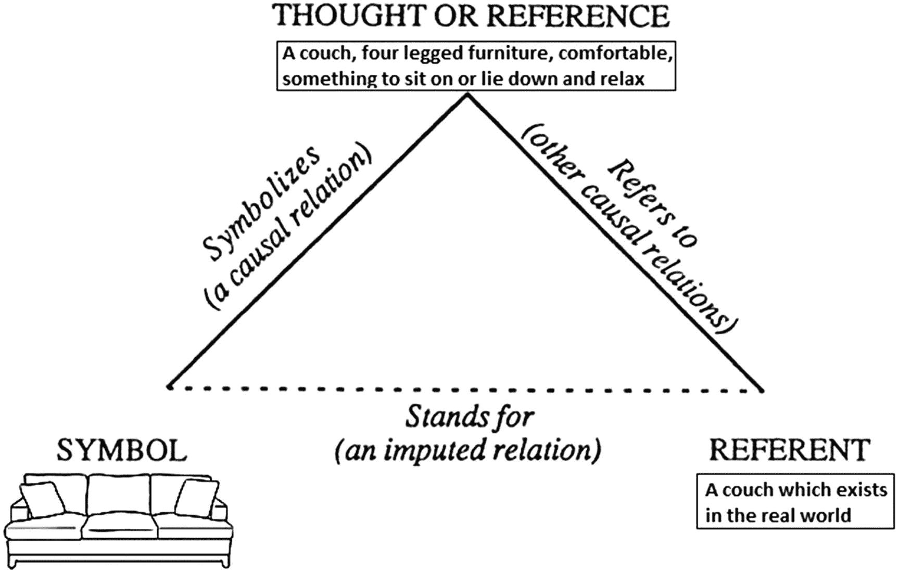

图 1-1

指称三角模型

指称三角模型也被称为意义的意义模型。图 1-1 展示了一个真实例子：一个人正在感知一张沙发。符号被表示为一种语言符号，如一个单词或物体，能在人的脑海中唤起思考。在此例中，符号是沙发，它唤起了诸如“沙发是什么？它是一种可以坐、躺、休息的家居用品，能给我们带来舒适感”之类的想法。这些想法被称为指称，通过这个指称，这个人能够将其与现实世界中存在的某个事物（被称为指称对象）联系起来。在此例中，指称对象就是这个人感知到存在于他面前的那张沙发。

确定语言与现实关系的第二种方式被称为`“拟合方向”`，我们在此讨论两个主要方向。“词到世界”的拟合方向讨论的是语言的使用能够反映现实的情况。这表明使用词语来匹配或关联现实世界中正在发生或已经发生的事情。例如，句子“埃菲尔铁塔真的很大”强调了一个现实中的事实。另一个拟合方向被称为“世界到词”，讨论的是语言的使用能够改变现实的情况。这里的例子是句子“我打算去游泳”，其中你通过游泳改变了现实，并在你正在交流的句子中描述了这一事实。图 1-2 展示了两种拟合方向之间的关系。

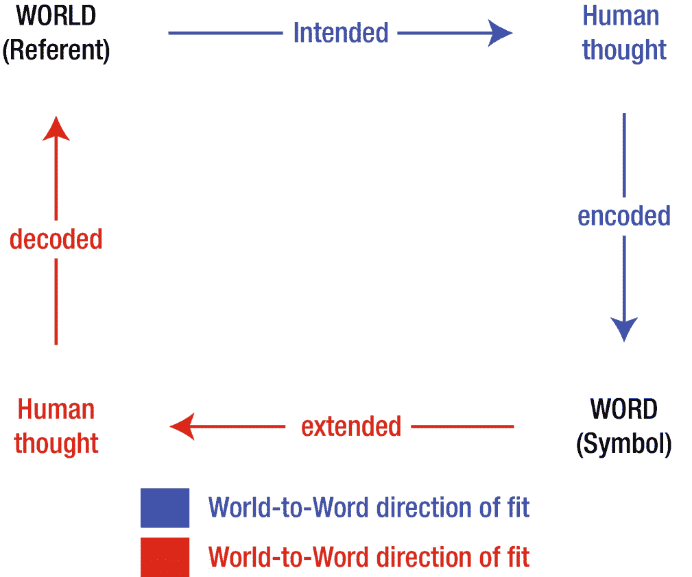

图 1-2

拟合方向表示图

基于从现实世界中感知到的指称对象，一个人可以形成符号或单词形式的表征，并进而将其传达给另一个人。这就基于接收到的符号形成了现实世界的一种表征，从而形成一个循环。

### 语言习得与使用

到目前为止，我们已经了解了自然语言的含义，以及语言背后的概念、本质、意义和使用。在本节中，我们将进一步详细讨论人类如何利用认知能力来感知、理解和学习语言。最后，我们将以言语行为作为我们之前简要讨论过的语言使用的主要形式来结束讨论。理解自然语言所表示的内容固然重要，但理解人类如何解释、学习和使用语言也同样关键。这有助于我们在尝试从文本数据中提取见解时，在算法和技术中模拟这些概念。你们中的许多人可能已经看到了基于这些原理的最新进展，包括深度学习、序列建模、生成模型和认知计算。

#### 语言习得与认知学习

# 语言习得

语言习得被定义为人类利用其认知能力、知识和经验，在听知觉的基础上理解语言，从而能够开始使用单词、短语和句子与他人进行交流的过程。简而言之，获取和产生语言的能力被称为`语言习得`。

语言习得的历史可以追溯到几个世纪前，当时哲学家和学者们试图推理和理解语言习得的起源，并提出了几种理论，例如认为这是一种代代相传的天赋能力。也有像柏拉图这样的学者指出，一种词义映射的形式可能是语言习得的原因。现代理论则由众多学者和哲学家提出，其中一些著名的理论，最著名的是伯尔赫斯·斯金纳的理论，指出语言的知识、学习和使用在本质上更偏向行为主义。

任何语言中的符号都基于特定的刺激，并根据对其使用的重复反应，在幼儿的记忆中得到强化。这一理论基于操作性条件反射，这是一种条件性学习，其中特定行为或反应的强度会根据其后果（如奖励或惩罚）而改变，这些后果性刺激有助于强化或控制行为和学习。

举个例子：一个孩子会通过父母反复使用某个特定声音组合来学习它构成一个单词，或者当他正确说出这个词时受到表扬作为奖励，或者在说错时得到纠正。这种重复的条件作用最终强化了该词在孩子记忆中的实际含义和理解。总而言之，儿童主要通过行为方式，即通过倾听和模仿成人来学习和使用语言。

然而，这一行为主义理论受到了著名语言学家诺姆·乔姆斯基的质疑，他声称儿童不可能仅仅通过模仿成人的一切来学习语言。以下例子可以证明这一假设的有效性。虽然像`go`和`give`这样的词是有效的，但儿童在使用过去式时，常常会使用`goed`或`gived`这种无效的词形，而不是`went`或`gave`。我们知道他们的父母并没有在他们面前说过这些词，因此基于斯金纳之前的理论，儿童是不可能学会这些词的。因此，乔姆斯基提出，儿童不仅是在模仿他们听到的词语，而且还在从相同的语言结构中提取模式、句法和规则，这一过程与仅仅利用基于行为的通用认知能力是分开的。

考虑到乔姆斯基的观点，认知能力连同语言特有的知识和能力（如句法、语义、词性和语法）共同构成了他所谓的`语言习得机制`。这赋予了人类`语言习得`的能力。除了认知能力，语言学习中最独特和重要的是语言本身的句法，这在他著名的句子`Colorless green ideas sleep furiously`中得到了强调。这个句子没有意义，因为无色不能与绿色关联，想法既不能与绿色关联，也不能狂怒地睡觉。然而，这个句子的语法是正确的。

乔姆斯基恰恰想以此说明，句法和语法所呈现的信息独立于词语的意义和语义。因此，他提出学习与辨识语言句法是人类相对于其他认知能力的一种独立能力。这个提出的假设也被称为`句法自主性`。当然，这些理论在学者和语言学家中仍存在广泛争议，但考虑人类心智如何习得和学习语言是有益的。现在我们来看一下语言通常被使用的一些典型模式。

## 语言使用

在上一节中，我们讨论了言语行为以及方向契合模型如何用于关联词语和符号与现实。在本节中，我们将介绍一些与言语行为相关的概念，这些概念凸显了语言在交际中使用的不同方式。言语行为主要分为三类。其中包括`言内行为`、`言外行为`和`言后行为`。

*   `言内行为`主要关注句子在人与人之间通过口头交流时的实际表达。
*   `言外行为`侧重于所交流句子的实际语义和意义。
*   `言后行为`指的是交流对其接收者产生的效果，这种效果更多是心理上的或行为上的。

一个简单的例子是父亲对孩子说的短语：`去桌上把书给我拿来`。父亲说出这个短语构成了言内行为。这个句子的意义是一条指令，告诉孩子去桌上把书拿来，这就构成了言外行为。孩子听到后采取的行动，即，如果他把书从桌上拿来交给父亲，就构成了言后行为。我们确实提到过，这里的言外行为是一个指令。根据哲学家约翰·塞尔的观点，言外行为共有五类：

*   断言类
*   指令类
*   承诺类
*   表达类
*   宣告类

`断言类`言语行为是传达世界万物早已如何存在的交流行为。发送者试图断言一个在现实世界中可以为`真`或`假`的命题时，就会说出这类言语。这些断言可以是陈述或声明。一个简单的例子是`地球围绕太阳转`。这些信息代表了前面讨论过的词到世界的方向契合。

`指令类`言语行为是发送者向接收者传达，要求或指示他/她去做某事的行为。这代表了接收者在收到发送者的指令后，未来可能采取的一种自愿行为。指令可以被遵从，也可以不被遵从。这些指令可以是简单的请求，甚至可以是命令。指令类言语行为的例子是`去桌上把书给我拿来`，我们在讨论言语行为类型时已经详细分析过这一点。

`承诺类`言语行为是使说出句子的发送者或说话人承诺未来某一自愿行为或行动的行为。像诺言、誓言、保证和誓约这些行为都属于承诺类，其方向契合可以是双向的。承诺类言语行为的例子是`我保证明天会出席典礼`。

`表达类`言语行为揭示了说话人或发送者对某个特定命题的态度和看法，他/她通过信息来传达这些。这可以是各种形式的表达或情感，如祝贺、讽刺等等。表达类言语行为的例子是`恭喜你以班级第一名的成绩毕业！`

`宣告类`是强有力的言语行为，因为它们有能力根据说话人/发送者所传达信息中宣告的命题来改变现实。通常的方向契合是世界到词，但也可能反过来。宣告类言语行为的例子是`我在此宣告他所有罪名成立`。

这些言语行为是人类使用和交流语言的主要方式。甚至在毫无察觉的情况下，你每天都会使用成百上千次这样的行为。现在我们来看看语言学及其相关的一些主要研究领域。

## 语言学

我们已经了解了自然语言的含义、语言的学习和使用方式，以及语言习得的起源。事实上，其中许多内容都是由被称为`语言学家`的研究人员和学者在语言学领域进行正式研究和探讨的。从形式上讲，语言学被定义为对语言的科学研究，包括语言的形式和句法、语言使用所描绘的意义和语义，以及使用语境。语言学的起源可以追溯到公元前 4 世纪，当时印度学者兼语言学家波你尼将梵语描述进行了形式化。`语言学`这一术语大约在 1847 年首次被用来指代对语言的科学研究，在此之前，`语文学`一词被用来表示相同含义。虽然文本分析并不需要对语言学进行详细探索，但了解语言学的不同领域是有用的，因为其中一些领域在自然语言处理和文本分析算法中被广泛使用。语言学下的主要研究领域列举如下。

*   **语音学：** 研究人类发声器官在言语过程中产生的声音的声学特性。这包括研究声音的产生方式以及人类如何感知这些声音特性。人类言语的最小独立单位称为`音素`，它通常特定于某种语言，而区别于一个更通用的术语——`音子`。
*   **音系学：** 研究人类心智如何解读声音模式，并以此区分不同音素。通常每次针对一种特定语言，详细研究音素的结构、组合和解读。英语包含大约 45 个音素。音系学通常不仅限于研究音素，还包括重音、语调和音节结构等。
*   **句法学：** 通常研究句子、短语、单词及其结构。这包括研究单词如何按语法规则组合成短语和句子。短语或句子中单词的句法顺序很重要，因为顺序可以完全改变意义。
*   **语义学：** 涉及对语言中意义的研究，可进一步细分为词汇语义学和组合语义学。
    *   **词汇语义学：** 涉及利用形态学和句法学来研究单词和符号的意义。
    *   **组合语义学：** 涉及研究词与词之间的关系以及词语组合，并理解短语和句子的意义及其相互关联方式。
*   **形态学：** 根据定义，`语素`是语言中具有独特意义的最小单位。这包括单词、前缀、后缀等具有自身独特意义的部分。形态学是对语言中这些独特单位或语素的结构和意义的研究。语素的组合方式受到特定的规则和句法约束。
*   **词汇学：** 研究语言中使用的单词和短语的属性，以及它们如何构建该语言的词汇。这包括研究哪些声音与单词的意义相关联，单词所属的词性，以及它们的形态形式。
*   **语用学：** 研究语言因素和非语言因素（如语境和场景）如何影响信息或话语表达的意义。这包括试图推断交流中是否存在任何隐藏或间接的含义。
*   **话语分析：** 分析人类对话中通过句子形式进行的语言和信息交换。这些对话可以是口语、书面语，甚至是手语。
*   **文体学：** 研究语言，重点关注写作风格，包括语气、口音、对话、语法和语态类型。
*   **符号学：** 研究符号、象征及符号过程，以及它们如何传达意义。这方面涵盖了类比、隐喻和象征主义等内容。

虽然这些是主要的研究领域，但语言学是一个巨大的领域，其范围远不止于此。然而，语言句法和语义学是其中一些最重要的概念，并且常常构成自然语言处理（NLP）的基础。因此，我们将在下一节更详细地探讨它们。我们将通过动手示例来展示一些概念，以便更好地理解。你也可以在我的 GitHub 仓库中查看第 1 章的 Jupyter notebook（网址：[`https://github.com/dipanjanS/text-analytics-with-python/tree/master/New-Second-Edition`](https://github.com/dipanjanS/text-analytics-with-python/tree/master/New-Second-Edition)），如果你想要跟着操作并亲自运行这些示例的话。在你的 Python 环境中加载以下依赖项来开始。关于安装和设置 Python 及特定框架的详细说明，请参见第 2 章。

```
import nltk
import spacy
import numpy as np
import pandas as pd
# 以下行是可选的，用于自定义词汇表安装
# 你可以使用 nlp = spacy.load('en')
nlp = spacy.load('en_core', parse=True, tag=True, entity=True)
```

# 语言句法与结构

我们已经了解了语言句法和结构的概念。句法与结构通常相辅相成，由一系列特定规则、惯例和原则来规定词汇如何组合成短语，短语组合成从句，从句组合成句子。本节将专门讨论英语的句法和结构，因为本书处理的是属于英语的文本数据。不过，这些概念中的许多内容也可以扩展到其他语言。了解语言的结构和句法在文本处理、标注和解析（以便进行文本分类或摘要等后续操作）等诸多领域都很有帮助。

在英语中，词汇组合形成其他构成单位。这些构成单位包括词汇、短语、从句和句子。所有构成单位在任何信息中都同时存在，并以层级结构相互关联。此外，句子是一种结构化格式，代表词汇的集合，前提是这些词汇遵循语法等特定句法规则。让我们以示例句子“The brown fox is quick and he is jumping over the lazy dog”为例。以下代码片段展示了该句子在 Python 中的呈现方式。

```
sentence = "The brown fox is quick and he is jumping over the lazy dog"
sentence
'The brown fox is quick and he is jumping over the lazy dog'
```

语法和词汇顺序确实赋予了句子意义。如果我们打乱词汇顺序，句子还能表达意义吗？

```
words = sentence.split()
np.random.shuffle(words)
print(words)
['quick', 'is', 'fox', 'brown', 'The', 'and', 'the', 'is', 'he', 'dog', 'lazy', 'jumping', 'over']
```

如图 1-3 所示，这组无序的词汇显然很难理解，不是吗？

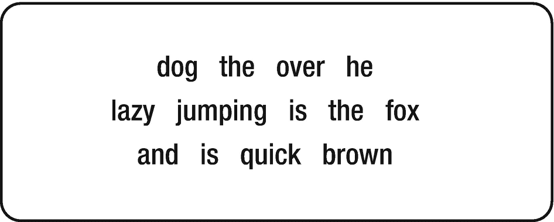

图 1-3 一组无任何关联或结构的词汇集合

从图 1-3 的词汇集合中，我们很难确定它试图传达什么。事实上，语言并不仅仅是由一堆无结构的词汇组成的。具有适当句法的句子不仅有助于我们构建合理的结构并关联词汇，还能帮助词汇根据顺序或位置来传达意义。考虑到之前提到的层级关系：*句子* → *从句* → *短语* → *词汇*，我们可以使用*浅层解析*（一种常用于确定句子构成单位的技术）来构建如图 1-4 所示的层级结构句法树。

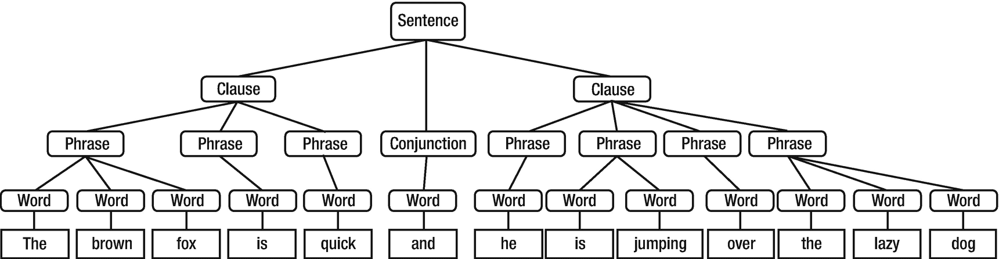

图 1-4 遵循层级句法的结构化句子

从图 1-4 的层级结构树中，我们得到了句子“The brown fox is quick and he is jumping over the lazy dog”，这是一个具有结构和意义的句子。我们可以看到，该树的叶节点由词汇组成（此处是最小的单位），词汇的组合形成短语，短语进而形成从句。从句通过各种填充词或连词等词汇连接起来，最终形成句子。在下一节中，我们将更详细地探讨这些构成单位，并学习如何分析它们以及确定主要的句法类别。

## 词汇

词汇是语言中最小的单位；它们具有独立性，并且有自身的含义。虽然词素是语言中具有意义的最小单位，但它们并不像词汇那样独立。一个词汇可以由多个词素组成。对词汇进行标注和标记，然后将其分析为词性，有助于我们了解主要的句法类别。在此，我们涵盖各种词性标签的主要类别和重要性；不过，我们将在第 3 章中更详细地审视它们，并探讨以编程方式生成词性标签的方法。词汇通常属于以下主要类别之一：

*   **N（名词）：** 通常指代描述某些对象或实体的词汇，这些实体可以是生物或非生物。例如：fox（狐狸）、dog（狗）、book（书）等。名词的词性标签符号为 `N`。

*   **V（动词）：** 动词是用于描述某些动作、状态或事件的词汇。还有多种进一步的子类别，如助动词、反身动词、及物动词等。动词的一些典型例子有：running（跑步）、jumping（跳跃）、read（阅读）、write（写作）。动词的词性标签符号为 `V`。

*   **ADJ（形容词）：** 形容词是用于描述或限定其他词汇（通常是名词和名词短语）的词汇。短语“beautiful flower”（美丽的花）中，名词（`N`）“flower”（花）被形容词（`ADJ`）“beautiful”（美丽的）描述或限定。形容词的词性标签符号为 `ADJ`。

*   **ADV（副词）：** 副词通常用作其他词汇（包括名词、形容词、动词或其他副词）的修饰语。短语“very beautiful flower”（非常美丽的花）中，副词（`ADV`）“very”（非常）修饰形容词（`ADJ`）“beautiful”（美丽的），表明花美丽的程度。副词的词性标签符号为 `ADV`。

除了这四大词性类别外，英语中还有其他经常出现的类别，包括代词、介词、感叹词、连词、限定词等。每个词性标签（如名词 `N`）可以进一步细分为各种子类别，例如单数名词（`NN`）、单数专有名词（`NNP`）和复数名词（`NNS`）。我们在第 3 章处理、解析文本数据并实现词性标注器进行文本标注时，会进一步详细探讨词性标签。考虑到前面的示例句子“The brown fox is quick and he is jumping over the lazy dog”，我们可以利用 Python 中的 `NLTK` 或 `spaCy` 来为其标注词性标签。见图 1-5。

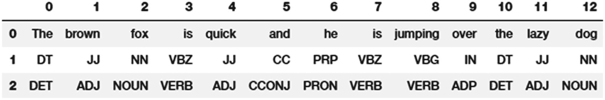

图 1-5 使用 NLTK 标注了词性标签的词汇

```
pos_tags = nltk.pos_tag(sentence.split())
pd.DataFrame(pos_tags).T
```

我们将在第 3 章详细讨论每个词性标签的含义。不过，你现在仍然可以利用 `spaCy` 来理解每个标签注释的顶层语义。见图 1-6。

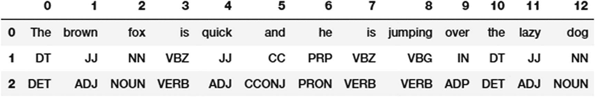

图 1-6 使用 spaCy 标注了词性标签的词汇

```
spacy_pos_tagged = [(word, word.tag_, word.pos_) for word in nlp(sentence)]
pd.DataFrame(spacy_pos_tagged).T
```

有趣的是，根据图 1-6 显示的输出，两个框架的标签注释是匹配的。它们在内部都使用宾州树库词性标注法。回到我们的讨论，使用基本词性标签对我们的句子进行简单注释，结果如图 1-7 所示。

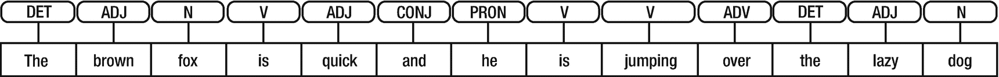

图 1-7 标注了词性标签的词汇

从这个示例中，你可能会看到一些未知的标签。标签 `DET` 代表限定词，用于描述冠词，如 a、an、the 等。标签 `CONJ` 表示连词，通常用于连接分句以构成句子。而 `PRON` 标签代表代词，指代或代替名词的词。`N`、`V`、`ADJ` 和 `ADV` 标签是典型的开放类词性，代表属于开放词汇表的词。开放类词性由无限数量的词组成，并且通常允许向词汇表中添加新词。新词通常通过形态派生、基于用法的创新以及创建复合词干等方式加入开放类词性。一些已添加的流行名词包括“互联网”和“多媒体”。封闭类词性则由一个封闭且有限的词集组成，不接受新词的加入。代词就属于封闭类词性。接下来，我们将探讨层级结构的下一个级别：短语。

### 短语

如前所述，词语有其自身的词法属性，如词性。利用这些词语，我们可以按特定顺序排列它们，使每个词获得相应的意义，并让每个词属于某个短语类别，且其中一个词是中心词或核心词。在层级树中，单词组构成短语，短语是语法树的第三层。根据原则，考虑到层级次序为 *单词* ⟵ *短语* ⟵ *分句* ⟵ *句子*，短语通常至少包含两个或更多词。然而，根据短语在分句或句子中的语法和位置，短语也可以是单个词或词的组合。例如，句子“Dessert was good”只有三个词，每个词都向上构成三个短语。单词“dessert”既是名词也是一个名词短语，“is”表示动词以及一个动词短语，而“good”则表示形容词以及一个形容词短语，用来描述前述的甜点。短语有五大主要类别，如下所述：

*   **名词短语 (NP):** 这类短语中，名词充当中心词。名词短语充当动词的主语或宾语。名词短语可以是一组词，这些词可以被代词替换，而不会导致句子或分句语法不正确。例如“dessert”、“the lazy dog”和“the brown fox”。

## 动词短语 (VP)

这些短语是词汇单元，其中动词充当中心词。动词短语通常有两种形式。一种形式包含动词成分以及作为宾语一部分的其他实体，如名词、形容词或副词。这里的动词被称为限定动词。它在层级树中作为一个单元，并可在分句中充当根节点。这种形式在成分语法中很常见。另一种形式是限定动词充当整个分句的根节点，这在依存语法中很常见。动词短语的另一种衍生形态严格由动词成分组成，包括主动词、助动词、不定式和分词。以下句子“He has started the engine”可用于说明这两类动词短语。根据讨论的两种形式，它们分别是“has started the engine”和“has started”。

## 形容词短语 (ADJP)

这类短语的中心词是形容词。其主要作用是描述或限定句子中的名词和代词，并且通常置于名词或代词的前后。句子“The cat is too quick”中包含一个形容词短语“too quick”，用于限定名词短语“the cat”。

## 副词短语 (ADVP)

这些短语的作用如同副词，因为副词是短语的中心词。副词短语用作名词、动词或副词的修饰语，通过提供更多细节来描述或限定它们。以句子“The train should be at the station pretty soon”为例，其中的副词短语是“pretty soon”，因为它描述了火车到达的时间。

## 介词短语 (PP)

这类短语通常包含一个介词作为中心词，以及其他的词汇成分，如名词、代词等。它们像形容词或副词一样，用于描述其他词或短语。句子“Going up the stairs”中包含一个介词短语“up”，描述了楼梯的方向。

这五大句法短语类别可以通过多种规则从单词生成，其中一些规则我们已经讨论过，例如利用不同类型的句法和语法。我们将在后续章节探讨一些流行的语法。浅层句法分析是一种流行的自然语言处理技术，用于从句子中提取这些构成成分，包括词性标注和短语。对于我们的句子“The brown fox is quick and he is jumping over the lazy dog”，使用浅层句法分析表示的一种方式是将其分为七个短语，如图 1-8 所示。

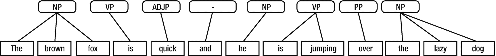

图 1-8 – 浅层句法分析中带有标签的注解短语

这些短语标签属于我们之前讨论的类别；不过单词“and”是一个连词，用于连接分句。有没有更好的处理方法？或许有！你可以自定义短语规则，然后使用类似 `NLTK` 的 `RegexpParser` 这样的基于查找的解析器来进行浅层句法分析或组块分析。它是一种基于语法的组块解析器，使用一组正则表达式模式（即定义的语法规则）来指定解析器的行为。以下代码展示了我们句子中的实际应用！同时请见图 1-9。

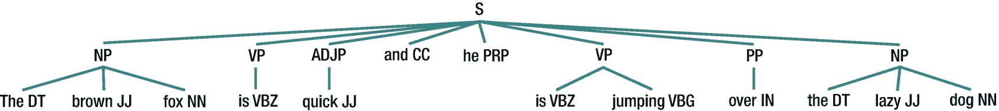

图 1-9 – 使用 NLTK 进行浅层句法分析时带有标签的注解短语

```
grammar = '''
NP: {??}
ADJP: {}
ADVP: {}
PP: {}
VP: {?+}
'''
pos_tagged_sent = nltk.pos_tag(sentence.split())
rp = nltk.RegexpParser(grammar)
shallow_parsed_sent = rp.parse(pos_tagged_sent)
print(shallow_parsed_sent)
(S
(NP The/DT brown/JJ fox/NN)
(VP is/VBZ)
(ADJP quick/JJ)
and/CC
he/PRP
(VP is/VBZ jumping/VBG)
(PP over/IN)
(NP the/DT lazy/JJ dog/NN))
# 可视化浅层句法树
shallow_parsed_sent
```

基于图 1-9 的输出，我们可以看到基于简单规则的组块分析器在识别主要短语和句子结构方面的强大功能。在接下来的部分，我们将探讨分句、其主要类别，以及一些用于从句子中提取分句的约定和句法规则。

## 从句

从句本质上既可以充当独立句子，也可以将多个从句组合起来构成一个句子。从句是一组相互关联的词语，通常包含主语和谓语。有时主语可能不出现，而谓语带有动词短语或动词加宾语。通常，你可以将从句分为两大类：主句和从句。主句也被称为独立从句（independent clause），因为它本身就能构成一个句子，同时兼具句子和从句的功能。从属从句或依赖从句（subordinate/dependent clause）无法独立存在，它需要依靠主句来表达含义。这类从句通常借助从属连词等从属词与其他从句连接。

由于我们正在大量讨论语言的句法特性，从句可以根据句法进一步细分为多个类别。具体说明如下。

*   **陈述从句：** 这类从句出现频率极高，表示不带特定语气的陈述。它们只是以中性语气陈述的常规陈述，可以是事实性或非事实性的。例如：“草是绿的”。

*   **祈使从句：** 这类从句通常以请求、命令、规则或建议的形式出现。其语气表现为一个人向一个或多个人发出指令，要求执行命令、请求甚至指示。例如：“请不要在课堂上讲话”。

*   **关系从句：** 对关系从句最简单的解释是，它们是从属从句，因此依赖句子的另一部分。这部分通常包含一个词、短语甚至一个从句。该成分通常充当关系从句中某个词的前行词（antecedent），并与该词相关联。一个简单的例子是：“约翰刚才说他想要一杯苏打水”。前行词是专有名词“约翰”，它在关系从句“他想要一杯苏打水”中被提及。

*   **疑问从句：** 这类从句通常以问题的形式出现。问题类型可以是肯定式或否定式。例如：“你收到我的邮件了吗？”和“你没去上学吗？”。

*   **感叹从句：** 这类从句用于表达震惊、惊讶甚至赞美。所有这些表达都属于感叹范畴，且从句通常以感叹号结尾。例如：“多么精彩的比赛啊！”

大多数从句都表现为上述句法形式之一；不过，从句类别的这份列表并不详尽，还可以进一步细分为其他几种形式。以我们的例句“那只棕色的狐狸跑得很快，它正跳过那只懒狗”为例，如果你还记得句法树，并列连词（and）将句子分成了两个从句。它们分别是“那只棕色的狐狸跑得很快”和“它正跳过那只懒狗”。你能猜出它们可能属于哪个类别吗？（提示：回顾一下陈述从句和关系从句的定义。）

## 语法

语法有助于实现语言中的句法和结构。它主要包括一套规则，用于确定在自然语言中构建句子时如何安排词语、短语和从句的位置。语法不仅限于书面文字，也用于口头表达。这些规则可能特定于某个地区、语言或方言，也可能具有某种普遍性，例如主谓宾（SVO）模型。语法的起源有着丰富的历史，始于印度的梵语。在西方，语法的研究起源于希腊人，最早的作品是狄俄尼索斯·特拉克斯（Dionysius Thrax）所著的《语法艺术》（*Art of Grammar*）。拉丁语法模型是在希腊模型的基础上发展起来的，并逐渐跨越多个时代，开始为各种语言创建语法模型。直到 18 世纪，语法才被视为语言学领域的一个严肃候选方向。

语法随时间推移而发展，并不断演变，从而催生了更新的语法类型。因此，语法并非一套固定的规则，而是根据语言在时间推移中的使用情况而演变。以前面的英语为例，语法有几种分类方式。我们首先讨论两大主要类别，大多数流行的语法框架都可以归入其中，然后进一步探讨这些语法框架如何表征语言。基于对话言句法和结构的表征方式，语法可分为两大类。具体如下：

*   依存语法（Dependency grammar）

*   成分语法（Constituency grammar）

### 依存语法

这是一类特别不关注成分（与成分语法不同）如单词、短语和从句的语法，而是更强调单词本身。因此，这类语法也被称为基于单词的语法。要理解依存语法，我们首先需要知道在这个语境下“依存”的含义。此处的依存指的是带有标签的词与词之间的关系或连接，通常是不对称的。一个单词根据其在句子中的位置，与另一个单词产生关系或依存于该单词。因此，依存语法假设短语和从句的进一步成分是由单词之间的这种依存结构推导出来的。依存语法的基本原理是，在该语言的任何句子中，除了一个单词外，所有其他单词都与句子中的其他单词存在某种关系或依存。那个没有依存关系的单词被称为句子的*根*。在大多数情况下，动词被视为句子的根。所有其他单词都通过称为依存的连接直接或间接地与根动词相关联。虽然没有短语或从句的概念，但通过观察句法以及单词与其依存词之间的关系，我们可以确定句子中必要的成分。

依存语法与句子中的每个单词始终具有一一对应关系。这种语法表示包含两个方面。一是句子的句法或结构，二是通过单词之间表示的关系获得的语义。单词的句法或结构及其相互连接可以使用句子句法或解析树来展示，类似于我们在前一小节中描述的那样。以我们的句子“The brown fox is quick and he is jumping over the lazy dog”为例，如果我们想为其绘制依存句法树，我们将得到如图 1-10 所示的结构。

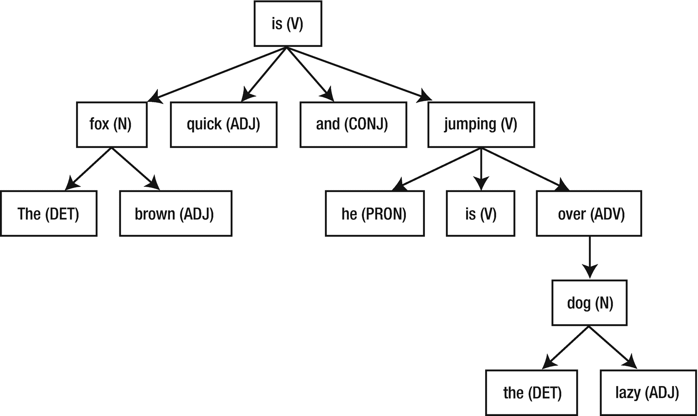

图 1-10 带词性标注的基于依存语法的句法树

图 1-10 向我们展示了依存关系形成了一棵树，或者更准确地说，形成了一张覆盖句子中所有单词的图。这张图是连通的，其中每个单词至少有一条出边或入边。该图也是有向的，因为每两个单词之间的边都指向一个特定的方向。因此，依存树是一个有向无环图（DAG）。树中的每个节点（根节点除外）最多只有一条入边。由于这是一张有向图，依存树本质上并不描述句子中单词的顺序。其重点更多地放在句子中单词之间的关系上。我们的句子在图 1-10 中用我们之前讨论过的相关词性标注进行了标注，并显示了表示依存关系的有向边。

现在，如果你还记得，我们之前讨论过使用依存语法表示句子有两个方面。每条有向边都代表一种特定类型的有意义关系（也称为句法功能），我们可以进一步标注句子，显示单词之间具体的依存关系类型。如图 1-11 所示。

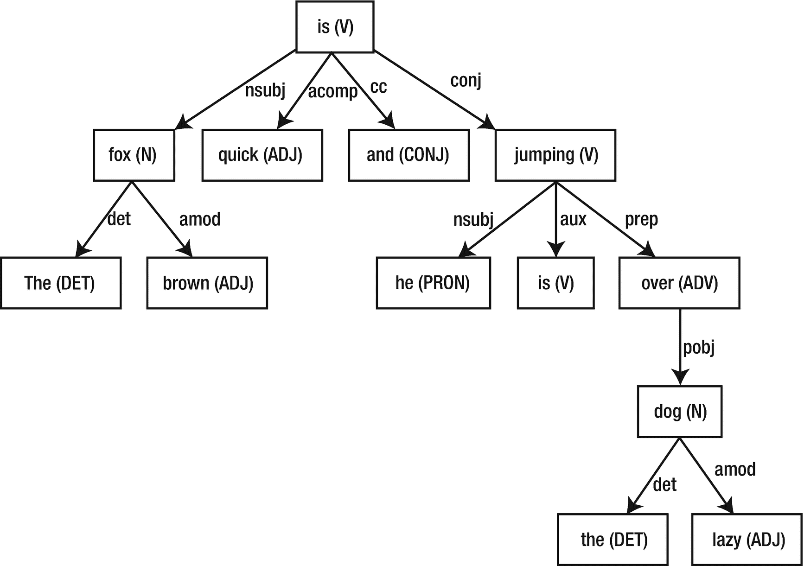

图 1-11 标注了依存关系类型的基于依存语法的句法树

这些依存关系各有其含义，并且是通用依存类型列表的一部分。这部分内容源自原始论文《Universal Stanford Dependencies: A Cross-Linguistic Typology》（de Marneffe 等人，2014 年）。你可以在[`http://universaldependencies.org/u/dep/index.html`](http://universaldependencies.org/u/dep/index.html)查看详尽的依存类型列表及其含义。`spaCy`框架利用了这一通用依存方案以及另一种名为`CLEAR`的依存方案。如果你有兴趣了解所有这些依存关系的重要性，可以在[`https://emorynlp.github.io/nlp4j/components/dependency-parsing.html`](https://emorynlp.github.io/nlp4j/components/dependency-parsing.html)获取有关可能依存的详细信息。如果我们观察其中一些依存关系，理解它们并不太难。我们详细分析一下图 1-11 句子中使用的几个依存标签。

*   依存标签 `det` 表示名词性中心词与其限定词之间的限定关系。通常，带有词性标签 `DET` 的单词也会具有 `det` 关系。例如（`fox -> the`）和（`dog -> the`）。
*   依存标签 `amod` 代表形容词修饰语，指代任何修饰名词含义的形容词。例如（`fox -> brown`）和（`dog -> lazy`）。
*   依存标签 `nsubj` 代表在从句中充当主语或施动者的实体。例如（`is -> fox`）和（`jumping -> he`）。
*   依存关系 `cc` 和 `conj` 是与通过并列连词连接的单词相关的链接。例如（`is -> and`）和（`is -> jumping`）。
*   依存标签 `aux` 表示从句中的助动词或次要动词。例如（`jumping -> is`）。
*   依存标签 `acomp` 代表形容词补语，充当句子中动词的补语或宾语。例如（`is -> quick`）。
*   依存标签 `prep` 表示介词修饰语，通常修饰名词、动词、形容词甚至介词的含义。这种表示法用于带有名词或名词短语补语的介词。例如（`jumping -> over`）。
*   依存标签 `pobj` 用于表示介词的对象。这通常是句子中介词后跟名词短语的中心词。例如（`over -> dog`）。

这些标签在我们的示例句子中被广泛用于标注单词之间的各种依存关系。既然你现在对依存关系有了更好的理解，最好记住，在表示句子的依存语法时，通常不必创建带有线性顺序的树，你还可以使用普通的图来表示，因为依存语法中没有单词顺序的概念。我们可以利用`spaCy`为我们的示例句子构建这个依存树/图（见图 1-12）。

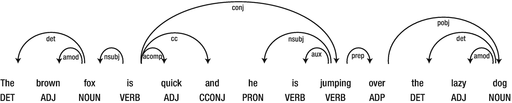

图 1-12 使用 `spaCy` 为我们的示例句子标注的依存语法图

```python
from spacy import displacy
displacy.render(nlp(sentence), jupyter=True,
options={'distance': 100,
'arrow_stroke': 1.5,
'arrow_width': 8})
```

图 1-12 展示了我们带依存标签标注的句子，基于我们之前的讨论，这应该对你来说很清晰了。当我们接下来讨论基于成分的语法时，你会观察到，与相应的成分语法相比，依存语法中的节点数量会少得多。目前存在多种基于依存语法的语法框架。一些流行的包括代数句法和运算符语法。接下来，我们来看一下成分语法的概念及其表示方法。

# 成分语法

这类语法建立在这样一个原则上：一个句子可以由其派生的若干成分来表示。这类语法可用于根据各成分的层次有序结构来建模或表示句子的内部结构。每个词都属于特定的词汇范畴，并构成不同短语的中心词。这些短语是基于称为短语结构规则的规则形成的。因此，成分语法也被称为*短语结构语法*。短语结构语法由诺姆·乔姆斯基在 20 世纪 50 年代提出。

## 成分的概念

要理解成分语法，我们必须清楚了解成分的含义。我们在本章前面多次提到过，但为了唤起你的记忆，成分是指具有特定含义、能够作为一个从属或独立单元共同起作用的单词或词组。它们还可以组合起来，形成句子中更高层次的结构。这包括短语和从句。

## 短语结构规则

短语结构规则构成了成分语法的核心，因为它们涉及句法和规则，这些规则支配着句子中各种成分的层级和顺序。这些规则主要服务于两个目的。首先也是最重要的，这些规则决定了用什么词来构建短语或成分；其次，这些规则决定了我们需要如何排列这些成分。如果我们要分析短语结构，就应该了解短语结构规则的典型模式。短语结构规则的通用表示为：

```
S → A B
```

它表示结构 `S` 由成分 `A` 和 `B` 构成，并且顺序是 `A` 后接 `B`。

短语结构规则有多种，我们逐一探讨，以理解如何准确地提取和排列句子中的成分。最重要的规则描述了如何划分一个句子或从句。短语结构规则将一个句子或从句表示为二进制划分：

```
S → NP VP
```

其中 `S` 是句子或从句，它被划分为主语（由名词短语 `NP` 表示）和谓语（由动词短语 `VP` 表示）。当然，我们可以应用其他规则来进一步分解每个成分，但层级的顶层是以 `NP` 和 `VP` 开始的。

## 名词短语规则

表示名词短语的规则形式为：

```
NP → [DET][ADJ]N [PP]
```

其中方括号 `[...]` 表示该部分是可选的。一个名词短语通常由一个名词（`N`）作为中心词，并且可以可选地包含（`DET`）限定词和（`ADJ`）形容词来描述该名词，以及右侧的介词短语（`PP`）在句法树中。因此，一个名词短语可能包含另一个名词短语作为其组成成分。图 1-13 展示了一些受上述名词短语规则支配的例子。

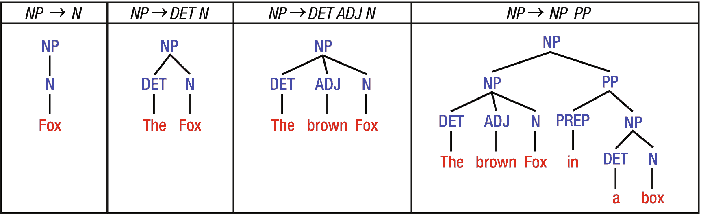

*图 1-13* — 展示名词短语结构规则的成分句法树

这些句法树向我们展示了名词短语通常包含的各种成分。如前所述，由产生式左侧的 `NP` 表示的名词短语也可能出现在产生式的右侧，如最后一个示例所示。这是一种称为*递归*的属性，我们将在本节末尾讨论它。

## 动词短语规则

现在我们来看表示动词短语的规则。其规则形式为：

```
VP → V | MD [VP][NP][PP][ADJP][ADVP]
```

其中中心词通常是动词（`V`）或情态动词（`MD`）。情态动词本身是助动词，但我们赋予其不同的表示，只是为了将其与普通动词区分开。其后可选地跟随着另一个动词短语（`VP`）或名词短语（`NP`）、介词短语（`PP`）、形容词短语（`ADJP`）或副词短语（`ADVP`）。当我们使用二分法规则拆分句子时，动词短语总是第二部分，而名词短语则是第一部分。图 1-14 展示了一些典型可构建的不同类型动词短语的例子及其句法树表示。

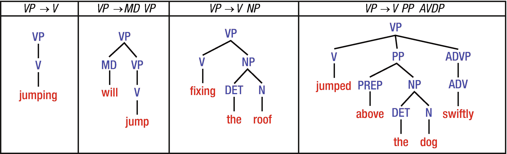

*图 1-14* — 展示动词短语结构规则的成分句法树

正如我们之前所描述的，这些句法树向我们展示了动词短语中各种成分的表示，并且利用递归属性，一个动词短语内部也可能包含另一个动词短语，正如我们在第二棵句法树中看到的那样。我们还看到层级关系得到了维护，尤其是在第三和第四棵句法树中，`NP` 和 `PP` 本身是 `VP` 下的进一步成分，并且它们可以进一步分解为更小的成分。

## 介词短语规则

既然我们在前面的例子中看到了大量使用的介词短语，让我们来看看表示介词短语的产生式规则。基本规则形式为：

```
PP → PREP [NP]
```

其中 `PREP` 表示充当中心词的介词，其后可选地跟着一个名词短语（`NP`）。图 1-15 展示了一些介词短语的表示及其对应的句法树。

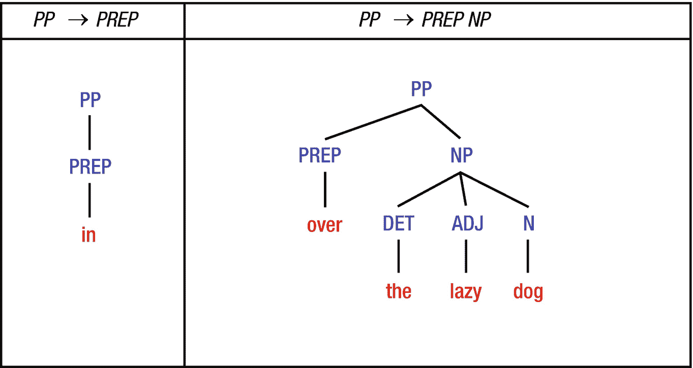

*图 1-15* — 展示介词短语结构规则的成分句法树

这些句法树向我们展示了介词短语的几种不同表示。

## 递归属性

现在我们讨论递归的概念。递归是语言固有的属性，它允许成分嵌入到其他成分中，这通过出现在产生式规则两侧的不同短语类别来体现。这使得我们能够从句子中创建出长的基于成分的句法树。一个简单的例子是句子“The flying monkey in the circus on the trapeze by the river”的表示，如图 1-16 中的成分句法分析树所示。

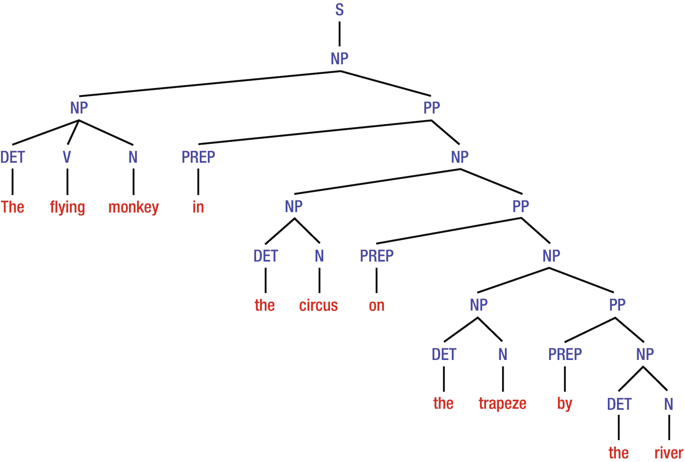

*图 1-16* — 展示成分之间递归属性的成分句法树

如果仔细观察图 1-16 中的语法树，你会发现它仅由名词短语和介词短语构成。然而，由于介词短语本身可以包含名词短语，而名词短语也可以包含名词短语和介词短语这一固有的递归属性，其层级结构中包含了多个`NP`和`PP`。如果你回顾一下名词短语和介词短语的生成规则，就会发现图 1-16 中的树形结构组成完全遵循这些规则。

## 连词规则

现在我们来简单谈谈连词，因为连词用于连接从句和短语，是语言句法的重要组成部分。通常，单词、短语甚至从句都可以通过连词组合起来。其生成规则可以表示为：

```
S → S conj S ∀ S ∈ {S, NP, VP}
```

其中两个成分可以通过规则中记为`conj`的连词连接。一个简单的例子是句子“The brown fox and the lazy dog”，它由一个名词短语构成，而该名词短语本身是由两个名词短语和一个连词组合而成的。图 1-17 中的成分句法树展示了这一生成规则的遵循情况。

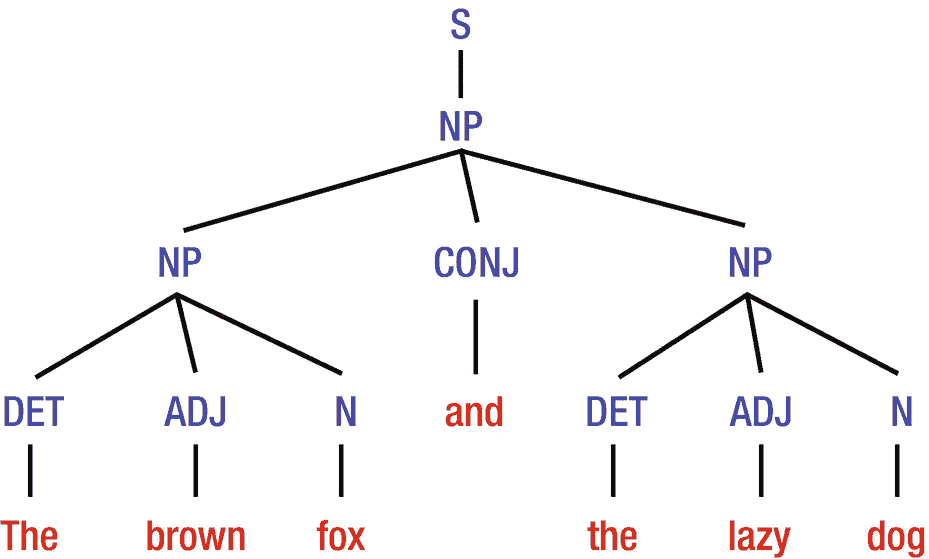

图 1-17：展示由连词连接的名词短语的成分句法树

图 1-17 向我们表明，顶层的名词短语本身就是一个句子，它包含两个名词短语作为其组成成分。这两个名词短语由一个连词连接，从而满足了我们之前提到的生成规则。如果我们想用一个连词连接两个句子或从句呢？我们可以将所有规则和约定结合起来，为我们示例句子“The brown fox is quick and he is jumping over the lazy dog”生成基于成分的句法树。这将得到我们句子的句法表示，如图 1-18 所示。

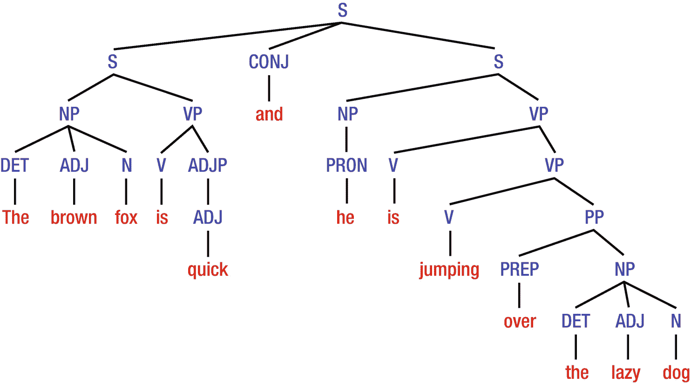

图 1-18：示例句子的成分句法树

从图 1-18 中，你可以推断出我们的句子包含两个主要从句或成分（我们之前讨论过），它们由一个并列连词（and）连接。此外，基于成分语法的生成规则将顶层成分进一步分解为由短语及其单词构成的子成分。查看该句法树，你会发现它确实展示了句子中单词的顺序，并且更像是一个具有无向边的层级树状结构。因此，这与基于依存语法的、具有无序单词和有向边的句法树/图有很大不同。有几种流行的语法框架都源于成分语法中的概念。这些框架包括短语结构语法、弧对语法、词汇功能语法，甚至还有广泛应用于形式语言描述的著名上下文无关语法。我们可以利用 NLTK 中基于 Stanford Core NLP 的解析器，对我们的示例句子进行成分分析。

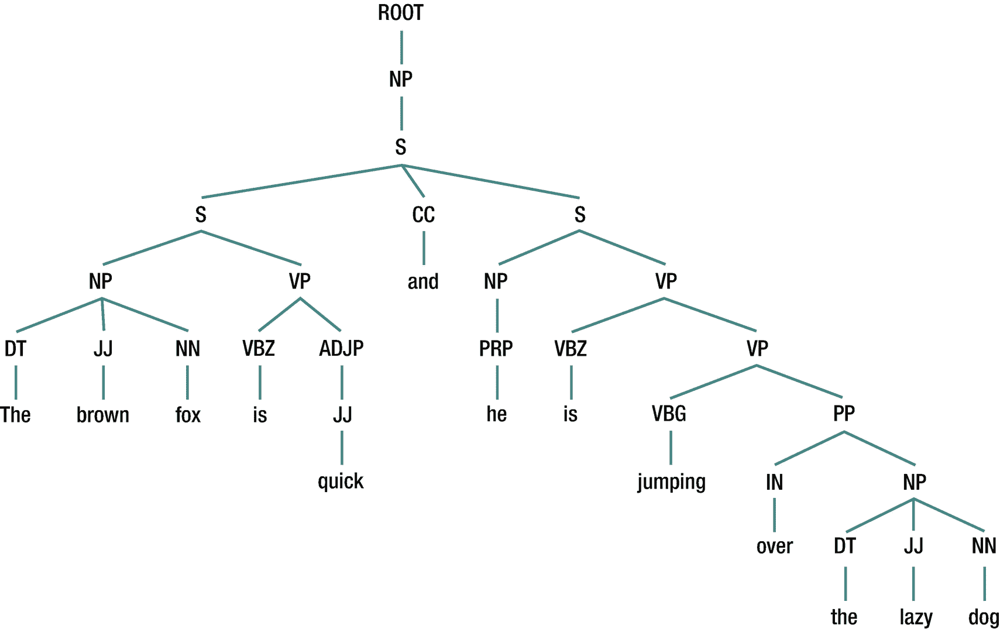

图 1-19：使用 NLTK 和 Stanford Core NLP 解析我们的示例句子得到的成分句法树

# 自然语言处理基础

```python
from nltk.parse.stanford import StanfordParser
scp = StanfordParser(path_to_jar='E:/stanford/stanford-parser-full-2015-04-20/stanford-parser.jar', path_to_models_jar='E:/stanford/stanford-parser-full-2015-04-20/stanford-parser-3.5.2-models.jar')
result = list(scp.raw_parse(sentence))
print(result[0])
(ROOT
(NP
(S
(S
(NP (DT The) (JJ brown) (NN fox))
(VP (VBZ is) (ADJP (JJ quick))))
(CC and)
(S
(NP (PRP he))
(VP
(VBZ is)
(VP
(VBG jumping)
(PP (IN over) (NP (DT the) (JJ lazy) (NN dog)))))))))
# 可视化成分树
result[0]
```

我们可以看到，图 1-19 中描绘的成分树与图 1-18 中的树具有相同的层级结构。

### 语序类型学

语言学中的*类型学*是一个专门研究如何根据句法、结构和功能对语言进行分类的领域。分类方式有多种，其中最常见的模型之一是根据其主导语序进行分类，这也被称为*语序类型学*。我们感兴趣的主要语序出现在包含主语、动词和宾语的从句中。当然，并非所有从句都会使用主语、动词和宾语的格式，而且在某些语言中，主语和宾语也并非必需。然而，存在几种不同的语序类别，可用于对多种多样的语言进行分类。Russell Tomlin 于 1986 年进行了一项调查，表 1-1 展示了其分析得出的一些见解。

**表 1-1**：Russell Tomlin 在 1986 年调查的基于语序的语言分类

| 序号 | 语序 | 语言出现频率 | 示例语言 |
| --- | --- | --- | --- |
| 1 | 主语-宾语-动词 | 180 (45%) | 梵语、孟加拉语、哥特语、印地语、拉丁语 |
| 2 | 主语-动词-宾语 | 168 (42%) | 英语、法语、普通话、西班牙语 |
| 3 | 动词-主语-宾语 | 37 (9%) | 希伯来语、爱尔兰语、菲律宾语、阿拉姆语 |
| 4 | 动词-宾语-主语 | 12 (3%) | Baure 语、马尔加什语、Aneityan 语 |
| 5 | 宾语-动词-主语 | 5 (1%) | Apalai 语、Hixkaryana 语、Arecua 语 |
| 6 | 宾语-主语-动词 | 1 (0%) | Warao 语 |

从这张表中，我们可以观察到共有六大主要语序类别，像英语这样的语言遵循主语-动词-宾语的语序类别。一个简单的例子是句子“He ate cake”，其中“He”是主语，“ate”是动词，“cake”是宾语。表 1-1 中的大多数语言遵循主语-宾语-动词语序。在这种情况下，如果将这些语言翻译过来，句子“He cake ate”才是正确的。英语到印地语对同一句子的翻译（如图 1-20 所示，由谷歌翻译提供）就说明了这一点。

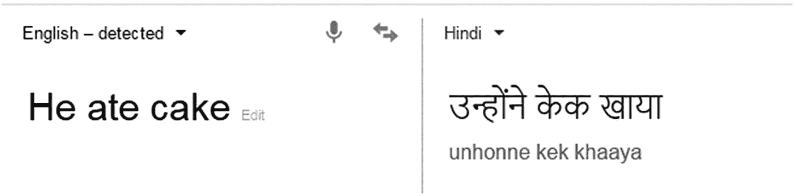

图 1-20：英语到印地语的翻译改变了句子的语序类别

即使你不懂印地语，通过谷歌提供的英语注释也能理解：在印地语翻译下方的文本中，表示“蛋糕”的词“kek”移到了句子的中间，而表示动词“吃”的“khaaya”移到了句尾，从而使语序类别变为主语-宾语-动词，这正是印地语的正确形式。这向我们表明了语序的重要性，以及信息表达在不同语言中可能在语法上存在差异。至此，我们关于语言句法和结构的讨论就结束了。接下来，我们来看看围绕语言语义的一些概念。

# 语言语义学

`语义学`的定义是对意义的研究。语言学有其自身的子领域——语言语义学，专门研究语言中的意义，包括词语、短语和符号之间的关系。它研究这些语言单位所指示、表达以及代表的知识。简言之，语义学更关注面部表情、标志、符号、肢体语言以及在信息传递过程中从一个实体转移到另一个实体的知识。如何通过形式化规则或惯例来表示语义，一直是语言学中的挑战。不过，有多种方法可以表示从语言中获得的意义和知识。在下一节中，我们将探讨语言词汇单位（主要是词语和短语）之间的关系，并研究围绕知识和意义形式化表示的几个概念。

## 词汇语义关系

词汇语义学旨在识别语言中词汇单位之间的语义关系，以及这些关系如何与语言的句法和结构相关联。词汇单位通常由语素表示，语素是语言中最小且句法正确的有意义单位。词语本质上是这些语素的一个子集。每个词汇单位都有其自身的句法、形式和意义，同时它们也从短语、从句和句子中的周围词汇单位获取意义。`词汇表`是这些词汇单位的完整词汇集合。本节我们将探讨围绕词汇语义学的一些概念。

### 词元与词形

`词元`也被称为一组词语的标准形式或引用形式。词元通常是一组词语的基础形式，这组词语被称为`词位`。词元是代表该词位的特定基础形式或主词。词形是词元的屈折变化形式，它们是词位的一部分，并且可以作为词位中的某个词语出现在文本中。一个简单的例子是词位 {eating, ate, eats}，这些是词形，而它们的词元是单词“eat”。

这些词根据其在句子中其他词之间的位置具有特定的含义。这也被称为词的“义项”或词义。`词义`为我们提供了词语意义不同方面的具体表示。考虑以下句子中的单词“fair”：“They are going to the annual fair（他们要去参加年度集市）”和“I hope the judgment is fair to all（我希望判决对所有人都是公平的）”。尽管单词“fair”在两个句子中相同，但其含义会根据周围的词和上下文而变化。

### 同形同音异义词、同形异义词与同音异义词

`同形同音异义词`被定义为拼写或发音相同但含义不同的词。另一种定义将条件限制为拼写相同。这些词之间的关系称为同形同音异义关系。同形同音异义词通常被认为是同形异义词和同音异义词的超集。同形同音异义词的一个例子可以通过以下句子来展示：“The bat hangs upside down from the tree（蝙蝠倒挂在树上）”和“That baseball bat is really sturdy（那个棒球棒非常结实）”，其中的单词是“bat”。

`同形异义词`被定义为书写形式或拼写相同但含义不同的词。几种替代的定义认为它们的发音也可以不同。同形异义词的一些例子包括单词“lead”，如“I am using a lead pencil（我正在用一支铅笔）”和“Please lead the soldiers to the camp（请带领士兵们去营地），以及单词“bass”，如“Turn up the bass for the song（把这首歌的低音调大）”和“I just caught a bass today while I was out fishing（我今天出去钓鱼时刚钓到一条鲈鱼）”。注意，对于单词“lead”的情况，拼写保持不变，但发音会根据句子中的上下文而变化。

`同音异义词`被定义为发音相同但含义不同，并且拼写可以相同或不同的词。例如单词“pair”（意思是“一对”）和“pear”（意思是“梨”），它们发音相同但含义和书写形式不同。这些词在自然语言处理中会引发问题，因为使用机器智能很难确定实际的上下文和含义。

### 同形异音异义词与同音形异义词

`同形异音异义词`被定义为书写形式或拼写相同，但发音和含义不同的词。从性质上讲，它们是同形异义词的一个子集。它们也常被称为同音异形词，意为“不同的发音”。同形异音异义词的例子包括单词“lead”（金属，指挥）和“tear”（撕开，眼泪）。

`同音形异义词`被定义为发音相同，但含义和拼写都不同的词。从性质上讲，它们是同形同音异义词的一个子集。它们的书写形式可能不同，但听起来非常相似，或者通常在口语中完全相同。一些例子包括单词“to”、“too”和“two”，它们发音相似，但拼写和含义不同。

### 多义词

`多义词`被定义为书写形式或拼写相同，但含义不同且相互关联的词。虽然这听起来很像同形同音异义现象，但区别是主观的，取决于上下文，因为这些词彼此相关。一个很好的例子是单词“bank”，它可以表示（1）金融机构，（2）河岸，（3）属于该金融机构的建筑，或者（4）甚至作为动词，意思是“依赖”。现在所有这些例子都使用了同一个单词“bank”，并且它们属于同形同音异义词。但只有（1）、（3）以及（4）（代表信任和安全，这正是金融机构所象征的）是多义词，并代表一个共同的主题。

### 大小写异义词

`大小写异义词`被定义为书写形式或拼写相同，但在大写时含义不同的词。这些词可能有或没有不同的发音。一些例子包括单词“march”（“March”表示三月，“march”描绘步行的动作）和“may”（“May”表示五月，“may”描绘一个情态动词）。

#### 同义词与反义词

`同义词`被定义为发音和拼写不同，但在某些或所有语境下具有相同含义的词语。如果两个单词或词素是同义词，它们可以在各种语境中相互替代，这表明它们具有相同的命题意义。互为同义词的词语被称为彼此`同义`，这种同义状态称为`同义关系`。完全的同义关系几乎不存在。原因在于同义关系更多是义项之间的关系，并具有语境含义，而不仅仅是词语本身。例如，“big”、“huge”和“large”这三个词互为同义词。它们在类似“那杯奶昔真的（big/large/huge）”这样的句子中相互关联且完全合理。然而，如果我们考虑句子“Bruce is my big brother”，将“big”替换为“huge”或“large”则不成句。这是因为此处的“big”具有表示“年长的”这一语境或义项，而另外两个同义词缺乏此义项。同义词可以存在于所有词类中，包括名词、形容词、动词、副词和介词。

`反义词`被定义为表示二元对立关系的成对词语。这些词表示彼此完全相反的具体含义和意义。反义词的状态称为`反义关系`。反义词有三种类型——分级反义词、互补反义词和关系反义词。分级反义词是在连续尺度上衡量时具有某种等级或水平的反义词，如（*胖*，*瘦*）这对词。互补反义词是意义相反但无法在任何等级或尺度上衡量的词对。互补反义词的一个例子是（*分裂*，*联合*）。关系反义词是其之间存在某种关系的词对，语境中的反义关系正是由这种关系所体现。关系反义词的一个例子是（*医生*，*病人*）。

### 下义词与上义词

`下义词`是其他词的下位类词语。在这种情况下，下义词通常是相对于其上位类词语而言，具有非常具体含义和语境的词语。`上义词`则是作为下义词上位类的词语，相较于下义词具有更通用的含义。例如，“fruit”这个词是上义词，而“mango”、“orange”和“pear”是其可能的下义词。这些词语之间体现的关系通常被称为上下义关系。

## 语义网络与模型

我们已经看到几种形式化词语之间关系及其含义或意义的方法。考虑到词汇语义学，有确定每个词汇单位的含义和意义的方法，但如果我们想要表示某个概念或理论的意义，而该概念或理论涉及将这些词汇单位关联起来，并根据它们的意义在它们之间建立联系，那该怎么办？语义网络旨在通过使用网络或图形来解决这种知识和概念的表示问题。语义网络的基本单元是一个实体或一个概念。概念可以是像想法这样有形或抽象的事物。一组概念彼此之间存在某种关系，并可以用有向或无向边来表示。每条边表示两个概念之间的一种特定关系类型。

假设我们在讨论“鱼”这个概念。我们可以根据它们与鱼的关系，围绕鱼形成不同的概念。例如，鱼“是一种”动物，鱼“是”海洋生物的“一部分”。这些关系被描绘为`is-a`关系。还可以有各种其他关系，如`has-a`、`part-of`、`related-to`等，具体取决于语境和语义。这些概念和关系构成了一个语义网络，你甚至可以在线浏览几个这样的语义模型，在那里你会找到涵盖不同概念的庞大知识库。图 1-21 展示了与鱼相关概念的一种可能表示。此模型由 Nodebox 提供，网址为[`https://www.nodebox.net/perception/`](https://www.nodebox.net/perception/)。你可以在此网站搜索各种概念并查看相关概念。

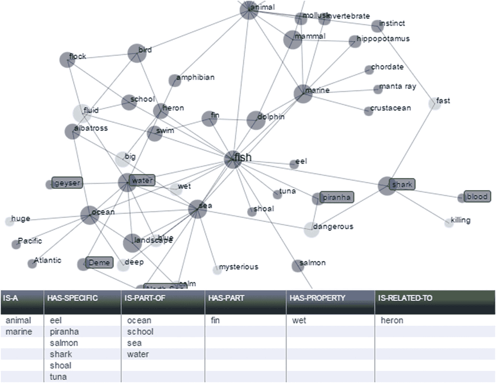

**图 1-21** 围绕“鱼”概念的语义网络

从图 1-21 所示的网络中，我们可以看到之前讨论的围绕“鱼”的一些概念，以及特定的鱼类，如鳗鱼、鲑鱼、鲨鱼等。这些可以是概念“鱼”的下义词。这些语义网络通过使用图形结构的语义数据模型进行正式表示，其中概念或实体是节点，边表示关系。语义网是万维网的扩展，它使用语义元数据注释和嵌入，以及诸如资源描述框架（`RDF`）和网络本体语言（`OWL`）等数据建模技术。在语言学中，我们拥有一个丰富的词汇语料库和数据库，称为`WordNet`，它包含了根据语义相似性（如同义词）分组到`synsets`（同义词集）中的不同词汇实体的详尽列表。这些`synsets`之间以及由此产生的各种词汇之间的语义关系可以在`WordNet`中探究，使其本质上成为一种语义网络。我们将在后面讨论文本语料库的部分，更详细地介绍`WordNet`。

## 语义的表示

到目前为止，我们已经看到如何基于词汇单位表示语义，以及如何通过利用语义网络将它们相互连接起来。如果我们考虑通过消息进行交流的常规形式，无论是书面还是口头，如果一个实体向另一个实体发送消息，并且该实体根据消息采取某些特定行动，那么就可以说该实体理解了该消息所传达的含义。

可能出现的一个问题是，我们如何正式表示一个简单句子所传达的含义或语义？虽然理解所传达的含义对我们来说可能极其容易，但正式表示语义并不像看起来那么简单。考虑以下例子：“把桌上那本书拿给我”。这个句子本质上是一个指令，它指示听者去做某事。理解这个句子所传达的含义，除了实际从桌上取书的行为外，还可能涉及语用学知识，例如“哪本书？”以及“哪张桌子？”。尽管人类思维具有直觉性，但正式表示各个组成部分的含义和关系是一个挑战。然而，我们可以使用多种技术来做到这一点，例如命题逻辑和一阶逻辑。利用这些表示，我们可以表示不同句子所指示的含义，并从中进行推理。我们甚至可以根据语义发现一个句子是否蕴含另一个句子。语义的表示对于执行各种自然语言处理操作特别有用，目的是通过适当的表示让机器理解消息背后的语义，因为机器缺乏人类的认知能力。

### 命题逻辑

命题逻辑，又称句子逻辑或陈述逻辑，被定义为研究命题、陈述和句子的逻辑学科。这包括研究命题与陈述之间的逻辑关系和属性，将多个命题组合成更复杂的命题，以及观察命题的真值如何根据其组成部分和逻辑运算符发生变化。命题或陈述通常是陈述性的，并且能够具有二元真值（真或假）。通常，陈述更具体且与语言相关，而命题更倾向于陈述所传达的思想或概念。一个简单的例子是这两个陈述——“火箭比飞船快”和“飞船比火箭慢”——它们不同但传达了相同的含义或命题。然而，在命题逻辑中，“陈述”和“命题”这两个术语往往可以互换使用。

命题逻辑的主要焦点是研究不同的命题，并观察如何通过逻辑运算符组合各种命题来改变整个命题的语义。这些逻辑运算符更多地被用作连接词或并列连词。运算符包括诸如“与”、“或”和“非”这样的术语，它们可以单独改变一个命题的含义，或在多个命题组合时发挥作用。一个简单的例子是两个命题——“地球是圆的”和“地球围绕太阳公转”。它们可以用逻辑运算符“与”组合，得到命题“地球是圆的，*并且*它围绕太阳公转”，这告诉我们，“与”运算符两侧的两个命题必须都为真，组合后的命题才为真。

命题逻辑的一个优点是每个命题都有其自身的真值，并且它不关心进一步将命题细分为更小的部分并验证逻辑特征。每个命题都被视为一个不可分割的整体单位，拥有自身的真值。逻辑运算符可以应用于它以及其他几个命题。这里不考虑细分命题的组成部分，如从句或短语。为了表示命题逻辑的各种基本构建块，我们使用一些约定和符号。像`P`和`Q`这样的大写字母用于表示单个陈述或命题。所使用不同的运算符及其对应符号如表 1-2 所示，按优先级顺序排列。

**表 1-2**

逻辑运算符及其符号与优先级

| 序号 | 运算符符号 | 运算符含义 | 优先级 |
| --- | --- | --- | --- |
| 1 | `¬` | 非 | 最高 |
| 2 | `∧` | 与 |   |
| 3 | `∨` | 或 |   |
| 4 | `→` | 如果-那么 |   |
| 5 | `↔︎` | 当且仅当 | 最低 |

从表 1-2 可以看出，总共有五个运算符，其中`非`运算符的优先级最高，`当且仅当`运算符的优先级最低。逻辑常量被表示为真或假。常量和符号被称为原子单位，而所有其他单位，更具体地说，句子和陈述，是复杂单位。字面量通常是一个原子语句或应用`非`运算符后的否定。我们用一个简单的例子来展示两个句子`P`和`Q`，并对它们应用各种运算符。让我们考虑以下表示：

`P`: 他饿了

`Q`: 他会吃一个三明治

表达式`P ∧ Q`翻译为“他饿了，并且他会吃一个三明治”。这表达了该操作的结果本身也是一个句子或命题。这是一个合取操作，其中`P`和`Q`是合取项。只有当`P`和`Q`都为真时，这个句子的结果才为真。

表达式`P ∨ Q`翻译为“他饿了，或者他会吃一个三明治”。这表达了该操作的结果也是由析取操作形成的另一个命题，其中`P`和`Q`是析取项。当`P`或`Q`中有一个为真，或者两者都为真时，这个句子的结果为真。

表达式`P → Q`翻译为“如果他饿了，那么他会吃一个三明治”。这是一个蕴含操作，它确定`P`是前提或前件，而`Q`是后件。这就像一个规则，规定只有当`P`已经发生或为真时，`Q`才会发生。

表达式`P ↔︎ Q`翻译为“当且仅当他饿了，他才会吃一个三明治”，这基本上是表达式“如果他饿了，那么他会吃一个三明治”（`P → Q`）和“如果他会吃一个三明治，那么他饿了”（`Q → P`）的组合。这是一个双条件或等价操作，当且仅当我们描述的这两个蕴含操作的结果都为真时，它才会评估为真。

表达式`¬P`翻译为“他不饿”，这描述了否定操作，当且仅当`P`评估为假时，它才会评估为真。

这让我们了解了命题之间的基本操作以及更复杂的操作，这些操作可以通过多个逻辑连接词和添加更多命题来实现。一个简单的例子是以下这些陈述：

`P`: 我们会踢足球

`Q`: 体育场开放

`R`: 今天会下雨

它们可以组合起来表示为`Q ∧ ¬R → P`，以描述这个复杂的命题：“如果体育场开放且今天不下雨，那么我们会踢足球”。最终命题的真值或结果的语义可以根据各个命题的真值和运算符来评估。不同运算符的真值各种结果如图 1-22 所示。

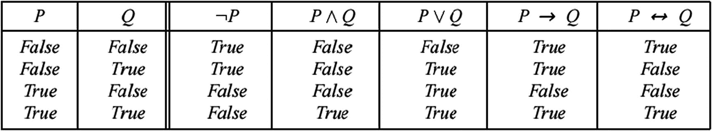

**图 1-22**

各种逻辑连接词的真值

因此，利用图 1-22 中的表格，我们可以通过将更复杂的命题分解为更简单的二元操作，计算这些操作的真值，并逐步组合它们，来评估这些命题。除了这些结果之外，还有其他属性，如结合律、交换律和分配律，它们有助于评估复杂命题的结果。检查每个操作和命题的有效性并最终评估结果的行为也称为`推理`。

然而，除了始终计算庞大的真值表之外，我们还可以使用多种推理规则来得出最终结果或结论。这样做的主要原因在于，随着命题数量的增加，包含各种操作的真值表的大小会呈指数级增长。此外，推理规则更容易理解且经过充分验证，在它们的核心，实际上应用了相同的真值表，但我们不必操心其内部机制。一系列推理规则在被应用后，通常会得出一个结论，这常被称为`逻辑证明`。推理规则通常的形式是`P ⊢ Q`，它表示`Q`可以从`P`所表示的一组陈述中通过某些推理操作推导出来。范葫芦符（`⊢`）表明`Q`是`P`的某个逻辑推论。最流行的推理规则如下：

- **假言推理（Modus ponens）：** 这是最常用的推理规则，也称为蕴含消去规则。它可以表示为`{P → Q, P}` ⊢ `Q`，意指如果`P`蕴含`Q`且`P`被断言为真，则可推断出`Q`也为真。你也可以用表达式`(P → Q) ∧ P) → Q`来表示，该表达式可通过真值表轻松求值。一个简单的例子是语句“如果天气晴朗，我们就去踢足球”，表示为`P → Q`。现在如果我们说“天气晴朗”，这表明`P`为真，因此自动推断出`Q`为真，即表示“我们将去踢足球”。

- **拒取式（Modus tollens）：** 这与前一条规则非常相似，其形式化表示为`{P → Q, ¬Q}` ⊢ `¬P`。这表明如果`P`蕴含`Q`且`Q`实际上被断言为假，则可推断出`P`也为假。你也可以用表达式`(P → Q) ∧ ¬Q) → ¬P`来表示，该表达式可通过真值表轻松求值。一个示例命题是“如果他是单身汉，他就没有结婚”，表示为`P → Q`。现在如果我们提出“他已经结婚”，表示为`¬Q`，则可推断出`¬P`，即“他不是单身汉”。

- **析取三段论：** 这也被称为析取消去规则，其形式化表示为`{P ∨ Q, ¬P}` ⊢ `Q`。这表明如果`P`或`Q`为真，且`P`为假，则`Q`为真。一个简单的例子是语句“他要么是奇迹创造者，要么是骗子”，表示为`P ∨ Q`。而“他不是奇迹创造者”表示为`¬P`，因此我们可以推断出“他是骗子”，即`Q`。

# 推理规则

- `假言三段论`：这通常被称为演绎链式规则，其形式化表示为`{P → Q, Q → R}` ⊢ `P → R`。这表明如果`P`蕴含`Q`且`Q`蕴含`R`，则可推断出`P`蕴含`R`。一个非常有趣的例子是理解语句“如果我生病了，我就不能去上班”，表示为`P → Q`，以及“如果我不能去上班，大楼的施工就无法完成”，表示为`Q → R`。然后我们可以推断出“如果我生病了，大楼的施工就无法完成”，即表示为`P → R`。

- `构造性二难推理`：这一推理规则是假言推理的析取版本，其形式化表示为`{(P → Q) ∧ (R → S), P ∨ R}` ⊢ `Q ∨ S`。这表明如果`P`蕴含`Q`且`R`蕴含`S`，并且`P`或`R`为真，则可推断出`Q`或`S`为真。考虑以下命题：“如果我努力工作，我就会成功”，表示为`P → Q`，以及“如果我中彩票，我就会变得富有”，表示为`R → S`。现在我们可以提出“我努力工作*或*我中彩票”为真，这表示为`P ∨ R`。然后我们可以推断出“我会成功或者我会变得富有”，即表示为`Q ∨ S`。这一规则的互补形式是`破坏性二难推理`，它是拒取式的析取版本。

这应该能让你清楚了解推理规则有多么直观，并且使用它们远比通过多个真值表来尝试确定复杂命题的结果要容易得多。我们从推理中得出的解释，赋予了语句或命题的语义。一个有效的语句是指在所有解释下都为真的语句，无论其内部的逻辑运算或各种语句如何。这通常被称为`重言式`。重言式的互补形式是`矛盾`或非一致语句，它在所有解释下都为假。请注意，上述列表仅是指示性的最常用推理规则，远非详尽无遗。感兴趣的读者可以进一步阅读关于推理和命题演算的内容，以了解除这里所涵盖的规则之外的其他规则和公理，从而对该主题有更深入的理解。接下来我们将探讨一阶逻辑，它试图解决命题逻辑中存在的一些不足。

## 一阶逻辑

一阶逻辑（FOL），也广泛称为谓词逻辑和一阶谓词演算，被定义为一组定义良好的形式系统，广泛用于演绎、推理和知识表示。FOL 允许我们在句子中使用量词和变量，这使我们能够克服命题逻辑的一些局限性。如果我们要考量命题逻辑（PL）的优缺点，就其有利点而言，PL 是陈述性的，并允许我们使用结构良好的语法轻松表示事实。PL 还允许复杂的表示，例如合取、析取和否定式的知识表示。这本质上使得 PL 具有组合性，其中复合或复杂的命题由作为其组成部分的简单命题以及逻辑连接词构建而成。然而，PL 在几个方面存在不足。在 PL 中表示事实显然不容易，因为对于每个可能的原子事实，我们都需要一个独特的符号表示。因此，由于这个限制，PL 的表达能力非常有限。因此，FOL 背后的基本思想是不将命题视为原子实体。

与 PL 相比，FOL 拥有更丰富的语法和必要的组成部分。FOL 的基本组成部分如下：

- **对象：** 这些是具有个体独特标识的特定实体或项，例如人、动物等。

- **关系：** 这些也称为谓词，通常存在于对象或对象集之间，并表示某种形式的关系或联系，例如 `is_man`、`is_brother` 和 `is_mortal`。关系通常对应于动词。

- **函数：** 这些是关系的一个子集，对于某个给定的输入，总是只有一个输出值或对象。例子包括 `height`、`weight` 和 `age_of`。

- **属性：** 这些是对象的特定属性，有助于将它们与其他对象区分开来，例如圆形、巨大等。

- **连接词：** 这些是逻辑连接词，与 PL 中的类似，包括非 (¬)、与 (∧)、或 (∨)、蕴含 (→) 和当且仅当 (↔)。

- **量词：** 这包括两种量词——全称量词 (∀) 代表“对于所有”或“所有”，以及存在量词 (∃) 代表“存在”或“有”。它们用于在逻辑或数学表达式中量化实体。

- **常量符号：** 这些用于表示世界中的具体实体或对象。例子包括 John、King、Red 和 7。

- **变量符号：** 这些用于表示变量，例如 x、y 和 z。

- **函数符号：** 这些用于将函数映射到结果。例子包括 `age_of(John)` = 25 或 `color_of(Tree)` = Green。

- **谓词符号：** 这些根据结果将特定实体以及它们之间的关系或函数映射到一个真值。例子包括 `color(sky, blue)` = True。

这些是构成 FOL 逻辑表示和语法的主要组成部分。通常，对象由各种项表示，这些项可以是函数、变量或常量，具体取决于不同的组成部分。这些项不需要定义，也不返回值。各种命题通常使用谓词和项，借助谓词符号来构建。一个 n 元谓词由一个作用于 n 个项的函数构建而成，其结果要么为真，要么为假。一个原子语句可以用一个 n 元谓词表示，其结果为真或假取决于该语句的语义，即由项表示的对象是否具有由谓词指定的正确关系。一个`复合语句`或陈述是由几个原子语句和逻辑连接词构成的。一个`量化语句`则是在语句中添加了前面提到的量词。

量词是 FOL 相对于 PL 的优势之一，因为它们使我们能够表示关于整个对象集的陈述，而无需用不同的名称来表示和枚举每个对象。`全称量词` (∀) 断言一个特定的关系或谓词对于与特定变量关联的所有值都为真。表示 `∀x F(x)` 表明 F 对于与 x 关联的域中 x 的所有值都成立。一个例子是 `∀x cat(x) → animal(x)`，这表明所有的猫都是动物。全称量词与`蕴含` (→) 连接词一起使用来构成规则和陈述。需要记住的一个重要点是，全称量词几乎从不与合取 (∧) 连接词一起用于陈述中，来表示世界上每个实体都存在某种关系。一个例子是表示 `∀x dog(x) ∧ eats_meat(x)`，这实际上意味着世界上的每个实体都是一条狗，并且它们都吃肉。这显然听起来很荒谬！`存在量词` (∃) 断言一个特定的关系或谓词对于与特定变量关联的至少某些值成立。表示 `∃x F(x)` 表明 F 对于与 x 关联的域中 x 的某些值成立。一个例子是 `∃x student(x) ∧ pass_exam(x)`，这表明至少有一个学生通过了考试。这个量词为 FOL 提供了强大的能力，因为我们可以对对象或实体做出陈述，而无需具体命名它们。

存在量词通常与`合取` (∧) 连接词一起使用来构成规则和陈述。你应该记住，存在量词几乎从不与`蕴含` (→) 连接词一起用于陈述中，因为其指示的语义通常是错误的。一个例子是 `∃x student(x) → knowledgeable(x)`，这告诉我们，如果你是一名学生，你就知识渊博。真正的问题在于，如果你问，那些不是学生的人呢，他们就不知识渊博吗？

考虑到量词嵌套的范围，多个量词的顺序是否重要取决于所使用的量词类型。对于多个全称量词，交换顺序不会改变语句的含义。这可以用 `(∀x)(∀y) brother(x,y) ↔ (∀y)(∀x) brother(x,y)` 来表示，这表明两个人是兄弟，无论顺序如何。类似地，你也可以交换存在量词的顺序，例如 `(∃x)(∃y) F(x,y) ↔ (∃y)(∃x) F(x,y)`。在句子中交换混合量词的顺序确实会改变该句子的解释。这在以下在 FOL 中非常流行的例子中可以更清楚地解释。

- `(∀x)(∃y) loves(x, y)` 意味着世界上的每个人都至少爱一个人。

- `(∃y)(∀x) loves(x, y)` 意味着世界上有某个人被所有人爱着。

- `(∀y)(∃x) loves(x, y)` 意味着世界上的每个人都至少有一个爱他们的人。

- `(∃x)(∀y) loves(x, y)` 意味着世界上至少有一个人爱着所有人。

从这些例子中，你可以看到这些语句看起来几乎相同，但量词的顺序会显著改变含义。还有一些其他性质展示了量词之间的关系。我们列出一些流行的量词恒等式和性质如下。

- `(∀x) ¬F(x) ↔ ¬(∃x) F(x)`

- `¬(∀x) F(x) ↔ (∃x) ¬F(x)`

- `(∀x) F(x) ↔ ¬(∃x) ¬F(x)`

- `(∃x) F(x) ↔ ¬(∀x) ¬F(x)`

- `(∀x) (P(x) ∧ Q(x)) ↔ ∀x P(x) ∧ ∀x Q(x)`

- `(∃x) (P(x) ∨ Q(x)) ↔ ∃x P(x) ∨ ∃x Q(x)`

# 谓词逻辑变换规则

在谓词逻辑中，还有其他几个关于变换规则的重要概念。这些包括实例化和泛化。全称实例化，也称为全称消去，是一条涉及全称量词的推理规则。它告诉我们，如果 `(∀x) F(x)` 为真，那么 `F(C)` 也为真，其中 `C` 是 `x` 域中存在的任何常量项。这里的变量符号可以被任何基础项替换。说明此规则的一个例子是 `(∀x) drinks(John, x)` → `drinks(John, Water)`。

全称泛化，也称为全称引入，是一条推理规则，告诉我们如果 `F(A) ∧ F(B) ∧ F(C) ∧ …` 等都为真，那么我们可以推断 `(∀x) F(x)` 也为真。

存在实例化，也称为存在消去，是一条涉及存在量词的推理规则。它告诉我们，如果给定的表示 `(∃x) F(x)` 存在，我们可以推断出 `F(C)` 成立，其中 `C` 是一个新的常量或变量符号。这假定在此规则中引入的常量或变量项 `C` 是一个新的常量，在此前的证明或我们现有的知识库中从未出现过。此过程也称为`斯科伦化`，常量 `C` 被称为`斯科伦常量`。

存在泛化，也称为存在引入，是一条推理规则，告诉我们假定 `F(C)` 为真（其中 `C` 是一个常量项），那么我们可以由此推断出 `(∃x) F(x)`。这可以通过表示式 `eats_fish(Cat)` → `(∃x) eats_fish(x)` 来体现，该式可翻译为“猫吃鱼，因此至少存在某个东西或某个人吃鱼”。

现在我们来看一些关于如何使用一阶逻辑表示自然语言陈述以及如何从自然语言陈述转换为一阶逻辑的示例。表 1-3 中的示例展示了一阶逻辑表示自然语言陈述的典型用法。

**表 1-3** 使用一阶逻辑表示自然语言陈述

| 序号 | 一阶逻辑表示 | 自然语言陈述 |
| --- | --- | --- |
| 1 | `¬ eats(John, fish)` | 约翰不吃鱼。 |
| 2 | `is_hot(pie) ∧ is_delicious(pie)` | 这个派又热又美味。 |
| 3 | `is_hot(pie) ∨ is_delicious(pie)` | 这个派要么是热的，要么是美味的。 |
| 4 | `study(John, exam) → pass(John, exam)` | 如果约翰复习了考试，他就会通过考试。 |
| 5 | `∀x student(x) → pass(x, exam)` | 所有学生都通过了考试。 |
| 6 | `∃x student(x) ∧ fail(x, exam)` | 至少有一名学生考试不及格。 |
| 7 | `(∃x student(x) ∧ fail(x, exam) ∧ (∀y fail(y, exam) → x=y))` | 恰恰有一名学生考试不及格。 |
| 8 | `∀x (spider(x) ∧ black_widow(x)) → poisonous(x)` | 所有黑寡妇蜘蛛都是有毒的。 |

这让我们对一阶逻辑的各种组成部分以及它相对于命题逻辑所提供的实用性和优势有了很好的了解。然而，一阶逻辑也有其自身的局限性。就其本质而言，它允许我们对变量和对象进行量化，但不能对属性或关系进行量化。高阶逻辑则允许我们对关系、谓词和函数进行量化。更具体地说，`二阶逻辑`使我们能够对谓词和函数进行量化，而`三阶逻辑`则使我们能够对谓词的谓词进行量化。尽管它们表达能力更强，但要判定高阶逻辑中所有语句的有效性却极其困难。至此，我们关于语义表示的讨论就结束了。下一节我们将讨论文本语料库。

## 文本语料库

文本语料库是“text corpus”的复数形式，可以定义为大型且结构化的文本或文本数据集合。它们通常由书面或口述文本的主体构成，通常以电子形式存储。这包括将古老的历史文本语料库从物理形式转换为电子形式，以便于分析和处理。文本语料库的主要目的是利用它们进行语言学和统计分析，并将其用作构建自然语言处理工具的数据。

单语语料库仅包含一种语言的文本数据，而多语语料库则包含多种语言的文本数据。要理解文本语料库的重要性，我们必须了解语料库的起源及其背后的原因。这一切都始于语言学的兴起以及人们为研究语言特性和结构而收集与语言相关的数据。在 20 世纪 50 年代，人们使用统计和定量方法来分析收集到的数据。然而，由于缺乏大量文本数据来有效应用统计方法，这种方法很快就走到了尽头。除此之外，认知学习和行为科学也获得了大量关注。这促使杰出的语言学家`诺姆·乔姆斯基`构建并制定了一个复杂的、基于规则的语言模型，该模型为构建、标注和分析大规模文本语料库奠定了基础。

### 语料库标注与实用工具

文本语料库都带有丰富的元数据标注，这在利用语料库进行自然语言处理和文本分析以获得有价值的见解时极为有用。文本语料库常见的标注包括词性标注、词干、词元等等。我们来看看一些最常用的文本语料库标注方法和技术。

-   **词性标注：** 这主要用于为每个单词标注一个词性标签，指示其关联的词性。
-   **词干：** 词的词干是词的一部分，可以附加各种词缀。
-   **词元：** 词元是一组词的规范形式或基本形式，也称为`主词`。
-   **依存语法：** 包括找出句子中各成分之间的各种关系并标注这些依存关系。
-   **成分语法：** 用于根据句子成分（包括短语和从句）为句子添加句法标注。
-   **语义类型和角色：** 句子的各种成分，包括单词和短语，都会被标注上特定的语义类型和角色，这些类型和角色通常来自知识本体，用以指示它们的功能。这些包括地点、人物、时间、组织、施事、受事、主题等。

高级的标注形式包括为文本添加句法和语义结构。这些是基于依存语法和成分语法的句法分析树。这些专门的语料库也称为`树库`，被广泛用于构建词性标注器、句法分析器和语义分析器。语言学家也广泛使用语料库来创建新的词典和语法规则。诸如搭配、搭配关系和频率计数等特性，使他们能够找到词汇信息、模式、词法句法信息，并用于语言学习。除了语言学领域，语料库还被广泛应用于开发各种自然语言处理工具，如文本标注器、语音识别、机器翻译、拼写和语法检查器、文本转语音和语音转文本合成器、信息检索、实体识别和知识抽取。

### 流行语料库

以下是一些随着时间推移而构建并不断发展的著名文本语料库资源。本节列举了部分最流行的语料库，旨在激发你的兴趣，你可以进一步查找并深入了解那些吸引你眼球的文本语料库的更多细节。下面列表描述了一些随时间构建的流行文本语料库。

*   **关键词索引：** `KWIC` 是一种诞生于 19 世纪 60 年代的方法论，但在 20 世纪 50 年代左右被语言学家广泛用于索引文档和创建索引语料库。
*   **布朗语料库：** 这是第一个百万词级的英语语料库，由 Kucera 和 Francis 于 1961 年发布；它也被称为“当代美国英语标准语料库”。该语料库包含来自各种来源和类别的文本。
*   **LOB 语料库：** 兰开斯特-奥斯陆-卑尔根（`LOB`）语料库是 20 世纪 70 年代由兰开斯特大学、奥斯陆大学和卑尔根挪威人文计算中心合作编纂的。该项目的主要动机是为布朗语料库提供一个对应的英式英语版本。该语料库同样是一个百万词级的语料库，包含来自各种来源和类别的文本。
*   **柯林斯语料库：** 柯林斯伯明翰大学国际语言数据库（`COBUILD`）于 1980 年在伯明翰大学建立，由柯林斯出版商资助，构建了一个大型的当代英语文本电子语料库，并为后来的语料库如“英语语料库银行”和“柯林斯 COBUILD 英语词典”铺平了道路。
*   **CHILDES：** 儿童语言数据交换系统（`CHILDES`）是由 Brian 和 Catherine 于 1984 年创建的语料库，作为语言习得数据的存储库，包含来自超过 130 个不同语料库的 26 种语言的转录文本、音频和视频。它最近与一个更大的名为 Talkbank 的语料库合并。它被广泛用于分析幼儿的语言和言语。
*   **WordNet：** 该语料库是一个面向语义的英语词汇数据库。它于 1985 年在乔治·阿米蒂奇的指导下于普林斯顿大学创建。该语料库包含单词和常被称为 `synsets` 的同义词集。除此之外，它还包含单词定义、关系以及使用单词和同义词集的示例。总的来说，它结合了词典和同义词词典的功能。
*   **宾夕法尼亚树库：** 该语料库包含经过词性标注和句法分析的英语句子，包括 `POS` 标签和基于语法的分析树，这些在树库中很常见。它也可以被定义为语言树库，由宾夕法尼亚大学创建。
*   **BNC 语料库：** 英国国家语料库（`BNC`）是最大的英语语料库之一，包含超过 1 亿个来自各种来源的口语和书面文本样本。该语料库是 20 世纪末英国英语口语和书面语的代表性样本。
*   **ANC 语料库：** 美国国家语料库（`ANC`）是一个大型的美式英语文本语料库。它包含自 20 世纪 90 年代以来的超过 2200 万个口语和书面文本样本。其数据来源广泛，包括一些新兴来源，如电子邮件、推文和网站，这些在 `BNC` 中是不存在的。
*   **COCA 语料库：** 当代美式英语语料库（`COCA`）是最大的美式英语文本语料库，包含超过 4.5 亿个单词，包括来自不同类别和来源的口语转录文本和书面文本。

### 文本语料库

*   **Google N-gram 语料库：** Google N-gram 语料库包含来自书籍、网页等多种来源的超过一万亿个单词。该语料库包含每种语言最高至 5-gram 的 n-gram 文件。
*   **路透社语料库：** 该语料库是路透社新闻文章和报道的合集，于 2000 年发布，专门用于自然语言处理和机器学习研究。
*   **网页、聊天、电子邮件、推文：** 这些是随着社交媒体的兴起而变得重要的全新形式的文本语料库。我们可以从各种来源获取它们，包括 Twitter、Facebook、聊天室等。

这让我们了解了一些最流行的文本语料库及其随时间演变的情况。在下一节中，我们将讨论如何借助 Python 和自然语言工具包（`NLTK`）平台来访问其中的一些文本语料库。

## 访问文本语料库

我们已经了解了什么是文本语料库，并查看了当今存在的一些流行文本语料库的列表。在本节中，我们利用 `NLTK` 来连接并访问其中一些文本语料库。我们将在下一章更详细地介绍 `NLTK` 和 Python，所以如果某些语法或代码看起来有点吃力，请不要担心。本节的主要目的是让你了解如何轻松访问和利用文本语料库来满足你的自然语言处理和分析需求。我们还会用到自然语言工具包（`nltk`）库，你可以访问 [`http://www.nltk.org/`](http://www.nltk.org/) 了解更多关于该项目的详细信息，该网站告诉我们 `NLTK` 是一个用于访问文本资源（包括用于各种自然语言处理和机器学习能力的语料库和库）的完整平台和框架。

首先，请确保你已经安装了 Python。你可以单独安装 Python，或者从 Anaconda 官网 [`https://www.anaconda.com/download`](https://www.anaconda.com/download) 下载流行的 Anaconda Python 发行版，该发行版附带了一套完整的分析包，包括 `NLTK`。如果你想了解更多关于 Python 的细节，并确定哪种发行版最适合你，可以前往第 2 章快速浏览一下，我们将在那里更详细地介绍这些主题。

假设你现在已经安装了 Python，如果你安装了 Anaconda 发行版，那么你已经安装了 `NLTK`。请注意，我们在本书中全程使用 Python 3，我们建议每个人都使用最新版本的 Python，最好是 Python 3.5 或更高版本。如果你没有安装 Anaconda 发行版但安装了 Python，你可以打开终端或命令提示符，运行以下命令来安装 `NLTK`。

```
$ pip install nltk
```

这将安装 `nltk` 库，你就可以使用它了。然而，`NLTK` 的默认安装并不包含本书所需的所有组件。要安装 `NLTK` 的所有组件和资源，你可以启动 Python shell 并输入以下命令。你会看到 `NLTK` 的各种依赖项正在被下载；以下代码片段展示了部分输出。

```
In [1]: import nltk
In [2]: nltk.download('all', halt_on_error=False)
[nltk_data] Downloading collection u'all'
[nltk_data]    |
[nltk_data]    | Downloading package abc to
[nltk_data]    |     C:\Users\DIP.DIPSLAPTOP\AppData\Roaming\nltk_data
[nltk_data]    |     ...
[nltk_data]    |   Package abc is already up-to-date!
[nltk_data]    | Downloading package alpino to
[nltk_data]    |     C:\Users\DIP.DIPSLAPTOP\AppData\Roaming\nltk_data
[nltk_data]    |     ...
```

该命令将下载 `NLTK` 所需的所有资源。如果你不想下载所有内容，也可以使用 `nltk.download()` 命令从图形用户界面（`GUI`）中选择必要的组件。一旦必要的依赖项下载完成，你现在就可以开始访问文本语料库了！

## 访问布朗语料库

我们之前已经简单讨论过布朗语料库，该语料库于 1961 年在布朗大学开发。该语料库包含来自 500 个来源的文本，并被划分为多个类别。以下代码片段将布朗语料库加载到系统内存中，并展示其各个类别。

```python
# 加载布朗语料库
from nltk.corpus import brown
# 总类别数
print('总类别数:', len(brown.categories()))
总类别数: 15
# 打印类别
print(brown.categories())
['adventure', 'belles_lettres', 'editorial', 'fiction', 'government', 'hobbies', 'humor', 'learned', 'lore', 'mystery', 'news', 'religion', 'reviews', 'romance', 'science_fiction']
```

上述输出告诉我们，该语料库共有 15 个类别，包括新闻、悬疑、传说等。以下代码片段将进一步深入探索布朗语料库的悬疑类别。

### 访问路透社语料库

路透社语料库包含来自大约 90 个不同类别的 10,788 篇路透社新闻文档，并被划分为训练集和测试集。在机器学习术语中，训练集用于训练模型，测试集用于测试该模型的性能。以下代码片段向我们展示了如何访问路透社语料库的数据。

```python
# 分词后的句子
brown.sents(categories='mystery')
[['There', 'were', 'thirty-eight', 'patients', 'on', 'the', 'bus', 'the', 'morning', 'I', 'left', 'for', 'Hanover', ',', 'most', 'of', 'them', 'disturbed', 'and', 'hallucinating', '.'], ['An', 'interne', ',', 'a', 'nurse', 'and', 'two', 'attendants', 'were', 'in', 'charge', 'of', 'us', '.'], ...]
# 词性标注后的句子
brown.tagged_sents(categories='mystery')
[[('There', 'EX'), ('were', 'BED'), ('thirty-eight', 'CD'), ('patients', 'NNS'), ('on', 'IN'), ('the', 'AT'), ('bus', 'NN'), ('the', 'AT'), ('morning', 'NN'), ('I', 'PPSS'), ('left', 'VBD'), ('for', 'IN'), ('Hanover', 'NP'), (',', ','), ('most', 'AP'), ('of', 'IN'), ('them', 'PPO'), ('disturbed', 'VBN'), ('and', 'CC'), ('hallucinating', 'VBG'), ('.', '.')], [('An', 'AT'), ('interne', 'NN'), (',', ','), ('a', 'AT'), ('nurse', 'NN'), ('and', 'CC'), ('two', 'CD'), ('attendants', 'NNS'), ('were', 'BED'), ('in', 'IN'), ('charge', 'NN'), ('of', 'IN'), ('us', 'PPO'), ('.', '.')], ...]
# 获取自然形式的句子
sentences = brown.sents(categories='mystery')
sentences = [' '.join(sentence_token) for sentence_token in sentences]
sentences[0:5] # 查看前 5 个句子
['There were thirty-eight patients on the bus the morning I left for Hanover , most of them disturbed and hallucinating .',
'An interne , a nurse and two attendants were in charge of us .',
"I felt lonely and depressed as I stared out the bus window at Chicago's grim, dirty West Side.",
'It seemed incredible , as I listened to the monotonous drone of voices and smelled the fetid odors coming from the patients , that technically I was a ward of the state of Illinois , going to a hospital for the mentally ill .',
'I suddenly thought of Mary Jane Brennan , the way her pretty eyes could flash with anger , her quiet competence , the gentleness and sweetness that lay just beneath the surface of her defenses .']
```

从前面的代码片段和输出中，我们可以看到悬疑类体裁的书面内容，以及句子如何以分词和注释格式提供。假设我们想查看悬疑类体裁中的顶级名词？我们可以使用以下代码片段来获取它们。请记住，名词的词性标注中通常包含`NN`或`NP`，用以表示名词的不同形式。我们将在第 3 章更详细地介绍词性标注。

```python
# 获取带词性标注的单词
tagged_words = brown.tagged_words(categories='mystery')
# 从带词性标注的单词中获取名词
nouns = [(word, tag) for word, tag in tagged_words if any(noun_tag in tag
for noun_tag in ['NP', 'NN'])]
nouns[0:10] # 查看前 10 个名词
[('patients', 'NNS'), ('bus', 'NN'), ('morning', 'NN'), ('Hanover', 'NP'), ('interne', 'NN'),
('nurse', 'NN'), ('attendants', 'NNS'), ('charge', 'NN'), ('bus', 'NN'), ('window', 'NN')]
# 构建名词的频率分布
nouns_freq = nltk.FreqDist([word for word, tag in nouns])
# 查看出现频率最高的前 10 个名词
nouns_freq.most_common(10)
[('man', 106), ('time', 82), ('door', 80), ('car', 69), ('room', 65),
('Mr.', 63), ('way', 61), ('office', 50), ('eyes', 48), ('Mrs.', 46)]
```

前面的代码片段和输出展示了出现频率最高的前十个名词，包括诸如 `man`、`time`、`room` 等词汇。我们使用了一些高级结构和技巧，如列表推导式、可迭代对象和元组。在下一章中，我们将介绍使用 Python 结构处理文本的核心概念。目前，你只需要知道我们根据词性标注从所有其他单词中过滤出名词，然后计算它们的频率，从而得到语料库中出现频率最高的名词。

## 自然语言处理

我们在本章中多次提到了*自然语言处理*（NLP）这个术语。到现在为止，你可能已经对 NLP 的含义有了一些概念。NLP 被定义为计算机科学与工程以及人工智能的一个专业领域，其根源在于计算语言学。它主要关注设计和构建能够实现机器与人类创造的自然语言之间交互的应用程序和系统。这也使得 NLP 与人机交互（HCI）领域相关联。NLP 技术使计算机能够处理和理解人类的自然语言，并进一步利用它来提供有用的输出。接下来，我们将讨论 NLP 的一些主要应用。

### 机器翻译

机器翻译或许是 NLP 中最令人向往、最受追捧的应用之一。它被定义为一种有助于在任意两种语言之间提供句法、语法和语义正确翻译的技术。这或许是 NLP 中第一个主要的研究和开发领域。简单来说，机器翻译就是由机器执行的自然语言翻译。默认情况下，机器翻译过程的基本构建块涉及将单词从一种语言简单替换为另一种语言，但在这种情况下，我们会忽略诸如语法和短语结构一致性之类的问题。因此，随着时间的推移，更复杂的技术已经发展起来，包括将大量的文本语料库资源与统计和语言学技术相结合。最流行的机器翻译系统之一就是谷歌翻译。图 1-23 展示了谷歌翻译对句子“What is the fare to the airport?”从英语到意大利语的成功机器翻译操作。

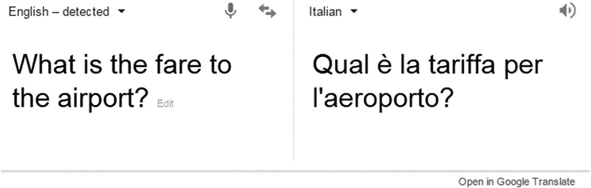

`图 1-23` 谷歌翻译执行的机器翻译

随着时间的推移，机器翻译系统在您对着应用程序说话或输入时实时提供翻译方面变得越来越好。

### 语音识别系统

### 访问 WordNet 语料库

WordNet 语料库或许是使用最广泛的语料库之一，因为它包含大量词汇以及每个词语在语义上相连的同义词集。我们在此探讨 WordNet 语料库的一些基本特性，包括同义词集和访问语料库数据的方法。有关 WordNet 功能的更深入分析和全面介绍，可参考第 3 章，其中涵盖了同义词集、词元、下位词、上位词以及我们在前面语义学部分讨论的其他几个概念。以下代码片段向我们展示了如何访问 WordNet 语料库数据和同义词集。

```python
# 加载 WordNet 语料库
from nltk.corpus import wordnet as wn
word = 'hike' # 将 hike 作为我们感兴趣的词
# 获取词语的同义词集
word_synsets = wn.synsets(word)
word_synsets
# 获取同义词集中每个同义词的详细信息
for synset in word_synsets:
    print(('同义词集名称: {name}\n'
           '词性标签: {tag}\n'
           '定义: {defn}\n'
           '示例: {ex}\n').format(name=synset.name(),
                                      tag=synset.pos(),
                                      defn=synset.definition(),
                                      ex=synset.examples()))
```

这段代码展示了一个关于单词 `hike` 及其同义词集的有趣示例，其中包括作为名词和动词且具有不同含义的同义词。WordNet 使得在语义上将单词与同义词关联起来、轻松检索各种单词的含义和示例变得更加容易。这个示例告诉我们，“hike”既可以指一次长途步行，也可以指工资/租金的上涨。请随意尝试不同的单词，并确定它们的同义词集、定义、示例和关系。

除了这些流行的语料库外，还有大量可用的文本语料库，你只需查看 `nltk.corpus` 模块即可找到它们，该模块可用于访问这些语料库中的任何一个。因此，你可以看到，借助 Python 和 NLTK，访问和使用来自任何文本语料库的数据是多么容易。至此，我们关于文本语料库的讨论就结束了。在下一节中，我们将介绍有关自然语言处理和文本分析的一些基本概念。

```python
# 加载路透社语料库
from nltk.corpus import reuters
# 总类别数
print('总类别数:', len(reuters.categories()))
总类别数: 90
# 打印类别
print(reuters.categories())
['acq', 'alum', 'barley', 'bop', 'carcass', 'castor-oil', 'cocoa', ..., 'yen', 'zinc']
# 获取住房和收入类别的句子
sentences = reuters.sents(categories=['housing', 'income'])
sentences = [' '.join(sentence_tokens) for sentence_tokens in sentences]
sentences[0:5]  # 查看前 5 个句子
["YUGOSLAV ECONOMY WORSENED IN 1986 , BANK DATA SHOWS National Bank economic data for 1986 shows that Yugoslavia ' s trade deficit grew , the inflation rate rose , wages were sharply higher , the money supply expanded and the value of the dinar fell .",
'The trade deficit for 1986 was 2 . 012 billion dlrs , 25 . 7 pct higher than in 1985 .',
'The trend continued in the first three months of this year as exports dropped by 17 . 8 pct , in hard currency terms , to 2 . 124 billion dlrs .',
'Yugoslavia this year started quoting trade figures in dinars based on current exchange rates , instead of dollars based on a fixed exchange rate of 264 . 53 dinars per dollar .',
"Yugoslavia ' s balance of payments surplus with the convertible currency area fell to 245 mln dlrs in 1986 from 344 mln in 1985 ."]
# 基于文件 ID 的访问
print(reuters.fileids(categories=['housing', 'income']))
['test/16118', 'test/18534', 'test/18540', ..., 'training/7006', 'training/7015', 'training/7036', 'training/7098', 'training/7099', 'training/9615']
print(reuters.sents(fileids=[u'test/16118', u'test/18534']))
[['YUGOSLAV', 'ECONOMY', 'WORSENED', 'IN', '1986', ',', 'BANK', 'DATA', 'SHOWS', 'National', 'Bank', 'economic', 'data', 'for', '1986', 'shows', 'that', 'Yugoslavia', "'", 's', 'trade', 'deficit', 'grew', ',', 'the', 'inflation', 'rate', 'rose', ',', 'wages', 'were', 'sharply', 'higher', ',', 'the', 'money', 'supply', 'expanded', 'and', 'the', 'value', 'of', 'the', 'dinar', 'fell', '.'], ['The', 'trade', 'deficit', 'for', '1986', 'was', '2', '.', '012', 'billion', 'dlrs', ',', '25', '.', '7', 'pct', 'higher', 'than', 'in', '1985', '.'], ...]
```

这让我们了解了如何使用类别和文件标识符来访问语料库数据。接下来，我们将介绍如何访问 WordNet 语料库。

这或许是 NLP 中最困难的应用。人工智能系统真正智能的主要且也许是最困难的测试之一就是图灵测试。该测试指出，如果用户向计算机和人类提出一个问题，它将无法区分所获得的回答。随着时间的推移，通过使用语音合成、分析、句法分析和上下文推理等技术，该领域已经取得了很大进展。然而，语音识别系统的一个主要限制仍然是它们具有很强的领域特异性，如果用户稍微偏离系统所需的预期脚本输入，系统就无法正常工作。语音识别系统现在广泛应用于从计算机、手机到虚拟辅助系统等众多地方。

## 问答系统

问答系统（QAS）是基于利用 NLP 和信息检索（IR）技术进行问答的原理构建的。QAS 主要关注构建稳健且可扩展的系统，这些系统能够为用户以自然语言形式提出的问题提供答案。想象一下，在一个完全陌生的国家，你用纯自然语言向你手机中的个性化助手提问，并得到类似的回复。这正是研究人员和技术人员日复一日努力追求的的理想状态。通过像 Siri 和 Cortana 这样的个性化助手，我们在这个领域取得了一些成功，但它们的范围仍然有限，因为它们只能理解整个人类自然语言中的一小部分关键子句和短语。

要构建一个成功的 QAS，你需要一个包含各个领域数据的巨大知识库。QAS 将利用对该知识库的高效查询系统来提供自然语言形式的问题答案。创建和维护一个可查询的庞大知识库极其困难，因此你会发现 QAS 在食品、医疗、电子商务等利基领域兴起。聊天机器人是广泛使用 QAS 的新兴趋势之一。

# 语境识别与消解

这涵盖了理解自然语言的广泛领域，包括基于句法和语义的推理。词义消歧是一种常见的应用，其目标是在给定句子中找出某个词语的语境含义。以`book`一词为例：当用作名词时，它可以指代包含知识和信息的物体（书）；当用作动词时，它则表示预订座位或餐桌等行为。根据语境检测句子中的这些差异，是词义消歧的主要前提，这也是一项艰巨的任务。

共指消解是自然语言处理（`NLP`）试图解决的语言学中的另一个问题。根据定义，当文本中的两个或多个术语/表述指向同一实体时，就发生了共指现象，这些术语/表述被称为具有相同的指代对象。以例句“`John` just told me that `he` is going to the exam hall”为例，句中代词`he`的指代对象是`John`。解析这些代词是共指消解的一部分，一旦文本中出现多个指代对象，这项工作就变得颇具挑战性。例如，“`John` just talked with `Jim`. `He` told me we have a surprise test tomorrow”这段文本中，代词`he`可能指代`John`或`Jim`，这使得难以精确锁定其确切的指代对象。

# 文本摘要

文本摘要的主要目标是从包含文本、段落或句子的文本文档集合中，适当精简内容，生成一份保留文档集关键要点的摘要。可以通过分析不同文档，找出集合中具有显著性的关键词、短语和句子来执行摘要提取。文本摘要的两种主要技术包括基于抽取的摘要和基于生成的摘要。随着海量文本和非结构化数据的出现，快速获取有价值见解的文本摘要需求十分旺盛。

文本摘要系统通常执行两类主要操作。第一类是通用摘要，旨在对分析中的文档集合提供一份通用摘要。第二类操作是基于查询的摘要，它提供与查询相关的文本摘要：首先根据特定查询进一步筛选语料，然后提取与查询相关的关键词和短语，并据此构建摘要。

## 文本分类

文本分类的主要目标是根据文档内容，确定特定文档应归入哪个类别或类别。这是自然语言处理和机器学习最流行的应用之一，因为只要拥有合适的数据，理解其内部原理并实现一个可运行的文本分类系统就极为简单。监督和无监督机器学习技术均可用于解决此问题，有时也会结合使用两者。这已帮助构建了许多成功且实用的应用，包括垃圾邮件过滤器和新闻文章分类。

## 文本分析

如前所述，随着海量计算能力、非结构化数据的出现，以及机器学习和统计分析技术的成功，文本分析很快便获得了大量关注。然而，你需要了解文本分析相较于常规分析方法所面临的一些挑战。自由文本高度非结构化，很少遵循特定模式（如天气数据或关系数据库中的结构化属性）。因此，标准的统计方法直接应用于非结构化文本数据时往往无济于事。在本节中，我们将介绍文本分析相关的一些核心概念，并讨论文本分析的定义与范畴，这将让你对后续章节的内容有一个大致的了解。

文本分析，也称为文本挖掘，被定义为从文本数据中获取高质量、可操作信息与洞察的方法论和过程。这涉及使用自然语言处理、信息检索和机器学习技术，将非结构化文本数据解析为更结构化的形式，并从中推导出对最终用户有用的模式和见解。文本分析包含一系列机器学习、语言学和统计技术，主要用于从文本中建模和提取信息，以满足分析需求，包括商业智能、探索性分析、描述性分析和预测性分析。文本分析中的一些主要技术和操作如下所述：

*   文本分类
*   文本聚类
*   文本摘要
*   情感分析
*   实体抽取与识别
*   相似性分析与关系建模

然而，相比于常规的统计分析或机器学习，进行文本分析有时是一个更复杂的过程。原因在于，在应用学习技术或算法之前，我们必须将非结构化文本数据转换为这些算法可接受的格式。根据定义，被分析的文本通常被称为文档，通过应用各种技术，我们将其转换为词向量。这通常是一个数值数组，其值为每个词的特定权重，可以是词频、词出现与否或各种其他表示形式（其中一些将在第 3 章讨论）。通常需要对文本进行清洗和处理，以去除噪声项和数据，这一过程称为文本预处理。一旦数据变成机器可读且可理解的格式，我们就可以根据待解决的问题应用相关算法。文本分析的应用多种多样，一些常见的应用如下：

*   垃圾邮件检测
*   新闻文章分类
*   社交媒体分析与监控
*   生物医学
*   安全情报
*   市场营销与客户关系管理（CRM）
*   情感分析
*   广告投放
*   聊天机器人
*   虚拟助手

## 机器学习

我们可以将机器学习（ML）定义为人工智能（AI）的一个子领域。机器学习是利用技术的艺术与科学。它能让机器从底层数据中自动学习潜在的（latent）模式和关系，并随着时间的推移自我改进，而无需显式编程或硬编码特定规则。解决现实世界的问题（如文本分类、聚类等）通常需要结合使用自然语言处理和机器学习。机器学习的三大主要类别包括监督学习算法、无监督学习算法和强化学习算法。

## 深度学习

深度学习（DL）领域是机器学习的一个子领域，专注于受大脑工作原理和功能启发的模型与算法。事实上，人工神经网络（ANN）是第一个从人脑中获得灵感而构建的模型。尽管我们距离复制大脑的功能还相当遥远，但神经网络是极其复杂的非线性模型，能够自动学习数据的层次化表示。深度学习或深度神经网络通常使用多层非线性处理单元，这些单元也被称为神经元，但我们更倾向于称其为处理单元。每一层都利用前一层输出作为输入，自行执行特征提取、工程化和转换。因此，每一层最终都在不同的抽象层次上学习数据的层次化表示。我们可以利用这些模型来解决有监督和无监督问题。近年来，深度学习在解决自然语言处理（NLP）问题方面展现出了巨大的潜力。

## 总结

恭喜你坚持读完了这漫长的一章！我们通过探索自然语言处理的世界及其相关的各种概念和领域，开启了使用 Python 进行文本分析的旅程。现在，你对自然语言的含义及其在我们世界中的重要性有了清晰的认识。我们还探讨了语言哲学、语言习得与使用等相关概念。语言学领域让我们领略了语言研究的起源及其随时间的演变。我们详细介绍了语言句法和语义，并辅以有趣的 Python 动手示例，以便轻松理解。我们还讨论了自然语言的资源，即文本语料库，并通过代码实例展示了如何使用 Python 和 `NLTK` 来交互和访问语料库。最后，我们以自然语言处理和文本分析的各个方面作为结束讨论。在下一章中，我们将讨论如何使用 Python 进行文本分析，包括设置用于自然语言处理的 Python 开发环境、Python 中用于文本处理的各种结构，并介绍一些用于 NLP 的流行且先进的库、框架和平台。
