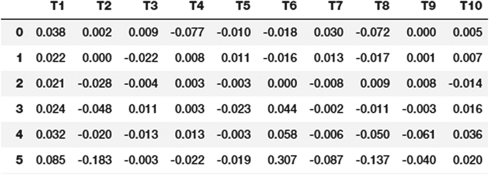
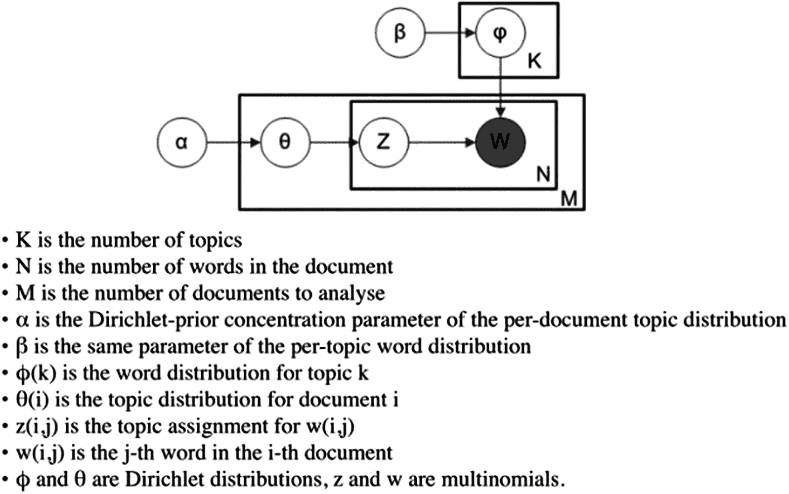
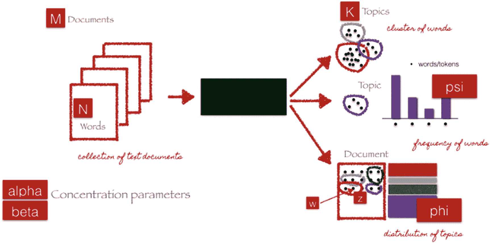
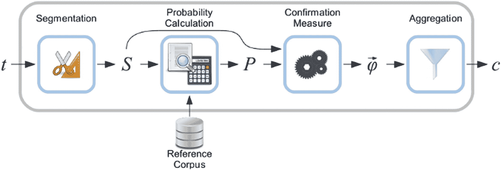
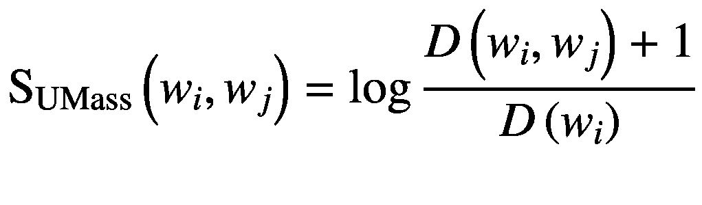
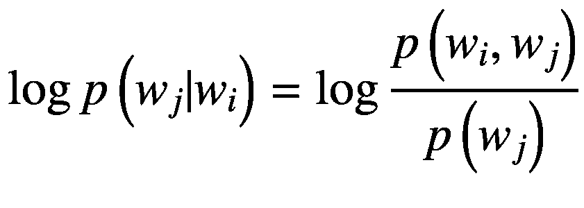

# 使用 Gensim 进行主题建模

Gensim 框架的核心标语是“面向人类主题建模”，这清楚地表明该框架专为主题建模而设计。我们可以利用该框架完成许多令人惊叹的工作，包括文本相似度分析、语义分析、主题建模和文本摘要。此外，与 Scikit-Learn 相比，Gensim 在构建、评估和调优主题模型方面提供了更多功能和更高的灵活性，我们很快就会看到这一点。在本节中，我们将使用以下方法构建主题模型。

*   潜在语义索引 (LSI)
*   潜在狄利克雷分配 (LDA)

话不多说，让我们从生成带有影响力二元词组的方法开始，并在特征工程之前删除一些可能无用的术语。

### 基于特征工程的文本表示

在特征工程和向量化之前，我们希望从研究论文中提取一些有用的基于二元词组的短语，并删除一些不必要的术语。为此，我们利用了非常有用的 `gensim.models.Phrases` 类。此功能有助于我们从句子流中自动检测常见短语，这些短语通常是多词表达/词元组。此实现的灵感源自 Mikolov 等人著名的论文《词语和短语的分布式表示及其组合性》，你可以在 [`https://arxiv.org/abs/1310.4546`](https://arxiv.org/abs/1310.4546) 查看该论文。我们首先为每一篇经过分词处理的研究论文提取并生成单词和二元词组作为短语。我们可以使用以下代码轻松构建此短语生成模型，并在示例论文上进行测试。

```
import gensim
bigram = gensim.models.Phrases(norm_papers, min_count=20, threshold=20, delimiter=b'_') # 阈值越高，短语越少。
bigram_model = gensim.models.phrases.Phraser(bigram)
# 示例演示
print(bigram_model[norm_papers[0]][:50])
['scaling', 'property', 'coarse_coded', 'symbol', 'memory', 'ronald', 'rosenfeld', 'david_touretzky', 'computer_science', 'department', 'carnegie_mellon', 'university_pittsburgh', 'pennsylvania', 'abstract', 'coarse_coded', 'symbol', 'memory', 'appeared', 'several', 'neural_network', 'symbol', 'processing', 'model', 'order', 'determine', 'model', 'would', 'scale', 'one', 'must', 'first', 'understanding', 'mathematics', 'coarse_coded', 'representa_tions', 'define', 'general', 'structure', 'coarse_coded', 'symbol', 'memory', 'derive', 'mathematical', 'relationship', 'among', 'essential', 'parameter', 'memor', 'size', 'lmbol']
```

我们可以清晰地看到，输出中包含单个单词以及二元词组（由下划线分隔的两个单词），这表明我们的模型运行正常。我们利用了 `min_count` 参数，它告诉模型要忽略在整个语料库（以分词句子列表形式输入的论文）中总出现次数低于 20 的所有单词和二元词组。我们还使用了阈值 20，它告诉模型根据此阈值接受特定的短语，因此，如果短语 `a` 后跟 `b` 的得分大于阈值 20，则该短语被接受。此阈值依赖于评分参数，有助于我们理解这些短语的评分方式，从而了解它们的影响力。

通常使用默认评分器，并且它非常易于理解。你可以在文档 [`https://radimrehurek.com/gensim/models/phrases.html#gensim.models.phrases.original_scorer`](https://radimrehurek.com/gensim/models/phrases.html#gensim.models.phrases.original_scorer) 以及前面提到的研究论文中查看更多详细信息。

让我们为所有分词后的研究论文生成短语，并构建一个词汇表，这将有助于我们将唯一的术语/短语映射到数字编号（因为机器学习或深度学习只能处理数值张量）。

```
norm_corpus_bigrams = [bigram_model[doc] for doc in norm_papers]
# 创建文档的字典表示。
dictionary = gensim.corpora.Dictionary(norm_corpus_bigrams)
print('单词到编号的映射示例：', list(dictionary.items())[:15])
print('词汇表总大小：', len(dictionary))
单词到编号的映射示例： [(0, '8a'), (1, 'abandon'), (2, 'able'), (3, 'abo'), (4, 'abstract'), (5, 'accommodate'), (6, 'accuracy'), (7, 'achieved'), (8, 'acknowledgment_thank'), (9, 'across'), (10, 'active'), (11, 'activity'), (12, 'actual'), (13, 'adjusted'), (14, 'adjusting')]
词汇表总大小： 78892
```

哇！根据上述输出，我们的研究论文语料库中似乎包含大量独特的短语。其中许多术语用处不大，因为它们特定于某篇论文甚至论文中的某个段落。因此，是时候修剪我们的词汇表并开始删除术语了。利用文档频率是实现这一目标的好方法。到现在，你可能已经意识到，一个术语的文档频率基本上就是该术语在整个语料库所有文档中出现的总次数。

```
# 过滤掉出现在少于 20 个文档中，或多于 50% 的文档中的词。
dictionary.filter_extremes(no_below=20, no_above=0.6)
print('词汇表总大小：', len(dictionary))
词汇表总大小： 7756
```

我们删除了所有在整个语料库中出现次数少于 20 次以及出现在超过 60% 文档中的所有术语。我们的目标是发现不同的主题和话题，而不是重复出现的主题。因此，这完全符合我们的需求。现在，我们可以通过使用简单的词袋模型来进行特征工程。

```
# 将语料库转换为词袋向量
bow_corpus = [dictionary.doc2bow(text) for text in norm_corpus_bigrams]
print(bow_corpus[1][:50])
[(4, 1), (14, 2), (20, 1), (28, 1), (33, 1), (43, 1), (50, 1), (60, 2), (61, 1), (62, 2), (63, 1), (72, 1), (84, 1), ..., (286, 39), (296, 6), (306, 1), (307, 2), (316, 1)]
# 查看实际的术语及其计数
print([(dictionary[idx] , freq) for idx, freq in bow_corpus[1][:50]])
[('achieved', 1), ('allow', 2), ('american_institute', 1), ('another', 1), ('appeared', 1), ('argument', 1), ('assume', 1), ('become', 2), ('becomes', 1), ('behavior', 2), ('behavioral', 1), ('bounded', 1), ('cause', 1), ..., ('group', 39), ('hence', 6), ('implementation', 1), ('implemented', 2), ('independent', 1)]
# 语料库中的论文总数
print('论文总数：', len(bow_corpus))
论文总数： 1740
```

我们的文档现已处理完毕，并通过词袋模型获得了足够好的表示形式，可以开始建模了。

### 潜在语义索引

我们的第一种技术是潜在语义索引 (LSI)，它于 20 世纪 70 年代开发，是一种用于关联语料库中语义相关术语的统计技术。LSI 不仅用于文本摘要，还用于信息检索和搜索。LSI 使用了非常流行的奇异值分解 (SVD) 技术，我们在“重要概念”部分详细讨论过该技术。LSI 背后的主要原理是，相似的术语往往在相同的上下文中使用，因此共现频率更高。LSI 这个名称来源于该技术能够揭示潜在的、隐藏的、在语义上相互关联以形成主题的术语。

我们现在利用 Gensim 实现 LSI，并从我们的 NIPS 研究论文语料库中提取主题。得益于 Gensim 简洁明了的 API，构建此模型相当简单。

```
%%time
TOTAL_TOPICS = 10
lsi_bow = gensim.models.LsiModel(bow_corpus, id2word=dictionary, num_topics=TOTAL_TOPICS, onepass=True, chunksize=1740, power_iters=1000)
CPU times: user 54min 30s, sys: 3min 21s, total: 57min 51s
Wall time: 3min 51s
```

模型构建完成后，我们可以使用以下代码查看语料库中的主要主题或思路。请记住，我们在此处显式地将主题数量设置为 10。


```
for topic_id, topic in lsi_bow.print_topics(num_topics=10, num_words=20):
    print('Topic #'+str(topic_id+1)+':')
    print(topic)
    print()
Topic #1:
0.215*"unit" + 0.212*"state" + 0.187*"training" + 0.177*"neuron" + 0.162*"pattern" + 0.145*"image" + 0.140*"vector" + 0.125*"feature" + 0.122*"cell" + 0.110*"layer" + 0.101*"task" + 0.097*"class" + 0.091*"probability" + 0.089*"signal" + 0.087*"step" + 0.086*"response" + 0.085*"representation" + 0.083*"noise" + 0.082*"rule" + 0.081*"distribution"
Topic #2:
-0.487*"neuron" + -0.396*"cell" + 0.257*"state" + -0.191*"response" + 0.187*"training" + -0.170*"stimulus" + -0.117*"activity" + 0.109*"class" + -0.099*"spike" + -0.097*"pattern" + -0.096*"circuit" + -0.096*"synaptic" + 0.095*"vector" + -0.090*"signal" + -0.090*"firing" + -0.088*"visual" + 0.084*"classifier" + 0.083*"action" + 0.078*"word" + -0.078*"cortical"
Topic #3:
-0.627*"state" + 0.395*"image" + -0.219*"neuron" + 0.209*"feature" + -0.188*"action" + 0.137*"unit" + 0.131*"object" + -0.130*"control" + 0.129*"training" + -0.109*"policy" + 0.103*"classifier" + 0.090*"class" + -0.081*"step" + -0.081*"dynamic" + 0.080*"classification" + 0.078*"layer" + 0.076*"recognition" + -0.074*"reinforcement_learning" + 0.069*"representation" + 0.068*"pattern"
Topic #4:
-0.686*"unit" + 0.433*"image" + -0.182*"pattern" + -0.131*"layer" + -0.123*"hidden_unit" + -0.121*"net" + -0.114*"training" + 0.112*"feature" + -0.109*"activation" + -0.107*"rule" + 0.097*"neuron" + -0.078*"word" + 0.070*"pixel" + -0.070*"connection" + 0.067*"object" + 0.065*"state" + 0.060*"distribution" + 0.059*"face" + -0.057*"architecture" + 0.055*"estimate"
Topic #5:
-0.428*"image" + -0.348*"state" + 0.266*"neuron" + -0.264*"unit" + 0.181*"training" + 0.174*"class" + -0.168*"object" + 0.167*"classifier" + -0.147*"action" + -0.122*"visual" + 0.117*"vector" + 0.115*"node" + 0.105*"distribution" + -0.103*"motion" + -0.099*"feature" + 0.097*"classification" + -0.097*"control" + -0.095*"task" + -0.087*"cell" + -0.083*"representation"
Topic #6:
0.660*"cell" + -0.508*"neuron" + -0.213*"image" + -0.103*"chip" + -0.097*"unit" + 0.093*"response" + -0.090*"object" + 0.083*"rat" + 0.076*"distribution" + -0.070*"circuit" + 0.069*"probability" + 0.064*"stimulus" + -0.061*"memory" + -0.058*"analog" + -0.058*"activation" + 0.055*"class" + -0.053*"bit" + -0.052*"net" + 0.051*"cortical" + 0.050*"firing"
Topic #7:
-0.353*"word" + 0.281*"unit" + -0.272*"training" + -0.257*"classifier" + -0.177*"recognition" + 0.159*"distribution" + -0.152*"feature" + -0.144*"state" + -0.142*"pattern" + 0.141*"vector" + -0.128*"cell" + -0.128*"task" + 0.122*"approximation" + 0.121*"variable" + 0.110*"equation" + -0.107*"classification" + 0.106*"noise" + -0.103*"class" + 0.101*"matrix" + -0.098*"neuron"
Topic #8:
-0.303*"pattern" + 0.243*"signal" + 0.236*"control" + 0.202*"training" + -0.181*"rule" + -0.178*"state" + 0.167*"noise" + -0.166*"class" + 0.162*"word" + -0.155*"cell" + -0.154*"feature" + 0.147*"motion" + 0.140*"task" + -0.127*"node" + -0.124*"neuron" + 0.116*"target" + 0.114*"circuit" + -0.114*"probability" + -0.110*"classifier" + -0.109*"image"
Topic #9:
-0.472*"node" + -0.254*"circuit" + 0.214*"word" + -0.201*"chip" + 0.190*"neuron" + 0.172*"stimulus" + -0.160*"classifier" + -0.152*"current" + 0.147*"feature" + -0.146*"voltage" + 0.145*"distribution" + -0.141*"control" + -0.124*"rule" + -0.110*"layer" + -0.105*"analog" + -0.091*"tree" + 0.084*"response" + 0.080*"state" + 0.079*"probability" + 0.079*"estimate"
Topic #10:
0.518*"word" + -0.254*"training" + 0.236*"vector" + -0.222*"task" + -0.194*"pattern" + -0.156*"classifier" + 0.149*"node" + 0.146*"recognition" + -0.139*"control" + 0.138*"sequence" + -0.126*"rule" + 0.125*"circuit" + 0.123*"cell" + -0.113*"action" + -0.105*"neuron" + 0.094*"hmm" + 0.093*"character" + 0.088*"chip" + 0.088*"matrix" + 0.085*"structure"
```

让我们花点时间来理解这些结果。简单回顾一下 LSI 模型——它基于这样一个原理：在相同上下文中使用的词语往往具有相似的含义。你可以在输出中观察到，每个主题都是词语（它们基本上倾向于传达该主题的整体含义）和权重的组合。现在这里的问题是我们同时拥有正权重和负权重。这意味着什么？

根据已有的研究以及我的解读，由于我们正在将维度降低到基于主题数量的 10 维空间，每个词语上的符号表示特定主题在向量空间中的一个方向或朝向。权重越高，贡献越重要。因此，相似的相关词语具有相同的符号或方向。所以，一个主题完全有可能根据词语的符号或方向包含两个不同的子主题。让我们分离这些词语并再次尝试解读这些主题。

```
for n in range(TOTAL_TOPICS):
    print('Topic #'+str(n+1)+':')
    print('='*50)
    d1 = []
    d2 = []
    for term, wt in lsi_bow.show_topic(n, topn=20):
        if wt >= 0:
            d1.append((term, round(wt, 3)))
        else:
            d2.append((term, round(wt, 3)))
    print('Direction 1:', d1)
    print('-'*50)
    print('Direction 2:', d2)
    print('-'*50)
    print()
Topic #1:
==================================================
Direction 1: [('unit', 0.215), ('state', 0.212), ('training', 0.187), ('neuron', 0.177), ('pattern', 0.162), ('image', 0.145), ('vector', 0.14), ('feature', 0.125), ('cell', 0.122), ('layer', 0.11), ('task', 0.101), ('class', 0.097), ('probability', 0.091), ('signal', 0.089), ('step', 0.087), ('response', 0.086), ('representation', 0.085), ('noise', 0.083), ('rule', 0.082), ('distribution', 0.081)]

Direction 2: []

Topic #2:
==================================================
Direction 1: [('state', 0.257), ('training', 0.187), ('class', 0.109), ('vector', 0.095), ('classifier', 0.084), ('action', 0.083), ('word', 0.078)]

Direction 2: [('neuron', -0.487), ('cell', -0.396), ('response', -0.191), ('stimulus', -0.17), ('activity', -0.117), ('spike', -0.099), ('pattern', -0.097), ('circuit', -0.096), ('synaptic', -0.096), ('signal', -0.09), ('firing', -0.09), ('visual', -0.088), ('cortical', -0.078)]

Topic #3:
==================================================
Direction 1: [('image', 0.395), ('feature', 0.209), ('unit', 0.137), ('object', 0.131), ('training', 0.129), ('classifier', 0.103), ('class', 0.09), ('classification', 0.08), ('layer', 0.078), ('recognition', 0.076), ('representation', 0.069), ('pattern', 0.068)]

Direction 2: [('state', -0.627), ('neuron', -0.219), ('action', -0.188), ('control', -0.13), ('policy', -0.109), ('step', -0.081), ('dynamic', -0.081), ('reinforcement_learning', -0.074)]

Topic #4:
==================================================
Direction 1: [('image', 0.433), ('feature', 0.112), ('neuron', 0.097), ('pixel', 0.07), ('object', 0.067), ('state', 0.065), ('distribution', 0.06), ('face', 0.059), ('estimate', 0.055)]

Direction 2: [('unit', -0.686), ('pattern', -0.182), ('layer', -0.131), ('hidden_unit', -0.123), ('net', -0.121), ('training', -0.114), ('activation', -0.109), ('rule', -0.107), ('word', -0.078), ('connection', -0.07), ('architecture', -0.057)]

Topic #5:
==================================================
Direction 1: [('neuron', 0.266), ('training', 0.181), ('class', 0.174), ('classifier', 0.167), ('vector', 0.117), ('node', 0.115), ('distribution', 0.105), ('classification', 0.097)]

Direction 2: [('image', -0.428), ('state', -0.348), ('unit', -0.264), ('object', -0.168), ('action', -0.147), ('visual', -0.122), ('motion', -0.103), ('feature', -0.099), ('control', -0.097), ('task', -0.095), ('cell', -0.087), ('representation', -0.083)]
```


### 主题 #6

方向 1：`[('cell', 0.66), ('response', 0.093), ('rat', 0.083), ('distribution', 0.076), ('probability', 0.069), ('stimulus', 0.064), ('class', 0.055), ('cortical', 0.051), ('firing', 0.05)]`

方向 2：`[('neuron', -0.508), ('image', -0.213), ('chip', -0.103), ('unit', -0.097), ('object', -0.09), ('circuit', -0.07), ('memory', -0.061), ('analog', -0.058), ('activation', -0.058), ('bit', -0.053), ('net', -0.052)]`

### 主题 #7

方向 1：`[('unit', 0.281), ('distribution', 0.159), ('vector', 0.141), ('approximation', 0.122), ('variable', 0.121), ('equation', 0.11), ('noise', 0.106), ('matrix', 0.101)]`

方向 2：`[('word', -0.353), ('training', -0.272), ('classifier', -0.257), ('recognition', -0.177), ('feature', -0.152), ('state', -0.144), ('pattern', -0.142), ('cell', -0.128), ('task', -0.128), ('classification', -0.107), ('class', -0.103), ('neuron', -0.098)]`

### 主题 #8

方向 1：`[('signal', 0.243), ('control', 0.236), ('training', 0.202), ('noise', 0.167), ('word', 0.162), ('motion', 0.147), ('task', 0.14), ('target', 0.116), ('circuit', 0.114)]`

方向 2：`[('pattern', -0.303), ('rule', -0.181), ('state', -0.178), ('class', -0.166), ('cell', -0.155), ('feature', -0.154), ('node', -0.127), ('neuron', -0.124), ('probability', -0.114), ('classifier', -0.11), ('image', -0.109)]`

### 主题 #9

方向 1：`[('word', 0.214), ('neuron', 0.19), ('stimulus', 0.172), ('feature', 0.147), ('distribution', 0.145), ('response', 0.084), ('state', 0.08), ('probability', 0.079), ('estimate', 0.079)]`

方向 2：`[('node', -0.472), ('circuit', -0.254), ('chip', -0.201), ('classifier', -0.16), ('current', -0.152), ('voltage', -0.146), ('control', -0.141), ('rule', -0.124), ('layer', -0.11), ('analog', -0.105), ('tree', -0.091)]`

### 主题 #10

方向 1：`[('word', 0.518), ('vector', 0.236), ('node', 0.149), ('recognition', 0.146), ('sequence', 0.138), ('circuit', 0.125), ('cell', 0.123), ('hmm', 0.094), ('character', 0.093), ('chip', 0.088), ('matrix', 0.088), ('structure', 0.085)]`

方向 2：`[('training', -0.254), ('task', -0.222), ('pattern', -0.194), ('classifier', -0.156), ('control', -0.139), ('rule', -0.126), ('action', -0.113), ('neuron', -0.105)]`

这样是否更好？嗯，这肯定比之前的解释好多了。在这里，我们可以清晰地看到与芯片和电子设备中建模、分类与识别模型、讨论人脑组件（如细胞、刺激、神经元、皮层成分）的神经模型，甚至还有关于强化学习的主题！我们稍后将更系统化地深入探讨这些内容。

现在，让我们尝试从主题模型中获取三个主要的矩阵（`U`、`S` 和 `VT`），该模型使用了 SVD（基于前面提到的基础概念）。

```
term_topic = lsi_bow.projection.u
singular_values = lsi_bow.projection.s
topic_document = (gensim.matutils.corpus2dense(lsi_bow[bow_corpus], len(singular_values)).T / singular_values).T
term_topic.shape, singular_values.shape, topic_document.shape
((7756, 10), (10,), (10, 1740))
```

正如上述输出所示，我们得到了一个词项-主题矩阵、奇异值矩阵和一个主题-文档矩阵。我们可以对主题-文档矩阵进行转置，形成文档-主题矩阵，这有助于我们查看每个主题在每个文档中所占的比例（比例越大，说明该主题在文档中越占主导地位）。请参见图 6-2。



**图 6-2** 我们 LSI 模型生成的文档-主题矩阵

```
document_topics = pd.DataFrame(np.round(topic_document.T, 3),
columns=['T'+str(i) for i in range(1, TOTAL_TOPICS+1)])
document_topics.head(5)
```

忽略符号，我们可以尝试找出几篇示例论文中最重要的主题，并验证其合理性。

```
document_numbers = [13, 250, 500]
for document_number in document_numbers:
top_topics = list(document_topics.columns[np.argsort(-
np.absolute(
document_topics.iloc[document_number].values))[:3]])
print('文档 #'+str(document_number)+':')
print('主导主题（前 3 个）：', top_topics)
print('论文摘要：')
print(papers[document_number][:500])
print()
文档 #13:
主导主题（前 3 个）： ['T6', 'T1', 'T2']
论文摘要：

随机学习网络及其电子实现
Joshua Alspector*, Robert B. Allen, Victor Hut, 以及 Srinagesh Satyanarayana
贝尔通信研究公司，莫里斯敦，新泽西州 07960
摘要
我们描述了一系列学习算法，这些算法运行在一个递归、对称连接的神经形态网络上，类似于玻尔兹曼机，能在存在噪声的情况下达到稳定状态。这些网络通过基于局部观察到的相关性来修改突触连接强度进行学习。
文档 #250:
主导主题（前 3 个）： ['T3', 'T5', 'T8']
论文摘要：
266 Zemel, Mozer 和 Hinton
交通：利用
分层参考框架变换识别对象
Richard S. Zemel
计算机科学系
多伦多大学
...
摘要
我们描述了一个模型，该模型能够识别未分割图像中的二维形状，且与它们的取向无关。
文档 #500:
主导主题（前 3 个）： ['T9', 'T8', 'T10']
论文摘要：
模拟电路参数
设定问题的约束优化
David Kirk, Kurt Fleischer, Lloyd Watts, Alan Bart
计算机图形学 350-74
加州理工学院
摘要
我们使用约束优化来为两个电路选择工作参数：一个简单的三晶体管平方根电路，以及一个模拟 VLSI 人工耳蜗。这种自动化方法使用计算机控制的测量和测试设备来选取芯片参数。
```

如果你查看上述输出中每个所选主题的术语描述，会发现它们非常合理。

-   论文 #13 的主导主题是 6、1 和 2，这些主题主要讨论神经元、细胞、大脑皮层、刺激等方面（围绕神经形态网络的话题）。
-   论文 #250 的主导主题是 3、5 和 8，这些主题讨论对象识别、图像分类以及基于神经网络的可视化表示。这与论文中关于对象识别的主题相符。
-   论文 #500 的主导主题是 9、8 和 10，这些主题讨论信号、电压、芯片、电路等。这与论文中关于模拟电路参数设置的主题一致。

这表明 LSI 模型相当有效，尽管基于正负权重进行解释稍微有点困难，这常常会让人感到困惑。


好的，作为一名高级文档工程师和翻译员，我将严格遵循您提供的注意事项和示例，将给定的英文文本翻译成中文。


### 从头实现 LSI 主题模型

基于我们之前提到的，LSI 模型的核心涉及奇异值分解（`SVD`）。在这里，我们尝试使用低秩`SVD`从头实现一个 LSI 主题模型。`SVD`的第一步是获取源矩阵，通常是一个词项-文档矩阵。我们可以通过将稀疏的词袋表示转换为稠密矩阵，从`Gensim`中获取它。

```python
td_matrix = gensim.matutils.corpus2dense(corpus=bow_corpus, num_terms=len(dictionary))
print(td_matrix.shape)
td_matrix
(7756, 1740)
array([[1., 0., 1., ..., 0., 2., 1.],
[1., 0., 1., ..., 1., 1., 0.],
[1., 0., 0., ..., 0., 0., 0.],
...,
[0., 0., 0., ..., 0., 0., 0.],
[0., 0., 0., ..., 0., 0., 0.],
[0., 0., 0., ..., 0., 0., 0.]], dtype=float32)
```

一切似乎都井然有序，因此我们可以使用以下代码来验证我们的词汇表，以确保一切正确无误。

```python
vocabulary = np.array(list(dictionary.values()))
print('Total vocabulary size:', len(vocabulary))
vocabulary
Total vocabulary size: 7756
array(['able', 'abstract', 'accommodate', ..., 'support_vector',
'mozer_jordan', 'kearns_solla'], dtype='<U28')
```

现在，我们利用以下代码片段对我们的词项-文档矩阵执行低秩`SVD`。

```python
from scipy.sparse.linalg import svds
u, s, vt = svds(td_matrix, k=TOTAL_TOPICS, maxiter=10000)
term_topic = u
singular_values = s
topic_document = vt
term_topic.shape, singular_values.shape, topic_document.shape
((7756, 10), (10,), (10, 1740))
```

获取每个主题中每个词项的权重（方向和重要性）也非常简单。以下代码帮助我们进行计算。

```python
tt_weights = term_topic.transpose() * singular_values[:, None]
tt_weights.shape
(10, 7756)
```

现在，我们可以通过以下代码轻松查看我们的 10 个主题及其影响力最大的词项。

```python
top_terms = 20
topic_key_term_idxs = np.argsort(-np.absolute(tt_weights), axis=1)[:, :top_terms]
topic_keyterm_weights = np.array([tt_weights[row, columns]
for row, columns in list(zip(np.arange(TOTAL_TOPICS), topic_key_term_idxs))])
topic_keyterms = vocabulary[topic_key_term_idxs]
topic_keyterms_weights = list(zip(topic_keyterms, topic_keyterm_weights))
for n in range(TOTAL_TOPICS):
    print('Topic #'+str(n+1)+':')
    print('='*50)
    d1 = []
    d2 = []
    terms, weights = topic_keyterms_weights[n]
    term_weights = sorted([(t, w) for t, w in zip(terms, weights)],
                          key=lambda row: -abs(row[1]))
    for term, wt in term_weights:
        if wt >= 0:
            d1.append((term, round(wt, 3)))
        else:
            d2.append((term, round(wt, 3)))
    print('Direction 1:', d1)
    print('-'*50)
    print('Direction 2:', d2)
    print('-'*50)
    print()
Topic #1:
==================================================
Direction 1: [('training', 92.618), ('task', 80.732), ('pattern', 70.619), ('classifier', 56.989), ('control', 50.677), ('rule', 45.926), ('action', 41.202), ('neuron', 38.193)]

Direction 2: [('word', -188.488), ('vector', -85.973), ('node', -54.376), ('recognition', -53.232), ('sequence', -50.351), ('circuit', -45.394), ('cell', -44.811), ('hmm', -34.086), ('character', -34.022), ('chip', -32.16), ('matrix', -32.093), ('structure', -30.993)]

Topic #2:
==================================================
Direction 1: [('word', 78.347), ('neuron', 69.793), ('stimulus', 63.234), ('feature', 53.819), ('distribution', 53.119), ('response', 30.954), ('state', 29.343), ('probability', 29.099), ('estimate', 28.908)]

Direction 2: [('node', -173.277), ('circuit', -93.0), ('chip', -73.593), ('classifier', -58.717), ('current', -55.844), ('voltage', -53.489), ('control', -51.708), ('rule', -45.293), ('layer', -40.265), ('analog', -38.344), ('tree', -33.483)]

Topic #3:
==================================================
Direction 1: [('pattern', 116.971), ('rule', 69.783), ('state', 68.605), ('class', 64.259), ('cell', 59.979), ('feature', 59.606), ('node', 49.175), ('neuron', 47.998), ('probability', 43.812), ('classifier', 42.612), ('image', 42.061)]

Direction 2: [('signal', -93.805), ('control', -91.041), ('training', -77.88), ('noise', -64.397), ('word', -62.392), ('motion', -56.699), ('task', -53.883), ('target', -44.765), ('circuit', -44.129)]

Topic #4:
==================================================
Direction 1: [('unit', 117.727), ('distribution', 66.719), ('vector', 58.881), ('approximation', 50.931), ('variable', 50.83), ('equation', 46.229), ('noise', 44.247), ('matrix', 42.214)]

Direction 2: [('word', -147.792), ('training', -113.693), ('classifier', -107.386), ('recognition', -73.948), ('feature', -63.454), ('state', -60.126), ('pattern', -59.562), ('cell', -53.768), ('task', -53.693), ('classification', -44.936), ('class', -43.161), ('neuron', -41.092)]

Topic #5:
==================================================
Direction 1: [('neuron', 220.116), ('image', 92.39), ('chip', 44.422), ('unit', 41.922), ('object', 39.001), ('circuit', 30.444), ('memory', 26.475), ('analog', 25.207), ('activation', 24.953), ('bit', 22.997), ('net', 22.699)]

Direction 2: [('cell', -285.803), ('response', -40.216), ('rat', -35.975), ('distribution', -33.085), ('probability', -29.79), ('stimulus', -27.789), ('class', -24.02), ('cortical', -22.185), ('firing', -21.66)]

Topic #6:
==================================================
Direction 1: [('image', 209.793), ('state', 170.207), ('unit', 129.108), ('object', 82.185), ('action', 72.136), ('visual', 59.502), ('motion', 50.605), ('feature', 48.665), ('control', 47.427), ('task', 46.496), ('cell', 42.366), ('representation', 40.564)]

Direction 2: [('neuron', -130.053), ('training', -88.668), ('class', -85.213), ('classifier', -81.921), ('vector', -57.532), ('node', -56.341), ('distribution', -51.622), ('classification', -47.645)]

Topic #7:
==================================================
Direction 1: [('image', 215.858), ('feature', 55.647), ('neuron', 48.494), ('pixel', 35.095), ('object', 33.585), ('state', 32.544), ('distribution', 29.977), ('face', 29.256), ('estimate', 27.555)]

Direction 2: [('unit', -341.829), ('pattern', -90.771), ('layer', -65.337), ('hidden_unit', -61.12), ('net', -60.035), ('training', -56.742), ('activation', -54.268), ('rule', -53.377), ('word', -38.903), ('connection', -34.618), ('architecture', -28.439)]

Topic #8:
==================================================
Direction 1: [('image', 229.287), ('feature', 121.397), ('unit', 79.44), ('object', 76.204), ('training', 75.152), ('classifier', 59.872), ('class', 52.527), ('classification', 46.696), ('layer', 45.149), ('recognition', 44.192), ('representation', 40.179), ('pattern', 39.252)]

Direction 2: [('state', -364.388), ('neuron', -127.022), ('action', -109.245), ('control', -75.369), ('policy', -63.103), ('step', -47.226), ('dynamic', -46.907), ('reinforcement_learning', -42.747)]

Topic #9:
==================================================
Direction 1: [('neuron', 306.151), ('cell', 249.243), ('response', 119.758), ('stimulus', 106.762), ('activity', 73.499), ('spike', 62.039), ('pattern', 60.957), ('circuit', 60.602), ('synaptic', 60.282), ('signal', 56.665), ('firing', 56.597), ('visual', 55.571), ('cortical', 48.867)]

Direction 2: [('state', -161.465), ('training', -117.32), ('class', -68.732), ('vector', -59.558), ('classifier', -52.589), ('action', -52.113), ('word', -49.239)]

Topic #10:
==================================================
Direction 1: []

Direction 2: [('unit', -260.793), ('state', -258.146), ('training', -227.312), ('neuron', -215.681), ('pattern', -197.232), ('image', -175.735), ('vector', -170.154), ('feature', -151.547), ('cell', -148.138), ('layer', -133.593), ('task', -122.389), ('class', -117.849), ('probability', -110.526), ('signal', -108.232), ('step', -105.202), ('response', -104.465), ('representation', -103.255), ('noise', -100.573), ('rule', -99.611), ('distribution', -98.973)]


请注意，尽管主题编号有所变动，但它们与先前由 `Gensim` 输出的主题模型结果高度吻合！您还可以尝试使用以下代码，从示例论文中提取有影响力的主题。

```
document_topics = pd.DataFrame(np.round(topic_document.T, 3),
columns=['T'+str(i) for i in range(1, TOTAL_TOPICS+1)])
document_numbers = [13, 250, 500]
for document_number in document_numbers:
top_topics = list(document_topics.columns[np.argsort(-
np.absolute(
document_topics.iloc[document_number].values))[:3]])
print('Document #'+str(document_number)+':')
print('Dominant Topics (top 3):', top_topics)
print('Paper Summary:')
print(papers[document_number][:500])
print()
```

```
Document #13:
Dominant Topics (top 3): ['T5', 'T10', 'T9']
Paper Summary:

Stochastic Learning Networks and their Electronic Implementation
Joshua Alspector*, Robert B. Allen, Victor Hut, and Srinagesh Satyanarayana
Bell Communications Research, Morristown, NJ 07960
ABSTRACT
We describe a family of learning algorithms that operate on a recurrent, symmetrically connected, neuromorphic network that, like the Boltzmann machine
Document #250:
Dominant Topics (top 3): ['T6', 'T8', 'T3']
Paper Summary:
266 Zemel, Mozer and Hinton
TRAFFIC: Recognizing Objects Using
Hierarchical Reference Frame Transformations
Richard S. Zemel
Computer Science Dept.
University of Toronto
...
ABSTRACT
We describe a model that can recognize two-dimensional shapes in
an unsegmented image, independent of their orie
Document #500:
Dominant Topics (top 3): ['T2', 'T3', 'T1']
Paper Summary:
Constrained Optimization Applied to the
Parameter Setting Problem for Analog Circuits
David Kirk, Kurt Fleischer, Lloyd Watts, Alan Bart
...
Abstract
We use constrained optimization to select operating parameters for two
circuits: a simple 3-transistor square root circuit, and an analog VLSI
artificial cochlea.
```

我们可以清晰地观察到，尽管主题编号发生了变化（因为它们是基于我们的新模型而重新排列的），但每个主题所涉及的核心主题与之前获得的结果高度匹配。显然，`SVD` 是一种非常强大的数学运算，在文档摘要部分，我们将看到更多它的应用！

### 潜在狄利克雷分配

潜在狄利克雷分配（LDA）技术是一种生成式概率模型，其中每个文档被认为包含多个主题的组合，类似于概率潜在语义索引模型。在这种情况下，潜在主题上存在一个狄利克雷先验分布。该技术背后的数学原理相当复杂，因此我们将尝试对其进行总结，因为深入具体细节超出了当前讨论范围。我们推荐读者阅读由 Christine Doig 在 [`http://chdoig.github.io/pygotham-topic-modeling/#/`](http://chdoig.github.io/pygotham-topic-modeling/#/) 上所做的精彩演讲，我们将从中借鉴一些优秀的图示。LDA 模型的板式表示法如图 6-3 所示。



图 6-3

LDA 板式表示法（图片由 C. Doug 提供，源自《Python 主题建模入门》）

关于图 6-3 的更多详细信息，请参阅维基百科官方网站上的文章 [`https://en.wikipedia.org/wiki/Latent_Dirichlet_allocation`](https://en.wikipedia.org/wiki/Latent_Dirichlet_allocation)，其中详细讨论了这些参数。图 6-3 很好地展示了每个参数如何与文本文档和词汇项相关联。该模型假定我们有 **M** 篇文档，文档中有 **N** 个词汇，并要生成 **K** 个主题。



图 6-4

端到端 LDA 框架（图片由 C. Doug 提供，源自《Python 主题建模入门》）

图 6-4 中的黑盒代表了核心算法，它使用前面提及的参数从文档中提取 **K** 个主题。以下步骤给出了该算法运行过程的极简说明，方便大家理解。

1.  初始化必要的参数。

2.  对于每篇文档，将每个词汇随机初始化为 **K** 个主题之一。

3.  开始如下迭代过程，并重复多次。对于每篇文档 **D**，文档中的每个词汇 **W**，以及每个主题 **T**：
    *   计算 `P(T| D)`，即文档 **D** 中分配给主题 **T** 的词汇比例。

*   计算 `P(W| T)`，即所有包含词汇 **W** 的文档中，分配给主题 **T** 的比例。

*   以概率 `P(T| D) × P(W| T)` 将词汇 **W** 重新分配为主题 **T**，同时考虑所有其他词汇及其主题分配。

经过多次迭代后，我们就得到了每篇文档的主题混合分布，然后可以从指向某个主题的词汇项中生成该主题的构成要素。这里流行使用的方法被称为*折叠吉布斯采样*。在下面的实现中，我们使用 `Gensim` 基于论文语料库构建一个基于 LDA 的主题模型。

```
%%time
lda_model = gensim.models.LdaModel(corpus=bow_corpus, id2word=dictionary, chunksize=1740, alpha="auto", eta="auto", random_state=42, iterations=500, num_topics=TOTAL_TOPICS, passes=20, eval_every=None)
CPU times: user 5min 32s, sys: 10.7 s, total: 5min 43s
Wall time: 2min 31s
```

查看已训练好的主题模型中的主题非常容易，我们可以使用以下代码来生成它们。


```python
for topic_id, topic in lda_model.print_topics(num_topics=10, num_words=20):
    print('主题 #'+str(topic_id+1)+':')
    print(topic)
    print()
```
`主题 #1`:
`0.016*"训练" + 0.012*"分类器" + 0.007*"模式" + 0.007*"分类" + 0.006*"类别" + 0.006*"任务" + 0.006*"向量" + 0.005*"训练集" + 0.005*"特征" + 0.004*"控制" + 0.004*"规模" + 0.003*"已训练" + 0.003*"教师" + 0.003*"比率" + 0.003*"学生" + 0.003*"平均值" + 0.003*"机器人" + 0.003*"随机" + 0.003*"规则" + 0.003*"搜索"`

`主题 #2`:
`0.008*"向量" + 0.006*"方程" + 0.006*"矩阵" + 0.006*"神经元" + 0.005*"状态" + 0.005*"动态" + 0.005*"解" + 0.005*"单元" + 0.004*"节点" + 0.004*"模式" + 0.004*"线性" + 0.004*"令" + 0.003*"层" + 0.003*"收敛" + 0.003*"规则" + 0.003*"规模" + 0.003*"定理" + 0.003*"阈值" + 0.003*"记忆" + 0.003*"理论"`

`主题 #3`:
`0.017*"训练" + 0.011*"词" + 0.008*"识别" + 0.007*"已训练" + 0.006*"网络" + 0.006*"单元" + 0.006*"特征" + 0.006*"语音" + 0.006*"任务" + 0.005*"架构" + 0.005*"类别" + 0.005*"字符" + 0.004*"层" + 0.004*"分类" + 0.004*"上下文" + 0.004*"测试" + 0.004*"序列" + 0.004*"隐藏单元" + 0.004*"实验" + 0.004*"向量"`

`主题 #4`:
`0.017*"运动" + 0.009*"规则" + 0.008*"方向" + 0.007*"刺激" + 0.006*"速度" + 0.006*"任务" + 0.006*"人类" + 0.006*"单元" + 0.005*"位置" + 0.005*"目标" + 0.005*"受试者" + 0.005*"记忆" + 0.005*"预测" + 0.005*"方位" + 0.004*"概念" + 0.004*"场" + 0.004*"响应" + 0.004*"线索" + 0.004*"层" + 0.004*"手"`

`主题 #5`:
`0.008*"分布" + 0.005*"估计" + 0.005*"样本" + 0.005*"训练" + 0.005*"类别" + 0.005*"概率" + 0.005*"近似" + 0.004*"变量" + 0.004*"高斯" + 0.004*"线性" + 0.004*"向量" + 0.004*"先验" + 0.004*"噪声" + 0.004*"密度" + 0.004*"预测" + 0.003*"核函数" + 0.003*"方差" + 0.003*"混合" + 0.003*"边界" + 0.003*"回归"`

`主题 #6`:
`0.037*"状态" + 0.011*"动作" + 0.008*"步" + 0.008*"控制" + 0.007*"策略" + 0.006*"序列" + 0.006*"强化学习" + 0.005*"概率" + 0.005*"最优" + 0.004*"任务" + 0.004*"转移" + 0.004*"环境" + 0.003*"变量" + 0.003*"奖励" + 0.003*"随机" + 0.003*"目标" + 0.003*"机器" + 0.003*"当前" + 0.003*"控制器" + 0.003*"智能体"`

`主题 #7`:
`0.012*"电路" + 0.011*"信号" + 0.011*"芯片" + 0.009*"神经元" + 0.008*"电流" + 0.007*"电压" + 0.006*"模拟" + 0.006*"控制" + 0.005*"通道" + 0.004*"噪声" + 0.004*"神经" + 0.004*"比特" + 0.004*"实现" + 0.004*"源" + 0.003*"设计" + 0.003*"增益" + 0.003*"处理器" + 0.003*"突触" + 0.003*"设备" + 0.003*"阵列"`

`主题 #8`:
`0.021*"神经元" + 0.019*"细胞" + 0.009*"响应" + 0.007*"活动" + 0.007*"刺激" + 0.007*"模式" + 0.006*"尖峰" + 0.005*"突触" + 0.004*"皮层" + 0.004*"神经" + 0.004*"信号" + 0.004*"放电" + 0.004*"连接" + 0.004*"效应" + 0.004*"层" + 0.004*"等人" + 0.004*"皮质" + 0.003*"视觉" + 0.003*"模拟" + 0.003*"突触"`

`主题 #9`:
`0.032*"图像" + 0.012*"物体" + 0.012*"特征" + 0.006*"像素" + 0.006*"视觉" + 0.005*"表示" + 0.005*"人脸" + 0.005*"向量" + 0.004*"视角" + 0.004*"识别" + 0.004*"变换" + 0.004*"局部" + 0.003*"映射" + 0.003*"结构" + 0.003*"区域" + 0.003*"滤波器" + 0.003*"位置" + 0.003*"距离" + 0.003*"部分" + 0.003*"地点"`

`主题 #10`:
`0.030*"单元" + 0.009*"模式" + 0.007*"表示" + 0.007*"激活" + 0.006*"隐藏单元" + 0.006*"节点" + 0.006*"结构" + 0.006*"层" + 0.005*"活动" + 0.004*"连接" + 0.004*"任务" + 0.004*"组件" + 0.004*"映射" + 0.004*"规则" + 0.004*"架构" + 0.004*"信号" + 0.004*"层级" + 0.003*"响应" + 0.003*"连接主义" + 0.003*"训练"`

与 LSI 模型相比，这些主题明显更容易理解和解释，因为所有权重符号相同，能够告诉我们每个词在主题中的重要性。我们还可以查看模型的总体平均连贯性得分。

```python
topics_coherences = lda_model.top_topics(bow_corpus, topn=20)
avg_coherence_score = np.mean([item[1] for item in topics_coherences])
print('平均连贯性得分:', avg_coherence_score)
```
`平均连贯性得分: -1.0433305600965899`

主题连贯性本身就是一个复杂的话题，它可以在一定程度上用于衡量主题模型的质量。通常，如果一组陈述能够相互支持，则称其具有连贯性。主题模型是基于无监督学习的模型，它们在非结构化文本数据上进行训练，因此很难衡量输出结果的质量。关于主题连贯性框架的优质资源是 Michael Röder 等人的论文《探索主题连贯性度量空间》，您可以在[`http://svn.aksw.org/papers/2015/WSDM_Topic_Evaluation/public.pdf`](http://svn.aksw.org/papers/2015/WSDM_Topic_Evaluation/public.pdf)访问。同样的框架已在`Gensim`框架中以 Python 实现。Devashish 在[`https://rare-technologies.com/what-is-topic-coherence`](https://rare-technologies.com/what-is-topic-coherence)提供了详细的文章，他将这一简洁功能实现在了`Gensim`中！

我用他同样易于理解的类比来简要说明主题连贯性框架：假设我们有一个水源，水被分配给不同的人。要测量水质，我们必须依赖个别顾客的评价。现在假设我们有四个主要的配水枢纽，我们在四个水管上安装了一些设备，这些水管负责在每个枢纽中配水。这些设备帮助我们通过量化指标测量水质，从而节省了依赖主观评价的时间。现在将这个类比应用到主题模型中：水基本上就是我们从主题模型中获取的主题，而主题连贯性框架就是我们安装的设备，用于对主题质量进行定量评估。正如我们之前提到的研究论文所定义，这个连贯性框架是一个四阶段流水线，如图 6-5 所示。



**图 6-5** 主题模型的统一连贯性框架

图 6-5 所示的主题连贯性框架流水线中的四个主要阶段描述如下：

1. **分割：** 这一阶段类似于我们将水分成若干杯，假设每杯水的质量不同。在这里，主题中的单词被分成子集，并创建词语对。

2. **概率计算：** 测量每杯水的水量。概率计算或估计的方法定义了如何从底层数据中推导出概率。布尔文档估计通过用单词出现的文档数除以总文档数来估计单个单词的概率。类似地，两个单词的联合概率通过包含这两个单词的文档数除以总文档数来估计。布尔滑动窗口则使用滑动窗口来确定单词计数。


### 3. 确认度量

水杯中水的质量（基于某个指标）被测量，并根据其数量为每个杯子分配一个数值。在主题模型的背景下，确认度量接受一对单词或单词子集及其相应的概率，并计算条件词集对另一词的支持强度。通常有两种类型的度量——外部度量和内部度量。

- **直接或外部度量：** 最流行的一种是 `UCI` 度量。它使用点互信息（`PMI`）作为成对评分函数。在该研究论文中，他们提出了一种直接度量`C[p]`，该度量取得了最佳性能（详情见论文）。

- **间接或内部度量：** 间接确认度量声称能够捕捉到直接度量会遗漏的语义支持。最流行的度量之一是 `UMass` 度量，它使用以下评分函数：



其中`D(w)`是词`w`的文档频率。该评分本质上是经验条件对数概率：



通过对分子中的文档频率加 1 进行平滑处理。研究论文声称发现了一个新的度量`C[v]`，它是间接余弦度量、`NPMI`和布尔滑动窗口的组合，取得了最佳结果。该度量在 Gensim 中也可用。

### 4. 聚合

这是将这些质量数值以某种方式（例如，算术平均值）组合起来得出一个定量指标的环节。每个主题的所有子集词对的确认度量被聚合并给出一个单一的连贯性分数。就像我们在之前的输出（`UMass`度量）中得到平均连贯性分数为-1.04 一样。

这为你评估和调整主题模型提供了足够的背景信息。现在，让我们以更易于理解的格式查看我们的`LDA`主题模型输出。一种方法是将主题可视化为词项和权重的元组。

```
topics_with_wts = [item[0] for item in topics_coherences]
print('LDA Topics with Weights')
print('='*50)
for idx, topic in enumerate(topics_with_wts):
print('Topic #'+str(idx+1)+':')
print([(term, round(wt, 3)) for wt, term in topic])
print()
LDA Topics with Weights
==================================================
Topic #1:
[('training', 0.017), ('word', 0.011), ('recognition', 0.008), ('trained', 0.007), ('net', 0.006), ('unit', 0.006), ('feature', 0.006), ('speech', 0.006), ('task', 0.006), ('architecture', 0.005), ('class', 0.005), ('character', 0.005), ('layer', 0.004), ('classification', 0.004), ('context', 0.004), ('test', 0.004), ('sequence', 0.004), ('hidden_unit', 0.004), ('experiment', 0.004), ('vector', 0.004)]
Topic #2:
[('unit', 0.03), ('pattern', 0.009), ('representation', 0.007), ('activation', 0.007), ('hidden_unit', 0.006), ('node', 0.006), ('structure', 0.006), ('layer', 0.006), ('activity', 0.005), ('connection', 0.004), ('task', 0.004), ('component', 0.004), ('map', 0.004), ('rule', 0.004), ('architecture', 0.004), ('signal', 0.004), ('level', 0.004), ('response', 0.003), ('connectionist', 0.003), ('training', 0.003)]
...,
...,
Topic #8:
[('state', 0.037), ('action', 0.011), ('step', 0.008), ('control', 0.008), ('policy', 0.007), ('sequence', 0.006), ('reinforcement_learning', 0.006), ('probability', 0.005), ('optimal', 0.005), ('task', 0.004), ('transition', 0.004), ('environment', 0.004), ('variable', 0.003), ('reward', 0.003), ('stochastic', 0.003), ('goal', 0.003), ('machine', 0.003), ('current', 0.003), ('controller', 0.003), ('agent', 0.003)]
Topic #9:
[('motion', 0.017), ('rule', 0.009), ('direction', 0.008), ('stimulus', 0.007), ('velocity', 0.006), ('task', 0.006), ('human', 0.006), ('unit', 0.006), ('location', 0.005), ('target', 0.005), ('subject', 0.005), ('memory', 0.005), ('prediction', 0.005), ('position', 0.005), ('concept', 0.004), ('field', 0.004), ('response', 0.004), ('cue', 0.004), ('layer', 0.004), ('hand', 0.004)]
Topic #10:
[('circuit', 0.012), ('signal', 0.011), ('chip', 0.011), ('neuron', 0.009), ('current', 0.008), ('voltage', 0.007), ('analog', 0.006), ('control', 0.006), ('channel', 0.005), ('noise', 0.004), ('neural', 0.004), ('bit', 0.004), ('implementation', 0.004), ('source', 0.004), ('design', 0.003), ('gain', 0.003), ('processor', 0.003), ('synapse', 0.003), ('device', 0.003), ('array', 0.003)]
```

我们还可以将主题视为不包含权重的词项列表，以便理解每个主题传达的背景或主题。

```
print('LDA Topics without Weights')
print('='*50)
for idx, topic in enumerate(topics_with_wts):
print('Topic #'+str(idx+1)+':')
print([term for wt, term in topic])
print()
LDA Topics without Weights
==================================================
Topic #1:
['training', 'word', 'recognition', 'trained', 'net', 'unit', 'feature', 'speech', 'task', 'architecture', 'class', 'character', 'layer', 'classification', 'context', 'test', 'sequence', 'hidden_unit', 'experiment', 'vector']
Topic #2:
['unit', 'pattern', 'representation', 'activation', 'hidden_unit', 'node', 'structure', 'layer', 'activity', 'connection', 'task', 'component', 'map', 'rule', 'architecture', 'signal', 'level', 'response', 'connectionist', 'training']
...,
...,
Topic #8:
['state', 'action', 'step', 'control', 'policy', 'sequence', 'reinforcement_learning', 'probability', 'optimal', 'task', 'transition', 'environment', 'variable', 'reward', 'stochastic', 'goal', 'machine', 'current', 'controller', 'agent']
Topic #9:
['motion', 'rule', 'direction', 'stimulus', 'velocity', 'task', 'human', 'unit', 'location', 'target', 'subject', 'memory', 'prediction', 'position', 'concept', 'field', 'response', 'cue', 'layer', 'hand']
Topic #10:
['circuit', 'signal', 'chip', 'neuron', 'current', 'voltage', 'analog', 'control', 'channel', 'noise', 'neural', 'bit', 'implementation', 'source', 'design', 'gain', 'processor', 'synapse', 'device', 'array']
```

我们可以使用困惑度和连贯性分数作为评估主题模型的指标。通常，困惑度越低，模型越好。类似地，在连贯性中，`UMass`分数越低且`Cv`分数越高，模型越好。

```
cv_coherence_model_lda = gensim.models.CoherenceModel(model=lda_model, corpus=bow_corpus,
texts=norm_corpus_bigrams,
dictionary=dictionary,
coherence='c_v')
avg_coherence_cv = cv_coherence_model_lda.get_coherence()
umass_coherence_model_lda = gensim.models.CoherenceModel(model=lda_model, corpus=bow_corpus,
texts=norm_corpus_bigrams,
dictionary=dictionary,
coherence='u_mass')
avg_coherence_umass = umass_coherence_model_lda.get_coherence()
perplexity = lda_model.log_perplexity(bow_corpus)
print('Avg. Coherence Score (Cv):', avg_coherence_cv)
print('Avg. Coherence Score (UMass):', avg_coherence_umass)
print('Model Perplexity:', perplexity)
Avg. Coherence Score (Cv): 0.47028476052247825
Avg. Coherence Score (UMass): -1.0433305600965896
Model Perplexity: -7.792233498252204
```

还不错，但我们没有与之比较的基准。让我们尝试基于一个名为`MALLET`的独立包构建另一个`LDA`主题模型，该包具有`Gensim`包装器，可以方便地从 Python 使用！


### 使用 MALLET 构建 LDA 模型

`MALLET` 框架是一个基于 Java 的软件包，用于统计自然语言处理、文档分类、聚类、主题建模、信息提取以及其他文本机器学习应用。`MALLET` 是 *MAchine Learning for LanguagE Toolkit*（语言工具包机器学习）的缩写。它由 Andrew McCallum 与马萨诸塞大学阿默斯特分校的几位研究人员共同开发。`MALLET` 主题建模工具包包含了基于采样的高效实现，用于**潜在狄利克雷分配（LDA）**、**Pachinko 分配**和**层次化 LDA**。要使用 `MALLET` 的功能，我们需要先下载该框架。

```
!wget http://mallet.cs.umass.edu/dist/mallet-2.0.8.zip
--2018-11-08 20:06:13--  http://mallet.cs.umass.edu/dist/mallet-2.0.8.zip
正在解析主机 mallet.cs.umass.edu (mallet.cs.umass.edu)... 128.119.246.70
正在连接 mallet.cs.umass.edu (mallet.cs.umass.edu)|128.119.246.70|:80... 已连接。
已发出 HTTP 请求，正在等待响应... 200 OK
长度：16184794 (15M) [application/zip]
正在保存至: 'mallet-2.0.8.zip'
mallet-2.0.8.zip    100%[===================>]  15.43M  1.35MB/s    用时 12s
2018-11-08 20:06:25 (1.28 MB/s) - 已保存 'mallet-2.0.8.zip' [16184794/16184794]
```

Windows 用户可以直接通过浏览器，使用上述代码中相同的 URL 下载该软件包。下载完成后，我们需要解压存档文件中的内容。

```
!unzip -q mallet-2.0.8.zip
```

现在，我们已准备好使用 `MALLET` 构建 LDA 模型。如果你的计算机有多个 CPU，`Gensim` 也可以利用它们进行并行处理以加速训练。

```
MALLET_PATH = 'mallet-2.0.8/bin/mallet'
lda_mallet = gensim.models.wrappers.LdaMallet(mallet_path=MALLET_PATH, corpus=bow_corpus,
num_topics=TOTAL_TOPICS, id2word=dictionary,
iterations=500, workers=16)
```

现在，我们可以利用以下代码片段查看生成的各个主题。

```
topics = [[(term, round(wt, 3))
for term, wt in lda_mallet.show_topic(n, topn=20)]
for n in range(0, TOTAL_TOPICS)]
for idx, topic in enumerate(topics):
print('Topic #'+str(idx+1)+':')
print([term for term, wt in topic])
print()
Topic #1:
['neuron', 'cell', 'response', 'stimulus', 'activity', 'pattern', 'signal', 'spike', 'effect', 'synaptic', 'frequency', 'neural', 'unit', 'connection', 'layer', 'cortical', 'firing', 'et_al', 'brain', 'temporal']
Topic #2:
['prediction', 'control', 'trajectory', 'target', 'task', 'expert', 'training', 'nonlinear', 'dynamic', 'linear', 'local', 'change', 'adaptive', 'mapping', 'hand', 'movement', 'controller', 'position', 'motor', 'architecture']
...,
...,
Topic #9:
['training', 'unit', 'pattern', 'hidden_unit', 'layer', 'net', 'classifier', 'class', 'training_set', 'classification', 'trained', 'test', 'task', 'back_propagation', 'hidden_layer', 'table', 'generalization', 'feature', 'size', 'architecture']
Topic #10:
['word', 'recognition', 'speech', 'sequence', 'feature', 'context', 'training', 'character', 'hmm', 'module', 'signal', 'letter', 'frame', 'trained', 'experiment', 'classification', 'architecture', 'speaker', 'window', 'class']
```

我们还可以像之前一样，使用困惑度和一致性指标来评估模型。

```
cv_coherence_model_lda_mallet = gensim.models.CoherenceModel(model=lda_mallet,
corpus=bow_corpus,
texts=norm_corpus_bigrams,
dictionary=dictionary,
coherence='c_v')
avg_coherence_cv = cv_coherence_model_lda_mallet.get_coherence()
umass_coherence_model_lda_mallet = gensim.models.CoherenceModel(model=lda_mallet,
corpus=bow_corpus,
texts=norm_corpus_bigrams,
dictionary=dictionary,
coherence='u_mass')
avg_coherence_umass = umass_coherence_model_lda_mallet.get_coherence()
