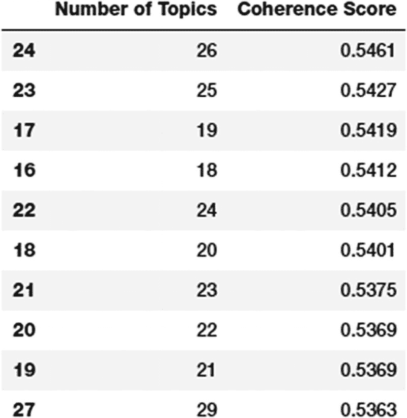
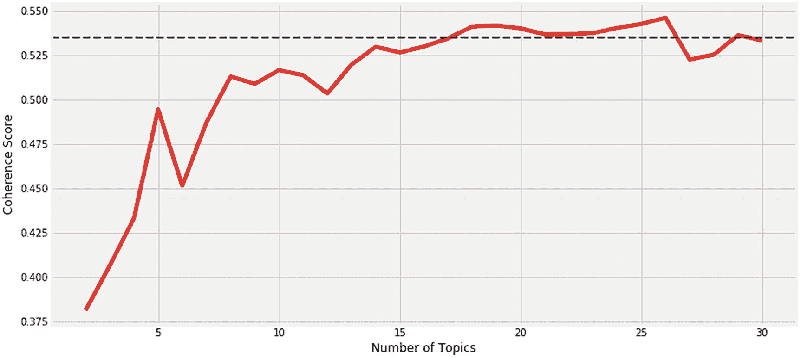
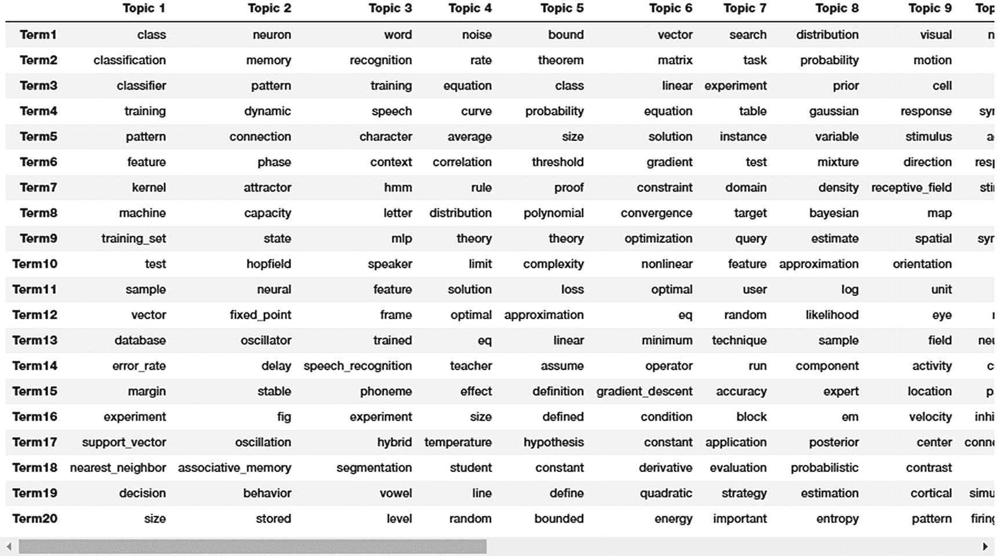
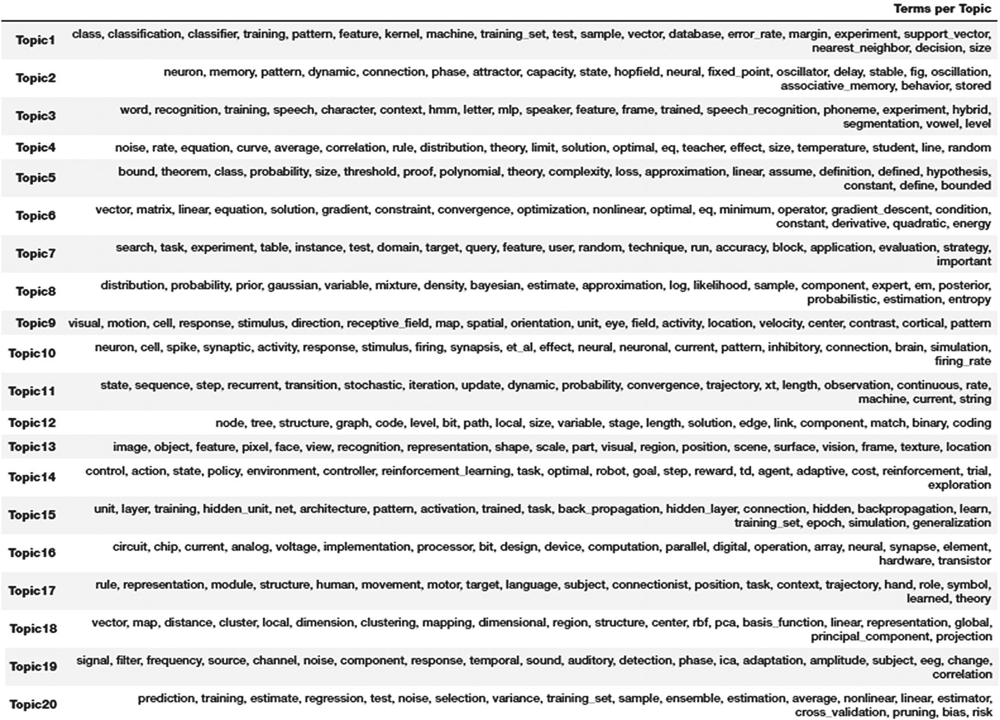
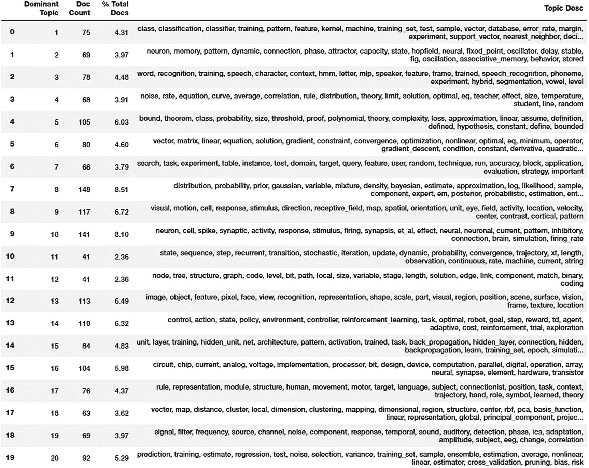
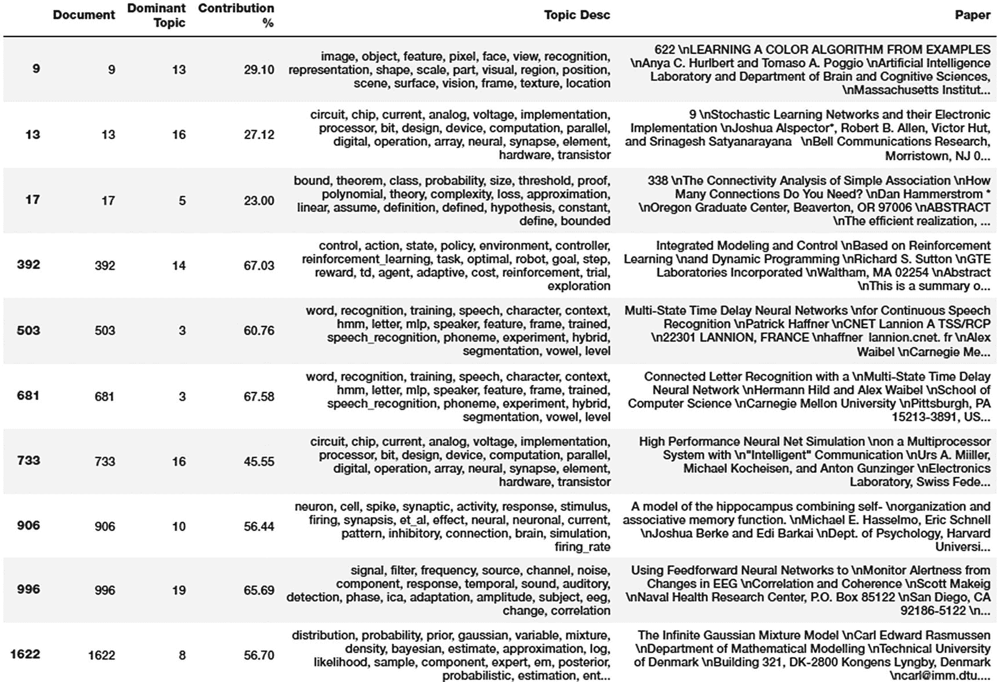
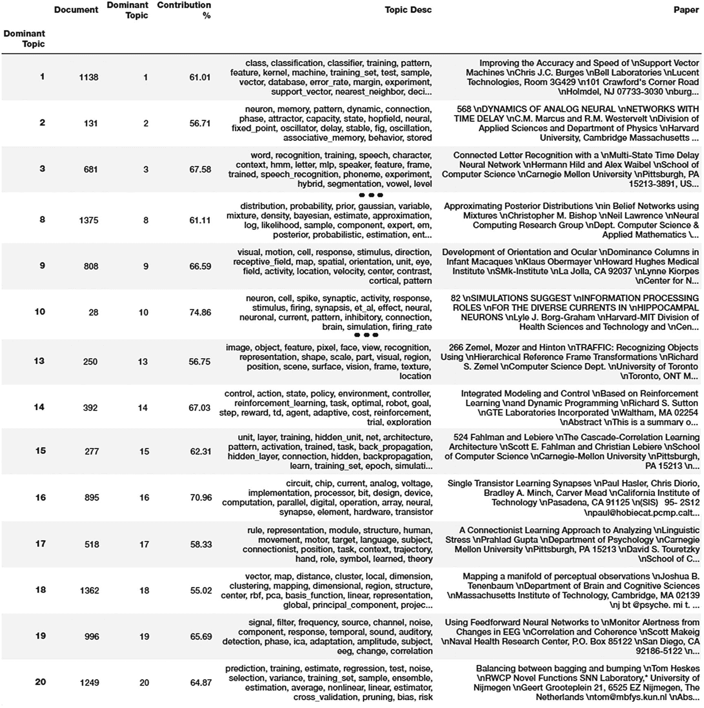

# 来自标准输出:  LL/token: -8.53533
perplexity = -8.53533
print('Avg. Coherence Score (Cv):', avg_coherence_cv)
print('Avg. Coherence Score (UMass):', avg_coherence_umass)
print('Model Perplexity:', perplexity)
Avg. Coherence Score (Cv): 0.5008326905758488
Avg. Coherence Score (UMass): -1.0635635291342118
Model Perplexity: -8.53533
```

你可以清晰地看到，根据这些指标，来自 `MALLET` 的模型远优于 `Gensim` 的默认 LDA 模型。我们能否找到使一致性最大化的最优主题数量？这是一个棘手的问题，但我们可以尝试迭代解决。

### LDA 调优：寻找最优主题数量

在主题模型中寻找最优主题数量很困难，因为它就像一个模型超参数，你始终需要在训练模型前进行设置。我们可以采用迭代方法，构建多个具有不同主题数量的模型，然后选择一致性得分最高的那个。为了实现此方法，我们构建以下函数。

```
from tqdm import tqdm
def topic_model_coherence_generator(corpus, texts, dictionary,
start_topic_count=2, end_topic_count=10, step=1,
cpus=1):
models = []
coherence_scores = []
for topic_nums in tqdm(range(start_topic_count, end_topic_count+1, step)):
mallet_lda_model = gensim.models.wrappers.LdaMallet(mallet_path=MALLET_PATH,
corpus=corpus,
num_topics=topic_nums,
id2word=dictionary,
iterations=500, workers=cpus)
cv_coherence_model_mallet_lda = gensim.models.CoherenceModel(model=mallet_lda_model,
corpus=corpus,
texts=texts,
dictionary=dictionary,
coherence='c_v')
coherence_score = cv_coherence_model_mallet_lda.get_coherence()
coherence_scores.append(coherence_score)
models.append(mallet_lda_model)
return models, coherence_scores
```

现在让我们运行这个函数，构建几个主题数量从 2 到 30 的主题模型。

```
lda_models, coherence_scores = topic_model_coherence_generator(corpus=bow_corpus,
texts=norm_corpus_bigrams,
dictionary=dictionary,
start_topic_count=2,
end_topic_count=30, step=1,
cpus=16)
100%|██████████| 29/29 [37:48<00:00, 92.53s/it]
```

注意，这一步可能需要一些时间来训练，具体取决于你的硬件基础设施，因为我们将训练多个主题模型。检查输出的一种方法是按一致性得分对结果进行排序，并查看对应的主题数量。参见图 6-6。



图 6-6

根据一致性得分对主题模型进行排序

```
coherence_df = pd.DataFrame({'Number of Topics': range(2, 31, 1),
'Coherence Score': np.round(coherence_scores, 4)})
coherence_df.sort_values(by=['Coherence Score'], ascending=False).head(10)
```

让我们绘制一张图表，展示每个模型的主题数量及其对应的一致性得分。



图 6-7

主题模型调优：主题数量与一致性得分对比

```
import matplotlib.pyplot as plt
plt.style.use('fivethirtyeight')
%matplotlib inline
x_ax = range(2, 31, 1)
y_ax = coherence_scores
plt.figure(figsize=(12, 6))
plt.plot(x_ax, y_ax, c="r")
plt.axhline(y=0.535, c="k", linestyle="--", linewidth=2)
plt.rcParams['figure.facecolor'] = 'white'
xl = plt.xlabel('Number of Topics')
yl = plt.ylabel('Coherence Score')
```

从图 6-7 可以看出，当主题数量为 5 时，得分开始快速上升，并在 19 或 20 时逐渐趋于平稳。基于我们的直觉，我们选择 20 作为最优主题数量。现在我们可以检索出最佳模型：

```
best_model_idx = coherence_df[coherence_df['Number of Topics'] == 20].index[0]
best_lda_model = lda_models[best_model_idx]
best_lda_model.num_topics
```

让我们查看所选最佳模型生成的所有 20 个主题，方法与之前的模型类似。


```python
topics = [[(term, round(wt, 3))
for term, wt in best_lda_model.show_topic(n, topn=20)]
for n in range(0, best_lda_model.num_topics)]
for idx, topic in enumerate(topics):
print('Topic #'+str(idx+1)+':')
print([term for term, wt in topic])
print()
Topic #1:
['class', 'classification', 'classifier', 'training', 'pattern', 'feature', 'kernel', 'machine', 'training_set', 'test', 'sample', 'vector', 'database', 'error_rate', 'margin', 'experiment', 'support_vector', 'nearest_neighbor', 'decision', 'size']
...,
Topic #8:
['distribution', 'probability', 'prior', 'gaussian', 'variable', 'mixture', 'density', 'bayesian', 'estimate', 'approximation', 'log', 'likelihood', 'sample', 'component', 'expert', 'em', 'posterior', 'probabilistic', 'estimation', 'entropy']
Topic #9:
['visual', 'motion', 'cell', 'response', 'stimulus', 'direction', 'receptive_field', 'map', 'spatial', 'orientation', 'unit', 'eye', 'field', 'activity', 'location', 'velocity', 'center', 'contrast', 'cortical', 'pattern']
...,
Topic #13:
['image', 'object', 'feature', 'pixel', 'face', 'view', 'recognition', 'representation', 'shape', 'scale', 'part', 'visual', 'region', 'position', 'scene', 'surface', 'vision', 'frame', 'texture', 'location']
Topic #14:
['control', 'action', 'state', 'policy', 'environment', 'controller', 'reinforcement_learning', 'task', 'optimal', 'robot', 'goal', 'step', 'reward', 'td', 'agent', 'adaptive', 'cost', 'reinforcement', 'trial', 'exploration']
...,
Topic #16:
['circuit', 'chip', 'current', 'analog', 'voltage', 'implementation', 'processor', 'bit', 'design', 'device', 'computation', 'parallel', 'digital', 'operation', 'array', 'neural', 'synapse', 'element', 'hardware', 'transistor']
Topic #17:
['rule', 'representation', 'module', 'structure', 'human', 'movement', 'motor', 'target', 'language', 'subject', 'connectionist', 'position', 'task', 'context', 'trajectory', 'hand', 'role', 'symbol', 'learned', 'theory']
Topic #18:
['vector', 'map', 'distance', 'cluster', 'local', 'dimension', 'clustering', 'mapping', 'dimensional', 'region', 'structure', 'center', 'rbf', 'pca', 'basis_function', 'linear', 'representation', 'global', 'principal_component', 'projection']
Topic #19:
['signal', 'filter', 'frequency', 'source', 'channel', 'noise', 'component', 'response', 'temporal', 'sound', 'auditory', 'detection', 'phase', 'ica', 'adaptation', 'amplitude', 'subject', 'eeg', 'change', 'correlation']
Topic #20:
['prediction', 'training', 'estimate', 'regression', 'test', 'noise', 'selection', 'variance', 'training_set', 'sample', 'ensemble', 'estimation', 'average', 'nonlinear', 'linear', 'estimator', 'cross_validation', 'pruning', 'bias', 'risk']
```

可视化主题的一个更好方法是构建一个术语-主题数据框，如图 6-8 所示。



图 6-8

从我们的 LDA 主题模型中生成的主题

```python
topics_df = pd.DataFrame([[term for term, wt in topic]
for topic in topics],
columns = ['Term'+str(i) for i in range(1, 21)],
index=['Topic '+str(t) for t in range(1, best_lda_model.num_topics+1)]).T
topics_df
```

另一个查看主题的简单方法是创建一个主题-术语数据框，其中每个主题以行的形式呈现，该主题的术语则表示为逗号分隔的字符串。



图 6-9

查看 LDA 主题模型的所有主题

```python
pd.set_option('display.max_colwidth', -1)
topics_df = pd.DataFrame([', '.join([term for term, wt in topic])
for topic in topics],
columns = ['Terms per Topic'],
index=['Topic'+str(t) for t in range(1, best_lda_model.num_topics+1)]
)
topics_df
```

图 6-9 中展示的数据框为我们提供了一种简单的方式来可视化和理解研究论文语料库中的主要主题。你是否注意到任何有趣的模式？我观察到了一些非常有趣的主题，涉及神经网络、信号处理、降维、强化学习、芯片上的神经模型，以及图像和视觉识别！

### 解读主题模型结果

让我们来看一些有趣的方法，来深入探索并解读主题模型的结果。需要记住一个有趣的点：给定一个文档语料库（以特征形式，例如词袋）和一个训练好的主题模型，你可以使用以下代码预测每个文档（这里指研究论文）的主题分布。

```python
tm_results = best_lda_model[bow_corpus]
```

现在，我们可以利用下面的代码，通过一些巧妙的排序和索引，为每篇研究论文找出最主导的主题。

```python
corpus_topics = [sorted(topics, key=lambda record: -record[1])[0]
for topics in tm_results]
corpus_topics[:5]
[(16, 0.2115988756613756),
(5, 0.29989652050187554),
(9, 0.3307915758896151),
(8, 0.5447463768115942),
(9, 0.18093823158652983)]
```

这提供了丰富的选项，可用于从我们的研究论文语料库中提取有用的见解。为了实现这一点，我们构建一个主数据框来保存基础统计数据，稍后我们将用它来呈现不同的有用见解。

```python
corpus_topic_df = pd.DataFrame()
corpus_topic_df['Document'] = range(0, len(papers))
corpus_topic_df['Dominant Topic'] = [item[0]+1 for item in corpus_topics]
corpus_topic_df['Contribution %'] = [round(item[1]*100, 2) for item in corpus_topics]
corpus_topic_df['Topic Desc'] = [topics_df.iloc[t[0]]['Terms per Topic'] for t in corpus_topics]
corpus_topic_df['Paper'] = papers
```

现在，让我们看看有哪些不同的方法可以转换这些结果，并从我们的研究论文及其主题中提取有意义的见解。

#### 语料库中主导主题的分布

我们首先可以查看每个主题在整个研究论文语料库中的总体分布。主要是想确定论文总数，以及 20 个主题中每个主题作为最主导主题的论文百分比。



图 6-10

查看主导主题的分布

```python
pd.set_option('display.max_colwidth', 200)
topic_stats_df = corpus_topic_df.groupby('Dominant Topic').agg({
'Dominant Topic': {
'Doc Count': np.size,
'% Total Docs': np.size }
})
topic_stats_df = topic_stats_df['Dominant Topic'].reset_index()
topic_stats_df['% Total Docs'] = topic_stats_df['% Total Docs'].apply(lambda row: round((row*100) / len(papers), 2))
topic_stats_df['Topic Desc'] = [topics_df.iloc[t]['Terms per Topic'] for t in range(len(topic_stats_df))]
topic_stats_df
```

图 6-10 中的结果显示，大多数论文涵盖了概率模型和贝叶斯建模（主题#8）的主题，其次是关于建模和模拟大脑如何通过神经元、细胞、刺激和连接来工作的论文（主题#10）。甚至主题#14（涵盖强化学习和机器人技术）也在论文总数中占据了约 6.32%的比例。这告诉我们，这并不是一个新事物，人们已经对它研究了几十年！


### 特定研究论文中的主导主题

另一个有趣的视角是选取特定的论文，查看每篇论文中的最主导主题，并判断其是否合理。



图 6-11：查看研究论文中的主题主导性

```
pd.set_option('display.max_colwidth', 200)
(corpus_topic_df[corpus_topic_df['Document']
.isin([681, 9, 392, 1622, 17,
906, 996, 503, 13, 733])])
```

根据图 6-11 的结果，我们可以看到这些结果完全合理！关于强化学习、信号处理、高斯混合模型、处理器仿真、词汇识别等论文，其对应的相关主题都作为最主导主题出现。这告诉我们，我们的主题模型运行良好。

### 基于主导性为每个主题寻找相关研究论文

更好的表示方式是尝试为 20 个主题中的每个主题，检索出具有最高代表性的研究论文。



图 6-12：查看每个主题及其贡献度最高的对应论文

```
corpus_topic_df.groupby('Dominant Topic').apply(lambda topic_set:
(topic_set.sort_values(by=['Contribution %'],
ascending=False).iloc[0]))
```

由于篇幅限制，我们没有在图 6-12 中展示所有主题，但您已经理解了思路，并且可以在 Jupyter notebook 中查看完整输出。您甚至可以基于索引打开每篇研究论文并阅读全文，以判断其是否合理！根据图 6-12 中展示的论文标题和对应主题，它们确实是合理的。看来我们的模型已经捕捉到了语料库中相关的潜在模式和主题。

### 预测新研究论文的主题

尽管主题模型是无监督模型，但我们可以基于模型在所谓的“训练”语料库上先前学习到的知识，来估计或预测新文档的潜在主题。为了测试我们的模型，我手动从 NIPS 16 会议论文集中下载了一些近期论文。在这些论文上测试我们的模型将是一项有趣的练习。

```
import glob
