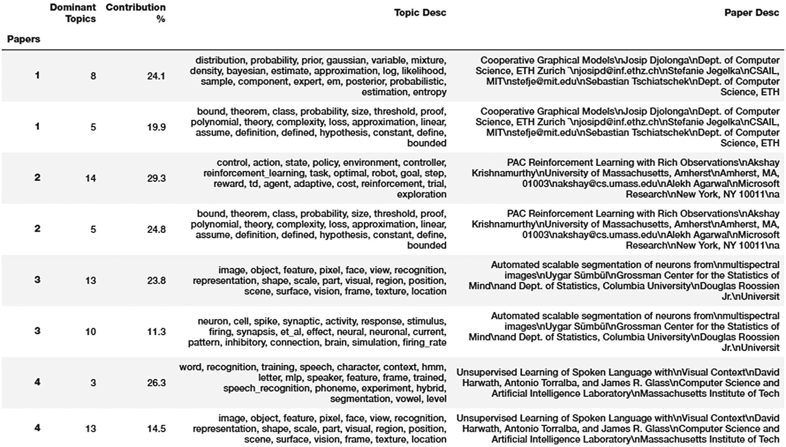

# putting the function in action

`topic_preds` = `get_topic_predictions`(`topic_model`=`best_lda_model`, `corpus`=`norm_bow_features`, `topn`=2)

`topic_preds`

```
[[(7, 0.241), (4, 0.199)],
 [(13, 0.293), (4, 0.248)],
 [(12, 0.238), (9, 0.113)],
 [(2, 0.263), (12, 0.145)]]
```

我们为每篇研究论文获取了前两个主题，因为一篇论文或文档总是可能由多个主题混合而成。让我们以一种易于理解的格式查看每篇论文的结果。



图 6-13：使用我们的 LDA 模型预测新论文的主题

```
results_df = pd.DataFrame()
results_df['Papers'] = range(1, len(new_papers)+1)
results_df['Dominant Topics'] = [[topic_num+1 for topic_num, wt in item]
                                 for item in topic_preds]
res = results_df.set_index(['Papers'])['Dominant Topics'].apply(pd.Series).stack().reset_index(level=1, drop=True)
results_df = pd.DataFrame({'Dominant Topics': res.values}, index=res.index)
results_df['Contribution %'] = [topic_wt for topic_list in
                                [[round(wt*100, 2)
                                  for topic_num, wt in item]
                                 for item in topic_preds]
                                for topic_wt in topic_list]
results_df['Topic Desc'] = [topics_df.iloc[t-1]['Terms per Topic']
                            for t in results_df['Dominant Topics'].values]
results_df['Paper Desc'] = [new_papers[i-1][:200] for i in results_df.index.values]
pd.set_option('display.max_colwidth', 300)
results_df
```

看着图 6-13 中为这些前所未见的新论文生成的主题，我得说我们的模型表现得非常出色！

## 使用 Scikit-Learn 的主题模型

本节的编写是基于许多用户的反馈，他们提到自己广泛使用 Scikit-Learn，并且也希望能将其用于主题建模。Scikit-Learn 框架确实提供了一系列用于构建主题模型的技术和方法，尽管与 Gensim 相比，调整或控制这些模型的灵活性略有不足。尽管如此，在本节中，我们将使用以下方法构建主题模型：

*   潜在语义索引 (LSI)
*   潜在狄利克雷分配 (LDA)
*   非负矩阵分解 (NMF)

我们将尽可能地复制在使用 Gensim 构建主题模型时所采用的特征工程过程。这些模型都基于 `norm_papers` 变量中相同的、经过标准化和预处理后的语料库进行工作。

### 通过特征工程进行文本表示

我们采用一元词和二元词构成的词袋模型来表示文本数据，这与上一节的分析方法类似。

```python
from sklearn.feature_extraction.text import CountVectorizer
cv = CountVectorizer(min_df=20, max_df=0.6, ngram_range=(1,2),
                     token_pattern=None, tokenizer=lambda doc: doc,
                     preprocessor=lambda doc: doc)
cv_features = cv.fit_transform(norm_papers)
cv_features.shape
(1740, 14408)
```