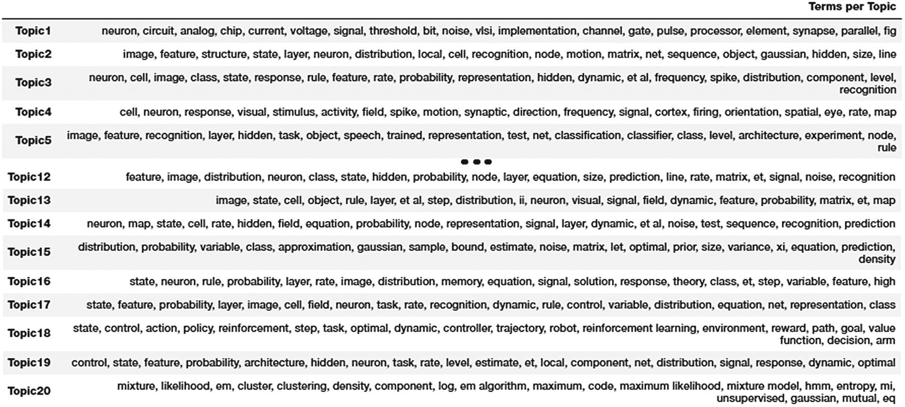
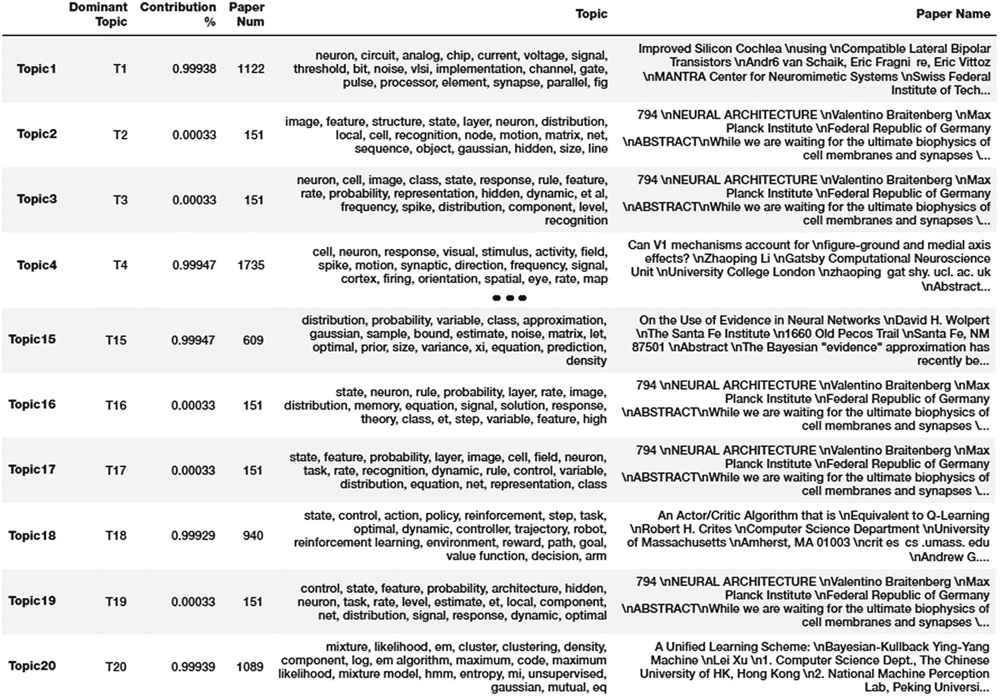
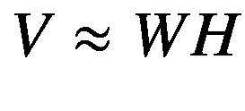
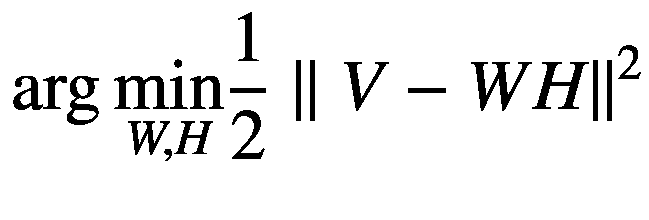
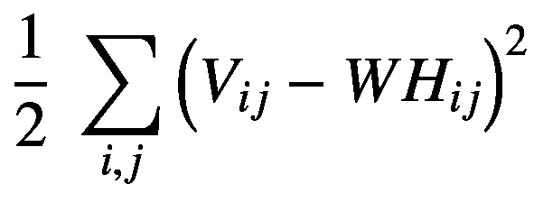
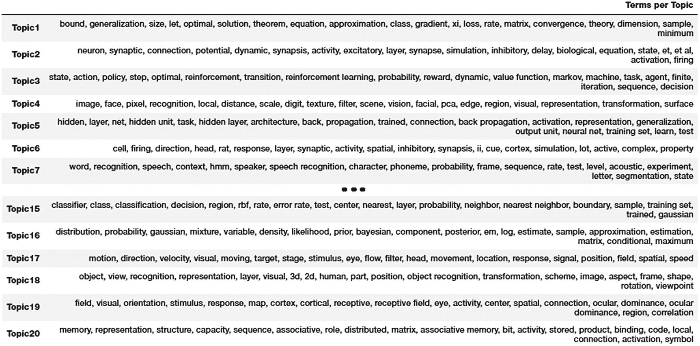
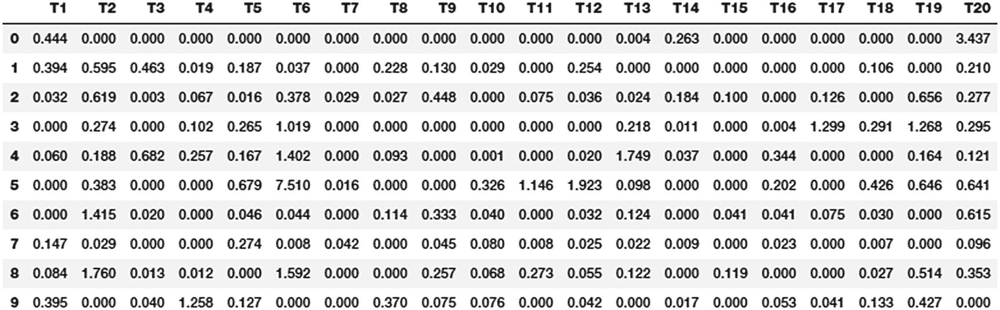
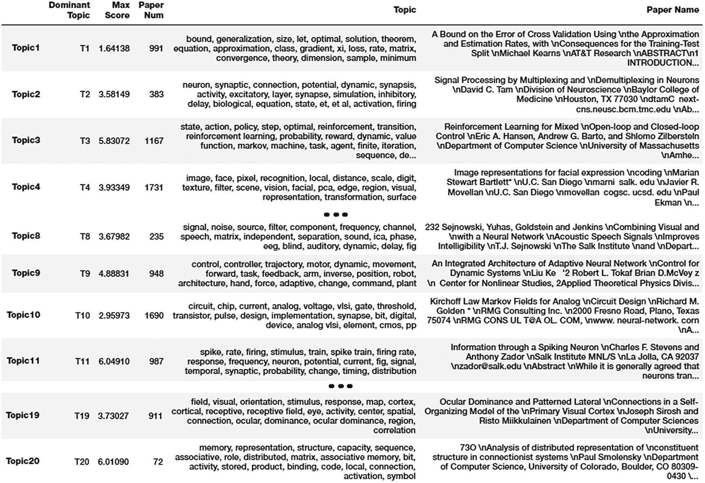

# 验证词汇大小

```python
vocabulary = np.array(cv.get_feature_names())

print('Total Vocabulary Size:', len(vocabulary))
```

```
Total Vocabulary Size: 14408
```

虽然词汇量是之前使用 Gensim 构建模型时的两倍，但我们仍然通过文档频率过滤器去除了不必要的术语。

## 潜在语义索引

我们尝试的第一种主题建模技术是基于 SVD 的 LSI 模型。由于在前一节中，我们确定最佳主题数为 20，那么就用这个数字作为要生成的总主题数。

```python
%%time

from sklearn.decomposition import TruncatedSVD

TOTAL_TOPICS = 20

lsi_model = TruncatedSVD(n_components=TOTAL_TOPICS, n_iter=500, random_state=42)

document_topics = lsi_model.fit_transform(cv_features)
```

```
CPU times: user 15min 25s, sys: 1min 3s, total: 16min 28s
Wall time: 1min 1s
```

```python
topic_terms = lsi_model.components_

topic_terms.shape
```

```
(20, 14408)
```

现在，我们可以通过复用之前实现的部分代码来生成主题，以显示主题和对应的术语。

```python
top_terms = 20

topic_key_term_idxs = np.argsort(-np.absolute(topic_terms), axis=1)[:, :top_terms]

topic_keyterm_weights = np.array([topic_terms[row, columns]
                                  for row, columns in list(zip(np.arange(TOTAL_TOPICS), topic_key_term_idxs))])

topic_keyterms = vocabulary[topic_key_term_idxs]

topic_keyterms_weights = list(zip(topic_keyterms, topic_keyterm_weights))

for n in range(TOTAL_TOPICS):
    print('Topic #'+str(n+1)+':')
    print('='*50)
    d1 = []
    d2 = []
    terms, weights = topic_keyterms_weights[n]
    term_weights = sorted([(t, w) for t, w in zip(terms, weights)],
                          key=lambda row: -abs(row[1]))
    for term, wt in term_weights:
        if wt >= 0:
            d1.append((term, round(wt, 3)))
        else:
            d2.append((term, round(wt, 3)))
    print('Direction 1:', d1)
    print('-'*50)
    print('Direction 2:', d2)
    print('-'*50)
    print()
```

```
Topic #1:
==================================================
Direction 1: [('state', 0.221), ('neuron', 0.169), ('image', 0.138), ('cell', 0.13), ('layer', 0.13), ('feature', 0.127), ('probability', 0.121), ('hidden', 0.114), ('distribution', 0.105), ('rate', 0.098), ('signal', 0.095), ('task', 0.093), ('class', 0.092), ('noise', 0.09), ('net', 0.089), ('recognition', 0.089), ('representation', 0.088), ('field', 0.082), ('rule', 0.082), ('step', 0.08)]
Direction 2: []
...
Topic #3:
==================================================
Direction 1: [('state', 0.574), ('neuron', 0.212), ('action', 0.187), ('policy', 0.149), ('control', 0.12), ('dynamic', 0.1), ('cell', 0.083), ('reinforcement', 0.081), ('optimal', 0.075), ('reinforcement learning', 0.068)]
Direction 2: [('image', -0.364), ('feature', -0.223), ('object', -0.144), ('recognition', -0.143), ('classifier', -0.111), ('class', -0.106), ('layer', -0.092), ('classification', -0.085), ('face', -0.073), ('test', -0.069)]
Topic #4:
==================================================
Direction 1: [('image', 0.425), ('state', 0.326), ('object', 0.215), ('feature', 0.159), ('action', 0.147), ('visual', 0.143), ('control', 0.126), ('task', 0.111), ('policy', 0.103), ('recognition', 0.103), ('face', 0.092), ('representation', 0.086), ('motion', 0.086)]
Direction 2: [('neuron', -0.216), ('distribution', -0.166), ('class', -0.112), ('bound', -0.109), ('probability', -0.108), ('spike', -0.104), ('variable', -0.087)]
...
Topic #6:
==================================================
Direction 1: [('cell', 0.548), ('layer', 0.139), ('word', 0.124), ('hidden', 0.111), ('classifier', 0.097), ('direction', 0.09), ('head', 0.078), ('rule', 0.073), ('rat', 0.073), ('speech', 0.071)]
Direction 2: [('neuron', -0.416), ('image', -0.336), ('circuit', -0.126), ('noise', -0.124), ('chip', -0.121), ('analog', -0.099), ('object', -0.09), ('spike', -0.075), ('signal', -0.071), ('voltage', -0.069)]
...
Topic #9:
==================================================
Direction 1: [('circuit', 0.244), ('control', 0.242), ('classifier', 0.229), ('chip', 0.167), ('node', 0.137), ('current', 0.132), ('analog', 0.13), ('voltage', 0.129), ('signal', 0.118), ('controller', 0.088)]
```

### 主题方向分析

Direction 2: [('hidden', -0.27), ('neuron', -0.247), ('state', -0.175), ('distribution', -0.158), ('hidden unit', -0.143), ('layer', -0.125), ('object', -0.115), ('probability', -0.108), ('image', -0.1), ('representation', -0.098)]

#### `主题 #10`：

方向 1: [('circuit', 0.245), ('cell', 0.225), ('node', 0.211), ('state', 0.183), ('image', 0.166), ('chip', 0.163), ('analog', 0.147), ('layer', 0.144), ('net', 0.12), ('voltage', 0.115)]

方向 2: [('task', -0.201), ('rule', -0.193), ('spike', -0.166), ('feature', -0.165), ('control', -0.157), ('neuron', -0.144), ('rate', -0.134), ('stimulus', -0.116), ('classifier', -0.116), ('action', -0.112)]

...

#### `主题 #18`：

方向 1: [('object', 0.419), ('signal', 0.26), ('layer', 0.258), ('rule', 0.209), ('feature', 0.164), ('view', 0.162), ('net', 0.113), ('noise', 0.112), ('bound', 0.105), ('speech', 0.1)]

方向 2: [('memory', -0.18), ('task', -0.161), ('representation', -0.14), ('hidden', -0.137), ('image', -0.135), ('hidden unit', -0.121), ('tree', -0.117), ('structure', -0.094), ('test', -0.093), ('word', -0.092)]

#### `主题 #19`：

方向 1: [('class', 0.287), ('memory', 0.275), ('classifier', 0.144), ('response', 0.139), ('sequence', 0.112), ('component', 0.11), ('stimulus', 0.101), ('region', 0.092), ('bound', 0.088)]

方向 2: [('node', -0.292), ('feature', -0.244), ('field', -0.202), ('rate', -0.152), ('word', -0.146), ('spike', -0.139), ('map', -0.132), ('character', -0.127), ('policy', -0.108), ('tree', -0.092), ('noise', -0.088)]

#### `主题 #20`：

方向 1: [('map', 0.222), ('control', 0.2), ('region', 0.181), ('ii', 0.145), ('feature', 0.132), ('image', 0.122), ('bound', 0.11), ('orientation', 0.109), ('rule', 0.109), ('threshold', 0.094), ('class', 0.092)]

方向 2: [('object', -0.31), ('motion', -0.252), ('direction', -0.229), ('memory', -0.223), ('classifier', -0.193), ('view', -0.136), ('matrix', -0.13), ('rate', -0.121), ('distance', -0.11)]

当然，受篇幅限制，我们并未在上方输出中展示所有主题，但您已能理解其大意。如有需要，您可以在笔记本中查看所有主题。与上一节类似，我们也可以提取特定研究论文的关键主题。

```python
dt_df = pd.DataFrame(np.round(document_topics, 3), columns=['T'+str(i) for i in range(1, TOTAL_TOPICS+1)])

document_numbers = [13, 250, 500]

for document_number in document_numbers:

    top_topics = list(dt_df.columns[np.argsort(-np.absolute(dt_df.iloc[document_number].values))[:3]])

    print('Document #'+str(document_number)+':')

    print('Dominant Topics (top 3):', top_topics)

    print('Paper Summary:')

    print(papers[document_number][:500])

    print()
```

#### `文档 #13`：

主导主题（前 3）：['T1', 'T6', 'T4']

论文摘要：

Stochastic Learning Networks and their Electronic Implementation

Joshua Alspector*, Robert B. Allen, Victor Hut, and Srinagesh Satyanarayana

Bell Communications Research, Morristown, NJ 07960

摘要

我们描述了一系列学习算法，这些算法运行在一个循环、对称连接的神经形态网络上，类似于玻尔兹曼机

#### `文档 #250`：

主导主题（前 3）：['T3', 'T18', 'T4']

论文摘要：

266 Zemel, Mozer and Hinton

TRAFFIC: Recognizing Objects Using

Hierarchical Reference Frame Transformations

Richard S. Zemel

摘要

我们描述了一个模型，该模型能够在未分割的图像中识别二维形状，且不受其方向的影响

#### `文档 #500`：

主导主题（前 3）：['T9', 'T1', 'T10']

论文摘要：

Constrained Optimization Applied to the

Parameter Setting Problem for Analog Circuits

David Kirk, Kurt Fleischer, Lloyd Watts, Alan Bart

摘要

我们使用约束优化为两个电路选择工作参数：一个简单的三晶体管平方根电路，以及一个模拟 VLSI 人工耳蜗。

如果您查看我们在上述输出中得到的主题术语，它们实际上是有意义的！

### 潜在狄利克雷分配

就连 Scikit-Learn 也在其库中集成了基于 LDA 的主题模型实现。以下代码片段使用它来构建一个 LDA 主题模型。

```python
%%time

from sklearn.decomposition import LatentDirichletAllocation

lda_model = LatentDirichletAllocation(n_components =TOTAL_TOPICS, max_iter=500, max_doc_update_iter=50, learning_method="online", batch_size=1740, learning_offset=50., random_state=42, n_jobs=16)

document_topics = lda_model.fit_transform(cv_features)

CPU times: user 13min 14s, sys 1min 41s, total 14min 56s

Wall time: 55min 32s
```

然后，我们可以获取主题-术语矩阵，并从中构建一个数据帧，以便于以一种易于解释的格式展示主题和术语。



**图 6-14** 从我们的 LDA 模型生成的主题

# 主题模型分析与非负矩阵分解

## 主题模型分析

```python
topic_terms = lda_model.components_

topic_key_term_idxs = np.argsort(-np.absolute(topic_terms), axis=1)[:, :top_terms]

topic_keyterms = vocabulary[topic_key_term_idxs]

topics = [', '.join(topic) for topic in topic_keyterms]

pd.set_option('display.max_colwidth', -1)

topics_df = pd.DataFrame(topics, columns = ['Terms per Topic'], index=['Topic'+str(t) for t in range(1, TOTAL_TOPICS+1)])

topics_df
```

基于图 6-14 中描述的主题，我们可以看到各主题之间存在相似主题的重复，这可能表明该模型不如我们的 MALLET LDA 模型优秀。现在，我们可以查看在 20 个主题中每个主题贡献度最大的研究论文，这与我们在上一节中的分析类似。



`图 6-15` 查看每个主题及其贡献度最大的对应论文

```python
dt_df = pd.DataFrame(document_topics, columns=['T'+str(i) for i in range(1, TOTAL_TOPICS+1)])

pd.options.display.float_format = '{:,.5f}'.format

pd.set_option('display.max_colwidth', 200)

max_contrib_topics = dt_df.max(axis=0)

dominant_topics = max_contrib_topics.index

contrib_perc = max_contrib_topics.values

document_numbers = [dt_df[dt_df[t] == max_contrib_topics.loc[t]].index[0] for t in dominant_topics]

documents = [papers[i] for i in document_numbers]

results_df = pd.DataFrame({'Dominant Topic': dominant_topics, 'Contribution %': contrib_perc, 'Paper Num': document_numbers, 'Topic': topics_df['Terms per Topic'], 'Paper Name': documents})

results_df
```

基于图 6-15 中描述的输出，我们可以看到某些主题在语料库中的表示非常差，几乎为 0%，因此我们看到同一篇论文（论文 #151）被选为这些主题的更相关论文。而贡献度良好（几乎 100% 主导）的主题，则展示出与相应主题所传达主题密切相关的论文，包括强化学习、贝叶斯和高斯混合模型、VLSI 上的神经模型以及晶体管。

## 非负矩阵分解

我们介绍的最后一门技术是非负矩阵分解（`NMF`），这是另一种类似于 `SVD` 的矩阵分解技术，但它作用于非负矩阵，并且对多变量数据效果良好。给定一个非负矩阵 `V`，`NMF` 的目标是找到两个非负矩阵因子 `W` 和 `H`，使得它们相乘后能够近似重构 `V`。用数学语言表示如下：



使得这三个矩阵都是非负的。为了得到这个近似，我们通常使用一个代价函数，例如两个矩阵之间的欧几里得距离或 `L2` 范数，或者 Frobenius 范数（它是对 `L2` 范数的一个微小改进）。这可以表示如下：



其中我们有三个非负矩阵——`V`、`W` 和 `H`——这可以进一步简化为：



这个实现可以在 Scikit-Learn 分解模块的 `NMF` 类中找到，我们将在本节中使用它。

我们可以使用以下代码片段在玩具语料库上构建一个基于 NMF 的主题模型，与 LDA 一样，它会给出特征名称及其权重。

```python
%%time

from sklearn.decomposition import NMF

nmf_model = NMF(n_components=TOTAL_TOPICS, solver="cd", max_iter=500,

random_state=42, alpha=.1, l1_ratio=.85)

document_topics = nmf_model.fit_transform(cv_features)

CPU times: user 11min 39s, sys: 47.5 s, total: 12min 26s

Wall time: 46.7 s
```

现在我们的模型已经训练好了，我们可以使用以下代码查看生成的主题。



`图 6-16` 从我们的 NMF 模型生成的主题

```python
topic_terms = nmf_model.components_

topic_key_term_idxs = np.argsort(-np.absolute(topic_terms), axis=1)[:, :top_terms]

topic_keyterms = vocabulary[topic_key_term_idxs]

topics = [', '.join(topic) for topic in topic_keyterms]

pd.set_option('display.max_colwidth', -1)

topics_df = pd.DataFrame(topics,

columns = ['Terms per Topic'],

index=['Topic'+str(t) for t in range(1, TOTAL_TOPICS+1)])

topics_df
```

根据图 6-16 中展示的主题，没有明显的主题重复，并且每个主题都讨论了一个清晰且不同的主题。NMF 主题模型的结果明显优于我们从 Scikit-Learn 的 LDA 中获得的结果。我们可以确定每个研究论文中主题的支配度，但在 NMF 的情况下，这些是由绝对分数而不是百分比来确定的，如下面的输出所示。见图 6-17。



`图 6-17` 使用文档-主题矩阵查看每个文档的主题支配度

```python
pd.options.display.float_format = '{:,.3f}'.format

dt_df = pd.DataFrame(document_topics,

columns=['T'+str(i) for i in range(1, TOTAL_TOPICS+1)])

dt_df.head(10)
```

利用文档-主题矩阵，我们可以通过以下代码，根据主题支配度得分确定每个主题最相关的论文。



`图 6-18` 查看每个主题及其贡献最大的对应论文

```python
pd.options.display.float_format = '{:,.5f}'.format

pd.set_option('display.max_colwidth', 200)

max_score_topics = dt_df.max(axis=0)

dominant_topics = max_score_topics.index

term_score = max_score_topics.values
```


`document_numbers = [dt_df[dt_df[t] == max_score_topics.loc[t]].index[0] for t in dominant_topics]`

`documents = [papers[i] for i in document_numbers]`

`results_df = pd.DataFrame({'Dominant Topic': dominant_topics, 'Max Score': term_score, 'Paper Num': document_numbers, 'Topic': topics_df['Terms per Topic'], 'Paper Name': documents})`

`results_df`

```
图 6-18 中显示的输出清楚地表明，`NMF` 模型比 `LDA` 模型好得多，每个主题都与其支配度最大的研究论文的核心主题强相关。我们观察到的是，与其他方法相比，即使在文档数量较少的小型语料库上，非负矩阵分解也能发挥最佳效果。但同样，这取决于你正在处理的数据类型。
```

### 预测新研究论文的主题

现在，我们为 `NIPS 16` 会议的四篇研究论文预测主题，类似于我们之前用 Gensim 主题模型所做的操作。如果尚未加载论文，请先加载它们。

```
import glob
```