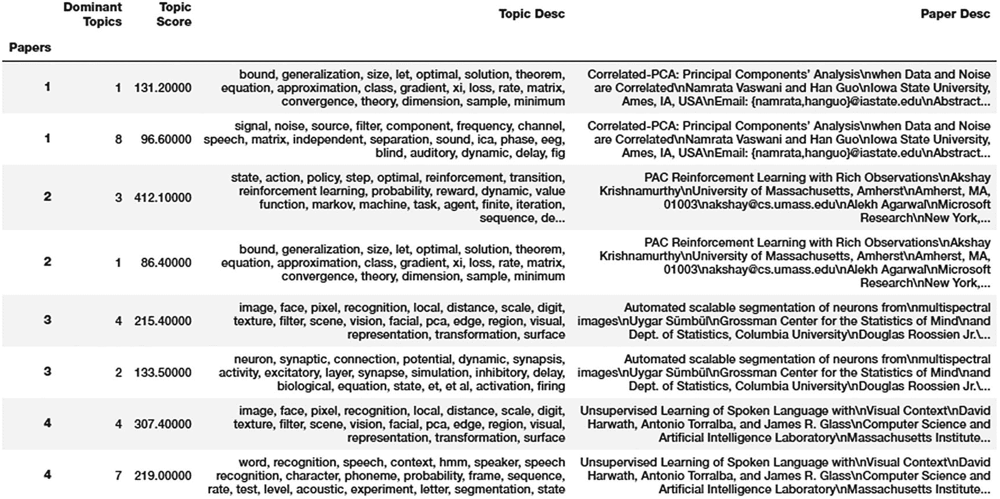
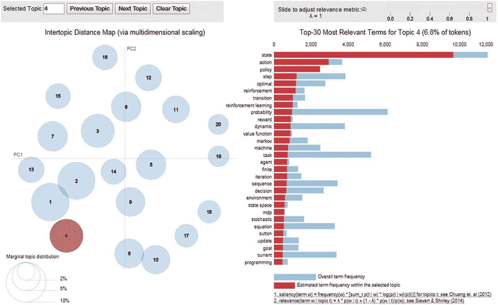

# https://papers.nips.cc/book/advances-in-neural-information-processing-systems-29-2016
new_paper_files = glob.glob('nips16*.txt')
new_papers = []
for fn in new_paper_files:
with open(fn, encoding='utf-8', errors="ignore", mode='r+') as f:
data = f.read()
new_papers.append(data)
print('Total New Papers:', len(new_papers))
Total New Papers: 4
```

流程中的下一步是预处理这些文档，并使用与构建主题模型时相同的步骤序列提取特征。

```
norm_new_papers = normalize_corpus(new_papers)
cv_new_features = cv.transform(norm_new_papers)
cv_new_features.shape
(4, 14408)
```

现在，我们可以使用 NMF 主题模型，通过以下代码预测这些新研究论文的主题（我们为每篇论文预测前两个主题）。

```
topic_predictions = nmf_model.transform(cv_new_features)
best_topics = [[(topic, round(sc, 3))
for topic, sc in sorted(enumerate(topic_predictions[i]),
key=lambda row: -row[1])[:2]]
for i in range(len(topic_predictions))]
best_topics
[[(0, 1.312), (7, 0.966)],
[(2, 4.121), (0, 0.864)],
[(3, 2.154), (1, 1.335)],
[(3, 3.074), (6, 2.19)]]
```

请记住，这里我们不会像 LDA 模型那样得到每个主题的支配度比例，而是得到绝对分数。让我们以易于理解的格式查看结果。



图 6-19

使用我们的 NMF 模型预测新论文的主题

```
results_df = pd.DataFrame()
results_df['Papers'] = range(1, len(new_papers)+1)
results_df['Dominant Topics'] = [[topic_num+1 for topic_num, sc in item]
for item in best_topics]
res = results_df.set_index(['Papers'])['Dominant Topics'].apply(pd.Series).stack().reset_index(level=1, drop=True)
results_df = pd.DataFrame({'Dominant Topics': res.values}, index=res.index)
results_df['Topic Score'] = [topic_sc for topic_list in
[[round(sc*100, 2)
for topic_num, sc in item]
for item in best_topics]
for topic_sc in topic_list]
results_df['Topic Desc'] = [topics_df.iloc[t-1]['Terms per Topic']
for t in results_df['Dominant Topics'].values]
results_df['Paper Desc'] = [new_papers[i-1][:200] for i in results_df.index.values]
results_df
```

观察图 6-19 中展示的新研究论文生成的主题，我们可以清楚地得出结论，这些主题是合理的，并且我们的 NMF 模型运行得非常好！


### 主题模型可视化

我们还可以通过交互式方式可视化主题模型，以便利用`pyLDAvis`框架查看每个主题及其传达的主题。通常，会使用 MDS、PDA 和 t-SNE 等降维技术将主题在二维可视化中呈现。

```python
import pyLDAvis
import pyLDAvis.sklearn
import dill
import warnings
warnings.filterwarnings('ignore')
pyLDAvis.enable_notebook()
pyLDAvis.sklearn.prepare(nmf_model, cv_features, cv, mds="mmds")
```

图 6-20 中的可视化在 Jupyter notebook 中是可交互的，您可以通过查看每个主题、词分布和主题分布来进行探索。希望这能为您提供足够的主题模型视角，助您开始对自己语料库进行建模。



**图 6-20** 基于 NMF 模型的主题可视化

## 自动文档摘要

我们在本章开头曾简要讨论过文档摘要，当时提到从大型文档或语料库中提取主旨，使其保留语料的核心精髓或含义。文档摘要的概念与关键短语提取或主题建模略有不同。在这种情况下，最终结果仍以某种文档形式呈现，但仅包含基于我们所需摘要长度的若干句子。这类似于研究论文中的摘要或执行摘要。自动文档摘要的主要目标是，在不涉及人工输入（除运行计算机程序外）的情况下执行此摘要任务。数学和统计模型通过观察文档的内容和上下文，帮助构建和自动化文档摘要任务。

使用自动化技术进行文档摘要主要有两种方法，描述如下：

- **基于抽取的技术：** 这些方法利用 SVD 等数学和统计概念，从原始文档中提取关键内容子集，使得该子集包含核心信息，并作为整个文档的焦点。这些内容可以是单词、短语甚至句子。该方法的最终结果是从原始文档中提取出几行简短执行摘要。此技术不生成任何新内容，因此得名 *基于抽取*。

- **基于抽象的技术：** 这些方法更为复杂和精细。它们利用语言语义创建表示，并使用自然语言生成技术，使机器借助知识库和语义表示自主生成文本，像人类一样撰写摘要。得益于深度学习，我们可以轻松实现这些技术，但它们需要大量数据和计算资源。

对基于抽取技术的研究更多，因为构建基于抽象的摘要生成器相对更困难。近年来，在该领域（模仿人类创建抽象摘要）已取得实质性进展。深度学习模型，尤其是编码器-解码器架构，在使用抽象方法总结文本方面非常有效。实现这些模型超出了我们当前的范围，但我们将通过动手示例涵盖抽取式文本摘要的要点。

我们将使用贝塞斯达软件工作室非常受欢迎的角色扮演游戏《天际》的描述来进行摘要。以下是待摘要文档的节选（完整文档位于用于文本摘要的 Jupyter notebook 中）。

```python
DOCUMENT = """
The Elder Scrolls V: Skyrim is an action role-playing video game developed by Bethesda Game Studios and published by Bethesda Softworks. It is the fifth main installment in The Elder Scrolls series, following The Elder Scrolls IV: Oblivion. The game's main story revolves around the player character's quest to defeat Alduin the World-Eater, a dragon who is prophesied to destroy the world. The game is set 200 years after the events of Oblivion and takes place in the fictional province of Skyrim. Over the course of the game, the player completes quests and develops the character by improving skills. The game continues the open-world tradition of
its predecessors by allowing the player to travel anywhere in the game world at any time, and to ignore or postpone the main storyline indefinitely. The team opted for a unique and more diverse open world than Oblivion's Imperial Province of Cyrodiil, which game director and executive producer Todd Howard considered less interesting by comparison. The game was released to critical acclaim, with reviewers particularly mentioning the character advancement and setting, and is considered to be one of the greatest video games of all time.
The Elder Scrolls V: Skyrim is an action role-playing game, playable from either a first or third-person perspective. The player may freely roam over the land of Skyrim which is an open world environment consisting of wilderness expanses, dungeons, cities, towns, fortresses, and villages.
...
...
A regeneration period limits the player's use of shouts in gameplay.
Skyrim is set around 200 years after the events of The Elder Scrolls IV: Oblivion, although it is not a direct sequel. The game takes place in Skyrim, a province of the Empire on the continent of Tamriel, amid a civil war between two factions: the Stormcloaks, led by Ulfric Stormcloak, and the Imperial Legion, led by General Tullius. The player character is a Dragonborn, a mortal born with the soul and power of a dragon. Alduin, a large black dragon who returns to the land after being lost in time, serves as the game's primary antagonist. Alduin is the first dragon created by Akatosh, one of the series' gods, and is prophesied to destroy and consume the world.
"""
```

我们需要对这个文档进行一些基本的预处理，以移除多余的换行符。可以使用以下代码来实现。

```python
import re
DOCUMENT = re.sub(r'\n|\r', ' ', DOCUMENT)
DOCUMENT = re.sub(r' +', ' ', DOCUMENT)
DOCUMENT = DOCUMENT.strip()
```

接下来，我们通过利用 Gensim 的摘要模块来查看文档摘要的实现。如下列代码所示，这非常直接了当。

```python
from gensim.summarization import summarize
print(summarize(DOCUMENT, ratio=0.2, split=False))
游戏的主要故事情节围绕玩家角色击败世界吞噬者奥杜因（一条预言会毁灭世界的巨龙）的探索而展开。
在游戏过程中，玩家通过提升技能来完成任务和发展角色。
游戏延续了其前作的开放世界传统，允许玩家随时前往游戏世界中的任何地点，并且可以无限期地忽略或推迟主线剧情。
玩家可以自由漫游天际省的土地，这是一个由荒野、地下城、城市、城镇、堡垒和村庄组成的开放世界环境。
游戏世界中的每个城市和城镇都有玩家可以从事的工作，例如耕种。
在游戏过程中，玩家会提升其角色的技能，这些技能是他们在某些领域能力的数值体现。
与其他生物一样，巨龙会在世界中随机生成，并与 NPC、生物和玩家进行战斗。
```

我们还可以使用以下代码，基于字数而非比例来限制摘要长度。


`print(summarize(DOCUMENT, word_count=75, split=False))`

游戏的主线故事围绕玩家角色展开，其目标是击败预言中将毁灭世界的巨龙——世界吞噬者奥杜因。在游戏过程中，玩家通过完成任务并提升技能来发展角色。玩家可以自由徜徉于天际省的土地上，这是一个由荒野、地下城、城市、城镇、要塞和村庄组成的开放世界环境。

我敢肯定，即使你从未玩过《*上古卷轴 5：天际*》，或者没读过那段介绍游戏的大段文字，这篇摘要也能让你对游戏内容有个相当清晰的认识。这就是文本摘要的力量——只需使用几句关键性的句子，我们就能概括整篇文档的核心主题。

Gensim 中的这个摘要实现，基于一种名为 *TextRank* 的流行算法的变体。既然我们已经了解了文本摘要可以多么有趣，那么接下来，让我们看看几种基于抽取的摘要算法。我们重点关注以下两种技术：

- 潜在语义分析
- TextRank

我们首先了解每种技术背后的概念和数学原理，然后使用 Python 实现它们，最后在玩具文档上进行测试。在深入探讨这些技术之前，让我们先对文档进行解析和规范化。

### 文本处理

我们需要对文档进行一些基本的文本处理或预处理。操作并不复杂，因为重点在于文档摘要。

```
import nltk
import numpy as np
import re
stop_words = nltk.corpus.stopwords.words('english')
def normalize_document(doc):
    # 转小写并移除特殊字符/空白符
    doc = re.sub(r'[^a-zA-Z\s]', '', doc, re.I|re.A)
    doc = doc.lower()
    doc = doc.strip()
    # 对文档进行分词
    tokens = nltk.word_tokenize(doc)
    # 从文档中过滤停用词
    filtered_tokens = [token for token in tokens if token not in stop_words]
    # 从过滤后的词元重新创建文档
    doc = ' '.join(filtered_tokens)
    return doc
normalize_corpus = np.vectorize(normalize_document)
