# 2. Python 与自然语言处理

在上一章中，我们踏入了自然语言处理的世界，并探索了与之相关的多个有趣概念和领域。现在，我们对自然语言处理、语言学和文本分析的整个范畴有了更深入的理解。回忆一下，我们也首次尝试运行 Python 代码，了解了处理和理解文本的基本要点。我们还学习了如何借助 NLTK 框架访问和使用文本语料库资源。在本章中，我们将探讨为何 Python 是自然语言处理（NLP）的首选语言，搭建一个稳健的 Python 环境，通过动手实践掌握字符串和文本处理、操作与转换的基础知识，最后介绍一些与 NLP 和文本分析相关的重要库和框架。本章旨在为读者快速入门 Python 和 NLP 提供复习。

本书假设读者具备一定的 Python 或其他编程语言知识。如果你是 Python 从业者甚至专家，可以浏览本章，因为本章内容从 Python 的简短历史、搭建 Python 开发环境到处理文本数据的基础知识都会涵盖。本章的重点是探索 Python 中如何处理文本数据，并了解更多关于 Python 中先进的 NLP 工具和框架。本章更侧重动手实践，我们将通过实例讲解各种概念。本章展示的所有代码示例均可在本书的官方 GitHub 仓库中找到，地址为 `https://github.com/dipanjanS/text-analytics-with-python/tree/master/New-Second-Edition`。

## 认识 Python

在深入探讨 Python 生态系统及其相关组件之前，我们需要简要了解 Python 的起源和哲学，看看它如何随着时间的推移演变成当今驱动众多应用、服务器和系统的首选语言。Python 是一种高级开源通用编程语言，广泛用作跨不同领域的脚本语言和编程语言。Python 是吉多·范罗苏姆的智慧结晶，构思于 20 世纪 80 年代末，作为 ABC 语言的继任者，两者均在荷兰数学与计算机科学中心（CWI）开发。Python 最初被设计为一种脚本解释型语言，至今仍保留着作为最流行脚本语言之一的精髓。但借助面向对象原则（OOP）和结构，你可以像使用 Java 等其他面向对象语言一样使用它。Python 这一名称由吉多取自热门喜剧节目《蒙提·派森的飞行马戏团》。

Python 是一种支持多种编程范式的通用编程语言。支持的流行编程范式如下：

- 面向对象编程

- 函数式编程

- 过程式编程

- 面向切面编程

Python 中蕴含了许多面向对象编程概念，包括类、对象、数据和方法。抽象、封装、继承和多态等原则也可以使用 Python 实现和体现。Python 拥有多项高级特性，包括迭代器、生成器、列表推导式、lambda 表达式，以及`collections`、`itertools`和`functools`等模块，这些使得编写遵循函数式编程范式的代码成为可能。Python 的设计始终秉持一个理念：简洁美观的代码比过早优化和难以理解的代码更优雅、更易用。

Python 的标准库功能强大，提供了从底层硬件接口到文件处理和文本数据操作的广泛能力。Python 在开发时就考虑了易于扩展和集成，以便能轻松集成到现有应用中，甚至可以创建丰富的应用程序接口（API）来为其他应用和工具提供接口。Python 还拥有一个活跃且乐于助人的开发者社区，确保互联网上有大量的有用资源和文档。社区还在世界各地组织各种研讨会和会议！

与其他语言（如 Java、C++和 C）相比，Python 通过减少开发、运行、调试、部署和维护大型代码库所需的时间来提高生产力。超过 100 行的大型程序移植到 Python 后，平均可缩减到 20 行甚至更少。高级抽象帮助开发者专注于解决手头的问题，而无需担心语言特定的细节。Python 还省去了编译和链接的繁琐步骤。因此，当快速原型开发和高效解决问题至关重要时，Python 往往是最佳选择。

Python 的主要优势之一在于它是一种通用编程语言，几乎可以用于任何场景！从 Web 应用到智能系统，Python 驱动着各种各样的应用和系统。除了作为一门通用语言，围绕 Python 开发或与之配合使用的广泛框架、库和平台，共同构成了一个完整的健壮生态系统。这些库为我们提供了多种能力和功能，只需极少的代码即可执行各种任务，从而简化了我们的生活。一些例子包括用于处理数据库、文本数据、机器学习、信号处理、图像处理、深度学习、人工智能等方面的库，且这份列表还在不断增长。

## Python 之禅

你可能想知道 Python 之禅究竟是什么。然而，如果你对 Python 有一定了解，这会是你首先接触到的东西之一。Python 之美在于其简洁与优雅。“Python 之禅”是一套 20 条指导原则（又称格言），对 Python 的设计产生了深远影响。资深 Python 开发者 Tim Peters 在 1999 年记录了其中的 19 条，你可以作为 Python 增强提案（PEP）第 20 号（`PEP 20`）的一部分在 `https://hg.python.org/peps/file/tip/pep-0020.txt` 上访问它们。最棒的是，如果你已经安装了 Python，可以通过在 Python 或 `IPython` shell 或 Jupyter notebook 中运行以下代码来访问“Python 之禅”。

```python
# zen of python
import this
The Zen of Python, by Tim Peters
Beautiful is better than ugly.
Explicit is better than implicit.
Simple is better than complex.
Complex is better than complicated.
Flat is better than nested.
Sparse is better than dense.
Readability counts .
Special cases aren't special enough to break the rules.
Although practicality beats purity.
Errors should never pass silently.
Unless explicitly silenced.
In the face of ambiguity, refuse the temptation to guess.
There should be one-- and preferably only one --obvious way to do it.
Although that way may not be obvious at first unless you're Dutch.
Now is better than never.
Although never is often better than *right* now.
If the implementation is hard to explain, it's a bad idea.
If the implementation is easy to explain, it may be a good idea.
Namespaces are one honking great idea -- let's do more of those!
```

这个输出向我们展示了构成 Python 之禅的 19 条原则，它们作为复活节彩蛋被包含在 Python 语言本身中。这些原则使用简单的英语编写，即使你从未编写过代码，其中许多也相当不言自明。其中不少还包含内部笑话！Python 专注于编写简洁、易读的代码。它还鼓励你专注于错误处理，并实现易于解释和理解的代码。我希望你记住的一条原则是“简单优于复杂”，这不仅适用于 Python，也适用于很多事情，尤其是当你在现实世界中解决问题时。有时，只要你知道自己在做什么，简单的方法往往能胜过复杂的方法。

## 应用：何时应该使用 Python？

Python 作为一种通用且多用途的编程语言，可用于构建不同领域的应用和系统，并解决各种现实世界的问题。Python 自带一个标准库，其中包含大量有用的库和模块，可用于解决各种问题。除了标准库之外，互联网上还有数以千计的第三方库可供使用，这鼓励了开源和活跃的开发。托管用于增强 Python 开发的第三方库和实用工具的官方仓库是 Python 包索引（`PyPI`），你可以通过访问 `https://pypi.python.org/` 来查看各种包。目前有超过 80,000 个包可供安装和使用。虽然 Python 可用于解决许多问题，但我们将其最流行的一些领域分类如下：

*   **脚本：** Python 通常被称为脚本语言。它可以用于执行各种任务，例如与网络和硬件交互、处理和操作文件与数据库、执行操作系统（`OS`）操作，以及接收和发送电子邮件。

*   **Web 开发：** 目前存在许多健壮且稳定的 Python 框架被广泛用于 Web 开发，例如 `Django`、`Flask`、`Web2Py` 和 `Pyramid`。你可以使用它们开发完整的企业级 Web 应用程序，它们支持诸如 RESTful API 和 MVC 架构等多种架构风格。它们还提供 ORM 支持以与数据库交互，并在此基础上使用面向对象编程。Python 甚至拥有像 `Kivy` 这样的框架，支持跨平台开发，用于在 `iOS`、`Android`、`Windows` 和 `OS X` 等多个平台上开发应用。

*   **图形用户界面：** 许多基于桌面的图形用户界面（GUI）应用可以很容易地用 Python 构建。像 `tkinter`、`PyQt`、`PyGTK` 和 `wxPython` 这样的库和 API 允许开发者开发具有简单或复杂界面的 GUI 应用。各种框架使开发者能够为不同的操作系统和平台创建基于 GUI 的应用。

*   **系统编程：** 作为一种高级语言，Python 拥有许多与底层操作系统服务和协议的接口，这些服务之上的抽象使开发者能够编写健壮且可移植的系统监控和管理工具。你可以使用 Python 执行多项操作系统操作，包括创建、处理、搜索、删除和管理文件及目录。Python 标准库（PSL）包含操作系统和 POSIX 绑定，可用于处理文件、多线程、多进程、环境变量，以及控制套接字、管道和进程。

*   **数据库编程：** Python 用于连接并访问来自不同类型数据库（无论是 SQL 还是 NoSQL）的数据。针对这些数据库，如 `MySQL`、`MSSQL`、`MongoDB`、`Oracle`、`PostgreSQL` 和 `SQLite`，都存在相应的 API 和连接器。实际上，轻量级关系数据库 `SQLite` 现在已成为 Python 标准发行版的一部分。像 `SQLAlchemy` 和 `SQLObject` 这样的流行库提供了访问各种关系数据库的接口，并包含 ORM 组件，以帮助在关系表之上实现面向对象编程风格的类和对象。

*   **科学计算：** Python 在数值和科学计算等领域真正展现了其多用途的特色。你可以执行简单以及复杂的数学运算，包括代数和微积分。像 `SciPy` 和 `NumPy` 这样的库帮助研究人员、科学家和开发者利用高度优化的函数和接口进行数值和科学编程。这些库也被用作在机器学习等多个领域开发复杂算法的基础。

# 机器学习与深度学习

Python 被认为是当今最流行的机器学习语言之一。它拥有丰富的库和框架，例如 `Scikit-Learn`、`h2o`、`TensorFlow`、`Keras`、`PyTorch`，甚至包括 `NumPy` 和 `SciPy` 等核心库，不仅能够实现机器学习算法，还能用于解决现实世界中的高级分析问题。

# 自然语言处理与文本分析

如前所述，Python 能够出色地处理文本数据，由此催生了多个流行的库，如用于自然语言处理、信息检索和文本分析的 `NLTK`、`Gensim` 和 `spaCy`。你还可以应用标准的机器学习算法来解决文本分析相关问题。本书将探讨其中几个库。

尽管这个列表可能让人有些应接不暇，但这仅仅是 Python 能力范围的冰山一角。它还被广泛应用于人工智能、游戏开发、机器人技术、物联网、计算机视觉、媒体处理以及网络与系统监控等多个领域。想要了解 Python 在艺术、科学、计算机科学、教育等不同领域取得的广泛成功案例，热心的程序员和研究人员可以查看这个链接：[`https://www.python.org/about/success/`](https://www.python.org/about/success/)。如果你想了解使用 Python 开发的各种热门应用，可以查看 [`https://www.python.org/about/apps/`](https://www.python.org/about/apps/) 和 [`https://wiki.python.org/moin/Applications`](https://wiki.python.org/moin/Applications)，你一定会发现其中有些应用是你曾经使用过的。

# 缺点：何时不应使用 Python？

就像任何其他工具或语言一样，Python 有自身的优缺点，本节将重点介绍其中一些，以便你在用 Python 开发和编写代码时能有所了解。

### 执行速度性能
“性能”是一个相当宽泛的术语，含义众多，因此我们在此聚焦于一个具体方面：执行速度。由于 Python 并非完全编译型语言，它的执行速度始终低于像 C 和 C++ 这样的底层全编译型语言。有几种方法可以优化你的代码，包括多线程和多进程处理，使用静态类型以及采用 Python 的 C 扩展，即所谓的 `Cython`。你也可以考虑使用 `PyPy`，它通过即时（JIT）编译器，运行速度远超普通 Python。详见 `http://pypy.org/`。通常情况下，如果你编写了优化良好的代码，完全可以仅用 Python 开发出无需依赖其他语言的应用程序。请记住，问题往往不出在工具上，而在于你编写的代码本身——这是所有开发者和工程师随着时间的推移和经验的积累都会领悟到的一点。

### 全局解释器锁
全局解释器锁（GIL）是一种互斥锁，用于 Python 和 Ruby 等多种编程语言的解释器。使用 GIL 的解释器即使运行在多核处理器上，也仅允许单个线程有效执行。这限制了通过多线程实现的并行性效率，具体取决于进程是 I/O 密集型还是 CPU 密集型，以及它在解释器外部进行调用的次数。Python `3.x` 还提供了诸如 `asyncio` 等模块，可用于异步 I/O 操作。

### 版本不兼容问题
如果你一直密切关注 Python 的发展，就会知道一旦 Python 从 `2.7.x` 版本发布 `3.x` 版本，它在多个方面都存在向后不兼容的问题，从而引发了一连串的麻烦。许多主要的库和包都是在 Python `2.7.x` 中构建的，当用户在不知情的情况下更新 Python 版本时，它们就开始出现故障。代码弃用和版本变更通常是导致系统崩溃的最重要因素之一。不过，Python `3.x` 现在已经相当稳定，绝大多数用户在过去几年中已开始积极使用它。

这些问题中有许多并非 Python 独有，其他语言也同样存在。因此，你不应仅仅因为上述几点就对使用 Python 望而却步。当然，在编写代码和构建系统时，你务必记住它们。

# Python 实现与版本

Python 有多种实现方式，并且由于 Python 正在积极开发中，不同版本会定期发布。本节我们将讨论这些实现和版本及其重要意义，这将让你了解存在哪些 Python 环境，以及开发时可能需要使用哪些版本。目前，有四种主流、成熟且稳定的 Python 实现：

## CPython

这就是我们通常所说的标准 Python。它既是编译器也是解释器，自带一套全部用标准 C 语言编写的标准包和模块。该版本可直接用于所有主流的现代平台。大多数 Python 第三方包和库都与该版本兼容。

## PyPy

一种速度更快的 Python 替代实现，它使用即时（JIT）编译器使代码运行速度超过 `CPython` 实现，有时可实现 10 到 100 倍的加速。它还更节省内存，支持 `greenlet` 和 `stackless` 技术，以实现高度并行和并发。

## Jython

一种针对 `Java` 平台的 Python 实现，支持任何版本（通常需高于 7 版）的 `Java` 虚拟机（`JVM`）。使用 `Jython`，你可以编写代码来利用所有类型的 `Java` 库、包和框架。当你更熟悉 `Java` 语法以及 `Java` 中广泛使用的面向对象编程（`OOP`）原则（如类、对象和接口）时，它的效果最佳。

## IronPython

一种针对微软 `.NET` 框架（也称为公共语言运行时 `CLR`）的 Python 实现。你可以在 `IronPython` 中使用所有微软的 `CLR` 库和框架，虽然你本质上不必用 `C#` 编写代码，但了解更多的 `C#` 语法和构造有助于高效地使用 `IronPython`。

作为入门，我建议你使用默认的 Python 即 `CPython` 实现，只有当你有兴趣与 `C#` 和 `Java` 等其他语言交互并需要在代码库中使用它们时，再尝试其他版本。

Python 主要有两个大版本系列——`2.x` 系列和 `3.x` 系列，其中 `x` 代表数字。`Python 2.7` 是 `2.x` 系列于 2010 年发布的最后一个主要版本，此后发布的版本只包含错误修复和性能改进，不再增加新功能。一个需要牢记的要点是，`Python 2.x` 的支持将于 2020 年结束。`3.x` 系列从 `Python 3.0` 开始，与 `Python 2.x` 相比引入许多不向后兼容的更改，并且每个 `3.x` 版本不仅包含错误修复和改进，还会引入新功能，例如 `AsyncIO` 模块。在撰写本文时，`Python 3.7` 是 `3.x` 系列的最新版本，于 2018 年 6 月发布。关于应该使用哪个 Python 版本，一直存在诸多争议。考虑到 `Python 2` 的支持将于 2020 年结束，且没有计划为其增加新功能或改进，我们建议你为所有项目、研究及开发工作使用 `Python 3`。

# 搭建一个稳健的 Python 环境

现在你已经了解了 Python，并对这门语言的功能、实现方式和版本有了更多认识，本节将介绍一些关于如何搭建开发环境以及处理包管理和虚拟环境的基本要点。本节将为后续学习本书中的各种动手实践示例做好充分准备。

## 选择哪个 Python 版本？

我们之前讨论过两个主要的 Python 版本：`2.x` 系列和 `3.x` 系列。这两个版本非常相似；然而，`3.x` 版本中存在一些不向后兼容的更改，这导致 `2.x` 和 `3.x` 的使用者之间产生了巨大的分歧。大多数遗留代码以及 PyPI 上的绝大部分 Python 包都是用 `Python 2.7.x` 开发的，包所有者没有时间或意愿将其所有代码库移植到 `Python 3.x`。`3.x` 中的一些更改如下：

- 所有文本字符串默认均为 Unicode
- `print` 和 `exec` 现在都是函数，不再是语句
- 一些方法（如 `range()`）返回内存高效的迭代器，而不是列表
- 类的风格发生了变化
- 库和名称因约定俗成和风格违规而改变
- 更多特性、模块和增强功能

要了解更多关于 `Python 3.x` 引入的变化，请查看 [`https://docs.python.org/3/whatsnew/3.7.html`](https://docs.python.org/3/whatsnew/3.7.html)，这是列出这些更改的官方文档。这应该能让你清楚地了解，如果你将代码从 `Python 2` 移植到 `Python 3`，哪些更改可能导致代码出现问题。

现在回到选择版本的问题上，我们强烈建议始终使用 `Python 3`。其主要原因是 Python 核心团队最近发布的一则公告，其中提到对 `Python 2` 的支持将于 2020 年结束，并且不会向 `Python 2` 推送任何新特性或增强功能。我们建议查看 `PEP 373` [`https://legacy.python.org/dev/peps/pep-0373/`](https://legacy.python.org/dev/peps/pep-0373/)，该文档对此问题有更详细的说明。但是，如果你正在处理一个大型的基于 `Python 2.x` 的遗留代码库，你可能需要坚持使用它，直到将其移植到 `Python 3` 成为可能。本书中使用的是 `Python 3.x`，并建议你也这样做。对于 `Python 2.x` 的代码，你可以根据需要参考本书的先前版本。

## 选择哪个操作系统？

市面上有几种流行的操作系统，每个人都有自己的偏好。Python 的美妙之处在于它可以毫无障碍地在任何操作系统上无缝运行。Python 支持的一些不同操作系统包括：

- Windows
- Linux
- macOS（也称为 OS X）

你可以选择任何你喜欢的操作系统并跟着示例操作。我们使用 Linux 和 Windows 的组合作为我们的操作系统平台。Python 的外部包通常易于在基于 UNIX 的操作系统（如 Linux 和 macOS）上安装。然而，有时在 Windows 上安装它们会遇到主要问题，因此我们会强调此类情况并加以处理，以便我们的 Windows 读者也能轻松执行任何代码片段和示例。在随本书学习示例时，我们非常欢迎你使用任何你喜欢的操作系统！

## 集成开发环境

集成开发环境是一种软件产品，通过提供编写、管理和执行代码所必需的整套工具和功能，使开发人员能够高效工作。IDE 的常见组件包括源代码编辑器、调试器、编译器、解释器以及重构和构建工具。它们还具有其他功能，如代码补全、语法高亮、错误高亮和检查、对象和变量浏览器。IDE 可用于管理整个代码库，远优于在简单的文本编辑器中编写代码，后者耗时更长。然而，经验更丰富的开发人员经常使用简单的纯文本编辑器来编写代码，尤其是在服务器环境中工作时。链接 [`https://wiki.python.org/moin/IntegratedDevelopmentEnvironments`](https://wiki.python.org/moin/IntegratedDevelopmentEnvironments) 提供了一个专门用于 Python 的 IDE 列表。我们使用 PyCharm、Spyder、Sublime Text 和 Jupyter notebook 的组合。本书中的代码示例大多在 Jupyter notebook 上演示，而 Jupyter notebook 是随 Anaconda Python 发行版一起安装的，用于编写和执行代码。

## 环境搭建

在本节中，我们将详细说明如何以最小的精力搭建你的 Python 环境以及所需的主要组件。你可以前往 Python 官方网站，从 [`https://www.python.org/downloads/`](https://www.python.org/downloads/) 下载 `Python 3.7`，或者从 Anaconda（原名 Continuum Analytics）下载一个完整的 Python 发行版，该发行版包含数百个专为数据科学和人工智能构建的包，即 Anaconda Python 发行版。这能带来诸多优势，尤其对 Windows 用户而言，因为安装 `NumPy` 和 `SciPy` 等包有时会引发重大问题。你可以访问 [`https://www.anaconda.com`](https://www.anaconda.com) 获取更多关于 Anaconda 及其出色工作的信息。Anaconda 附带 `conda`（一个开源的包和环境管理系统）以及 Spyder（科学 Python 开发环境），后者是一个用于编写和执行代码的集成开发环境。

要开始环境搭建，你可以按照 [`https://docs.anaconda.com/anaconda/install/windows`](https://docs.anaconda.com/anaconda/install/windows) 上针对 Windows 的说明进行操作，或者使用你选择的其他操作系统的说明。前往 [`https://www.anaconda.com/download/`](https://www.anaconda.com/download/) 并根据你的操作系统版本下载适用于 Windows 的 64 位或 32 位 `Python 3` 安装程序。对于其他操作系统，你可以在网站上查看相关说明。启动可执行文件，并通过在每个阶段单击“下一步”按钮来按照屏幕上的说明进行操作。务必设置好合适的安装位置，如图 2-1 所示。

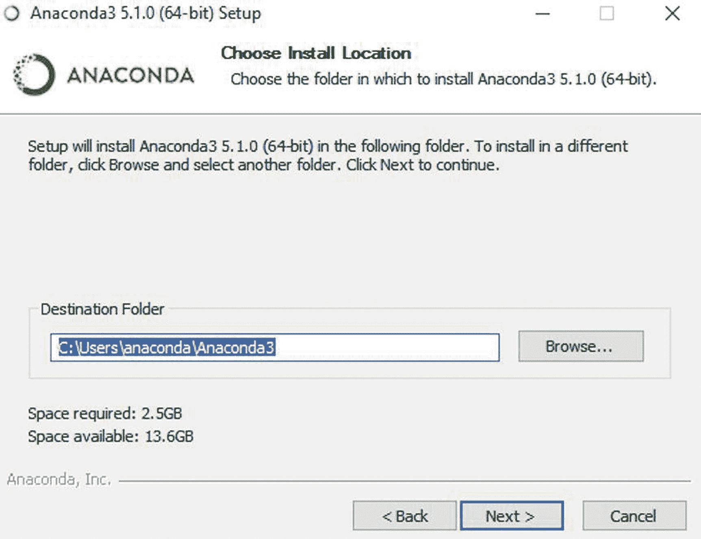

图 2-1：安装 Anaconda Python 发行版——设置安装位置

在开始实际安装之前，务必勾选图 2-2 中显示的两个选项。

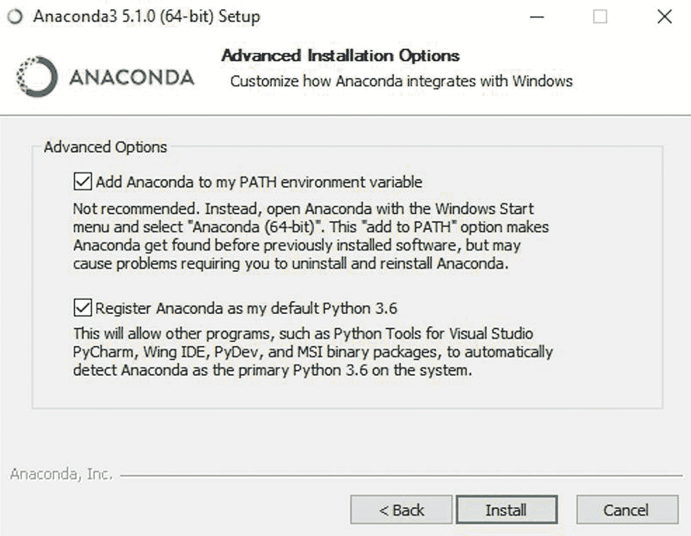

图 2-2：安装 Anaconda Python 发行版——添加到系统路径

安装完成后，你可以通过双击相关图标启动 Spyder，或者从命令提示符启动 Python 或 IPython 终端。要启动 Jupyter notebook，只需在终端或命令提示符中输入 `jupyter notebook` 即可。Spyder 为你提供了一个完整的集成开发环境，用于在常规 Python 和 IPython 终端中编写和执行代码。图 2-3 展示了如何启动 Jupyter notebook。

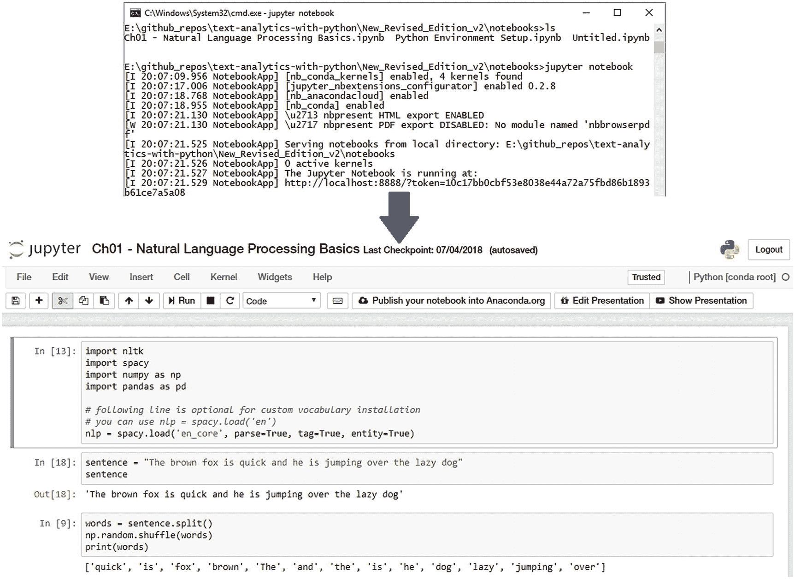

图 2-3：启动 Jupyter notebook

这应该能让你了解在 Jupyter notebook 中以交互方式展示代码和输出是多么容易。我们通常通过这些 notebook 来展示代码。要测试 Python 是否安装正确，只需在终端甚至在 notebook 中输入 `python --version` 即可，如图 2-4 所示。

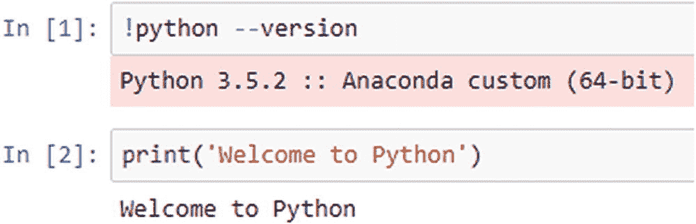

图 2-4：检查你的 Python 安装

## 包管理

我们现在简要介绍包管理。你可以使用 `pip` 或 `conda` 命令来安装、卸载和升级包。下面的 shell 命令展示了通过 `pip` 安装 pandas 库。你可以使用 `pip freeze <package_name>` 命令检查包是否已安装，并使用 `pip install <package_name>` 命令安装包，如图 2-5 所示。如果你已经安装了一个包/库，可以使用 `--upgrade` 标志。

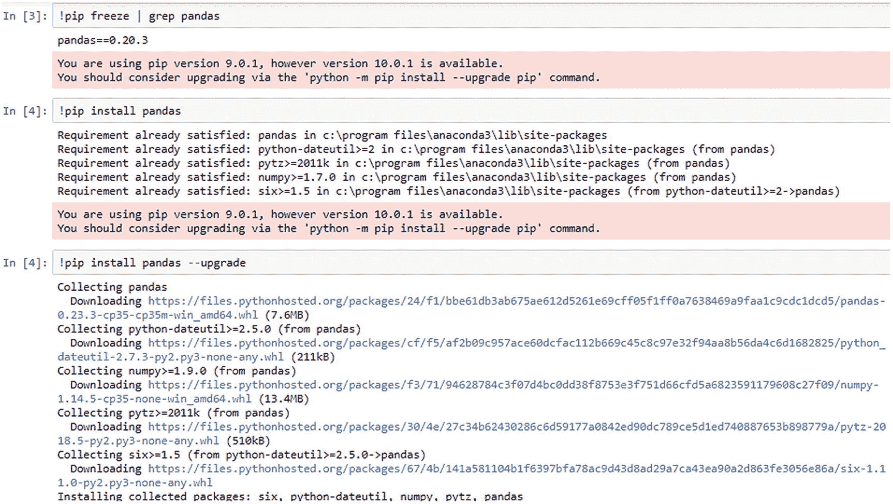

图 2-5：使用 `pip` 进行 Python 包管理

`conda` 包管理器在几个方面优于 `pip`，因为它能提供关于安装过程中将升级哪些依赖项、具体版本及其他细节的整体视图。`pip` 在 Windows 上经常无法安装某些包；然而，`conda` 在安装过程中通常没有此类问题。图 2-6 展示了如何使用 `conda` 安装和管理包。

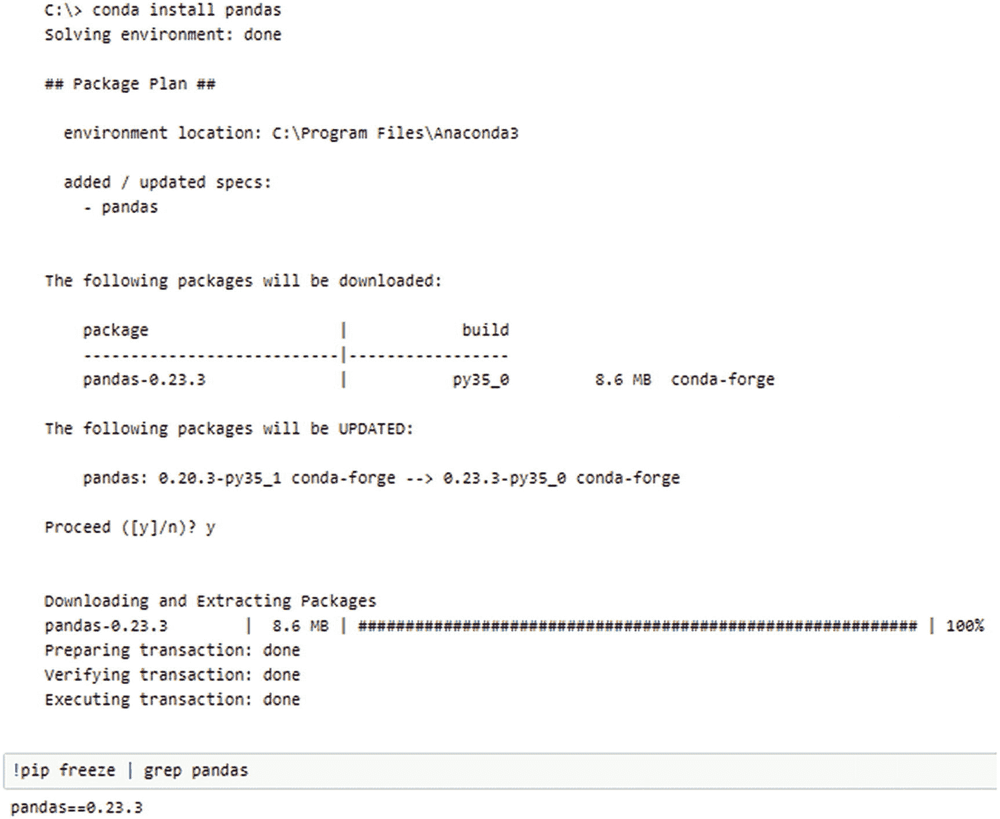

图 2-6：使用 `conda` 进行 Python 包管理

现在，你对于如何在 Python 中安装外部包和库有了更清晰的认识。当你日后需要在环境中安装外部 Python 包时，这将非常有用。你的 Python 环境现在应该已经搭建好并可以执行代码了。在我们深入探讨 Python 中处理文本数据的技术之前，我们以对虚拟环境的讨论作为本章的结束。

### 虚拟环境

虚拟环境（亦称为 `venv`）是一个完全独立的 Python 环境，拥有自己的 Python 解释器、库、模块和脚本。该环境是一个独立环境，与其他虚拟环境以及系统默认的 Python 环境相隔离。当你有多个项目或代码库依赖同一软件包或库的不同版本时，虚拟环境会非常有用。例如，如果我的项目 `TextApp1` 依赖 NLTK 2.0，而另一个项目 `TextApp2` 依赖 NLTK 3.0，那么在同一系统上运行这两个项目是不可能的。因此，我们需要虚拟环境来提供完全隔离的环境，这些环境可以根据需要激活和停用。

要搭建虚拟环境，你需要 `virtualenv` 软件包。我们创建一个新目录来存放虚拟环境，并按如下方式安装 `virtualenv`：

```
E:\>mkdir Apress
E:\>cd Apress
E:\Apress>pip install virtualenv
Collecting virtualenv
Installing collected packages: virtualenv
Successfully installed virtualenv-16.0.0
```

软件包安装完成后，你就可以创建一个虚拟环境了。这里我们创建一个名为 `test_proj` 的新项目目录，并在其中创建虚拟环境：

```
E:\Apress>mkdir test_proj && chdir test_proj
E:\Apress\test_proj>virtualenv venv
Using base prefix 'c:\\program files\\anaconda3'
New python executable in E:\Apress\test_proj\venv\Scripts\python.exe
Installing setuptools, pip, wheel...done.
```

既然你已经成功安装了虚拟环境，让我们试着观察一下全局系统 Python 环境与我们的虚拟环境之间的主要区别。如果你还记得，我们在上一节中将全局系统 Python 的 pandas 软件包版本更新到了 0.23。我们可以使用以下命令进行验证。

```
E:\Apress\test_proj>echo 'This is Global System Python'
'This is Global System Python'
E:\Apress\test_proj>pip freeze | grep pandas
pandas==0.23.3
```

现在假设我们想要在虚拟环境中使用旧版本的 pandas，但又不希望影响全局系统 Python 环境。我们可以通过激活虚拟环境并安装 pandas 来实现。

```
E:\Apress\test_proj>venv\Scripts\activate
(venv) E:\Apress\test_proj>echo 'This is VirtualEnv Python'
'This is VirtualEnv Python'
(venv) E:\Apress\test_proj>pip install pandas==0.21.0
Collecting pandas==0.21.0
100% |################################| 9.0MB 310kB/s
Collecting pytz>=2011k (from pandas==0.21.0)
Collecting python-dateutil>=2 (from pandas==0.21.0)
Collecting numpy>=1.9.0 (from pandas==0.21.0)
Collecting six>=1.5 (from python-dateutil>=2->pandas==0.21.0)
Installing collected packages: pytz, six, python-dateutil, numpy, pandas
Successfully installed numpy-1.14.5 pandas-0.21.0 python-dateutil-2.7.3 pytz-2018.5 six-1.11.0
(venv) E:\Apress\test_proj>pip freeze | grep pandas
pandas==0.21.0
```

对于其他操作系统平台，你可能需要使用命令 `source venv/bin/activate` 来激活虚拟环境。一旦虚拟环境被激活，你可以看到 `(venv)` 标识，如前面代码输出所示，并且你安装的任何新软件包都将被放置在 `venv` 文件夹中，与全局系统 Python 环境完全隔离。

从之前的代码片段中，你可以看到同一台机器上 pandas 软件包的不同版本——全局 Python 为 0.23.3，而虚拟环境 Python 为 0.21.0。因此，这些隔离的虚拟环境可以在同一系统上无缝运行。当你在虚拟环境中完成工作后，可以按如下方式再次停用它。

```
(venv) E:\Apress\test_proj>venv\Scripts\deactivate
E:\Apress\test_proj>pip freeze | grep pandas
pandas==0.23.3
```

这将使你回到系统的默认 Python 版本及其所有已安装的库，并且正如预期那样，pandas 版本是我们之前安装的较新版本。这让我们很好地了解了虚拟环境的实用性和优势，一旦你开始处理多个项目，绝对应该考虑使用它。要了解更多关于虚拟环境的信息，请查看 [`http://docs.python-guide.org/en/latest/dev/virtualenvs/`](http://docs.python-guide.org/en/latest/dev/virtualenvs/)，这是 `virtualenv` 软件包的官方文档。至此，我们的安装和设置活动告一段落。接下来，在通过动手实例深入探讨如何使用 Python 处理文本数据之前，我们先了解一些关于 Python 语法和结构的基本概念。

## Python 语法与结构

我们简要讨论一下在为应用程序和系统编写 Python 代码时所遵循的基本语法、结构和设计理念。Python 代码有明确的层级语法，你在编写代码时应牢记这一点。任何大型 Python 应用程序或系统都是由多个模块构建而成，而这些模块本身又由 Python 语句组成。每条语句就像一条命令或指令，指示系统应执行哪些操作。这些语句由表达式和对象组成。Python 中万物皆对象，包括函数、数据结构、类型、类等等。这种层级结构可以更直观地通过图 2-7 来理解。

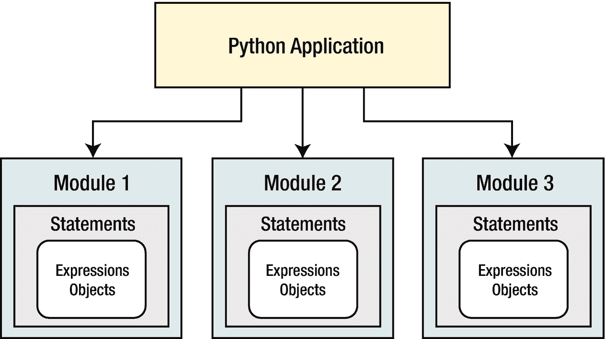

图 2-7

Python 程序结构层级关系

基本语句由对象和表达式组成（表达式使用对象并对其进行处理和操作）。对象可以是简单数据类型和结构，也可以是复杂对象，包括具有特定角色的函数和保留字。Python 有大约 30 多个关键字或保留字，均有各自指定的角色和功能。我们假设你对基本编程结构有一定了解，但如果你没有，也不要气馁！在下一节中，我们将通过详细的动手实例来展示如何处理文本数据。

## 处理文本数据

在本节中，我们将简要介绍专门用于处理文本数据的数据类型，以及这些数据类型及其相关工具、函数和方法如何在后续章节中发挥作用。Python 中处理文本数据的主要数据类型是字符串。这些可以是普通字符串、存储二进制信息的字节串或 Unicode。默认情况下，Python 3.x 中所有字符串都是 Unicode 编码，但 Python 2.x 中并非如此。在不同 Python 发行版中处理文本时，这一点你一定要牢记。

# Python 字符串

Python 中的字符串是字符序列，类似于数组和代码，带有一组属性和方法，可以轻松地利用它们来操作和处理文本数据。这使得 Python 在许多场景下成为文本分析的首选语言。我们将讨论多种类型的字符串，并在下一节中给出若干示例。

## 字符串字面量

如前所述，字符串有多种类型。下面的 BNF（巴克斯-诺尔范式）给出了生成字符串的一般词法定义，这些定义与 Python 官方文档中的一致。

```
stringliteral   ::=  stringprefix
stringprefix    ::=  "r" | "u" | "ur" | "R" | "U" | "UR" | "Ur" | "uR"
                     | "b" | "B" | "br" | "Br" | "bR" | "BR"
shortstring     ::=  "'" shortstringitem* "'" | '"' shortstringitem* '"'
longstring      ::=  "'''" longstringitem* "'''" | '"""' longstringitem* '"""'
shortstringitem ::=  shortstringchar | escapeseq
longstringitem  ::=  longstringchar | escapeseq
shortstringchar ::=  
longstringchar  ::=  
escapeseq       ::=  "\" 
```

这些规则告诉我们，存在不同类型的字符串前缀，它们可以与不同的字符串类型结合使用以生成字符串字面量。简单来说，最常用的字符串字面量类型如下：

-   **短字符串：** 这类字符串通常用单引号 (`'`) 或双引号 (`"`) 包围字符。例如 `'Hello'` 和 `"Hello"`。

-   **长字符串：** 这类字符串通常用三个单引号 (`'''`) 或三个双引号 (`"""`) 包围字符。例如 `"""Hello, I'm a long string"""` 或 `'''Hello I\'m a long string'''`。注意 (`\'`) 表示一个转义序列，我们稍后将讨论。

-   **字符串中的转义序列：** 这类字符串通常包含转义序列，其规则以反斜杠 (`\`) 开头，后跟任意 ASCII 字符。因此，它们执行退格插值。常见的转义序列包括 (`\n`)（表示换行符）和 (`\t`)（表示制表符）。

-   **字节串：** 用于表示创建字节数据类型对象的字节串。这些字符串可以通过 `bytes('...')` 或使用 `b'...'` 符号创建。例如 `bytes('hello')` 和 `b'hello'`。

-   **原始字符串：** 这类字符串最初是为正则表达式（regex）和正则模式专门创建的。它们可以使用 `r'...'` 符号创建，并保持字符串的原始或原生形式。因此，它们不执行任何退格插值，也会关闭转义序列。例如 `r'Hello'`。

-   **Unicode 字符串：** 这类字符串支持文本中的 Unicode 字符，通常是 ASCII 字符序列。它们使用 `u'...'` 符号表示。然而，在 Python 3.x 中，所有字符串字面量通常都用 Unicode 表示。除了字符串符号之外，还有几种特定方法可以表示字符串中的特殊 Unicode 字符。通常包括格式为 `'\xVV'` 的十六进制字节值转义序列。除此之外，我们还有 `'\uVVVV'` 和 `'\uVVVVVVVV'` 形式的 Unicode 转义序列，其中第一种形式使用四个十六进制数字编码 16 位字符，第二种使用八个十六进制数字编码 32 位字符。一些示例包括 `u 'H\xe8llo'` 和 `u 'H\u00e8llo'`，它们都表示字符串 `'Hèllo'`。

现在我们已经了解了字符串字面量的主要类型，接下来看看表示字符串的方法。

## 表示字符串

字符串是用于存储和表示文本数据的字符序列或集合，这也是本书大多数示例中首选的数据类型。字符串可用于将文本和字节作为信息存储。字符串有各种各样的方法可用于处理和操作字符串，这将在后续章节中看到。需要记住的一个重要点是，字符串是不可变的，对字符串执行的任何操作都会创建一个新的字符串对象（可以使用 `id` 函数检查），而不仅仅是更改现有字符串对象的值。让我们看一些基本的字符串表示。

```
new_string = "This is a String"  # 存储一个字符串
print('ID:', id(new_string))  # 显示对象标识符（地址）
print('Type:', type(new_string))  # 显示对象类型
print('Value:', new_string)  # 显示对象值
ID: 1907471142032
Type: 
Value: This is a String
# 简单字符串
simple_string = 'Hello!' + " I'm a simple string"
print(simple_string)
Hello! I'm a simple string
```

表示多行字符串也非常简单，可以按如下方式操作：

```
# 多行字符串，注意自动创建的 \n（换行）转义字符
multi_line_string = """Hello I'm
a multi-line
string!"""
multi_line_string
"Hello I'm\na multi-line\nstring!"
print(multi_line_string)
Hello I'm
a multi-line
string!
```

现在让我们看看如何以原生格式表示转义序列和原始字符串，而不包含任何转义序列。

```
# 包含转义序列的普通字符串导致文件路径错误！
escaped_string = "C:\the_folder\new_dir\file.txt"
print(escaped_string)  # 如果尝试在此处打开文件将导致错误
C: he_folder
ew_dirile.txt
# 原始字符串保留反斜杠的原始形式
raw_string = r'C:\the_folder\new_dir\file.txt'
print(raw_string)
C:\the_folder\new_dir\file.txt
```

让我们看看如何利用 Unicode 表示非 ASCII 字符，这也可用于表示像表情符号这样的符号。

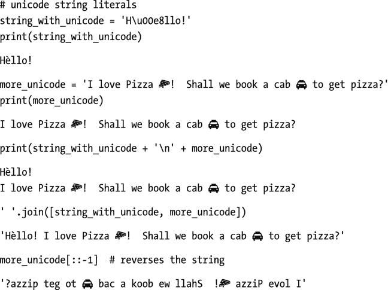

## 字符串操作和方法

字符串是可迭代序列，因此可以对它们执行许多操作。这在将文本数据处理和解析为易于使用的格式时尤其有用。可以对字符串执行多种操作。我们将其分为以下几类。

-   基本操作

-   索引和切片

-   方法

-   格式化

-   正则表达式

这些涵盖了处理字符串最常用的技术，构成了我们入门所需的基础。在下一章中，我们将基于前两章学到的概念来理解和处理文本数据。

### 基本操作

你可以对字符串执行几种基本操作，包括连接、检查子字符串、字符和长度。我们从一些连接字符串的基本示例开始。

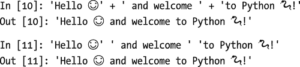

现在让我们看看在处理字符串时连接变量和字面量的一些方法。

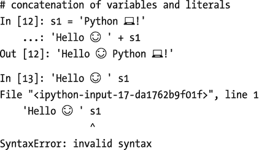

接下来我们看看更多连接字符串的方法。

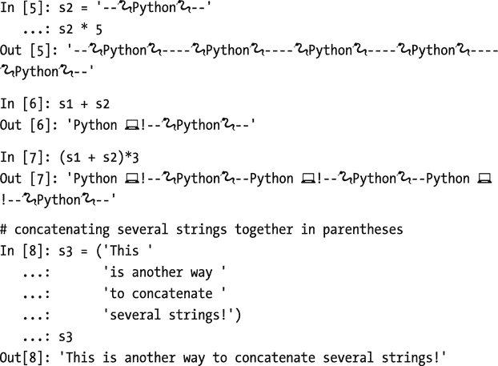

以下是一些更基本的操作，比如检查子字符串和查找典型字符串的长度。

```
In [9]: 'way' in s3
Out[9]: True
In [10]: 'python' in s3
Out[10]: False
In [11]: len(s3)
Out[11]: 51
```

### 索引与切片

如前所述，字符串是字符序列，也是可迭代对象。因此，它们可以像列表等其他可迭代对象一样被索引、切片和迭代。每个字符在字符串中都有一个特定的位置，称为其索引。通过索引，我们可以访问字符串的特定部分。使用特定位置或索引访问字符串中的单个字符称为*索引*，而使用起始和结束索引访问字符串的一部分（即子串）称为*切片*。Python 支持两种类型的索引：一种从 `0` 开始，每增加一个字符索引加 `1`，直到字符串末尾；另一种从字符串末尾的 `-1` 开始，每向字符串开头移动一个字符索引减 `1`。图 2-8 描述了字符串 `'PYTHON'` 的两种索引类型。

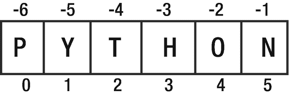

**图 2-8** 字符串索引语法

让我们从一些基本的字符串索引开始，以便你了解如何访问字符串中的特定字符。

```
# 创建一个字符串
In [12]: s = 'PYTHON'
...: s, type(s)
Out[12]: ('PYTHON', str)
# 展示字符串索引
In [13]: for index, character in enumerate(s):
...:     print('Character ->', character, 'has index->', index)
Character -> P has index-> 0
Character -> Y has index-> 1
Character -> T has index-> 2
Character -> H has index-> 3
Character -> O has index-> 4
Character -> N has index-> 5
# 字符串索引
In [14]: s[0], s[1], s[2], s[3], s[4], s[5]
Out[14]: ('P', 'Y', 'T', 'H', 'O', 'N')
In [15]: s[-1], s[-2], s[-3], s[-4], s[-5], s[-6]
Out[15]: ('N', 'O', 'H', 'T', 'Y', 'P')
```

很明显，你可以像访问列表一样，通过索引访问特定的字符串元素。现在，让我们通过一些动手示例来看看切片字符串的有趣方法！

```
# 字符串切片
In [16]: s[:]
Out[16]: 'PYTHON'
In [17]: s[1:4]
Out[17]: 'YTH'
In [18]: s[:3], s[3:]
Out[18]: ('PYT', 'HON')
In [19]: s[-3:]
Out[19]: 'HON'
In [21]: s[:3] + s[-3:]
Out[21]: 'PYTHON'
In [22]: s[::1]  # 无偏移
Out[22]: 'PYTHON'
In [24]: s[::2]  # 每隔一个字符打印一次
Out[24]: 'PTO'
```

前面的代码片段应该能让你很好地了解如何从给定字符串中切片并提取特定的子串。如前所述，这与列表非常相似。然而，关键的区别在于字符串是不可变的。让我们在以下示例中尝试理解这个概念。

```
# 字符串是不可变的，因此赋值会报错
In [27]: s[0] = 'X'
Traceback (most recent call last):
File "", line 1, in 
s[0] = 'X'
TypeError: 'str' object does not support item assignment
# 创建一个新字符串
In [28]: print('Original String id:', id(s))
...: # 创建一个新字符串
...: s = 'X' + s[1:]
...: print(s)
...: print('New String id:', id(s))
Original String id: 2117246774552
XYTHON
New String id: 2117246656048
```

基于前面的示例，你可以清楚地看到字符串是不可变的，不支持以任何形式对原始字符串进行赋值或修改。即使你使用同一个变量并对其执行某些操作，也会得到一个全新的字符串。

### 方法

Python 基础库中内置了大量可用的字符串方法，你可以使用它们来执行各种转换、处理和操作。详细讨论每一个方法超出了当前的范围；然而，官方 Python 文档中的这个有用链接 [`https://docs.python.org/3/library/stdtypes.html#string-methods`](https://docs.python.org/3/library/stdtypes.html#string-methods) 提供了你需要的关于每个方法的所有信息，包括语法和定义。方法非常有用，能提高你的生产力，因为你无需花费额外的时间编写样板代码来处理和操作字符串。我们在以下代码片段中展示了一些流行的字符串方法示例。

```
s = 'python is great'
### 大小写转换
In [33]: s.capitalize()
Out[33]: 'Python is great'
In [34]: s.upper()
Out[34]: 'PYTHON IS GREAT'
In [35]: s.title()
Out[35]: 'Python Is Great'
# 字符串替换
In [36]: s.replace('python', 'NLP')
Out[36]: 'NLP is great'
# 数字检查
In [37]: '12345'.isdecimal()
Out[37]: True
In [38]: 'apollo11'.isdecimal()
Out[38]: False
# 字母检查
In [39]: 'python'.isalpha()
Out[39]: True
In [40]: 'number1'.isalpha()
Out[40]: False
# 字母数字检查
In [41]: 'total'.isalnum()
Out[41]: True
In [42]: 'abc123'.isalnum()
Out[42]: True
In [43]: '1+1'.isalnum()
Out[43]: False
```

以下代码片段展示了基于不同动手示例的分割、连接和去除字符串的方法。

```
# 字符串分割与连接
In [44]: s = 'I,am,a,comma,separated,string'
...: s.split(',')
Out[44]: ['I', 'am', 'a', 'comma', 'separated', 'string']
In [45]: ' '.join(s.split(','))
Out[45]: 'I am a comma separated string'
# 基本字符串去除空白
In [46]: s = '   I am surrounded by spaces    '
...: s
Out[46]: '   I am surrounded by spaces    '
In [47]: s.strip()
Out[47]: 'I am surrounded by spaces'
# 更多组合
In [48]: sentences = 'Python is great. NLP is also good.'
...: sentences.split('.')
Out[48]: ['Python is great', ' NLP is also good', "]
In [49]: print('\n'.join(sentences.split('.')))
Python is great
NLP is also good
In [50]: print('\n'.join([sentence.strip()
...:                      for sentence in sentences.split('.')
...:                          if sentence]))
Python is great
NLP is also good
```

这些示例仅仅触及了字符串上众多处理和操作的皮毛。欢迎尝试使用文档中提到的其他方法进行其他操作。我们在后续章节中会用到其中一些方法。

### 格式化

字符串格式化用于在字符串中替换特定的数据对象和类型。这在向用户显示文本时经常使用。字符串有两种不同的格式化类型：

-   **格式化表达式：** 这些表达式通常采用 `'...%s...%s...' %(values)` 的语法，其中 `%s` 表示一个占位符，用于替换 `values` 列表中对应的字符串。这与 C 语言的 `printf` 模型非常相似，并且自 Python 诞生之初就已存在。你可以通过 `%` 符号后跟相应的字母来替换其他类型的值，例如 `%d` 用于整数，`%f` 用于浮点数。

-   **格式化方法：** 这些字符串采用 `'...{}...{}...'.format(values)` 的形式，它使用花括号 `{}` 作为占位符，通过 `format` 方法从 `values` 中插入字符串。这种方法自 Python `2.6.x` 版本起就已存在。

以下代码片段通过几个动手示例展示了两种字符串格式化类型。

# 简单的字符串格式化表达式 - 旧式

```
In [51]: 'Hello %s' %('Python!')
Out[51]: 'Hello Python!'
In [52]: 'Hello %s %s' %('World!', 'How are you?')
Out[52]: 'Hello World! How are you?'
```

# 不同数据类型的格式化表达式 - 旧式

```
In [53]: 'We have %d %s containing %.2f gallons of %s' %(2, 'bottles', 2.5, 'milk')
Out[53]: 'We have 2 bottles containing 2.50 gallons of milk'
In [54]: 'We have %d %s containing %.2f gallons of %s' %(5.21, 'jugs', 10.86763, 'juice')
Out[54]: 'We have 5 jugs containing 10.87 gallons of juice'
```

# 使用格式方法的字符串格式化 - 新式

```
In [55]: 'Hello {} {}, it is a great {} to meet you at {}'.format('Mr.', 'Jones', 'pleasure', 5)
Out[55]: 'Hello Mr. Jones, it is a great pleasure to meet you at 5'
In [56]: 'Hello {} {}, it is a great {} to meet you at {} o\' clock'.format('Sir', 'Arthur', 'honor', 9)
Out[56]: "Hello Sir Arthur, it is a great honor to meet you at 9 o' clock"
```

# 使用字符串格式化的其他方式

```
In [57]: 'I have a {food_item} and a {drink_item} with me'.format(drink_item='soda', food_item="sandwich")
Out[57]: 'I have a sandwich and a soda with me'
In [58]: 'The {animal} has the following attributes: {attributes}'.format(animal='dog', attributes=['lazy', 'loyal'])
Out[58]: "The dog has the following attributes: ['lazy', 'loyal']"
```

从这些示例中可以看出，格式化字符串没有硬性规定，因此你可以大胆尝试不同的格式，并使用最适合你任务的格式。我们通常建议使用新式格式。

## 正则表达式

正则表达式，更广为人知的名字是 regexes，允许你创建字符串模式，并用于在文本数据中搜索和替换特定的模式匹配。Python 提供了一个名为 `re` 的丰富模块来创建和使用正则表达式。由于它易于使用但难以精通，因此已有整本书籍专门讨论这个主题。在当前范围内不可能讨论正则表达式的每一个方面，但我们通过足够的示例覆盖了主要领域，这应该足以让你入门这个主题。

正则表达式或 regexes 是特定的模式，通常使用原始字符串表示法表示。这些模式基于其表达的规则匹配一组特定的字符串。这些模式随后通常被编译成字节码，然后由匹配引擎执行以匹配字符串。`re` 模块还提供了几个标志，可以改变模式匹配的执行方式。一些重要的标志包括：

-   `re.I` 或 `re.IGNORECASE` 用于忽略大小写匹配模式。
-   `re.S` 或 `re.DOTALL` 使句点（`.`）字符匹配任何字符，包括换行符。
-   `re.U` 或 `re.UNICODE` 有助于匹配基于 Unicode 的字符（在 Python 3.x 中已弃用）。

对于模式匹配，正则表达式中有各种规则。一些常用的规则包括：

-   `.` 用于匹配单个字符
-   `^` 用于匹配字符串的开头
-   `$` 用于匹配字符串的结尾
-   `*` 用于匹配模式中 `*` 符号之前指定的正则表达式的零个或多个实例
-   `?` 用于匹配模式中 `?` 符号之前指定的正则表达式的零个或一个实例
-   `[...]` 用于匹配方括号内字符集合中的任意一个字符
-   `[^...]` 用于匹配 `^` 符号后方括号内不存在的字符
-   `|` 表示 `OR` 运算符，用于匹配其前面或后面的正则表达式
-   `+` 用于匹配模式中 `+` 符号之前指定的正则表达式的一个或多个实例
-   `\d` 用于匹配十进制数字，也可表示为 `[0-9]`
-   `\D` 用于匹配非数字字符，也可表示为 `[⁰-9]`
-   `\s` 用于匹配空白字符
-   `\S` 用于匹配非空白字符
-   `\w` 用于匹配字母数字字符；也可表示为 `[a-zA-Z0-9_]`
-   `\W` 用于匹配非字母数字字符；也可表示为 `[^a-zA-Z0-9_]`

正则表达式可以被编译成模式对象，然后与各种方法一起使用，在字符串中进行模式搜索和替换。`re` 模块为执行这些操作提供的主要方法如下：

-   `re.compile()` ：此方法将指定的正则表达式模式编译成一个正则表达式对象，该对象可用于匹配和搜索。它接受一个模式和可选的标志作为输入，这些我们在前面已经讨论过。
-   `re.match()` ：此方法用于在字符串的开头匹配模式。
-   `re.search()` ：此方法用于匹配字符串中任何位置出现的模式。
-   `re.findall()` ：此方法返回字符串中指定正则表达式模式的所有非重叠匹配项。
-   `re.finditer()` ：此方法以迭代器的形式返回字符串中从左到右扫描时特定模式的所有匹配实例。
-   `re.sub()` ：此方法用于将字符串中的指定正则表达式模式替换为替换字符串。它只替换字符串中从左数起第一个出现的模式。

以下代码片段展示了其中一些方法，并说明了它们在处理字符串和正则表达式时的典型用法。

# Python 字符串与正则表达式

## 创建与匹配字符串

```python
# 创建一些字符串
s1 = 'Python is an excellent language'
s2 = 'I love the Python language. I also use Python to build applications at work!'
# 由于大小写不匹配，未找到匹配项
In [61]: import re
...:
...: pattern = 'python'
...: # match 仅在字符串开头找到正则匹配时才返回匹配对象
...: re.match(pattern, s1)
# 模式是小写的，因此忽略大小写标志有助于匹配不同大小写的相同模式
In [62]: re.match(pattern, s1, flags=re.IGNORECASE)
Out[62]:
```

```python
# 打印匹配的字符串及其在原字符串中的索引
In [64]: m = re.match(pattern, s1, flags=re.IGNORECASE)
...: print('在原字符串 "{}" 中，找到从索引 {} 到 {} 的匹配项 "{}"'.format(m.group(0), m.start(), m.end(), s1))
Found match Python ranging from index 0 - 6 in the string "Python is an excellent language"
# 当模式不在字符串 s2 的开头时，match 不起作用
In [65]: re.match(pattern, s2, re.IGNORECASE)
```

## `find()` 与 `search()` 方法

现在让我们看一些示例，说明 `find(...)` 和 `search(...)` 方法在正则表达式中的工作方式：

```python
# 使用 re 模块演示 find 和 search 方法
In [66]: re.search(pattern, s2, re.IGNORECASE)
Out[66]:
In [67]: re.findall(pattern, s2, re.IGNORECASE)
Out[67]: ['Python', 'Python']
In [68]: match_objs = re.finditer(pattern, s2, re.IGNORECASE)
...: match_objs
Out[68]:
In [69]: print("字符串:", s2)
...: for m in match_objs:
...:     print('找到从索引 {} 到 {} 的匹配项 "{}"'.format(m.start(), m.end(), m.group(0)))
String: I love the Python language. I also use Python to build applications at work!
Found match "Python" ranging from index 11 - 17
Found match "Python" ranging from index 39 - 45
```

## 使用正则表达式进行文本替换

用于文本替换的正则表达式非常有用，可以查找并替换字符串中的特定文本标记。我们通过几个示例来说明这一点：

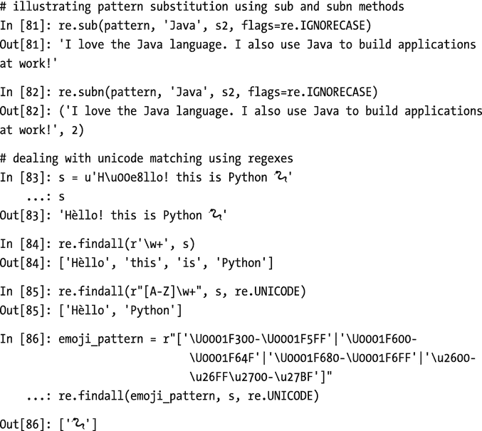

至此，我们关于字符串及其各种方面（包括表示和操作）的讨论结束了。这应该能让你了解如何利用字符串处理文本数据，以及字符串如何构成文本处理的基础，而文本处理是文本分析中的一个重要组成部分。现在我们介绍一个基本的文本处理案例研究，其中我们将基于前面章节学到的内容，将所有这些知识整合在一起。

# 基本文本处理与分析：综合应用

让我们利用本章以及前一章学到的知识，构建并解决一个基本的文本处理问题。为此，我们从 NLTK 中的 Gutenberg 语料库加载《英王钦定版圣经》。以下代码展示了如何加载圣经语料库并显示其中的前几行。

```python
from nltk.corpus import gutenberg
import matplotlib.pyplot as plt
% matplotlib inline
bible = gutenberg.open('bible-kjv.txt')
bible = bible.readlines()
bible[:5]
['[The King James Bible]\n',
'\n',
'The Old Testament of the King James Bible\n',
'\n',
'The First Book of Moses:  Called Genesis\n']
```

在前面的输出中，我们可以清楚地看到圣经语料库的前几行。让我们进行一些基本的预处理，方法是移除语料库中的所有空换行符，并去掉其他行中的换行符。

```python
In [88]: len(bible)
Out[88]: 99805
In [89]: bible = list(filter(None, [item.strip('\n') for item in bible]))
...: bible[:5]
Out[89]:
['[The King James Bible]',
'The Old Testament of the King James Bible',
'The First Book of Moses:  Called Genesis',
'1:1 In the beginning God created the heaven and the earth.',
'1:2 And the earth was without form, and void; and darkness was upon']
In [90]: len(bible)
Out[90]: 74645
```

我们可以清楚地看到，语料库中有很多空换行符，我们已经成功地将它们移除。现在让我们对语料库进行一些基本的频率分析。假设我们想要可视化圣经中典型句子或行长的整体分布。我们可以通过计算每个句子的长度，然后使用直方图进行可视化，如图 2-9 所示。

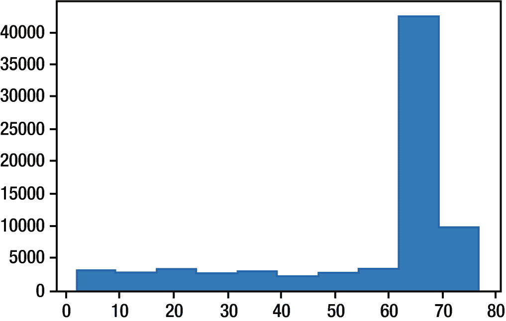

*图 2-9. 可视化圣经中的句子长度分布*

```python
line_lengths = [len(sentence) for sentence in bible]
h = plt.hist(line_lengths)
```

根据图 2-9 所描绘的图表，大多数句子的长度似乎在 65-70 个字符左右。现在让我们来看看每句的总词数分布。为了得到这个分布，首先让我们研究一下对语料库中每个句子进行分词的方法。

```python
In [95]: tokens = [item.split() for item in bible]
...: print(tokens[:5])
[['[The', 'King', 'James', 'Bible]'], ['The', 'Old', 'Testament', 'of', 'the', 'King', 'James', 'Bible'], ['The', 'First', 'Book', 'of', 'Moses:', 'Called', 'Genesis'], ['1:1', 'In', 'the', 'beginning', 'God', 'created', 'the', 'heaven', 'and', 'the', 'earth.'], ['1:2', 'And', 'the', 'earth', 'was', 'without', 'form,', 'and', 'void;', 'and', 'darkness', 'was', 'upon']]
```

现在我们已经对每个句子进行了分词，只需要计算每个句子的长度，即可获得每句的总词数，并绘制直方图来可视化这个分布。参见图 2-10。

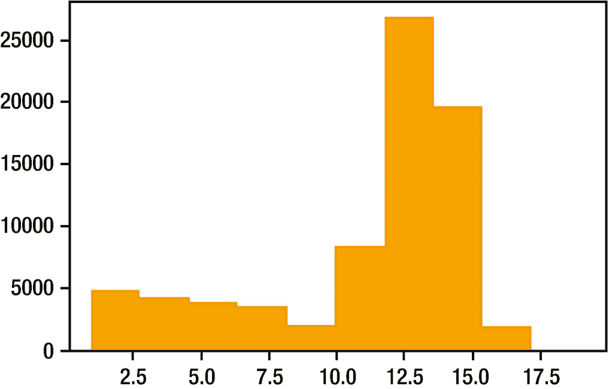

*图 2-10. 可视化圣经中每句总词数的分布*

```python
In [96]: total_tokens_per_line = [len(sentence.split()) for sentence in bible]
...: h = plt.hist(total_tokens_per_line, color="orange")
```

根据图 2-10 所描绘的可视化结果，我们可以清楚地得出结论：圣经中的大多数句子大约包含 12-15 个单词（或词元）。现在让我们尝试确定圣经语料库中最常见的单词。我们已经将句子分词为单词（单词列表）。第一步是将这个大的列表的列表（每个列表是一个已分词的句子）展平成一个大的单词列表。

```python
words = [word for sentence in tokens for word in sentence]
print(words[:20])
['[The', 'King', 'James', 'Bible]', 'The', 'Old', 'Testament', 'of', 'the', 'King', 'James', 'Bible', 'The', 'First', 'Book', 'of', 'Moses:', 'Called', 'Genesis', '1:1']
```

好极了！我们现在拥有了语料库中的大词元列表。不过，你可以看到这些词元并非完全干净，部分单词中还包含一些我们不想要的符号和特殊字符。现在，让我们利用正则表达式的强大功能来移除它们。

```python
words = list(filter(None, [re.sub(r'[^A-Za-z]', ", word) for word in words]))
print(words[:20])
['The', 'King', 'James', 'Bible', 'The', 'Old', 'Testament', 'of', 'the', 'King', 'James', 'Bible', 'The', 'First', 'Book', 'of', 'Moses', 'Called', 'Genesis', 'In']
```

基于我们在前一段代码中使用的正则表达式，我们移除了所有非字母字符。因此，所有数字和特殊字符都被删除了。现在，我们可以用以下代码来确定频率最高的单词。

```python
In [99]: from collections import Counter
...:
...: words = [word.lower() for word in words]
...: c = Counter(words)
...: c.most_common(10)
Out[99]:
[('the', 64023),
('and', 51696),
('of', 34670),
('to', 13580),
('that', 12912),
('in', 12667),
('he', 10419),
('shall', 9838),
('unto', 8997),
('for', 8970)]
```

我们看到，代词、冠词等大量通用填充词是频率最高的词，这完全合乎情理。但这并没有传达太多信息。如果我们能移除这些词，专注于更有趣的词，会怎么样呢？一种方法是移除这些填充词（通常称为停用词），然后按如下方式计算频率。

```python
In [100]: import nltk
...:
...: stopwords = nltk.corpus.stopwords.words('english')
...: words = [word.lower() for word in words if word.lower() not in stopwords]
...: c = Counter(words)
...: c.most_common(10)
Out[100]:
[('shall', 9838),
('unto', 8997),
('lord', 7830),
('thou', 5474),
('thy', 4600),
('god', 4442),
('said', 3999),
('ye', 3983),
('thee', 3826),
('upon', 2748)]
```

因此，我们看到结果比以前更好；然而，许多词仍然是填充词或停用词。这是因为它们是更口语化的英语，不属于标准英语停用词列表，所以没有被移除。我们总是可以根据需要构建自定义的停用词列表。（更多关于停用词的内容，请参见第 3 章。）这应该能让您清楚地了解我们如何利用与字符串、方法和转换相关的所有方面来处理和分析文本数据。

## 自然语言处理框架

我们之前提到，Python 生态系统是多样化的，并在不同领域支持各种各样的库、框架和模块。由于我们将要分析文本数据并解决多个相关用例，因此有专门用于自然语言处理和文本分析的开源框架和库，您可以像使用 Python 标准库中的任何其他内置模块一样，直接安装并使用它们。这些框架经过了长时间的构建，并且通常仍在积极开发中。评估一个框架的方式通常是看其开发者社区的活跃程度。

每个框架都包含各种用于操作文本、获取洞察以及为后续分析（例如对预处理后的文本数据应用机器学习算法）准备数据的方法、能力和特性。利用这些框架可以节省大量编写模板代码来处理、操作和转换文本数据所需的工作和时间。因此，这使得开发人员和研究人员能够更专注于解决实际问题以及所需的逻辑和算法。我们已经在第一章中初步了解了`nltk`库。以下列出了一些最流行的文本分析框架库，我们将在本书中多次使用到它们。

*   `nltk`：自然语言工具包是一个完整的平台，包含超过 50 个语料库和词汇资源，例如 WordNet。除此之外，它还提供了必要的工具、接口和方法来处理和分析文本数据。NLTK 框架自带一套高效的模块，用于分类、分词、词干提取、词形还原、词性标注、句法分析和语义推理。它是业界任何 NLP 项目的标准主力工具。

*   `pattern`：`pattern`项目在此获得荣誉提名，因为我们在本书的第一版中广泛使用了它。然而，由于缺乏官方支持或 Python 3.x 版本，我们本版将不再使用它。它最初是安特卫普大学计算语言学与心理语言学研究中心的一个研究项目。它提供了用于网络挖掘、信息检索、自然语言处理、机器学习和网络分析的工具和接口。

*   `spacy`：与其他框架相比，这是相对较新的库之一，但或许是用于 NLP 的最佳库之一。我们可以保证，spaCy 通过提供每种技术和算法的最佳实现，提供了工业级的自然语言处理能力，使得 NLP 任务在性能和实现方面都高效。事实上，spaCy 擅长大规模信息抽取任务。它从头开始使用高效、内存管理的 Cython 编写。广泛的研究也证实 spaCy 是世界上最快的。spaCy 还能与 TensorFlow、PyTorch、Scikit-Learn、Gensim 等深度学习及机器学习框架，以及 Python 其余优秀的 AI 生态系统无缝协作。最棒的是，spaCy 支持多种语言，并提供了预训练的词向量！

*   `gensim`：`gensim`库拥有丰富的语义分析能力，包括主题建模和相似性分析。但最棒的部分是，它包含了谷歌非常流行的 Word2Vec 模型的 Python 移植版（最初以 C 语言包的形式提供），该模型是一个神经网络模型，用于学习单词的分布式表示，使得语义相似的单词彼此靠近出现。因此，Gensim 既可用于语义分析，也可用于特征工程！

*   `textblob`：这是另一个提供多种能力的库，包括文本处理、短语提取、分类、词性标注、文本翻译和情感分析。TextBlob 通过其极其直观且易于使用的 API，将许多困难的事情变得非常简单，包括语言翻译和情感分析。

除此之外，还有其他几个框架和库并非专门用于文本分析，但当您想对文本数据使用机器学习或深度学习技术时，它们会很有用。这些包括 Scikit-Learn、NumPy 和 SciPy 技术栈，它们对于文本特征工程、以矩阵形式处理特征集，甚至执行流行的机器学习任务（如相似性计算、文本分类和聚类）都极为有用。

除此之外，如果您想构建基于深度神经网络、卷积神经网络、序列模型和生成模型的高级深度学习模型，那么像 PyTorch、TensorFlow 和 Keras 这样的深度学习和基于张量的库也会派上用场。您可以在命令提示符或终端中使用以下命令来安装这些库中的大部分：

```
pip install <library>
```

我们将在后续章节使用这些库时，讨论任何需要注意的特殊事项。

## 总结

本章对整个 Python 生态系统及其在处理文本数据方面的能力提供了高屋建瓴但又足够详细的概述。你了解了 Python 语言背后的起源以及它是如何随着时间不断演进的。该语言具有开源的优势，这使得拥有一个活跃的开发者社区，他们不断努力改进该语言并添加新功能。

现在，你也知道了何时应该使用 Python，以及与该语言相关的缺点，这些是每个开发者在构建系统和应用程序时都应该牢记的。本章还清晰地阐述了如何设置自己的 Python 环境以及如何处理多个虚拟环境。从最基础的知识开始，我们深入探讨了如何使用字符串数据类型及其各种语法、方法、操作和格式来处理文本数据。我们还了解了正则表达式的强大之处，以及它们在模式匹配和替换中是多么有用。

为了总结我们的讨论，我们审视了各种流行的文本分析和自然语言处理框架，这些框架有助于解决和处理与自然语言处理、分析以及从文本数据中提取见解相关的任务问题。这应该能让你开始使用 Python 编程并处理文本数据。在下一章中，我们将在本章的基础上，开始理解、处理并以可用的格式解析文本数据。
