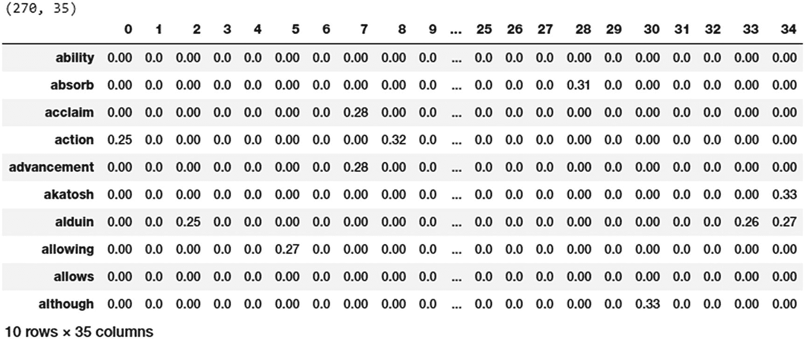

# 规范化文档中的每个句子
norm_sentences = normalize_corpus(sentences)
norm_sentences[:3]
```

输出：

```
array(['elder scrolls v skyrim action roleplaying video game developed bethesda game studios published bethesda softworks',
       'fifth main installment elder scrolls series following elder scrolls iv oblivion',
       'games main story revolves around player characters quest defeat alduin worldeater dragon prophesied destroy world'],
      dtype='<U183')
```

现在，我们的语料库已经过预处理和规范化。接下来，我们可以利用特征工程，以高效的向量化格式来表示文本数据。

### 基于特征工程的文本表示

我们将使用 TF-IDF 特征工程方案对规范化的句子进行向量化。我们保持简单，不根据文档频率过滤任何词语。但你可以随意尝试，甚至可以尝试使用 n-gram 作为特征。

```
from sklearn.feature_extraction.text import TfidfVectorizer
import pandas as pd
tv = TfidfVectorizer(min_df=0., max_df=1., use_idf=True)
dt_matrix = tv.fit_transform(norm_sentences)
dt_matrix = dt_matrix.toarray()
vocab = tv.get_feature_names()
td_matrix = dt_matrix.T
print(td_matrix.shape)
pd.DataFrame(np.round(td_matrix, 2), index=vocab).head(10)
```

图 6-21 中的输出是我们的标准术语-文档矩阵，显示了各个文档中每个术语的 TF-IDF 权重。在本例中，每个文档是我们原始游戏描述中的一个句子，并表示为矩阵的一列。现在，我们可以开始使用前面提到的两种技术来实现文档摘要。



*图 6-21. 可视化 NMF 模型中的主题*

### 潜在语义分析

在这里，我们通过利用文档句子来总结我们的游戏描述。文档中每个句子的术语已被提取出来，形成了我们在图 6-21 中看到的术语-文档矩阵。我们对这个矩阵应用低秩奇异值分解。潜在语义分析的核心原理是：在任何文档中，上下文相关的术语之间都存在一种潜在结构，因此它们也应在同一个奇异空间中相关联。

我们实现中所遵循的方法，源自 2004 年 J. Steinberger 和 K. Jezek 发表的一篇知名论文，题为“在文本摘要和摘要评估中使用潜在语义分析”，该论文对 Y. Gong 和 X. Liu 于 2001 年发表的杰出工作“使用相关性度量和潜在语义分析进行通用文本摘要”提出了一些改进建议。如果你想更深入地了解这项技术，我们建议你阅读这两篇论文。

我们实现的主要思想是使用 SVD（回顾 `M = USV^T`），使得 `U` 和 `V` 是正交矩阵，`S` 是对角矩阵，也可以表示为奇异值向量。原始矩阵可以表示为一个术语-文档矩阵，其中行是术语，列是文档（在本例中，即我们文档中的句子）。这些值可以是任何类型的权重，例如基于词袋模型频率、TF-IDF 或二进制出现次数。

我们使用 `low_rank_svd()` 函数，基于概念数量 `k`（即我们的奇异值数量）为 `M` 创建低秩矩阵近似。矩阵 `U` 中相同的 `k` 列将指向每个 `k` 概念的术语向量，而对于矩阵 `V`，基于前 `k` 个奇异值的 `k` 行则指向句子向量。一旦我们从 SVD 中，根据概念数量 `k`，获得了对应前 `k` 个奇异值的 `U`、`S` 和 `V^T`，我们就执行以下计算。请记住，我们需要的输入参数是概念数量 `k` 和摘要最终要包含的句子数量 `n`。

1.  从矩阵 `V`（`k` 行）中获取句子向量。
2.  从 `S` 中获取前 `k` 个奇异值。
3.  应用基于阈值的策略，移除那些小于最大奇异值一半的奇异值（如果存在）。这是一个启发式方法，你可以根据需要调整这个值。数学上表示为：如果 `S_i < (1/2) * S`，则 `S_i = 0`。
4.  将 `V` 中每个术语-句子列的平方与其对应奇异值 `S` 的平方相乘，以获得每个主题的句子权重。
5.  计算所有主题的句子权重之和，并对最终得分取平方根，以获得文档中每个句子的显著度得分。

每个句子的显著度得分计算可以用数学表示如下：

```
SS = sqrt(sum_{i=1}^k (S_i * V_i^T))
```

其中 `SS` 表示通过计算奇异值与 `V^T` 中句子向量点积得到的每个句子的显著性得分。一旦我们得到这些分数，就按降序排列，选出得分最高的前 `n` 个句子，并根据它们在原始文档中出现的顺序组合起来，形成最终的摘要。


让我们用 Python 实现算法。第一步是选择摘要包含的句子数量`n`。由于我们有大约 35 个句子，我们设定摘要包含八个句子。主题或概念的总数`k`设为三个，因为我们从维基百科原始评论的摘要、游戏玩法和剧情部分提取了游戏描述。然后我们执行低秩 SVD。

```
num_sentences = 8
num_topics = 3
u, s, vt = low_rank_svd(td_matrix, singular_count=num_topics)
print(u.shape, s.shape, vt.shape)
term_topic_mat, singular_values, topic_document_mat = u, s, vt
(270, 3) (3,) (3, 35)
```

接下来，我们应用一个阈值，将任何小于最大奇异值一半的奇异值设为`0`。

```
