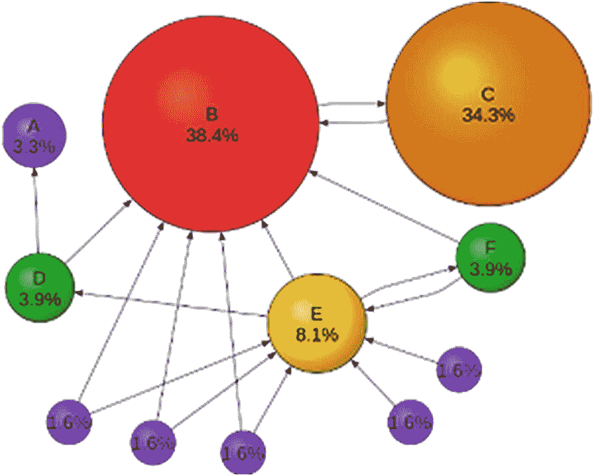
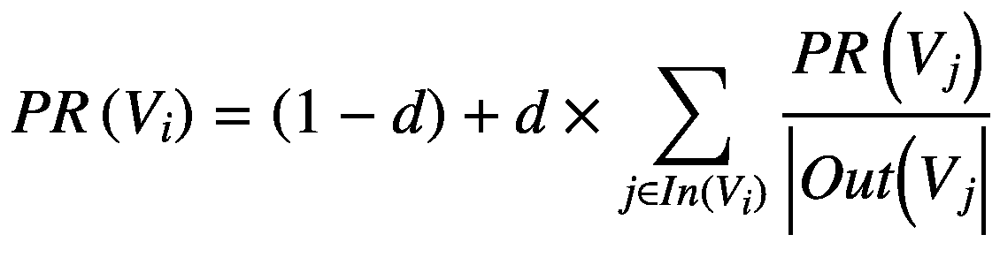
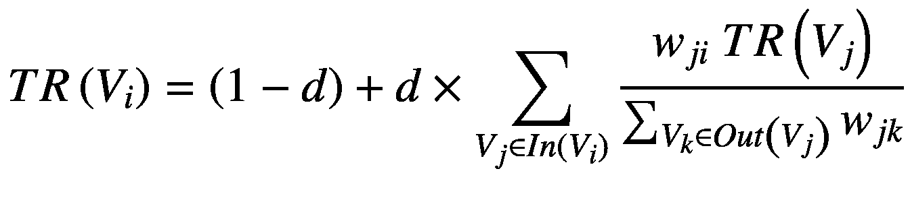

# 移除低于阈值的奇异值

`sv_threshold = 0.5`

`min_sigma_value = max(singular_values) * sv_threshold`

`singular_values[singular_values < min_sigma_value] = 0`

现在我们可以利用前面描述的公式，为游戏描述中的每个句子（文档）计算句子显著性分数。

```python
salience_scores = np.sqrt(np.dot(np.square(singular_values),
                                 np.square(topic_document_mat)))
salience_scores
```

```
array([0.53291263, 0.61639562, 0.60427539, 0.52307109, 0.50141128,
       0.32352969, 0.1506046 , 0.25383436, 0.60567083, 0.35902104,
       0.22562997, 0.34608934, 0.15781555, 0.40522541, 0.24505982,
       0.19874104, 0.39317895, 0.45392878, 0.31638528, 0.47353378,
       0.18348908, 0.45731421, 0.13929749, 0.38932101, 0.36829067,
       0.57822992, 0.40853736, 0.26260062, 0.38904585, 0.32776714,
       0.67662776, 0.21866561, 0.34687796, 0.3234621 , 0.46107093])
```

现在只需根据显著性分数选择排名靠前的句子，并展示游戏描述的摘要。

```python
top_sentence_indices = (-salience_scores).argsort()[:num_sentences]
top_sentence_indices.sort()
print('\n'.join(np.array(sentences)[top_sentence_indices]))
```

```
The Elder Scrolls V: Skyrim is an action role-playing video game developed by Bethesda Game Studios and published by Bethesda Softworks.
It is the fifth main installment in The Elder Scrolls series, following The Elder Scrolls IV: Oblivion.
The game's main story revolves around the player character's quest to defeat Alduin the World-Eater, a dragon who is prophesied to destroy the world.
The game is set 200 years after the events of Oblivion and takes place in the fictional province of Skyrim.
Over the course of the game, the player completes quests and develops the character by improving skills.
The Elder Scrolls V: Skyrim is an action role-playing game, playable from either a first or third-person perspective.
Skyrim is the first entry in The Elder Scrolls to include dragons in the game's wilderness.
Skyrim is set around 200 years after the events of The Elder Scrolls IV: Oblivion, although it is not a direct sequel.
```

由此可见，只需几次矩阵变换，就能得到一个简洁且出色的摘要文档，涵盖了游戏描述的主要方面。这就是我们对潜在语义分析的讨论。接下来，我们介绍另一种基于抽取的文档摘要技术。

## TextRank

TextRank 摘要算法在内部使用了流行的 PageRank 算法，该算法被谷歌用于对网站和页面进行排名。当根据搜索查询提供相关网页时，谷歌搜索引擎会使用该算法。为了更好理解 TextRank，我们需要了解 PageRank 相关的一些概念。PageRank 的核心算法是一种基于图的评分或排名算法，其中页面根据其重要性进行评分或排名。网站和页面包含进一步嵌入其中的链接，这些链接指向更多包含更多链接的页面，并且这个过程在整个互联网中持续进行。这可以表示为一个基于图的模型，其中顶点表示网页，边表示它们之间的链接。这可以用来形成一个投票或推荐系统，例如当一个顶点链接到图中的另一个顶点时，它基本上就是在投一票。顶点的重要性不仅取决于投票数或边数，还取决于与其相连的顶点的重要性以及这些顶点自身的重要性。这有助于确定每个顶点或页面的得分或排名。这在图 6-22 中显而易见。



图 6-22

简单网络的 PageRank 分数

从图 6-22 中，我们可以看到代表页面 C 的顶点比页面 E 的分数更高，即使它的边数比页面 E 少，这是因为页面 B 是一个连接到页面 C 的重要页面。因此，我们可以形式化地将 PageRank 定义如下。考虑一个有向图表示为 *G* = (*V*, *E*)，其中`V`表示顶点或页面的集合，`E`表示边或链接的集合。`E`是 *V* × *V* 的一个子集。假设我们有一个给定的页面`V[i]`，我们想要计算其 PageRank，可以数学定义如下：



其中，对于顶点/页面`V[i]`，`PR(V[i])`表示 PageRank 分数。`In(V[i])`表示指向该顶点/页面的页面集合，`Out(V[i])`表示顶点/页面`V[i]`所指向的页面集合，`d`是阻尼系数，通常取值在 0 到 1 之间（理想情况下设为 0.85）。

回到 TextRank 算法，在对文档进行摘要时，根据我们尝试进行的摘要类型，句子、关键词或短语将作为算法的顶点。这些顶点之间可能存在多个链接。我们对原始 PageRank 算法所做的修改是，在两个顶点`V[i]`和`V[j]`之间的连边上添加一个权重系数（例如`w[ij]`），该权重表示它们之间连接的强度。因此，我们现在形式化定义计算顶点 TextRank 的新函数如下：



其中`TR`表示顶点加权后的 PageRank 分数，现在定义为该顶点的 TextRank。因此，我们可以制定算法并描述将要遵循的主要步骤。它们定义如下：

1.  对待摘要文档中的句子进行分词和提取。
2.  确定最终摘要中想要的句子数量`k`。
3.  使用 TF-IDF 或词袋等权重构建文档-术语特征矩阵。
4.  通过将矩阵与其转置相乘计算文档相似度矩阵。
5.  使用这些文档（在本例中为句子）作为顶点，将每对文档之间的相似度作为权重或之前提到的评分系数，输入到 PageRank 算法中。
6.  获取每个句子的评分。
7.  根据评分对句子进行排序，并返回评分最高的 `k` 个句子。

由于我们在使用 LSA 进行文档摘要时已经定义了文档-词项特征矩阵，我们将复用存储于 `dt_matrix` 变量中的该矩阵。下一步是计算文档相似度矩阵。

```python
similarity_matrix = np.matmul(dt_matrix, dt_matrix.T)
```

print(`similarity_matrix.shape`)

`np.round(similarity_matrix, 3)`

(35, 35)

array([[1\.   , 0.182, 0\.   , ..., 0\.   , 0\.   , 0\.   ],

       [0.182, 1\.   , 0.05 , ..., 0\.   , 0\.   , 0.084],

       [0\.   , 0.05 , 1\.   , ..., 0.101, 0.165, 0.319],

       ...,

       [0\.   , 0\.   , 0.101, ..., 1\.   , 0.066, 0.069],

       [0\.   , 0\.   , 0.165, ..., 0.066, 1\.   , 0.123],

       [0\.   , 0.084, 0.319, ..., 0.069, 0.123, 1\.   ]])

现在，我们使用文档相似度分数和作为顶点的文档本身，在玩具文档中的所有句子之间构建连接图。我们使用`networkx`库来绘制此图。请记住，在我们的场景中，每个文档都是一个句子，它们也将是图中的顶点。

```python
import networkx
```