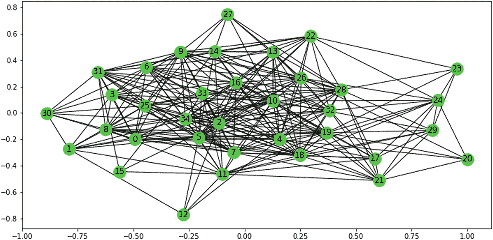

## view the similarity graph

```python
import matplotlib.pyplot as plt

%matplotlib inline

plt.figure(figsize=(12, 6))

networkx.draw_networkx(similarity_graph, node_color="lime")
```

从图 6-23 中，我们可以看到玩具文档中的句子如何根据文档相似度相互连接。图表展示了某些句子与其他句子的连接程度。现在我们计算所有句子的 `PageRank` 分数，并使用得分最高的八个句子构建摘要。



图 6-23：显示句子间连接的相似度图