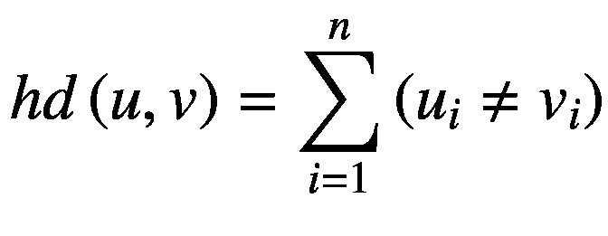
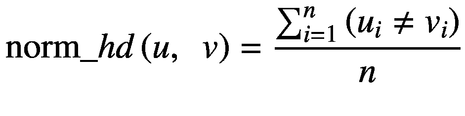

# Elephant

因此，你可以看到我们是如何轻松地将每个文本术语转换为对应的数字向量表示的。注意，`NaN`值表示这些字符串比最后一个字符串短一个字符，而最后一个字符串则长一个字符。现在，我们使用几种距离度量来计算根词与其他三个单词之间的相似度，如前一个代码片段所述。有许多距离度量可以用来计算和衡量相似度。在本节中，我们将介绍以下五种度量。

*   汉明距离
*   曼哈顿距离
*   欧几里得距离
*   莱文斯坦编辑距离
*   余弦距离与相似度

我们将介绍每种距离度量的概念，并利用`NumPy`数组的强大功能来实现必要的计算和数学公式。然后，我们将通过测量示例术语的相似度来实际应用它们。在此之前，我们使用以下代码片段设置一些必要的变量：存储根词、将与其比较相似度的其他术语，以及它们各自的各种向量表示。

```python
root_term = root
other_terms = [term1, term2, term3]
root_term_vec = vec_df[vec_df.index == root_term].dropna(axis=1).values[0]
other_term_vecs = [vec_df[vec_df.index == term].dropna(axis=1).values[0] for term in other_terms]
```

我们现在准备开始计算相似度度量，并将使用这些术语及其向量表示来衡量相似度。

## 汉明距离

*汉明距离*是一种非常流行的距离度量，常用于信息论和通信系统中。它是在假设两个字符串等长的前提下，测量它们之间的距离。正式定义是：在两个等长字符串之间，对应位置字符不同的位置数量。考虑两个长度为`n`的术语`u`和`v`，汉明距离的数学表示如下：



如果需要，你也可以通过将不匹配数除以术语的总长度来进行归一化。这样就得到了归一化的汉明距离，表示如下：



注意，`n`表示术语的长度。下面的函数计算两个术语之间的汉明距离，并且具备计算归一化距离的能力。

```python
def hamming_distance(u, v, norm=False):
    if u.shape != v.shape:
        raise ValueError('The vectors must have equal lengths.')
    return (u != v).sum() if not norm else (u != v).mean()
```

我们可以使用以下代码片段来测量根词与其他术语之间的汉明距离。

```python
```