# 4. 面向文本表示的特征工程

在前面的章节中，我们了解了如何理解、处理和整理文本数据。然而，所有机器学习或深度学习模型都存在局限性，因为它们无法直接理解文本数据，只能将特征的数值表示作为输入。在本章中，我们将探讨如何处理文本数据——这无疑是非结构化数据最丰富的来源之一。文本数据通常由文档组成，这些文档可以表示单词、句子甚至段落形式的自由流动文本。文本数据固有的结构缺失（没有整齐格式化的数据列！）和噪声特性使得机器学习方法难以直接处理原始文本数据。因此，在本章中，我们将采用动手实践的方法，探索一些从文本数据中提取有意义特征的最流行且最有效的策略。然后，这些特征可用于高效地表示文本，进而可以轻松地用于构建机器学习或深度学习模型以解决复杂任务。

特征工程非常重要，通常被称为创建卓越且性能更优的机器学习模型的秘诀。仅仅一个出色的特征就可能成为你在`Kaggle`挑战赛中获胜或根据预测获得更高回报的通行证！对于非结构化的文本数据，特征工程甚至更为重要，因为我们需要将自由流动的文本转换为可以被机器学习算法理解的数值表示。即使有了自动化特征工程功能，在将它们作为黑盒模型应用之前，你仍然需要理解不同特征工程策略背后的核心概念。请始终记住：“如果你得到一箱修理房屋的工具，你应该知道什么时候用电钻，什么时候用锤子！”

在本章中，我们涵盖了一系列用于表示文本数据的特征工程技术。我们将研究传统模型以及基于深度学习的新模型。本章涵盖以下技术：

* 词袋模型

* N-gram 词袋模型

* TF-IDF 模型

* 相似性特征

* 主题模型

* Word2Vec

* GloVe

* FastText

我们将探讨每种特征工程技术的相关重要概念，并学习如何使用该模型来表示文本数据。我们还将展示完整的动手实践示例，因为做中学效果最好！本章展示的所有代码示例均可在此书的官方 GitHub 仓库中找到，你可以通过以下链接访问：[`https://github.com/dipanjanS/text-analytics-with-python/tree/master/New-Second-Edition`](https://github.com/dipanjanS/text-analytics-with-python/tree/master/New-Second-Edition)。

# 理解文本数据

相信在介绍了整整三章内容后，你对文本数据应该已经有了一个清晰的概念。请记住，文本数据始终可以以结构化数据属性的形式存在，但通常这类数据归属于结构化、分类数据的范畴。在本场景中，我们讨论的是以单词、短语、句子和整篇文档形式存在的自由流动文本。本质上，我们确实有一定的句法结构。单词组成短语，短语组成句子，句子组成段落。然而，文本文档并没有固有的结构，因为你可以拥有各式各样的单词，这些单词在不同文档中可能各不相同，并且与结构化数据集中固定的数据维度数量相比，每个句子的长度也会不同。本章内容就是文本数据的一个绝佳范例！一个重要的问题可能是，我们如何表示文本数据，以便机器能够轻松地理解和领会？

在处理文本数据时，`向量空间模型`是一个非常有用的概念，它在信息检索和文档排序中非常流行。向量空间模型也称为`词项向量模型`，它被定义为一个数学和代数模型，用于将文本文档转换并表示为特定词项的数值向量，这些词项构成了向量维度。在数学上，可以如下定义。假设我们在文档向量空间`VS`中有一个文档`D`。每个文档的维度或列数将是向量空间中所有文档的不同词项或单词的总数。因此，向量空间可以表示如下：

`VS` = {`W`[1], `W`[2], ... , `W`[n]}

其中所有文档中共有`n`个不同的单词。现在，我们可以在这个向量空间中将文档`D`表示如下：

`D` = {`w`[`D`1], `w`[`D`2], ... , `w`[`Dn`]}

其中`w`[`Dn`]表示文档`D`中第`n`个单词的权重。这个权重是一个数值，可以是该词在文档中出现的频率、平均出现频率、嵌入权重，甚至是`TF-IDF 权重`（我们稍后讨论）等任何值。

关于特征提取和工程化，需要记住的一个要点是：一旦我们使用变换和数学运算构建了特征工程模型，就需要确保在从待预测的新文档中提取特征时使用相同的过程，而不是基于新文档重新构建整个算法。

# 构建文本语料库

我们需要一个文本语料库来进行操作，并演示不同的特征工程和表示方法。为了保持简单易懂，我们将在本节中构建一个简单的文本语料库。首先，在你的 Jupyter notebook 中加载以下依赖项。

```python
import pandas as pd
import numpy as np
import re
import nltk
import matplotlib.pyplot as plt
pd.options.display.max_colwidth = 200
%matplotlib inline
```

现在，让我们构建一个示例文档语料库，我们将在本章中对其运行大部分分析。*语料库*通常是指属于一个或多个主题或话题的文本文档的集合。下面的代码帮助我们创建这个语料库。你可以在图 4-1 的输出中看到这个示例文本语料库。

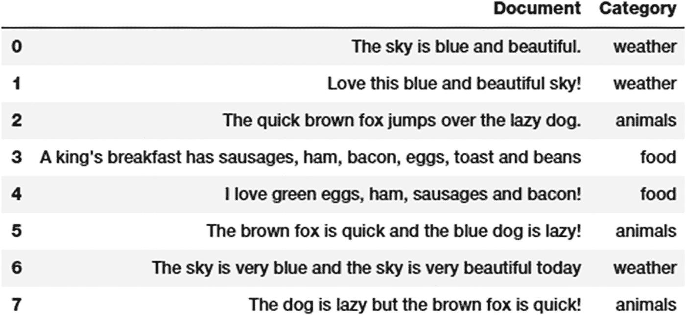

图 4-1

我们的示例文本语料库

```python
# 构建文档语料库
corpus = ['天空湛蓝而美丽。',
'喜欢这蓝色美丽的天空！',
'那只敏捷的棕色狐狸跳过了懒惰的狗。',
"国王的早餐有香肠、火腿、培根、鸡蛋、吐司和豆子",
'我喜欢绿色鸡蛋、火腿、香肠和培根！',
'那只棕色狐狸很敏捷，而那只蓝色狗很懒惰！',
'今天天空很蓝，天空非常美丽',
'那条狗很懒，但那只棕色狐狸很敏捷！'
]
labels = ['天气', '天气', '动物', '食物', '食物', '动物', '天气', '动物']
corpus = np.array(corpus)
corpus_df = pd.DataFrame({'文档': corpus, '类别': labels})
corpus_df = corpus_df[['文档', '类别']]
corpus_df
```

图 4-1 显示，我们已经为我们的示例语料库选取了几个属于不同类别的示例文本文档。在讨论特征工程之前，我们需要进行一些数据预处理和整理，以删除不必要的字符、符号和词元。

# 预处理我们的文本语料库

清理和预处理文本数据有多种方法。以下几点我们重点介绍自然语言处理（NLP）流程中常用的一些最重要方法。如果你已阅读过第 3 章，其中大部分内容可作为复习。

- **移除标签：** 我们的文本通常包含像 HTML 标签这类无必要的内容，它们在文本分析时价值不大。`BeautifulSoup` 库在提供相应函数方面表现出色。

- **移除重音字符：** 在任何文本语料库中，尤其是处理英语时，可能会遇到带重音的字符/字母。因此，需要确保这些字符被转换并标准化为 ASCII 字符。一个简单的例子是将 `é` 转换为 `e`。

- **扩展缩写：** 在英语中，缩写本质上是单词或音节的简写形式，通过移除特定字母和发音形成。例如 `do not` 缩写为 `don’t`，`I would` 缩写为 `I’d`。将每个缩写扩展为其原始完整形式通常有助于文本标准化。

- **移除特殊字符：** 通常是非字母数字字符的特殊字符和符号，往往会增加非结构化文本中的额外噪音。很多时候，简单的正则表达式即可实现此目的。

- **词干提取与词形还原：** 词干是可能单词的基本形式，通过向词干附加前缀和后缀等词缀来创建新词，这被称为屈折变化。获取单词基本形式的反向过程被称为`词干提取`。一个简单的例子是单词 `watches`、`watching` 和 `watched`，它们都以 `watch` 作为词根词干。`词形还原`与`词干提取`非常相似，都是移除单词词缀以获取单词的基本形式。不过，在这种情况下，基本形式被称为根词而非根词干。区别在于根词始终是词典中存在的词汇学上正确的单词，而根词干则可能并不总是正确。

- **移除停用词：** 在从文本中构建有意义的特征时，意义很小或没有意义的单词被称为停用词。如果在一个语料库中进行简单的词频统计，这些词通常最终出现频率最高。像 “a”、“an”、“the” 等词被认为是停用词。虽然没有通用的停用词列表，但我们使用来自 `NLTK` 的标准英语停用词列表。你也可以根据需要添加自己领域特定的停用词。

你还可以进行其他标准操作，如分词、移除多余空白、文本小写化，以及更高级的操作，如拼写纠正、语法错误纠正、移除重复字符等。如果感兴趣，可以查看第 3 章中关于文本预处理和整理的详细章节。

由于本文的重点是特征工程，我们构建一个简单的文本预处理器，其核心功能是移除特殊字符、多余空白、数字、停用词，然后将文本语料库转换为小写。

```python
wpt = nltk.WordPunctTokenizer()
stop_words = nltk.corpus.stopwords.words('english')
def normalize_document(doc):
    # 小写化并移除特殊字符/空白
    doc = re.sub(r'[^a-zA-Z\s]', '', doc, re.I|re.A)
    doc = doc.lower()
    doc = doc.strip()
    # 对文档进行分词
    tokens = wpt.tokenize(doc)
    # 从文档中过滤停用词
    filtered_tokens = [token for token in tokens if token not in stop_words]
    # 从过滤后的分词重新创建文档
    doc = ' '.join(filtered_tokens)
    return doc
normalize_corpus = np.vectorize(normalize_document)
```

一旦基本预处理流程准备就绪，就将其应用到示例语料库上，以便用于特征工程。

```python
norm_corpus = normalize_corpus(corpus)
norm_corpus
```

```
array(['sky blue beautiful', 'love blue beautiful sky',
       'quick brown fox jumps lazy dog',
       'kings breakfast sausages ham bacon eggs toast beans',
       'love green eggs ham sausages bacon',
       'brown fox quick blue dog lazy', 'sky blue sky beautiful today',
       'dog lazy brown fox quick'], dtype='<U51')
```

这个输出应能让你清楚了解预处理后每个示例文档的样子。现在，让我们探索各种特征工程技术！

## 传统特征工程模型

用于文本数据的传统（基于计数）特征工程策略属于一类统称为词袋模型的模型。这包括词频、TF-IDF（词频-逆文档频率）、N-gram、主题模型等。虽然这些是从文本中提取特征的有效方法，但由于模型本质上只是一个非结构化单词的集合，我们会丢失额外信息，如每个文本文档中附近单词的语义、结构、顺序和上下文。还有更先进的模型可以处理这些方面，我们将在本章后续章节中介绍。传统特征工程模型是使用数学和统计方法论构建的。我们将研究其中一些模型，并将其应用于示例语料库。

### 词袋模型

这或许是最简单的非结构化文本向量空间表示模型。向量空间模型本质上是一种数学模型，能将非结构化文本（或其他数据）表示为数值向量，其中向量的每一维都代表一个特定的特征/属性。词袋模型将每个文本文档表示为一个数值向量，其中每个维度对应语料库中的一个特定词语，其值可以是该词在文档中的频率、出现情况（用 1 或 0 表示），甚至可以是加权值。这个模型之所以得名，是因为每个文档被字面意义上地视为“一袋”它自己的词语，而忽略了词语顺序、序列和语法。

```python
from sklearn.feature_extraction.text import CountVectorizer
# 以稀疏格式获取词袋特征
cv = CountVectorizer(min_df=0., max_df=1.)
cv_matrix = cv.fit_transform(norm_corpus)
cv_matrix
```

```
<42x20 sparse matrix of type '<class 'numpy.int64'>'
    with 42 stored elements in Compressed Sparse Row format>
```

```python
# 查看稀疏矩阵中的非零特征位置
print(cv_matrix)
```

```
  (0, 2)	1
  (0, 3)	1
  (0, 17)	1
  (1, 14)	1
  ...
  ...
  (6, 17)	2
  (7, 6)	1
  (7, 13)	1
  (7, 8)	1
  (7, 5)	1
  (7, 15)	1
```

特征矩阵传统上以稀疏矩阵形式表示，因为随着每个文档中不同词语成为特征，特征数量会惊人地增加。上述输出展示了每个 (`x`, `y`) 对的计数。其中，`x`代表一个文档，`y`代表一个特定的词语/特征，其值表示`y`在`x`中出现的次数。我们可以利用以下代码以稠密矩阵形式查看输出。

```python
# 查看稠密表示形式
# 注意：如果数据量过大，可能导致内存错误
cv_matrix = cv_matrix.toarray()
cv_matrix
```

```
array([[0, 0, 1, 1, 0, 0, 0, 0, 0, 0, 0, 0, 0, 0, 0, 0, 0, 1, 0, 0],
       [0, 0, 1, 1, 0, 0, 0, 0, 0, 0, 0, 0, 0, 0, 1, 0, 0, 1, 0, 0],
       [0, 0, 0, 0, 0, 1, 1, 0, 1, 0, 0, 1, 0, 1, 0, 1, 0, 0, 0, 0],
       [1, 1, 0, 0, 1, 0, 0, 1, 0, 0, 1, 0, 1, 0, 0, 0, 1, 0, 1, 0],
       [1, 0, 0, 0, 0, 0, 0, 1, 0, 1, 1, 0, 0, 0, 1, 0, 1, 0, 0, 0],
       [0, 0, 0, 1, 0, 1, 1, 0, 1, 0, 0, 0, 0, 1, 0, 1, 0, 0, 0, 0],
       [0, 0, 1, 1, 0, 0, 0, 0, 0, 0, 0, 0, 0, 0, 0, 0, 0, 2, 0, 1],
       [0, 0, 0, 0, 0, 1, 1, 0, 1, 0, 0, 0, 0, 1, 0, 1, 0, 0, 0, 0]], dtype=int64)
```

因此，你可以看到这些文档已被转换为数值向量，这样每个文档都由特征矩阵中的一个向量（行）表示，每一列则代表一个独特的词语作为特征。以下代码以更易于理解的格式展示了这一点。请参见图 4-2。

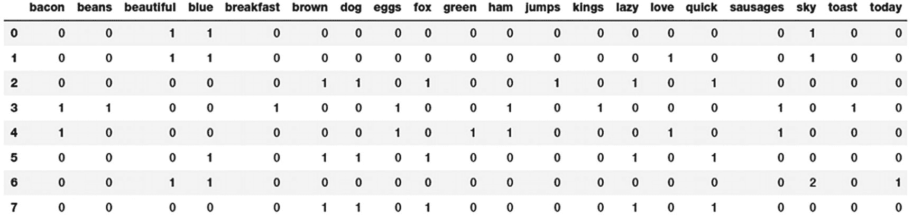

图 4-2

基于词袋模型的文档特征向量

```python
# 获取语料库中所有不重复的词语
vocab = cv.get_feature_names()
# 展示文档特征向量
pd.DataFrame(cv_matrix, columns=vocab)
```

图 4-2 应该能让你更清楚！你可以清晰地看到，特征向量中的每一列或每一维都代表语料库中的一个词语，每一行则代表我们的一个文档。任何一个单元格中的值都表示该词语（由列表示）在特定文档（由行表示）中出现的次数。一个简单的例子是，第一个文档中的单词 blue、beautiful 和 sky 各出现一次，因此在上述输出的第一行中，相应的特征值都为 1。因此，如果一个文档语料库在所有文档中共包含 N 个不重复的词语，那么每个文档都会得到一个 N 维的向量。

### 词袋 N 元模型

一个词语通常是一个单独的标记，常被称为*一元组*或*1-gram*。我们已经知道词袋模型不考虑词语顺序。但如果我们还想考虑按顺序出现的短语或词语集合呢？N 元组（N-grams）就能帮助我们做到这一点。N 元组本质上是从文本文档中提取的一组连续的词语标记，这些标记之间是连续的并按顺序出现。二元组指的是阶数为 2 的 N 元组（两个词），三元组指的是阶数为 3 的 N 元组（三个词），以此类推。词袋 N 元模型只是词袋模型的一个扩展，它利用了基于 N 元组的特征。下面的示例展示了每个文档特征向量中基于二元组的特征。请参见图 4-3。

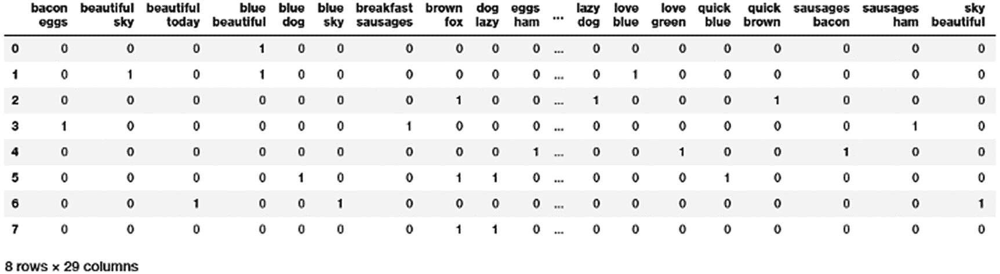

图 4-3

使用词袋 N 元模型生成的基于二元组的特征向量

```
# 你可以将 n-gram 范围设置为(1,2)，以同时获取一元组和二元组
bv = CountVectorizer(ngram_range=(2,2))
bv_matrix = bv.fit_transform(norm_corpus)
bv_matrix = bv_matrix.toarray()
vocab = bv.get_feature_names()
pd.DataFrame(bv_matrix, columns=vocab)
```

这为我们的文档生成了特征向量，其中每个特征都包含一个二元组，代表两个词的序列，其值表示该二元组在文档中出现的次数。我们鼓励你尝试调整 `ngram_range` 参数。试着将 `ngram_range` 设置为 `(1, 3)` 并观察输出结果！

### TF-IDF 模型

当词袋模型应用于大型语料库时，可能会出现一些潜在问题。由于特征向量基于绝对词频，可能会出现某些词在所有文档中频繁出现，从而在特征集合中掩盖其他词的情况。尤其是那些不常出现，但作为识别特定类别的特征可能更有趣且更有效的词。这时，TF-IDF 就应运而生了。TF-IDF 代表*词频-逆文档频率*。它是两个指标的组合：词频 (`tf`) 和逆文档频率 (`idf`)。该技术最初是作为一种根据用户查询对搜索引擎结果进行排序的指标而开发的，现已成为信息检索和文本特征提取的一部分。

现在让我们正式定义 TF-IDF，并在深入其实现之前，先看看其数学表示。数学上，TF-IDF 是两个指标的乘积，可以表示如下：

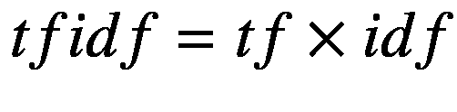

其中，词频 (`tf`) 和逆文档频率 (`idf`) 代表了我们刚刚讨论的两个指标。*词频*，由 `tf` 表示，就是我们上一节在词袋模型中计算的内容。任何文档向量中的词频都由该词在特定文档中的原始频率值表示。数学上可以表示如下：

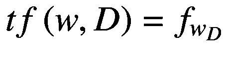

其中 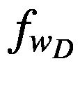 表示词 `w` 在文档 `D` 中的频率，这即为词频 (`tf`)。有时你也可以使用对数或平均频率来对绝对原始频率进行归一化。在我们的计算中，我们使用原始频率。

*逆文档频率*，由 `idf` 表示，是每个词文档频率的倒数，其计算方式是将语料库中的文档总数除以每个词的文档频率，然后对结果进行对数缩放。在我们的实现中，我们会为每个词的文档频率加 1，以表示我们的语料库中还多了一个文档，该文档实质上包含了词汇表中的每一个词。这是为了防止潜在的除以零错误，并平滑逆文档频率。我们还会在 `idf` 计算结果上加 1，以避免忽略那些可能 `idf` 为零的词。数学上，我们对 `idf` 的实现可以表示如下：

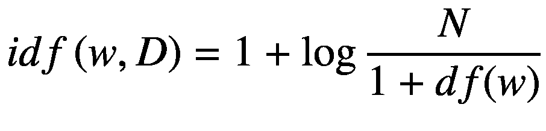

其中，`idf`(`w`, `D`) 表示词 `w` 在文档 `D` 中的 `idf`，`N` 表示语料库中的文档总数，`df`(`t`) 表示包含词 `w` 的文档数量。

因此，词频-逆文档频率可以通过将这两个度量相乘来计算。我们将使用的最终 TF-IDF 指标，是 `tf` 和 `idf` 乘积得到的 `tfidf` 矩阵的归一化版本。我们将 `tfidf` 矩阵除以其 L2 范数（也称为欧几里得范数，即每个词 `tfidf` 权重的平方和再开平方根）来进行归一化。数学上，我们可以将最终的 `tfidf` 特征向量表示如下：

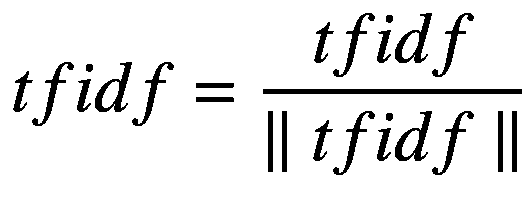

其中，`∥tfidf∥` 表示 `tfidf` 矩阵的欧几里得 L2 范数。这个模型有多种变体，但它们最终都能得到相似的结果。现在让我们将其应用到我们的语料库中！

### 使用 `TfidfTransformer`

假设我们已经从前述章节中获得了基于词袋模型的特征向量，以下代码展示了获取基于 `tfidf` 的特征向量的实现。见图 4-4。

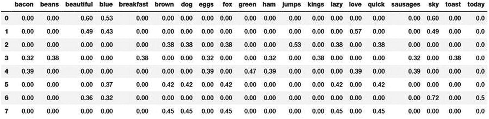

图 4-4：使用 `TfidfTransformer` 基于我们的 TF-IDF 模型生成的文档特征向量

```python
from sklearn.feature_extraction.text import TfidfTransformer
tt = TfidfTransformer(norm='l2', use_idf=True)
tt_matrix = tt.fit_transform(cv_matrix)
tt_matrix = tt_matrix.toarray()
vocab = cv.get_feature_names()
pd.DataFrame(np.round(tt_matrix, 2), columns=vocab)
```

您可以看到，我们在参数中使用了 L2 范数选项，并确保平滑了 IDF，以便为可能具有零 IDF 的词赋予权重，从而避免忽略它们。

### 使用 `TfidfVectorizer`

在工程化 TF-IDF 特征之前，并不总是需要使用词袋或基于计数的模型来预先生成特征。Scikit-Learn 的 `TfidfVectorizer` 使我们能够直接以原始文档作为输入，在内部计算词频和逆文档频率，从而直接计算出 `tfidf` 向量。这消除了使用 `CountVectorizer` 基于词袋模型计算词频的需要。此外，它还支持向特征向量中添加 n-gram。我们可以在以下代码片段中看到该函数的使用。见图 4-5。


图 4-5：使用 `TfidfVectorizer` 基于我们的 TF-IDF 模型生成的文档特征向量

```python
from sklearn.feature_extraction.text import TfidfVectorizer
tv = TfidfVectorizer(min_df=0., max_df=1., norm="l2",
use_idf=True, smooth_idf=True)
tv_matrix = tv.fit_transform(norm_corpus)
tv_matrix = tv_matrix.toarray()
vocab = tv.get_feature_names()
pd.DataFrame(np.round(tv_matrix, 2), columns=vocab)
```

您可以看到，和之前一样，我们在参数中使用了 L2 范数选项，并确保平滑了 `idfs`。从输出中可以看出，`tfidf` 特征向量与我们之前获得的相匹配。

#### 理解 TF-IDF 模型

本节专为机器学习专家以及那些对幕后工作原理充满好奇的读者们而设！我们首先加载必要的依赖项，并为我们的示例语料库计算词频（`TF`）。见图 4-6。

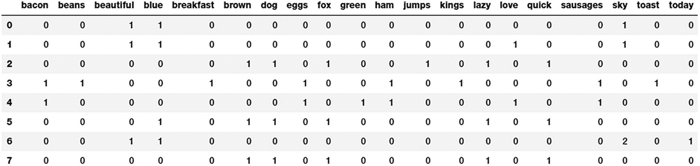

图 4-6

从零开始为我们的语料库构建基于计数的词袋特征

```python
# 获取独特词汇作为特征名称
unique_words = list(set([word for doc in [doc.split() for doc in norm_corpus]
for word in doc]))
def_feature_dict = {w: 0 for w in unique_words}
print('特征名称:', unique_words)
print('默认特征字典:', def_feature_dict)
```

```
特征名称: ['lazy', 'fox', 'love', 'jumps', 'sausages', 'blue', 'ham', 'beautiful', 'brown', 'kings', 'eggs', 'quick', 'bacon', 'breakfast', 'toast', 'beans', 'green', 'today', 'dog', 'sky']
默认特征字典: {'lazy': 0, 'fox': 0, 'kings': 0, 'love': 0, 'jumps': 0, 'sausages': 0, 'breakfast': 0, 'today': 0, 'brown': 0, 'ham': 0, 'beautiful': 0, 'green': 0, 'eggs': 0, 'blue': 0, 'bacon': 0, 'toast': 0, 'beans': 0, 'dog': 0, 'sky': 0, 'quick': 0}
```

```python
from collections import Counter
# 为每个文档构建词袋特征 - 词频
bow_features = []
for doc in norm_corpus:
bow_feature_doc = Counter(doc.split())
all_features = Counter(def_feature_dict)
bow_feature_doc.update(all_features)
bow_features.append(bow_feature_doc)
bow_features = pd.DataFrame(bow_features)
bow_features
```

现在，我们根据每个词项出现的文档数量来计算其文档频率（`DF`）。以下代码片段展示了如何从我们的词袋特征中获取该信息。见图 4-7。

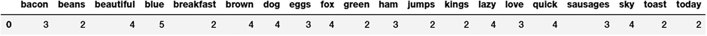

图 4-7

我们语料库中每个特征的文档频率

```python
import scipy.sparse as sp
feature_names = list(bow_features.columns)
# 构建文档频率矩阵
df = np.diff(sp.csc_matrix(bow_features, copy=True).indptr)
df = 1 + df # 为后续平滑化 idf 加 1
# 显示平滑后的文档频率
pd.DataFrame([df], columns=feature_names)
```

这告诉我们每个词项的文档频率（`DF`），你可以通过我们示例语料库中的文档进行验证。请记住，我们为每个频率值都加了 1，以便后续平滑 `IDF` 值，并假设存在一个包含所有词项一次的文档（虚构的），从而防止除以零错误。因此，如果你在语料库中检查，会发现“bacon”出现了 2(+1) 次，“sky”出现了 3(+1) 次，依此类推（考虑到 (+1) 用于平滑处理）。

现在我们有了文档频率，接下来使用之前定义的公式来计算逆文档频率（`IDF`）。请注意，为了平滑 `IDF`，我们需要在语料库的总文档数上加 1，这对应了我们之前假设的那个包含所有词项至少一次的文档。见图 4-8。

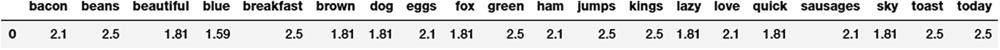

图 4-8

我们语料库中每个特征的逆文档频率

```python
# 计算逆文档频率
total_docs = 1 + len(norm_corpus)
idf = 1.0 + np.log(float(total_docs) / df)
# 显示平滑后的 idf
pd.DataFrame([np.round(idf, 2)], columns=feature_names)
```

因此，我们可以看到图 4-8 描绘了我们语料库中每个特征的（平滑后）逆文档频率。现在我们将其转换为一个矩阵，以便于后续计算整体 `TF-IDF` 分数。见图 4-9。

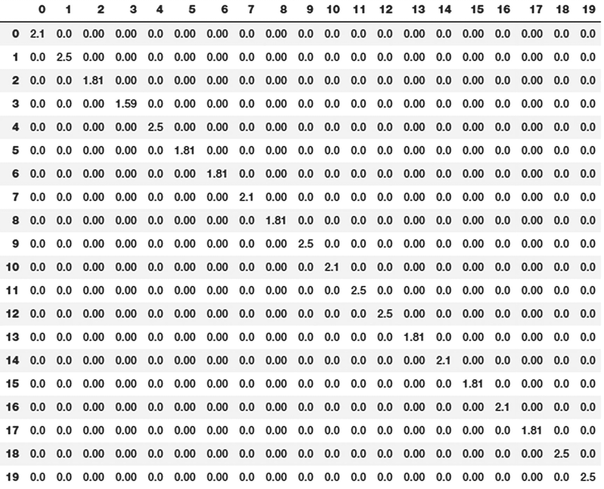

图 4-9

为我们语料库中的每个特征构建一个 n 维逆文档频率对角矩阵

```python
# 计算 idf 对角矩阵
total_features = bow_features.shape[1]
idf_diag = sp.spdiags(idf, diags=0, m=total_features, n=total_features)
idf_dense = idf_diag.todense()
# 打印 idf 对角矩阵
pd.DataFrame(np.round(idf_dense, 2))
```

你现在可以看到我们基于数学公式创建的 `idf` 矩阵。我们还将其转换为一个对角矩阵，这在后续需要与词频计算乘积时会很有帮助。现在，我们有了 `TF` 和 `IDF`，便可以使用矩阵乘法来计算原始 `TF-IDF` 特征矩阵，如下所示。见图 4-10。

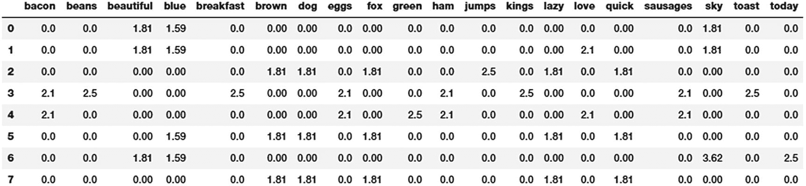

图 4-10

从 `TF` 和 `IDF` 分量构建原始 `TF-IDF` 矩阵

```python
# 计算 tfidf 特征矩阵
tf = np.array(bow_features, dtype="float64")
tfidf = tf * idf
# 查看原始 tfidf 特征矩阵
pd.DataFrame(np.round(tfidf, 2), columns=feature_names)
```

现在我们就得到了 `tfidf` 特征矩阵，但是等等！如果你还记得我们之前展示的公式，我们还需要将其除以 L2 范数。以下代码片段计算了每个文档的 `tfidf` 范数，然后将 `tfidf` 权重除以该范数，以得到最终所需的 `tfidf` 矩阵。见图 4-11。

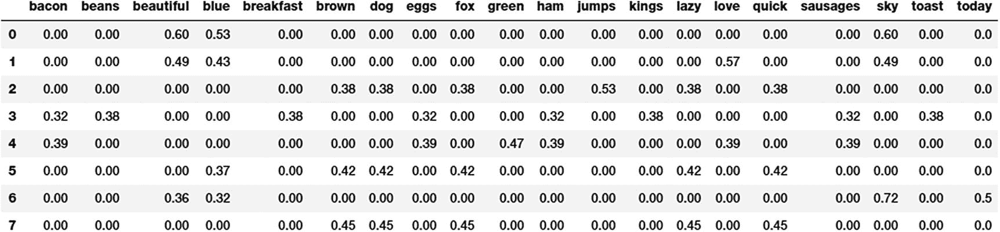

图 4-11

构建最终归一化的 `TF-IDF` 矩阵

```python
from numpy.linalg import norm
# 计算 L2 范数
norms = norm(tfidf, axis=1)
# 打印每个文档的范数
print (np.round(norms, 3))
```

```
[ 3.013  3.672  4.761  6.534  5.319  4.35   5.019  4.049]
```

```python
# 计算归一化的 tfidf
norm_tfidf = tfidf / norms[:, None]
# 显示最终的 tfidf 特征矩阵
pd.DataFrame(np.round(norm_tfidf, 2), columns=feature_names)
```

如果你将图 4-11 中为语料库文档得到的 `tfidf` 特征矩阵与之前使用 `TfidfTransformer` 或 `TfidfVectorizer` 得到的特征矩阵进行比较，会发现它们完全一致，从而验证了我们的数学实现是正确的。实际上，Scikit-Learn 在后台正是采用了相同的实现，并进行了更多优化。

### 为新文档提取特征

假设你构建了一个用于分类和归类新闻文章的机器学习模型，并且该模型目前正在生产环境中运行。你如何为完全新的文档生成特征，以便将其输入到机器学习模型中进行预测？Scikit-Learn API 为我们之前讨论过的向量化器提供了 `transform(...)` 函数，我们可以利用它为那些不在我们语料库中的全新文档（即训练模型时未包含的文档）获取特征。见图 4-12。

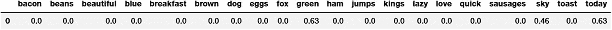

图 4-12

# 为一个全新的文档生成 TF-IDF 特征向量

```
new_doc = 'the sky is green today'
pd.DataFrame(np.round(tv.transform([new_doc]).toarray(), 2),
columns=tv.get_feature_names())
```

因此，始终利用 `fit_transform(...)` 函数来为语料库中的所有文档构建特征矩阵。这通常会成为训练特征集，你将在此基础上构建和训练预测模型或其他机器学习模型。一旦准备就绪，就利用 `transform(...)` 函数来生成新文档的特征向量。然后，这些特征向量可以被输入到你训练好的模型中，以按需生成洞察。

# 文档相似度

`文档相似度`是一个过程，它利用基于距离或相似度的度量方法，根据从文档中提取的特征（如词袋或`TF-IDF`）来识别一个文本文档与任何其他文档的相似程度。因此，你可以看到我们可以基于上一节中设计的`TF-IDF`特征进行构建，并使用它们来生成新特征。像搜索引擎、文档聚类和信息检索等领域都可以利用这些基于相似度的特征。

语料库中的两两文档相似度涉及计算语料库中每一对文档的文档相似度。因此，如果你的语料库中有`C`个文档，你最终会得到一个`C` x `C`的矩阵，其中每一行和每一列代表一对文档的相似度得分。这分别表示行和列的索引。有多种相似度和距离度量方法可用于计算文档相似度。这些包括余弦距离/相似度、欧几里得距离、曼哈顿距离、`BM25`相似度、杰卡德距离等。在我们的分析中，我们使用最流行和广泛使用的相似度度量之一——余弦相似度，并基于其`TF-IDF`特征向量比较两两文档相似度。请参见图 4-13。

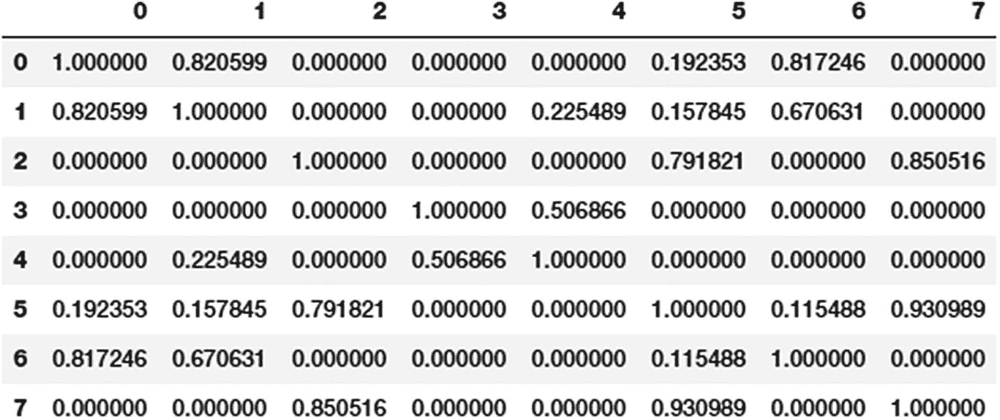
图 4-13：两两文档相似度矩阵（余弦相似度）

```python
from sklearn.metrics.pairwise import cosine_similarity
similarity_matrix = cosine_similarity(tv_matrix)
similarity_df = pd.DataFrame(similarity_matrix)
similarity_df
```

余弦相似度为我们提供了一个度量，表示两个文本文档特征向量表示之间夹角的余弦值。文档之间的夹角越小，它们就越接近、越相似，如图 4-13 中的得分以及图 4-14 中的一些示例文档向量所示。

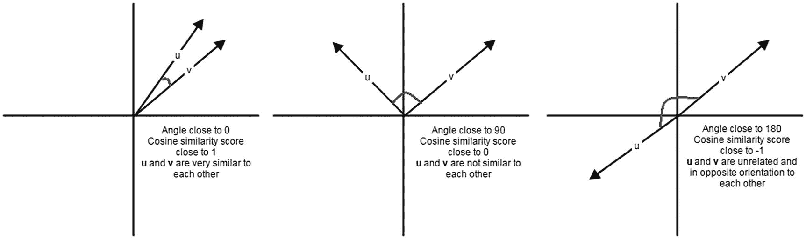
图 4-14：文本文档特征向量的余弦相似度示意图

仔细观察图 4-13 中的相似度矩阵，你可以清楚地看到文档 0、1、6 与文档 2、5、7 彼此非常相似，而文档 3 和 4 彼此略微相似。这必然表明这些相似的文档具有一些相似的特征。这是一个通过无监督学习解决分组或聚类问题的完美示例，尤其是在处理包含数百万文本文档的庞大语料库时。

## 基于相似度特征的文档聚类

我们已经构建了许多特征，现在让我们将其中的一些用于一个现实世界的问题：对相似文档进行分组！聚类利用无监督学习将数据点（在此场景中为文档）分组或聚类。我们在此利用一种无监督的层次聚类算法，通过利用我们之前生成的文档相似度特征，尝试对我们的小型语料库中的相似文档进行分组。

层次聚类算法有两种类型——凝聚型和分裂型。我们使用凝聚型聚类算法，这是一种采用自下而上方法的层次聚类，即每个观测值或文档从自己的聚类开始，然后使用度量数据点之间距离的度量标准和链接合并准则依次合并聚类。图 4-15 展示了一个示例示意图。

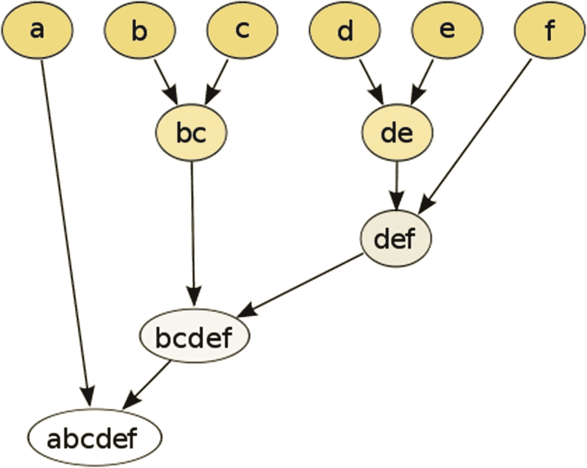
图 4-15：凝聚型层次聚类

链接准则的选择决定了合并策略。一些链接准则的例子包括`Ward`法、完全链接、平均链接等。此准则对于在每一步选择要合并的聚类对（在最低层是单个文档，在更高层是聚类）非常有用，这基于目标函数的最优值。我们选择`Ward`最小方差法作为我们的链接准则，以最小化总的聚类内方差。因此，在每一步，我们找到合并后导致总的聚类内方差增量最小的聚类对。由于我们已经有了相似度特征，让我们在我们的示例文档上构建链接矩阵。请参见图 4-16。

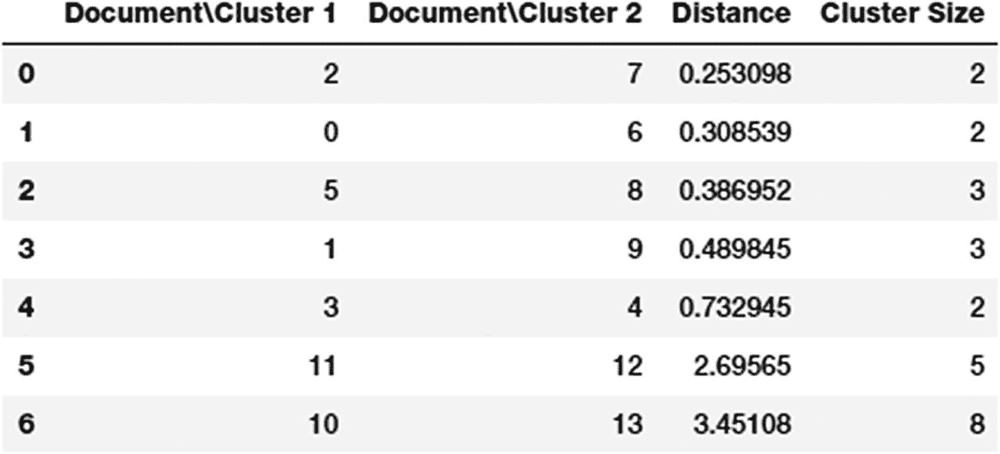
图 4-16：我们语料库的链接矩阵

```python
from scipy.cluster.hierarchy import dendrogram, linkage
Z = linkage(similarity_matrix, 'ward')
pd.DataFrame(Z, columns=['文档\聚类 1', '文档\聚类 2',
'距离', '聚类大小'], dtype="object")
```

如果仔细查看图 4-16 中的链接矩阵，你可以看到链接矩阵的每一步（行）告诉我们哪些数据点（或聚类）被合并了。如果你有`n`个数据点，链接矩阵`Z`的形状将是`(n − 1) × 4`，其中`Z[i]`会告诉我们在第`i`步合并了哪些聚类。每行有四个元素；前两个元素是数据点标识符或聚类标签（在矩阵的后面部分，一旦多个数据点被合并），第三个元素是前两个元素（数据点或聚类）之间的聚类距离，最后一个元素是合并完成后聚类中元素/数据点的总数。我们建议你参考`SciPy`文档，其中有详细解释。现在让我们将此矩阵可视化为树状图，以便更好地理解这些元素！请参见图 4-17。

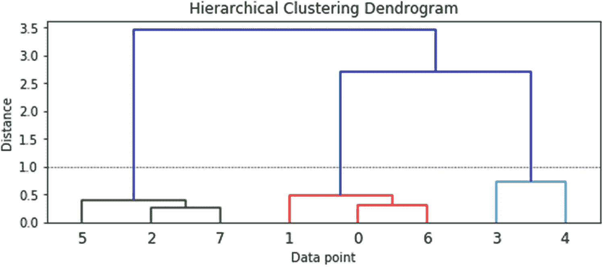
图 4-17：可视化层次聚类过程的树状图

```python
plt.figure(figsize=(8, 3))
plt.title('层次聚类树状图')
plt.xlabel('数据点')
plt.ylabel('距离')
dendrogram(Z)
plt.axhline(y=1.0, c="k", ls="--", lw=0.5)
```

我们可以看到每个数据点如何从一个单独的聚类开始，并逐渐与其他数据点合并形成聚类。从颜色和树状图的高级角度来看，如果你考虑距离度量大约为 1.0 或以上（由虚线表示），你可以看到模型已正确识别出三个主要的聚类。利用这个距离，我们得到了聚类标签。请参见图 4-18。

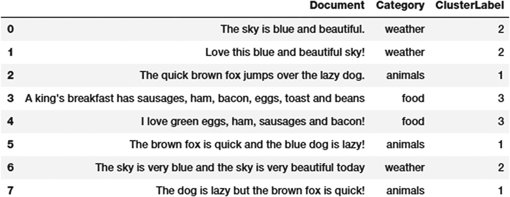
图 4-18：通过层次聚类将我们的文档分组到聚类中

```python
from scipy.cluster.hierarchy import fcluster
max_dist = 1.0
cluster_labels = fcluster(Z, max_dist, criterion="distance")
cluster_labels = pd.DataFrame(cluster_labels, columns=['聚类标签'])
pd.concat([corpus_df, cluster_labels], axis=1)
```

因此，你可以清楚地看到，基于分配给文档的聚类标签，我们的算法已正确识别出文档中的三个不同类别。这应该让你很好地了解我们的`TF-IDF`特征如何被用于构建相似度特征，而这些特征反过来又帮助我们对文档进行聚类。将来你可以使用这个流程来对你的文档进行聚类。我们将在本书后面的章节中，使用更多模型和示例进一步详细讨论文本聚类。

### 主题模型

尽管我们会在本书的独立章节中详细讨论主题建模，但若未谈及主题模型，关于特征工程的讨论便不算完整。我们可以利用一些摘要技术，从文本文档中提取基于主题或概念的特征。主题模型的核心思想在于从文档语料库中提取关键主题或概念，这些主题或概念以“主题”的形式呈现。每个主题可以表示为文档语料库中词语/术语的集合。这些术语共同指代特定的主题、议题或概念，并且每个主题都能通过这些术语所传达的语义含义与其他主题轻松区分开来。

然而，根据数据的不同，你常常会得到一些相互重叠的主题。这些概念涵盖范围很广，从简单的事实陈述到观点和看法。主题模型在总结大型文本文档语料库以提取和描述关键概念方面极为有用。它们同样有助于从文本数据中提取能捕捉数据中潜在模式的特征。参见图 4-19。

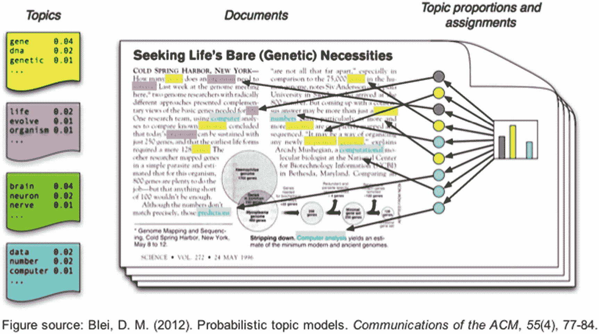
图 4-19：使用层次聚类将文档分组

主题建模有多种技术，其中大部分涉及某种形式的矩阵分解。一些技术，如潜在语义索引（`LSI`），会使用矩阵分解操作，更具体地说是奇异值分解。我们采用另一种称为潜在狄利克雷分配（`LDA`）的技术，它使用生成式概率模型，其中每个文档由若干主题的组合构成，并且每个术语或单词可以归属于特定主题。这类似于基于`pLSI`的模型（概率潜在语义索引）。在`LDA`中，每个潜在主题上都有一个狄利克雷先验分布。该技术背后的数学原理相当复杂，所以我在此尽量简化说明。我们还会在后续章节中详细讨论主题建模！参见图 4-20。

## 端到端LDA框架

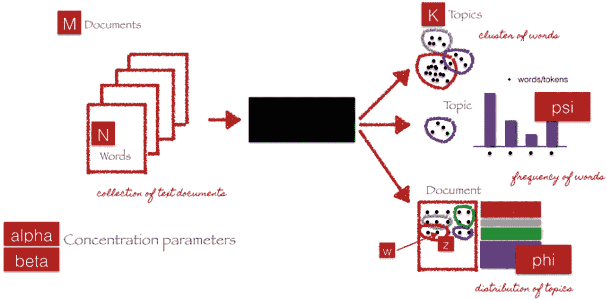

图 4-20：端到端 LDA 框架（图片由 C. Doig 提供，源自《Python 主题建模入门》）

图 4-20 中的黑盒代表了核心算法，该算法使用前述参数从 `M` 个文档中提取 `K` 个主题。图 4-22 中概述的步骤对幕后的工作原理进行了简单解释。

### LDA算法步骤

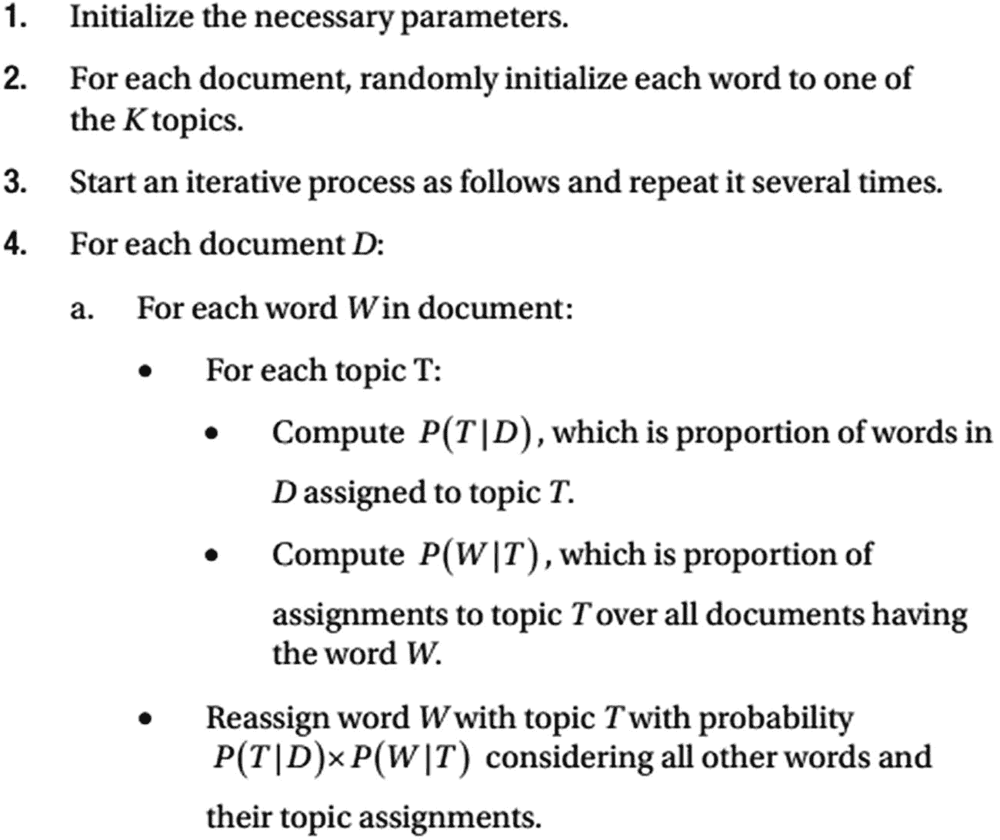

图 4-21：LDA 主题建模算法的主要步骤

经过多次迭代后，我们应该能得到每个文档的主题混合分布，然后根据指向每个主题的术语生成该主题的组成部分。像 `Gensim` 或 `Scikit-Learn` 这样的框架使我们能够利用 LDA 模型生成主题。就本章旨在探讨的特征工程而言，你需要记住：当 LDA 应用于文档-术语矩阵（TF-IDF 或词袋特征矩阵）时，它会被分解成两个主要部分。

*   一个**文档-主题矩阵**，即我们需要的特征矩阵。
*   一个**主题-术语矩阵**，有助于我们查看语料库中的潜在主题。

### 使用Scikit-Learn生成文档-主题矩阵

现在，我们利用 `Scikit-Learn` 来获取文档-主题矩阵，操作如下。该矩阵可用作任何后续建模需求的特征。参见图 4-22。

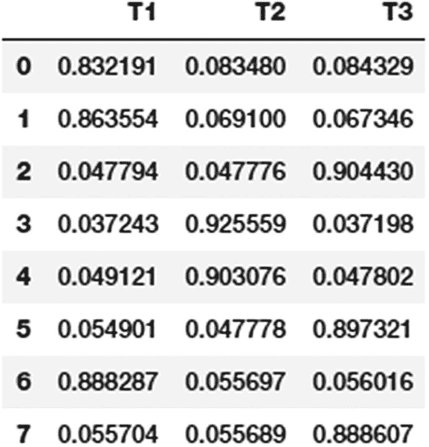

图 4-22：从 LDA 模型生成的文档-主题特征矩阵

```python
from sklearn.decomposition import LatentDirichletAllocation
lda = LatentDirichletAllocation(n_topics=3, max_iter=10000, random_state=0)
dt_matrix = lda.fit_transform(cv_matrix)
features = pd.DataFrame(dt_matrix, columns=['T1', 'T2', 'T3'])
features
```

在此输出中，你可以清晰地看到每个文档对这三个主题各自的贡献程度。你可以通过以下方式查看主题及其主要组成部分。

```python
tt_matrix = lda.components_
for topic_weights in tt_matrix:
    topic = [(token, weight) for token, weight in zip(vocab, topic_weights)]
    topic = sorted(topic, key=lambda x: -x[1])
    topic = [item for item in topic if item[1] > 0.6]
    print(topic)
    print()
[('sky', 4.3324395825632624), ('blue', 3.373753174831771), ('beautiful', 3.3323652405224857), ('today', 1.3325579841038182), ('love', 1.3304224288080069)]
[('bacon', 2.332695948479998), ('eggs', 2.332695948479998), ('ham', 2.332695948479998), ('sausages', 2.332695948479998), ('love', 1.335454457601996), ('beans', 1.332773525378464), ('breakfast', 1.332773525378464), ('kings', 1.332773525378464), ('toast', 1.332773525378464), ('green', 1.3325433207547732)]
[('brown', 3.3323474595768783), ('dog', 3.3323474595768783), ('fox', 3.3323474595768783), ('lazy', 3.3323474595768783), ('quick', 3.3323474595768783), ('jumps', 1.3324193736202712), ('blue', 1.2919635624485213)]
```

因此，根据其组成术语，你可以清楚地看到这三个主题彼此之间具有很高的区分度。第一个主题谈论天气，第二个关于食物，最后一个则关于动物。为主题建模选择主题数量本身是一门完整的技术，既是一门艺术，也是一门科学。有多种方法和启发式策略可以获取最佳的主题数量，但由于这些技术细节繁多，我们在此不做讨论。

### 高级特征工程模型

传统的（基于计数的）文本数据特征工程策略涉及一系列模型，通常被称为词袋模型。这包括词频、`TF-IDF`（词频-逆文档频率）、`N-Grams`（N 元组）等。虽然它们是有效的文本特征提取方法，但由于模型本质上只是非结构化单词的袋子，我们会丢失每个文本文档中诸如语义、结构、顺序以及周围单词的上下文等额外信息。这足以激励我们去探索更复杂的模型，这些模型能够捕捉这些信息，并为我们提供作为单词向量表示的特征，通常被称为*嵌入*。

虽然这听起来有些道理，但我们为什么要有足够的动力去学习和构建这些词嵌入呢？对于语音或图像识别系统而言，所有信息已经以丰富密集的特征向量形式存在，这些向量嵌入在高维数据集中，比如音频频谱图和图像像素强度。然而，对于原始文本数据，尤其是像词袋这样的基于计数的模型，我们处理的是可能具有自己标识符的单个单词，并且无法捕捉单词之间的语义关系。这会导致文本数据产生巨大的稀疏词向量，因此，如果没有足够的数据，我们可能会得到糟糕的模型，甚至由于维数灾难而导致过拟合。见图 4-23。

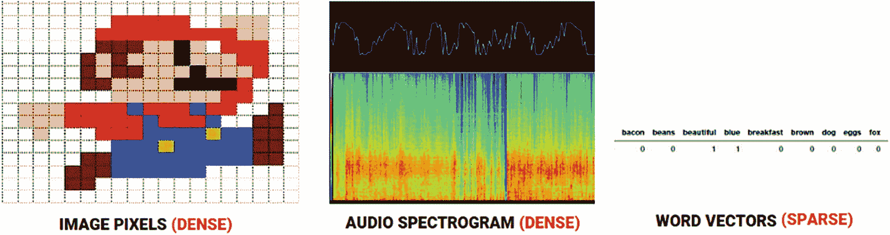

图 4-23：音频、图像和文本的特征表示对比

为了克服词袋模型的缺点，我们需要使用*向量空间模型（VSM）*，以便能够基于语义和上下文相似性将词向量嵌入到这个连续向量空间中。事实上，*分布式语义学*领域的*分布假说*告诉我们，出现在并用于相同上下文中的单词在语义上彼此相似，并且具有相似的含义。简单来说，“一个词由它所处的环境所表征”。

一篇详细讨论这些语义词向量及各种类型的著名论文是 Baroni 等人的《不要计数，要预测！上下文计数与上下文预测语义向量的系统比较》。我们不会深入探讨，但简而言之，有两种主要的上下文词向量方法。*基于计数的方法*，如*潜在语义分析（LSA）*，可用于计算语料库中单词与其相邻单词共现频率的统计度量，然后根据这些度量为每个单词构建密集词向量。*预测方法*，如*基于神经网络的语言模型*，则通过观察语料库中的单词序列，试图从其相邻单词中预测单词。在此过程中，它学习了分布式表示，从而为我们提供了密集的词嵌入。我们在本节中重点介绍这些预测方法。

### 加载圣经语料库

为了训练并展示这些基于深度学习的先进特征表示模型的部分能力，我们通常需要一个更大的语料库。虽然我们仍将使用之前的语料库进行演示，但我们也将使用 `NLTK` 加载另一个基于詹姆斯国王版本的圣经语料库。然后我们对文本进行预处理，以便根据我们稍后实现的模型，展示可能更相关的示例。

```python
from nltk.corpus import gutenberg
from string import punctuation
bible = gutenberg.sents('bible-kjv.txt')
remove_terms = punctuation + '0123456789'
norm_bible = [[word.lower() for word in sent if word not in remove_terms] for sent in bible]
norm_bible = [' '.join(tok_sent) for tok_sent in norm_bible]
norm_bible = filter(None, normalize_corpus(norm_bible))
norm_bible = [tok_sent for tok_sent in norm_bible if len(tok_sent.split()) > 2]
print('总行数:', len(bible))
print('\n 样本行:', bible[10])
print('\n 处理后的行:', norm_bible[10])
```

以下输出显示了语料库中的总行数以及预处理在圣经语料库上的工作方式。

```
总行数: 30103
样本行: ['1', ':', '6', 'And', 'God', 'said', ',', 'Let', 'there', 'be', 'a', 'firmament', 'in', 'the', 'midst', 'of', 'the', 'waters', ',', 'and', 'let', 'it', 'divide', 'the', 'waters', 'from', 'the', 'waters', '.']
处理后的行: god said let firmament midst waters let divide waters waters
```

现在，让我们来看一些流行的词嵌入模型，并从我们的语料库中提炼出有意义的特征吧！

### Word2Vec 模型

该模型由谷歌于 2013 年创建，是一个基于深度学习的预测模型，用于计算和生成高质量、分布式且连续的密集词向量表示，这些表示能够捕捉上下文和语义相似性。本质上，这些是无监督模型，可以接收海量文本语料库，创建可能的词汇表，并为向量空间中代表该词汇表的每个单词生成密集的词嵌入。通常，您可以指定词嵌入向量的大小，而向量的总数基本上等于词汇表的大小。这使得这个密集向量空间的维度比使用传统词袋模型构建的高维稀疏向量空间低得多。

`Word2Vec` 可以利用两种不同的模型架构来创建这些词嵌入表示。它们包括：

- 连续词袋（`CBOW`）模型
- 跳字模型

这些模型由 Mikolov 等人提出，我建议感兴趣的读者阅读围绕这些模型的原始论文，包括 Mikolov 等人的《词语和短语的分布式表示及其组合性》以及 Mikolov 等人的《向量空间中词表示的高效估计》，以获取深入视角。

#### 连续词袋（CBOW）模型

`CBOW` 模型（见图 4-24）架构试图基于源上下文单词（周围单词）来预测当前目标单词（中心词）。考虑一个简单的句子，“the quick brown fox jumps over the lazy dog”，这可以形成 `(context_window, target_word)` 的对，其中如果我们考虑大小为 2 的上下文窗口，我们有这样的示例：(`[quick, fox]`, `brown`)、(`[the, brown]`, `quick`)、(`[the, dog]`, `lazy`) 等等。因此，该模型试图基于 `context_window` 单词来预测 `target_word`。

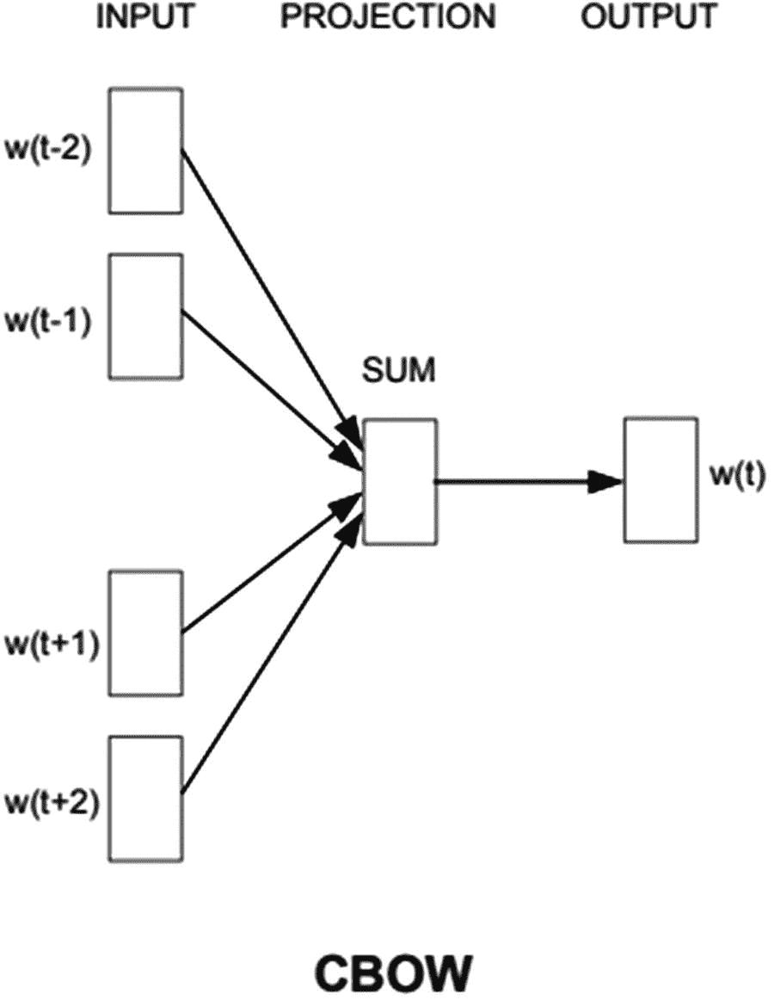

图 4-24

`CBOW` 模型架构（来源：[`https://arxiv.org/pdf/1301.3781.pdf`](https://arxiv.org/pdf/1301.3781.pdf) Mikolov 等人）

由于 `Word2Vec` 系列模型是无监督的，你只需给它一个语料库，无需额外的标签或信息，它就能从语料库中构建稠密的词嵌入。但是，一旦你拥有了这个语料库，你仍然需要利用一种有监督的分类方法才能获得这些嵌入。我们仅通过语料库本身来做到这一点，无需任何辅助信息。我们可以将这种 `CBOW` 架构建模为深度学习分类模型，其中我们将上下文单词作为我们的输入 `X`，并试图预测目标单词 `Y`。事实上，构建这种架构比跳字模型更简单，后者试图从一个源目标单词预测一大堆上下文单词。

### 实现连续词袋（CBOW）模型

虽然使用像 Gensim 这样具备 Word2Vec 模型的强大框架非常棒，但我们不妨从头开始实现一次，以便更深入地理解其背后的运作原理。我们将利用存储在 `norm_bible` 变量中的圣经语料库来训练模型。实现过程将聚焦于以下四个部分：

- 构建语料库词汇表
- 构建 CBOW（上下文，目标词）生成器
- 构建 CBOW 模型架构
- 训练模型
- 获取词嵌入

闲言少叙，我们马上开始！

#### 构建语料库词汇表

首先，我们将构建语料库词汇表，从中提取每个唯一的单词，并为其映射一个唯一的数字标识符。

```python
from keras.preprocessing import text
from keras.utils import np_utils
from keras.preprocessing import sequence
tokenizer = text.Tokenizer()
tokenizer.fit_on_texts(norm_bible)
word2id = tokenizer.word_index
# 构建唯一单词的词汇表
word2id['PAD'] = 0
id2word = {v:k for k, v in word2id.items()}
wids = [[word2id[w] for w in text.text_to_word_sequence(doc)] for doc in norm_bible]
vocab_size = len(word2id)
embed_size = 100
window_size = 2 # 上下文窗口大小
print('词汇表大小:', vocab_size)
print('词汇表样例:', list(word2id.items())[:10])
词汇表大小: 12425
词汇表样例: [('base', 2338), ('feller', 10771), ('sanctuary', 455), ('plunge', 10322), ('azariah', 1120), ('enlightened', 4438), ('horns', 838), ('kareah', 2920), ('nursing', 5943), ('baken', 3492)]
```

由此可见，我们为语料库中的唯一单词创建了一个词汇表，并建立了单词到其唯一标识符（以及反向映射）的映射。`PAD` 项通常用于在必要时将上下文单词填充到固定长度。

#### 构建 CBOW（上下文，目标词）生成器

我们需要由目标中心词及其周围上下文单词组成的配对。在我们的实现中，目标词长度为 1，周围上下文长度为 `2 * window_size`，即取语料库中目标词前后的各 `window_size` 个单词。通过下面的例子，这一点会更清楚。

# 构建 CBOW 模型架构

现在，我们利用基于 TensorFlow 的 Keras 来构建 CBOW 模型的深度学习架构。为此，我们的输入将是上下文单词，它们被传递到一个嵌入层（使用随机权重初始化）。词嵌入被传递到一个 `Lambda` 层，在那里我们对词嵌入进行平均（因此被称为 CBOW，因为平均时我们并不真正考虑上下文单词的顺序或序列）。然后，我们将这个平均后的上下文嵌入传递到一个密集的 softmax 层，该层预测我们的目标词。我们将此与实际目标词进行匹配，利用 `categorical_crossentropy` 损失函数计算损失，并在每个训练周期执行反向传播，以更新过程中的嵌入层。以下代码展示了模型架构。见图 4-25。

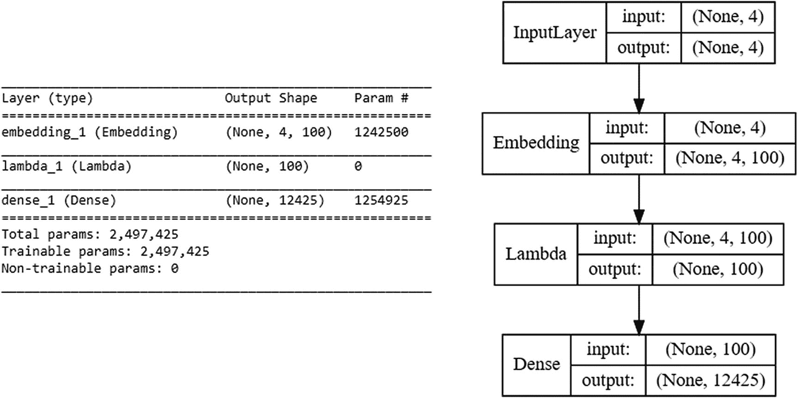

**图 4-25.** CBOW 模型摘要与架构

```python
import keras.backend as K
from keras.models import Sequential
from keras.layers import Dense, Embedding, Lambda
# 构建 CBOW 架构
cbow = Sequential()
cbow.add(Embedding(input_dim=vocab_size, output_dim=embed_size, input_length=window_size*2))
cbow.add(Lambda(lambda x: K.mean(x, axis=1), output_shape=(embed_size,)))
cbow.add(Dense(vocab_size, activation="softmax"))
cbow.compile(loss='categorical_crossentropy', optimizer="rmsprop")
# 查看模型摘要
print(cbow.summary())
# 可视化模型结构
from IPython.display import SVG
from keras.utils.vis_utils import model_to_dot
SVG(model_to_dot(cbow, show_shapes=True, show_layer_names=False,
                 rankdir='TB').create(prog='dot', format="svg"))
```

如果你仍然难以可视化这个深度学习模型，我建议你阅读我前面提到的论文。我试着用简单的术语总结这个模型的核心概念。我们输入维度为 (`2 * window_size`) 的上下文单词，并将它们传递给大小为 (`vocab_size * embed_size`) 的嵌入层，这将为每个上下文单词生成密集的词嵌入（每个单词为 `1 * embed_size`）。接着，我们使用一个 `Lambda` 层对这些嵌入进行平均，得到一个平均的密集嵌入（`1 * embed_size`），然后将其发送到密集的 softmax 层，该层输出最可能的目标词。我们将其与实际目标词进行比较，计算损失，反向传播误差以调整权重（在嵌入层中），并对所有（上下文，目标词）配对重复此过程多个训练周期。图 4-26 试图解释这个过程。

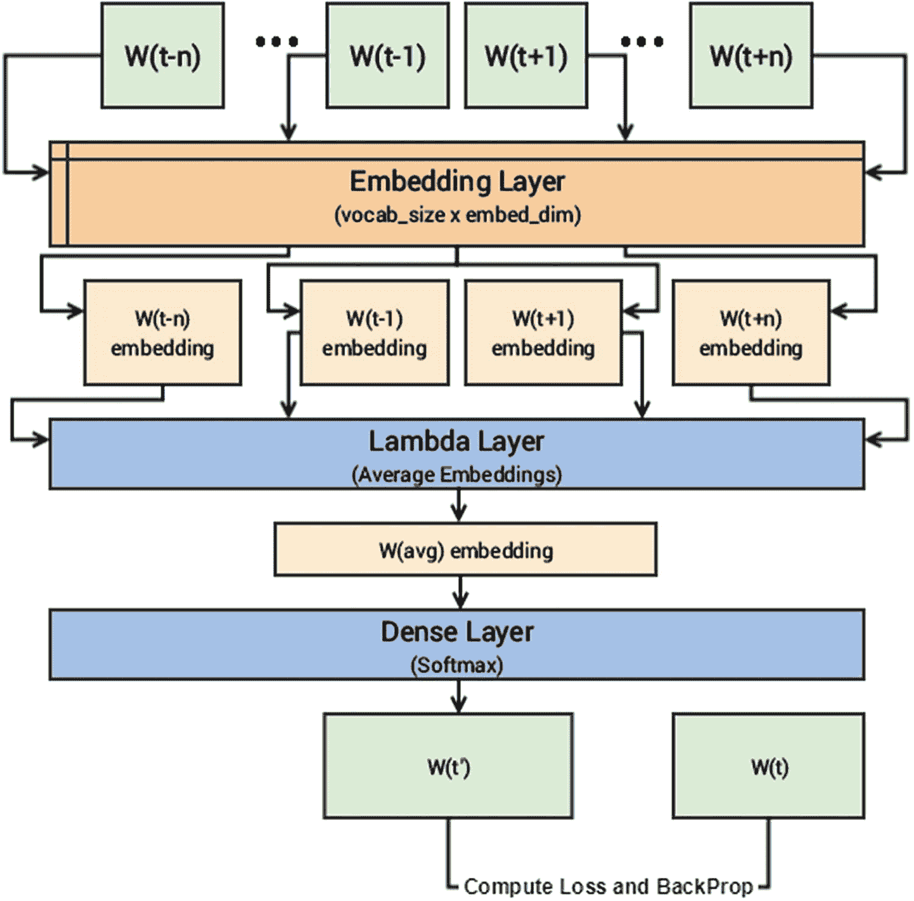

**图 4-26.** CBOW 深度学习模型的视觉描述

现在，我们已经准备好使用我们的数据生成器向模型输入（上下文，目标词）配对，在语料库上训练这个模型了。

```python
def generate_context_word_pairs(corpus, window_size, vocab_size):
    context_length = window_size*2
    for words in corpus:
        sentence_length = len(words)
        for index, word in enumerate(words):
            context_words = []
            label_word   = []
            start = index - window_size
            end = index + window_size + 1
            context_words.append([words[i]
                                 for i in range(start, end)
                                 if 0 <= i < sentence_length
                                 and i != index])
            label_word.append(word)
            x = sequence.pad_sequences(context_words, maxlen=context_length)
            y = np_utils.to_categorical(label_word, vocab_size)
            yield (x, y)
i = 0
for x, y in generate_context_word_pairs(corpus=wids, window_size=window_size, vocab_size=vocab_size):
    if 0 not in x[0]:
        print('上下文 (X):', [id2word[w] for w in x[0]], '-> 目标词 (Y):', id2word[np.argwhere(y[0])[0][0]])
        if i == 10:
            break
        i += 1
上下文 (X): ['old','testament','james','bible'] -> 目标词 (Y): king
上下文 (X): ['first','book','called','genesis'] -> 目标词 (Y): moses
上下文 (X): ['beginning','god','heaven','earth'] -> 目标词 (Y): created
上下文 (X): ['earth','without','void','darkness'] -> 目标词 (Y): form
上下文 (X): ['without','form','darkness','upon'] -> 目标词 (Y): void
上下文 (X): ['form', 'void', 'upon', 'face'] -> 目标词 (Y): darkness
上下文 (X): ['void', 'darkness', 'face', 'deep'] -> 目标词 (Y): upon
上下文 (X): ['spirit', 'god', 'upon', 'face'] -> 目标词 (Y): moved
上下文 (X): ['god', 'moved', 'face', 'waters'] -> 目标词 (Y): upon
上下文 (X): ['god', 'said', 'light', 'light'] -> 目标词 (Y): let
上下文 (X): ['god', 'saw', 'good', 'god'] -> 目标词 (Y): light
```

上述输出应该能让你更清楚地了解 `X` 如何构成上下文单词，以及我们如何根据这些上下文预测目标中心词 `Y`。例如，假设原始文本是“in the beginning god created heaven and earth”，经过预处理和停用词移除后，变成了“beginning god created heaven earth”。给定 `[beginning, god, heaven, earth]` 作为上下文，本例中的目标中心词就是“created”。

## 训练模型

在完整的语料库上运行模型需要相当长的时间，所以我只运行了五个训练周期。你可以使用以下代码，并在必要时增加训练周期。

```markdown
```python
for epoch in range(1, 6):
    loss = 0.
    i = 0
    for x, y in generate_context_word_pairs(corpus=wids, window_size=window_size, vocab_size=vocab_size):
        i += 1
        loss += cbow.train_on_batch(x, y)
        if i % 100000 == 0:
            print('已处理 {} 对 (上下文, 单词) 配对'.format(i))
    print('训练周期:', epoch, '\t 损失:', loss)
    print()
训练周期: 1     损失: 4257900.60084
训练周期: 2     损失: 4256209.59646
训练周期: 3     损失: 4247990.90456
训练周期: 4     损失: 4225663.18927
训练周期: 5     损失: 4104501.48929
```

### 注意

运行此模型计算量很大，如果使用 GPU 进行训练，效果会更好。我在一个配备 Tesla K80 GPU 的 AWS p2.x 实例上进行了训练，仅五个训练周期就花了将近 1.5 小时！

一旦此模型训练完成，相似的单词在嵌入层中应具有相似的权重。

### 获取词嵌入

要获取整个词汇表的词嵌入，我们可以通过以下代码从嵌入层中提取。我们不提取位置 0 处的嵌入，因为它属于填充（`PAD`）词，并非我们真正感兴趣的词。见图 4-27。

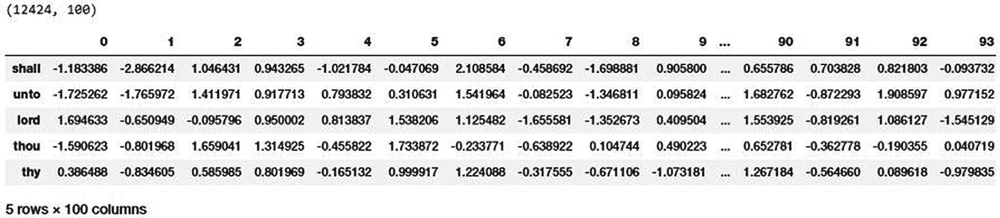

图 4-27

基于 CBOW 模型的词汇表词嵌入

```
weights = cbow.get_weights()[0]
weights = weights[1:]
print(weights.shape)
pd.DataFrame(weights, index=list(id2word.values())[1:]).head()
```

因此，你可以清晰地看到每个词都有一个大小为（1×100）的密集嵌入，如图 4-27 的输出所示。让我们尝试基于这些嵌入为特定感兴趣的词找到一些上下文相似的词。为此，我们基于密集嵌入向量构建词汇表中所有词之间的成对距离矩阵，然后基于最短（欧几里得）距离找到每个感兴趣词的 n 个最近邻。

```
from sklearn.metrics.pairwise import euclidean_distances
# 计算成对距离矩阵
distance_matrix = euclidean_distances(weights)
print(distance_matrix.shape)
# 查看上下文相似的词
similar_words = {search_term: [id2word[idx]
for idx in distance_matrix[word2id[search_term]-1].argsort()[1:6]+1]
for search_term in ['god', 'jesus', 'noah', 'egypt', 'john', 'gospel', 'moses','famine']}
similar_words
(12424, 12424)
{'egypt': ['destroy', 'none', 'whole', 'jacob', 'sea'],
'famine': ['wickedness', 'sore', 'countries', 'cease', 'portion'],
'god': ['therefore', 'heard', 'may', 'behold', 'heaven'],
'gospel': ['church', 'fowls', 'churches', 'preached', 'doctrine'],
'jesus': ['law', 'heard', 'world', 'many', 'dead'],
'john': ['dream', 'bones', 'held', 'present', 'alive'],
'moses': ['pharaoh', 'gate', 'jews', 'departed', 'lifted'],
'noah': ['abram', 'plagues', 'hananiah', 'korah', 'sarah']}
```

你可以清晰地看到其中一些在上下文中有意义（`god` 与 `heaven`，`gospel` 与 `church` 等），而有些则不然。通常，训练更多的周期会得到更好的结果。我们现在来探索 Skip-Gram 架构，它通常比 CBOW 能给出更好的结果。

### Skip-Gram 模型

Skip-Gram 模型架构试图实现 CBOW 模型的反向功能。它试图根据一个目标词（中心词）来预测源上下文词（周围词）。考虑我们之前的简单句子“the quick brown fox jumps over the lazy dog”。如果我们使用 CBOW 模型，我们会得到（`context_window`， `target_word`）对，例如，如果考虑大小为 2 的上下文窗口，我们会得到诸如（`[quick, fox]`， `brown`）、（`[the, brown]`， `quick`）、（`[the, dog]`， `lazy`）等示例。现在，考虑到 Skip-Gram 模型的目标是从目标词预测上下文，该模型通常会反转上下文和目标，并试图从每个目标词预测每个上下文词。因此任务变成了根据目标词 `brown` 预测上下文 `[quick, fox]`，或根据目标词 `quick` 预测上下文 `[the, brown]`，依此类推。因此，模型试图基于 `target_word` 预测 `context_window` 中的词。见图 4-28。

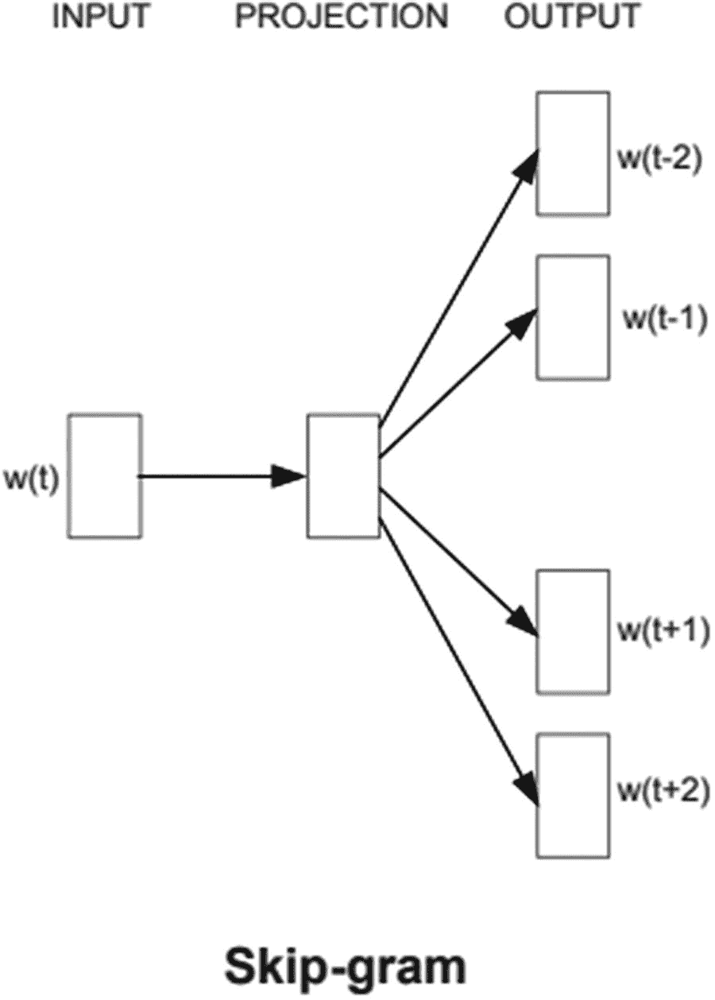

图 4-28

Skip-Gram 模型架构（来源：[`https://arxiv.org/pdf/1301.3781.pdf`](https://arxiv.org/pdf/1301.3781.pdf) Mikolov 等人）

正如我们在 CBOW 模型中讨论的，我们需要将这个 Skip-Gram 架构建模为一个深度学习分类模型，因此我们将目标词作为输入，并尝试预测上下文词。这变得稍微复杂，因为我们的上下文中有多个词。我们通过将每个(`target`, `context_words`)对分解为(`target`, `context`)对来进一步简化，这样上下文只包含一个词。因此我们之前的数据集被转换为类似（`brown`， `quick`）、（`brown`， `fox`）、（`quick`， `the`）、（`quick`， `brown`）等对。但是，我们如何监督或训练模型来知道什么是上下文相关的，什么不是呢？

为此，我们向 Skip-Gram 模型提供（`X`， `Y`）对，其中 `X` 是输入，`Y` 是标签。我们通过使用[(`target`, `context`)， 1]对作为正输入样本来实现这一点，其中 `target` 是我们感兴趣的词，`context` 是出现在目标词附近的上下文词。*正标签 1*表示这是一个上下文相关的对。我们还输入[(`target`, `random`)， 0]对作为负输入样本，其中 `target` 同样是我们感兴趣的词，但 `random` 是从词汇表中随机选择的一个词，与我们的目标词没有上下文或关联。因此*负标签 0*表示这是一个上下文无关的对。我们这样做是为了让模型能够学习哪些词对是上下文相关的，哪些不是，然后为语义相似的词生成相似的嵌入。

### 实现 Skip-Gram 模型

现在让我们尝试从头实现这个模型，以深入了解其内部工作原理，并能够将其与我们实现的 CBOW 模型进行比较。我们照常使用包含在 `norm_bible` 变量中的圣经语料库来训练我们的模型。实现将集中在五个部分：

- 构建语料库词汇表

- 构建 Skip-Gram [(`target`, `context`)， 相关性]生成器

- 构建 Skip-Gram 模型架构

- 训练模型

- 获取词嵌入

让我们开始着手构建我们的 Skip-Gram Word2Vec 模型吧！

#### 构建语料库词汇表

首先，我们按照标准流程构建语料库词汇表，从词汇表中提取每个唯一的词并分配一个唯一标识符，类似于我们在 CBOW 模型中所做的。我们还维护映射关系，以便在词及其唯一标识符之间进行转换。
```

```
from keras.preprocessing import text
tokenizer = text.Tokenizer()
tokenizer.fit_on_texts(norm_bible)
word2id = tokenizer.word_index
id2word = {v:k for k, v in word2id.items()}
vocab_size = len(word2id) + 1
embed_size = 100
wids = [[word2id[w] for w in text.text_to_word_sequence(doc)] for doc in norm_bible]
print('Vocabulary Size:', vocab_size)
print('Vocabulary Sample:', list(word2id.items())[:10])
```
```
Vocabulary Size: 12425
Vocabulary Sample: [('base', 2338), ('feller', 10771), ('sanctuary', 455), ('plunge', 10322), ('azariah', 1120), ('enlightened', 4438), ('horns', 838), ('kareah', 2920), ('nursing', 5943), ('baken', 3492)]
```

语料库中的每个唯一词现在都是我们词汇表的一部分，并拥有一个唯一的数字标识符。

### 构建 Skip-Gram `[(目标词, 上下文词), 相关性]`生成器

现在，我们来构建 Skip-Gram 生成器，它将为我们提供词对及其相关性，正如我们之前讨论的。幸运的是，Keras 有一个便捷的 `Skip-Grams` 工具可以直接使用，我们无需像在 CBOW 中那样手动实现这个生成器。

`skipgrams(...)` 函数位于 `keras.preprocessing.sequence` 中。该函数将词索引序列（整数列表）转换为以下形式的词元组：

1.  `(词, 同一窗口内的词)`，标签为 1（正样本）。

2.  `(词, 词汇表中的随机词)`，标签为 0（负样本）。

```python
from keras.preprocessing.sequence import skipgrams
# 生成 skip-grams
skip_grams = [skipgrams(wid, vocabulary_size=vocab_size, window_size=10) for wid in wids]
# 查看 skip-grams 样本
pairs, labels = skip_grams[0][0], skip_grams[0][1]
for i in range(10):
    print("({:s} ({:d}), {:s} ({:d})) -> {:d}".format(
        id2word[pairs[i][0]], pairs[i][0],
        id2word[pairs[i][1]], pairs[i][1],
        labels[i]))
```
```
(bible (5766), stank (5220)) -> 0
(james (1154), izri (9970)) -> 0
(king (13), bad (2285)) -> 0
(king (13), james (1154)) -> 1
(king (13), lucius (8272)) -> 0
(james (1154), king (13)) -> 1
(james (1154), bazluth (10091)) -> 0
(james (1154), bible (5766)) -> 1
(king (13), bible (5766)) -> 1
(bible (5766), james (1154)) -> 1
```

因此，你可以看到我们已经成功生成了所需的 Skip-Grams，并且基于上述输出中的 Skip-Grams 样本，你可以根据标签（0 或 1）清晰地看出哪些是相关的，哪些是不相关的。

### 构建 Skip-Gram 模型架构

现在，我们利用 TensorFlow 之上的 Keras 来构建 Skip-Gram 模型的深度学习架构。为此，我们的输入将是目标词和上下文词或随机词对。每个输入都将传入各自的嵌入层（使用随机权重初始化）。一旦我们获得目标词和上下文词的词嵌入，我们将其传递到一个合并层，在该层中计算这两个向量的点积。然后，我们将这个点积值传递到一个密集的 sigmoid 层，该层根据词对是上下文相关还是随机词，预测结果是 1 或 0。

我们将其与实际相关性标签进行比较，利用 `mean_squared_error` 损失函数计算损失，并在每个训练周期执行反向传播，以更新嵌入层。以下代码展示了我们的模型架构。见图 4-29。

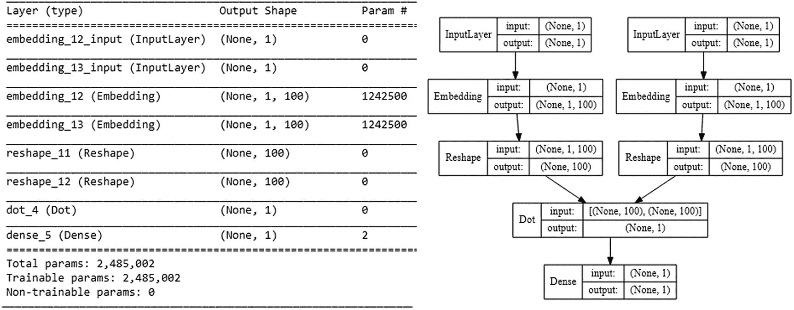

图 4-29 Skip-Gram 模型概要及架构

```python
from keras.layers import Dot
from keras.layers.core import Dense, Reshape
from keras.layers.embeddings import Embedding
from keras.models import Sequential
from keras.models import Model
# 构建 skip-gram 架构
word_model = Sequential()
word_model.add(Embedding(vocab_size, embed_size, embeddings_initializer="glorot_uniform", input_length=1))
word_model.add(Reshape((embed_size, )))
context_model = Sequential()
context_model.add(Embedding(vocab_size, embed_size, embeddings_initializer="glorot_uniform", input_length=1))
context_model.add(Reshape((embed_size,)))
model_arch = Dot(axes=1)([word_model.output, context_model.output])
model_arch = Dense(1, kernel_initializer="glorot_uniform", activation="sigmoid")(model_arch)
model = Model([word_model.input, context_model.input], model_arch)
model.compile(loss="mean_squared_error", optimizer="rmsprop")
# 查看模型概要
print(model.summary())
# 可视化模型结构
from IPython.display import SVG
from keras.utils.vis_utils import model_to_dot
SVG(model_to_dot(model, show_shapes=True, show_layer_names=False, rankdir='TB').create(prog='dot', format="svg"))
```

理解这个深度学习模型相当直接。不过，我将尽力用简单的术语总结这个模型的核心概念，以便于理解。对于每个训练样本，我们有一对输入词，包括一个具有唯一数字标识符的输入目标词和一个具有唯一数字标识符的上下文词。如果是正样本，则该词具有上下文意义，是一个上下文词，我们的标签 Y = 1。否则，如果是负样本，则该词没有上下文意义，只是一个随机词，我们的标签 Y = 0。我们将每个词传递给它们各自的嵌入层，其大小为（`vocab_size` × `embed_size`），这将为这两个词生成稠密的词嵌入（每个词对应 `1` × `embed_size`）。

接下来，我们使用一个合并层来计算这两个嵌入的点积，并得到点积值。然后发送到密集的 sigmoid 层，该层输出 1 或 0。我们将其与实际标签 Y（1 或 0）进行比较，计算损失，反向传播误差以调整权重（在嵌入层中），并对所有 `(目标词, 上下文词)` 对重复此过程，进行多个训练周期。图 4-30 试图解释这个过程。

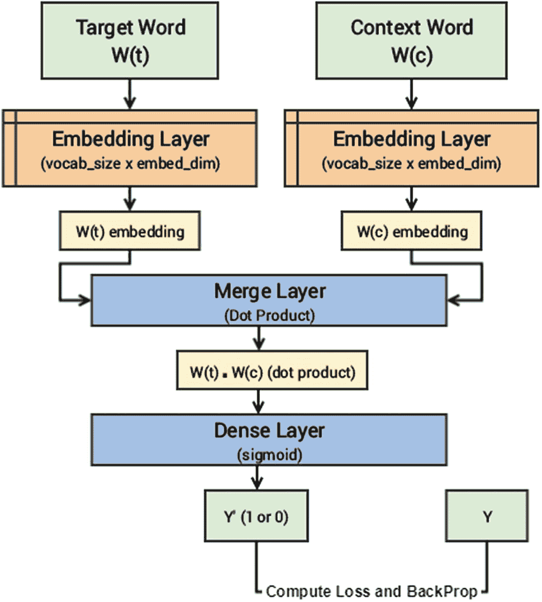

图 4-30 Skip-Gram 深度学习模型的可视化描述

现在，让我们开始使用我们的 Skip-Grams 来训练模型。

### 训练模型

在完整语料库上运行模型需要相当多的时间，但比CBOW模型要快。我运行了五个训练周期。你可以利用以下代码，并在需要时运行更多周期。

```python
for epoch in range(1, 6):
    loss = 0
    for i, elem in enumerate(skip_grams):
        pair_first_elem = np.array(list(zip(*elem[0]))[0], dtype="int32")
        pair_second_elem = np.array(list(zip(*elem[0]))[1], dtype="int32")
        labels = np.array(elem[1], dtype="int32")
        X = [pair_first_elem, pair_second_elem]
        Y = labels
        if i % 10000 == 0:
            print('已处理 {} 个 (skip_first, skip_second, relevance) 对'.format(i))
        loss += model.train_on_batch(X,Y)
    print('训练周期:', epoch, '损失:', loss)
```

```
Epoch: 1 Loss: 4474.41281086
Epoch: 2 Loss: 3750.71884749
Epoch: 3 Loss: 3752.47489296
Epoch: 4 Loss: 3793.9177565
Epoch: 5 Loss: 3718.15081862
```

模型训练完成后，基于嵌入层，相似的词应具有相似的权重。

### 获取词嵌入

要获取整个词汇表的词嵌入，我们可以通过以下代码从嵌入层中提取。请注意，我们只关心目标词嵌入层，因此我们从`word_model`嵌入层提取嵌入向量。我们不采用位置0的嵌入，因为词汇表中没有任何词的数值标识符为0。参见图4-31。

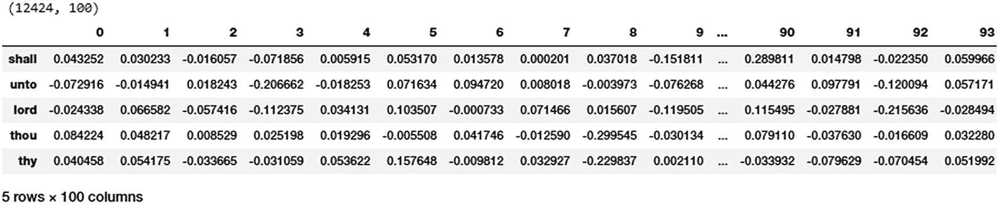

图4-31 – 基于Skip-Gram模型的词汇表词嵌入

```
word_embed_layer = model.layers[2]
weights = word_embed_layer.get_weights()[0][1:]
print(weights.shape)
pd.DataFrame(weights, index=id2word.values()).head()
```

因此，你可以清晰地看到每个词都拥有一个大小为`(1 × 100)`的稠密嵌入，如上文输出所示。这与我们从CBOW模型中得到的结果类似。现在，我们在这些稠密嵌入向量上应用欧几里得距离度量，为词汇表中的每个词生成成对距离度量。然后，我们可以基于最短（欧几里得）距离来确定每个目标词的n个最近邻，这与我们在CBOW模型嵌入上的操作类似。

```
from sklearn.metrics.pairwise import euclidean_distances
distance_matrix = euclidean_distances(weights)
print(distance_matrix.shape)
similar_words = {search_term: [id2word[idx]
for idx in distance_matrix[word2id[search_term]-1].argsort()[1:6]+1]
for search_term in ['god', 'jesus', 'noah', 'egypt', 'john', 'gospel', 'moses','famine']}
similar_words
```

```
(12424, 12424)
{'egypt': ['taken', 'pharaoh', 'wilderness', 'gods', 'became'],
'famine': ['moved', 'awake', 'driven', 'howl', 'snare'],
'god': ['strength', 'given', 'blessed', 'wherefore', 'lord'],
'gospel': ['preached', 'must', 'preach', 'desire', 'grace'],
'jesus': ['disciples', 'christ', 'dead', 'peter', 'jews'],
'john': ['peter', 'hold', 'mountain', 'ghost', 'preached'],
'moses': ['commanded', 'third', 'congregation', 'tabernacle', 'tribes'],
'noah': ['ham', 'terah', 'amon', 'adin', 'zelophehad']}
```

从结果中可以清晰地看到，每个目标词的许多相似词都是合理的，并且与我们的CBOW模型相比，我们获得了更好的结果。现在，让我们使用t-SNE（*t-分布随机邻域嵌入*）来可视化这些词嵌入。这是一种流行的降维技术，用于在低维空间（例如二维）中可视化高维空间。参见图4-32。

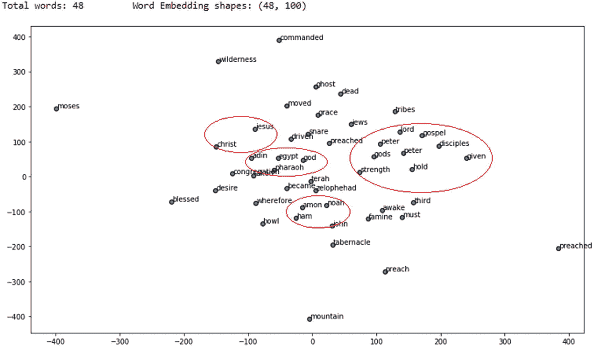

图4-32 – 使用t-SNE可视化Skip-Gram Word2Vec词嵌入

```
from sklearn.manifold import TSNE
words = sum([[k] + v for k, v in similar_words.items()], [])
words_ids = [word2id[w] for w in words]
word_vectors = np.array([weights[idx] for idx in words_ids])
print('Total words:', len(words), '\tWord Embedding shapes:', word_vectors.shape)
tsne = TSNE(n_components=2, random_state=0, n_iter=10000, perplexity=3)
np.set_printoptions(suppress=True)
T = tsne.fit_transform(word_vectors)
labels = words
plt.figure(figsize=(14, 8))
plt.scatter(T[:, 0], T[:, 1], c="steelblue", edgecolors="k")
for label, x, y in zip(labels, T[:, 0], T[:, 1]):
    plt.annotate(label, xy=(x+1, y+1), xytext=(0, 0), textcoords='offset points')
```

图4-32中的圆圈显示了在向量空间中彼此邻近、上下文语义相似的词。如果你发现其他有趣的规律，欢迎随时告知！

### 使用Gensim构建鲁棒的Word2Vec模型

虽然我们的实现还算不错，但它们并未针对在大型语料库上高效运行进行优化。由Radim Řehůřek创建的*Gensim*框架包含一个鲁棒、高效且可扩展的Word2Vec模型实现。我们将在圣经语料库上利用它。在我们的工作流程中，我们将对标准化后的语料库进行分词，然后重点关注Word2Vec模型中的以下四个参数进行构建。基本思想是提供文档语料库作为输入，并为输出获取特征向量。

在内部，它会根据输入的文本文档构建一个词汇表，并基于我们之前提到的各种技术学习词的向量表示。完成后，它会构建一个模型，可用于提取文档中每个词的词向量。使用诸如平均加权或TF-IDF加权等多种技术，我们可以利用文档的词向量来计算其平均向量表示。你可以在[`http://radimrehurek.com/gensim/models/word2vec.html`](http://radimrehurek.com/gensim/models/word2vec.html)获取有关Gensim的Word2Vec实现接口的更多详情。当我们基于示例训练语料库构建模型时，将主要关注以下参数。

- `size`：此参数用于设置词向量的大小或维度，范围可以从几十到几千。你可以尝试不同的维度，看看哪种效果最佳。

- `window`：此参数用于设置上下文或窗口大小，该大小指定算法在训练时视为上下文的词窗口长度。

- `min_count`：此参数指定词汇表中考虑一个词所需的最小词频。这有助于移除那些可能不太重要、因为在文档中出现频率极低的特定词。

- `sample`：此参数用于对高频词的降采样效果进行设置。通常在 0.01 到 0.0001 之间的值比较理想。

构建模型后，我们将使用感兴趣的目标词来查看每个词对应的最相似词。

```python
from gensim.models import word2vec
# tokenize sentences in corpus
wpt = nltk.WordPunctTokenizer()
tokenized_corpus = [wpt.tokenize(document) for document in norm_bible]
# Set values for various parameters
feature_size = 100    # Word vector dimensionality
window_context = 30          # Context window size
min_word_count = 1   # Minimum word count
sample = 1e-3   # Downsample setting for frequent words
w2v_model = word2vec.Word2Vec(tokenized_corpus, size=feature_size,
window=window_context, min_count=min_word_count,
sample=sample, iter=50)
# view similar words based on gensim's model
similar_words = {search_term: [item[0]
for item in w2v_model.wv.most_similar([search_term], topn=5)]
for search_term in ['god', 'jesus', 'noah', 'egypt', 'john', 'gospel', 'moses','famine']}
similar_words
{'egypt': ['pharaoh', 'egyptians', 'bondage', 'rod', 'flowing'],
'famine': ['pestilence', 'peril', 'blasting', 'mildew', 'morever'],
'god': ['lord', 'promised', 'worldly', 'glory', 'reasonable'],
'gospel': ['faith', 'afflictions', 'christ', 'persecutions', 'godly'],
'jesus': ['peter', 'messias', 'apostles', 'immediately', 'neverthless'],
'john': ['baptist', 'james', 'peter', 'galilee', 'zebedee'],
'moses': ['congregation', 'children', 'aaron', 'ordinance', 'doctor'],
'noah': ['shem', 'japheth', 'ham', 'noe', 'henoch']}
```

这些相似词与我们的目标词关联更紧密，这也是意料之中的，因为我们让模型运行了更多迭代，这必然会产生更好且更具上下文关联的嵌入。你是否注意到了任何有趣的关联？参见图 4-33。


# 诺亚的儿子与词嵌入

诺亚的儿子们成为我们模型中最具上下文相似性的实体！

接下来，我们使用词嵌入向量，通过 `t-SNE` 降维至二维空间，可视化目标词汇及其相似词汇。见图 4-34。

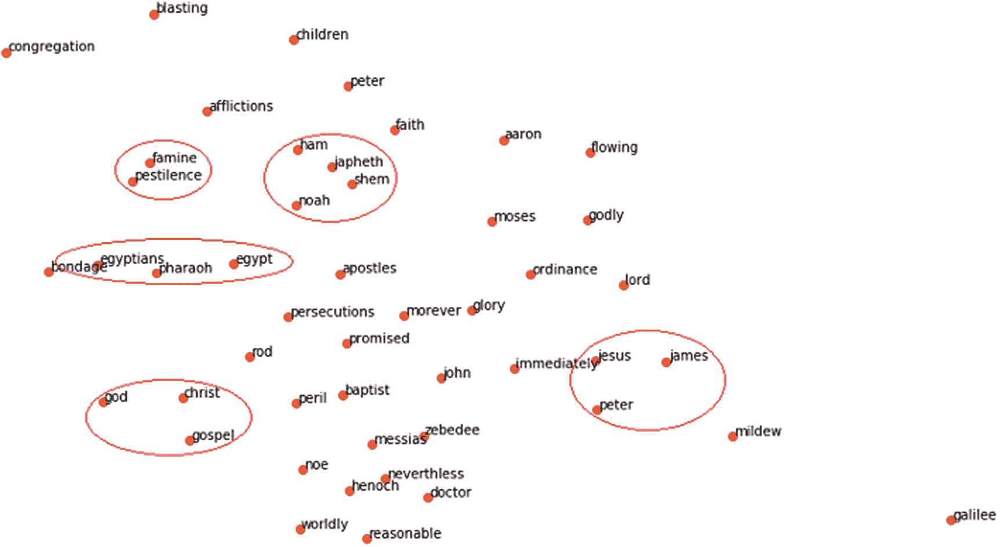

**图 4-34** – 使用 `t-SNE` 可视化我们的 Word2Vec 词嵌入

```python
from sklearn.manifold import TSNE
words = sum([[k] + v for k, v in similar_words.items()], [])
wvs = w2v_model.wv[words]
tsne = TSNE(n_components=2, random_state=0, n_iter=10000, perplexity=2)
np.set_printoptions(suppress=True)
T = tsne.fit_transform(wvs)
labels = words
plt.figure(figsize=(14, 8))
plt.scatter(T[:, 0], T[:, 1], c="orange", edgecolors="r")
for label, x, y in zip(labels, T[:, 0], T[:, 1]):
    plt.annotate(label, xy=(x+1, y+1), xytext=(0, 0), textcoords='offset points')
```

圆圈是我手动绘制的，用于指出一些有趣的关联。根据我之前的描述，可以清楚看到，基于我们模型的词嵌入，诺亚和他的儿子们在空间上非常接近。

## 应用 Word2Vec 特征于机器学习任务

如果你还记得本章前一节的内容，你可能会看到我使用特征执行了一些实际的机器学习任务，例如聚类。让我们利用另一个语料库，尝试取得类似的结果。首先，我们在该语料库上构建一个简单的 `Word2Vec` 模型，并可视化嵌入向量。见图 4-35。

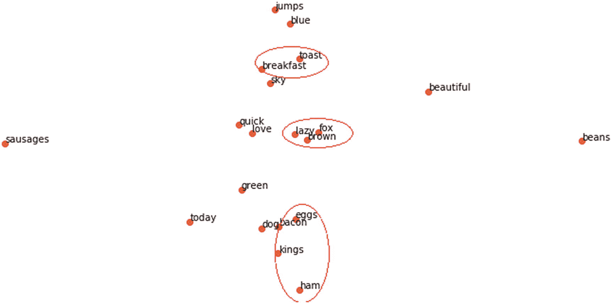

**图 4-35** – 在另一个示例语料库上可视化 `Word2Vec` 词嵌入

```python
# build word2vec model
wpt = nltk.WordPunctTokenizer()
tokenized_corpus = [wpt.tokenize(document) for document in norm_corpus]
# Set values for various parameters
feature_size = 10    # Word vector dimensionality
window_context = 10          # Context window size
min_word_count = 1   # Minimum word count
sample = 1e-3   # Downsample setting for frequent words
w2v_model = word2vec.Word2Vec(tokenized_corpus, size=feature_size,
window=window_context, min_count = min_word_count, sample=sample, iter=100)
# visualize embeddings
from sklearn.manifold import TSNE
words = w2v_model.wv.index2word
wvs = w2v_model.wv[words]
tsne = TSNE(n_components=2, random_state=0, n_iter=5000, perplexity=2)
np.set_printoptions(suppress=True)
T = tsne.fit_transform(wvs)
labels = words
plt.figure(figsize=(12, 6))
plt.scatter(T[:, 0], T[:, 1], c="orange", edgecolors="r")
for label, x, y in zip(labels, T[:, 0], T[:, 1]):
    plt.annotate(label, xy=(x+1, y+1), xytext=(0, 0), textcoords='offset points')
```

请记住，我们的语料库非常小，因此为了获得有意义的词嵌入，并使模型获取更多上下文和语义信息，我们需要更多的数据。那么在这种场景下，什么是词嵌入？它通常是每个单词对应的稠密向量，如下面针对单词“sky”的示例所示。

```python
w2v_model.wv['sky']
# array([ 0.04576328,  0.02328374, -0.04483001,  0.0086611 ,  0.05173225,
#         0.00953358, -0.04087641, -0.00427487, -0.0456274 ,  0.02155695], dtype=float32)
```

### 获取文档嵌入的策略

现在，假设我们想要对我们的玩具语料库中的八个文档进行聚类。我们需要从每个文档中包含的每个单词中获取文档级嵌入。一种策略是对文档中每个单词的词嵌入取平均值。这是一个非常有用的策略，你可以将其应用到自己的问题中。让我们在语料库上应用这种方法来获取每个文档的特征。见图 4-36。

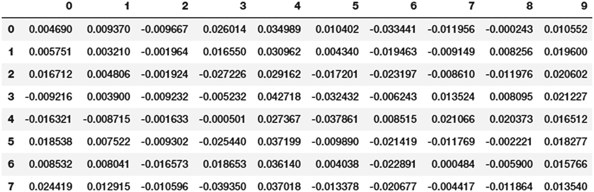

**图 4-36** – 文档级嵌入

```python
def average_word_vectors(words, model, vocabulary, num_features):
    feature_vector = np.zeros((num_features,),dtype="float64")
    nwords = 0.
    for word in words:
        if word in vocabulary:
            nwords = nwords + 1.
            feature_vector = np.add(feature_vector, model[word])
    if nwords:
        feature_vector = np.divide(feature_vector, nwords)
    return feature_vector

def averaged_word_vectorizer(corpus, model, num_features):
    vocabulary = set(model.wv.index2word)
    features = [average_word_vectors(tokenized_sentence, model, vocabulary, num_features) for tokenized_sentence in corpus]
    return np.array(features)

# get document level embeddings
w2v_feature_array = averaged_word_vectorizer(corpus=tokenized_corpus, model=w2v_model, num_features=feature_size)
pd.DataFrame(w2v_feature_array)
```

现在我们已经获得了每个文档的特征，接下来使用亲和传播算法对这些文档进行聚类。这是一种基于数据点之间“消息传递”概念的聚类算法。它不需要显式指定簇的数量，而这是基于划分的聚类算法通常需要的。更详细的讨论请参见第 7 章。见图 4-37。


**图 4-37** – 基于 `Word2Vec` 文档特征分配的簇

```python
from sklearn.cluster import AffinityPropagation
ap = AffinityPropagation()
ap.fit(w2v_feature_array)
cluster_labels = ap.labels_
cluster_labels = pd.DataFrame(cluster_labels, columns=['ClusterLabel'])
pd.concat([corpus_df, cluster_labels], axis=1)
```

可以看到，我们的算法基于`Word2Vec`特征成功将每个文档聚类到了正确的组中，非常巧妙！我们还可以使用`主成分分析 (PCA)`将特征维度降至二维，然后通过颜色编码每个簇来可视化每个文档在簇中的位置。见图 4-38。

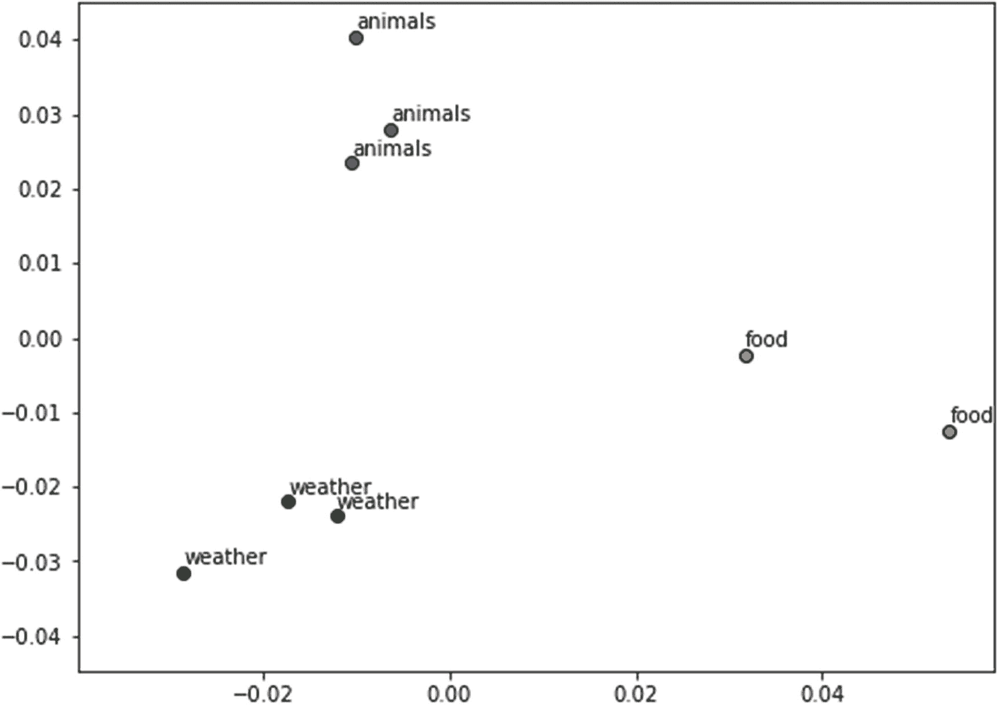

**图 4-38** – 可视化我们的文档簇

```python
from sklearn.decomposition import PCA
pca = PCA(n_components=2, random_state=0)
pcs = pca.fit_transform(w2v_feature_array)
labels = ap.labels_
categories = list(corpus_df['Category'])
plt.figure(figsize=(8, 6))
for i in range(len(labels)):
    label = labels[i]
    color = 'orange' if label == 0 else 'blue' if label == 1 else 'green'
    annotation_label = categories[i]
    x, y = pcs[i]
    plt.scatter(x, y, c=color, edgecolors="k")
    plt.annotate(annotation_label, xy=(x+1e-4, y+1e-3), xytext=(0, 0),
                 textcoords='offset points')
```

一切看起来井井有条，因为每个簇中的文档彼此靠近，与其他簇相距较远。

# GloVe 模型

GloVe（全局向量）模型是一种无监督学习模型，可用于获取类似于`Word2Vec`的稠密词向量。不过，其技术有所不同，训练是在聚合的全局“词-词”共现矩阵上进行的，从而为我们提供一个具有有意义子结构的向量空间。该方法由斯坦福大学的 Pennington 等人发明，我建议你阅读关于 GloVe 的原始论文，即 Pennington 等人所著的《GloVe: Global Vectors for Word Representation》，这是一篇极好的读物，能让你深入了解该模型的工作原理。

我们不会过于详细地从头实现该模型，但如果你对实际代码感兴趣，可以查看官方的 GloVe 页面：[`https://nlp.stanford.edu/projects/glove/`](https://nlp.stanford.edu/projects/glove/)。这里我们保持简单，并尝试理解 GloVe 模型背后的基本概念。

我们讨论过基于计数的矩阵分解方法（如`LSA`）以及预测方法（如`Word2Vec`）。论文指出，目前这两类方法都存在显著缺陷。像`LSA`这类方法能高效利用统计信息，但在词类比任务（例如寻找语义相似的词）上表现相对较差。像`Skip-Gram`这类方法在类比任务上可能表现更好，但它们未能很好地全局利用语料库的统计信息。

GloVe 模型的基本方法是：首先创建一个巨大的“词-上下文”共现矩阵，由（词，上下文）对组成，矩阵中的每个元素代表一个词与上下文（可以是一个词序列）共同出现的频次。然后，其思路是应用矩阵分解来近似这个矩阵，如图 4-39 所示。

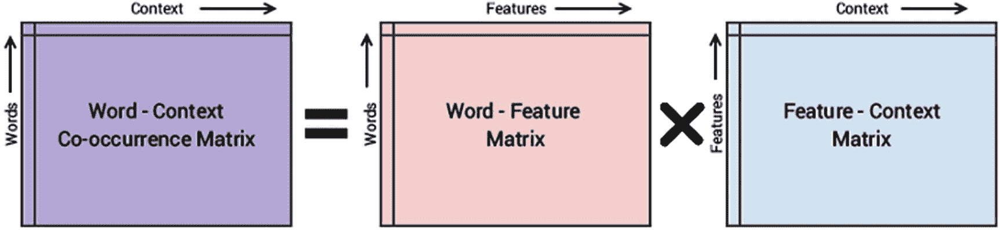

**图 4-39** GloVe 模型实现的概念模型

考虑“词-上下文”（`WC`）矩阵、“词-特征”（`WF`）矩阵和“特征-上下文”（`FC`）矩阵，我们尝试进行因式分解：


其目标是通过将`WF`和`FC`相乘来重构`WC`。为此，我们通常用一些随机权重初始化`WF`和`FC`，尝试将它们相乘得到`WC'`（`WC`的近似值），并衡量其与`WC`的接近程度。我们使用随机梯度下降法（`SGD`）多次重复此过程以最小化误差。

最后，“词-特征矩阵”（`WF`）为每个词提供了词嵌入，其中`F`可以预设为特定的维度数。需要记住的一个非常重要点是，`Word2Vec`和`GloVe`模型在工作方式上非常相似。两者都旨在构建一个向量空间，其中每个词的位置都受到其相邻词（基于它们的上下文和语义）的影响。`Word2Vec`从局部的单个词共现对示例开始，而`GloVe`从语料库中所有词的全局聚合共现统计开始。

## 将 GloVe 特征应用于机器学习任务

让我们尝试将基于 GloVe 的嵌入用于我们的文档聚类任务。非常流行的`spaCy`框架具备基于不同语言模型利用 GloVe 嵌入的能力。你也可以从斯坦福 NLP 网站（[`https://nlp.stanford.edu/projects/glove/`](https://nlp.stanford.edu/projects/glove/)）获取预训练的词向量，并使用`Gensim`或`spaCy`按需加载。我们将安装`spaCy`并使用`en_vectors_web_lg`模型（[`https://spacy.io/models/en#en_vectors_web_lg`](https://spacy.io/models/en#en_vectors_web_lg)），该模型包含在 Common Crawl（[`http://commoncrawl.org/`](http://commoncrawl.org/)）上使用 GloVe 训练的 300 维词向量稠密嵌入。

```
# 使用以下命令安装 spaCy
> pip install -U spacy
或
> conda install -c conda-forge spacy
# 下载以下语言模型并将其存储在磁盘上
https://github.com/explosion/spacy-models/releases/tag/en_vectors_web_lg-2.0.0
# 将其链接到 spaCy
> python -m spacy link ./spacymodels/en_vectors_web_lg-2.0.0/en_vectors_web_lg en_vecs
链接成功
./spacymodels/en_vectors_web_lg-2.0.0/en_vectors_web_lg --> ./Anaconda3/lib/site-packages/spacy/data/en_vecs
你现在可以通过 spacy.load('en_vecs') 加载模型
```

在`spaCy`中也有自动安装模型的方法。如果需要，你可以查看 [`https://spacy.io/usage/models`](https://spacy.io/usage/models) 上的“模型与语言”页面了解更多信息。我在使用自动安装时遇到了一些问题，所以不得不手动加载它们。现在我们使用`spaCy`加载我们的语言模型。

```
import spacy
nlp = spacy.load('en_vecs')
total_vectors = len(nlp.vocab.vectors)
print('词向量总数:', total_vectors)
词向量总数: 1070971
```

这验证了一切正常且有序。现在让我们为玩具语料库中的每个词获取 GloVe 嵌入。见图 4-40。

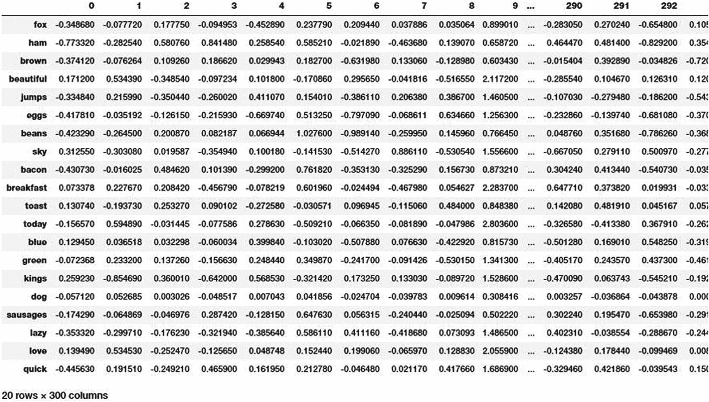

**图 4-40** 样本语料库中词的 GloVe 嵌入

```
unique_words = list(set([word for sublist in [doc.split() for doc in norm_corpus] for word in sublist]))
word_glove_vectors = np.array([nlp(word).vector for word in unique_words])
pd.DataFrame(word_glove_vectors, index=unique_words)
```

现在我们可以使用 t-SNE 来可视化这些嵌入，类似于我们使用`Word2Vec`嵌入所做的操作。见图 4-41。

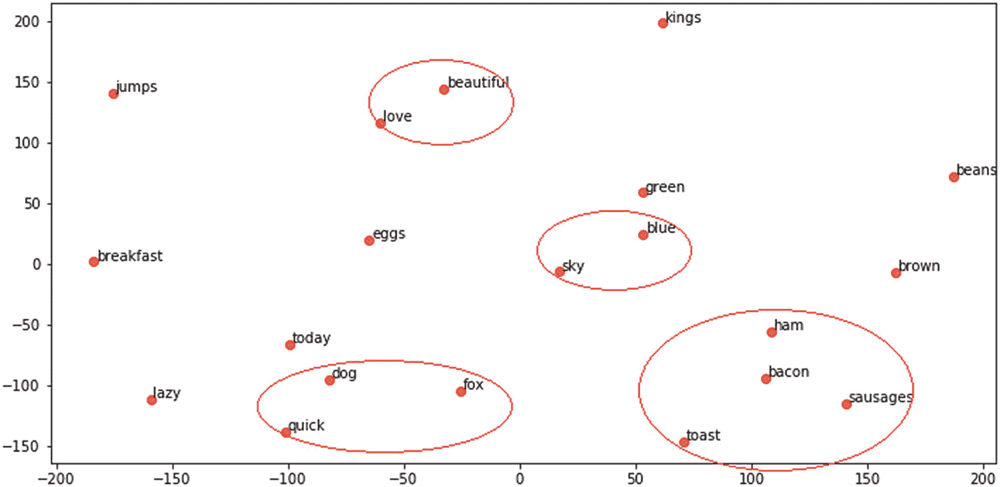

**图 4-41** 在样本语料库上可视化 GloVe 词嵌入

```
from sklearn.manifold import TSNE
tsne = TSNE(n_components=2, random_state=0, n_iter=5000, perplexity=3)
np.set_printoptions(suppress=True)
T = tsne.fit_transform(word_glove_vectors)
labels = unique_words
plt.figure(figsize=(12, 6))
plt.scatter(T[:, 0], T[:, 1], c="orange", edgecolors="r")
for label, x, y in zip(labels, T[:, 0], T[:, 1]):
plt.annotate(label, xy=(x+1, y+1), xytext=(0, 0), textcoords='offset points')
```

`spaCy`的妙处在于，它自动为每个文档中的词提供平均嵌入，而无需我们像在`Word2Vec`中那样实现一个函数。我们现在将利用`spaCy`为我们的语料库获取文档特征，并使用 k-means 聚类对文档进行聚类。见图 4-42。


**图 4-42** 基于 GloVe 文档特征分配的聚类

```markdown
```python
doc_glove_vectors = np.array([nlp(str(doc)).vector for doc in norm_corpus])
km = KMeans(n_clusters=3, random_state=0)
km.fit_transform(doc_glove_vectors)
cluster_labels = km.labels_
cluster_labels = pd.DataFrame(cluster_labels, columns=['ClusterLabel'])
pd.concat([corpus_df, cluster_labels], axis=1)
```

我们看到与从 `Word2Vec` 模型获得的结果一致的聚类，这很好！如图 4-43 所示（该图来自 Pennington 等人的原始论文），`GloVe` 模型声称在许多场景下表现优于 `Word2Vec` 模型。

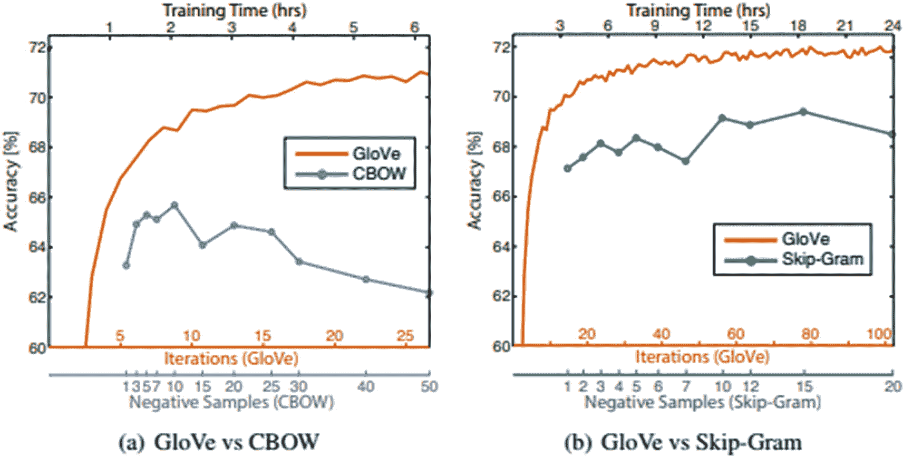

**图 4-43** GloVe 与 Word2Vec 性能对比（来源：Pennington 等人发表于 [`https://nlp.stanford.edu/pubs/glove.pdf`](https://nlp.stanford.edu/pubs/glove.pdf) 的论文）

这些实验是在相同的 6B 词元语料库（Wikipedia 2014 + Gigaword 5）上训练 300 维向量，使用相同的 40 万词词汇表以及大小为 10 的对称上下文窗口（如果你对细节感兴趣）进行的。

### FastText 模型

`FastText` 模型由 Facebook 于 2016 年推出，作为基础 `Word2Vec` 模型的扩展和预期改进。它基于 Mikolov 等人题为 *《利用子词信息丰富词向量》* 的原始论文，该论文是深入理解该模型工作原理的极佳读物。总体而言，`FastText` 是一个用于学习词表示并执行鲁棒、快速且准确文本分类的框架。该框架由 Facebook 在 GitHub 上开源，并声称具有以下特点：

*   最新的最先进英语词向量

*   在 Wikipedia 和 Crawl 上训练的 157 种语言的词向量

*   用于语言识别和各种监督任务的模型

虽然我没有从头实现这个模型，但根据研究论文，我了解到以下关于该模型工作原理的内容。通常，像 `Word2Vec` 这样的预测模型将每个词视为一个独立的实体（例如，where），并为该词生成一个密集嵌入。然而，这对手词汇量庞大、罕见词众多的语言来说是一个严重的限制。`Word2Vec` 模型通常会忽略每个词的形态结构，将词视为单一实体。`FastText` 模型则将每个词视为一个字符 n-gram 的袋。这在论文中也被称为*子词*模型。

我们在词的开头和结尾添加特殊的边界符号 `<` 和 `>`。这使我们能够区分前缀和后缀与其他字符序列。我们还将字母 `w` 包含在其 n-gram 集合中，以便学习每个词的表示（除了其字符 n-gram）。以词 "where" 和 `n=3`（三字符组）为例，它将被表示为字符 n-gram：`<wh`、`whe`、`her`、`ere`、`re>` 以及代表整个词的特殊序列 `<where>`。请注意，对应于词 `<her>` 的序列与三字符组 "her" 以及词 "where" 是不同的。

在实践中，论文建议提取 `n ≥ 3` 和 `n ≤ 6` 的所有 n-gram。这是一种非常简单的方法，也可以考虑不同的 n-gram 集合，例如取所有前缀和后缀。我们通常为每个词的每个 n-gram 关联一个向量表示（嵌入）。因此，我们可以通过求其 n-gram 向量表示之和或这些 n-gram 嵌入的平均值来表示一个词。由于这种基于字符从单个词中利用 n-gram 的效果，罕见词获得良好表示的可能性更高，因为基于字符的 n-gram 应该会出现在语料库的其他词中。

### 将 FastText 特征应用于机器学习任务

`Gensim` 包提供了包装器，可以借助 `gensim.models.fasttext` 模块下的 `FastText` 模型接口。我们再次将其应用于圣经语料库，查看感兴趣的词及其最相似的词。

```python
from gensim.models.fasttext import FastText
wpt = nltk.WordPunctTokenizer()
tokenized_corpus = [wpt.tokenize(document) for document in norm_bible]
# 设置各种参数的值
feature_size = 100    # 词向量维度
window_context = 50          # 上下文窗口大小
min_word_count = 5   # 最小词频
sample = 1e-3   # 高频词的下采样设置
# sg 决定是否使用 skip-gram 模型 (1) 或 CBOW (0)
ft_model = FastText(tokenized_corpus, size=feature_size, window=window_context, min_count=min_word_count, sample=sample, sg=1, iter=50)
# 基于 gensim 的 FastText 模型查看相似词
similar_words = {search_term: [item[0] for item in ft_model.wv.most_similar([search_term], topn=5)] for search_term in ['god', 'jesus', 'noah', 'egypt', 'john', 'gospel', 'moses','famine']}
similar_words
```

输出：

```
{'egypt': ['land', 'pharaoh', 'egyptians', 'pathros', 'assyrian'],
 'famine': ['pestilence', 'sword', 'egypt', 'dearth', 'blasted'],
 'god': ['lord', 'therefore', 'jesus', 'christ', 'truth'],
 'gospel': ['preached', 'preach', 'christ', 'preaching', 'gentiles'],
 'jesus': ['christ', 'god', 'disciples', 'paul', 'grace'],
 'john': ['baptist', 'baptize', 'peter', 'philip', 'baptized'],
 'moses': ['aaron', 'commanded', 'congregation', 'spake', 'tabernacle'],
 'noah': ['shem', 'methuselah', 'creepeth', 'adam', 'milcah']}
```

你可以看到结果中有很多相似之处（见图 4-44）。你是否注意到任何有趣的关联和相似性？


**图 4-44** 摩西、他的兄弟亚伦以及摩西的会幕在我们的模型中作为相似实体出现

有了这些嵌入，我们可以执行一些有趣的自然语言任务。其中之一是确定不同词（实体）之间的相似度。

```python
print(ft_model.wv.similarity(w1='god', w2="satan"))
print(ft_model.wv.similarity(w1='god', w2="jesus"))
```

输出：

```
0.333260876685
0.698824900473
```

```python
st1 = "god jesus satan john"
print('Odd one out for [',st1, ']:', ft_model.wv.doesnt_match(st1.split()))
st2 = "john peter james judas"
print('Odd one out for [',st2, ']:', ft_model.wv.doesnt_match(st2.split()))
```

输出：

```
Odd one out for [ god jesus satan john ]: satan
Odd one out for [ john peter james judas ]: judas
```

我们可以看到，根据圣经语料库的文本，“god”与“jesus”的关联比与“satan”更紧密。在其他词中找出异常实体的两种情况下，都可以看到类似的结果。

## 总结
```

本章涵盖了丰富多样的特征工程技术及模型，包括传统与先进的文本表示新模型。请记住，传统策略基于数学、信息检索和自然语言处理的概念。因此，这些经过时间检验的可靠方法已在各种数据集和问题上证明了其成功之处。我们广泛介绍了传统的特征工程模型，包括`词袋模型`、`N 元词袋模型`、`TF-IDF`、`相似度`和主题模型。我们还从零开始实现了一些模型，以便通过动手示例更好地理解这些概念。

传统模型存在一些局限性，比如稀疏表示会导致特征爆炸，从而引发维度灾难，并丢失文本数据中相关词汇的语境、顺序和序列关系。这正是我们引入先进特征工程模型的原因——这些模型利用深度学习与神经网络，为任何语料库中的每个单词生成稠密嵌入。

我们深入探讨了`Word2Vec`，甚至从零训练了深度学习模型，以展示`CBOW`和`Skip-Gram`模型的工作原理。理解如何在现实世界中应用特征工程模型同样重要，我们演示了如何提取和构建文档级特征，并将其用于文本聚类。最后，我们介绍了另外两种先进特征工程模型——`GloVe`和`FastText`——的核心概念与详细示例。我们鼓励您尝试将这些模型应用到自己的问题中。在下一章关于文本分类的内容中，我们也将继续使用这些模型！
