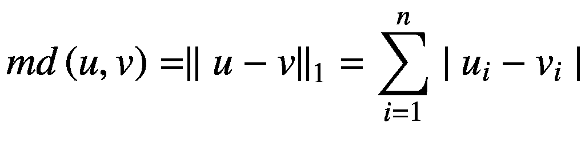
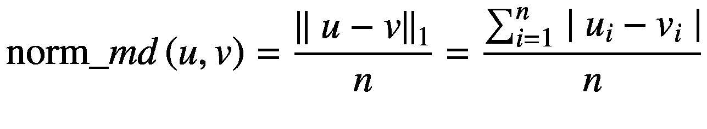

# 曼哈顿距离

## ValueError: The vectors must have equal lengths

```
从输出中可以看出，术语"Believe"和"beleive"最为相似，汉明距离为 2 或 0.29，而术语"bargain"的得分为 6 或 0.86（分数越小，术语越相似）。同样地，术语"Elephant"会抛出异常，因为其长度与根词"Believe"不同。由于字符串长度不相等，无法计算汉明距离。
```

*曼哈顿距离*度量在概念上与汉明距离相似，区别在于不是计算不匹配的字符数，而是将两个字符串在每个位置上每对字符的差值相减。形式上，曼哈顿距离也称为城市街区距离、`L1`范数或出租车度量，它被定义为网格中两点之间基于严格水平或垂直路径的距离。这取代了通常由欧几里得距离度量计算的对角线距离。数学上可表示如下：



其中 `u` 和 `v` 是长度为 `n` 的两个项。汉明距离中关于两个项长度相等的假设在此同样适用。我们还可以通过将绝对差值之和除以项的长度来计算归一化曼哈顿距离。这可以表示为：



其中 `n` 是每个项 `u` 和 `v` 的长度。以下函数帮助我们实现曼哈顿距离，并具备计算归一化曼哈顿距离的能力。

```python
def manhattan_distance(u, v, norm=False):
    if u.shape != v.shape:
        raise ValueError('The vectors must have equal lengths.')
    return abs(u - v).sum() if not norm else abs(u - v).mean()
```

现在，我们将使用下面代码片段中描述的函数，计算我们的根项与其他项之间的曼哈顿距离。

```python
```