# 5. 文本分类

学习处理和理解文本是从文本数据中获取有意义洞察的第一步，也是至关重要的一步。虽然理解语言语法、结构和语义很重要，但仅凭这些还不足以从海量文本数据中提取有用模式、获得洞察并最大化利用价值。将语言处理知识与人工智能、机器学习和深度学习的概念相结合，有助于构建能够利用文本数据并解决现实世界实际问题的智能系统，从而造福企业和机构。

机器学习涉及多个方面，包括监督学习、无监督学习、强化学习以及近来的深度学习。每个领域都有多种技术和算法，可以应用于文本数据之上，使我们能够构建无需过多人工监督的自主学习系统。机器学习模型是数据与算法的结合，我们在第 3 章构建自己的解析器和标注器时已初步体验过。机器学习的好处在于，一旦模型训练完成，我们就能直接将其应用于新的、未见过的数据上，开始看到有用的洞察和期望的结果——这正是预测性和规范性分析的关键！

自然语言处理领域最相关且最具挑战性的问题之一是`文本分类`或归类，通常也被称为`文档分类`。这项任务涉及根据每个文本文档的内在属性或特征，将文本文档划分到各种（预定义的）类别中。它在不同领域和业务中都有应用，包括电子邮件垃圾邮件识别和新闻分类。这个概念看似简单：如果你有少量文档，你可以查看每个文档并对其内容有所了解。基于这些了解，你可以将相似文档归入类别或类中。但当需要分类的文本文档数量增加到几十万甚至几百万时，问题就开始变得更具挑战性。这时，特征提取以及监督或无监督机器学习等技术就派上了用场。文档分类是一个通用问题，不仅限于文本，还可以扩展到音乐、图像、视频和其他媒体。

为了更清晰地阐述这个问题，我们将有一组给定的类别和若干文本文档。请记住，文档本质上是句子或文本段落。这构成了一个语料库。我们的任务是确定每个文档属于哪个或哪些类别。整个流程包含多个步骤，稍后我们将详细介绍。简而言之，对于监督分类问题，我们需要有一些标注数据来训练文本分类模型。这些数据本质上是事先已被分配到某个特定类别的精选文档。利用这些数据，我们从每个文档中提取特征和属性，并使我们的模型学习与每个文档及其类别相对应的这些属性。这是通过将数据输入监督机器学习算法来实现的。

当然，在构建模型之前，需要对数据进行预处理和标准化。完成后，我们遵循相同的标准化和特征提取流程，然后将数据输入模型以预测新文档的类别。然而，对于无监督分类问题，我们通常没有任何标注的训练文档，而是使用聚类和文档相似度度量等技术，根据文档的内在属性进行聚类，并为其分配标签。

在本章中，我们将讨论文本文档分类的概念，并学习如何将其构建为一个监督机器学习问题。我们还将讨论分类的各种形式及其含义。我们还将清晰描绘出完成文本分类工作流程所需的关键步骤，并讲解该工作流程中的核心环节。其中一部分内容我们已在第 3 章和第 4 章中介绍过，包括文本整理、特征工程，以及新的方面，如监督机器学习分类器、模型评估和调优。最后，我们将所有这些组件整合起来，构建一个端到端的文本分类系统。本章展示的所有代码示例均可在本书的官方 GitHub 仓库中获取，您可以通过[`https://github.com/dipanjanS/text-analytics-with-python/tree/master/New-Second-Edition`](https://github.com/dipanjanS/text-analytics-with-python/tree/master/New-Second-Edition)访问。

# 什么是文本分类？

在定义文本分类之前，我们需要了解文本数据的范围以及“分类”的含义。这里涉及的文本数据可以是短语、句子，甚至是包含段落文本的完整文档，其来源可以是语料库、博客、网络上的任何地方，甚至企业数据仓库。文本分类也常被称为*文档分类*，目的是用术语*“文档”*涵盖所有形式的文本内容。虽然*“文档”*一词可以定义为思想或事件的某种具体表现形式，可以是书面文字、录音、绘图或演示文稿，但我们在此使用*“文档”*一词来代表文本数据，例如属于英语的句子或段落（只要你能解析并处理该语言，也欢迎将其扩展到其他语言！）。

文本分类也常被称为*文本归类*。然而，我们特意使用*“分类”*一词，原因有二。第一个原因是，它表达了与文本归类相同的本质，即我们希望对文档进行分类。第二个原因是，它表明我们正在使用*分类*或*监督式机器学习方法*来对文本进行分类或归类。文本归类可以通过多种方式实现。我们则明确专注于使用监督式方法进行分类。分类过程并不仅限于文本，在科学、医疗、天气和技术等其他领域也经常使用。

## 形式化定义

既然我们已经理清了所有背景假设，现在可以正式定义文本分类的任务及其整体范围。文本或文档分类被定义为：假设我们有一组预定义的类别，将文本文档分配到一个或多个类别或标签的过程。文档是文本形式的，每个文档可以包含一个句子甚至一个段落的单词。一个文本分类系统可以根据文档的内在属性，成功地将每个文档划分到其正确的类别中。

从数学角度，我们可以将其定义如下：给定某个文档 `D` 的描述和属性 `d`，其中 `d ∈ D`，并给定一组预定义的类别或标签 `C = {c[1], c[2], c[3], …, c[n]}`。实际文档 `D` 可能具有许多内在属性和特征，这使其成为高维空间中的一个实体。通过使用该空间的一个子集（包含由 `d` 所表示的有限描述和特征），我们应该能够使用文本分类系统 `T`，成功地将原始文档 `D` 分配到其正确的类别 `C[x]`。这可以表示为 `T : D → C[x]`。我们将在后续章节中更详细地讨论文本分类系统。图 5-1 展示了文本分类过程的高级概念表示图。

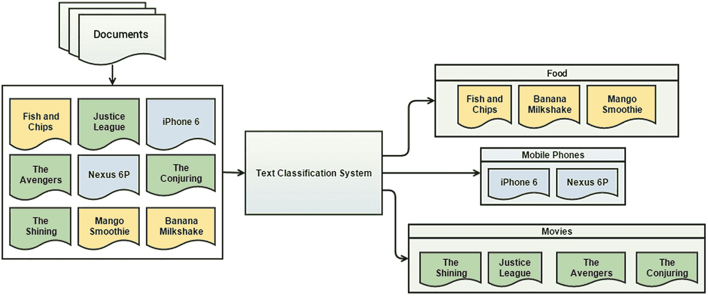

*图 5-1* 文本分类概念概览

在图 5-1 中，我们可以看到有多个文档，它们可以被分配到食品、手机和电影等不同类别。最初，这些文档都混合在一起，就像一个文本语料库中包含各种文档一样。当它们通过一个以黑盒形式表示的文本分类系统后，我们可以看到每个文档都被分配到了我们先前定义的某个特定类别。在真实数据中，这些文档仅以其名称表示；它们可以包含每个产品的描述、特定属性（如电影类型）、产品规格、成分等等，这些本质上都是可以在文本分类系统中用作特征、从而简化文档识别和分类的属性。

## 主要的文本分类变体

文本分类有多种类型。我们介绍两种基于文档内容类型的主要分类。它们如下所示。

-   基于内容的分类

-   基于需求的分类

这些更像是文本分类方法背后的不同理念，而非具体的算法或技术流程。*基于内容的分类*是一种文本分类方式，它会为文本内容中的特定主题或话题赋予优先级或权重，从而帮助确定文档的类别。一个概念性的例子是：一本书中超过 30% 的内容关于食物准备，那么它可能被归类为烹饪/食谱类。*基于需求的分类*则受到用户需求的影响，并针对特定的用户群体和受众。这种分类方式受制于基于用户行为和决策的特定策略与理念。

# 自动化文本分类

我们已经了解了文本分类的定义和范畴，也从概念和数学上对其进行了正式定义，其中提到“文本分类系统”能够将文本文档归类到各自的类别或分类中。想象一下，如果有数名人类审查员逐一处理并分类每一篇文档，他们将成为我们所说的文本分类系统的一部分。然而，一旦我们需要在短时间内对数百万篇文本文档进行分类，这种人工方式就无法有效扩展。为了让流程更高效、更快速，我们可以将文本分类任务自动化，这就引出了自动化文本分类。为了实现自动化文本分类，我们使用了多种机器学习技术和概念。与解决此问题相关的主要机器学习技术有两种，如下所示：

- 监督式机器学习
- 非监督式机器学习

除了这两种技术，还有其他类型的学习算法，例如`强化学习`和`半监督学习`。我们将从机器学习的角度以及如何利用它们对文本文档进行分类这两个方面，更详细地探讨监督式和非监督式学习算法。

`非监督式学习`指的是那些不需要任何预先标注的训练数据样本来构建模型的特定机器学习技术或算法。其重点更多地在于模式挖掘和发现数据中的潜在子结构，而非预测性分析。我们通常会有一组数据点，根据要解决的问题，这些数据点可能是文本形式或数字形式。我们通过一个称为`特征工程`的过程从每个数据点中提取特征，然后将每个数据点的特征集输入到算法中，并尝试从数据中提取有意义的模式，例如使用聚类等技术将相似的数据点分组，或根据主题模型总结文档。

这在文本文档分类中非常有用，也被称为`文档聚类`。在这种方法中，我们根据文档的特征、相似度和属性将它们聚类成组，而无需在任何先前标记过的数据上训练模型。我们将在后续章节讨论主题模型、文档摘要、相似度分析和聚类时，更深入地探讨非监督式学习。

`监督式学习`指的是那些在预先标注的数据样本（称为训练数据）及相应的训练标签/类别上进行训练的特定机器学习技术或算法。通过特征工程从这些数据中提取特征，每个数据点都有自己的特征集和对应的类别/标签。算法从训练数据中学习每种类别类型的各种模式。一旦这个过程完成，我们就得到了一个训练好的模型。随后，当我们将新测试数据样本的特征输入模型时，该模型就可以用来预测其所属类别。因此，机器实际上是基于先前的训练数据样本学会了如何预测未见过的、新数据样本的类别。监督式学习算法主要有两种类型，描述如下：

- **分类**：当需要预测的结果是不同类别时，监督式学习算法被称为分类算法，因此在这种情况下，结果变量是一个分类变量。例如新闻类别和电影类型。
- **回归**：当需要预测的结果是一个连续的数值变量时，监督式学习算法被称为回归算法。例如房价和天气温度。

我们专门针对我们的问题聚焦于分类，因为本章的名称不言而喻。我们正尝试将文本文档分类到不同的类别中。在我们的实施过程中，我们将遵循监督式学习方法，使用不同的分类模型。

## 正式定义

现在，我们准备用数学方式来定义自动化或基于机器学习的文本分类过程。假设我们有一个训练文档集，每个文档都标有相应的类别或分类。这可以用 `TS` 来表示，`TS` 是一个由成对的文档和标签组成的集合，`TS = {(d[1], c[1]), (d[2], c[2]), … , (d[n], c[n])}`，其中 `d[1], d[2], … , d[n]` 是文本文档的列表。它们对应的标签是 `c[1], c[2], … , c[n]`，且 `c[x] ∈ C = {c1, c2, … , cn}`，这里 `c[x]` 表示文档 `x` 的类别标签，`C` 表示所有可能的不同类别的集合，每个文档的类别可以是其中任何一个。假设我们有了训练集，我们可以定义一个监督式学习算法 `F`，当它在我们的训练数据集 `TS` 上训练时，我们就构建了一个分类模型或分类器 `γ`，并且 `F(TS) = γ`。因此，监督式学习算法 `F` 将输入的成对（文档，类别）集合 `TS` 进行处理，并给出训练好的分类器 `γ`，这就是我们的模型。这个过程被称为训练过程。然后，这个模型可以接收一篇新的、未曾见过的文档 `ND`，并预测其类别 `c[ND]`，使得 `c[ND] ∈ C`。这个过程被称为`预测过程`，可以用 `γ : TD → c[ND]` 来表示。因此，我们可以看到监督式文本分类过程有两个主要阶段：

- 训练
- 预测

需要记住的重要一点是，监督式文本分类需要一些人工标注的训练数据。所以，尽管我们讨论的是自动化文本分类，但为了启动这个过程，我们仍需要一些人工努力。当然，这样做的好处是多方面的，因为一旦我们有了训练好的分类器，就可以持续使用它来预测和分类新的文档，所需的人工努力和监督极少。有各种不同的学习方法或算法，我们将在后续章节中讨论。这些学习算法并非专门针对文本数据，而是通用的机器学习算法，在经过适当的预处理和特征工程后，可以应用于多种类型的数据。我们将涉及几种监督式机器学习算法，并使用它们来解决实际的文本分类问题。

这些算法通常在训练数据集上训练，并且通常还会使用一个可选的验证集，以防止训练后的模型过拟合训练数据。过拟合基本上意味着模型将无法很好地泛化，也无法对新文本文档实例进行正确的预测。通常，基于学习算法，并通过评估验证集上的准确性等各种性能指标，或使用交叉验证（通过随机抽样将训练数据集拆分为训练集和验证集），模型会根据其几个内部参数（称为`超参数`）进行调整。这构成了训练过程的一部分，其结果产生一个完全训练好的、可用于预测的模型。在预测阶段，我们通常会有来自测试数据集的新数据点。在对这些数据进行归一化和特征工程处理后，我们可以将它们输入模型，并通过评估其预测性能来观察模型的表现如何。

### 文本分类任务的变体

根据待预测的类别数量及预测性质，文本分类任务存在以下几种变体：

- 二分类
- 多分类
- 多标签分类

这些分类类型基于数据集、该数据集所涉及的类别数量，以及任何数据点可被预测的类别数量。`Binary classification`（二分类）是指不同类别总数为二，且每次预测结果只能是这两类中的一个。`Multi-class classification`（多分类）也称为多项式分类，指的是类别总数超过两个，且每次预测结果为一个类别，该类别可以是其中任意一个。这是对二分类问题的扩展，其中类别总数超过两个。`Multi-label classification`（多标签分类）指的是对于任何数据点，每次预测可以产生多个结果/预测类别的问题。

## 文本分类蓝图

在了解了自动文本分类的基本范围后，本节将呈现构建自动文本分类器系统的完整工作流蓝图。这包含一系列在训练和测试阶段必须遵循的步骤。要构建一个文本分类系统，我们需要确保拥有数据源并检索到数据，以便开始将其输入系统。假设我们的数据集已经下载并准备好使用，以下主要步骤勾勒出了文本分类系统的典型工作流。

- 准备训练集和测试集（可选地准备验证集）
- 预处理和标准化文本文档
- 特征提取与工程
- 模型训练
- 模型预测与评估
- 模型部署

以上是按顺序执行以构建文本分类器的主要步骤。图 5-2 展示了文本分类系统的详细工作流，其中训练和预测过程中的主要组件已高亮显示。

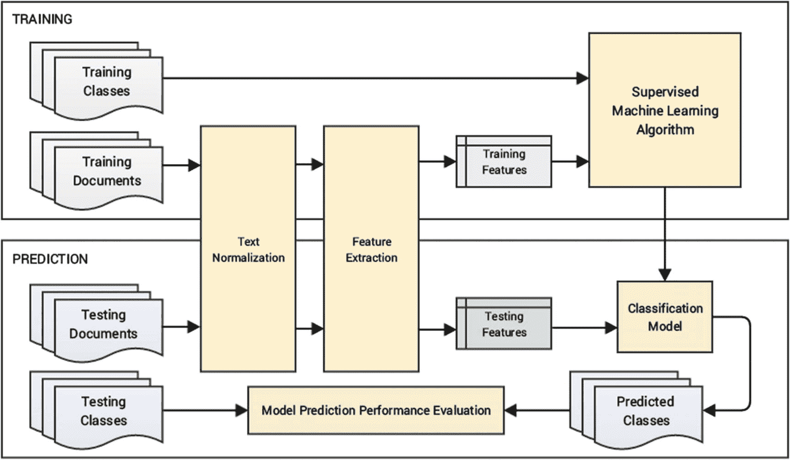

图 5-2 构建自动文本分类系统的蓝图

从图 5-2 中，我们注意到有两个主要方框，称为训练和预测，这是构建文本分类器涉及的两个主要阶段。通常，我们拥有的数据集通常被分成两个或三个部分，称为训练集、验证集（可选）和测试集。请注意图 5-2 中两个过程的“文本标准化”模块和“特征提取”模块存在重叠。这表明，无论我们要分类和预测哪个文档，它都必须经过训练和预测过程中相同的一系列转换。每个文档首先被预处理和标准化，然后提取与该文档相关的特定特征。这些过程在“训练”和“预测”过程中始终保持一致，以确保我们的分类模型在其预测中表现一致。

在“训练”过程中，每个文档都有其对应的类别/分类，这些类别是事先手动标记或整理好的。这些训练文本文档在“文本标准化”模块中进行预处理和标准化，从而得到干净、标准化的训练文本文档。然后，它们被传递到“特征提取”模块，在该模块中，使用不同的特征提取或工程化技术从处理后的文本文档中提取有意义的特征。常见的特征提取技术已在第 4 章中详细讨论，本章将使用其中的一些技术！这些特征通常是数值数组或向量，原因是标准的机器学习算法只能处理数值向量，而无法处理像文本这样的原始非结构化数据。一旦我们拥有了特征，我们选择一个或多个监督式机器学习算法来训练我们的模型。

训练模型涉及将来自文档的特征向量和相应的标签输入，以便算法能够学习与每个类别/分类相对应的各种模式，并能够重用这些知识来预测未来新文档的类别。通常，会使用一个可选的验证数据集来评估分类算法的性能，以确保其在训练过程中能很好地泛化数据。这些特征与机器学习算法的结合产生了一个分类模型，这是“训练”过程的最终产物或输出。通常，该模型会通过一个称为`超参数`调整的过程，使用各种模型参数进行调优，以构建性能更优的最优模型。我们将在动手实践的示例中很快探讨这一点。

## 预测与部署

“预测”过程涉及尝试为新文档预测类别，或评估对新的、之前未见过的测试数据的预测效果。测试数据集文档将经历相同的标准化、特征提取和工程化过程。然后，测试文档的特征向量被传递给训练好的`分类模型`，该模型根据先前学习的模式（此处不进行训练——除非您拥有能从反馈中学习的模型）为每个文档预测可能的类别。如果您拥有这些文档的真实类别标签（已手动标记），则可以通过使用`准确性`、`精确率`、`召回率`和`F1 分数`等各种指标，比较真实标签与预测标签来评估模型的预测性能。这会让您了解模型基于其对新文档的预测的表现如何。

一旦我们拥有一个稳定且能正常工作的模型，最后一步就是部署模型，这通常包括保存模型及其必要的依赖项，并将其部署为服务、API 或运行中的程序。它可以作为批处理作业，或者（如果作为 Web 服务访问）根据用户请求来为新文档预测类别。有多种部署机器学习模型的方式，这通常取决于您将来希望如何访问它。我们现在将讨论此蓝图中的每个主要模块和组件，并实现/重用这些模块，以便我们可以将它们集成起来，构建一个真实世界的自动文本分类器。

# 数据检索

显然，任何数据科学或机器学习流程的第一步都是访问并检索所需数据，以便进行分析和构建机器学习模型。为此，我们将使用非常流行但具有一定挑战性的 20 Newsgroups 数据集，该数据集可直接通过 `Scikit-Learn` 下载。20 Newsgroups 数据集包含约 18,000 篇新闻组帖子，分布在 20 个不同的类别或主题中，因此构成了一个 20 类的分类问题。与预测电子邮件中的垃圾邮件相比，这显然更具挑战性。请记住，类别数量越多，构建准确分类器的难度就越大。

有关该数据集的详细信息，请访问 [`scikit-learn.org/0.19/datasets/twenty_newsgroups.html`](http://scikit-learn.org/0.19/datasets/twenty_newsgroups.html)。建议移除文本文档中的页眉、页脚和引用，以防止模型因某些特定的页眉或电子邮件地址而过拟合或泛化能力不佳。幸运的是，`Scikit-Learn` 认识到了这个问题，加载 20 Newsgroups 数据的函数提供了一个名为 `remove` 的参数，用于指定要从每个文件中剥离哪些类型的信息。`remove` 参数应是一个元组，可包含 `('headers', 'footers', 'quotes')` 的任意子集，分别用于指示移除页眉、签名块和引用块。

在数据预处理阶段，我们还会移除在移除这三项后为空或没有任何内容的文档，因为尝试从空文档中提取特征毫无意义。让我们从加载必要的数据集并定义构建训练和测试数据集的函数开始。我们将加载常用的依赖项，包括在第三章中构建的文本预处理与规范化模块，名为 `text_normalizer`。

```python
from sklearn.datasets import fetch_20newsgroups
import numpy as np
import text_normalizer as tn
import matplotlib.pyplot as plt
import pandas as pd
import warnings
warnings.filterwarnings('ignore')
%matplotlib inline
```

现在，我们利用 `Scikit-Learn` 的辅助函数来获取所需数据。获取数据后，我们将这些数据转换为易于使用的 DataFrame。见图 5-3。

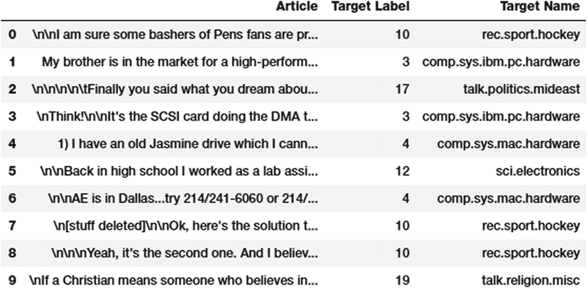

**图 5-3** 20 Newsgroups 数据集

```python
data = fetch_20newsgroups(subset='all', shuffle=True,
remove=('headers', 'footers', 'quotes'))
data_labels_map = dict(enumerate(data.target_names))
Downloading 20news dataset. This may take a few minutes.
Downloading dataset from https://ndownloader.figshare.com/files/5975967 (14 MB)
# 构建 DataFrame
corpus, target_labels, target_names = (data.data, data.target,
[data_labels_map[label] for label in data.target])
data_df = pd.DataFrame({'Article': corpus, 'Target Label': target_labels, 'Target Name': target_names})
print(data_df.shape)
data_df.head(10)
(18846, 3)
```

从该数据集中，我们可以看到每个文档都有一些文本内容，并且标签可以用一个特定数字表示，该数字映射到一个新闻组类别名称。图 5-3 展示了一些数据样本。

# 数据预处理与规范化

在对文档进行预处理和规范化之前，我们先查看数据集中可能存在的空文档并将其移除。

```python
total_nulls = data_df[data_df.Article.str.strip() == "].shape[0]
print("Empty documents:", total_nulls)
Empty documents: 515
```

现在，我们可以使用一个简单的 pandas 过滤操作，移除所有文章中没有文本内容的记录，如下所示。

```python
data_df = data_df[~(data_df.Article.str.strip() == ")]
data_df.shape
(18331, 3)
```

这很简洁！现在我们需要考虑一般的文本预处理或整理阶段。这包括清洗、预处理和规范化文本，将句子、短语和词语等文本成分转换为某种标准格式。这有助于在整个文档语料库中实现标准化，从而构建有意义的特征并减少噪声。噪声可能由多种因素引入，例如不相关的符号、特殊字符、XML 和 HTML 标签等。我们已经在第三章中详细讨论过这一点。不过，为了简要回顾，我们的文本规范化流程中的主要组成部分描述如下。请记住，它们都可以在 `text_normalizer` 模块中找到，该模块位于 `text_normalizer.py` 文件中。

- `清洗文本：` 我们的文本通常包含不必要的内容，比如 HTML 标签，这些内容在分析情感时没有太大价值。因此，我们需要确保在提取特征之前将其移除。`BeautifulSoup` 库为此提供了非常出色的函数。我们的 `strip_html_tags(...)` 函数负责清理并移除 HTML 代码。

- `移除带重音符号的字符：` 在我们的数据集中，我们处理的是英文评论，因此需要确保任何其他格式的字符，尤其是带重音符号的字符，都被转换并标准化为 ASCII 字符。一个简单的例子是将 é 转换为 e。我们的 `remove_accented_chars(...)` 函数在这方面提供了帮助。

- `扩展缩写词：` 在英语中，缩写词本质上是单词或音节的缩略形式。这些现有单词或短语的缩略形式是通过移除特定字母和发音来创建的。通常情况下，单词中的元音会被移除。例如 `do not` 变为 `don't`，`I would` 变为 `I'd`。缩写词给文本规范化带来了问题，因为我们需要处理像撇号这样的特殊字符，还必须将每个缩写词转换为其扩展后的原始形式。`expand_contractions(...)` 函数使用正则表达式以及 `contractions.py` 模块中映射的各种缩写词，来扩展我们文本语料库中的所有缩写词。

- `移除特殊字符：` 文本清洗和规范化中的另一个重要任务是移除特殊字符和符号，这些字符和符号常常会增加非结构化文本中的额外噪声。可以使用简单的正则表达式来实现这一点。我们的函数 `remove_special_characters(...)` 有助于移除特殊字符。在我们的代码中，我们保留了数字，但如果你不希望规范化后的语料库中出现数字，也可以将其移除。

### 词干提取与词形还原

词干通常是可能通过附加词缀（如前缀和后缀）而创建的基础单词形式，这一过程被称为*屈折变化*。获取单词基础形式的反向过程被称为*词干提取*。一个简单的例子是“watches”、“watching”和“watched”，它们的基础词干是“watch”。NLTK 包提供了广泛的词干提取器，例如 `PorterStemmer` 和 `LancasterStemmer`。

词形还原与词干提取非常相似，都是通过去除单词词缀来获取基础形式。然而，此处的基础形式被称为词根，而非词干。不同之处在于，词根始终是一个符合词汇规范的正确单词（存在于词典中），而词干可能并不正确。我们在规范化流程中仅使用词形还原来保留符合词汇规范的正确单词。函数 `lemmatize_text(...)` 在这方面可以帮助我们。

### 去除停用词

在从文本构建有意义的特征时，那些几乎没有或根本没有意义的单词被称为停用词。如果你在文档语料库中进行简单的词频统计，这些单词通常最终会具有最高的出现频率。像“a”、“an”、“the”等单词都是停用词。虽然没有通用的停用词列表，但我们使用来自 NLTK 的标准英语停用词列表。如果需要，你可以添加特定领域的自定义停用词。函数 `remove_stopwords(...)` 有助于去除停用词，并保留语料库中最具意义和上下文的单词。

我们将所有这些组件整合到名为 `normalize_corpus(...)` 的函数中，该函数可用于接收文档语料库作为输入，并返回经过清洗和规范化文本处理的同一语料库。这在我们的文本规范化模块中已经提供。现在让我们来测试一下！见图 5-4。

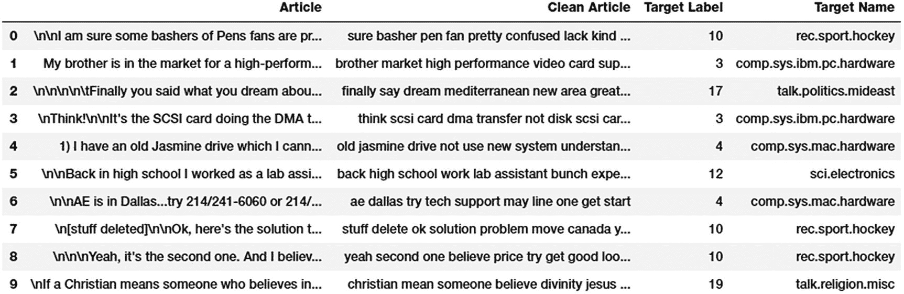

`图 5-4` – 经过文本预处理后的 20 个新闻组数据集

```python
import nltk
stopword_list = nltk.corpus.stopwords.words('english')
# 仅为了在二元组中保留否定词（如果有的话）
stopword_list.remove('no')
stopword_list.remove('not')
# 规范化我们的语料库
norm_corpus = tn.normalize_corpus(corpus=data_df['Article'], html_stripping=True,
contraction_expansion=True, accented_char_removal=True,
text_lower_case=True, text_lemmatization=True,
text_stemming=False, special_char_removal=True,
remove_digits=True, stopword_removal=True,
stopwords=stopword_list)
data_df['Clean Article'] = norm_corpus
# 查看样本数据
data_df = data_df[['Article', 'Clean Article', 'Target Label', 'Target Name']]
data_df.head(10)
```

现在我们拥有一个经过良好预处理和规范化的文章语料库。但等等，还没结束！有些文档在预处理后最终可能变为空值或空。我们使用以下代码来验证这个假设，并从语料库中移除这些文档。

```python
data_df = data_df.replace(r'^(\s?)+$', np.nan, regex=True)
data_df.info()

Int64Index: 18331 entries, 0 to 18845
Data columns (total 4 columns):
Article          18331 non-null object
Clean Article    18304 non-null object
Target Label     18331 non-null int64
Target Name      18331 non-null object
dtypes: int64(1), object(3)
memory usage: 1.3+ MB
```

经过预处理操作后，我们确实得到了一些空文章。我们可以安全地使用以下代码移除这些空文档。

```python
data_df = data_df.dropna().reset_index(drop=True)
data_df.info()

RangeIndex: 18304 entries, 0 to 18303
Data columns (total 4 columns):
Article          18304 non-null object
Clean Article    18304 non-null object
Target Label     18304 non-null int64
Target Name      18304 non-null object
dtypes: int64(1), object(3)
memory usage: 572.1+ KB
```

我们现在可以使用这个数据集来构建文本分类系统。如有需要，可以随意使用以下代码存储数据集，这样就不必每次都运行预处理步骤。

```python
data_df.to_csv('clean_newsgroups.csv', index=False)
```

## 构建训练集和测试集

为了构建机器学习系统，我们需要在训练数据上构建模型，然后在测试数据上测试和评估其性能。因此，我们将数据集拆分为训练集和测试集。我们采用训练集与测试集拆分比例为总数据的 67%/33%。

```markdown
## 特征工程技术

有多种特征提取或特征工程技术可以应用于文本数据，但在深入探讨它们之前，让我们简要回顾一下特征的含义、为什么需要特征以及它们如何发挥作用。在一个数据集中，通常有许多数据点，通常是数据集的行；而列则是数据集的各种特征或属性，每一行或每个观察值都有特定的值。在机器学习术语中，特征是数据集中每个观察值或数据点的独特可测量属性或特性。特征本质上是数值型的，可以是绝对数值，也可以是分类特征。分类特征可以通过一种称为`独热编码`的过程，编码为列表中每个类别的二进制特征。它们也可以通过一种称为`标签编码`的过程，表示为不同的数值实体。提取和选择特征的过程既是一门艺术也是一门科学，这个过程被称为`特征提取`或`特征工程`。

特征工程非常重要，通常被称为创建卓越且性能更优机器学习模型的秘诀。提取的特征被输入到机器学习算法中，用于学习模式，这些模式可以应用于未来的新数据点以获取洞察。这些算法通常期望特征以数值向量的形式出现，因为每个算法本质上都是一个数学优化过程，在尝试从数据点和观察值中学习模式时，它要最小化损失和误差。因此，处理文本数据带来了额外的挑战，即如何从文本数据中转换和提取数值特征。

我们在第 4 章中详细介绍了文本数据的最新特征工程技术。在接下来的章节中，我们简要回顾本章所使用的方法。但为了深入学习，我建议读者查阅第 4 章。

### 传统特征工程模型

针对文本数据的传统（基于计数）特征工程策略涉及一系列模型，这些模型通常统称为词袋模型（Bag of Words model）。虽然它们是有效的文本特征提取方法，但由于模型本质仅是一个无序词的集合，我们会丢失额外信息，例如每篇文本文档中单词的语义、结构、顺序以及附近单词的上下文。

- **词袋（词频）模型（Bag of Words (term frequency) model）**：词袋模型将每篇文本文档表示为一个数值向量，其中每个维度对应语料库中的一个特定单词，其值可以是该单词在文档中的词频、是否出现（用 1 或 0 表示），甚至可以是加权值。该模型得名于此，因为每篇文档都按字面意思被表示为其自身单词的一个词袋，而忽略了单词顺序、序列和语法。

- **词袋 N-gram 模型（Bag of N-Grams model）**：N-gram 本质上是从文本文档中提取的一组连续且按序列出现的词元。二元组（Bi-grams）指阶数为 2（两个单词）的 n-gram，三元组（tri-grams）指阶数为 3（三个单词）的 n-gram，以此类推。词袋 N-gram 模型只是词袋模型的一个扩展，因此我们也可以利用基于 N-gram 的特征。

- **TF-IDF 模型（TF-IDF model）**：TF-IDF 代表词频-逆文档频率（Term Frequency-Inverse Document Frequency），它是两个指标的组合：词频（TF）和逆文档频率（IDF）。该技术最初是作为一种根据用户查询展示搜索引擎结果的指标而开发的，现已成为信息检索和文本特征提取的一部分。

### 高级特征工程模型

针对文本数据的传统（基于计数）特征工程策略涉及一系列模型，这些模型通常统称为词袋模型。这包括词频、TF-IDF（词频-逆文档频率）、N-gram 等。虽然它们是有效的文本特征提取方法，但存在严重的局限性，即我们会丢失额外信息，例如每篇文本文档中单词的语义、结构、顺序以及附近单词的上下文。这足以成为我们探索更复杂模型的动力，这些模型能够捕获这些信息，并提供以单词向量表示（通常称为`词嵌入`）为形式的特征。我们使用预测性方法，例如基于神经网络的语言模型，通过观察语料库中的单词序列，尝试从其相邻单词中预测单词。在此过程中，模型学习分布式表示，从而得到密集的词嵌入。这些模型通常也被称为词嵌入模型。

- **Word2Vec 模型（Word2Vec model）**：该模型由 Google 于 2013 年创建，是一个基于预测的深度学习模型，用于计算和生成高质量、分布式且连续的单词密集向量表示，能够捕获上下文和语义相似性。您通常可以指定词嵌入向量的大小，而向量的总数实质上就是词汇表的大小。这使得密集向量空间的维度远低于使用传统词袋模型构建的高维稀疏向量空间。Word2Vec 可以利用两种不同的模型架构来创建这些词嵌入表示。其中包括连续词袋模型（CBOW）和跳字模型（Skip-Gram）。

- **GloVe 模型（GloVe model）**：GloVe 模型代表全局向量（Global Vectors）。它是一种无监督学习模型，可用于获取密集的词向量，类似于 Word2Vec。然而，其技术不同，训练是在一个全局词-词共现矩阵上进行的，从而为我们提供一个具有有意义子结构的向量空间。

- **FastText 模型（FastText model）**：FastText 模型由 Facebook 于 2016 年提出，作为原始 Word2Vec 模型的扩展和所谓的改进。它基于 Mikolov 等人撰写的原始论文《利用子词信息丰富词向量》（Enriching Word Vectors with Subword Information），该论文对于深入理解该模型的工作原理来说是一份极佳的读物。总的来说，FastText 是一个用于学习单词表示并执行稳健、快速且准确的文本分类的框架。Word2Vec 模型通常忽略每个单词的形态结构，将单词视为单个实体。而 FastText 模型将每个单词视为一个字符 N-gram 的词袋。这在论文中也被称为`子词`模型。

以上内容应能让我们充分了解本文中使用的特征工程技术类型，从而能够将非结构化文本数据有效地表示为结构化的数值向量特征。在下一节中，我们将快速概念性地了解一些常见的监督学习/分类模型，稍后我们将使用它们来构建文本分类系统。

```python
from sklearn.model_selection import train_test_split
train_corpus, test_corpus, train_label_nums, test_label_nums, train_label_names, test_label_names = train_test_split(np.array(data_df['Clean Article']),
np.array(data_df['Target Label']),
np.array(data_df['Target Name']),
test_size=0.33, random_state=42)
train_corpus.shape, test_corpus.shape
((12263,), (6041,))
```

你还可以使用以下代码，通过不同的新闻组类别观察各类文章的分布情况。然后我们可以了解有多少文档将用于训练模型，以及有多少用于测试模型。见图 5-5。

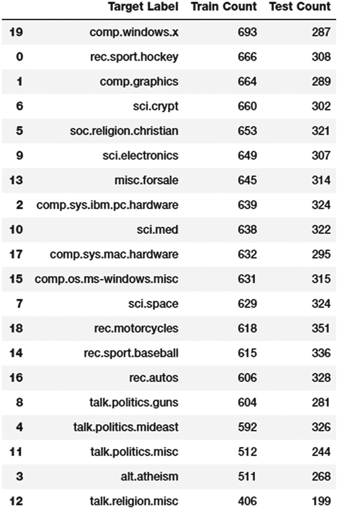

`图 5-5` – 20 个新闻组中训练和测试文章的分布情况

```python
from collections import Counter
trd = dict(Counter(train_label_names))
tsd = dict(Counter(test_label_names))
(pd.DataFrame([[key, trd[key], tsd[key]] for key in trd],
columns=['Target Label', 'Train Count', 'Test Count'])
.sort_values(by=['Train Count', 'Test Count'],
ascending=False))
```
```

# 分类模型

分类模型是一种监督式机器学习算法，用于根据过去观察到的数据点进行分类、归类或打标签。每个分类算法都属于监督学习算法，因此需要训练数据。这些训练数据由一组训练观测值组成，每个观测值都是一个数据对，包含一个输入数据点（通常是我们之前提到的特征向量）以及该输入观测值对应的输出结果。在建模阶段，分类算法需要经历三个步骤：

- 训练
- 评估
- 调优

`训练` 是监督学习算法试图从训练数据中推断模式的过程，以便识别出哪些模式会导致特定的结果。这些结果通常被称为类别标签/类别变量/响应变量。在训练之前，我们通常会进行特征提取或特征工程，从原始数据中提取有意义的特征。这些特征集被输入到我们选择的算法中，然后算法会尝试从这些特征及其对应的结果中识别模式。其结果是得到一个推断出的函数，称为模型或分类模型。该模型期望能充分地从训练集的模式中学习泛化，以便能够预测未来新数据点的类别或结果。

`评估` 涉及尝试测试我们模型的预测性能，以查看它在训练数据集上的训练和学习效果。为此，我们使用一个验证数据集，通过在该数据集上进行预测，并将我们的预测结果与实际类别标签（也称为 `ground truth`）进行比较，来测试模型的性能。我们还经常使用交叉验证，将数据分成若干折，其中一部分用于训练，剩余部分用于验证已训练的模型。

需要记住的一点是，我们也会根据验证结果对模型进行调优，以达到最优配置，从而获得最高的准确率和最低的误差。我们还会针对一个保留集或测试集来评估模型，但绝不会针对该数据集对模型进行调优，因为这会导致模型产生偏差或过拟合测试数据集中某些非常具体的特征。保留集或测试集在某种程度上是未来真实数据样本的代表性样本，模型将对这些样本生成预测，并显示出它可能在这些新数据样本上的表现。我们将在后续章节中介绍用于评估和衡量模型性能的各种常用指标。

`调优` 也称为超参数调优或优化，我们专注于尝试优化模型，以最大化其预测能力并减少误差。每个模型本质上都是一个数学函数，具有多个决定模型复杂度、学习能力等的参数。这些被称为 `超参数`，因为它们不能直接从数据中学习，必须在运行和训练模型之前设置好。因此，选择一组最优的模型超参数，以使模型的性能达到良好预测准确率的过程，被称为 `模型调优`，我们可以通过多种方式进行，例如随机搜索和网格搜索。在我们的实践操作中会介绍一些模型调优的方面。

通常，有各种各样的分类算法，但我们不会深入探讨每个算法的细节，因为本章的范围与文本分类相关，而这并非一本仅关注机器学习的书。不过，我们将会简要介绍一些算法，这些算法稍后将在构建分类模型时使用。

- 多项式朴素贝叶斯
- 逻辑回归
- 支持向量机
- 随机森林
- 梯度提升机

还有其他几种分类算法；然而，这些是用于文本数据的一些最常见和最流行的算法。此列表中提到的最后两个模型是集成技术，它们使用模型集合或集成来学习和预测结果，包括随机森林和梯度提升。除此之外，基于深度学习的技术最近也变得流行起来，这些技术使用多个隐藏层并结合多个神经网络模型来构建复杂的分类模型。现在，在使用这些算法解决我们的分类问题之前，我们先简要介绍一些围绕这些算法的基本概念。

### 多项式朴素贝叶斯

这是流行的朴素贝叶斯算法的一种特例，专门用于处理预测和分类任务中类别超过两类的情况。在探讨多项式朴素贝叶斯之前，我们先了解朴素贝叶斯算法的定义和公式。朴素贝叶斯算法是一种监督学习算法，它应用了非常著名的贝叶斯定理。然而，这里有一个“朴素”的假设，即每个特征与其他特征完全独立。从数学角度，我们可以这样表述：给定一个响应类别变量 `y` 和一组由 `n` 个特征组成的特征向量 `{x[1], x[2], … , x[n]}`，利用贝叶斯定理，我们可以表示在给定这些特征时 `y` 出现的概率如下：

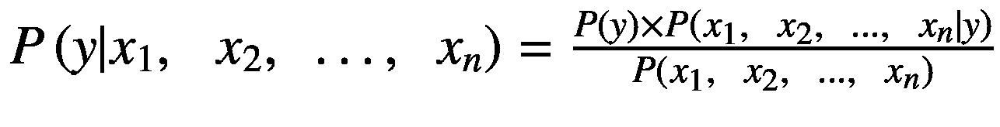

并且假设

`P(x[i]|y, x[1], x[2], … , x[i-1], x[i+1], … , x[n]) = P(x[i]|y)`

对于所有 `i` 成立，我们可以将其表示为：

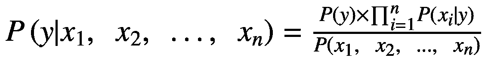

其中 `i` 的取值范围是从 1 到 `n`。简单来说，可以写成：


由于 `P(x[1], x[2], … , x[n])` 是常数，该模型可以表达为：

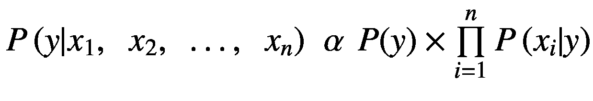

这意味着，在之前关于特征之间相互独立（每个特征在条件上独立于其他所有特征）的假设下，待预测的类别变量 `y` 上的条件分布可以用以下数学方程表示：

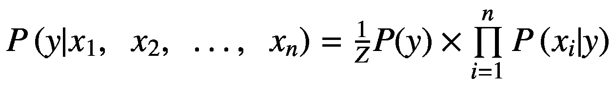

其中，证据度量 `Z = p(x)` 是一个依赖于特征变量的常数缩放因子。基于这个方程，我们可以结合一个称为 `MAP` 决策规则（即最大后验概率）的规则来构建朴素贝叶斯分类器。在当前范围内深入探讨统计细节是不可能的，但通过使用该规则，分类器可以表示为一个数学函数，该函数可以使用以下表达式为某个 `k` 分配预测类别标签 `ŷ = C_k`：

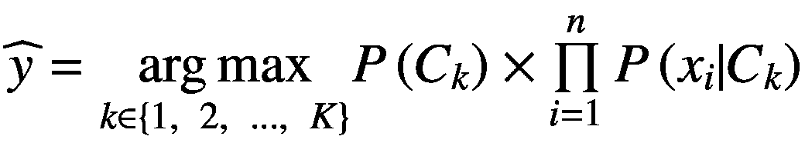

这个分类器通常被认为很简单，从其名称和我们对数据和特征所做的（在现实世界中可能不成立的）几个假设中就可以明显看出。尽管如此，该算法在许多与分类相关的用例中仍然表现得非常出色，包括多类文档分类、垃圾邮件过滤等。与其他分类器相比，它们训练速度非常快，并且即使没有足够的训练数据也能表现良好。当模型拥有大量特征时，通常性能不佳，这种现象被称为`维度诅咒`。朴素贝叶斯通过解耦与类别变量相关的条件特征分布来应对这个问题，从而使每个分布都能被独立地估计为一维分布。

多项式朴素贝叶斯是该算法的一种扩展，用于预测和分类数据点，其中不同类别或结果的数量超过两个。在这种情况下，特征向量通常被假定为来自词袋模型的词频统计，但基于 `TF-IDF` 的权重也同样适用。一个限制是，基于负权重的特征不能输入到该算法中。对于每个类别标签 `y`，该分布可以表示为 `p[y] = {p[y1], p[y2], … , p[yn]}`，总特征数为 `n`，在文本分析中可表示为不同单词或术语的总词汇量。从方程中，`p[yi] = P(x[i]|y)` 表示在结果或类别为 `y` 的任何观测样本中特征 `i` 的概率。参数 `p[y]` 可以通过一种平滑版本的最大似然估计（基于相对出现频率）来估算，并表示为：

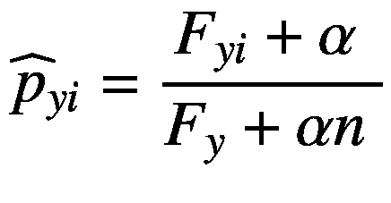

### 朴素贝叶斯

其中 `F_yi = Σ_{x∈TD} x_i` 是训练数据集 `TD` 中类别标签为 `y` 的样本中特征 `i` 出现的频率，而 `F_y = Σ_{i=1}^{|TD|} F_yi` 是类别标签 `y` 的所有特征的总频率。借助先验 `α ≥ 0` 进行了一定程度的平滑处理，这考虑了学习数据点中不存在的特征，有助于消除与零概率相关的问题。该参数有一些常用的特定设置。`α = 1` 的值被称为*拉普拉斯平滑*，而 `α < 1` 被称为*利德斯通平滑*。Scikit-Learn 库在 `MultinomialNB` 类中提供了多项式朴素贝叶斯的优秀实现，我们稍后在构建文本分类器时将利用它。请记住，不要盲目将 `α` 值设置得过高，因为这可能因过度平滑而导致模型错误地认为某些不存在的特征对于预测特定类别是重要的。

### 逻辑回归

逻辑回归模型实际上是由统计学家戴维·考克斯于 1958 年提出的一种统计模型。由于它使用逻辑函数（通常也称为 sigmoid 函数）来估算参数值，因此也被称为 logit 模型或逻辑模型。这些参数是所有特征的系数，其目标是在预测结果（在本例中为新闻组类别）时使总体损失最小化。不过，我们关注的并非误差，而是利用极大似然估计法，最大化预测值与观测值之间的似然性。

考虑一个二分类问题：预测类别为 0 或 1。在逻辑模型中，标记为 1 的类别的对数几率（odds 的对数）本质上是线性回归模型的方程（一个或多个独立特征的线性组合，这些特征可以是类别型或连续型）。然而，我们需要预测的是离散的类别。因此，标记为 1 的类别对应的概率值可以在 0 到 1 之间变化，以此表示预测的置信度。将对数几率转换为概率的函数就是逻辑函数。标准 sigmoid 函数或逻辑函数可以用以下公式进行数学表示：

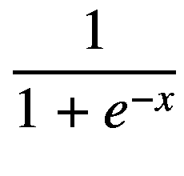

其中，`e` 是自然常数（欧拉数），`x` 代表典型方程，它可以从我们尝试估算特征系数的线性回归方程中推导出来。该函数通常呈现为 S 形曲线，如图 5-6 所示。

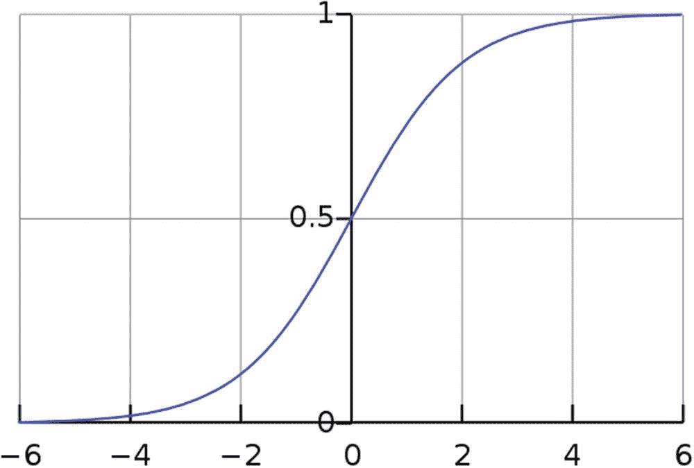

图 5-6 标准 sigmoid 函数或逻辑函数

对数几率尺度的标准测量单位称为 `logit`，即逻辑单位的缩写，因此该模型也有这些别名。要理解这个模型的工作原理，需要深入钻研数学，而本书的目的并非提供机器学习课程。不过，为了面向更偏好数学的读者，我们会简要介绍这部分内容。考虑一个标准的多重线性回归模型，表示如下：

`y = β[0] + β[1]x[1] + β[2]x[2] + … + β[n]x[n]`

其中 `{x[1], x[2], …, x[n]}` 是我们的特征，我们尝试估算系数 `{β[1], β[2], …, β[n]}`。考虑到我们需要预测类别，我们可以将其表示为对数几率，即使用概率 `p` 的 `logit` 函数：

`logodds = logit(p) = β[0] + β[1]x[1] + β[2]x[2] + … + β[n]x[n]`

这意味着，如果 `p` 是预测某个特定类别的概率，那么该事件发生的几率是 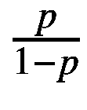，这本质上是有利结果与不利结果的比率。同样地，`p` 的 `logit` 本质上就是对数几率。因此，我们可以用数学方法推导如下：

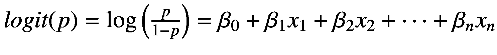

如果我们想得到逻辑回归模型输出的类别概率值，可以推导出以下方程，这也是逻辑回归模型的核心：

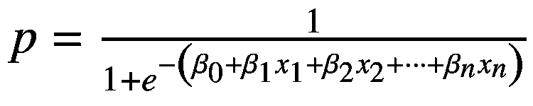

最后，我们可以使用极大似然估计法来优化并估算每个特征的最优系数，这有助于最大化似然函数。在 Scikit-Learn 中，可以利用 `LogisticRegression` 模型来应用逻辑回归模型进行分类。`LogisticRegression` 类中实现的求解器包括 `"liblinear"`、`"newton-cg"`、`"lbfgs"`、`"sag"` 和 `"saga"`。每个求解器都有其独特的实现方式。在多分类问题中（正如我们这里的问题），如果 `multi_class` 选项设置为 `ovr`，训练算法会使用一对多方案；如果 `multi_class` 选项设置为 `multinomial`，则会使用交叉熵损失。

### 支持向量机

在机器学习中，支持向量机（通常被称为 `SVM`）是一种监督学习算法。它们用于分类、回归、新颖性、异常以及离群点检测。考虑一个二分类问题，如果我们有训练数据，且每个数据点或观测值属于特定的类别，就可以基于这些数据训练 `SVM` 算法，使其能够将未来的数据点分配到两个类别之一。该算法将训练数据样本表示为空间中的点，使得属于任一类的点可以通过它们之间的宽间隙（超平面）分开，待预测的新数据点则根据它们落在此超平面的哪一侧来分配类别。这个过程是一个典型的线性分类过程。然而，`SVM` 也可以通过一种称为**核技巧**的有趣方法执行非线性分类，其中使用核函数在非线性可分离的高维特征空间上进行操作。通常，特征空间中数据点之间的内积有助于实现这一点。

`SVM` 算法接收一组训练数据点，并为高维特征空间构建一个超平面（或一组超平面）。超平面的间隔越大，分离效果越好，这会导致分类器的泛化误差更低。让我们正式且数学化地表示这一点。考虑一个包含 **n** 个数据点的训练数据集：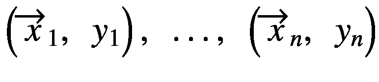，其中类别变量 `y[i] ∈ {-1, 1}`，每个值表示点 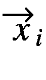 对应的类别。每个数据点  是一个特征向量。`SVM` 算法的目标是找到最大间隔超平面，该超平面将类别标签为 `y[i] = 1` 的数据点集与类别标签为 `y[i] = -1` 的数据点集分开，同时最大化超平面与离它最近的任一类样本数据点之间的距离。这些样本数据点被称为**支持向量**。图 5-7 展示了带有超平面的向量空间的样子。

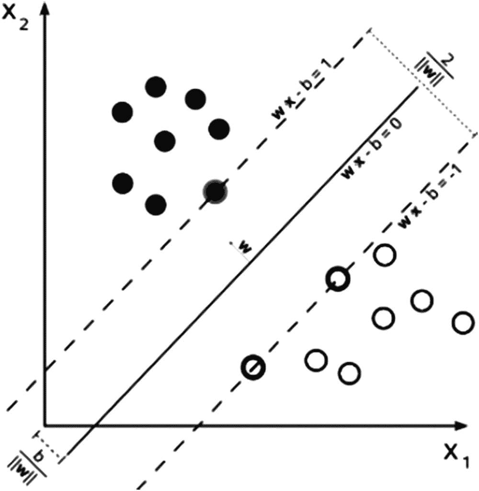

**图 5-7** 二分类 `SVM` 描绘了超平面和支持向量

从图 5-7 中可以清晰地看到超平面和支持向量。超平面可以定义为满足 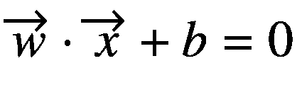 的点集 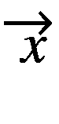，其中  是超平面的法向量，而 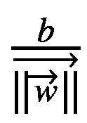 给出了超平面从原点到图 5-7 中高亮显示的支持向量的偏移量。主要有两种类型的间隔有助于分离属于不同类别的数据点。

当数据是线性可分离的（如图 5-7 所示）时，我们可以使用硬间隔，它基本上由虚线表示的两个平行超平面来表示。这有助于分离属于两个不同类别的数据点。这是通过考虑它们之间的距离尽可能大来实现的。由这两个超平面界定的区域形成了间隔，而最大间隔超平面位于中间。这些超平面的方程为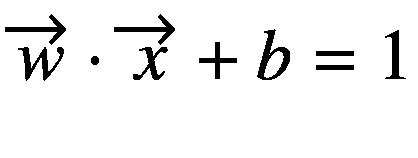和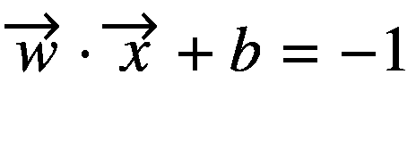。

通常，数据点不是线性可分离的，此时我们可以使用铰链损失函数，它可以表示为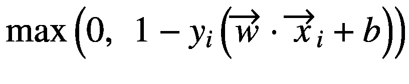。事实上，`Scikit-Learn`实现的`SVM`可以在`SVC`、`LinearSVC`或`SGDClassifier`中找到，我们使用`hinge`损失函数（默认设置）来优化和构建模型。这个损失函数帮助我们获得软间隔，通常被称为软间隔 SVM。你还可以使用不同的核函数将现有的特征空间转换为更高维的特征空间，使得数据可以在其中被线性分离。这就是`SVM`中广为人知的核技巧！但是，我们不建议在文本数据问题上过多地使用它，因为从一开始你就已经要处理大量的维度。

对于多类分类问题，如果我们有`n`个类别，则会为每个类别训练和学习一个二分类器，这有助于将每个类别与其他`n-1`个类别分开。在预测期间，计算每个分类器的得分（到超平面的距离），并选择最大得分来确定类别标签。在`SVM`算法中，常使用随机梯度下降来最小化损失函数。图 5-8 展示了如何在非常著名的鸢尾花数据集上为一个三分类`SVM`问题训练总共三个分类器。此图使用`Scikit-Learn`模型构建，来源于其官方文档，可在[`http://scikit-learn.org/`](http://scikit-learn.org/)获取。

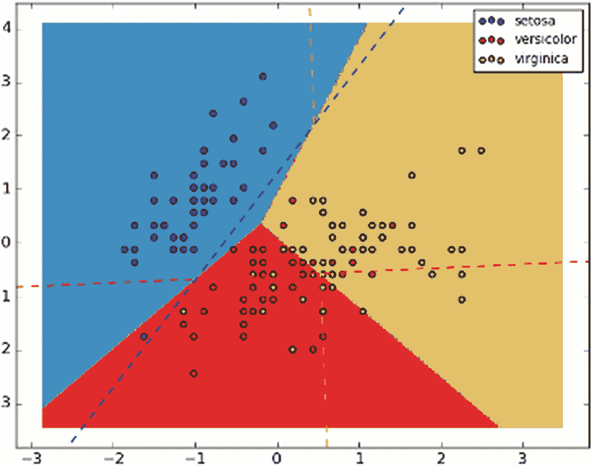

**图 5-8**

针对三个类别的多分类 SVM（致谢：[scikit-learn.​org](http://scikit-learn.org)）

从图 5-8 中可以清晰地看到，总共为三个类别中的每一个训练了三个`SVM`分类器。它们被组合起来进行最终预测，以便正确标记属于每个类别的数据点。因此，多分类支持是按照一对多的方案处理的，类似于逻辑回归模型。

## 集成模型

集成模型本质上是字面意义上由其他模型或估计器组成的模型或元估计器。这些子模型是简单的估计器，可能无法像组合多个估计器后那样做出准确预测。以随机森林为例，其子模型是决策树。通常，随机森林会训练许多决策树，并将它们组合起来生成一个单一的预测。集成模型的种类非常丰富。我们简要提及其中的两类，因为接下来将分别介绍这两类中的一个示例。

-   **装袋法**：一种非常流行的集成建模技术。在装袋法中，你会提取数据的子集（通常是自助样本），并同时在每个子集上训练一个模型。然后，这些子集被允许对结果进行*同时*投票，最终结果通常是平均聚合。随机森林模型可能是装袋法模型中最著名的例子。

-   **提升法**：另一种集成技术。与装袋法并行构建多个模型不同，提升法采用顺序建模，并试图通过前一个模型的错误来改进当前模型！提升法通常以一种*序贯*处理的形式，将一个模型的输出作为下一个模型的输入。梯度提升机是最流行的提升模型之一。

## 随机森林

决策树是一类监督式机器学习算法，能够从底层数据中自动表示和解释规则集。它们使用信息增益和基尼指数等指标来构建树。然而，决策树的一个主要缺点是，由于它们是非参数模型，数据越多，树的深度就越大。我们最终可能会得到非常庞大且深的树，这些树容易过拟合。该模型可能在训练数据上表现非常好，但它并不是在学习，而只是记住了所有的训练样本，并为它们构建了非常具体的规则。因此，它在测试数据上表现非常差。随机森林试图解决这个问题。

随机森林是一种元估计器或集成模型，它在数据集的各种子样本上拟合多个决策树分类器，并使用平均化来提高预测准确性并控制过拟合。子样本的大小始终与原始输入样本大小相同，但样本是放回抽取的（自助样本）。在随机森林中，所有树都是并行训练的（装袋模型/自助聚合）。除此之外，集成中的每棵树都是通过从训练集中放回抽取的样本（即自助样本）构建的。此外，在树的构建过程中，当分裂一个节点时，选择的分裂不再是所有特征中的最佳分裂；相反，所选的分裂是特征随机子集中的最佳分裂。因此，随机森林中引入的随机性既来自于数据的随机抽样，也来自于每棵树分裂节点时特征选择的随机性。所以，由于这种随机性，森林的偏差通常会略有增加（相对于单个非随机决策树的偏差）。然而，由于进行了平均化，模型整体方差的降低幅度远大于偏差的增加幅度，因此最终为我们提供了一个整体上更好的模型。

在构建随机森林时，你可以为基本决策树和整个森林设置特定的模型参数。对于树，你通常可以设置与普通决策树模型相同的参数，如树深度、叶子节点数、每次分裂的特征数、每个叶子节点的样本数、节点分裂标准、信息增益和基尼不纯度。对于森林，你可以调整所需的树的总数、每棵树要使用的特征数量等。

## 梯度提升机

梯度提升机，通常称为 GBM，可用于回归和分类。通常，GBM 会以向前逐步序贯的方式构建一个加性模型；它们允许优化任意的可微损失函数。GBM 通常可以处理任何模型（弱学习器）和损失函数的组合。Scikit-Learn 使用 GBRT（梯度提升回归树），这是一种广义的提升模型，可以应用于任意的可微损失函数。该模型的美妙之处在于它很准确，并且可以用于回归和分类问题。GBRT 考虑加性模型，其数学表示如下：

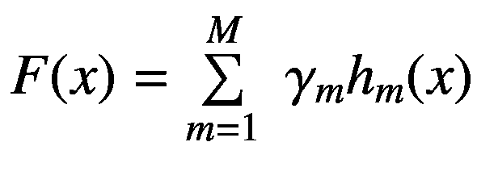

其中`hm`可以被定义为基模型或弱学习器——在这里是决策树。与其他提升算法类似，GBRT 以向前逐步序贯的方式构建加性模型。数学上可以表示如下：

`Fm = Fm - 1 + γ[m]hm`

在每个阶段，选择下一个决策树`hm`来最小化给定前一个决策树模型`F[m - 1]`及其拟合结果`Fm - 1`的损失函数`L`。其表示如下：

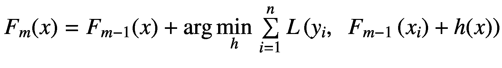

通常，决策树被用作基础模型，我们最终会最小化残差（回归树）或负对数似然（分类树）。

有许多资源和书籍完全致力于监督式机器学习和分类。我们鼓励读者查阅这些资料，以更深入地了解这些技术的工作原理以及如何将它们应用于分析中的各种问题。我们还建议读者查看最新、最先进的集成模型，例如 XGBoost、CatBoost 和 LightGBM。

# 评估分类模型

训练、调优和构建模型是整个分析生命周期的重要组成部分，但了解这些模型的性能甚至更为重要。分类模型的性能通常取决于它们对新的数据点预测结果的好坏。通常，这种性能通过测试集或保留数据集来衡量，该数据集由从未以任何方式影响或训练分类器的数据点组成。这个测试数据集包含多个观测值及其对应的标签。我们以与训练模型时相同的方式提取特征。将这些特征输入到已经训练好的模型中，我们便得到每个数据点的预测结果。然后，将这些预测结果与实际标签进行比对，以查看模型预测的效果或准确度。有多种指标可用于确定模型的预测性能。我们主要关注以下指标。

-   准确率

-   精确率

-   召回率

-   F1 分数

让我们举一个非常经典的例子——威斯康星州乳腺癌诊断数据集。该数据集有 30 个属性或特征，以及每个数据点（乳腺肿块）对应的标签，表示其是否患有癌症（恶性：标签值为 1）或没有癌症（良性：标签值为 0）。假设我们已经拥有这些数据，并将构建一个基本的逻辑回归模型并对其进行评估。我们假设训练数据集中有 398 个观测值，测试数据集中有 171 个观测值。我们将利用一个为模型评估创建的实用模块。它名为 `model_evaluation_utils`，你可以连同本章的代码文件和笔记本一起找到它。我们建议你查看该代码，它利用了 Scikit-Learn 的 `metrics` 模块来计算大多数评估指标和图表。

## 混淆矩阵

# 混淆矩阵

`混淆矩阵`是评估分类模型最常用的方法之一。虽然矩阵本身并非一个指标，但矩阵的表示形式可用于定义各种指标，所有指标在某些特定案例或场景中都变得至关重要。混淆矩阵可以针对二分类和多分类模型创建。

混淆矩阵是通过将数据点的预测类别标签与其实际类别标签进行比较而创建的。此比较会针对整个数据集重复进行，比较结果会以矩阵或表格形式汇总。生成的矩阵就是我们的混淆矩阵。在进一步深入之前，我们先在乳腺癌数据集上构建一个逻辑回归模型，并查看模型在测试数据集上的预测混淆矩阵。

```python
from sklearn import linear_model
# 训练并构建模型
logistic = linear_model.LogisticRegression()
logistic.fit(X_train, y_train)
# 对测试数据进行预测并查看混淆矩阵
import model_evaluation_utils as meu
y_pred = logistic.predict(X_test)
meu.display_confusion_matrix(true_labels=y_test, predicted_labels=y_pred, classes=[0, 1])
```

预测值：
```
      0    1
实际值：
0         59    4
1          2  106
```

上述输出展示了带有必要注释的混淆矩阵。我们可以看到，在标签为 `0`（良性）的 63 个观测值中，我们的模型正确预测了 59 个。同样，在标签为 `1`（恶性）的 108 个观测值中，我们的模型正确预测了 106 个。更详细的分析即将呈现！

### 理解混淆矩阵

虽然名字本身听起来相当吓人，但只要掌握了基础知识，理解混淆矩阵并不那么令人困惑！为了重申我们在上一节中学到的内容，混淆矩阵是一种表格结构，用于记录正确分类和错误分类。这对于评估分类模型的性能非常有用，我们知道模型的真实数据标签，并可以将其与预测的数据标签进行比较。混淆矩阵中的每一列代表基于模型预测的分类实例计数，矩阵中的每一行代表基于实际/真实类别标签的实例计数。这种结构也可以反过来，即用行表示预测，用列表示真实标签。在一个典型的二分类问题中，我们通常有一个被定义为正类别的类别标签，这基本上是我们感兴趣的类别。例如，在我们的乳腺癌数据集中，我们感兴趣的是检测乳腺癌，因此标签 `1` 是我们的正类别。图 5-9 展示了一个典型的二分类问题混淆矩阵，其中 `p` 代表正类别，`n` 代表负类别。

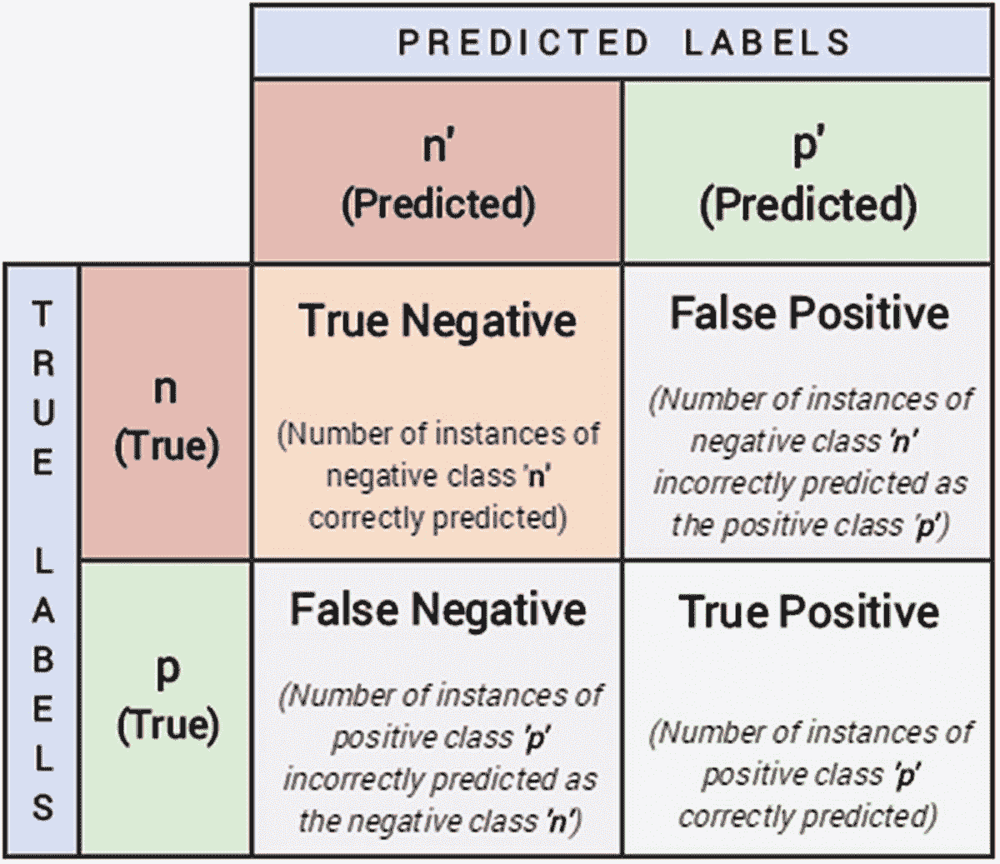

**图 5-9** 混淆矩阵的典型结构

图 5-9 应该能让混淆矩阵的结构更加清晰。通常，我们有一个正类别（如前所述），另一个类别是负类别。基于这种结构，我们可以清楚地看到四个重要的术语。

*   `真正例 (TP)`: 这是来自正类别的实例总数，其真实类别标签等于预测类别标签，即我们模型正确预测正类别标签的总实例数。

*   `假正例 (FP)`: 这是来自负类别的实例总数，我们的模型错误地将它们预测为正类别。因此得名“假”正例。

*   `真负例 (TN)`: 这是来自负类别的实例总数，其真实类别标签等于预测类别标签，即我们模型正确预测负类别标签的总实例数。

*   `假负例 (FN)`: 这是来自正类别的实例总数，我们的模型错误地将它们预测为负类别。因此得名“假”负例。

基于这些信息，你能根据模型在乳腺癌测试数据上的预测结果，为我们的混淆矩阵计算出这些指标吗？

```python
positive_class = 1
TP = 106
FP = 4
TN = 59
FN = 2
```

# 性能指标

混淆矩阵本身并非分类模型的性能度量标准，但它可用于计算多种适用于不同场景的有效指标。我们将说明如何从混淆矩阵计算主要指标，通过必要公式手动计算，将结果与`Scikit-Learn`提供的函数在预测结果上的输出进行对比，并直观解释每种指标适用的场景。

`准确率`是衡量分类器性能最常用的指标之一，定义为模型正确预测的总体比例。从混淆矩阵计算准确率的公式如下：

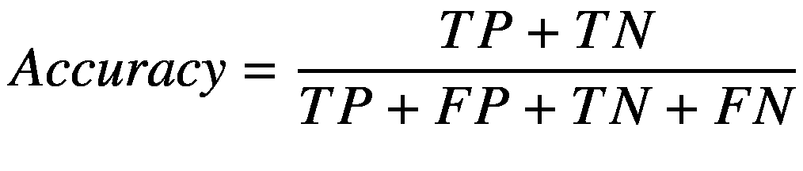

当类别分布基本均衡且各类别正确预测的重要性相同时，通常使用准确率。以下代码计算了模型预测的准确率。

```
fw_acc = round(meu.metrics.accuracy_score(y_true=y_test, y_pred=y_pred), 5)
mc_acc = round((TP + TN) / (TP + TN + FP + FN), 5)
print('框架准确率:', fw_acc)
print('手动计算准确率:', mc_acc)
框架准确率: 0.96491
手动计算准确率: 0.96491
```

`精确率`（亦称阳性预测值）是另一个可从混淆矩阵派生的指标。它定义为在所有基于正类的预测中，实际正确或相关的预测数量。精确率的公式如下：

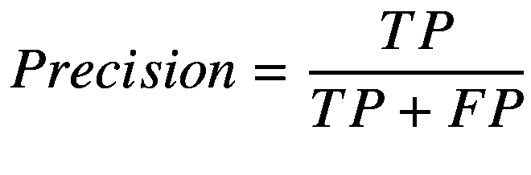

与较低精确率的模型相比，高精确率的模型能识别更高比例的正类。当我们更关注找出最大数量的正类（即使总体准确率下降）时，精确率变得尤为重要。以下代码计算了模型预测的精确率。

```
fw_prec = round(meu.metrics.precision_score(y_true=y_test, y_pred=y_pred), 5)
mc_prec = round((TP) / (TP + FP), 5)
print('框架精确率:', fw_prec)
print('手动计算精确率:', mc_prec)
框架精确率: 0.96364
手动计算精确率: 0.96364
```

`召回率`（亦称`灵敏度`）是衡量模型识别相关数据点百分比的指标。它定义为正确预测的正类实例数量，也被称为命中率、覆盖率或灵敏度。召回率的公式如下：

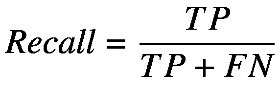

当我们希望捕获某个类别的大多数实例（即使这会增加假阳性）时，召回率就成为分类器性能的重要衡量指标。例如，银行欺诈检测场景中，高召回率的模型会给出更多潜在欺诈案例，但同样有助于对大多数可疑情况发出警报。以下代码计算了模型预测的召回率。

```
fw_rec = round(meu.metrics.recall_score(y_true=y_test, y_pred=y_pred), 5)
mc_rec = round((TP) / (TP + FN), 5)
print('框架召回率:', fw_rec)
print('手动计算召回率:', mc_rec)
框架召回率: 0.98148
手动计算召回率: 0.98148
```

在某些情况下，我们需要精确率和召回率的平衡优化。`F1 分数`是精确率和召回率的调和平均数，有助于优化分类器实现两者的均衡性能。

`F1 分数`的公式如下：

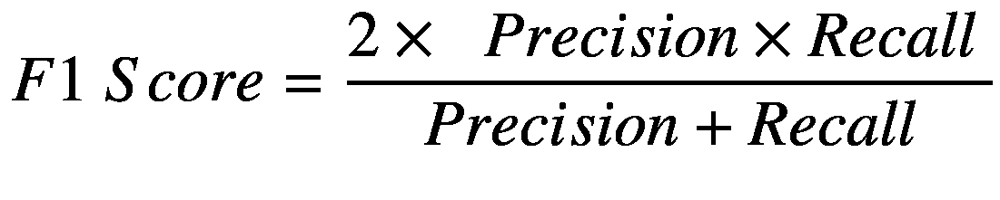

下面使用以下代码计算模型预测结果的`F1 分数`。

```
fw_f1 = round(meu.metrics.f1_score(y_true=y_test, y_pred=y_pred), 5)
mc_f1 = round((2*mc_prec*mc_rec) / (mc_prec+mc_rec), 5)
print('框架 F1 分数:', fw_f1)
print('手动计算 F1 分数:', mc_f1)
框架 F1 分数: 0.97248
手动计算 F1 分数: 0.97248
```

由此可见，我们手动计算的指标与`Scikit-Learn`函数所得结果完全吻合。这将帮助您深入理解如何利用这些指标评估分类模型。

## 构建与评估文本分类器

我们已经学习了构建分类系统所需的全部步骤，包括数据检索、数据整理、文本预处理与标准化、特征提取与工程、分类模型以及模型性能评估。本节将整合所有知识，构建并评估我们的文本分类系统！训练集和测试集已完成清洗，可直接使用。我们将采用以下工作流程构建文本分类器：

-   传统特征表示（`词袋模型`、`TF-IDF`）与分类模型
-   高级特征表示（`Word2Vec`、`GloVe`、`FastText`）与分类模型

同时使用交叉验证和网格搜索技术对最优模型进行评估和调优。

### 词袋特征与分类模型

首先使用基础的`词袋模型`（基于词频的特征工程模型）从训练集和测试集中提取特征。

```
from sklearn.feature_extraction.text import CountVectorizer
from sklearn.model_selection import cross_val_score
# 构建训练文章的词袋特征
cv = CountVectorizer(binary=False, min_df=0.0, max_df=1.0)
cv_train_features = cv.fit_transform(train_corpus)
# 将测试文章转换为特征
cv_test_features = cv.transform(test_corpus)
print('词袋模型:> 训练特征形状:', cv_train_features.shape,
 ' 测试特征形状:', cv_test_features.shape)
词袋模型:> 训练特征形状: (12263, 66865)  测试特征形状: (6041, 66865)
```

现在，我们利用这些特征在训练数据上构建多个分类器，使用前述所有分类模型在测试数据集上评估其性能。同时通过五折交叉验证检查模型准确率的一致性，以确认模型在数据的不同验证折上表现稳定（后续将采用相同策略进行模型调优）。

# 朴素贝叶斯分类器

```python
from sklearn.naive_bayes import MultinomialNB
mnb = MultinomialNB(alpha=1)
mnb.fit(cv_train_features, train_label_names)
mnb_bow_cv_scores = cross_val_score(mnb, cv_train_features, train_label_names, cv=5)
mnb_bow_cv_mean_score = np.mean(mnb_bow_cv_scores)
print('CV Accuracy (5-fold):', mnb_bow_cv_scores)
print('Mean CV Accuracy:', mnb_bow_cv_mean_score)
mnb_bow_test_score = mnb.score(cv_test_features, test_label_names)
print('Test Accuracy:', mnb_bow_test_score)
```

```
CV Accuracy (5-fold): [ 0.68468102  0.68241042  0.67835304  0.67741935  0.6792144 ]
Mean CV Accuracy: 0.680415648396
Test Accuracy: 0.680185399768
```

## 逻辑回归

```python
from sklearn.linear_model import LogisticRegression
lr = LogisticRegression(penalty='l2', max_iter=100, C=1, random_state=42)
lr.fit(cv_train_features, train_label_names)
lr_bow_cv_scores = cross_val_score(lr, cv_train_features, train_label_names, cv=5)
lr_bow_cv_mean_score = np.mean(lr_bow_cv_scores)
print('CV Accuracy (5-fold):', lr_bow_cv_scores)
print('Mean CV Accuracy:', lr_bow_cv_mean_score)
lr_bow_test_score = lr.score(cv_test_features, test_label_names)
print('Test Accuracy:', lr_bow_test_score)
```

```
CV Accuracy (5-fold): [ 0.70418529  0.69788274  0.69384427  0.6998775   0.69599018]
Mean CV Accuracy: 0.698355996012
Test Accuracy: 0.703856977322
```

## 支持向量机

```python
from sklearn.svm import LinearSVC
svm = LinearSVC(penalty='l2', C=1, random_state=42)
svm.fit(cv_train_features, train_label_names)
svm_bow_cv_scores = cross_val_score(svm, cv_train_features, train_label_names, cv=5)
svm_bow_cv_mean_score = np.mean(svm_bow_cv_scores)
print('CV Accuracy (5-fold):', svm_bow_cv_scores)
print('Mean CV Accuracy:', svm_bow_cv_mean_score)
svm_bow_test_score = svm.score(cv_test_features, test_label_names)
print('Test Accuracy:', svm_bow_test_score)
```

```
CV Accuracy (5-fold): [ 0.64120276  0.64169381  0.64900122  0.64107799  0.63993453]
Mean CV Accuracy: 0.642582064348
Test Accuracy: 0.656679357722
```

# 随机梯度下降支持向量机

```
from sklearn.linear_model import SGDClassifier
svm_sgd = SGDClassifier(loss='hinge', penalty="l2", max_iter=5, random_state=42)
svm_sgd.fit(cv_train_features, train_label_names)
svmsgd_bow_cv_scores = cross_val_score(svm_sgd, cv_train_features, train_label_names, cv=5)
svmsgd_bow_cv_mean_score = np.mean(svmsgd_bow_cv_scores)
print('CV Accuracy (5-fold):', svmsgd_bow_cv_scores)
print('Mean CV Accuracy:', svmsgd_bow_cv_mean_score)
svmsgd_bow_test_score = svm_sgd.score(cv_test_features, test_label_names)
print('Test Accuracy:', svmsgd_bow_test_score)
```

```
CV Accuracy (5-fold): [ 0.66030069  0.62459283  0.65185487  0.63209473  0.64157119]
Mean CV Accuracy: 0.642082864709
Test Accuracy: 0.633007780169
```

## 随机森林

```
from sklearn.ensemble import RandomForestClassifier
rfc = RandomForestClassifier(n_estimators=10, random_state=42)
rfc.fit(cv_train_features, train_label_names)
rfc_bow_cv_scores = cross_val_score(rfc, cv_train_features, train_label_names, cv=5)
rfc_bow_cv_mean_score = np.mean(rfc_bow_cv_scores)
print('CV Accuracy (5-fold):', rfc_bow_cv_scores)
print('Mean CV Accuracy:', rfc_bow_cv_mean_score)
rfc_bow_test_score = rfc.score(cv_test_features, test_label_names)
print('Test Accuracy:', rfc_bow_test_score)
```

```
CV Accuracy (5-fold): [ 0.52052011  0.51669381  0.53485528  0.51327072  0.5212766 ]
Mean CV Accuracy: 0.521323304518
Test Accuracy: 0.52987915908
```

## 梯度提升机

```
from sklearn.ensemble import GradientBoostingClassifier
gbc = GradientBoostingClassifier(n_estimators=10, random_state=42)
gbc.fit(cv_train_features, train_label_names)
gbc_bow_cv_scores = cross_val_score(gbc, cv_train_features, train_label_names, cv=5)
gbc_bow_cv_mean_score = np.mean(gbc_bow_cv_scores)
print('CV Accuracy (5-fold):', gbc_bow_cv_scores)
print('Mean CV Accuracy:', gbc_bow_cv_mean_score)
gbc_bow_test_score = gbc.score(cv_test_features, test_label_names)
print('Test Accuracy:', gbc_bow_test_score)
```

```
CV Accuracy (5-fold): [ 0.55424624  0.53827362  0.54219323  0.55206207  0.55441899]
Mean CV Accuracy: 0.548238828239
Test Accuracy: 0.547922529383
```

有趣的是，像朴素贝叶斯和逻辑回归这样更简单的模型，其表现远优于集成模型。现在，我们来看看下一个模型管道。

## 基于 TF-IDF 特征的分类模型

我们使用 TF-IDF 特征来训练分类模型。假设 TF-IDF 会降低不重要特征的权重，那么我们可能会得到性能更优的模型。让我们来验证这个假设！

```
from sklearn.feature_extraction.text import TfidfVectorizer
# build BOW features on train articles
tv = TfidfVectorizer(use_idf=True, min_df=0.0, max_df=1.0)
tv_train_features = tv.fit_transform(train_corpus)
# transform test articles into features
tv_test_features = tv.transform(test_corpus)
print('TFIDF model:> Train features shape:', tv_train_features.shape,
' Test features shape:', tv_test_features.shape)
```

```
TFIDF model:> Train features shape: (12263, 66865)  Test features shape: (6041, 66865)
```

现在，我们在这些特征上使用训练数据构建多个分类器，并使用所有分类模型在测试数据集上测试其性能。同时，我们像之前一样，通过五折交叉验证来检查模型的准确率。

# `朴素贝叶斯`

```
mnb = MultinomialNB(alpha=1)
mnb.fit(tv_train_features, train_label_names)
mnb_tfidf_cv_scores = cross_val_score(mnb, tv_train_features, train_label_names, cv=5)
mnb_tfidf_cv_mean_score = np.mean(mnb_tfidf_cv_scores)
print('CV Accuracy (5-fold):', mnb_tfidf_cv_scores)
print('Mean CV Accuracy:', mnb_tfidf_cv_mean_score)
mnb_tfidf_test_score = mnb.score(tv_test_features, test_label_names)
print('Test Accuracy:', mnb_tfidf_test_score)
CV Accuracy (5-fold): [ 0.71759447  0.70969055  0.71585813  0.7121274   0.7111293 ]
Mean CV Accuracy: 0.713279971122
Test Accuracy: 0.713954643271
```

## `逻辑回归`

```
lr = LogisticRegression(penalty='l2', max_iter=100, C=1, random_state=42)
lr.fit(tv_train_features, train_label_names)
lr_tfidf_cv_scores = cross_val_score(lr, tv_train_features, train_label_names, cv=5)
lr_tfidf_cv_mean_score = np.mean(lr_tfidf_cv_scores)
print('CV Accuracy (5-fold):', lr_tfidf_cv_scores)
print('Mean CV Accuracy:', lr_tfidf_cv_mean_score)
lr_tfidf_test_score = lr.score(tv_test_features, test_label_names)
print('Test Accuracy:', lr_tfidf_test_score)
CV Accuracy (5-fold): [ 0.74725721  0.73493485  0.73257236  0.74520212  0.73076923]
Mean CV Accuracy: 0.738147156079
Test Accuracy: 0.745240854163
```

## `支持向量机`

```
svm = LinearSVC(penalty='l2', C=1, random_state=42)
svm.fit(tv_train_features, train_label_names)
svm_tfidf_cv_scores = cross_val_score(svm, tv_train_features, train_label_names, cv=5)
svm_tfidf_cv_mean_score = np.mean(svm_tfidf_cv_scores)
print('CV Accuracy (5-fold):', svm_tfidf_cv_scores)
print('Mean CV Accuracy:', svm_tfidf_cv_mean_score)
svm_tfidf_test_score = svm.score(tv_test_features, test_label_names)
print('Test Accuracy:', svm_tfidf_test_score)
CV Accuracy (5-fold): [ 0.76635514  0.7536645   0.75743987  0.76439363  0.75695581]
Mean CV Accuracy: 0.75976178901
Test Accuracy: 0.762456546929
```

# 基于随机梯度下降的 SVM

```
svm_sgd = SGDClassifier(loss='hinge', penalty="l2", max_iter=5, random_state=42)
svm_sgd.fit(tv_train_features, train_label_names)
svmsgd_tfidf_cv_scores = cross_val_score(svm_sgd, tv_train_features, train_label_names, cv=5)
svmsgd_tfidf_cv_mean_score = np.mean(svmsgd_tfidf_cv_scores)
print('CV Accuracy (5-fold):', svmsgd_tfidf_cv_scores)
print('Mean CV Accuracy:', svmsgd_tfidf_cv_mean_score)
svmsgd_tfidf_test_score = svm_sgd.score(tv_test_features, test_label_names)
print('Test Accuracy:', svmsgd_tfidf_test_score)
CV Accuracy (5-fold): [ 0.76513612  0.75570033  0.75377089  0.76112699  0.75695581]
Mean CV Accuracy: 0.75853802856
Test Accuracy: 0.765767257077
```

## 随机森林

```
rfc = RandomForestClassifier(n_estimators=10, random_state=42)
rfc.fit(tv_train_features, train_label_names)
rfc_tfidf_cv_scores = cross_val_score(rfc, tv_train_features, train_label_names, cv=5)
rfc_tfidf_cv_mean_score = np.mean(rfc_tfidf_cv_scores)
print('CV Accuracy (5-fold):', rfc_tfidf_cv_scores)
print('Mean CV Accuracy:', rfc_tfidf_cv_mean_score)
rfc_tfidf_test_score = rfc.score(tv_test_features, test_label_names)
print('Test Accuracy:', rfc_tfidf_test_score)
CV Accuracy (5-fold): [ 0.53596099  0.5252443   0.53852426  0.51204573  0.54296236]
Mean CV Accuracy: 0.53094752738
Test Accuracy: 0.545936103294
```

# 梯度提升

```
gbc = GradientBoostingClassifier(n_estimators=10, random_state=42)
gbc.fit(tv_train_features, train_label_names)
gbc_tfidf_cv_scores = cross_val_score(gbc, tv_train_features, train_label_names, cv=5)
gbc_tfidf_cv_mean_score = np.mean(gbc_tfidf_cv_scores)
print('CV Accuracy (5-fold):', gbc_tfidf_cv_scores)
print('Mean CV Accuracy:', gbc_tfidf_cv_mean_score)
gbc_tfidf_test_score = gbc.score(tv_test_features, test_label_names)
print('Test Accuracy:', gbc_tfidf_test_score)
CV Accuracy (5-fold): [ 0.55790329  0.53827362  0.55768447  0.55859535  0.54541735]
Mean CV Accuracy: 0.551574813725
Test Accuracy: 0.548584671412
```

有趣的是，几个模型的整体准确率都有相当幅度的提升，包括逻辑回归、朴素贝叶斯和 SVM。而有趣的是，集成模型的表现却不尽人意。使用更多的估计器可能会改善它们的表现，但即便如此，其效果可能仍然不及其他模型，并且会耗费大量的训练时间。

## 模型性能对比评估

现在，我们可以对目前为止尝试过的所有模型，结合两种不同的特征工程技术，进行一次漂亮的对比。我们将根据建模结果创建一个数据框，并比较这些结果。见图 5-10。

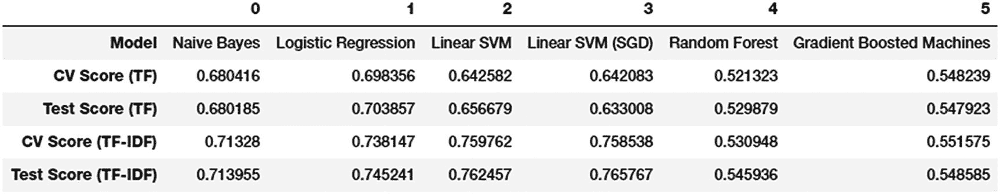

**图 5-10** — 模型性能对比评估

```
pd.DataFrame([['Naive Bayes', mnb_bow_cv_mean_score, mnb_bow_test_score,
mnb_tfidf_cv_mean_score, mnb_tfidf_test_score],
['Logistic Regression', lr_bow_cv_mean_score, lr_bow_test_score, lr_tfidf_cv_mean_score, lr_tfidf_test_score],
['Linear SVM', svm_bow_cv_mean_score, svm_bow_test_score,
svm_tfidf_cv_mean_score, svm_tfidf_test_score],
['Linear SVM (SGD)', svmsgd_bow_cv_mean_score, svmsgd_bow_test_score, svmsgd_tfidf_cv_mean_score, svmsgd_tfidf_test_score],
['Random Forest', rfc_bow_cv_mean_score, rfc_bow_test_score,
rfc_tfidf_cv_mean_score, rfc_tfidf_test_score],
['Gradient Boosted Machines', gbc_bow_cv_mean_score, gbc_bow_test_score, gbc_tfidf_cv_mean_score, gbc_tfidf_test_score]],
columns=['Model', 'CV Score (TF)', 'Test Score (TF)',
'CV Score (TF-IDF)', 'Test Score (TF-IDF)'],
).T
```

图 5-10 清晰地表明，表现最佳的模型是 SVM，其次是逻辑回归和朴素贝叶斯。集成模型在此数据集上的表现不佳。

### 基于 Word2Vec 嵌入的分类模型

接下来，我们尝试将更新的高级特征工程技术应用于分类模型。首先，从生成 Word2Vec 嵌入开始。这里需要注意的一点是，词嵌入模型会为每个单词生成一个固定长度的稠密嵌入向量。因此，我们需要某种方案来为每个文档生成固定长度的嵌入。一种方法是对文档中所有单词的词嵌入进行平均（甚至可以计算 TF-IDF 加权平均值！）。下面我们来构建一个方案，通过平均词嵌入来生成文档嵌入。

```
def document_vectorizer(corpus, model, num_features):
vocabulary = set(model.wv.index2word)
def average_word_vectors(words, model, vocabulary, num_features):
feature_vector = np.zeros((num_features,), dtype="float64")
nwords = 0.
for word in words:
if word in vocabulary:
nwords = nwords + 1.
feature_vector = np.add(feature_vector, model.wv[word])
if nwords:
feature_vector = np.divide(feature_vector, nwords)
return feature_vector
features = [average_word_vectors(tokenized_sentence, model, vocabulary, num_features) for tokenized_sentence in corpus]
return np.array(features)
```

我们使用优秀的 Python 框架 `Gensim`，为语料库中的所有单词生成 Word2Vec 嵌入。

```
# 对语料库进行分词
tokenized_train = [tn.tokenizer.tokenize(text)
for text in train_corpus]
tokenized_test = [tn.tokenizer.tokenize(text)
for text in test_corpus]
# 生成 word2vec 词嵌入
import gensim
# 构建 word2vec 模型
w2v_num_features = 1000
w2v_model = gensim.models.Word2Vec(tokenized_train, size=w2v_num_features, window=100, min_count=2, sample=1e-3, sg=1, iter=5, workers=10)
# 生成文档级嵌入
# 请记住，我们仅使用训练数据集的词汇嵌入
# 这样测试数据集才能保持真正不可见的状态
# 从 word2vec 模型生成平均词向量特征
avg_wv_train_features = document_vectorizer(corpus=tokenized_train, model=w2v_model, num_features=w2v_num_features)
avg_wv_test_features = document_vectorizer(corpus=tokenized_test, model=w2v_model, num_features=w2v_num_features)
print('Word2Vec model:> Train features shape:', avg_wv_train_features.shape,' Test features shape:', avg_wv_test_features.shape)
Word2Vec model:> Train features shape: (12263, 1000)  Test features shape: (6041, 1000)
```

接下来，我们尝试使用我们表现最好的模型之一（基于 SGD 的 SVM），在测试数据上检查模型性能。

## 基于词嵌入的分类模型

```
from sklearn.svm import LinearSVC
from sklearn.model_selection import cross_val_score
from sklearn.linear_model import SGDClassifier
svm = SGDClassifier(loss='hinge', penalty="l2", random_state=42, max_iter=500)
svm.fit(avg_wv_train_features, train_label_names)
svm_w2v_cv_scores = cross_val_score(svm, avg_wv_train_features, train_label_names, cv=5)
svm_w2v_cv_mean_score = np.mean(svm_w2v_cv_scores)
print('CV Accuracy (5-fold):', svm_w2v_cv_scores)
print('Mean CV Accuracy:', svm_w2v_cv_mean_score)
svm_w2v_test_score = svm.score(avg_wv_test_features, test_label_names)
print('Test Accuracy:', svm_w2v_test_score)
CV Accuracy (5-fold): [0.76026006 0.74796417 0.73746433 0.73989383 0.74386252]
Mean CV Accuracy: 0.7458889820674891
Test Accuracy: 0.7381228273464658
```

模型性能确实不错，但仍然不如我们基于 TF-IDF 的模型，后者在测试集上取得了更好的准确率。

### 基于 GloVe 嵌入的分类模型

现在，我们为每个单词生成基于 GloVe 的词嵌入，生成文档级嵌入，并使用我们的 SVM 模型来测试模型性能。我们使用 spaCy 基于 Common Crawl 语料库生成的默认词嵌入。

```
# 使用 GloVe 模型进行特征工程
train_nlp = [tn.nlp(item) for item in train_corpus]
train_glove_features = np.array([item.vector for item in train_nlp])
test_nlp = [tn.nlp(item) for item in test_corpus]
test_glove_features = np.array([item.vector for item in test_nlp])
print('GloVe model:> Train features shape:', train_glove_features.shape,
' Test features shape:', test_glove_features.shape)
GloVe model:> Train features shape: (12263, 300)  Test features shape: (6041, 300)
# 构建我们的 SVM 模型
svm = SGDClassifier(loss='hinge', penalty="l2", random_state=42, max_iter=500)
svm.fit(train_glove_features, train_label_names)
svm_glove_cv_scores = cross_val_score(svm, train_glove_features, train_label_names, cv=5)
svm_glove_cv_mean_score = np.mean(svm_glove_cv_scores)
print('CV Accuracy (5-fold):', svm_glove_cv_scores)
print('Mean CV Accuracy:', svm_glove_cv_mean_score)
svm_glove_test_score = svm.score(test_glove_features, test_label_names)
print('Test Accuracy:', svm_glove_test_score)
CV Accuracy (5-fold): [ 0.68996343  0.67711726  0.67101508  0.67006942  0.66448445]
Mean CV Accuracy: 0.674529928944
Test Accuracy: 0.666777023672
```

看起来性能并不理想，这可能是因为我们使用了预生成的词嵌入。现在，让我们来看看 FastText！

### 基于 FastText 嵌入的分类模型

现在我们再次利用 Gensim，但使用 Facebook 的 FastText 模型来生成词嵌入，并基于这些嵌入构建我们的文档嵌入。

```
from gensim.models.fasttext import FastText
ft_num_features = 1000
# sg 决定使用 skip-gram 模型 (1) 还是 CBOW 模型 (0)
ft_model = FastText(tokenized_train, size=ft_num_features, window=100,
min_count=2, sample=1e-3, sg=1, iter=5, workers=10)
# 从 word2vec 模型生成平均词向量特征
avg_ft_train_features = document_vectorizer(corpus=tokenized_train, model=ft_model, num_features=ft_num_features)
avg_ft_test_features = document_vectorizer(corpus=tokenized_test, model=ft_model, num_features=ft_num_features)
print('FastText model:> Train features shape:', avg_ft_train_features.shape,
' Test features shape:', avg_ft_test_features.shape)
FastText model:> Train features shape: (12263, 1000)  Test features shape: (6041, 1000)
```

现在，就像之前的流程一样，我们在这组特征上训练并评估我们的 SVM 模型。

```
svm = SGDClassifier(loss='hinge', penalty="l2", random_state=42, max_iter=500)
svm.fit(avg_ft_train_features, train_label_names)
svm_ft_cv_scores = cross_val_score(svm, avg_ft_train_features, train_label_names, cv=5)
svm_ft_cv_mean_score = np.mean(svm_ft_cv_scores)
print('CV Accuracy (5-fold):', svm_ft_cv_scores)
print('Mean CV Accuracy:', svm_ft_cv_mean_score)
svm_ft_test_score = svm.score(avg_ft_test_features, test_label_names)
print('Test Accuracy:', svm_ft_test_score)
CV Accuracy (5-fold): [0.76391711 0.74307818 0.74194863 0.74724377 0.74795417]
Mean CV Accuracy: 0.7488283727085712
Test Accuracy: 0.7434199635821884
```

这无疑是所有基于词嵌入的模型中表现最好的，但仍然不及我们基于 TF-IDF 的模型。我们快速构建一个双隐藏层的神经网络，看看是否能获得更好的模型性能。

## 模型调优

```python
from sklearn.neural_network import MLPClassifier
mlp = MLPClassifier(solver='adam', alpha=1e-5, learning_rate="adaptive", early_stopping=True, activation = 'relu', hidden_layer_sizes=(512, 512), random_state=42)
mlp.fit(avg_ft_train_features, train_label_names)
svm_ft_test_score = mlp.score(avg_ft_test_features, test_label_names)
print('Test Accuracy:', svm_ft_test_score)
```

```
Test Accuracy: 0.7328256911107432
```

这告诉我们什么？词嵌入模型或深度学习模型可能很好，但这并不意味着它们是解决所有问题的万能药。通常，传统模型可能表现更优，具体取决于问题和上下文！

模型调优或许是机器学习流程中的关键阶段之一，能够带来性能更优的模型。任何机器学习模型通常都包含**超参数**，这些超参数就像设备上的旋钮一样，是你可以调节的高级配置概念！一个非常重要的点是：超参数是模型参数，但并非在评估器（`estimator`）内部直接学习得到，也不依赖于底层数据（这与模型参数或系数不同，例如逻辑回归的系数会根据底层训练数据而改变）。

我们可以在超参数空间中搜索以获取最佳的交叉验证分数，这不仅是可行的，而且是推荐的。为此，我们采用五折交叉验证方案，并结合网格搜索来寻找最优的超参数值。在调优过程中，搜索最佳超参数值通常包含以下主要组件：

*   一个模型或评估器，例如 Scikit-Learn 中的 `LogisticRegression`

*   一个可以定义具体值和范围的超参数空间

*   一种搜索或采样候选超参数的方法，例如网格搜索

*   一个交叉验证方案，例如五折交叉验证

*   一个评分函数，例如用于分类模型的准确率

Scikit-Learn 中还提供了两种非常常见的采样搜索候选对象的方法。我们有 `GridSearchCV`，它会穷尽地考虑用户设定的所有参数组合。然而，`RandomizedSearchCV` 通常根据指定的分布从参数空间中采样给定数量的候选对象，而不是采用所有组合。我们在调优实验中使用网格搜索。

为了进行调优实验，我们还使用了 Scikit-Learn 的 `Pipeline` 对象，这是一种将多个组件串联起来的极好方式。我们依次应用一系列变换，例如数据预处理器、特征工程方法以及用于预测的模型评估器。`Pipeline` 的中间步骤必须是某种形式的“变换器”，也就是说，它们必须实现 `fit` 和 `transform` 方法。

使用 `Pipeline` 的目的是能够将特征工程和建模等多个组件组装起来，这样在设置网格搜索的不同超参数值时，这些组件可以一起进行交叉验证。让我们开始调优我们的朴素贝叶斯模型吧！

```python
# 调优我们的多项朴素贝叶斯模型
from sklearn.pipeline import Pipeline
from sklearn.model_selection import GridSearchCV
from sklearn.naive_bayes import MultinomialNB
from sklearn.feature_extraction.text import TfidfVectorizer
mnb_pipeline = Pipeline([('tfidf', TfidfVectorizer()),
('mnb', MultinomialNB())
])
param_grid = {'tfidf__ngram_range': [(1, 1), (1, 2)],
'mnb__alpha': [1e-5, 1e-4, 1e-2, 1e-1, 1]
}
gs_mnb = GridSearchCV(mnb_pipeline, param_grid, cv=5, verbose=2)
gs_mnb = gs_mnb.fit(train_corpus, train_label_names)
```

```
Fitting 5 folds for each of 10 candidates, totalling 50 fits
[CV] mnb__alpha=1e-05, tfidf__ngram_range=(1, 1) .....................
[Parallel(n_jobs=1)]: Using backend SequentialBackend with 1 concurrent workers.
[CV] ...... mnb__alpha=1e-05, tfidf__ngram_range=(1, 1), total=   1.5s
[CV] mnb__alpha=1e-05, tfidf__ngram_range=(1, 1) .....................
...
...
[CV] mnb__alpha=1, tfidf__ngram_range=(1, 2) .........................
[CV] .......... mnb__alpha=1, tfidf__ngram_range=(1, 2), total=   6.2s
[Parallel(n_jobs=1)]: Done  50 out of  50 | elapsed:  4.7min finished
```

现在，我们可以使用以下代码检查为最佳评估器/模型选择的超参数值。

```python
gs_mnb.best_estimator_.get_params()
```

```
{'memory': None,
'steps': [('tfidf',
TfidfVectorizer(analyzer='word', max_df=1.0, min_df=1, ngram_range=(1, 2),
norm='l2', ...,  use_idf=True),
('mnb', MultinomialNB(alpha=0.01, class_prior=None, fit_prior=True))],
'tfidf': TfidfVectorizer(analyzer='word', max_df=1.0, min_df=1, ngram_range=(1, 2),
norm='l2', ...,  use_idf=True),
'mnb': MultinomialNB(alpha=0.01, class_prior=None, fit_prior=True),
'tfidf__analyzer': 'word', 'tfidf__binary': False, 'tfidf__decode_error': 'strict',
'tfidf__dtype': numpy.float64, 'tfidf__encoding': 'utf-8', 'tfidf__input': 'content',
'tfidf__lowercase': True, 'tfidf__max_df': 1.0, 'tfidf__max_features': None,
'tfidf__min_df': 1, 'tfidf__ngram_range': (1, 2), 'tfidf__norm': 'l2',
'tfidf__preprocessor': None, 'tfidf__smooth_idf': True, 'tfidf__stop_words': None,
'tfidf__strip_accents': None, 'tfidf__sublinear_tf': False,
'tfidf__token_pattern': '(?u)\\b\\w\\w+\\b', 'tfidf__tokenizer': None, 'tfidf__use_idf': True,
'tfidf__vocabulary': None, 'mnb__alpha': 0.01, 'mnb__class_prior': None,
'mnb__fit_prior': True}
```

现在你可能会好奇，这些超参数是如何具体被选为最佳评估器参数的？嗯，决策是基于模型性能做出的，具体来说，是在交叉验证过程中，使用这些超参数值在五折验证数据上评估的表现。见图 5-11。

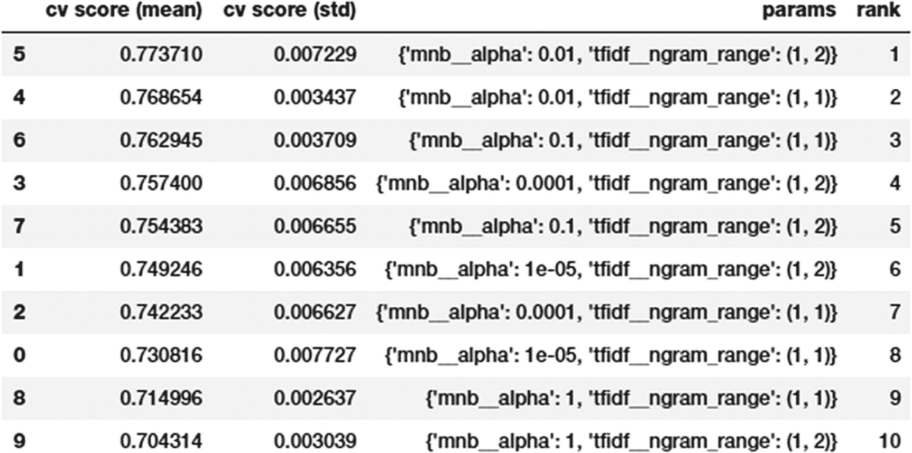

**图 5-11** 超参数空间中不同超参数值对应的模型性能

```
cv_results = gs_mnb.cv_results_
results_df = pd.DataFrame({'rank': cv_results['rank_test_score'],
'params': cv_results['params'],
'cv score (mean)': cv_results['mean_test_score'],
'cv score (std)': cv_results['std_test_score']}
)
results_df = results_df.sort_values(by=['rank'], ascending=True)
pd.set_option('display.max_colwidth', 100)
results_df
```

从图 5-11 的表格中，你可以看到包括二元词组 TF-IDF 特征在内的最佳超参数如何带来了最佳的交叉验证准确率。请注意，我们从不基于测试数据分数来调整模型，因为这会导致模型偏向测试数据集。现在，我们可以检查调优后的模型在测试数据上的性能。

```
best_mnb_test_score = gs_mnb.score(test_corpus, test_label_names)
print('Test Accuracy :', best_mnb_test_score)
Test Accuracy : 0.7735474259228604
```

看来我们实现了 77.3% 的模型准确率，比基础模型提升了 6%！现在让我们看看逻辑回归模型的表现如何。

```
# 调优我们的逻辑回归模型
lr_pipeline = Pipeline([('tfidf', TfidfVectorizer()),
('lr', LogisticRegression(penalty='l2', max_iter=100, random_state=42))
])
param_grid = {'tfidf__ngram_range': [(1, 1), (1, 2)],
'lr__C': [1, 5, 10]
}
gs_lr = GridSearchCV(lr_pipeline, param_grid, cv=5, verbose=2)
gs_lr = gs_lr.fit(train_corpus, train_label_names)
Fitting 5 folds for each of 6 candidates, totalling 30 fits
[CV] lr__C=1, tfidf__ngram_range=(1, 1) ..............................
[CV] ............... lr__C=1, tfidf__ngram_range=(1, 1), total=   5.9s
[Parallel(n_jobs=1)]: Done   1 out of   1 | elapsed:    7.1s remaining:    0.0s
[CV] lr__C=1, tfidf__ngram_range=(1, 1) ..............................
[CV] ............... lr__C=1, tfidf__ngram_range=(1, 1), total=   6.5s
...
...
[CV] lr__C=10, tfidf__ngram_range=(1, 2) .............................
[CV] .............. lr__C=10, tfidf__ngram_range=(1, 2), total=  47.8s
[Parallel(n_jobs=1)]: Done  30 out of  30 | elapsed: 13.0min finished
# 在测试数据集上评估最佳调优模型
best_lr_test_score = gs_lr.score(test_corpus, test_label_names)
print('Test Accuracy :', best_lr_test_score)
Test Accuracy : 0.766926005628
```

我们得到了大约 77%的总体测试准确率，相比基础逻辑回归模型提升了近 2.5%。最后，让我们调优两个顶级 SVM 模型——常规线性 SVM 模型和基于随机梯度下降的 SVM（SVM with SGD）。

```
# Tuning the Linear SVM model
svm_pipeline = Pipeline([('tfidf', TfidfVectorizer()),
('svm', LinearSVC(random_state=42))
])
param_grid = {'tfidf__ngram_range': [(1, 1), (1, 2)],
'svm__C': [0.01, 0.1, 1, 5]
}
gs_svm = GridSearchCV(svm_pipeline, param_grid, cv=5, verbose=2)
gs_svm = gs_svm.fit(train_corpus, train_label_names)
# evaluating best tuned model on the test dataset
best_svm_test_score = gs_svm.score(test_corpus, test_label_names)
print('Test Accuracy :', best_svm_test_score)
Test Accuracy : 0.77685813607
```

这绝对是我们迄今为止获得的最高总体准确率！然而，相比默认线性 SVM 模型，提升并不大。基于 SGD 的 SVM 模型调优后的准确率为 76.8%。

## 模型性能评估

选择最佳模型进行部署取决于多种因素，如模型速度、准确率、易用性、可理解性等。基于我们构建的所有模型，朴素贝叶斯模型训练速度最快，尽管 SVM 模型在测试集上的准确率可能略高，但 SVM 以速度慢且通常难以扩展而闻名。让我们在测试数据集上对我们最佳调优后的朴素贝叶斯模型进行详细的性能评估。我们使用便捷的`model_evaluation_utils`模块进行模型评估。

```
import model_evaluation_utils as meu
mnb_predictions = gs_mnb.predict(test_corpus)
unique_classes = list(set(test_label_names))
meu.get_metrics(true_labels=test_label_names, predicted_labels=mnb_predictions)
Accuracy: 0.7735
Precision: 0.7825
Recall: 0.7735
F1 Score: 0.7696
```

很高兴看到分类指标具有良好的一致性。除了查看模型性能指标的宏观视图，通常更细致地查看每个类别的模型性能指标也很有帮助。让我们来看一下。

```
meu.display_classification_report(true_labels=test_label_names,
predicted_labels=mnb_predictions,
classes=unique_classes)
precision    recall  f1-score   support
comp.os.ms-windows.misc       0.76      0.72      0.74       315
talk.politics.misc       0.72      0.68      0.70       244
comp.graphics       0.64      0.75      0.69       289
comp.windows.x       0.79      0.84      0.81       287
talk.religion.misc       0.67      0.21      0.32       199
comp.sys.ibm.pc.hardware       0.69      0.76      0.72       324
comp.sys.mac.hardware       0.78      0.77      0.77       295
sci.crypt       0.79      0.85      0.82       302
talk.politics.mideast       0.85      0.87      0.86       326
misc.forsale       0.83      0.77      0.80       314
sci.med       0.88      0.88      0.88       322
rec.motorcycles       0.88      0.74      0.80       351
sci.electronics       0.80      0.72      0.76       307
rec.sport.hockey       0.88      0.92      0.90       308
talk.politics.guns       0.65      0.81      0.72       281
sci.space       0.84      0.81      0.83       324
rec.sport.baseball       0.94      0.88      0.91       336
alt.atheism       0.80      0.57      0.67       268
rec.autos       0.82      0.74      0.78       328
soc.religion.christian       0.57      0.92      0.70       321
micro avg       0.77      0.77      0.77      6041
macro avg       0.78      0.76      0.76      6041
weighted avg       0.78      0.77      0.77      6041
```

这为我们提供了每个新闻组类别模型性能的概览，有趣的是，像宗教、基督教和无神论等类别的性能略低。是不是模型将这些类别混淆了？混淆矩阵是检验这一假设的好方法。我们先来看一下新闻组名称与数字的映射关系。参见图 5-12。

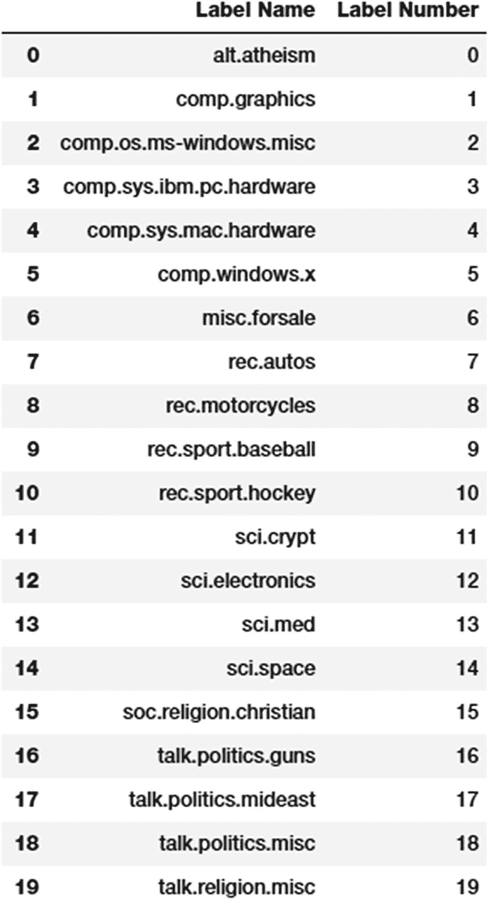

图 5-12：类别标签名称与数字之间的映射

```python
label_data_map = {v:k for k, v in data_labels_map.items()}
label_map_df = pd.DataFrame(list(label_data_map.items()),
columns=['Label Name', 'Label Number'])
label_map_df
```

现在我们可以构建一个混淆矩阵，来展示每个类别标签的正确分类和错误分类实例。由于类别名称较长，我们在显示时使用数字表示。参见图 5-13。

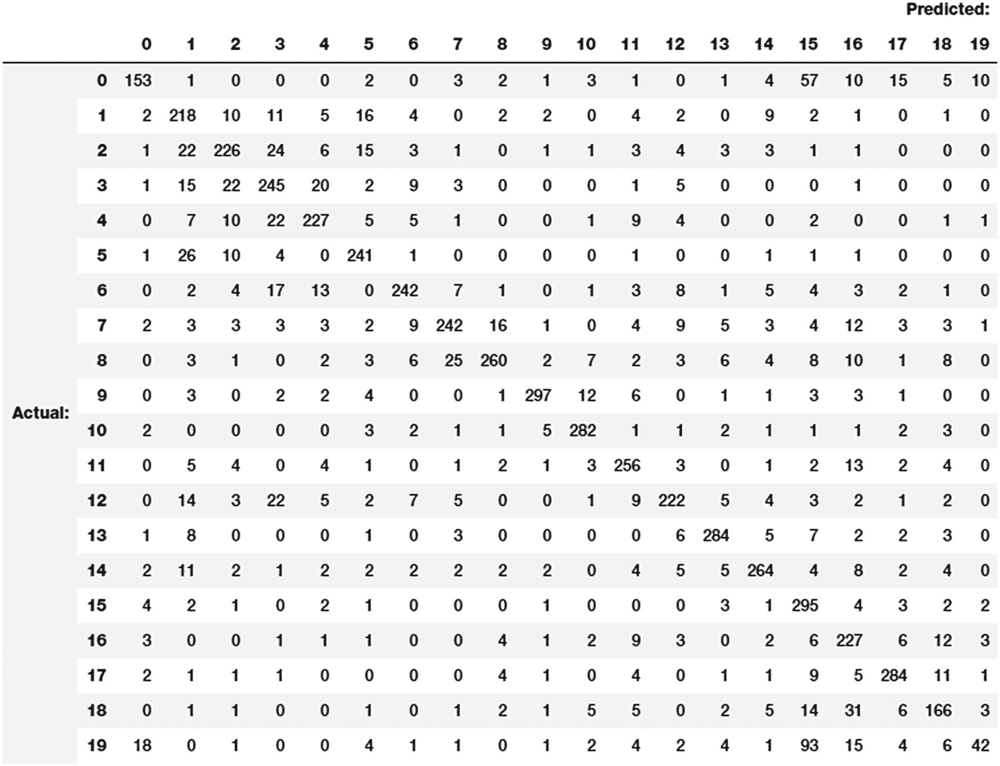

图 5-13：我们的朴素贝叶斯模型在测试数据上预测结果的混淆矩阵

```python
unique_class_nums = label_map_df['Label Number'].values
mnb_prediction_class_nums = [label_data_map[item] for item in mnb_predictions]
meu.display_confusion_matrix_pretty(true_labels=test_label_nums,
predicted_labels=mnb_prediction_class_nums, classes=unique_class_nums)
```

我们的混淆矩阵对角线集中了大部分数值，这表明大多数预测与实际类别标签是匹配的！有趣的是，类别标签 `0`、`15` 和 `19` 似乎存在大量错误分类。让我们仔细查看这些类别标签，了解它们对应的新闻组名称。如图 5-14 所示。

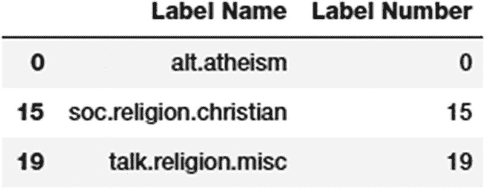

图 5-14：错误分类的新闻组类别标签编号与名称

```python
label_map_df[label_map_df['Label Number'].isin([0, 15, 19])]
```

正如我们所推测，所有与宗教不同方面相关的新闻组都存在更多错误分类，这表明模型可能在这些类别中误判了实例。让我们更深入地探究这一点，并分析一些具体实例。

```python
# 提取测试文档行号
train_idx, test_idx = train_test_split(np.array(range(len(data_df['Article']))), test_size=0.33, random_state=42)
test_idx
array([ 4105, 12650,  7039, ...,  4772,  7803,  9616])
```

现在，我们在测试数据集的 DataFrame 中添加两列。第一列是朴素贝叶斯模型的预测标签，第二列是模型进行预测时的置信度，本质上是模型预测的概率。如图 5-15 所示。

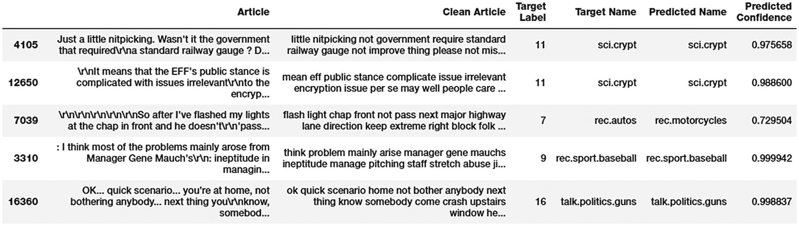

图 5-15：向测试数据集中添加包含模型预测和置信度分数的额外元数据

```python
predict_probas = gs_mnb.predict_proba(test_corpus).max(axis=1)
test_df = data_df.iloc[test_idx]
test_df['Predicted Name'] = mnb_predictions
test_df['Predicted Confidence'] = predict_probas
test_df.head()
```

基于图 5-15 中展示的 DataFrame 快照，测试数据集中的文章、真实标签、预测标签和置信度分数看起来都井井有条。现在，让我们查看一些原本来自 `talk.religion.misc` 新闻组，但模型以最高置信度预测为 `soc.religion.christian` 的文章。如图 5-16 所示。

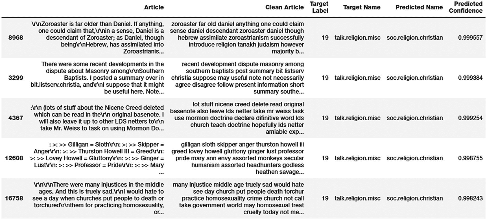

图 5-16：查看 `religion.misc` 和 `religion.christian` 的主要错误分类实例

```markdown
这能让您深入了解哪些实例可能被错误分类及其原因。看起来这些文章中的某些内容确实提到了基督教的某些方面，导致模型预测为`soc.religion.christian`类别。现在，让我们查看一些原本来自`talk.religion.misc`新闻组，但模型以最高置信度预测为`alt.atheism`的文章。如图 5-17 所示。

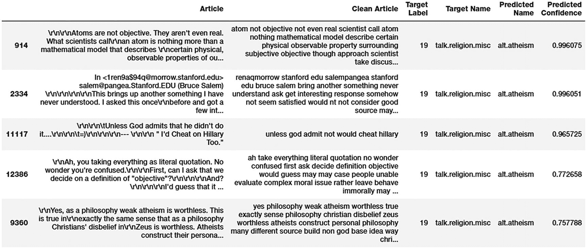

**图 5-17** – 查看`religion.misc`和`alt.atheism`的主要错误分类实例

```python
pd.set_option('display.max_colwidth', 200)
res_df = (test_df[(test_df['Target Name'] == 'talk.religion.misc')
& (test_df['Predicted Name'] == 'alt.atheism')]
.sort_values(by=['Predicted Confidence'], ascending=False).head(5))
res_df
```

考虑到无神论和宗教在人们讨论时（尤其是在在线论坛上）有多个方面的关联，这应该是显而易见的。您是否注意到了其他有趣的模式？请继续深入探索数据！至此，我们关于文本分类系统的讨论和实现就告一段落了。欢迎使用其他创新的特征提取技术或有监督学习算法实现更多模型，并比较它们的性能。

## 应用

文本分类与归类在多个真实场景和应用中都有使用。其中包括：

*   新闻分类

*   垃圾邮件过滤

*   音乐或电影类型分类

*   情感分析

*   语言检测

文本数据的可能性确实是无穷无尽的，您只需付出一点努力，就能应用分类方法来解决各种问题，并自动化原本耗时耗力的操作和场景。

## 总结

文本分类确实是一个强大的工具，我们在本章中涵盖了与之相关的几乎所有方面。我们的旅程从了解文本分类的定义和范围开始。接着，我们将自动文本分类定义为一个有监督学习问题，并介绍了文本分类的多种类型。我们还简要介绍了与各种算法相关的机器学习概念。此外，我们还定义了一个典型的文本分类系统蓝图，描述了构建端到端文本分类器所涉及的各个模块和步骤。随后，我们对蓝图中的每个模块进行了展开说明。

上一章已详细讨论了文本预处理和标准化，我们专门为文本分类构建了一个标准化模块。我们回顾了第 4 章中关于文本数据的各种特征提取和工程技术，包括词袋、TF-IDF 以及先进的词嵌入技术。现在，您不仅应该清楚其数学表示和概念，还应该了解如何实现它们。

我们讨论了各种有监督学习方法，重点介绍了最先进的分类器，如多项式朴素贝叶斯、逻辑回归、支持向量机，以及随机森林和梯度提升等集成模型。我们甚至一瞥了神经网络模型！我们还探讨了评估分类模型性能的方法，并实现了这些评估指标。最后，我们将所学的一切整合在一起，构建了一个稳健的 20 类文本分类系统，应用于真实数据，并评估了多种模型，详细分析了模型性能。我们通过介绍文本分类的一些常见应用领域来结束本次讨论。我们才刚刚触及文本分析和自然语言处理的表面，在后续章节中，我们将探讨更多从文本数据中分析和提取见解的方法。
```
