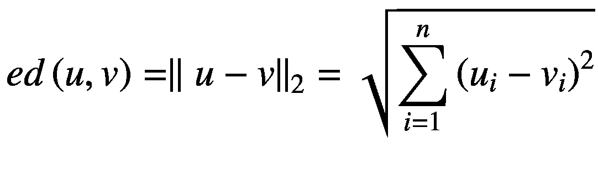

# compute normalized Manhattan distance
for term, term_vector in zip(other_terms, other_term_vecs):
print('Normalized Manhattan distance between root: {} and term: {} is {}'.format(root_term, term, round(manhattan_distance(root_term_vec, term_vector, norm=True), 2)))
Normalized Manhattan distance between root: Believe and term: beleive is 1.14
Normalized Manhattan distance between root: Believe and term: bargain is 5.43
Traceback (most recent call last):
File "<stdin>", line 4, in <module>
round(manhattan_distance(root_vector, vector_term, norm=True),2))
ValueError: The vectors must have equal lengths.
```

从这些结果可以看出，正如预期的那样，“Believe”和“beleive”最为相似，得分为 8 或 1.14，而“bargain”的得分为 38 或 5.43。项“Elephant”会产生错误，因为其长度与基本项不同。

# 欧几里得距离

我们在前一节比较曼哈顿距离时简要提到了*欧几里得距离*。形式上，欧几里得距离也称为欧几里得范数、`L2`范数或 `L2`距离。它被定义为两点之间的最短直线距离。数学上可表示如下：



其中在我们的场景中，两个点 `u` 和 `v` 是长度为 `n` 的向量化文本项。以下函数帮助我们计算两个项之间的欧几里得距离。

```python
def euclidean_distance(u, v):
if u.shape != v.shape:
raise ValueError('The vectors must have equal lengths.')
distance = np.sqrt(np.sum(np.square(u - v)))
return distance
```

现在，我们可以使用下面代码片段中描述的这个函数，来比较各项之间的欧几里得距离。

```python
