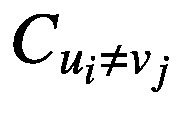
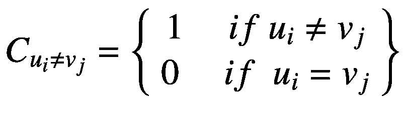
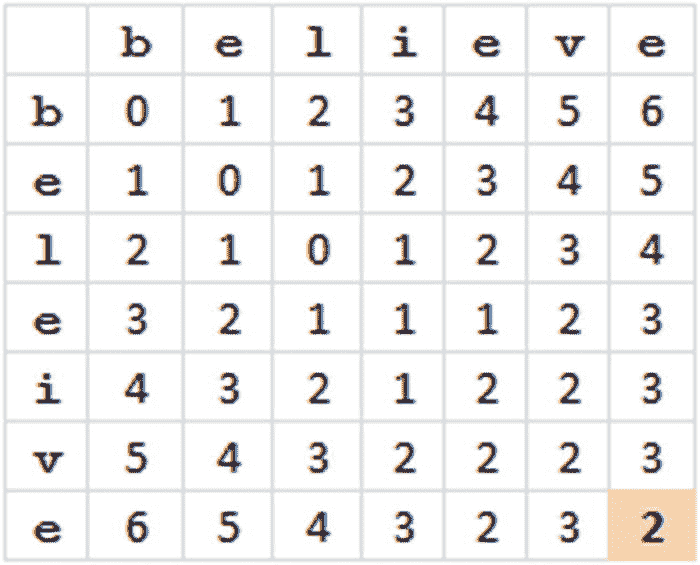

# compute Euclidean distance
for term, term_vector in zip(other_terms, other_term_vecs):
print('Euclidean distance between root: {} and term: {} is {}'.format(root_term, term, round(euclidean_distance(root_term_vec, term_vector), 2)))
Euclidean distance between root: Believe and term: beleive is 5.66
Euclidean distance between root: Believe and term: bargain is 17.94
Traceback (most recent call last):
File "<stdin>", line 4, in <module>
round(euclidean_distance(root_vector, vector_term),2))
ValueError: The vectors must have equal lengths.
```

从这些输出中可以看到，项“Believe”和“beleive”最为相似，得分为 5.66，而“bargain”的得分为 17.94。同样，字符串“Elephant”会抛出 `ValueError`，因为它的长度不同。到目前为止，我们使用的所有距离度量都适用于长度相同的字符串，当字符串长度不相等时就会失败。那么，我们该如何处理这个问题呢？接下来，我们将介绍几种即使在字符串长度不等时也能衡量相似度的距离度量。


### 莱文斯坦编辑距离

*莱文斯坦编辑距离*（通常简称为*莱文斯坦距离*）属于基于编辑距离的度量族，用于根据两个字符串序列之间的差异来衡量它们的距离，其概念与汉明距离类似。两个词项之间的莱文斯坦编辑距离可以定义为：通过添加、删除或替换的形式，将一个词项更改为另一个词项所需的最少编辑次数。这些替换是基于字符的替换，即每次操作可以编辑单个字符。如前所述，两个词项的长度不必相等。在数学上，我们可以将两个词项之间的莱文斯坦编辑距离表示为`ldu, v`，其中`u`和`v`是我们的两个词项，`|u|`和`|v|`是它们的长度。该距离可以用以下公式表示：


其中`i`和`j`基本上是指词项`u`和`v`的索引。最小值中的第三个方程包含一个代价函数，记为，它具有以下条件：



这表示一个指示函数，描述了为两个词项匹配两个字符时相关的代价（该方程表示匹配或不匹配操作）。最小值中的第一个方程确定删除操作，第二个方程确定插入操作。

因此，函数`ldu, v`涵盖了插入、删除和添加这三种操作。它也表示了在词项`u`的前`i`个字符和词项`v`的前`j`个字符之间测量的莱文斯坦距离。关于莱文斯坦编辑距离，还有一些有趣的边界条件。如下所示：

* 两个词项之间编辑距离的最小值是两个词项的长度之差

* 两个词项之间编辑距离的最大值可以是较长词项的长度

* 如果两个词项相等，则编辑距离为零

* 当且仅当两个词项长度相等时，两个词项之间的汉明距离是莱文斯坦编辑距离的一个上界

* 作为一种距离度量，它也满足三角不等式性质，这在我们之前讨论距离度量时已经提到过

有多种方法可以实现词项的莱文斯坦距离计算。这里我们从两个词项的示例开始。考虑根词项`"believe"`和另一个词项`"beleive"`（计算中忽略大小写），编辑距离将为 2，因为我们需要以下两次操作。

* bel`e`ive → bel`i`ive（将`e`替换为`i`）

* beli`i`ve → beli`e`ve（将`i`替换为`e`）

为了实现这一点，我们构建一个矩阵，通过比较第一个词项的每个字符与第二个词项的字符，来计算两个词项所有字符之间的莱文斯坦距离。在计算中，我们采用动态规划方法，以便基于最后计算出的值得到两个词项之间的编辑距离。对于这两个词项，我们的算法应生成的莱文斯坦编辑距离矩阵如图 7-1 所示。



图 7-1

词项之间的莱文斯坦编辑距离矩阵

从图 7-1 中可以看出，编辑距离是针对词项中每对字符计算的，而最终的编辑距离值（在图中突出显示）给出了两个词项之间的实际编辑距离。该算法也称为*瓦格纳-费歇尔算法*，出自 R. Wagner 和 M. Fischer 的论文《字符串到字符串的校正问题》，如果你对细节感兴趣，可以参考该论文。伪代码如下所示，源自该论文。

```
function levenshtein_distance(char u[1..m], char v[1..n]):
