# 6. 文本摘要与主题模型

在文本分析和自然语言处理的世界中，我们已经走过了一段相当长的旅程。你已经了解了如何为各种应用处理和标注文本数据。我们还探讨了结合特征工程的最新文本表示方法。此外，我们深入了机器学习的领域，并利用各种特征提取技术和监督式机器学习算法构建了属于自己的多类文本分类系统。在本章中，我们将处理文本分析领域一个略有不同的问题——信息摘要。

世界在技术、商业、贸易和媒体方面正迅速发展。我们等待报纸送到家中以了解世界各地种种事件的日子已经一去不复返了。随着互联网和社交媒体的出现，我们迎来了所谓的“信息时代”。如今，我们通过各种社交媒体了解日常事件、与亲朋好友及世界保持联系。像 Facebook 和 Twitter 这样的社交媒体通过短消息或状态更新，为信息共享和消费创造了全新的维度。人类的注意力持续时间往往很短，这导致我们在阅读冗长的文档和文章时容易感到厌倦。

这就引出了`文本摘要`，它在文本分析中是一个极其重要的概念。企业和分析公司都使用它来缩短和概括冗长的文档，从而保留文档的核心主题。通常，我们会将这些摘要信息呈现给消费者和客户，以便他们在几秒钟内就能理解这些信息。这类似于“电梯演讲”，你需要提供一个快速的总结，来描述一个流程、产品、服务或业务，并确保它保留了核心的重要主题和价值。这个想法源于演讲时间应相当于乘坐电梯所需的时间，从几秒到几分钟不等。

想象一下，你拥有一整个文本文档语料库，任务是从中提取有意义的见解。乍一看，这似乎很困难，因为你甚至不知道该如何处理这些文档，更不用说对其应用 NLP 或数据科学方法了。由于这更多是关于模式挖掘而非预测性分析，一个好的起点是使用专门针对文本摘要和信息提取的无监督学习方法。总的来说，可以对文本文档执行几种操作，如下所示：

- **关键短语提取：** 专注于从文档中提取关键性的重要短语。

- **主题建模：** 提取文档中存在的各种不同的概念或主题，并保留这些文档的主要主题。

- **文档摘要：** 对整个文本文档进行摘要，以提供一个包含整个语料库重要部分的梗概。

我们将涵盖所有这三种主要技术的基本概念、技术和实际实现。

在本章中，我们首先详细讨论各种摘要和信息提取技术，并涵盖一些基础概念，这对于理解后续的实践示例至关重要。我们将介绍三种主要技术，包括关键短语提取、主题模型和自动化文档摘要。本章展示的所有代码示例均可从本书的官方 GitHub 仓库获取，您可以通过 [`github.com/dipanjanS/text-analytics-with-python/tree/master/New-Second-Edition`](https://github.com/dipanjanS/text-analytics-with-python/tree/master/New-Second-Edition) 访问该仓库。

## 文本摘要与信息提取

文本摘要和信息提取致力于从庞大的文本语料库中提取关键概念和主题，本质上是在此过程中对内容进行缩减。在深入探讨概念和技术之前，我们首先需要理解文本摘要的必要性。`信息过载`这一概念是催生文本摘要需求的主要原因之一。自从印刷和口头媒体变得突出以来，书籍、文章、音频和视频的数量就变得极其丰富。这大约始于公元前 3 或 4 世纪，当时人们将海量的书籍描述为“书籍的生产没有尽头”，而这种信息过载往往招致反对。

文艺复兴时期，古腾堡大约在公元 1440 年发明了印刷机，这导致了书籍、手稿、文章和小册子的大规模生产。这再次引发了信息过载，学者们抱怨信息过多，这些信息变得极其难以消化、处理和管理。

随着计算机和技术的进步，我们在 20 世纪进入了数字时代，互联网由此诞生。这为通过社交媒体、新闻网站、电子邮件和即时通讯工具生产和消费信息开辟了全新的可能性窗口。这导致信息量激增，甚至产生了垃圾邮件、无用的状态更新、推文，以及网络上发布无意义内容的机器人等不受欢迎的信息。

现在，我们了解了信息生产和消费的现状，可以将`信息过载`定义为：由于存在过多的数据或信息，导致消费者难以处理这些信息并做出明智的决策。当输入系统的信息量开始超过系统的处理能力时，就会发生这种过载。人类的认知处理能力有限，并且我们的思维模式决定了我们无法长时间阅读单一的信息或数据，因为大脑会不时地走神。因此，当我们被信息淹没时，就会导致决策质量下降。

企业依靠做出明智的决策来蓬勃发展，而它们通常拥有海量的数据和信息。从这些信息中获取洞察并非易事，自动化这个过程也很困难，因为你必须知道如何处理这些数据。高管们很少有时间听长篇大论的演讲或翻阅好几页关于重要信息的内容。摘要和信息提取的目标是抓住关键的重要主题和主旨，并将庞大的信息文档浓缩成几行可以快速阅读、理解和解读的内容。最终目标是能够在更短的时间内做出明智的决策。我们需要高效且可扩展的流程和技术来对文本数据执行此操作。最流行的技术如下：

- 关键短语提取

- 主题建模

- 自动化文档摘要

前两种技术涉及以概念、主题和主旨的形式从文档中提取关键信息，从而对其进行缩减。自动化文档摘要则是将大型文本文档总结成几行文字，用以解释文档试图传达的信息。我们将在后续章节详细探讨每种技术，并结合实践示例。首先，我们将简要介绍每种技术的内容及其范围。

## 关键词提取

这可能是三种技术中最简单的一种。它涉及从文本文档或语料库中提取关键词或短语的过程，这些关键词或短语能够捕捉文档或语料库的主要概念或主题。可以说，这是主题建模的一种简化形式。你可能在学术论文中，甚至在线商店的某些产品中看到过用关键词或短语来描述实体，用几个词或短语捕捉该实体的核心思想或概念。

## 主题建模

这通常涉及使用统计和数学建模技术，从文档语料库中提取主要主题、议题或概念。请注意，我们强调文档语料库，因为你拥有的文档集越多样化，就能生成越多的主题或概念。这与单个文档不同，如果单个文档谈论的是单一概念，你将无法获得太多主题或概念。主题模型通常被称为`概率统计模型`，它们使用特定的统计技术，包括奇异值分解（SVD）和潜在狄利克雷分配（LDA），来发现文本数据中连接的潜在语义结构，以产生主题和概念。它们在文本分析以及生物信息学等不同领域中得到了广泛应用。

## 自动文档摘要

这是使用基于统计和机器学习技术的计算机程序或算法，对单个文档或文档语料库进行摘要，以获得一个能捕捉其基本概念和主题的简短摘要的过程。存在多种构建自动文档摘要器的技术，包括各种基于抽取和基于概括的技术。所有这些算法背后的关键概念是，找到一个原始数据集的代表性子集，使得该子集包含从语义和概念角度出发的数据集核心本质。文档摘要通常涉及从单个文档中抽取并构建一个执行摘要，但相同的算法也可以扩展到多个文档。然而，其目的并非将多个不同的文档合并在一起，因为那样会违背算法的初衷。同样的概念也适用于图像和视频摘要。

在进一步详细讨论每种技术之前，我们现在先讨论一些关于数学和机器学习的重要基础概念。

## 重要概念

本节我们将讨论几个重要的数学和机器学习基础概念，这些概念在后续内容中会很有用。其中一些你可能已经熟悉，但为了内容的完整性，我们会重复提及，以便你温故知新。本节我们还会涵盖一些自然语言处理的概念。

一个`文档`是一个包含完整文本数据体以及可选标题和其他元数据信息的实体。一个`语料库`通常由一组文档组成。这些文档可以是简单的句子，也可以是完整的文本段落。一个`分词后的语料库`指的是每个文档都被分词或分解成标记（通常是单词）的语料库。

`文本整理`或`预处理`是使用特定技术（如移除特殊符号和字符、移除多余的 HTML 标签、移除停用词、纠正拼写、词干提取和词形还原）对文本数据进行清洗、规范化和标准化的过程。

`特征工程`是从原始文本数据中提取有意义的特征或属性，并将其输入统计或机器学习算法的过程。这个过程也被称为`向量化`，因为该过程的最终转换结果是从原始文本标记生成的数值向量。原因是传统算法只能处理数值向量，不能直接处理原始文本数据。存在多种特征提取方法，包括基于词袋模型的二元特征（告诉我们文档中是否存在某个词或词组）、基于词袋模型的频率特征（告诉我们文档中某个词或词组的频率）以及词频-逆文档频率（TF-IDF）加权特征（它在对每个词项进行加权时会考虑词频和逆文档频率）。关于特征提取的更多细节，可以查看第 `4` 章。

一个`特征矩阵`通常指的是从文档集合到特征的一个映射，其中每一行代表一个文档，每一列代表一个特定的特征（通常是一个词或一组词）。在特征提取之后，我们通过特征矩阵来表示一组文档或句子，并且在我们的实际示例中，我们通常会对这些矩阵应用统计和机器学习技术。特征矩阵也可以转置，这样，我们得到的就不是传统的文档-词项矩阵，而是词项-文档矩阵。我们也可以将其他特征（如文档相似度、主题-词项和主题-文档）表示为特征矩阵。

`奇异值分解（SVD）`是一种来自线性代数的技术，在摘要算法中非常常用。SVD 是对实数或复数矩阵进行因子分解的过程。形式上，我们可以如下定义 SVD。考虑一个维度为 *m* × *n* 的矩阵 `M`，其中 *m* 表示行数，*n* 表示列数。数学上，矩阵 `M` 可以使用 SVD 表示为如下的因子分解形式：

```
M_{m×n} = U_{m×m} S_{m×n} V_{n×n}^T
```

其中我们有以下分解：

-   `U` 是一个 *m* × *m* 的酉矩阵，满足 `U^T U = I[m × m]`，其中 `I` 是单位矩阵。`U` 的列表示左奇异向量。

-   `S` 是一个对角线的 *m × n* 矩阵，其对角线上的元素为正实数。这通常也可以表示为一个包含 *m* 个值的向量，这些值表示奇异值。

-   `V^T` 是一个 *n* × *n* 的酉矩阵，满足 `V^T V = I[n × n]`，其中 `I` 是单位矩阵。`V` 的行表示右奇异向量。

这告诉我们 `U` 和 `V` 是正交的。`S` 的奇异值在摘要算法中尤为重要。我们特别将 SVD 用于低秩矩阵近似，其中我们用矩阵 `M̂` 来近似原始矩阵 `M`，该新矩阵是原始矩阵 `M` 的截断版本，秩为 `k`，并且可以用 SVD 表示为 `M̂ = UŜV^T`，其中 `Ŝ` 是原始 `S` 矩阵的截断版本，现在只包含前 `k` 个最大的奇异值，其他奇异值用零表示。我们使用 SciPy 提供的一个优秀实现来提取前 `k` 个奇异值，并返回相应的 `U`、`S` 和 `V` 矩阵。我们使用的代码片段位于 `utils.py` 文件中，如下所示：

```python
from scipy.sparse.linalg import svds
def low_rank_svd(matrix, singular_count=2):
    u, s, vt = svds(matrix, k=singular_count)
    return u, s, vt
```

我们将在后续章节的主题建模和文档摘要中使用这个实现。图 6-1 很好地展示了这一过程，它从原始的 SVD 分解中得到了 `k` 个奇异向量，并展示了我们如何确定低秩矩阵近似。

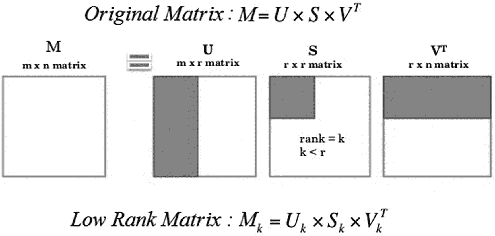

**图 6-1** 低秩矩阵近似的奇异值分解

从图 6-1 中可以清楚地看到，`k` 个奇异值在低秩矩阵近似中被保留，以及原始矩阵 `M` 是如何通过 SVD 分解为 `U`、`S` 和 `VT` 的。

*   `M` 通常被称为*词项-文档*矩阵，通常在对预处理后的文本数据进行特征工程后得到，其中矩阵的每一行代表一个词项，每一列代表一个文本文档。

*   `U` 被称为*词项-主题*矩阵，其中矩阵的每一行代表一个词项，每一列代表一个主题。当我们将它乘以奇异值时，有助于获取每个主题中具有影响力的词项。

*   `S` 是由低秩 SVD 后得到的*奇异值*列表组成的矩阵或数组，其数量通常等于我们在该操作之前确定的主题数量。

*   `VT` 是*主题-文档*矩阵，如果对其进行转置，你会得到*文档-主题*矩阵，这对于了解每个主题对每个文档的影响程度非常有用。

在本章的其余部分，除非对理解算法工作原理至关重要，否则我们尽量将数学内容保持在最低限度。但我们鼓励读者深入研究这些技术，以便更好地理解它们在幕后是如何工作的。

## 关键词提取

这是从非结构化文本文档中提取重要信息最简单但最强大的技术之一。关键词提取，也称为*术语提取*，是从非结构化文本主体中提取关键术语或短语的过程，以便捕获核心主题。该技术属于信息检索和提取的广泛范畴。关键词提取在许多领域都很有用，这里列举其中一些：

*   语义网

*   基于查询的搜索引擎和爬虫

*   推荐系统

*   标签系统

*   文档相似度

*   翻译

关键词提取通常是执行文本分析或自然语言处理中更复杂任务的起点，其输出可以作为更复杂系统的特征。关键词提取有多种方法；我们将介绍以下两种主要技术：

*   搭配

*   基于加权标签的短语提取

需要记住的一个要点是，我们将提取短语，这些短语通常是单词的集合，有时也可能只是单个单词。如果你正在提取关键词，这也被称为关键词提取，它是关键词提取的一个子集。

### 搭配词

术语*搭配词*借用于语料库分析和语言学领域。搭配词可以定义为倾向于频繁出现的单词序列或词组，其出现频率往往高于随机或偶然出现的频率。基于词性（如名词、动词等），可以形成各种类型的搭配词。有几种提取搭配词的方法，最佳方法之一是采用 n-gram 分组或切分策略。这种方法通过从语料库构建 n-gram，然后统计每个 n-gram 的出现频率，并根据频率排序，从而获取最频繁的 n-gram 搭配。

其核心思想是：拥有一个文档语料库（由段落或句子组成），对其进行分词形成句子，将句子列表扁平化成一个长字符串或序列，然后基于 n-gram 的范围，滑动一个大小为 n 的窗口来计算整个字符串上的 n-gram。计算完成后，根据每个 n-gram 的出现频率进行计数并排序。这样，就能基于频率得到最频繁的搭配词。我们首先从头实现这一过程，以便更好地理解算法，然后使用 NLTK 的一些内置功能来进行演示。

我们先加载一些必要的依赖项和一个用于计算搭配词的语料库。我们使用 NLTK 古腾堡语料库中的书籍——刘易斯·卡罗尔的 *《爱丽丝梦游仙境》* 作为语料库。同时，使用我们在前几章构建的便捷 `text_normalizer` 模块对语料库进行标准化处理，以统一文本内容。

```python
from nltk.corpus import gutenberg
import text_normalizer as tn
import nltk
from operator import itemgetter
# 加载语料库
alice = gutenberg.sents(fileids='carroll-alice.txt')
alice = [' '.join(ts) for ts in alice]
norm_alice = list(filter(None,
    tn.normalize_corpus(alice, text_lemmatization=False)))
# 打印并对比第一行
print(alice[0], '\n', norm_alice[0])
[ Alice ' s Adventures in Wonderland by Lewis Carroll 1865 ]
alice adventures wonderland lewis carroll
```

现在我们定义一个函数，基于输入的标记列表和参数 `n`（`n` 决定了 n-gram 的度数，如一元组、二元组等），来计算 n-gram。下面的代码片段计算了输入序列中的 n-gram。

```python
def compute_ngrams(sequence, n):
    return list(
        zip(*(sequence[index:] for index in range(n)))
    )
```

这个函数接收一个标记序列，并构建一个列表的列表，其中每个列表包含前一个列表中除第一个元素之外的所有元素。它会构建 `n` 个这样的列表，然后将它们压缩在一起，得到所需的 n-gram。由于在 Python 3 中，`zip` 函数返回的是一个生成器对象而非原始列表，我们将最终结果包装在一个列表中。下面的代码片段展示了该函数在示例序列上的运行情况。

```python
In [7]: compute_ngrams([1,2,3,4], 2)
Out[7]: [(1, 2), (2, 3), (3, 4)]
In [8]: compute_ngrams([1,2,3,4], 3)
Out[8]: [(1, 2, 3), (2, 3, 4)]
```

上述输出展示了输入序列的二元组和三元组。现在，我们利用这个函数并在此基础上进行扩展，以生成基于出现频率的 top n-gram。为此，我们需要定义一个函数将语料库扁平化成一个大的文本字符串。以下函数帮助我们对文档语料库执行此操作。

```python
def flatten_corpus(corpus):
    return ' '.join([document.strip() for document in corpus])
```

现在，我们可以构建一个函数来帮助从文本语料库中获取 top n-gram。

```python
def get_top_ngrams(corpus, ngram_val=1, limit=5):
    corpus = flatten_corpus(corpus)
    tokens = nltk.word_tokenize(corpus)
    ngrams = compute_ngrams(tokens, ngram_val)
    ngrams_freq_dist = nltk.FreqDist(ngrams)
    sorted_ngrams_fd = sorted(ngrams_freq_dist.items(),
                              key=itemgetter(1), reverse=True)
    sorted_ngrams = sorted_ngrams_fd[0:limit]
    sorted_ngrams = [(' '.join(text), freq) for text, freq in sorted_ngrams]
    return sorted_ngrams
```

我们使用 NLTK 的 `FreqDist` 类创建一个所有 n-gram 的计数器（基于它们的频率），然后根据频率排序，并根据用户指定的限制返回 top n-gram。现在，使用以下代码片段计算我们语料库中的 top 二元组和 top 三元组。

```
# 前 10 个二元组
In [11]: get_top_ngrams(corpus=norm_alice, ngram_val=2,
...:               limit=10)
Out[11]:
[('said alice', 123),
 ('mock turtle', 56),
 ('march hare', 31),
 ('said king', 29),
 ('thought alice', 26),
 ('white rabbit', 22),
 ('said hatter', 22),
 ('said mock', 20),
 ('said caterpillar', 18),
 ('said gryphon', 18)]

# 前 10 个三元组
In [12]: get_top_ngrams(corpus=norm_alice, ngram_val=3,
...:               limit=10)
Out[12]:
[('said mock turtle', 20),
 ('said march hare', 10),
 ('poor little thing', 6),
 ('little golden key', 5),
 ('certainly said alice', 5),
 ('white kid gloves', 5),
 ('march hare said', 5),
 ('mock turtle said', 5),
 ('know said alice', 4),
 ('might well say', 4)]
```

该输出显示了由 n-gram 生成的二词和三词序列，以及它们在语料库中出现的次数。我们可以看到，大多数搭配词都指向正在说话的人，格式为 "said <人物>"。我们还可以看到，搭配词中出现了《爱丽丝梦游仙境》中的知名角色，如假海龟、国王、兔子、帽匠和爱丽丝。

现在我们来看 NLTK 的搭配词查找器，它使我们能够使用原始频率、逐点互信息等各种度量标准来查找搭配词。简单解释一下，`逐点互信息`可以针对两个事件或术语进行计算，即它们共同出现的概率与假设它们相互独立时各自概率乘积之比的对数。数学上可以表示为：

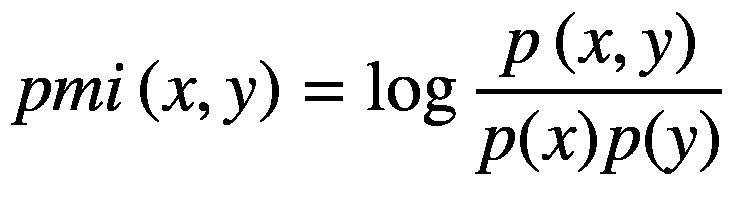

这个度量是对称的。下面的代码片段展示了如何使用这些度量来计算搭配词。

```
# 二元组
from nltk.collocations import BigramCollocationFinder
from nltk.collocations import BigramAssocMeasures
finder = BigramCollocationFinder.from_documents([item.split() for item in norm_alice])
finder
```

# 原始频率

`finder.nbest(bigram_measures.raw_freq, 10)`

Out[14]:

```
[(u'said', u'alice'),
 (u'mock', u'turtle'),
 (u'march', u'hare'),
 (u'said', u'king'),
 (u'thought', u'alice'),
 (u'said', u'hatter'),
 (u'white', u'rabbit'),
 (u'said', u'mock'),
 (u'said', u'caterpillar'),
 (u'said', u'gryphon')]
```

# 逐点互信息

`finder.nbest(bigram_measures.pmi, 10)`

```
[(u'abide', u'figures'),
 (u'acceptance', u'elegant'),
 (u'accounting', u'tastes'),
 (u'accustomed', u'usurpation'),
 (u'act', u'crawling'),
 (u'adjourn', u'immediate'),
 (u'adoption', u'energetic'),
 (u'affair', u'trusts'),
 (u'agony', u'terror'),
 (u'alarmed', u'proposal')]
```

# 三元组

```python
from nltk.collocations import TrigramCollocationFinder
from nltk.collocations import TrigramAssocMeasures
finder = TrigramCollocationFinder.from_documents([item.split() for item in norm_alice])
trigram_measures = TrigramAssocMeasures()
```

# 原始频率

`finder.nbest(trigram_measures.raw_freq, 10)`

```
[(u'said', u'mock', u'turtle'),
 (u'said', u'march', u'hare'),
 (u'poor', u'little', u'thing'),
 (u'little', u'golden', u'key'),
 (u'march', u'hare', u'said'),
 (u'mock', u'turtle', u'said'),
 (u'white', u'kid', u'gloves'),
 (u'beau', u'ootiful', u'soo'),
 (u'certainly', u'said', u'alice'),
 (u'might', u'well', u'say')]
```

# 逐点互信息

`finder.nbest(trigram_measures.pmi, 10)`

```
[(u'accustomed', u'usurpation', u'conquest'),
 (u'adjourn', u'immediate', u'adoption'),
 (u'adoption', u'energetic', u'remedies'),
 (u'ancient', u'modern', u'seaography'),
 (u'apple', u'roast', u'turkey'),
 (u'arithmetic', u'ambition', u'distraction'),
 (u'brother', u'latin', u'grammar'),
 (u'canvas', u'bag', u'tied'),
 (u'cherry', u'tart', u'custard'),
 (u'circle', u'exact', u'shape')]
```

现在你已经了解了如何使用 n-gram 生成方法计算语料库中的搭配。我们将在下一节探讨一种基于词性标注和术语加权的更好的关键词生成方法。

## 基于加权的词性标注短语提取

现在我们来看一种略有不同的关键词提取方法。该方法借鉴了几篇论文的概念，即 K. Barker 和 N. Cornachhia 的《使用名词短语中心词提取文档关键词》以及 Ian Witten 等人的《KEA：实用的自动关键词提取》，如果你对其实验和方法的更多细节感兴趣，可参考这些论文。我们的算法遵循两步流程，具体如下：

1.  使用浅层解析提取所有名词短语块。
2.  计算每个块的 TF-IDF 权重，并返回权重最高的短语。

第一步，我们使用基于词性标签的简单模式来提取名词短语块。你在第 3 章中应该已经熟悉了这一点，当时我们探讨了组块分析和浅层解析。在讨论我们的算法之前，先加载将要测试实现的语料库。我们使用维基百科中关于大象的一段样本描述，该描述位于 `elephants.txt` 文件中，你可以从本书的 GitHub 仓库获取：[`https://github.com/dipanjanS/text-analytics-with-python`](https://github.com/dipanjanS/text-analytics-with-python)。

```python
data = open('elephants.txt', 'r+').readlines()
sentences = nltk.sent_tokenize(data[0])
len(sentences)
```

```python
# 查看前三行
sentences[:3]
['Elephants are large mammals of the family Elephantidae and the order Proboscidea.',
 'Three species are currently recognised: the African bush elephant (Loxodonta africana), the African forest elephant (L. cyclotis), and the Asian elephant (Elephas maximus).',
 'Elephants are scattered throughout sub-Saharan Africa, South Asia, and Southeast Asia.']
```

现在，让我们使用精巧的 `text_normalizer` 模块对语料库进行一些非常基础的文本预处理。

```python
norm_sentences = tn.normalize_corpus(sentences, text_lower_case=False,
                                     text_stemming=False, text_lemmatization=False,
                                     stopword_removal=False)
norm_sentences[:3]
['Elephants are large mammals of the family Elephantidae and the order Proboscidea',
 'Three species are currently recognised the African bush elephant Loxodonta africana the African forest elephant L cyclotis and the Asian elephant Elephas maximus',
 'Elephants are scattered throughout subSaharan Africa South Asia and Southeast Asia']
```

语料库准备就绪后，我们将使用模式 `" NP: {<DT>? <JJ>* <NN.*>+}"` 从文档/句子语料库中提取所有可能的名词短语。你随时可以尝试更复杂的模式，后期甚至可融入动词、形容词或副词短语。但在此我们保持简洁，专注于核心逻辑。确定模式后，我们将定义一个函数，使用以下代码片段进行解析和提取。同时，在此处加载其他必要的依赖项。

```python
import itertools
stopwords = nltk.corpus.stopwords.words('english')

def get_chunks(sentences, grammar=r'NP: {<DT>?<JJ>*<NN.*>+}',
               stopword_list=stopwords):
    all_chunks = []
    chunker = nltk.chunk.regexp.RegexpParser(grammar)
    for sentence in sentences:
        tagged_sents = [nltk.pos_tag(nltk.word_tokenize(sentence))]
        chunks = [chunker.parse(tagged_sent) for tagged_sent in tagged_sents]
        wtc_sents = [nltk.chunk.tree2conlltags(chunk) for chunk in chunks]
        flattened_chunks = list(
            itertools.chain.from_iterable(
                wtc_sent for wtc_sent in wtc_sents)
        )
        valid_chunks_tagged = [(status, [wtc for wtc in chunk])
                               for status, chunk
                               in itertools.groupby(flattened_chunks,
                                                    lambda word_pos_chunk: word_pos_chunk[2] != 'O')]
        valid_chunks = [' '.join(word.lower()
                                 for word, tag, chunk in wtc_group
                                 if word.lower() not in stopword_list)
                        for status, wtc_group in valid_chunks_tagged
                        if status]
        all_chunks.append(valid_chunks)
    return all_chunks
```

在这个函数中，我们定义了一个用于分块或提取名词短语的语法模式。我们基于相同的模式定义了一个分块器，对于文档中的每个句子，我们首先用词性标注对其进行标注，然后构建一个浅层解析树，其中名词短语作为语块，所有其他基于词性标注的单词作为非语块（不属于任何语块）。完成后，我们使用 `tree2conlltags` 函数生成 `(w, t, c)` *三元组*，即单词、词性标签和 IOB 格式的语块标签（详见第 3 章）。我们删除所有语块标签为 `O` 的标签，因为它们基本上是不属于任何语块的单词或术语。最后，从这些有效的语块中，我们组合分块后的术语，从每个语块组生成短语。我们可以在以下代码片段中的语料库上看到这个函数的实际应用。

# 关键短语提取

```
chunks = get_chunks(norm_sentences)
chunks
[['elephants', 'large mammals', 'family elephantidae', 'order proboscidea'],
['species', 'african bush elephant loxodonta', 'african forest elephant l cyclotis', 'asian elephant elephas maximus'],
['elephants', 'subsaharan africa south asia', 'southeast asia'],
...,
...,
['incisors', 'tusks', 'weapons', 'tools', 'objects'],
['elephants', 'flaps', 'body temperature'],
['pillarlike legs', 'great weight'],
...,
...,
['threats', 'populations', 'ivory trade', 'animals', 'ivory tusks'],
['threats', 'elephants', 'habitat destruction', 'conflicts', 'local people'],
['elephants', 'animals', 'asia'],
['past', 'war today', 'display', 'zoos', 'entertainment', 'circuses'],
['elephants', 'art folklore religion literature', 'popular culture']]
```

此输出显示了文档中每个句子的所有有效关键短语。您已经可以看到，由于我们针对的是名词短语，因此所有短语都涉及基于名词的实体。现在我们基于 `get_chunks()` 函数，为步骤 2 实现必要的逻辑：我们将使用 Gensim 在关键短语上构建一个基于 TF-IDF 的模型，然后根据每个关键短语在语料库中的出现频率计算其 TF-IDF 权重。最后，我们根据这些关键短语的 TF-IDF 权重进行排序，并显示前 N 个关键短语，其中 `top_n` 由用户指定。

```
from gensim import corpora, models
def get_tfidf_weighted_keyphrases(sentences,
grammar=r'NP: {? <NN.*>+}',
top_n=10):
    valid_chunks = get_chunks(sentences, grammar=grammar)
    dictionary = corpora.Dictionary(valid_chunks)
    corpus = [dictionary.doc2bow(chunk) for chunk in valid_chunks]
    tfidf = models.TfidfModel(corpus)
    corpus_tfidf = tfidf[corpus]
    weighted_phrases = {dictionary.get(idx): value
                       for doc in corpus_tfidf
                       for idx, value in doc}
    weighted_phrases = sorted(weighted_phrases.items(),
                              key=itemgetter(1), reverse=True)
    weighted_phrases = [(term, round(wt, 3)) for term, wt in weighted_phrases]
    return weighted_phrases[:top_n]
```

我们现在可以在玩具语料库上测试这个函数，使用以下代码片段生成前 30 个关键短语。

```
# 前 30 个 tf-idf 加权关键短语
get_tfidf_weighted_keyphrases(sentences=norm_sentences, top_n=30)
[('water', 1.0), ('asia', 0.807), ('wild', 0.764), ('great weight', 0.707),
('pillarlike legs', 0.707), ('southeast asia', 0.693), ('subsaharan africa south asia', 0.693), ('body temperature', 0.693), ('flaps', 0.693), ('fissionfusion society', 0.693), ('multiple family groups', 0.693), ('art folklore religion literature', 0.693), ('popular culture', 0.693), ('ears', 0.681), ('males', 0.653), ('males bulls', 0.653), ('family elephantidae', 0.607), ('large mammals', 0.607), ('years', 0.607), ('environments', 0.577), ('impact', 0.577), ('keystone species', 0.577), ('cetaceans', 0.577), ('elephant intelligence', 0.577), ('primates', 0.577), ('dead individuals', 0.577), ('kind', 0.577), ('selfawareness', 0.577), ('different habitats', 0.57), ('marshes', 0.57)]
```

有趣的是，我们在关键短语中看到了各种类型的大象，如亚洲象和非洲象，以及大象的典型特征，如“巨大的重量”、“裂变-融合社会”和“柱状腿”。

我们还可以利用 Gensim 的摘要模块，它有一个从文本中提取关键字的 `keywords` 函数。这使用了 TextRank 算法的一个变体，我们将在文档摘要部分探讨该算法。

```
from gensim.summarization import keywords
key_words = keywords(data[0], ratio=1.0, scores=True, lemmatize=True)
[(item, round(score, 3)) for item, score in key_words][:25]
[('african bush elephant', 0.261), ('including', 0.141), ('family', 0.137),
('cow', 0.124), ('forests', 0.108), ('female', 0.103), ('asia', 0.102),
('objects', 0.098), ('tigers', 0.098), ('sight', 0.098), ('ivory', 0.098),
('males', 0.088), ('folklore', 0.087), ('known', 0.087), ('religion', 0.087),
('larger ears', 0.085), ('water', 0.075), ('highly recognisable', 0.075),
('breathing lifting', 0.074), ('flaps', 0.073), ('africa', 0.072),
('gomphotheres', 0.072), ('animals tend', 0.071), ('success', 0.071),
('south', 0.07)]
```

因此，您可以看到关键短语提取如何从文本文档中提取关键重要概念并对其进行总结。尝试在其他语料库上使用这些函数，观察有趣的结果！

## 主题建模

我们已经了解了如何使用几种技术提取关键短语。虽然这些短语指出了文档或语料库中的关键点，但这项技术过于简单，通常无法准确描述语料库中的各种主题或概念，特别是当我们处理包含不同区分主题或概念的文档语料库时。

主题模型是专门为从包含各种类型文档的大型语料库中提取各种区分概念或主题而设计的，其中每个文档涉及一个或多个概念。这些概念可以是思想、观点、事实、看法、陈述等等。主题建模的主要目的是使用数学和统计技术来发现语料库中隐藏和潜在的语义结构。

主题建模涉及从文档术语中提取特征，并使用数学结构和框架（如矩阵分解和 SVD）来生成彼此可区分的术语聚类或分组，这些词簇形成主题或概念。这些概念可用于解释语料库的主要主题，并在各种文档中频繁共现的词语之间建立语义联系。有多种框架和算法可用于构建主题模型。我们涵盖以下三种方法：

*   潜在语义索引

## 潜在狄利克雷分配

## 非负矩阵分解

前两种方法相当流行且历史悠久。最后一种技术，`非负矩阵分解`，是一种较新但极其有效的技术，并能提供出色的结果。我们利用 `Gensim` 和 `Scikit-Learn` 进行实际实现，并研究如何基于潜在语义索引构建我们自己的主题模型。

与上一版相比，我们在本版新书中采用了一些不同的做法。我们没有使用玩具数据集，而是像在其他章节中那样，使用一个复杂的真实世界数据集。在接下来的几节中，我们将演示如何使用前面提到的三种方法进行主题建模。为了演示，我们利用了两个最流行的框架——`Gensim` 和 `Scikit-Learn`。这里的目标是理解如何轻松地利用这些框架构建主题模型，并理解幕后一些基本概念。

# 研究论文主题建模

我们将在此进行一项有趣的练习——对极受欢迎的 NIPS 会议（现称为 NeurIPS 会议）的过往研究论文进行主题建模。已故的 Sam Roweis 教授整理了一份优秀的 NIPS 会议论文合集（第 1 卷至第 12 卷），你可以在[`https://cs.nyu.edu/~roweis/data.html`](https://cs.nyu.edu/%257Eroweis/data.html)找到。有趣的是，他是通过处理 NIPS 1-12 期 OCR 数据获得这份合集的，那实际上还是电子投稿之前的时代。Yann LeCun 公开了这些数据。在[`http://ai.stanford.edu/~gal/data.html`](http://ai.stanford.edu/%257Egal/data.html)上还有一个更新至 NIPS 17 期的数据集。不过，该数据集是 MAT 文件格式，你可能需要先进行一些额外的预处理，才能在 Python 中使用。

## 主要目标

结合我们目前的讨论，我们的主要目标相当简单。给定一大批会议研究论文，我们能否利用无监督学习从中识别出一些关键主题或话题？我们并没有标注好的类别来告诉我们每篇研究论文的主要主题是什么。除此之外，我们处理的是通过 OCR（光学字符识别）提取的文本数据。因此，可以预料到会出现拼写错误的单词、字符缺失的单词等问题，这使得我们的问题更具挑战性。我们此次主题建模练习的关键目标在于展示以下几点：

*   使用 Gensim 和 Scikit-Learn 进行主题建模
*   使用 LDA、LSI 和 NMF 实现主题模型
*   如何利用像 MALLET 这样的第三方建模框架进行主题建模
*   评估主题建模性能
*   调优主题模型以获得最佳主题
*   解读主题建模结果
*   预测新研究论文的主题

关键在于，我们可以利用主题建模从 NIPS 研究论文中识别出一些主要主题，解读这些主题，甚至能够预测新论文的主题！

## 数据获取

我们需要获取网络上可用的数据集。你可以直接使用以下命令从 Jupyter notebook 中下载它（或者通过在终端中移除命令开头的感叹号来执行）。

```
!wget https://cs.nyu.edu/~roweis/data/nips12raw_str602.tgz
--2018-11-07 18:59:33--  https://cs.nyu.edu/~roweis/data/nips12raw_str602.tgz
正在解析 cs.nyu.edu (cs.nyu.edu)... 128.122.49.30
正在连接 cs.nyu.edu (cs.nyu.edu)|128.122.49.30|:443... 已连接。
已发送 HTTP 请求，正在等待响应... 200 OK
长度：12851423 (12M) [application/x-gzip]
正在保存至：'nips12raw_str602.tgz'
nips12raw_str602.tg 100%[===================>]  12.26M  1.75MB/s    用时 7.4s
2018-11-07 18:59:41 (1.65 MB/s) - 已保存 'nips12raw_str602.tgz' [12851423/12851423]
```

下载完存档文件后，你可以直接在 notebook 中使用以下命令自动解压其内容。

```
!tar -xzf nips12raw_str602.tgz
```

如果你使用的是 Windows 操作系统，这些命令可能无法运行，你可以直接访问网站[`https://cs.nyu.edu/~roweis/data/nips12raw_str602.tgz`](https://cs.nyu.edu/%257Eroweis/data/nips12raw_str602.tgz)手动获取研究论文。下载存档文件。下载完成后，你可以使用任意存档提取工具来提取`nipstxt`文件夹。内容提取完毕后，我们可以通过检查文件夹结构来验证。

```
import os
import numpy as np
import pandas as pd
DATA_PATH = 'nipstxt/'
print(os.listdir(DATA_PATH))
['nips01', 'nips04', 'MATLAB_NOTES', 'nips10', 'nips02', 'idx', 'nips11', 'nips03', 'nips07', 'README_yann', 'nips05', 'nips12', 'nips06', 'RAW_DATA_NOTES', 'orig', 'nips00', 'nips08', 'nips09']
```

### 加载并查看数据集

现在我们可以使用以下代码加载所有研究论文。每篇论文都在各自的文本文件中，因此我们需要使用 Python 的文件读取函数。

```
folders = ["nips{0:02}".format(i) for i in range(0,13)]
# 将所有文本读入一个列表。
papers = []
for folder in folders:
    file_names = os.listdir(DATA_PATH + folder)
    for file_name in file_names:
        with open(DATA_PATH + folder + '/' + file_name, encoding='utf-8',
                 errors='ignore', mode='r+') as f:
            data = f.read()
            papers.append(data)
len(papers)
```

总共有 1740 篇研究论文，这可不算少！让我们看看其中一篇论文的文本片段，感受一下。

```
print(papers[0][:1000])

Scaling Properties of Coarse-Coded Symbol Memories
Ronald Rosenfeld
David S. Touretzky
Computer Science Department
Carnegie Mellon University
Pittsburgh, Pennsylvania 15213
Abstract
Coarse-coded symbol memories have appeared in several neural network
symbol processing models. In order to determine how these models would scale, one must first have some understanding of the mathematics of coarse-coded representations. We define the general structure of coarse-coded symbol memories and derive mathematical relationships among their essential parameters: memory t size, sylmbol-set size and capacitor. The computed capacity of one of the schemes agrees well with actual measurements of the coarse-coded working memory of DCPS, Touretzky and Hinton's distributed connectionist production system.
1 Introduction
A distributed representation is a memory scheme in which each entity (concept, symbol) is represented by a pattern of activity over many units [3]. If each unit partic
```

看！这基本上就是你在浏览器中经常看到的 PDF 版本的研究论文的样子。然而，看起来 OCR 的效果并不完美，我们在这里那里发现了一些缺失的字符。这是意料之中的，但也使得这项任务更具挑战性！

### 基本文本整理

在深入进行主题建模之前，我们先进行一些基本的文本整理或预处理。我们在此保持简单，执行分词、名词词形还原以及移除停用词和任何单字符词汇的操作。

```
%%time
import nltk
stop_words = nltk.corpus.stopwords.words('english')
wtk = nltk.tokenize.RegexpTokenizer(r'\w+')
wnl = nltk.stem.wordnet.WordNetLemmatizer()
def normalize_corpus(papers):
    norm_papers = []
    for paper in papers:
        paper = paper.lower()
        paper_tokens = [token.strip() for token in wtk.tokenize(paper)]
        paper_tokens = [wnl.lemmatize(token) for token in paper_tokens if not token.isnumeric()]
        paper_tokens = [token for token in paper_tokens if len(token) > 1]
        paper_tokens = [token for token in paper_tokens if token not in stop_words]
        paper_tokens = list(filter(None, paper_tokens))
        if paper_tokens:
            norm_papers.append(paper_tokens)
    return norm_papers
norm_papers = normalize_corpus(papers)
print(len(norm_papers))
```

```
CPU times: user 38.6 s, sys: 92 ms, total: 38.7 s
Wall time: 38.7 s
```

```
# 查看一篇处理后的论文
print(norm_papers[0][:50])
```

```
['scaling', 'property', 'coarse', 'coded', 'symbol', 'memory', 'ronald', 'rosenfeld', 'david', 'touretzky', 'computer', 'science', 'department', 'carnegie', 'mellon', 'university', 'pittsburgh', 'pennsylvania', 'abstract', 'coarse', 'coded', 'symbol', 'memory', 'appeared', 'several', 'neural', 'network', 'symbol', 'processing', 'model', 'order', 'determine', 'model', 'would', 'scale', 'one', 'must', 'first', 'understanding', 'mathematics', 'coarse', 'coded', 'representa', 'tions', 'define', 'general', 'structure', 'coarse', 'coded', 'symbol']
```

我们现在可以开始构建主题模型了，并将像之前提到的，展示在 `Gensim` 和 `Scikit-Learn` 中的方法。

# 使用 Gensim 进行主题建模

Gensim 框架的核心标语是“面向人类主题建模”，这清楚地表明该框架专为主题建模而设计。我们可以利用该框架完成许多令人惊叹的工作，包括文本相似度分析、语义分析、主题建模和文本摘要。此外，与 Scikit-Learn 相比，Gensim 在构建、评估和调优主题模型方面提供了更多功能和更高的灵活性，我们很快就会看到这一点。在本节中，我们将使用以下方法构建主题模型。

*   `潜在语义索引 (LSI)`
*   `潜在狄利克雷分配 (LDA)`

话不多说，让我们从生成带有影响力二元词组的方法开始，并在特征工程之前删除一些可能无用的术语。

### 基于特征工程的文本表示

在特征工程和向量化之前，我们希望从研究论文中提取一些有用的基于二元词组的短语，并删除一些不必要的术语。为此，我们利用了非常有用的 `gensim.models.Phrases` 类。此功能有助于我们从句子流中自动检测常见短语，这些短语通常是多词表达/词元组。此实现的灵感源自 Mikolov 等人著名的论文《词语和短语的分布式表示及其组合性》，你可以在 [`https://arxiv.org/abs/1310.4546`](https://arxiv.org/abs/1310.4546) 查看该论文。我们首先为每一篇经过分词处理的研究论文提取并生成单词和二元词组作为短语。我们可以使用以下代码轻松构建此短语生成模型，并在示例论文上进行测试。

```python
import gensim
bigram = gensim.models.Phrases(norm_papers, min_count=20, threshold=20, delimiter=b'_') # 阈值越高，短语越少。
bigram_model = gensim.models.phrases.Phraser(bigram)
# 示例演示
print(bigram_model[norm_papers[0]][:50])
['scaling', 'property', 'coarse_coded', 'symbol', 'memory', 'ronald', 'rosenfeld', 'david_touretzky', 'computer_science', 'department', 'carnegie_mellon', 'university_pittsburgh', 'pennsylvania', 'abstract', 'coarse_coded', 'symbol', 'memory', 'appeared', 'several', 'neural_network', 'symbol', 'processing', 'model', 'order', 'determine', 'model', 'would', 'scale', 'one', 'must', 'first', 'understanding', 'mathematics', 'coarse_coded', 'representa_tions', 'define', 'general', 'structure', 'coarse_coded', 'symbol', 'memory', 'derive', 'mathematical', 'relationship', 'among', 'essential', 'parameter', 'memor', 'size', 'lmbol']
```

我们可以清晰地看到，输出中包含单个单词以及二元词组（由下划线分隔的两个单词），这表明我们的模型运行正常。我们利用了 `min_count` 参数，它告诉模型要忽略在整个语料库（以分词句子列表形式输入的论文）中总出现次数低于 20 的所有单词和二元词组。我们还使用了阈值 20，它告诉模型根据此阈值接受特定的短语，因此，如果短语 `a` 后跟 `b` 的得分大于阈值 20，则该短语被接受。此阈值依赖于评分参数，有助于我们理解这些短语的评分方式，从而了解它们的影响力。

通常使用默认评分器，并且它非常易于理解。你可以在文档 [`https://radimrehurek.com/gensim/models/phrases.html#gensim.models.phrases.original_scorer`](https://radimrehurek.com/gensim/models/phrases.html#gensim.models.phrases.original_scorer) 以及前面提到的研究论文中查看更多详细信息。

让我们为所有分词后的研究论文生成短语，并构建一个词汇表，这将有助于我们将唯一的术语/短语映射到数字编号（因为机器学习或深度学习只能处理数值张量）。

```python
norm_corpus_bigrams = [bigram_model[doc] for doc in norm_papers]
# 创建文档的字典表示。
dictionary = gensim.corpora.Dictionary(norm_corpus_bigrams)
print('单词到编号的映射示例：', list(dictionary.items())[:15])
print('词汇表总大小：', len(dictionary))
单词到编号的映射示例： [(0, '8a'), (1, 'abandon'), (2, 'able'), (3, 'abo'), (4, 'abstract'), (5, 'accommodate'), (6, 'accuracy'), (7, 'achieved'), (8, 'acknowledgment_thank'), (9, 'across'), (10, 'active'), (11, 'activity'), (12, 'actual'), (13, 'adjusted'), (14, 'adjusting')]
词汇表总大小： 78892
```

哇！根据上述输出，我们的研究论文语料库中似乎包含大量独特的短语。其中许多术语用处不大，因为它们特定于某篇论文甚至论文中的某个段落。因此，是时候修剪我们的词汇表并开始删除术语了。利用文档频率是实现这一目标的好方法。到现在，你可能已经意识到，一个术语的文档频率基本上就是该术语在整个语料库所有文档中出现的总次数。

```python
# 过滤掉出现在少于 20 个文档中，或多于 50% 的文档中的词。
dictionary.filter_extremes(no_below=20, no_above=0.6)
print('词汇表总大小：', len(dictionary))
词汇表总大小： 7756
```

我们删除了所有在整个语料库中出现次数少于 20 次以及出现在超过 60% 文档中的所有术语。我们的目标是发现不同的主题和话题，而不是重复出现的主题。因此，这完全符合我们的需求。现在，我们可以通过使用简单的词袋模型来进行特征工程。

```python
# 将语料库转换为词袋向量
bow_corpus = [dictionary.doc2bow(text) for text in norm_corpus_bigrams]
print(bow_corpus[1][:50])
[(4, 1), (14, 2), (20, 1), (28, 1), (33, 1), (43, 1), (50, 1), (60, 2), (61, 1), (62, 2), (63, 1), (72, 1), (84, 1), ..., (286, 39), (296, 6), (306, 1), (307, 2), (316, 1)]
# 查看实际的术语及其计数
print([(dictionary[idx] , freq) for idx, freq in bow_corpus[1][:50]])
[('achieved', 1), ('allow', 2), ('american_institute', 1), ('another', 1), ('appeared', 1), ('argument', 1), ('assume', 1), ('become', 2), ('becomes', 1), ('behavior', 2), ('behavioral', 1), ('bounded', 1), ('cause', 1), ..., ('group', 39), ('hence', 6), ('implementation', 1), ('implemented', 2), ('independent', 1)]
# 语料库中的论文总数
print('论文总数：', len(bow_corpus))
论文总数： 1740
```

我们的文档现已处理完毕，并通过词袋模型获得了足够好的表示形式，可以开始建模了。

### 潜在语义索引

我们的第一种技术是 `潜在语义索引 (LSI)`，它于 20 世纪 70 年代开发，是一种用于关联语料库中语义相关术语的统计技术。LSI 不仅用于文本摘要，还用于信息检索和搜索。LSI 使用了非常流行的 `奇异值分解 (SVD)` 技术，我们在“重要概念”部分详细讨论过该技术。LSI 背后的主要原理是，相似的术语往往在相同的上下文中使用，因此共现频率更高。LSI 这个名称来源于该技术能够揭示潜在的、隐藏的、在语义上相互关联以形成主题的术语。

我们现在利用`Gensim`实现`LSI`，并从我们的`NIPS`研究论文语料库中提取主题。得益于`Gensim`简洁明了的`API`，构建此模型相当简单。

```
%%time
TOTAL_TOPICS = 10
lsi_bow = gensim.models.LsiModel(bow_corpus, id2word=dictionary, num_topics=TOTAL_TOPICS, onepass=True, chunksize=1740, power_iters=1000)
CPU times: user 54min 30s, sys: 3min 21s, total: 57min 51s
Wall time: 3min 51s
```

模型构建完成后，我们可以使用以下代码查看语料库中的主要主题或思路。请记住，我们在此处显式地将主题数量设置为 10。

```
for `topic_id`, `topic` in `lsi_bow.print_topics(num_topics=10, num_words=20)`:
    `print('Topic #'+str(topic_id+1)+':')`
    `print(topic)`
    `print()`

Topic #1:
`0.215*"unit" + 0.212*"state" + 0.187*"training" + 0.177*"neuron" + 0.162*"pattern" + 0.145*"image" + 0.140*"vector" + 0.125*"feature" + 0.122*"cell" + 0.110*"layer" + 0.101*"task" + 0.097*"class" + 0.091*"probability" + 0.089*"signal" + 0.087*"step" + 0.086*"response" + 0.085*"representation" + 0.083*"noise" + 0.082*"rule" + 0.081*"distribution"`

Topic #2:
`-0.487*"neuron" + -0.396*"cell" + 0.257*"state" + -0.191*"response" + 0.187*"training" + -0.170*"stimulus" + -0.117*"activity" + 0.109*"class" + -0.099*"spike" + -0.097*"pattern" + -0.096*"circuit" + -0.096*"synaptic" + 0.095*"vector" + -0.090*"signal" + -0.090*"firing" + -0.088*"visual" + 0.084*"classifier" + 0.083*"action" + 0.078*"word" + -0.078*"cortical"`

Topic #3:
`-0.627*"state" + 0.395*"image" + -0.219*"neuron" + 0.209*"feature" + -0.188*"action" + 0.137*"unit" + 0.131*"object" + -0.130*"control" + 0.129*"training" + -0.109*"policy" + 0.103*"classifier" + 0.090*"class" + -0.081*"step" + -0.081*"dynamic" + 0.080*"classification" + 0.078*"layer" + 0.076*"recognition" + -0.074*"reinforcement_learning" + 0.069*"representation" + 0.068*"pattern"`

Topic #4:
`-0.686*"unit" + 0.433*"image" + -0.182*"pattern" + -0.131*"layer" + -0.123*"hidden_unit" + -0.121*"net" + -0.114*"training" + 0.112*"feature" + -0.109*"activation" + -0.107*"rule" + 0.097*"neuron" + -0.078*"word" + 0.070*"pixel" + -0.070*"connection" + 0.067*"object" + 0.065*"state" + 0.060*"distribution" + 0.059*"face" + -0.057*"architecture" + 0.055*"estimate"`

Topic #5:
`-0.428*"image" + -0.348*"state" + 0.266*"neuron" + -0.264*"unit" + 0.181*"training" + 0.174*"class" + -0.168*"object" + 0.167*"classifier" + -0.147*"action" + -0.122*"visual" + 0.117*"vector" + 0.115*"node" + 0.105*"distribution" + -0.103*"motion" + -0.099*"feature" + 0.097*"classification" + -0.097*"control" + -0.095*"task" + -0.087*"cell" + -0.083*"representation"`

Topic #6:
`0.660*"cell" + -0.508*"neuron" + -0.213*"image" + -0.103*"chip" + -0.097*"unit" + 0.093*"response" + -0.090*"object" + 0.083*"rat" + 0.076*"distribution" + -0.070*"circuit" + 0.069*"probability" + 0.064*"stimulus" + -0.061*"memory" + -0.058*"analog" + -0.058*"activation" + 0.055*"class" + -0.053*"bit" + -0.052*"net" + 0.051*"cortical" + 0.050*"firing"`

Topic #7:
`-0.353*"word" + 0.281*"unit" + -0.272*"training" + -0.257*"classifier" + -0.177*"recognition" + 0.159*"distribution" + -0.152*"feature" + -0.144*"state" + -0.142*"pattern" + 0.141*"vector" + -0.128*"cell" + -0.128*"task" + 0.122*"approximation" + 0.121*"variable" + 0.110*"equation" + -0.107*"classification" + 0.106*"noise" + -0.103*"class" + 0.101*"matrix" + -0.098*"neuron"`

Topic #8:
`-0.303*"pattern" + 0.243*"signal" + 0.236*"control" + 0.202*"training" + -0.181*"rule" + -0.178*"state" + 0.167*"noise" + -0.166*"class" + 0.162*"word" + -0.155*"cell" + -0.154*"feature" + 0.147*"motion" + 0.140*"task" + -0.127*"node" + -0.124*"neuron" + 0.116*"target" + 0.114*"circuit" + -0.114*"probability" + -0.110*"classifier" + -0.109*"image"`

Topic #9:
`-0.472*"node" + -0.254*"circuit" + 0.214*"word" + -0.201*"chip" + 0.190*"neuron" + 0.172*"stimulus" + -0.160*"classifier" + -0.152*"current" + 0.147*"feature" + -0.146*"voltage" + 0.145*"distribution" + -0.141*"control" + -0.124*"rule" + -0.110*"layer" + -0.105*"analog" + -0.091*"tree" + 0.084*"response" + 0.080*"state" + 0.079*"probability" + 0.079*"estimate"`

Topic #10:
`0.518*"word" + -0.254*"training" + 0.236*"vector" + -0.222*"task" + -0.194*"pattern" + -0.156*"classifier" + 0.149*"node" + 0.146*"recognition" + -0.139*"control" + 0.138*"sequence" + -0.126*"rule" + 0.125*"circuit" + 0.123*"cell" + -0.113*"action" + -0.105*"neuron" + 0.094*"hmm" + 0.093*"character" + 0.088*"chip" + 0.088*"matrix" + 0.085*"structure"`
```

# LSI 模型结果分析

让我们花点时间来理解这些结果。简单回顾一下 LSI 模型——它基于这样一个原理：在相同上下文中使用的词语往往具有相似的含义。你可以在输出中观察到，每个主题都是词语（它们基本上倾向于传达该主题的整体含义）和权重的组合。现在这里的问题是我们同时拥有正权重和负权重。这意味着什么？

根据已有的研究以及我的解读，由于我们正在将维度降低到基于主题数量的 10 维空间，每个词语上的符号表示特定主题在向量空间中的一个方向或朝向。权重越高，贡献越重要。因此，相似的相关词语具有相同的符号或方向。所以，一个主题完全有可能根据词语的符号或方向包含两个不同的子主题。让我们分离这些词语并再次尝试解读这些主题。

```python
for n in range(TOTAL_TOPICS):
    print('Topic #'+str(n+1)+':')
    print('='*50)
    d1 = []
    d2 = []
    for term, wt in lsi_bow.show_topic(n, topn=20):
        if wt >= 0:
            d1.append((term, round(wt, 3)))
        else:
            d2.append((term, round(wt, 3)))
    print('Direction 1:', d1)
    print('-'*50)
    print('Direction 2:', d2)
    print('-'*50)
    print()
```

```
Topic #1:
==================================================
Direction 1: [('unit', 0.215), ('state', 0.212), ('training', 0.187), ('neuron', 0.177), ('pattern', 0.162), ('image', 0.145), ('vector', 0.14), ('feature', 0.125), ('cell', 0.122), ('layer', 0.11), ('task', 0.101), ('class', 0.097), ('probability', 0.091), ('signal', 0.089), ('step', 0.087), ('response', 0.086), ('representation', 0.085), ('noise', 0.083), ('rule', 0.082), ('distribution', 0.081)]

Direction 2: []

Topic #2:
==================================================
Direction 1: [('state', 0.257), ('training', 0.187), ('class', 0.109), ('vector', 0.095), ('classifier', 0.084), ('action', 0.083), ('word', 0.078)]

Direction 2: [('neuron', -0.487), ('cell', -0.396), ('response', -0.191), ('stimulus', -0.17), ('activity', -0.117), ('spike', -0.099), ('pattern', -0.097), ('circuit', -0.096), ('synaptic', -0.096), ('signal', -0.09), ('firing', -0.09), ('visual', -0.088), ('cortical', -0.078)]

Topic #3:
==================================================
Direction 1: [('image', 0.395), ('feature', 0.209), ('unit', 0.137), ('object', 0.131), ('training', 0.129), ('classifier', 0.103), ('class', 0.09), ('classification', 0.08), ('layer', 0.078), ('recognition', 0.076), ('representation', 0.069), ('pattern', 0.068)]

Direction 2: [('state', -0.627), ('neuron', -0.219), ('action', -0.188), ('control', -0.13), ('policy', -0.109), ('step', -0.081), ('dynamic', -0.081), ('reinforcement_learning', -0.074)]

Topic #4:
==================================================
Direction 1: [('image', 0.433), ('feature', 0.112), ('neuron', 0.097), ('pixel', 0.07), ('object', 0.067), ('state', 0.065), ('distribution', 0.06), ('face', 0.059), ('estimate', 0.055)]

Direction 2: [('unit', -0.686), ('pattern', -0.182), ('layer', -0.131), ('hidden_unit', -0.123), ('net', -0.121), ('training', -0.114), ('activation', -0.109), ('rule', -0.107), ('word', -0.078), ('connection', -0.07), ('architecture', -0.057)]

Topic #5:
==================================================
Direction 1: [('neuron', 0.266), ('training', 0.181), ('class', 0.174), ('classifier', 0.167), ('vector', 0.117), ('node', 0.115), ('distribution', 0.105), ('classification', 0.097)]

Direction 2: [('image', -0.428), ('state', -0.348), ('unit', -0.264), ('object', -0.168), ('action', -0.147), ('visual', -0.122), ('motion', -0.103), ('feature', -0.099), ('control', -0.097), ('task', -0.095), ('cell', -0.087), ('representation', -0.083)]
```

### 主题 #6

方向 1：`[('cell', 0.66), ('response', 0.093), ('rat', 0.083), ('distribution', 0.076), ('probability', 0.069), ('stimulus', 0.064), ('class', 0.055), ('cortical', 0.051), ('firing', 0.05)]`

方向 2：`[('neuron', -0.508), ('image', -0.213), ('chip', -0.103), ('unit', -0.097), ('object', -0.09), ('circuit', -0.07), ('memory', -0.061), ('analog', -0.058), ('activation', -0.058), ('bit', -0.053), ('net', -0.052)]`

### 主题 #7

方向 1：`[('unit', 0.281), ('distribution', 0.159), ('vector', 0.141), ('approximation', 0.122), ('variable', 0.121), ('equation', 0.11), ('noise', 0.106), ('matrix', 0.101)]`

方向 2：`[('word', -0.353), ('training', -0.272), ('classifier', -0.257), ('recognition', -0.177), ('feature', -0.152), ('state', -0.144), ('pattern', -0.142), ('cell', -0.128), ('task', -0.128), ('classification', -0.107), ('class', -0.103), ('neuron', -0.098)]`

### 主题 #8

方向 1：`[('signal', 0.243), ('control', 0.236), ('training', 0.202), ('noise', 0.167), ('word', 0.162), ('motion', 0.147), ('task', 0.14), ('target', 0.116), ('circuit', 0.114)]`

方向 2：`[('pattern', -0.303), ('rule', -0.181), ('state', -0.178), ('class', -0.166), ('cell', -0.155), ('feature', -0.154), ('node', -0.127), ('neuron', -0.124), ('probability', -0.114), ('classifier', -0.11), ('image', -0.109)]`

### 主题 #9

方向 1：`[('word', 0.214), ('neuron', 0.19), ('stimulus', 0.172), ('feature', 0.147), ('distribution', 0.145), ('response', 0.084), ('state', 0.08), ('probability', 0.079), ('estimate', 0.079)]`

方向 2：`[('node', -0.472), ('circuit', -0.254), ('chip', -0.201), ('classifier', -0.16), ('current', -0.152), ('voltage', -0.146), ('control', -0.141), ('rule', -0.124), ('layer', -0.11), ('analog', -0.105), ('tree', -0.091)]`

### 主题 #10

方向 1：`[('word', 0.518), ('vector', 0.236), ('node', 0.149), ('recognition', 0.146), ('sequence', 0.138), ('circuit', 0.125), ('cell', 0.123), ('hmm', 0.094), ('character', 0.093), ('chip', 0.088), ('matrix', 0.088), ('structure', 0.085)]`

方向 2：`[('training', -0.254), ('task', -0.222), ('pattern', -0.194), ('classifier', -0.156), ('control', -0.139), ('rule', -0.126), ('action', -0.113), ('neuron', -0.105)]`

这样是否更好？嗯，这肯定比之前的解释好多了。在这里，我们可以清晰地看到与芯片和电子设备中建模、分类与识别模型、讨论人脑组件（如细胞、刺激、神经元、皮层成分）的神经模型，甚至还有关于强化学习的主题！我们稍后将更系统化地深入探讨这些内容。

现在，让我们尝试从主题模型中获取三个主要的矩阵（`U`、`S` 和 `VT`），该模型使用了 SVD（基于前面提到的基础概念）。

```
term_topic = lsi_bow.projection.u
singular_values = lsi_bow.projection.s
topic_document = (gensim.matutils.corpus2dense(lsi_bow[bow_corpus], len(singular_values)).T / singular_values).T
term_topic.shape, singular_values.shape, topic_document.shape
((7756, 10), (10,), (10, 1740))
```

正如上述输出所示，我们得到了一个词项-主题矩阵、奇异值矩阵和一个主题-文档矩阵。我们可以对主题-文档矩阵进行转置，形成文档-主题矩阵，这有助于我们查看每个主题在每个文档中所占的比例（比例越大，说明该主题在文档中越占主导地位）。请参见图 6-2。

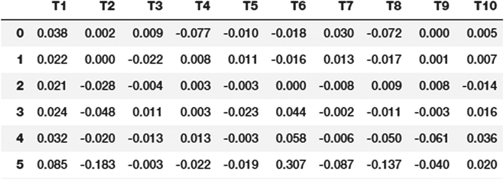

**图 6-2** 我们 LSI 模型生成的文档-主题矩阵

```
document_topics = pd.DataFrame(np.round(topic_document.T, 3),
columns=['T'+str(i) for i in range(1, TOTAL_TOPICS+1)])
document_topics.head(5)
```

忽略符号，我们可以尝试找出几篇示例论文中最重要的主题，并验证其合理性。

```
document_numbers = [13, 250, 500]
for document_number in document_numbers:
top_topics = list(document_topics.columns[np.argsort(-
np.absolute(
document_topics.iloc[document_number].values))[:3]])
print('文档 #'+str(document_number)+':')
print('主导主题（前 3 个）：', top_topics)
print('论文摘要：')
print(papers[document_number][:500])
print()
文档 #13:
主导主题（前 3 个）： ['T6', 'T1', 'T2']
论文摘要：

随机学习网络及其电子实现
Joshua Alspector*, Robert B. Allen, Victor Hut, 以及 Srinagesh Satyanarayana
贝尔通信研究公司，莫里斯敦，新泽西州 07960
摘要
我们描述了一系列学习算法，这些算法运行在一个递归、对称连接的神经形态网络上，类似于玻尔兹曼机，能在存在噪声的情况下达到稳定状态。这些网络通过基于局部观察到的相关性来修改突触连接强度进行学习。
文档 #250:
主导主题（前 3 个）： ['T3', 'T5', 'T8']
论文摘要：
266 Zemel, Mozer 和 Hinton
交通：利用
分层参考框架变换识别对象
Richard S. Zemel
计算机科学系
多伦多大学
...
摘要
我们描述了一个模型，该模型能够识别未分割图像中的二维形状，且与它们的取向无关。
文档 #500:
主导主题（前 3 个）： ['T9', 'T8', 'T10']
论文摘要：
模拟电路参数
设定问题的约束优化
David Kirk, Kurt Fleischer, Lloyd Watts, Alan Bart
计算机图形学 350-74
加州理工学院
摘要
我们使用约束优化来为两个电路选择工作参数：一个简单的三晶体管平方根电路，以及一个模拟 VLSI 人工耳蜗。这种自动化方法使用计算机控制的测量和测试设备来选取芯片参数。
```

如果你查看上述输出中每个所选主题的术语描述，会发现它们非常合理。

-   论文 #13 的主导主题是 6、1 和 2，这些主题主要讨论神经元、细胞、大脑皮层、刺激等方面（围绕神经形态网络的话题）。

-   论文 #250 的主导主题是 3、5 和 8，这些主题讨论对象识别、图像分类以及基于神经网络的可视化表示。这与论文中关于对象识别的主题相符。

-   论文 #500 的主导主题是 9、8 和 10，这些主题讨论信号、电压、芯片、电路等。这与论文中关于模拟电路参数设置的主题一致。

这表明 LSI 模型相当有效，尽管基于正负权重进行解释稍微有点困难，这常常会让人感到困惑。

### 从头实现 LSI 主题模型

基于我们之前提到的，LSI 模型的核心涉及奇异值分解（`SVD`）。在这里，我们尝试使用低秩`SVD`从头实现一个 LSI 主题模型。`SVD`的第一步是获取源矩阵，通常是一个词项-文档矩阵。我们可以通过将稀疏的词袋表示转换为稠密矩阵，从`Gensim`中获取它。

```python
td_matrix = gensim.matutils.corpus2dense(corpus=bow_corpus, num_terms=len(dictionary))
print(td_matrix.shape)
td_matrix
(7756, 1740)
array([[1., 0., 1., ..., 0., 2., 1.],
[1., 0., 1., ..., 1., 1., 0.],
[1., 0., 0., ..., 0., 0., 0.],
...,
[0., 0., 0., ..., 0., 0., 0.],
[0., 0., 0., ..., 0., 0., 0.],
[0., 0., 0., ..., 0., 0., 0.]], dtype=float32)
```

一切似乎都井然有序，因此我们可以使用以下代码来验证我们的词汇表，以确保一切正确无误。

```python
vocabulary = np.array(list(dictionary.values()))
print('Total vocabulary size:', len(vocabulary))
vocabulary
Total vocabulary size: 7756
array(['able', 'abstract', 'accommodate', ..., 'support_vector',
'mozer_jordan', 'kearns_solla'], dtype='<U28')
```

现在，我们利用以下代码片段对我们的词项-文档矩阵执行低秩`SVD`。

```python
from scipy.sparse.linalg import svds
u, s, vt = svds(td_matrix, k=TOTAL_TOPICS, maxiter=10000)
term_topic = u
singular_values = s
topic_document = vt
term_topic.shape, singular_values.shape, topic_document.shape
((7756, 10), (10,), (10, 1740))
```

获取每个主题中每个词项的权重（方向和重要性）也非常简单。以下代码帮助我们进行计算。

```python
tt_weights = term_topic.transpose() * singular_values[:, None]
tt_weights.shape
(10, 7756)
```

现在，我们可以通过以下代码轻松查看我们的 10 个主题及其影响力最大的词项。

```python
top_terms = 20
topic_key_term_idxs = np.argsort(-np.absolute(tt_weights), axis=1)[:, :top_terms]
topic_keyterm_weights = np.array([tt_weights[row, columns]
for row, columns in list(zip(np.arange(TOTAL_TOPICS), topic_key_term_idxs))])
topic_keyterms = vocabulary[topic_key_term_idxs]
topic_keyterms_weights = list(zip(topic_keyterms, topic_keyterm_weights))
for n in range(TOTAL_TOPICS):
    print('Topic #'+str(n+1)+':')
    print('='*50)
    d1 = []
    d2 = []
    terms, weights = topic_keyterms_weights[n]
    term_weights = sorted([(t, w) for t, w in zip(terms, weights)],
                          key=lambda row: -abs(row[1]))
    for term, wt in term_weights:
        if wt >= 0:
            d1.append((term, round(wt, 3)))
        else:
            d2.append((term, round(wt, 3)))
    print('Direction 1:', d1)
    print('-'*50)
    print('Direction 2:', d2)
    print('-'*50)
    print()
```

```
Topic #1:
==================================================
Direction 1: [('training', 92.618), ('task', 80.732), ('pattern', 70.619), ('classifier', 56.989), ('control', 50.677), ('rule', 45.926), ('action', 41.202), ('neuron', 38.193)]

Direction 2: [('word', -188.488), ('vector', -85.973), ('node', -54.376), ('recognition', -53.232), ('sequence', -50.351), ('circuit', -45.394), ('cell', -44.811), ('hmm', -34.086), ('character', -34.022), ('chip', -32.16), ('matrix', -32.093), ('structure', -30.993)]

Topic #2:
==================================================
Direction 1: [('word', 78.347), ('neuron', 69.793), ('stimulus', 63.234), ('feature', 53.819), ('distribution', 53.119), ('response', 30.954), ('state', 29.343), ('probability', 29.099), ('estimate', 28.908)]

Direction 2: [('node', -173.277), ('circuit', -93.0), ('chip', -73.593), ('classifier', -58.717), ('current', -55.844), ('voltage', -53.489), ('control', -51.708), ('rule', -45.293), ('layer', -40.265), ('analog', -38.344), ('tree', -33.483)]

Topic #3:
==================================================
Direction 1: [('pattern', 116.971), ('rule', 69.783), ('state', 68.605), ('class', 64.259), ('cell', 59.979), ('feature', 59.606), ('node', 49.175), ('neuron', 47.998), ('probability', 43.812), ('classifier', 42.612), ('image', 42.061)]

Direction 2: [('signal', -93.805), ('control', -91.041), ('training', -77.88), ('noise', -64.397), ('word', -62.392), ('motion', -56.699), ('task', -53.883), ('target', -44.765), ('circuit', -44.129)]

Topic #4:
==================================================
Direction 1: [('unit', 117.727), ('distribution', 66.719), ('vector', 58.881), ('approximation', 50.931), ('variable', 50.83), ('equation', 46.229), ('noise', 44.247), ('matrix', 42.214)]

Direction 2: [('word', -147.792), ('training', -113.693), ('classifier', -107.386), ('recognition', -73.948), ('feature', -63.454), ('state', -60.126), ('pattern', -59.562), ('cell', -53.768), ('task', -53.693), ('classification', -44.936), ('class', -43.161), ('neuron', -41.092)]

Topic #5:
==================================================
Direction 1: [('neuron', 220.116), ('image', 92.39), ('chip', 44.422), ('unit', 41.922), ('object', 39.001), ('circuit', 30.444), ('memory', 26.475), ('analog', 25.207), ('activation', 24.953), ('bit', 22.997), ('net', 22.699)]

Direction 2: [('cell', -285.803), ('response', -40.216), ('rat', -35.975), ('distribution', -33.085), ('probability', -29.79), ('stimulus', -27.789), ('class', -24.02), ('cortical', -22.185), ('firing', -21.66)]

Topic #6:
==================================================
Direction 1: [('image', 209.793), ('state', 170.207), ('unit', 129.108), ('object', 82.185), ('action', 72.136), ('visual', 59.502), ('motion', 50.605), ('feature', 48.665), ('control', 47.427), ('task', 46.496), ('cell', 42.366), ('representation', 40.564)]

Direction 2: [('neuron', -130.053), ('training', -88.668), ('class', -85.213), ('classifier', -81.921), ('vector', -57.532), ('node', -56.341), ('distribution', -51.622), ('classification', -47.645)]

Topic #7:
==================================================
Direction 1: [('image', 215.858), ('feature', 55.647), ('neuron', 48.494), ('pixel', 35.095), ('object', 33.585), ('state', 32.544), ('distribution', 29.977), ('face', 29.256), ('estimate', 27.555)]

Direction 2: [('unit', -341.829), ('pattern', -90.771), ('layer', -65.337), ('hidden_unit', -61.12), ('net', -60.035), ('training', -56.742), ('activation', -54.268), ('rule', -53.377), ('word', -38.903), ('connection', -34.618), ('architecture', -28.439)]

Topic #8:
==================================================
Direction 1: [('image', 229.287), ('feature', 121.397), ('unit', 79.44), ('object', 76.204), ('training', 75.152), ('classifier', 59.872), ('class', 52.527), ('classification', 46.696), ('layer', 45.149), ('recognition', 44.192), ('representation', 40.179), ('pattern', 39.252)]

Direction 2: [('state', -364.388), ('neuron', -127.022), ('action', -109.245), ('control', -75.369), ('policy', -63.103), ('step', -47.226), ('dynamic', -46.907), ('reinforcement_learning', -42.747)]

Topic #9:
==================================================
Direction 1: [('neuron', 306.151), ('cell', 249.243), ('response', 119.758), ('stimulus', 106.762), ('activity', 73.499), ('spike', 62.039), ('pattern', 60.957), ('circuit', 60.602), ('synaptic', 60.282), ('signal', 56.665), ('firing', 56.597), ('visual', 55.571), ('cortical', 48.867)]

Direction 2: [('state', -161.465), ('training', -117.32), ('class', -68.732), ('vector', -59.558), ('classifier', -52.589), ('action', -52.113), ('word', -49.239)]

Topic #10:
==================================================
Direction 1: []

Direction 2: [('unit', -260.793), ('state', -258.146), ('training', -227.312), ('neuron', -215.681), ('pattern', -197.232), ('image', -175.735), ('vector', -170.154), ('feature', -151.547), ('cell', -148.138), ('layer', -133.593), ('task', -122.389), ('class', -117.849), ('probability', -110.526), ('signal', -108.232), ('step', -105.202), ('response', -104.465), ('representation', -103.255), ('noise', -100.573), ('rule', -99.611), ('distribution', -98.973)]
```

请注意，尽管主题编号有所变动，但它们与先前由 `Gensim` 输出的主题模型结果高度吻合！您还可以尝试使用以下代码，从示例论文中提取有影响力的主题。

# 主题模型分析

## 潜在狄利克雷分配

潜在狄利克雷分配（LDA）技术是一种生成式概率模型，其中每个文档被认为包含多个主题的组合，类似于概率潜在语义索引模型。在这种情况下，潜在主题上存在一个狄利克雷先验分布。该技术背后的数学原理相当复杂，因此我们将尝试对其进行总结，因为深入具体细节超出了当前讨论范围。我们推荐读者阅读由 Christine Doig 在 [`http://chdoig.github.io/pygotham-topic-modeling/#/`](http://chdoig.github.io/pygotham-topic-modeling/#/) 上所做的精彩演讲，我们将从中借鉴一些优秀的图示。LDA 模型的板式表示法如图 6-3 所示。

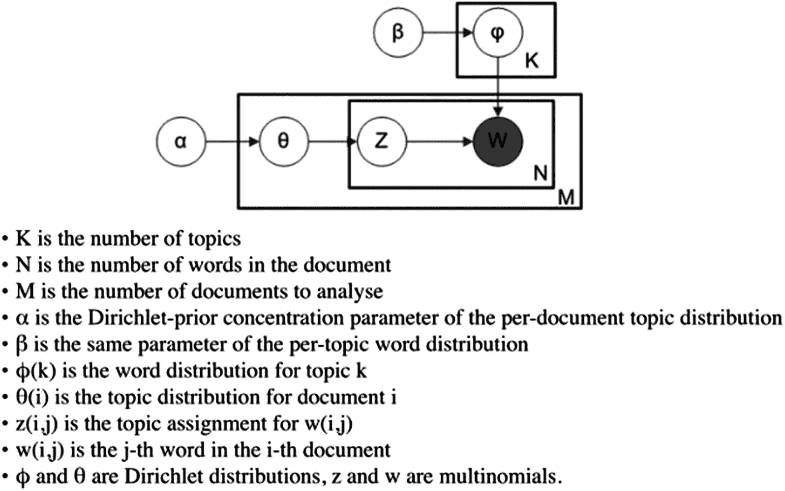

图 6-3 LDA 板式表示法（图片由 C. Doug 提供，源自《Python 主题建模入门》）

关于图 6-3 的更多详细信息，请参阅维基百科官方网站上的文章 [`https://en.wikipedia.org/wiki/Latent_Dirichlet_allocation`](https://en.wikipedia.org/wiki/Latent_Dirichlet_allocation)，其中详细讨论了这些参数。图 6-3 很好地展示了每个参数如何与文本文档和词汇项相关联。该模型假定我们有 **M** 篇文档，文档中有 **N** 个词汇，并要生成 **K** 个主题。

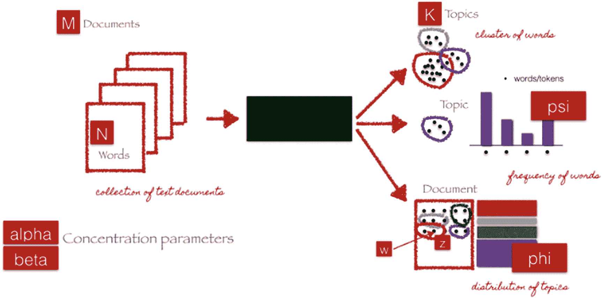

图 6-4 端到端 LDA 框架（图片由 C. Doug 提供，源自《Python 主题建模入门》）

图 6-4 中的黑盒代表了核心算法，它使用前面提及的参数从文档中提取 **K** 个主题。以下步骤给出了该算法运行过程的极简说明，方便大家理解。

1.  初始化必要的参数。
2.  对于每篇文档，将每个词汇随机初始化为 **K** 个主题之一。
3.  开始如下迭代过程，并重复多次。对于每篇文档 **D**，文档中的每个词汇 **W**，以及每个主题 **T**：
    *   计算 `P(T| D)`，即文档 **D** 中分配给主题 **T** 的词汇比例。
    *   计算 `P(W| T)`，即所有包含词汇 **W** 的文档中，分配给主题 **T** 的比例。
    *   以概率 `P(T| D) × P(W| T)` 将词汇 **W** 重新分配为主题 **T**，同时考虑所有其他词汇及其主题分配。

经过多次迭代后，我们就得到了每篇文档的主题混合分布，然后可以从指向某个主题的词汇项中生成该主题的构成要素。这里流行使用的方法被称为*折叠吉布斯采样*。在下面的实现中，我们使用 `Gensim` 基于论文语料库构建一个基于 LDA 的主题模型。

```python
%%time

lda_model = gensim.models.LdaModel(corpus=bow_corpus, id2word=dictionary, chunksize=1740, alpha="auto", eta="auto", random_state=42, iterations=500, num_topics=TOTAL_TOPICS, passes=20, eval_every=None)
```

```
CPU times: user 5min 32s, sys: 10.7 s, total: 5min 43s
Wall time: 2min 31s
```

查看已训练好的主题模型中的主题非常容易，我们可以使用以下代码来生成它们。

```python
for topic_id, topic in lda_model.print_topics(num_topics=10, num_words=20):
    print('主题 #'+str(topic_id+1)+':')
    print(topic)
    print()
```

我们可以清晰地观察到，尽管主题编号发生了变化（因为它们是基于我们的新模型而重新排列的），但每个主题所涉及的核心主题与之前获得的结果高度匹配。显然，`SVD` 是一种非常强大的数学运算，在文档摘要部分，我们将看到更多它的应用！

## 主题-文档分布示例

```python
document_topics = pd.DataFrame(np.round(topic_document.T, 3),
                                columns=['T'+str(i) for i in range(1, TOTAL_TOPICS+1)])

document_numbers = [13, 250, 500]

for document_number in document_numbers:
    top_topics = list(document_topics.columns[np.argsort(-
        np.absolute(
            document_topics.iloc[document_number].values))[:3]])
    print('Document #'+str(document_number)+':')
    print('Dominant Topics (top 3):', top_topics)
    print('Paper Summary:')
    print(papers[document_number][:500])
    print()
```

```
Document #13:
Dominant Topics (top 3): ['T5', 'T10', 'T9']
Paper Summary:
Stochastic Learning Networks and their Electronic Implementation
Joshua Alspector*, Robert B. Allen, Victor Hut, and Srinagesh Satyanarayana
Bell Communications Research, Morristown, NJ 07960
ABSTRACT
We describe a family of learning algorithms that operate on a recurrent, symmetrically connected, neuromorphic network that, like the Boltzmann machine

Document #250:
Dominant Topics (top 3): ['T6', 'T8', 'T3']
Paper Summary:
266 Zemel, Mozer and Hinton
TRAFFIC: Recognizing Objects Using
Hierarchical Reference Frame Transformations
Richard S. Zemel
Computer Science Dept.
University of Toronto
...
ABSTRACT
We describe a model that can recognize two-dimensional shapes in
an unsegmented image, independent of their orie

Document #500:
Dominant Topics (top 3): ['T2', 'T3', 'T1']
Paper Summary:
Constrained Optimization Applied to the
Parameter Setting Problem for Analog Circuits
David Kirk, Kurt Fleischer, Lloyd Watts, Alan Bart
...
Abstract
We use constrained optimization to select operating parameters for two
circuits: a simple 3-transistor square root circuit, and an analog VLSI
artificial cochlea.
```

### 主题 #1
`0.016*"训练" + 0.012*"分类器" + 0.007*"模式" + 0.007*"分类" + 0.006*"类别" + 0.006*"任务" + 0.006*"向量" + 0.005*"训练集" + 0.005*"特征" + 0.004*"控制" + 0.004*"规模" + 0.003*"已训练" + 0.003*"教师" + 0.003*"比率" + 0.003*"学生" + 0.003*"平均值" + 0.003*"机器人" + 0.003*"随机" + 0.003*"规则" + 0.003*"搜索"`

### 主题 #2
`0.008*"向量" + 0.006*"方程" + 0.006*"矩阵" + 0.006*"神经元" + 0.005*"状态" + 0.005*"动态" + 0.005*"解" + 0.005*"单元" + 0.004*"节点" + 0.004*"模式" + 0.004*"线性" + 0.004*"令" + 0.003*"层" + 0.003*"收敛" + 0.003*"规则" + 0.003*"规模" + 0.003*"定理" + 0.003*"阈值" + 0.003*"记忆" + 0.003*"理论"`

### 主题 #3
`0.017*"训练" + 0.011*"词" + 0.008*"识别" + 0.007*"已训练" + 0.006*"网络" + 0.006*"单元" + 0.006*"特征" + 0.006*"语音" + 0.006*"任务" + 0.005*"架构" + 0.005*"类别" + 0.005*"字符" + 0.004*"层" + 0.004*"分类" + 0.004*"上下文" + 0.004*"测试" + 0.004*"序列" + 0.004*"隐藏单元" + 0.004*"实验" + 0.004*"向量"`

### 主题 #4
`0.017*"运动" + 0.009*"规则" + 0.008*"方向" + 0.007*"刺激" + 0.006*"速度" + 0.006*"任务" + 0.006*"人类" + 0.006*"单元" + 0.005*"位置" + 0.005*"目标" + 0.005*"受试者" + 0.005*"记忆" + 0.005*"预测" + 0.005*"方位" + 0.004*"概念" + 0.004*"场" + 0.004*"响应" + 0.004*"线索" + 0.004*"层" + 0.004*"手"`

### 主题 #5
`0.008*"分布" + 0.005*"估计" + 0.005*"样本" + 0.005*"训练" + 0.005*"类别" + 0.005*"概率" + 0.005*"近似" + 0.004*"变量" + 0.004*"高斯" + 0.004*"线性" + 0.004*"向量" + 0.004*"先验" + 0.004*"噪声" + 0.004*"密度" + 0.004*"预测" + 0.003*"核函数" + 0.003*"方差" + 0.003*"混合" + 0.003*"边界" + 0.003*"回归"`

### 主题 #6
`0.037*"状态" + 0.011*"动作" + 0.008*"步" + 0.008*"控制" + 0.007*"策略" + 0.006*"序列" + 0.006*"强化学习" + 0.005*"概率" + 0.005*"最优" + 0.004*"任务" + 0.004*"转移" + 0.004*"环境" + 0.003*"变量" + 0.003*"奖励" + 0.003*"随机" + 0.003*"目标" + 0.003*"机器" + 0.003*"当前" + 0.003*"控制器" + 0.003*"智能体"`

### 主题 #7
`0.012*"电路" + 0.011*"信号" + 0.011*"芯片" + 0.009*"神经元" + 0.008*"电流" + 0.007*"电压" + 0.006*"模拟" + 0.006*"控制" + 0.005*"通道" + 0.004*"噪声" + 0.004*"神经" + 0.004*"比特" + 0.004*"实现" + 0.004*"源" + 0.003*"设计" + 0.003*"增益" + 0.003*"处理器" + 0.003*"突触" + 0.003*"设备" + 0.003*"阵列"`

### 主题 #8
`0.021*"神经元" + 0.019*"细胞" + 0.009*"响应" + 0.007*"活动" + 0.007*"刺激" + 0.007*"模式" + 0.006*"尖峰" + 0.005*"突触" + 0.004*"皮层" + 0.004*"神经" + 0.004*"信号" + 0.004*"放电" + 0.004*"连接" + 0.004*"效应" + 0.004*"层" + 0.004*"等人" + 0.004*"皮质" + 0.003*"视觉" + 0.003*"模拟" + 0.003*"突触"`

### 主题 #9
`0.032*"图像" + 0.012*"物体" + 0.012*"特征" + 0.006*"像素" + 0.006*"视觉" + 0.005*"表示" + 0.005*"人脸" + 0.005*"向量" + 0.004*"视角" + 0.004*"识别" + 0.004*"变换" + 0.004*"局部" + 0.003*"映射" + 0.003*"结构" + 0.003*"区域" + 0.003*"滤波器" + 0.003*"位置" + 0.003*"距离" + 0.003*"部分" + 0.003*"地点"`

### 主题 #10
`0.030*"单元" + 0.009*"模式" + 0.007*"表示" + 0.007*"激活" + 0.006*"隐藏单元" + 0.006*"节点" + 0.006*"结构" + 0.006*"层" + 0.005*"活动" + 0.004*"连接" + 0.004*"任务" + 0.004*"组件" + 0.004*"映射" + 0.004*"规则" + 0.004*"架构" + 0.004*"信号" + 0.004*"层级" + 0.003*"响应" + 0.003*"连接主义" + 0.003*"训练"`

与 LSI 模型相比，这些主题明显更容易理解和解释，因为所有权重符号相同，能够告诉我们每个词在主题中的重要性。我们还可以查看模型的总体平均连贯性得分。

```python
topics_coherences = lda_model.top_topics(bow_corpus, topn=20)
avg_coherence_score = np.mean([item[1] for item in topics_coherences])
print('平均连贯性得分:', avg_coherence_score)
```

# 主题连贯性框架

`平均连贯性得分: -1.0433305600965899`

主题连贯性本身就是一个复杂的话题，它可以在一定程度上用于衡量主题模型的质量。通常，如果一组陈述能够相互支持，则称其具有连贯性。主题模型是基于无监督学习的模型，它们在非结构化文本数据上进行训练，因此很难衡量输出结果的质量。关于主题连贯性框架的优质资源是 Michael Röder 等人的论文《探索主题连贯性度量空间》，您可以在[`http://svn.aksw.org/papers/2015/WSDM_Topic_Evaluation/public.pdf`](http://svn.aksw.org/papers/2015/WSDM_Topic_Evaluation/public.pdf)访问。同样的框架已在`Gensim`框架中以 Python 实现。Devashish 在[`https://rare-technologies.com/what-is-topic-coherence`](https://rare-technologies.com/what-is-topic-coherence)提供了详细的文章，他将这一简洁功能实现在了`Gensim`中！

我用他同样易于理解的类比来简要说明主题连贯性框架：假设我们有一个水源，水被分配给不同的人。要测量水质，我们必须依赖个别顾客的评价。现在假设我们有四个主要的配水枢纽，我们在四个水管上安装了一些设备，这些水管负责在每个枢纽中配水。这些设备帮助我们通过量化指标测量水质，从而节省了依赖主观评价的时间。现在将这个类比应用到主题模型中：水基本上就是我们从主题模型中获取的主题，而主题连贯性框架就是我们安装的设备，用于对主题质量进行定量评估。正如我们之前提到的研究论文所定义，这个连贯性框架是一个四阶段流水线，如图 6-5 所示。

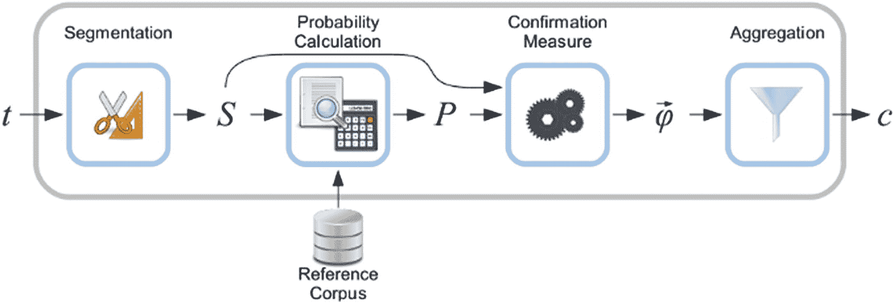

**图 6-5** 主题模型的统一连贯性框架

图 6-5 所示的主题连贯性框架流水线中的四个主要阶段描述如下：

## 1. 分割
这一阶段类似于我们将水分成若干杯，假设每杯水的质量不同。在这里，主题中的单词被分成子集，并创建词语对。

## 2. 概率计算
测量每杯水的水量。概率计算或估计的方法定义了如何从底层数据中推导出概率。布尔文档估计通过用单词出现的文档数除以总文档数来估计单个单词的概率。类似地，两个单词的联合概率通过包含这两个单词的文档数除以总文档数来估计。布尔滑动窗口则使用滑动窗口来确定单词计数。

## 3. 确认度量
水杯中水的质量（基于某个指标）被测量，并根据其数量为每个杯子分配一个数值。在主题模型的背景下，确认度量接受一对单词或单词子集及其相应的概率，并计算条件词集对另一词的支持强度。通常有两种类型的度量——外部度量和内部度量。

- **直接或外部度量：** 最流行的一种是 `UCI` 度量。它使用点互信息（`PMI`）作为成对评分函数。在该研究论文中，他们提出了一种直接度量`C[p]`，该度量取得了最佳性能（详情见论文）。
- **间接或内部度量：** 间接确认度量声称能够捕捉到直接度量会遗漏的语义支持。最流行的度量之一是 `UMass` 度量，它使用以下评分函数：

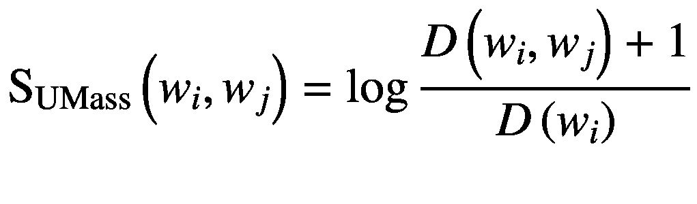

其中`D(w)`是词`w`的文档频率。该评分本质上是经验条件对数概率：

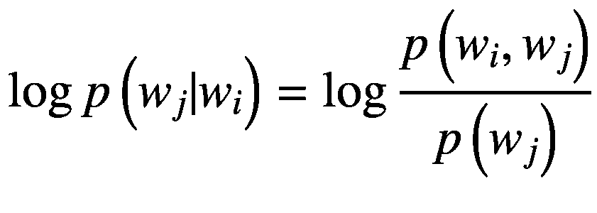

通过对分子中的文档频率加 1 进行平滑处理。研究论文声称发现了一个新的度量`C[v]`，它是间接余弦度量、`NPMI`和布尔滑动窗口的组合，取得了最佳结果。该度量在 Gensim 中也可用。

## 4. 聚合
这是将这些质量数值以某种方式（例如，算术平均值）组合起来得出一个定量指标的环节。每个主题的所有子集词对的确认度量被聚合并给出一个单一的连贯性分数。就像我们在之前的输出（`UMass`度量）中得到平均连贯性分数为-1.04 一样。

这为你评估和调整主题模型提供了足够的背景信息。现在，让我们以更易于理解的格式查看我们的`LDA`主题模型输出。一种方法是将主题可视化为词项和权重的元组。

```python
topics_with_wts = [item[0] for item in topics_coherences]

print('LDA Topics with Weights')

print('='*50)

for idx, topic in enumerate(topics_with_wts):

print('Topic #'+str(idx+1)+':')

print([(term, round(wt, 3)) for wt, term in topic])

print()
```

```
LDA Topics with Weights

==================================================

Topic #1:

[('training', 0.017), ('word', 0.011), ('recognition', 0.008), ('trained', 0.007), ('net', 0.006), ('unit', 0.006), ('feature', 0.006), ('speech', 0.006), ('task', 0.006), ('architecture', 0.005), ('class', 0.005), ('character', 0.005), ('layer', 0.004), ('classification', 0.004), ('context', 0.004), ('test', 0.004), ('sequence', 0.004), ('hidden_unit', 0.004), ('experiment', 0.004), ('vector', 0.004)]

Topic #2:

[('unit', 0.03), ('pattern', 0.009), ('representation', 0.007), ('activation', 0.007), ('hidden_unit', 0.006), ('node', 0.006), ('structure', 0.006), ('layer', 0.006), ('activity', 0.005), ('connection', 0.004), ('task', 0.004), ('component', 0.004), ('map', 0.004), ('rule', 0.004), ('architecture', 0.004), ('signal', 0.004), ('level', 0.004), ('response', 0.003), ('connectionist', 0.003), ('training', 0.003)]

...,

...,

Topic #8:

[('state', 0.037), ('action', 0.011), ('step', 0.008), ('control', 0.008), ('policy', 0.007), ('sequence', 0.006), ('reinforcement_learning', 0.006), ('probability', 0.005), ('optimal', 0.005), ('task', 0.004), ('transition', 0.004), ('environment', 0.004), ('variable', 0.003), ('reward', 0.003), ('stochastic', 0.003), ('goal', 0.003), ('machine', 0.003), ('current', 0.003), ('controller', 0.003), ('agent', 0.003)]

Topic #9:
```

# LDA Topics without Weights

我们还可以将主题视为不包含权重的词项列表，以便理解每个主题传达的背景或主题。

```python
print('LDA Topics without Weights')
print('='*50)
for idx, topic in enumerate(topics_with_wts):
    print('Topic #'+str(idx+1)+':')
    print([term for wt, term in topic])
    print()
```

```
LDA Topics without Weights
==================================================
Topic #1:
['training', 'word', 'recognition', 'trained', 'net', 'unit', 'feature', 'speech', 'task', 'architecture', 'class', 'character', 'layer', 'classification', 'context', 'test', 'sequence', 'hidden_unit', 'experiment', 'vector']
Topic #2:
['unit', 'pattern', 'representation', 'activation', 'hidden_unit', 'node', 'structure', 'layer', 'activity', 'connection', 'task', 'component', 'map', 'rule', 'architecture', 'signal', 'level', 'response', 'connectionist', 'training']
...,
...,
Topic #8:
['state', 'action', 'step', 'control', 'policy', 'sequence', 'reinforcement_learning', 'probability', 'optimal', 'task', 'transition', 'environment', 'variable', 'reward', 'stochastic', 'goal', 'machine', 'current', 'controller', 'agent']
Topic #9:
['motion', 'rule', 'direction', 'stimulus', 'velocity', 'task', 'human', 'unit', 'location', 'target', 'subject', 'memory', 'prediction', 'position', 'concept', 'field', 'response', 'cue', 'layer', 'hand']
Topic #10:
['circuit', 'signal', 'chip', 'neuron', 'current', 'voltage', 'analog', 'control', 'channel', 'noise', 'neural', 'bit', 'implementation', 'source', 'design', 'gain', 'processor', 'synapse', 'device', 'array']
```

我们可以使用困惑度和连贯性分数作为评估主题模型的指标。通常，困惑度越低，模型越好。类似地，在连贯性中，`UMass`分数越低且`Cv`分数越高，模型越好。

```python
cv_coherence_model_lda = gensim.models.CoherenceModel(model=lda_model, corpus=bow_corpus,
                                                      texts=norm_corpus_bigrams,
                                                      dictionary=dictionary,
                                                      coherence='c_v')
avg_coherence_cv = cv_coherence_model_lda.get_coherence()

umass_coherence_model_lda = gensim.models.CoherenceModel(model=lda_model, corpus=bow_corpus,
                                                         texts=norm_corpus_bigrams,
                                                         dictionary=dictionary,
                                                         coherence='u_mass')
avg_coherence_umass = umass_coherence_model_lda.get_coherence()

perplexity = lda_model.log_perplexity(bow_corpus)

print('Avg. Coherence Score (Cv):', avg_coherence_cv)
print('Avg. Coherence Score (UMass):', avg_coherence_umass)
print('Model Perplexity:', perplexity)
```

```
Avg. Coherence Score (Cv): 0.47028476052247825
Avg. Coherence Score (UMass): -1.0433305600965896
Model Perplexity: -7.792233498252204
```

还不错，但我们没有与之比较的基准。让我们尝试基于一个名为`MALLET`的独立包构建另一个`LDA`主题模型，该包具有`Gensim`包装器，可以方便地从 Python 使用！

## 使用 MALLET 构建 LDA 模型

`MALLET` 框架是一个基于 Java 的软件包，用于统计自然语言处理、文档分类、聚类、主题建模、信息提取以及其他文本机器学习应用。`MALLET` 是 *MAchine Learning for LanguagE Toolkit*（语言工具包机器学习）的缩写。它由 Andrew McCallum 与马萨诸塞大学阿默斯特分校的几位研究人员共同开发。`MALLET` 主题建模工具包包含了基于采样的高效实现，用于**潜在狄利克雷分配（LDA）**、**Pachinko 分配**和**层次化 LDA**。要使用 `MALLET` 的功能，我们需要先下载该框架。

```bash
!wget http://mallet.cs.umass.edu/dist/mallet-2.0.8.zip
```

```
--2018-11-08 20:06:13--  http://mallet.cs.umass.edu/dist/mallet-2.0.8.zip
正在解析主机 mallet.cs.umass.edu (mallet.cs.umass.edu)... 128.119.246.70
正在连接 mallet.cs.umass.edu (mallet.cs.umass.edu)|128.119.246.70|:80... 已连接。
已发出 HTTP 请求，正在等待响应... 200 OK
长度：16184794 (15M) [application/zip]
正在保存至: 'mallet-2.0.8.zip'
```

# MALLET 安装与 LDA 模型构建

## 下载与安装

```
mallet-2.0.8.zip    100%[===================>]  15.43M  1.35MB/s    用时 12s

2018-11-08 20:06:25 (1.28 MB/s) - 已保存 'mallet-2.0.8.zip' [16184794/16184794]
```

Windows 用户可以直接通过浏览器，使用上述代码中相同的 URL 下载该软件包。下载完成后，我们需要解压存档文件中的内容。

```bash
!unzip -q mallet-2.0.8.zip
```

## 构建 LDA 模型

现在，我们已准备好使用 `MALLET` 构建 LDA 模型。如果你的计算机有多个 CPU，`Gensim` 也可以利用它们进行并行处理以加速训练。

```python
MALLET_PATH = 'mallet-2.0.8/bin/mallet'

lda_mallet = gensim.models.wrappers.LdaMallet(mallet_path=MALLET_PATH, corpus=bow_corpus,
                                               num_topics=TOTAL_TOPICS, id2word=dictionary,
                                               iterations=500, workers=16)
```

## 查看主题

现在，我们可以利用以下代码片段查看生成的各个主题。

```python
topics = [[(term, round(wt, 3))
           for term, wt in lda_mallet.show_topic(n, topn=20)]
          for n in range(0, TOTAL_TOPICS)]

for idx, topic in enumerate(topics):
    print('Topic #'+str(idx+1)+':')
    print([term for term, wt in topic])
    print()
```

```
Topic #1:
['neuron', 'cell', 'response', 'stimulus', 'activity', 'pattern', 'signal', 'spike', 'effect', 'synaptic', 'frequency', 'neural', 'unit', 'connection', 'layer', 'cortical', 'firing', 'et_al', 'brain', 'temporal']

Topic #2:
['prediction', 'control', 'trajectory', 'target', 'task', 'expert', 'training', 'nonlinear', 'dynamic', 'linear', 'local', 'change', 'adaptive', 'mapping', 'hand', 'movement', 'controller', 'position', 'motor', 'architecture']

...,

...,

Topic #9:
['training', 'unit', 'pattern', 'hidden_unit', 'layer', 'net', 'classifier', 'class', 'training_set', 'classification', 'trained', 'test', 'task', 'back_propagation', 'hidden_layer', 'table', 'generalization', 'feature', 'size', 'architecture']

Topic #10:
['word', 'recognition', 'speech', 'sequence', 'feature', 'context', 'training', 'character', 'hmm', 'module', 'signal', 'letter', 'frame', 'trained', 'experiment', 'classification', 'architecture', 'speaker', 'window', 'class']
```

## 模型评估

我们还可以像之前一样，使用困惑度和一致性指标来评估模型。

```python
cv_coherence_model_lda_mallet = gensim.models.CoherenceModel(model=lda_mallet,
                                                             corpus=bow_corpus,
                                                             texts=norm_corpus_bigrams,
                                                             dictionary=dictionary,
                                                             coherence='c_v')
avg_coherence_cv = cv_coherence_model_lda_mallet.get_coherence()

umass_coherence_model_lda_mallet = gensim.models.CoherenceModel(model=lda_mallet,
                                                                 corpus=bow_corpus,
                                                                 texts=norm_corpus_bigrams,
                                                                 dictionary=dictionary,
                                                                 coherence='u_mass')
avg_coherence_umass = umass_coherence_model_lda_mallet.get_coherence()
```

# 来自标准输出: LL/token: -8.53533

`perplexity = -8.53533`

`print('Avg. Coherence Score (Cv):', avg_coherence_cv)`

`print('Avg. Coherence Score (UMass):', avg_coherence_umass)`

`print('Model Perplexity:', perplexity)`

`Avg. Coherence Score (Cv): 0.5008326905758488`

`Avg. Coherence Score (UMass): -1.0635635291342118`

`Model Perplexity: -8.53533`

你可以清晰地看到，根据这些指标，来自 `MALLET` 的模型远优于 `Gensim` 的默认 LDA 模型。我们能否找到使一致性最大化的最优主题数量？这是一个棘手的问题，但我们可以尝试迭代解决。

## LDA 调优：寻找最优主题数量

在主题模型中寻找最优主题数量很困难，因为它就像一个模型超参数，你始终需要在训练模型前进行设置。我们可以采用迭代方法，构建多个具有不同主题数量的模型，然后选择一致性得分最高的那个。为了实现此方法，我们构建以下函数。

```python
from tqdm import tqdm

def topic_model_coherence_generator(corpus, texts, dictionary,
                                    start_topic_count=2, end_topic_count=10, step=1,
                                    cpus=1):
    models = []
    coherence_scores = []
    for topic_nums in tqdm(range(start_topic_count, end_topic_count+1, step)):
        mallet_lda_model = gensim.models.wrappers.LdaMallet(mallet_path=MALLET_PATH,
                                                             corpus=corpus,
                                                             num_topics=topic_nums,
                                                             id2word=dictionary,
                                                             iterations=500, workers=cpus)
        cv_coherence_model_mallet_lda = gensim.models.CoherenceModel(model=mallet_lda_model,
                                                                     corpus=corpus,
                                                                     texts=texts,
                                                                     dictionary=dictionary,
                                                                     coherence='c_v')
        coherence_score = cv_coherence_model_mallet_lda.get_coherence()
        coherence_scores.append(coherence_score)
        models.append(mallet_lda_model)
    return models, coherence_scores
```

现在让我们运行这个函数，构建几个主题数量从 2 到 30 的主题模型。

```python
lda_models, coherence_scores = topic_model_coherence_generator(corpus=bow_corpus,
                                                               texts=norm_corpus_bigrams,
                                                               dictionary=dictionary,
                                                               start_topic_count=2,
                                                               end_topic_count=30, step=1,
                                                               cpus=16)
100%|██████████| 29/29 [37:48<00:00, 92.53s/it]
```

注意，这一步可能需要一些时间来训练，具体取决于你的硬件基础设施，因为我们将训练多个主题模型。检查输出的一种方法是按一致性得分对结果进行排序，并查看对应的主题数量。参见图 6-6。

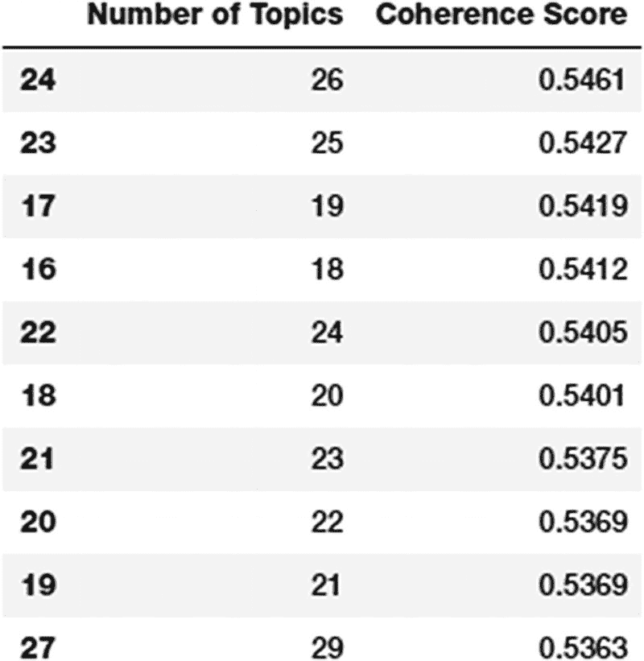

图 6-6 根据一致性得分对主题模型进行排序

```python
coherence_df = pd.DataFrame({'Number of Topics': range(2, 31, 1),
                             'Coherence Score': np.round(coherence_scores, 4)})
coherence_df.sort_values(by=['Coherence Score'], ascending=False).head(10)
```

让我们绘制一张图表，展示每个模型的主题数量及其对应的一致性得分。

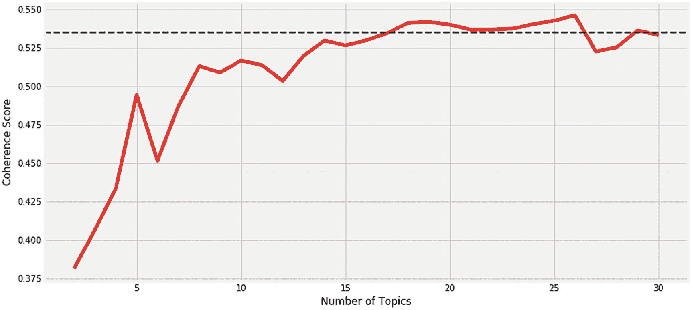

图 6-7 主题模型调优：主题数量与一致性得分对比

```python
import matplotlib.pyplot as plt
plt.style.use('fivethirtyeight')
%matplotlib inline

x_ax = range(2, 31, 1)
y_ax = coherence_scores
plt.figure(figsize=(12, 6))
plt.plot(x_ax, y_ax, c="r")
plt.axhline(y=0.535, c="k", linestyle="--", linewidth=2)
plt.rcParams['figure.facecolor'] = 'white'
xl = plt.xlabel('Number of Topics')
yl = plt.ylabel('Coherence Score')
```

从图 6-7 可以看出，当主题数量为 5 时，得分开始快速上升，并在 19 或 20 时逐渐趋于平稳。基于我们的直觉，我们选择 20 作为最优主题数量。现在我们可以检索出最佳模型：

```python
best_model_idx = coherence_df[coherence_df['Number of Topics'] == 20].index[0]
best_lda_model = lda_models[best_model_idx]
best_lda_model.num_topics
```

让我们查看所选最佳模型生成的所有 20 个主题，方法与之前的模型类似。

```python
topics = [[(term, round(wt, 3))
           for term, wt in best_lda_model.show_topic(n, topn=20)]
          for n in range(0, best_lda_model.num_topics)]

for idx, topic in enumerate(topics):
    print('Topic #'+str(idx+1)+':')
    print([term for term, wt in topic])
    print()

Topic #1:
['class', 'classification', 'classifier', 'training', 'pattern', 'feature', 'kernel', 'machine', 'training_set', 'test', 'sample', 'vector', 'database', 'error_rate', 'margin', 'experiment', 'support_vector', 'nearest_neighbor', 'decision', 'size']
...,
Topic #8:
['distribution', 'probability', 'prior', 'gaussian', 'variable', 'mixture', 'density', 'bayesian', 'estimate', 'approximation', 'log', 'likelihood', 'sample', 'component', 'expert', 'em', 'posterior', 'probabilistic', 'estimation', 'entropy']
Topic #9:
['visual', 'motion', 'cell', 'response', 'stimulus', 'direction', 'receptive_field', 'map', 'spatial', 'orientation', 'unit', 'eye', 'field', 'activity', 'location', 'velocity', 'center', 'contrast', 'cortical', 'pattern']
...,
Topic #13:
```

['image', 'object', 'feature', 'pixel', 'face', 'view', 'recognition', 'representation', 'shape', 'scale', 'part', 'visual', 'region', 'position', 'scene', 'surface', 'vision', 'frame', 'texture', 'location']

Topic #14:

['control', 'action', 'state', 'policy', 'environment', 'controller', 'reinforcement_learning', 'task', 'optimal', 'robot', 'goal', 'step', 'reward', 'td', 'agent', 'adaptive', 'cost', 'reinforcement', 'trial', 'exploration']

...,

Topic #16:

['circuit', 'chip', 'current', 'analog', 'voltage', 'implementation', 'processor', 'bit', 'design', 'device', 'computation', 'parallel', 'digital', 'operation', 'array', 'neural', 'synapse', 'element', 'hardware', 'transistor']

Topic #17:

['rule', 'representation', 'module', 'structure', 'human', 'movement', 'motor', 'target', 'language', 'subject', 'connectionist', 'position', 'task', 'context', 'trajectory', 'hand', 'role', 'symbol', 'learned', 'theory']

Topic #18:

['vector', 'map', 'distance', 'cluster', 'local', 'dimension', 'clustering', 'mapping', 'dimensional', 'region', 'structure', 'center', 'rbf', 'pca', 'basis_function', 'linear', 'representation', 'global', 'principal_component', 'projection']

Topic #19:

['signal', 'filter', 'frequency', 'source', 'channel', 'noise', 'component', 'response', 'temporal', 'sound', 'auditory', 'detection', 'phase', 'ica', 'adaptation', 'amplitude', 'subject', 'eeg', 'change', 'correlation']

Topic #20:

['prediction', 'training', 'estimate', 'regression', 'test', 'noise', 'selection', 'variance', 'training_set', 'sample', 'ensemble', 'estimation', 'average', 'nonlinear', 'linear', 'estimator', 'cross_validation', 'pruning', 'bias', 'risk']

可视化主题的一个更好方法是构建一个术语-主题数据框，如图 6-8 所示。

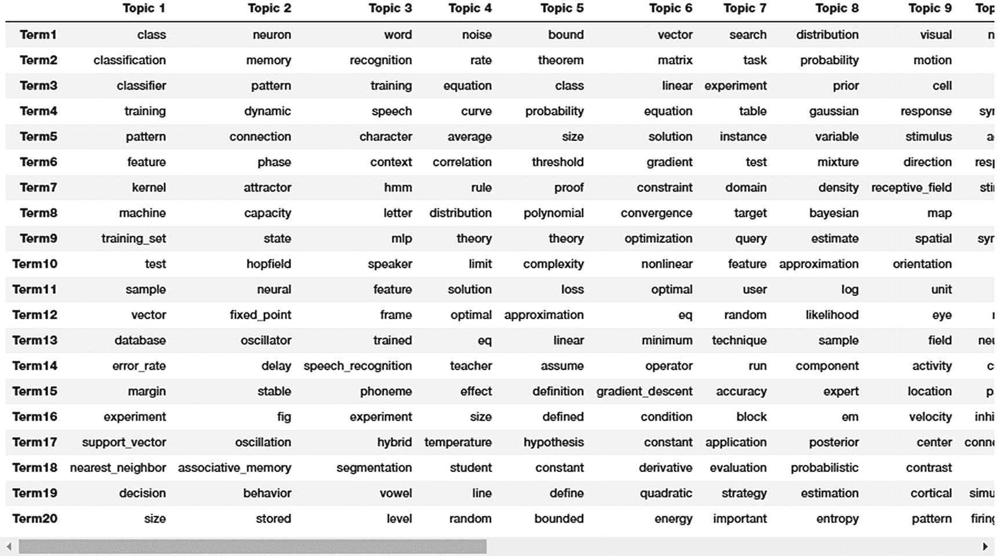

图 6-8 从我们的 LDA 主题模型中生成的主题

```python
topics_df = pd.DataFrame([[term for term, wt in topic]
                          for topic in topics],
                         columns = ['Term'+str(i) for i in range(1, 21)],
                         index=['Topic '+str(t) for t in range(1, best_lda_model.num_topics+1)]).T
topics_df
```

另一个查看主题的简单方法是创建一个主题-术语数据框，其中每个主题以行的形式呈现，该主题的术语则表示为逗号分隔的字符串。

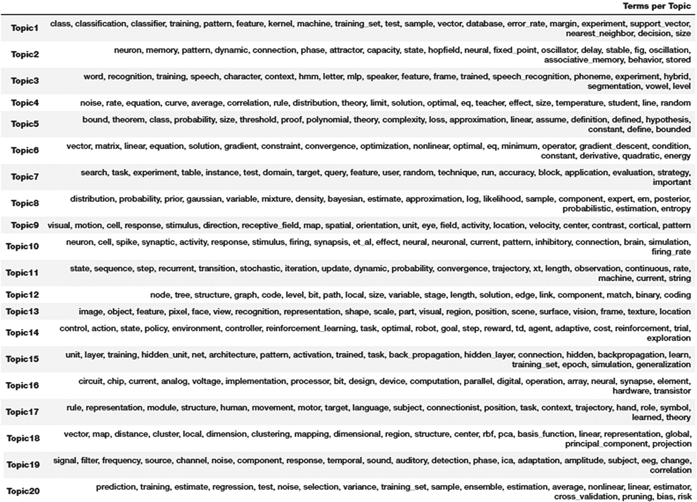

图 6-9 查看 LDA 主题模型的所有主题

```python
pd.set_option('display.max_colwidth', -1)
topics_df = pd.DataFrame([', '.join([term for term, wt in topic])
                          for topic in topics],
                         columns = ['Terms per Topic'],
                         index=['Topic'+str(t) for t in range(1, best_lda_model.num_topics+1)]
                        )
topics_df
```

图 6-9 中展示的数据框为我们提供了一种简单的方式来可视化和理解研究论文语料库中的主要主题。你是否注意到任何有趣的模式？我观察到了一些非常有趣的主题，涉及神经网络、信号处理、降维、强化学习、芯片上的神经模型，以及图像和视觉识别！

## 解读主题模型结果

让我们来看一些有趣的方法，来深入探索并解读主题模型的结果。需要记住一个有趣的点：给定一个文档语料库（以特征形式，例如词袋）和一个训练好的主题模型，你可以使用以下代码预测每个文档（这里指研究论文）的主题分布。

```python
tm_results = best_lda_model[bow_corpus]
```

现在，我们可以利用下面的代码，通过一些巧妙的排序和索引，为每篇研究论文找出最主导的主题。

```python
corpus_topics = [sorted(topics, key=lambda record: -record[1])[0]
                 for topics in tm_results]
corpus_topics[:5]
[(16, 0.2115988756613756),
 (5, 0.29989652050187554),
 (9, 0.3307915758896151),
 (8, 0.5447463768115942),
 (9, 0.18093823158652983)]
```

这提供了丰富的选项，可用于从我们的研究论文语料库中提取有用的见解。为了实现这一点，我们构建一个主数据框来保存基础统计数据，稍后我们将用它来呈现不同的有用见解。

```python
corpus_topic_df = pd.DataFrame()
corpus_topic_df['Document'] = range(0, len(papers))
corpus_topic_df['Dominant Topic'] = [item[0]+1 for item in corpus_topics]
corpus_topic_df['Contribution %'] = [round(item[1]*100, 2) for item in corpus_topics]
corpus_topic_df['Topic Desc'] = [topics_df.iloc[t[0]]['Terms per Topic'] for t in corpus_topics]
corpus_topic_df['Paper'] = papers
```

现在，让我们看看有哪些不同的方法可以转换这些结果，并从我们的研究论文及其主题中提取有意义的见解。

### 语料库中主导主题的分布

我们首先可以查看每个主题在整个研究论文语料库中的总体分布。主要是想确定论文总数，以及 20 个主题中每个主题作为最主导主题的论文百分比。

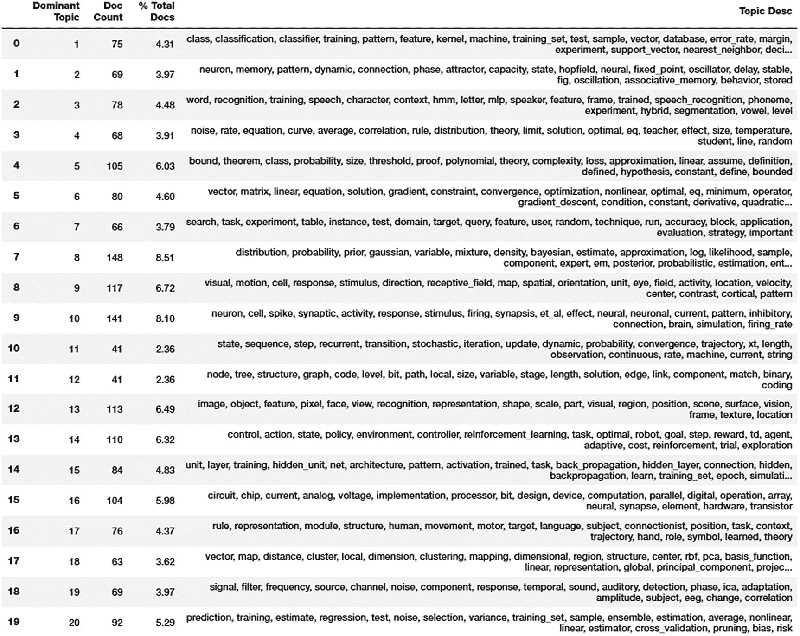

图 6-10 查看主导主题的分布

```python
pd.set_option('display.max_colwidth', 200)
topic_stats_df = corpus_topic_df.groupby('Dominant Topic').agg({
    'Dominant Topic': {
```

### 特定研究论文中的主导主题

另一个有趣的视角是选取特定的论文，查看每篇论文中的最主导主题，并判断其是否合理。

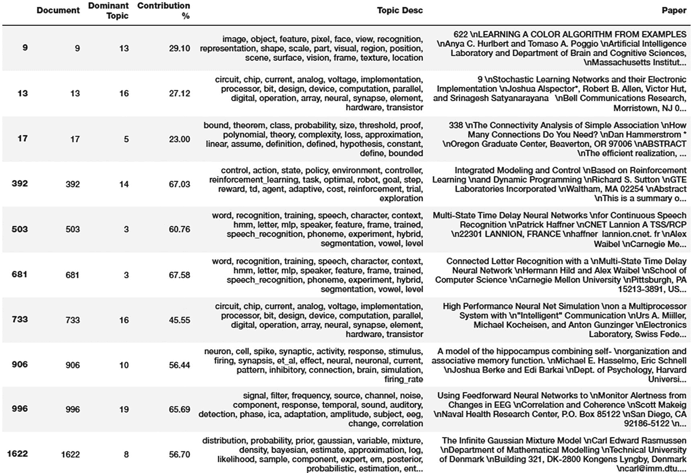

```python
pd.set_option('display.max_colwidth', 200)

(corpus_topic_df[corpus_topic_df['Document']
.isin([681, 9, 392, 1622, 17,
906, 996, 503, 13, 733])])
```

根据图 6-11 的结果，我们可以看到这些结果完全合理！关于强化学习、信号处理、高斯混合模型、处理器仿真、词汇识别等论文，其对应的相关主题都作为最主导主题出现。这告诉我们，我们的主题模型运行良好。

### 基于主导性为每个主题寻找相关研究论文

更好的表示方式是尝试为 20 个主题中的每个主题，检索出具有最高代表性的研究论文。

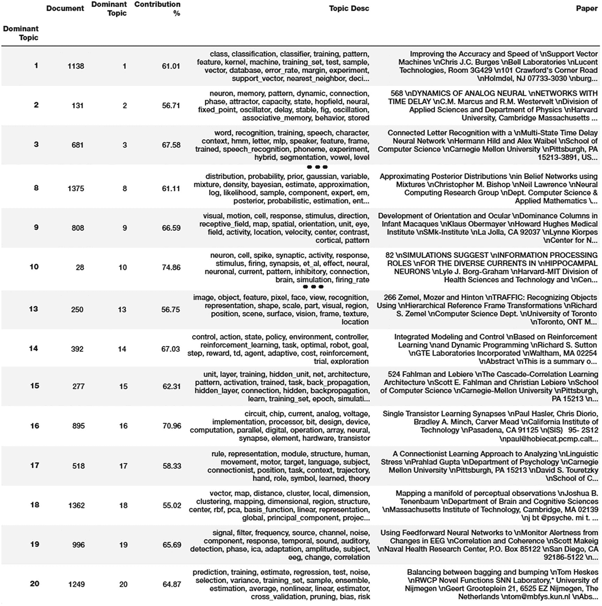

```python
corpus_topic_df.groupby('Dominant Topic').apply(lambda topic_set:
(topic_set.sort_values(by=['Contribution %'],
ascending=False).iloc[0]))
```

由于篇幅限制，我们没有在图 6-12 中展示所有主题，但您已经理解了思路，并且可以在 Jupyter notebook 中查看完整输出。您甚至可以基于索引打开每篇研究论文并阅读全文，以判断其是否合理！根据图 6-12 中展示的论文标题和对应主题，它们确实是合理的。看来我们的模型已经捕捉到了语料库中相关的潜在模式和主题。

### 预测新研究论文的主题

尽管主题模型是无监督模型，但我们可以基于模型在所谓的“训练”语料库上先前学习到的知识，来估计或预测新文档的潜在主题。为了测试我们的模型，我手动从 NIPS 16 会议论文集中下载了一些近期论文。在这些论文上测试我们的模型将是一项有趣的练习。

```python
import glob
```

# papers manually downloaded from NIPS 16

# [NeurIPS 2016 论文集](https://papers.nips.cc/book/advances-in-neural-information-processing-systems-29-2016)

```python
new_paper_files = glob.glob('nips16*.txt')
new_papers = []
for fn in new_paper_files:
    with open(fn, encoding='utf-8', errors="ignore", mode='r+') as f:
        data = f.read()
    new_papers.append(data)
print('Total New Papers:', len(new_papers))
```

Total New Papers: 4

您可以在本书 GitHub 仓库中本章对应的文件夹里找到这些下载的论文，仓库地址为：[`https://github.com/dipanjanS/text-analytics-with-python`](https://github.com/dipanjanS/text-analytics-with-python)。

我们需要构建一个文本整理和特征工程管道，该管道应与训练主题模型时所遵循的步骤相匹配。

```python
def text_preprocessing_pipeline(documents, normalizer_fn, bigram_model):
    norm_docs = normalizer_fn(documents)
    norm_docs_bigrams = bigram_model[norm_docs]
    return norm_docs_bigrams

def bow_features_pipeline(tokenized_docs, dictionary):
    paper_bow_features = [dictionary.doc2bow(text)
                          for text in tokenized_docs]
    return paper_bow_features

norm_new_papers = text_preprocessing_pipeline(documents=new_papers,
                                              normalizer_fn=normalize_corpus,
                                              bigram_model=bigram_model)
norm_bow_features = bow_features_pipeline(tokenized_docs=norm_new_papers,
                                          dictionary=dictionary)
```

我们现在可以使用以下代码验证转换是否成功。

```python
print(norm_new_papers[0][:30])
print(norm_bow_features[0][:30])
```

现在让我们构建一个通用函数，该函数能够使用我们训练好的模型从任何研究论文中提取出前 **N** 个主题。

```python
def get_topic_predictions(topic_model, corpus, topn=3):
    topic_predictions = topic_model[corpus]
    best_topics = [[(topic, round(wt, 3))
                    for topic, wt in sorted(topic_predictions[i],
                                            key=lambda row: -row[1])[:topn]]
                   for i in range(len(topic_predictions))]
    return best_topics
```

# putting the function in action

`topic_preds` = `get_topic_predictions`(`topic_model`=`best_lda_model`, `corpus`=`norm_bow_features`, `topn`=2)

`topic_preds`

```
[[(7, 0.241), (4, 0.199)],
 [(13, 0.293), (4, 0.248)],
 [(12, 0.238), (9, 0.113)],
 [(2, 0.263), (12, 0.145)]]
```

我们为每篇研究论文获取了前两个主题，因为一篇论文或文档总是可能由多个主题混合而成。让我们以一种易于理解的格式查看每篇论文的结果。

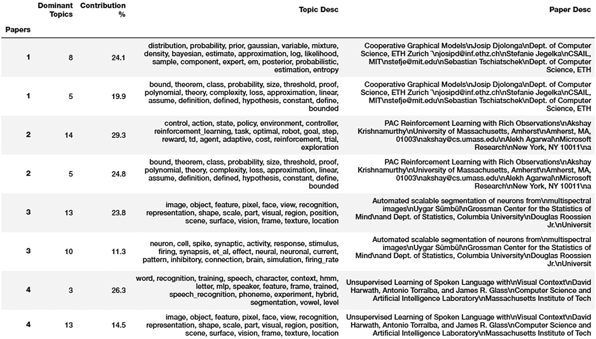

图 6-13：使用我们的 LDA 模型预测新论文的主题

```
results_df = pd.DataFrame()
results_df['Papers'] = range(1, len(new_papers)+1)
results_df['Dominant Topics'] = [[topic_num+1 for topic_num, wt in item]
                                 for item in topic_preds]
res = results_df.set_index(['Papers'])['Dominant Topics'].apply(pd.Series).stack().reset_index(level=1, drop=True)
results_df = pd.DataFrame({'Dominant Topics': res.values}, index=res.index)
results_df['Contribution %'] = [topic_wt for topic_list in
                                [[round(wt*100, 2)
                                  for topic_num, wt in item]
                                 for item in topic_preds]
                                for topic_wt in topic_list]
results_df['Topic Desc'] = [topics_df.iloc[t-1]['Terms per Topic']
                            for t in results_df['Dominant Topics'].values]
results_df['Paper Desc'] = [new_papers[i-1][:200] for i in results_df.index.values]
pd.set_option('display.max_colwidth', 300)
results_df
```

看着图 6-13 中为这些前所未见的新论文生成的主题，我得说我们的模型表现得非常出色！

## 使用 Scikit-Learn 的主题模型

本节的编写是基于许多用户的反馈，他们提到自己广泛使用 Scikit-Learn，并且也希望能将其用于主题建模。Scikit-Learn 框架确实提供了一系列用于构建主题模型的技术和方法，尽管与 Gensim 相比，调整或控制这些模型的灵活性略有不足。尽管如此，在本节中，我们将使用以下方法构建主题模型：

*   潜在语义索引 (LSI)
*   潜在狄利克雷分配 (LDA)
*   非负矩阵分解 (NMF)

我们将尽可能地复制在使用 Gensim 构建主题模型时所采用的特征工程过程。这些模型都基于 `norm_papers` 变量中相同的、经过标准化和预处理后的语料库进行工作。

### 通过特征工程进行文本表示

我们采用一元词和二元词构成的词袋模型来表示文本数据，这与上一节的分析方法类似。

```python
from sklearn.feature_extraction.text import CountVectorizer
cv = CountVectorizer(min_df=20, max_df=0.6, ngram_range=(1,2),
                     token_pattern=None, tokenizer=lambda doc: doc,
                     preprocessor=lambda doc: doc)
cv_features = cv.fit_transform(norm_papers)
cv_features.shape
(1740, 14408)
```

# 验证词汇大小

```python
vocabulary = np.array(cv.get_feature_names())

print('Total Vocabulary Size:', len(vocabulary))
```

```
Total Vocabulary Size: 14408
```

虽然词汇量是之前使用 Gensim 构建模型时的两倍，但我们仍然通过文档频率过滤器去除了不必要的术语。

## 潜在语义索引

我们尝试的第一种主题建模技术是基于 SVD 的 LSI 模型。由于在前一节中，我们确定最佳主题数为 20，那么就用这个数字作为要生成的总主题数。

```python
%%time

from sklearn.decomposition import TruncatedSVD

TOTAL_TOPICS = 20

lsi_model = TruncatedSVD(n_components=TOTAL_TOPICS, n_iter=500, random_state=42)

document_topics = lsi_model.fit_transform(cv_features)
```

```
CPU times: user 15min 25s, sys: 1min 3s, total: 16min 28s
Wall time: 1min 1s
```

```python
topic_terms = lsi_model.components_

topic_terms.shape
```

```
(20, 14408)
```

现在，我们可以通过复用之前实现的部分代码来生成主题，以显示主题和对应的术语。

```python
top_terms = 20

topic_key_term_idxs = np.argsort(-np.absolute(topic_terms), axis=1)[:, :top_terms]

topic_keyterm_weights = np.array([topic_terms[row, columns]
                                  for row, columns in list(zip(np.arange(TOTAL_TOPICS), topic_key_term_idxs))])

topic_keyterms = vocabulary[topic_key_term_idxs]

topic_keyterms_weights = list(zip(topic_keyterms, topic_keyterm_weights))

for n in range(TOTAL_TOPICS):
    print('Topic #'+str(n+1)+':')
    print('='*50)
    d1 = []
    d2 = []
    terms, weights = topic_keyterms_weights[n]
    term_weights = sorted([(t, w) for t, w in zip(terms, weights)],
                          key=lambda row: -abs(row[1]))
    for term, wt in term_weights:
        if wt >= 0:
            d1.append((term, round(wt, 3)))
        else:
            d2.append((term, round(wt, 3)))
    print('Direction 1:', d1)
    print('-'*50)
    print('Direction 2:', d2)
    print('-'*50)
    print()
```

```
Topic #1:
==================================================
Direction 1: [('state', 0.221), ('neuron', 0.169), ('image', 0.138), ('cell', 0.13), ('layer', 0.13), ('feature', 0.127), ('probability', 0.121), ('hidden', 0.114), ('distribution', 0.105), ('rate', 0.098), ('signal', 0.095), ('task', 0.093), ('class', 0.092), ('noise', 0.09), ('net', 0.089), ('recognition', 0.089), ('representation', 0.088), ('field', 0.082), ('rule', 0.082), ('step', 0.08)]
Direction 2: []
...
Topic #3:
==================================================
Direction 1: [('state', 0.574), ('neuron', 0.212), ('action', 0.187), ('policy', 0.149), ('control', 0.12), ('dynamic', 0.1), ('cell', 0.083), ('reinforcement', 0.081), ('optimal', 0.075), ('reinforcement learning', 0.068)]
Direction 2: [('image', -0.364), ('feature', -0.223), ('object', -0.144), ('recognition', -0.143), ('classifier', -0.111), ('class', -0.106), ('layer', -0.092), ('classification', -0.085), ('face', -0.073), ('test', -0.069)]
Topic #4:
==================================================
Direction 1: [('image', 0.425), ('state', 0.326), ('object', 0.215), ('feature', 0.159), ('action', 0.147), ('visual', 0.143), ('control', 0.126), ('task', 0.111), ('policy', 0.103), ('recognition', 0.103), ('face', 0.092), ('representation', 0.086), ('motion', 0.086)]
Direction 2: [('neuron', -0.216), ('distribution', -0.166), ('class', -0.112), ('bound', -0.109), ('probability', -0.108), ('spike', -0.104), ('variable', -0.087)]
...
Topic #6:
==================================================
Direction 1: [('cell', 0.548), ('layer', 0.139), ('word', 0.124), ('hidden', 0.111), ('classifier', 0.097), ('direction', 0.09), ('head', 0.078), ('rule', 0.073), ('rat', 0.073), ('speech', 0.071)]
Direction 2: [('neuron', -0.416), ('image', -0.336), ('circuit', -0.126), ('noise', -0.124), ('chip', -0.121), ('analog', -0.099), ('object', -0.09), ('spike', -0.075), ('signal', -0.071), ('voltage', -0.069)]
...
Topic #9:
==================================================
Direction 1: [('circuit', 0.244), ('control', 0.242), ('classifier', 0.229), ('chip', 0.167), ('node', 0.137), ('current', 0.132), ('analog', 0.13), ('voltage', 0.129), ('signal', 0.118), ('controller', 0.088)]
```

### 主题方向分析

Direction 2: [('hidden', -0.27), ('neuron', -0.247), ('state', -0.175), ('distribution', -0.158), ('hidden unit', -0.143), ('layer', -0.125), ('object', -0.115), ('probability', -0.108), ('image', -0.1), ('representation', -0.098)]

#### `主题 #10`：

方向 1: [('circuit', 0.245), ('cell', 0.225), ('node', 0.211), ('state', 0.183), ('image', 0.166), ('chip', 0.163), ('analog', 0.147), ('layer', 0.144), ('net', 0.12), ('voltage', 0.115)]

方向 2: [('task', -0.201), ('rule', -0.193), ('spike', -0.166), ('feature', -0.165), ('control', -0.157), ('neuron', -0.144), ('rate', -0.134), ('stimulus', -0.116), ('classifier', -0.116), ('action', -0.112)]

...

#### `主题 #18`：

方向 1: [('object', 0.419), ('signal', 0.26), ('layer', 0.258), ('rule', 0.209), ('feature', 0.164), ('view', 0.162), ('net', 0.113), ('noise', 0.112), ('bound', 0.105), ('speech', 0.1)]

方向 2: [('memory', -0.18), ('task', -0.161), ('representation', -0.14), ('hidden', -0.137), ('image', -0.135), ('hidden unit', -0.121), ('tree', -0.117), ('structure', -0.094), ('test', -0.093), ('word', -0.092)]

#### `主题 #19`：

方向 1: [('class', 0.287), ('memory', 0.275), ('classifier', 0.144), ('response', 0.139), ('sequence', 0.112), ('component', 0.11), ('stimulus', 0.101), ('region', 0.092), ('bound', 0.088)]

方向 2: [('node', -0.292), ('feature', -0.244), ('field', -0.202), ('rate', -0.152), ('word', -0.146), ('spike', -0.139), ('map', -0.132), ('character', -0.127), ('policy', -0.108), ('tree', -0.092), ('noise', -0.088)]

#### `主题 #20`：

方向 1: [('map', 0.222), ('control', 0.2), ('region', 0.181), ('ii', 0.145), ('feature', 0.132), ('image', 0.122), ('bound', 0.11), ('orientation', 0.109), ('rule', 0.109), ('threshold', 0.094), ('class', 0.092)]

方向 2: [('object', -0.31), ('motion', -0.252), ('direction', -0.229), ('memory', -0.223), ('classifier', -0.193), ('view', -0.136), ('matrix', -0.13), ('rate', -0.121), ('distance', -0.11)]

当然，受篇幅限制，我们并未在上方输出中展示所有主题，但您已能理解其大意。如有需要，您可以在笔记本中查看所有主题。与上一节类似，我们也可以提取特定研究论文的关键主题。

```python
dt_df = pd.DataFrame(np.round(document_topics, 3), columns=['T'+str(i) for i in range(1, TOTAL_TOPICS+1)])

document_numbers = [13, 250, 500]

for document_number in document_numbers:

    top_topics = list(dt_df.columns[np.argsort(-np.absolute(dt_df.iloc[document_number].values))[:3]])

    print('Document #'+str(document_number)+':')

    print('Dominant Topics (top 3):', top_topics)

    print('Paper Summary:')

    print(papers[document_number][:500])

    print()
```

#### `文档 #13`：

主导主题（前 3）：['T1', 'T6', 'T4']

论文摘要：

Stochastic Learning Networks and their Electronic Implementation

Joshua Alspector*, Robert B. Allen, Victor Hut, and Srinagesh Satyanarayana

Bell Communications Research, Morristown, NJ 07960

摘要

我们描述了一系列学习算法，这些算法运行在一个循环、对称连接的神经形态网络上，类似于玻尔兹曼机

#### `文档 #250`：

主导主题（前 3）：['T3', 'T18', 'T4']

论文摘要：

266 Zemel, Mozer and Hinton

TRAFFIC: Recognizing Objects Using

Hierarchical Reference Frame Transformations

Richard S. Zemel

摘要

我们描述了一个模型，该模型能够在未分割的图像中识别二维形状，且不受其方向的影响

#### `文档 #500`：

主导主题（前 3）：['T9', 'T1', 'T10']

论文摘要：

Constrained Optimization Applied to the

Parameter Setting Problem for Analog Circuits

David Kirk, Kurt Fleischer, Lloyd Watts, Alan Bart

摘要

我们使用约束优化为两个电路选择工作参数：一个简单的三晶体管平方根电路，以及一个模拟 VLSI 人工耳蜗。

如果您查看我们在上述输出中得到的主题术语，它们实际上是有意义的！

### 潜在狄利克雷分配

就连 Scikit-Learn 也在其库中集成了基于 LDA 的主题模型实现。以下代码片段使用它来构建一个 LDA 主题模型。

```python
%%time

from sklearn.decomposition import LatentDirichletAllocation

lda_model = LatentDirichletAllocation(n_components =TOTAL_TOPICS, max_iter=500, max_doc_update_iter=50, learning_method="online", batch_size=1740, learning_offset=50., random_state=42, n_jobs=16)

document_topics = lda_model.fit_transform(cv_features)

CPU times: user 13min 14s, sys 1min 41s, total 14min 56s

Wall time: 55min 32s
```

然后，我们可以获取主题-术语矩阵，并从中构建一个数据帧，以便于以一种易于解释的格式展示主题和术语。

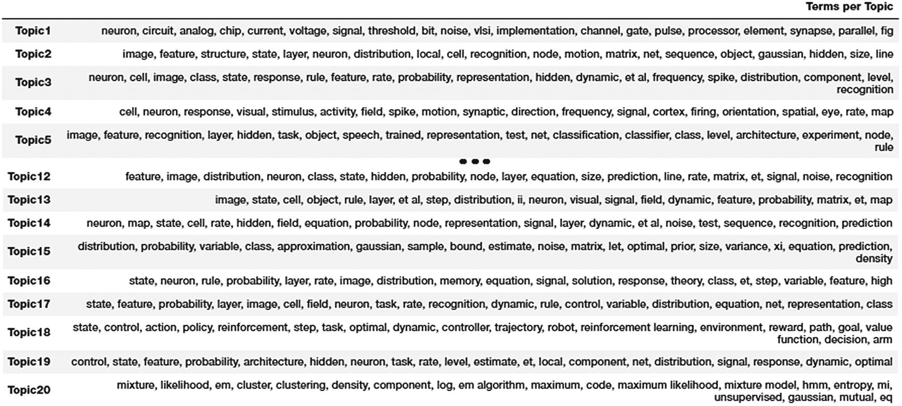

**图 6-14** 从我们的 LDA 模型生成的主题

# 主题模型分析与非负矩阵分解

## 主题模型分析

```python
topic_terms = lda_model.components_

topic_key_term_idxs = np.argsort(-np.absolute(topic_terms), axis=1)[:, :top_terms]

topic_keyterms = vocabulary[topic_key_term_idxs]

topics = [', '.join(topic) for topic in topic_keyterms]

pd.set_option('display.max_colwidth', -1)

topics_df = pd.DataFrame(topics, columns = ['Terms per Topic'], index=['Topic'+str(t) for t in range(1, TOTAL_TOPICS+1)])

topics_df
```

基于图 6-14 中描述的主题，我们可以看到各主题之间存在相似主题的重复，这可能表明该模型不如我们的 MALLET LDA 模型优秀。现在，我们可以查看在 20 个主题中每个主题贡献度最大的研究论文，这与我们在上一节中的分析类似。

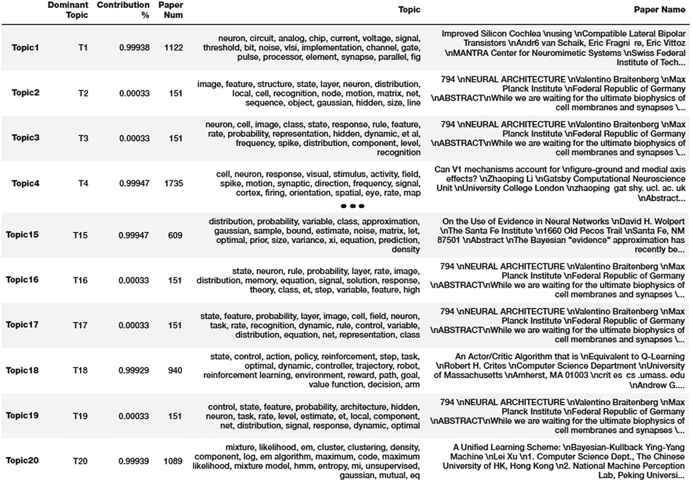

`图 6-15` 查看每个主题及其贡献度最大的对应论文

```python
dt_df = pd.DataFrame(document_topics, columns=['T'+str(i) for i in range(1, TOTAL_TOPICS+1)])

pd.options.display.float_format = '{:,.5f}'.format

pd.set_option('display.max_colwidth', 200)

max_contrib_topics = dt_df.max(axis=0)

dominant_topics = max_contrib_topics.index

contrib_perc = max_contrib_topics.values

document_numbers = [dt_df[dt_df[t] == max_contrib_topics.loc[t]].index[0] for t in dominant_topics]

documents = [papers[i] for i in document_numbers]

results_df = pd.DataFrame({'Dominant Topic': dominant_topics, 'Contribution %': contrib_perc, 'Paper Num': document_numbers, 'Topic': topics_df['Terms per Topic'], 'Paper Name': documents})

results_df
```

基于图 6-15 中描述的输出，我们可以看到某些主题在语料库中的表示非常差，几乎为 0%，因此我们看到同一篇论文（论文 #151）被选为这些主题的更相关论文。而贡献度良好（几乎 100% 主导）的主题，则展示出与相应主题所传达主题密切相关的论文，包括强化学习、贝叶斯和高斯混合模型、VLSI 上的神经模型以及晶体管。

## 非负矩阵分解

我们介绍的最后一门技术是非负矩阵分解（`NMF`），这是另一种类似于 `SVD` 的矩阵分解技术，但它作用于非负矩阵，并且对多变量数据效果良好。给定一个非负矩阵 `V`，`NMF` 的目标是找到两个非负矩阵因子 `W` 和 `H`，使得它们相乘后能够近似重构 `V`。用数学语言表示如下：

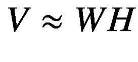

使得这三个矩阵都是非负的。为了得到这个近似，我们通常使用一个代价函数，例如两个矩阵之间的欧几里得距离或 `L2` 范数，或者 Frobenius 范数（它是对 `L2` 范数的一个微小改进）。这可以表示如下：

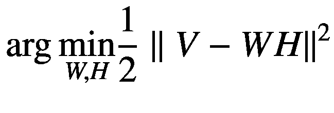

其中我们有三个非负矩阵——`V`、`W` 和 `H`——这可以进一步简化为：

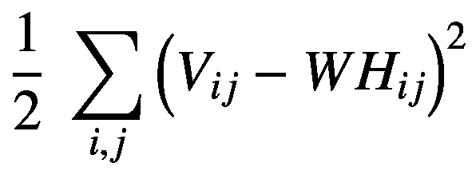

这个实现可以在 Scikit-Learn 分解模块的 `NMF` 类中找到，我们将在本节中使用它。

我们可以使用以下代码片段在玩具语料库上构建一个基于 NMF 的主题模型，与 LDA 一样，它会给出特征名称及其权重。

```python
%%time

from sklearn.decomposition import NMF

nmf_model = NMF(n_components=TOTAL_TOPICS, solver="cd", max_iter=500,

random_state=42, alpha=.1, l1_ratio=.85)

document_topics = nmf_model.fit_transform(cv_features)

CPU times: user 11min 39s, sys: 47.5 s, total: 12min 26s

Wall time: 46.7 s
```

现在我们的模型已经训练好了，我们可以使用以下代码查看生成的主题。

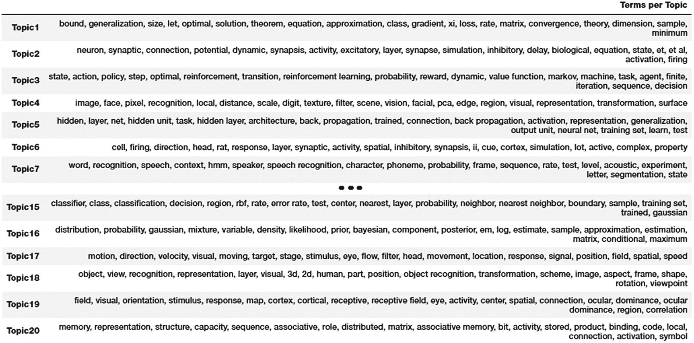

`图 6-16` 从我们的 NMF 模型生成的主题

```python
topic_terms = nmf_model.components_

topic_key_term_idxs = np.argsort(-np.absolute(topic_terms), axis=1)[:, :top_terms]

topic_keyterms = vocabulary[topic_key_term_idxs]

topics = [', '.join(topic) for topic in topic_keyterms]

pd.set_option('display.max_colwidth', -1)

topics_df = pd.DataFrame(topics,

columns = ['Terms per Topic'],

index=['Topic'+str(t) for t in range(1, TOTAL_TOPICS+1)])

topics_df
```

根据图 6-16 中展示的主题，没有明显的主题重复，并且每个主题都讨论了一个清晰且不同的主题。NMF 主题模型的结果明显优于我们从 Scikit-Learn 的 LDA 中获得的结果。我们可以确定每个研究论文中主题的支配度，但在 NMF 的情况下，这些是由绝对分数而不是百分比来确定的，如下面的输出所示。见图 6-17。

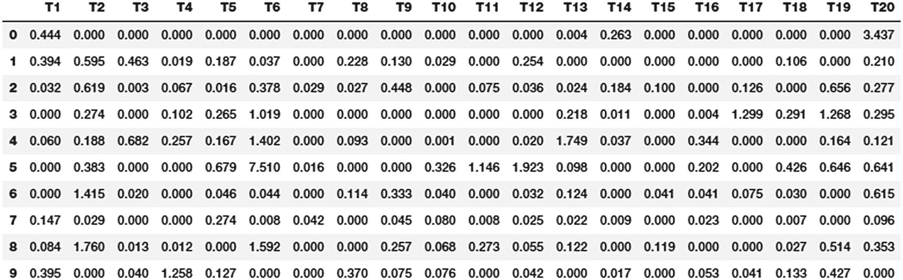

`图 6-17` 使用文档-主题矩阵查看每个文档的主题支配度

```python
pd.options.display.float_format = '{:,.3f}'.format

dt_df = pd.DataFrame(document_topics,

columns=['T'+str(i) for i in range(1, TOTAL_TOPICS+1)])

dt_df.head(10)
```

利用文档-主题矩阵，我们可以通过以下代码，根据主题支配度得分确定每个主题最相关的论文。

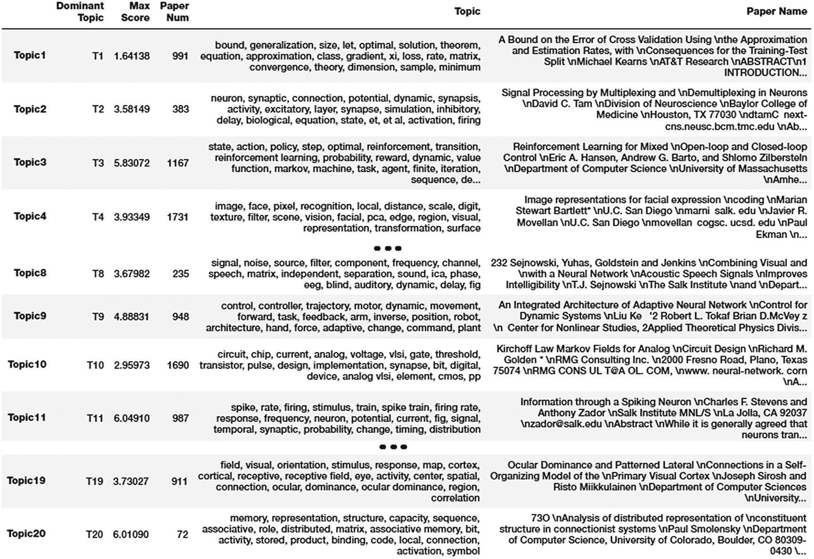

`图 6-18` 查看每个主题及其贡献最大的对应论文

```python
pd.options.display.float_format = '{:,.5f}'.format

pd.set_option('display.max_colwidth', 200)

max_score_topics = dt_df.max(axis=0)

dominant_topics = max_score_topics.index

term_score = max_score_topics.values
```


`document_numbers = [dt_df[dt_df[t] == max_score_topics.loc[t]].index[0] for t in dominant_topics]`

`documents = [papers[i] for i in document_numbers]`

`results_df = pd.DataFrame({'Dominant Topic': dominant_topics, 'Max Score': term_score, 'Paper Num': document_numbers, 'Topic': topics_df['Terms per Topic'], 'Paper Name': documents})`

`results_df`

```
图 6-18 中显示的输出清楚地表明，`NMF` 模型比 `LDA` 模型好得多，每个主题都与其支配度最大的研究论文的核心主题强相关。我们观察到的是，与其他方法相比，即使在文档数量较少的小型语料库上，非负矩阵分解也能发挥最佳效果。但同样，这取决于你正在处理的数据类型。
```

### 预测新研究论文的主题

现在，我们为 `NIPS 16` 会议的四篇研究论文预测主题，类似于我们之前用 Gensim 主题模型所做的操作。如果尚未加载论文，请先加载它们。

```
import glob
```

# papers manually downloaded from NIPS 16

# https://papers.nips.cc/book/advances-in-neural-information-processing-systems-29-2016

## 新论文主题预测

```python
new_paper_files = glob.glob('nips16*.txt')
new_papers = []
for fn in new_paper_files:
    with open(fn, encoding='utf-8', errors="ignore", mode='r+') as f:
        data = f.read()
        new_papers.append(data)
print('Total New Papers:', len(new_papers))
```

```
Total New Papers: 4
```

流程中的下一步是预处理这些文档，并使用与构建主题模型时相同的步骤序列提取特征。

```python
norm_new_papers = normalize_corpus(new_papers)
cv_new_features = cv.transform(norm_new_papers)
cv_new_features.shape
```

```
(4, 14408)
```

现在，我们可以使用 NMF 主题模型，通过以下代码预测这些新研究论文的主题（我们为每篇论文预测前两个主题）。

```python
topic_predictions = nmf_model.transform(cv_new_features)
best_topics = [[(topic, round(sc, 3))
                for topic, sc in sorted(enumerate(topic_predictions[i]),
                                        key=lambda row: -row[1])[:2]]
               for i in range(len(topic_predictions))]
best_topics
```

```
[[(0, 1.312), (7, 0.966)],
 [(2, 4.121), (0, 0.864)],
 [(3, 2.154), (1, 1.335)],
 [(3, 3.074), (6, 2.19)]]
```

请记住，这里我们不会像 LDA 模型那样得到每个主题的支配度比例，而是得到绝对分数。让我们以易于理解的格式查看结果。

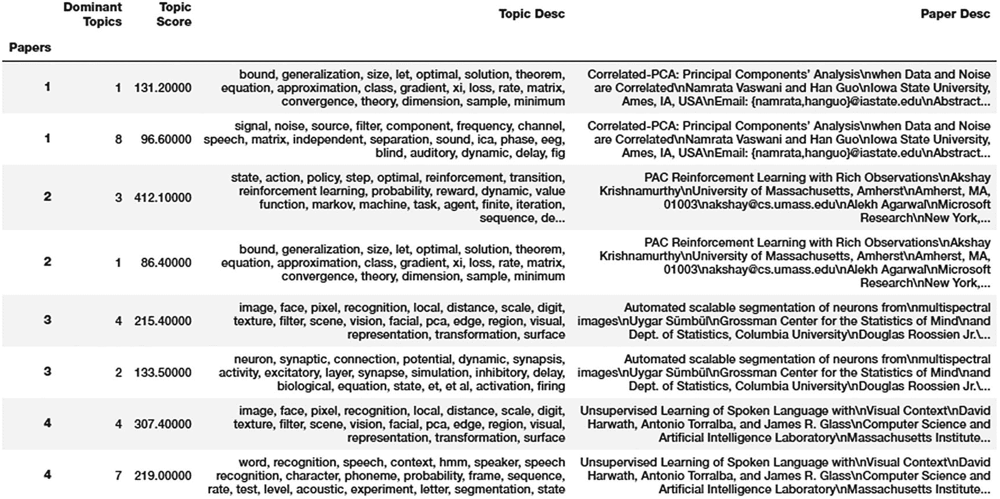

图 6-19 使用我们的 NMF 模型预测新论文的主题

```python
results_df = pd.DataFrame()
results_df['Papers'] = range(1, len(new_papers)+1)
results_df['Dominant Topics'] = [[topic_num+1 for topic_num, sc in item]
                                 for item in best_topics]
res = results_df.set_index(['Papers'])['Dominant Topics'].apply(pd.Series).stack().reset_index(level=1, drop=True)
results_df = pd.DataFrame({'Dominant Topics': res.values}, index=res.index)
results_df['Topic Score'] = [topic_sc for topic_list in
                             [[round(sc*100, 2)
                               for topic_num, sc in item]
                              for item in best_topics]
                             for topic_sc in topic_list]
results_df['Topic Desc'] = [topics_df.iloc[t-1]['Terms per Topic']
                            for t in results_df['Dominant Topics'].values]
results_df['Paper Desc'] = [new_papers[i-1][:200] for i in results_df.index.values]
results_df
```

观察图 6-19 中展示的新研究论文生成的主题，我们可以清楚地得出结论，这些主题是合理的，并且我们的 NMF 模型运行得非常好！

## 主题模型可视化

我们还可以通过交互式方式可视化主题模型，以便利用`pyLDAvis`框架查看每个主题及其传达的主题。通常，会使用 MDS、PDA 和 t-SNE 等降维技术将主题在二维可视化中呈现。

```python
import pyLDAvis
import pyLDAvis.sklearn
import dill
import warnings
warnings.filterwarnings('ignore')
pyLDAvis.enable_notebook()
pyLDAvis.sklearn.prepare(nmf_model, cv_features, cv, mds="mmds")
```

图 6-20 中的可视化在 Jupyter notebook 中是可交互的，您可以通过查看每个主题、词分布和主题分布来进行探索。希望这能为您提供足够的主题模型视角，助您开始对自己语料库进行建模。

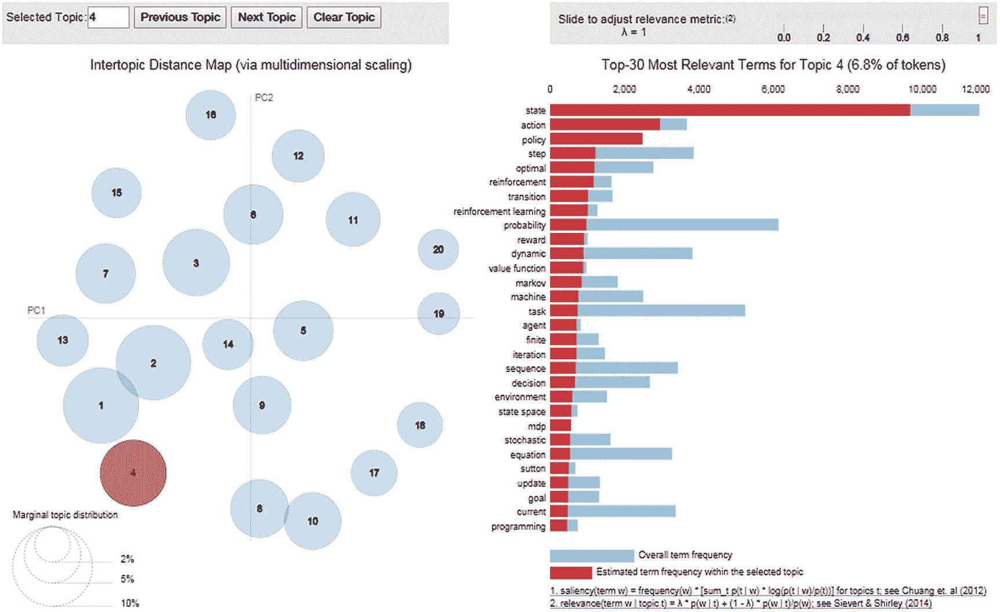

图 6-20 基于 NMF 模型的主题可视化

## 自动文档摘要

我们在本章开头曾简要讨论过文档摘要，当时提到从大型文档或语料库中提取主旨，使其保留语料的核心精髓或含义。文档摘要的概念与关键短语提取或主题建模略有不同。在这种情况下，最终结果仍以某种文档形式呈现，但仅包含基于我们所需摘要长度的若干句子。这类似于研究论文中的摘要或执行摘要。自动文档摘要的主要目标是，在不涉及人工输入（除运行计算机程序外）的情况下执行此摘要任务。数学和统计模型通过观察文档的内容和上下文，帮助构建和自动化文档摘要任务。

使用自动化技术进行文档摘要主要有两种方法，描述如下：

- **基于抽取的技术：** 这些方法利用 SVD 等数学和统计概念，从原始文档中提取关键内容子集，使得该子集包含核心信息，并作为整个文档的焦点。这些内容可以是单词、短语甚至句子。该方法的最终结果是从原始文档中提取出几行简短执行摘要。此技术不生成任何新内容，因此得名 *基于抽取*。

- **基于抽象的技术：** 这些方法更为复杂和精细。它们利用语言语义创建表示，并使用自然语言生成技术，使机器借助知识库和语义表示自主生成文本，像人类一样撰写摘要。得益于深度学习，我们可以轻松实现这些技术，但它们需要大量数据和计算资源。

对基于抽取技术的研究更多，因为构建基于抽象的摘要生成器相对更困难。近年来，在该领域（模仿人类创建抽象摘要）已取得实质性进展。深度学习模型，尤其是编码器-解码器架构，在使用抽象方法总结文本方面非常有效。实现这些模型超出了我们当前的范围，但我们将通过动手示例涵盖抽取式文本摘要的要点。

我们将使用贝塞斯达软件工作室非常受欢迎的角色扮演游戏《天际》的描述来进行摘要。以下是待摘要文档的节选（完整文档位于用于文本摘要的 Jupyter notebook 中）。

```python
DOCUMENT = """
The Elder Scrolls V: Skyrim is an action role-playing video game developed by Bethesda Game Studios and published by Bethesda Softworks. It is the fifth main installment in The Elder Scrolls series, following The Elder Scrolls IV: Oblivion. The game's main story revolves around the player character's quest to defeat Alduin the World-Eater, a dragon who is prophesied to destroy the world. The game is set 200 years after the events of Oblivion and takes place in the fictional province of Skyrim. Over the course of the game, the player completes quests and develops the character by improving skills. The game continues the open-world tradition of
"""
```

# 《上古卷轴5：天际》与文本摘要技术

## 游戏介绍

《上古卷轴5：天际》是一款动作角色扮演游戏，玩家可以从第一人称或第三人称视角进行游戏。玩家可以自由漫游天际省的土地，这是一个由荒野、地下城、城市、城镇、堡垒和村庄组成的开放世界环境。

游戏延续了其前作的开放世界传统，允许玩家随时前往游戏世界中的任何地点，并且可以无限期地忽略或推迟主线剧情。游戏团队选择了一个比《上古卷轴4：湮没》中的西罗帝尔帝国行省更多样化、更独特的开放世界，游戏总监兼执行制作人托德·霍华德认为后者相比之下趣味性较低。游戏发布后获得了评论界的赞誉，评论家特别提到了角色成长和游戏设定，并被认为是史上最伟大的电子游戏之一。

游戏的主要故事情节围绕玩家角色击败世界吞噬者奥杜因（一条预言会毁灭世界的巨龙）的探索而展开。在游戏过程中，玩家通过提升技能来完成任务和发展角色。玩家可以自由漫游天际省的土地，这是一个由荒野、地下城、城市、城镇、堡垒和村庄组成的开放世界环境。游戏世界中的每个城市和城镇都有玩家可以从事的工作，例如耕种。在游戏过程中，玩家会提升其角色的技能，这些技能是他们在某些领域能力的数值体现。与其他生物一样，巨龙会在世界中随机生成，并与NPC、生物和玩家进行战斗。再生期限制了玩家在游戏中使用“龙吼”的能力。

《天际》的故事背景设定在《上古卷轴4：湮没》事件发生约200年后，但它并非直接续作。游戏发生在泰姆瑞尔大陆的天际省，正值一场内战，交战双方分别是：由乌弗瑞克·风暴斗篷领导的风暴斗篷，和由图留斯将军领导的帝国军团。玩家角色是一名龙裔，一个生来就拥有龙之灵魂和力量的凡人。奥杜因，一条在时间长河中迷失后重返大地的黑色巨龙，是游戏的主要反派。奥杜因是由系列神祇之一阿卡托什创造的第一条龙，被预言将毁灭并吞噬世界。

## 文本摘要示例

我们需要对这个文档进行一些基本的预处理，以移除多余的换行符。可以使用以下代码来实现。

```python
import re

DOCUMENT = re.sub(r'\n|\r', ' ', DOCUMENT)

DOCUMENT = re.sub(r' +', ' ', DOCUMENT)

DOCUMENT = DOCUMENT.strip()
```

接下来，我们通过利用Gensim的摘要模块来查看文档摘要的实现。如下列代码所示，这非常直接了当。

```python
from gensim.summarization import summarize

print(summarize(DOCUMENT, ratio=0.2, split=False))
```

游戏的主要故事情节围绕玩家角色击败世界吞噬者奥杜因（一条预言会毁灭世界的巨龙）的探索而展开。

在游戏过程中，玩家通过提升技能来完成任务和发展角色。

游戏延续了其前作的开放世界传统，允许玩家随时前往游戏世界中的任何地点，并且可以无限期地忽略或推迟主线剧情。

玩家可以自由漫游天际省的土地，这是一个由荒野、地下城、城市、城镇、堡垒和村庄组成的开放世界环境。

游戏世界中的每个城市和城镇都有玩家可以从事的工作，例如耕种。

在游戏过程中，玩家会提升其角色的技能，这些技能是他们在某些领域能力的数值体现。

与其他生物一样，巨龙会在世界中随机生成，并与NPC、生物和玩家进行战斗。

我们还可以使用以下代码，基于字数而非比例来限制摘要长度。

```python
print(summarize(DOCUMENT, word_count=75, split=False))
```

游戏的主线故事围绕玩家角色展开，其目标是击败预言中将毁灭世界的巨龙——世界吞噬者奥杜因。在游戏过程中，玩家通过完成任务并提升技能来发展角色。玩家可以自由徜徉于天际省的土地上，这是一个由荒野、地下城、城市、城镇、要塞和村庄组成的开放世界环境。

我敢肯定，即使你从未玩过《上古卷轴5：天际》，或者没读过那段介绍游戏的大段文字，这篇摘要也能让你对游戏内容有个相当清晰的认识。这就是文本摘要的力量——只需使用几句关键性的句子，我们就能概括整篇文档的核心主题。

Gensim中的这个摘要实现，基于一种名为TextRank的流行算法的变体。既然我们已经了解了文本摘要可以多么有趣，那么接下来，让我们看看几种基于抽取的摘要算法。我们重点关注以下两种技术：

- 潜在语义分析
- TextRank

我们首先了解每种技术背后的概念和数学原理，然后使用Python实现它们，最后在玩具文档上进行测试。在深入探讨这些技术之前，让我们先对文档进行解析和规范化。

### 文本处理

我们需要对文档进行一些基本的文本处理或预处理。操作并不复杂，因为重点在于文档摘要。

```python
import nltk

import numpy as np

import re

stop_words = nltk.corpus.stopwords.words('english')

def normalize_document(doc):

    # 转小写并移除特殊字符/空白符

    doc = re.sub(r'[^a-zA-Z\s]', '', doc, re.I|re.A)

    doc = doc.lower()

    doc = doc.strip()

    # 对文档进行分词

    tokens = nltk.word_tokenize(doc)

    # 从文档中过滤停用词

    filtered_tokens = [token for token in tokens if token not in stop_words]

    # 从过滤后的词元重新创建文档

    doc = ' '.join(filtered_tokens)

    return doc

normalize_corpus = np.vectorize(normalize_document)
```

# 获取文档中的句子

```
sentences = nltk.sent_tokenize(DOCUMENT)
```

# 规范化文档中的每个句子

```python
norm_sentences = normalize_corpus(sentences)
norm_sentences[:3]
```

输出：

```
array(['elder scrolls v skyrim action roleplaying video game developed bethesda game studios published bethesda softworks',
       'fifth main installment elder scrolls series following elder scrolls iv oblivion',
       'games main story revolves around player characters quest defeat alduin worldeater dragon prophesied destroy world'],
      dtype='<U183')
```

现在，我们的语料库已经过预处理和规范化。接下来，我们可以利用特征工程，以高效的向量化格式来表示文本数据。

## 基于特征工程的文本表示

我们将使用 TF-IDF 特征工程方案对规范化的句子进行向量化。我们保持简单，不根据文档频率过滤任何词语。但你可以随意尝试，甚至可以尝试使用 n-gram 作为特征。

```python
from sklearn.feature_extraction.text import TfidfVectorizer
import pandas as pd

tv = TfidfVectorizer(min_df=0., max_df=1., use_idf=True)
dt_matrix = tv.fit_transform(norm_sentences)
dt_matrix = dt_matrix.toarray()
vocab = tv.get_feature_names()
td_matrix = dt_matrix.T
print(td_matrix.shape)
pd.DataFrame(np.round(td_matrix, 2), index=vocab).head(10)
```

图 6-21 中的输出是我们的标准术语-文档矩阵，显示了各个文档中每个术语的 TF-IDF 权重。在本例中，每个文档是我们原始游戏描述中的一个句子，并表示为矩阵的一列。现在，我们可以开始使用前面提到的两种技术来实现文档摘要。

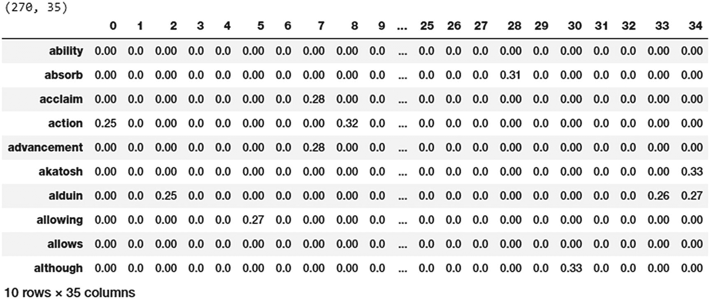

*图 6-21. 可视化 NMF 模型中的主题*

## 潜在语义分析

在这里，我们通过利用文档句子来总结我们的游戏描述。文档中每个句子的术语已被提取出来，形成了我们在图 6-21 中看到的术语-文档矩阵。我们对这个矩阵应用低秩奇异值分解。潜在语义分析的核心原理是：在任何文档中，上下文相关的术语之间都存在一种潜在结构，因此它们也应在同一个奇异空间中相关联。

我们实现中所遵循的方法，源自 2004 年 J. Steinberger 和 K. Jezek 发表的一篇知名论文，题为“在文本摘要和摘要评估中使用潜在语义分析”，该论文对 Y. Gong 和 X. Liu 于 2001 年发表的杰出工作“使用相关性度量和潜在语义分析进行通用文本摘要”提出了一些改进建议。如果你想更深入地了解这项技术，我们建议你阅读这两篇论文。

我们实现的主要思想是使用 SVD（回顾 `M = USV^T`），使得 `U` 和 `V` 是正交矩阵，`S` 是对角矩阵，也可以表示为奇异值向量。原始矩阵可以表示为一个术语-文档矩阵，其中行是术语，列是文档（在本例中，即我们文档中的句子）。这些值可以是任何类型的权重，例如基于词袋模型频率、TF-IDF 或二进制出现次数。

我们使用 `low_rank_svd()` 函数，基于概念数量 `k`（即我们的奇异值数量）为 `M` 创建低秩矩阵近似。矩阵 `U` 中相同的 `k` 列将指向每个 `k` 概念的术语向量，而对于矩阵 `V`，基于前 `k` 个奇异值的 `k` 行则指向句子向量。一旦我们从 SVD 中，根据概念数量 `k`，获得了对应前 `k` 个奇异值的 `U`、`S` 和 `V^T`，我们就执行以下计算。请记住，我们需要的输入参数是概念数量 `k` 和摘要最终要包含的句子数量 `n`。

1.  从矩阵 `V`（`k` 行）中获取句子向量。
2.  从 `S` 中获取前 `k` 个奇异值。
3.  应用基于阈值的策略，移除那些小于最大奇异值一半的奇异值（如果存在）。这是一个启发式方法，你可以根据需要调整这个值。数学上表示为：如果 `S_i < (1/2) * S`，则 `S_i = 0`。
4.  将 `V` 中每个术语-句子列的平方与其对应奇异值 `S` 的平方相乘，以获得每个主题的句子权重。
5.  计算所有主题的句子权重之和，并对最终得分取平方根，以获得文档中每个句子的显著度得分。

每个句子的显著度得分计算可以用数学表示如下：

```
SS = sqrt(sum_{i=1}^k (S_i * V_i^T))
```

其中 `SS` 表示通过计算奇异值与 `V^T` 中句子向量点积得到的每个句子的显著性得分。一旦我们得到这些分数，就按降序排列，选出得分最高的前 `n` 个句子，并根据它们在原始文档中出现的顺序组合起来，形成最终的摘要。

让我们用 Python 实现算法。第一步是选择摘要包含的句子数量 `n`。由于我们有大约 35 个句子，我们设定摘要包含八个句子。主题或概念的总数 `k` 设为三个，因为我们从维基百科原始评论的摘要、游戏玩法和剧情部分提取了游戏描述。然后我们执行低秩 SVD。

```python
num_sentences = 8
num_topics = 3
u, s, vt = low_rank_svd(td_matrix, singular_count=num_topics)
print(u.shape, s.shape, vt.shape)
term_topic_mat, singular_values, topic_document_mat = u, s, vt
```

输出：

```
(270, 3) (3,) (3, 35)
```

接下来，我们应用一个阈值，将任何小于最大奇异值一半的奇异值设为 `0`。

# 移除低于阈值的奇异值

`sv_threshold = 0.5`

`min_sigma_value = max(singular_values) * sv_threshold`

`singular_values[singular_values < min_sigma_value] = 0`

现在我们可以利用前面描述的公式，为游戏描述中的每个句子（文档）计算句子显著性分数。

```python
salience_scores = np.sqrt(np.dot(np.square(singular_values),
                                 np.square(topic_document_mat)))
salience_scores
```

```
array([0.53291263, 0.61639562, 0.60427539, 0.52307109, 0.50141128,
       0.32352969, 0.1506046 , 0.25383436, 0.60567083, 0.35902104,
       0.22562997, 0.34608934, 0.15781555, 0.40522541, 0.24505982,
       0.19874104, 0.39317895, 0.45392878, 0.31638528, 0.47353378,
       0.18348908, 0.45731421, 0.13929749, 0.38932101, 0.36829067,
       0.57822992, 0.40853736, 0.26260062, 0.38904585, 0.32776714,
       0.67662776, 0.21866561, 0.34687796, 0.3234621 , 0.46107093])
```

现在只需根据显著性分数选择排名靠前的句子，并展示游戏描述的摘要。

```python
top_sentence_indices = (-salience_scores).argsort()[:num_sentences]
top_sentence_indices.sort()
print('\n'.join(np.array(sentences)[top_sentence_indices]))
```

```
The Elder Scrolls V: Skyrim is an action role-playing video game developed by Bethesda Game Studios and published by Bethesda Softworks.
It is the fifth main installment in The Elder Scrolls series, following The Elder Scrolls IV: Oblivion.
The game's main story revolves around the player character's quest to defeat Alduin the World-Eater, a dragon who is prophesied to destroy the world.
The game is set 200 years after the events of Oblivion and takes place in the fictional province of Skyrim.
Over the course of the game, the player completes quests and develops the character by improving skills.
The Elder Scrolls V: Skyrim is an action role-playing game, playable from either a first or third-person perspective.
Skyrim is the first entry in The Elder Scrolls to include dragons in the game's wilderness.
Skyrim is set around 200 years after the events of The Elder Scrolls IV: Oblivion, although it is not a direct sequel.
```

由此可见，只需几次矩阵变换，就能得到一个简洁且出色的摘要文档，涵盖了游戏描述的主要方面。这就是我们对潜在语义分析的讨论。接下来，我们介绍另一种基于抽取的文档摘要技术。

## TextRank

TextRank 摘要算法在内部使用了流行的 PageRank 算法，该算法被谷歌用于对网站和页面进行排名。当根据搜索查询提供相关网页时，谷歌搜索引擎会使用该算法。为了更好理解 TextRank，我们需要了解 PageRank 相关的一些概念。PageRank 的核心算法是一种基于图的评分或排名算法，其中页面根据其重要性进行评分或排名。网站和页面包含进一步嵌入其中的链接，这些链接指向更多包含更多链接的页面，并且这个过程在整个互联网中持续进行。这可以表示为一个基于图的模型，其中顶点表示网页，边表示它们之间的链接。这可以用来形成一个投票或推荐系统，例如当一个顶点链接到图中的另一个顶点时，它基本上就是在投一票。顶点的重要性不仅取决于投票数或边数，还取决于与其相连的顶点的重要性以及这些顶点自身的重要性。这有助于确定每个顶点或页面的得分或排名。这在图 6-22 中显而易见。

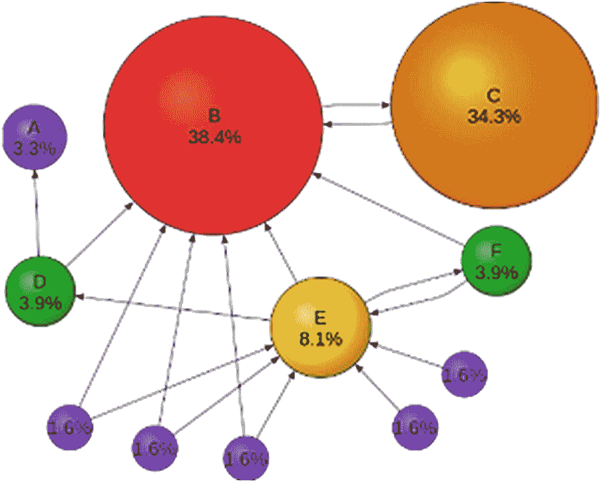

图 6-22

简单网络的 PageRank 分数

从图 6-22 中，我们可以看到代表页面 C 的顶点比页面 E 的分数更高，即使它的边数比页面 E 少，这是因为页面 B 是一个连接到页面 C 的重要页面。因此，我们可以形式化地将 PageRank 定义如下。考虑一个有向图表示为 *G* = (*V*, *E*)，其中`V`表示顶点或页面的集合，`E`表示边或链接的集合。`E`是 *V* × *V* 的一个子集。假设我们有一个给定的页面`V[i]`，我们想要计算其 PageRank，可以数学定义如下：

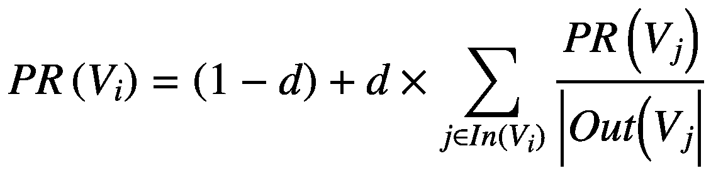

其中，对于顶点/页面`V[i]`，`PR(V[i])`表示 PageRank 分数。`In(V[i])`表示指向该顶点/页面的页面集合，`Out(V[i])`表示顶点/页面`V[i]`所指向的页面集合，`d`是阻尼系数，通常取值在 0 到 1 之间（理想情况下设为 0.85）。

回到 TextRank 算法，在对文档进行摘要时，根据我们尝试进行的摘要类型，句子、关键词或短语将作为算法的顶点。这些顶点之间可能存在多个链接。我们对原始 PageRank 算法所做的修改是，在两个顶点`V[i]`和`V[j]`之间的连边上添加一个权重系数（例如`w[ij]`），该权重表示它们之间连接的强度。因此，我们现在形式化定义计算顶点 TextRank 的新函数如下：

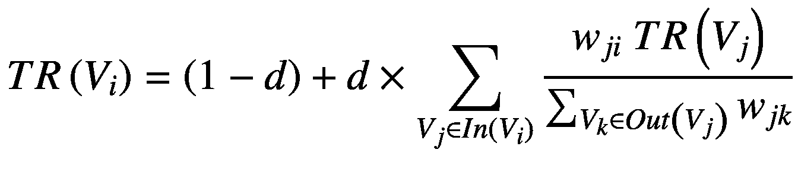

其中`TR`表示顶点加权后的 PageRank 分数，现在定义为该顶点的 TextRank。因此，我们可以制定算法并描述将要遵循的主要步骤。它们定义如下：

1.  对待摘要文档中的句子进行分词和提取。
2.  确定最终摘要中想要的句子数量`k`。
3.  使用 TF-IDF 或词袋等权重构建文档-术语特征矩阵。
4.  通过将矩阵与其转置相乘计算文档相似度矩阵。
5.  使用这些文档（在本例中为句子）作为顶点，将每对文档之间的相似度作为权重或之前提到的评分系数，输入到 PageRank 算法中。
6.  获取每个句子的评分。
7.  根据评分对句子进行排序，并返回评分最高的 `k` 个句子。

由于我们在使用 LSA 进行文档摘要时已经定义了文档-词项特征矩阵，我们将复用存储于 `dt_matrix` 变量中的该矩阵。下一步是计算文档相似度矩阵。

```python
similarity_matrix = np.matmul(dt_matrix, dt_matrix.T)
```

print(`similarity_matrix.shape`)

`np.round(similarity_matrix, 3)`

(35, 35)

array([[1\.   , 0.182, 0\.   , ..., 0\.   , 0\.   , 0\.   ],

       [0.182, 1\.   , 0.05 , ..., 0\.   , 0\.   , 0.084],

       [0\.   , 0.05 , 1\.   , ..., 0.101, 0.165, 0.319],

       ...,

       [0\.   , 0\.   , 0.101, ..., 1\.   , 0.066, 0.069],

       [0\.   , 0\.   , 0.165, ..., 0.066, 1\.   , 0.123],

       [0\.   , 0.084, 0.319, ..., 0.069, 0.123, 1\.   ]])

现在，我们使用文档相似度分数和作为顶点的文档本身，在玩具文档中的所有句子之间构建连接图。我们使用`networkx`库来绘制此图。请记住，在我们的场景中，每个文档都是一个句子，它们也将是图中的顶点。

```python
import networkx
```

# build the similarity graph

```
similarity_graph = networkx.from_numpy_array(similarity_matrix)
```

`similarity_graph`

## view the similarity graph

```python
import matplotlib.pyplot as plt

%matplotlib inline

plt.figure(figsize=(12, 6))

networkx.draw_networkx(similarity_graph, node_color="lime")
```

从图 6-23 中，我们可以看到玩具文档中的句子如何根据文档相似度相互连接。图表展示了某些句子与其他句子的连接程度。现在我们计算所有句子的 `PageRank` 分数，并使用得分最高的八个句子构建摘要。

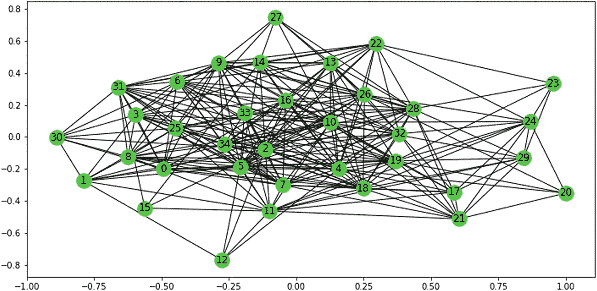

图 6-23：显示句子间连接的相似度图

# compute pagerank scores for all the sentences

```python
scores = networkx.pagerank(similarity_graph)

ranked_sentences = sorted(((score, index) for index, score

in scores.items()),

reverse=True)

ranked_sentences[:10]
```

```
[(0.03729704979721473, 2),

 (0.03490843547537587, 25),

 (0.03460086870923609, 4),

 (0.03240744530656926, 8),

 (0.03218748996523769, 28),

 (0.03183673426880143, 11),

 (0.031566658693076226, 26),

 (0.03150616293402057, 3),

 (0.031376143577383796, 5),

 (0.031123481531894214, 16)]
```

一旦每个句子被评分（基于以上输出中可见的句子索引），我们根据其分数对其进行排序。然后，我们可以轻松地识别出得分最高的八个句子，以形成摘要。


# get the top sentence indices for our summary

```
top_sentence_indices = [ranked_sentences[index][1]

                       for index in range(num_sentences)]

top_sentence_indices.sort()
```


# The Elder Scrolls V: Skyrim

## 游戏类型
《上古卷轴V：天际》是一款动作角色扮演游戏，玩家可以从第一人称或第三人称视角进行游玩。

## 背景设定
游戏的故事发生在《湮灭》事件的200年后，地点是虚构的省份天际省。

## 主要玩法
在游戏过程中，玩家通过完成任务和提升技能来发展角色。游戏的主线任务可以在完成第一阶段后，由玩家自行选择完成或忽略。

## 特色系统
天际省是《上古卷轴》系列中首个在野外加入龙的作品。与其他生物一样，龙会在世界中随机生成，并与NPC、生物及玩家交战。玩家角色可以吸收龙的灵魂，以使用被称为“龙吼”或“Thu'um”的强大法术。

## 代码示例
```python
# construct the document summary

print('\n'.join(np.array(sentences)[top_sentence_indices]))
```

我们最终通过`TextRank`算法得到了所需的摘要。其内容也相当有意义，你会看到它与基于`TextRank`算法变体的`Gensim`输出有很多相似之处。

从这一输出中可以看出，我们成功地对产品描述进行了摘要。这个简短的摘要描绘了产品描述的核心，例如游戏名称及其在玩法和情节方面的各种特性。这结束了我们对自动文本摘要的讨论。我们鼓励您将这些技术应用于更多文档，并使用不同的参数进行测试。考虑诸如更多的主题和不同的特征等参数，甚至可以探索基于深度学习的抽象式文本摘要技术。

## 总结

在本章中，我们介绍了自然语言处理和文本分析中关于信息提取、文档摘要和主题建模的一些有趣领域。我们从世界信息生成的演进概述开始，了解了诸如信息过载等概念，这引出了对文本摘要和信息检索的需求。我们讨论了从文本数据中提取关键信息的各种方法，以及总结大型文档的方式。我们还涵盖了重要的数学概念，如奇异值分解和低秩矩阵近似，并在多个算法中应用了它们。

我们介绍了三种减少信息过载的方法，包括关键短语提取、主题模型和自动文档摘要。关键短语提取包括从语料库中获取关键短语或术语的方法，如搭配和加权标记词方法。

我们构建了几种主题建模技术，包括潜在语义索引、潜在狄利克雷分配以及近期使用`Gensim`和`Scikit-Learn`实现的非负矩阵分解。我们还调整了主题模型，并展示了找到最佳主题数量的方法。此外，我们探讨了解释和理解主题建模结果的有效方法。最后，我们研究了两种基于提取的自动文档摘要技术——潜在语义分析和`TextRank`。我们实现了每种方法，并在真实数据上观察结果，以很好地了解这些方法的工作原理，以及简单的数学运算在生成可操作见解方面如何有效。
