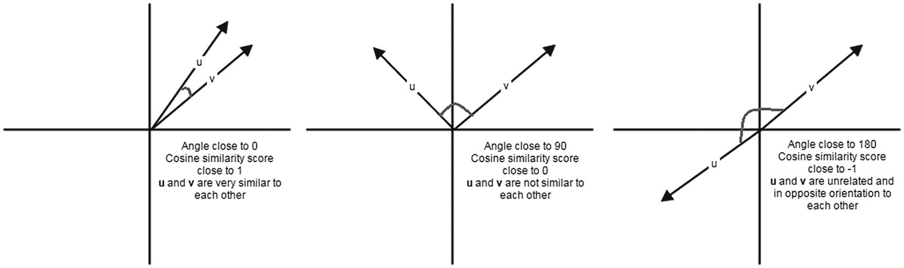
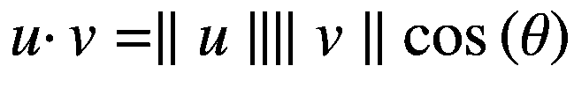
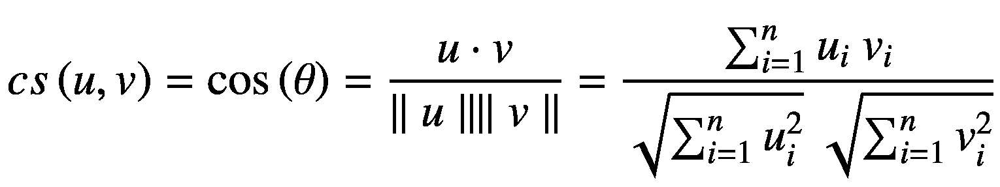
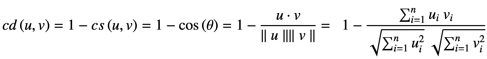
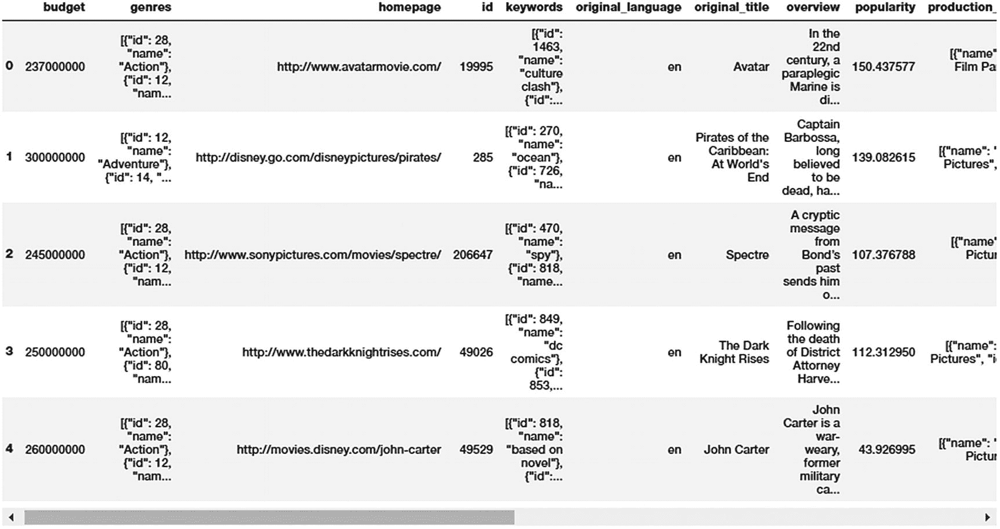
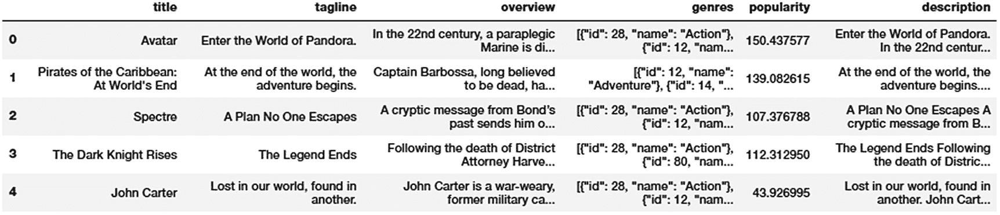

# 计算最终的编辑距离和编辑矩阵

```python
distance = dv[len(v)]

edit_matrix = np.array(edit_matrix)

edit_matrix = edit_matrix.T

edit_matrix = edit_matrix[1:,]

edit_matrix = pd.DataFrame(data=edit_matrix,
                           index=list(v),
                           columns=list(u))
return distance, edit_matrix
```

该函数返回两个输入项 `u` 和 `v` 之间的最终 Levenshtein 编辑距离及完整的编辑矩阵。请注意，我们需要直接传递原始字符串格式的项，而非其向量表示。同时，此处不区分字符串的大小写，并将它们转换为小写。以下代码片段使用前述函数计算示例项之间的 Levenshtein 编辑距离。

```python
for term in other_terms:
    edit_d, edit_m = levenshtein_edit_distance(root_term, term)
    print('Computing distance between root: {} and term: {}'.format(root_term, term))
    print('Levenshtein edit distance is {}'.format(edit_d))
    print('The complete edit distance matrix is depicted below')
    print(edit_m)
    print('-'*30)
```

```
Computing distance between root: Believe and term: beleive
Levenshtein edit distance is 2
The complete edit distance matrix is depicted below
b  e  l  i  e  v  e
b  0  1  2  3  4  5  6
e  1  0  1  2  3  4  5
l  2  1  0  1  2  3  4
e  3  2  1  1  1  2  3
i  4  3  2  1  2  2  3
v  5  4  3  2  2  2  3
e  6  5  4  3  2  3  2
------------------------------
Computing distance between root: Believe and term: bargain
Levenshtein edit distance is 6
The complete edit distance matrix is depicted below
b  e  l  i  e  v  e
b  0  1  2  3  4  5  6
a  1  1  2  3  4  5  6
r  2  2  2  3  4  5  6
g  3  3  3  3  4  5  6
a  4  4  4  4  4  5  6
i  5  5  5  4  5  5  6
n  6  6  6  5  5  6  6
------------------------------
Computing distance between root: Believe and term: Elephant
Levenshtein edit distance is 7
The complete edit distance matrix is depicted below
b  e  l  i  e  v  e
e  1  1  2  3  4  5  6
l  2  2  1  2  3  4  5
e  3  2  2  2  2  3  4
p  4  3  3  3  3  3  4
h  5  4  4  4  4  4  4
a  6  5  5  5  5  5  5
n  7  6  6  6  6  6  6
t  8  7  7  7  7  7  7
```

从输出可以看出，“Believe”和“beleive”最为接近，编辑距离为 2；而“Believe”与“bargain”和“Elephant”之间的距离均为 6，表示共需 6 次编辑操作。编辑矩阵则提供了算法每次迭代如何计算距离的更详细洞察。

## Cosine 距离与相似度

Cosine 距离是一个可以从 Cosine 相似度推导出的度量，反之亦然。假设我们有两个以向量形式表示的项（字符包向量，我们稍后会描述，其中字符的顺序无关紧要）。Cosine 相似度给出了当它们表示为内积空间中的非零正向量时，两者之间夹角的余弦值。因此，方向相似的项向量得分将更接近 1（`cos 0°`），表示向量在同一方向上非常接近（夹角接近零度）。相似度得分接近 0（`cos 90°`）的项向量表示不相关的项，其夹角接近正交。相似度得分接近 -1（`cos 180°`）的项向量表示方向完全相反的项。图 7-2 更清晰地说明了这一点，其中 `u` 和 `v` 是向量空间中的项向量。



因此，你可以从向量的位置看出，这些图更清晰地展示了向量之间的距离远近，而向量之间夹角的余弦值则给出了 Cosine 相似度度量。现在，我们可以正式将 Cosine 相似度定义为两个项向量 `u` 和 `v` 的点积，除以其 L2 范数的乘积。数学上，我们可以将两个向量之间的点积表示如下：



其中，θ 是 `u` 和 `v` 之间的夹角，`∥u∥` 表示向量 `u` 的 L2 范数，`∥v∥` 是向量 `v` 的 L2 范数。因此，我们可以从该公式推导出 Cosine 相似度如下：



其中，`cs(u, v)` 是 `u` 和 `v` 之间的 Cosine 相似度得分。这里 `u[i]` 和 `v[i]` 是两个向量的各个特征，这些特征或分量的总数为 `n`。在我们的案例中，我们使用字符包向量化来构建这些项向量，`n` 是分析中所有项中唯一字符的数量。

字符包向量化与词袋模型非常相似，不同之处在于我们计算的是单词中每个字符的频率。此处不考虑序列或单词顺序。以下函数有助于计算这一点。

```python
from scipy.stats import itemfreq

def boc_term_vectors(word_list):
    word_list = [word.lower() for word in word_list]
    unique_chars = np.unique(
        np.hstack([list(word)
                   for word in word_list]))
    word_list_term_counts = [{char: count
                              for char, count in np.stack(
                                  np.unique(list(word), return_counts=True), axis=1)}
                             for word in word_list]
    boc_vectors = [np.array([int(word_term_counts.get(char, 0))
                             for char in unique_chars])
                   for word_term_counts in word_list_term_counts]
    return list(unique_chars), boc_vectors
```

# 字符袋向量化

在这个函数中，我们接收一个单词或项列表，并从中提取唯一字符。这成为我们的特征列表，就像我们在词袋模型中所做的那样。不过，这里唯一单词将作为特征，而不是字符。一旦我们有了`unique_chars`列表，我们就获取每个单词中每个字符的计数，并构建我们的字符包向量。以下代码利用前面的函数为我们的示例项构建字符包向量。

```python
import pandas as pd

feature_names, feature_vectors = boc_term_vectors(terms)

boc_df = pd.DataFrame(feature_vectors, columns=feature_names, index=terms)

print(boc_df)
```

输出：

```
a  b  e  g  h  i  l  n  p  r  t  v
Believe   0  1  3  0  0  1  1  0  0  0  0  1
beleive   0  1  3  0  0  1  1  0  0  0  0  1
bargain   2  1  0  1  0  1  0  1  0  1  0  0
Elephant  1  0  2  0  1  0  1  1  1  0  1  0
```

就像我们预期的那样，每个向量本质上是一个无序的字符袋，描述了每个字符在对应单词中出现的频率。在计算余弦距离之前，我们先将这些向量存储到特定的变量中。

```python
root_term_boc = boc_df[vec_df.index == root_term].values[0]

other_term_bocs = [boc_df[vec_df.index == term].values[0]
                   for term in other_terms]
```

一个重要的点是：余弦相似度评分通常范围在 -1 到 +1 之间，但如果使用基于字符袋的字符频率（针对术语）或基于词袋的词频（针对文档），评分范围将是 0 到 1。这是因为频率向量永远不会为负，因此两个向量之间的夹角不会超过 90°。余弦距离是相似度评分的互补值，可以通过以下公式计算：



其中 `cd(u, v)` 表示术语向量 **u** 和 **v** 之间的余弦距离。以下函数实现了基于该公式的余弦距离计算。

```python
def cosine_distance(u, v):
    distance = 1.0 - (np.dot(u, v) /
                     (np.sqrt(sum(np.square(u))) * np.sqrt(sum(np.square(v))))
                     )
    return distance
```

现在我们使用之前创建的基于字符袋的表示（存储在`boc_root_vector`和`boc_vector_terms`变量中）来测试示例术语之间的相似度：

```python
for term, boc_term in zip(other_terms, other_term_bocs):
    print('Analyzing similarity between root: {} and term: {}'.format(root_term, term))
    distance = round(cosine_distance(root_term_boc, boc_term), 2)
    similarity = round(1 - distance, 2)
    print('Cosine distance  is {}'.format(distance))
    print('Cosine similarity  is {}'.format(similarity))
    print('-'*40)
```

输出：

```
Analyzing similarity between root: Believe and term: beleive
Cosine distance  is -0.0
Cosine similarity  is 1.0
Analyzing similarity between root: Believe and term: bargain
Cosine distance  is 0.82
Cosine similarity  is 0.18
Analyzing similarity between root: Believe and term: Elephant
Cosine distance  is 0.39
Cosine similarity  is 0.61
```

这些向量表示没有考虑字符的顺序，因此“Believe”和“beleive”这两个术语之间的相似度为 1.0，即 100% 完美匹配。你可以看到，如何将其与 WordNet 这样的语义词典结合使用，提供正确的拼写建议。当用户拼写错误时，它通过测量词语之间的相似度，从词汇表中推荐语义和语法都正确的单词。

你甚至可以尝试使用不同的特征来代替单个字符频率，例如每次取两个字符并计算它们的频率来构建术语向量。这将考虑到字符在各个术语中保持的某些序列。尝试不同的可能性并比较结果！这种距离度量在衡量大型文档或句子之间的相似度时效果非常好，我们将在下一节讨论文档相似度时看到这一点。

# 分析文档相似度

在前面的章节中，我们使用各种相似度和距离度量分析了术语之间的相似度。我们还看到向量化是如何使数学计算变得更容易，特别是在计算向量之间的距离时。在本节中，我们将尝试分析文档之间的相似度。到目前为止，你一定知道文档被定义为一篇文本主体，可以包含句子或段落。为了分析文档相似度，我们将进行一些基本的文本预处理，使用 TF-IDF 方案对文档进行向量化，类似于我们之前对文本文档进行分类或总结整个文档时所做的那样。一旦我们有了各种文档的向量表示，我们就可以使用一些标准的距离或相似度度量来计算文档之间的相似度。本节涵盖的度量如下：

- 余弦相似度
- Okapi BM25 排序

像往常一样，我们将介绍每个度量背后的概念，查看数学表示和定义，然后使用 Python 实现它们。为了增加趣味性，我们将通过一个构建电影推荐系统的实际例子来展示这些方法！你可以将其视为一个迷你模拟：当你在线搜索或观看一部电影时，系统会根据电影描述和内容向你推荐类似的电影。在现实世界中，你显然会有更多的参数和特征，如评分、类型、用户偏好历史等，但我们构建的推荐器将展示文档相似度如何帮助构建简单但令人惊叹的推荐器。

# 构建电影推荐器

推荐系统是机器学习中最流行和应用最广泛的领域之一。它们通常用于向用户推荐实体。这些实体可以是任何东西，如产品、电影、服务等。常见的推荐示例包括：

- 亚马逊在其网站上推荐产品
- Amazon Prime、Netflix 和 Hotstar 推荐电影/节目
- YouTube 推荐观看视频

推荐系统通常可以通过三种方式实现：

- **简单的基于规则的推荐器：** 基于特定的全局度量和阈值，如电影流行度、全球评分等。
- **基于内容的推荐器：** 基于特定感兴趣的实体提供相似的实体。可以在这里使用内容元数据，如电影描述、类型、演员、导演等。
- **协同过滤推荐器：** 我们不需要元数据，而是根据不同用户和特定项目的历史评分来预测推荐和评分。

我们将构建一个电影推荐系统，根据与不同电影相关的数据/元数据，尝试推荐类似的感兴趣的电影。参见图 7-3。


图 7-3 典型的电影或电视节目推荐

由于我们的重点不是推荐引擎，而是 NLP，我们将利用每部电影的基于文本的元数据，尝试根据特定的感兴趣电影推荐相似的电影。这属于基于内容的推荐器。我们将采用逐步的方法，结合文档相似度来构建这个推荐系统。

### 加载与查看数据集

本实验将使用广受欢迎的 TMDB 5000 电影数据集，您可以在 Kaggle 上的 [`https://www.kaggle.com/tmdb/tmdb-movie-metadata/home`](https://www.kaggle.com/tmdb/tmdb-movie-metadata/home) 找到它。同时，我们在官方 GitHub 仓库中也提供了该数据集的压缩版本，您可以通过 [`https://github.com/dipanjanS/text-analytics-with-python`](https://github.com/dipanjanS/text-analytics-with-python) 获取。现在，让我们加载并查看这个数据集。见图 7-4。



图 7-4 TMDB 5000 电影数据集

```python
import pandas as pd

df = pd.read_csv('tmdb_5000_movies.csv.gz', compression="gzip")

df.info()

RangeIndex: 4803 entries, 0 to 4802

Data columns (total 20 columns):

budget                  4803 non-null int64

genres                  4803 non-null object

homepage                1712 non-null object

id                      4803 non-null int64

keywords                4803 non-null object

original_language       4803 non-null object

original_title          4803 non-null object

overview                4800 non-null object

popularity              4803 non-null float64

production_companies    4803 non-null object

production_countries    4803 non-null object

release_date            4802 non-null object

revenue                 4803 non-null int64

runtime                 4801 non-null float64

spoken_languages        4803 non-null object

status                  4803 non-null object

tagline                 3959 non-null object

title                   4803 non-null object

vote_average            4803 non-null float64

vote_count              4803 non-null int64

dtypes: float64(3), int64(4), object(13)

memory usage: 750.5+ KB

df.head()
```

显然，对于基于简单内容的文档相似度电影推荐系统而言，我们并不需要分析所有这些字段（尽管若想构建更复杂的系统，它们可能很有用）。我们将把电影 `tagline` 列和 `overview` 列的文本内容合并成一个新列，命名为 `description`。见图 7-5。



图 7-5 包含相关属性的 TMDB 5000 电影数据集

```python
df = df[['title', 'tagline', 'overview', 'genres', 'popularity']]

df.tagline.fillna(", inplace=True)

df['description'] = df['tagline'].map(str) + ' ' + df['overview']

df.dropna(inplace=True)

df.info()

Int64Index: 4800 entries, 0 to 4802

Data columns (total 6 columns):

title          4800 non-null object

tagline        4800 non-null object

overview       4800 non-null object

genres         4800 non-null object

popularity     4800 non-null float64

description    4800 non-null object

dtypes: float64(1), object(5)

memory usage: 262.5+ KB

df.head()
```

现在，我们将构建自己的电影推荐系统。其流程中的主要组件如下：

- 文本预处理
- 特征工程
- 文档相似度计算
- 基于样片查找最相似的电影
- 构建电影推荐器

推荐的核心在于理解那些使我们偏爱某一选择而非另一选择的内在特征。项目之间的相似性（在本例中为电影）是理解我们为何选择一部电影而非另一部的一种方式。计算两个项目相似度的方法有多种。最广泛使用的度量之一就是余弦相似度，我们之前使用过，很快将再次使用。

### 文本预处理

在构建特征之前，我们将对电影描述进行一些基本的文本预处理。不需要太复杂，因为此处的重点在于文档相似度，而非文本处理本身。

```python
import nltk
import re
import numpy as np

stop_words = nltk.corpus.stopwords.words('english')

def normalize_document(doc):
```