# 7. 文本相似度与聚类

在前面的章节中，我们介绍了多种分析文本和提取有价值洞见的技术。我们探讨了有监督机器学习技术，用于将文本文档分类到几个预设的类别中。还介绍了无监督技术，如主题模型和文档摘要，这些技术涉及从大型文本文档和语料库中检索关键主题和信息。

在本章中，我们将研究一些利用无监督学习和信息检索概念的有趣技术和用例。如果你回忆一下第 5 章的内容，文本分类确实是一个有趣的问题，有着多种应用，最显著的包括新闻文章分类和电子邮件分类。但文本分类的一个限制是，我们需要大量带有手工标记类别的人工标注训练数据，因为我们使用有监督学习算法来构建分类模型。构建一个标注数据集绝非易事，因为你需要可观数量的训练数据。为此，我们需要花费时间和人力进行数据标注、模型构建，然后用它来对新文档进行分类。通常，任何企业可能都没有足够的时间在这方面投入（尽管收益可能是十倍的！）。我们能否让机器来完成这项任务呢？或许可以在一定程度上实现！本章将专门研究文本文档的内容，使用各种度量方法分析它们的相似性，并将相似的文档聚类在一起。

文本数据是非结构化的且噪声很高。在执行文本分类时，我们受益于良好标注的训练数据和有监督学习。然而，文档聚类是一个无监督学习过程，我们试图通过让机器学习各种文本文档、它们的特征、相似性和差异性，来将文档分割并分类到不同的类别中。这使得文档聚类更具挑战性，尽管也很有趣。假设有一个包含讨论各种不同概念和想法的文档的语料库。人类天生就能利用过往的学习经验来区分概念。例如，句子“狐狸比狗更聪明”与“狗比狐狸更快”的相似度，远高于其与“Python 是一种优秀的编程语言”的相似度。我们可以轻易地凭直觉识别出像`Python`、`狐狸`、`狗`、`编程`这样的特定关键词，这有助于我们判断哪些句子或文档更相似。但我们能否以编程方式实现这一点呢？

在本章中，我们将重点关注与文本相似度相关的几个概念——距离度量和无监督机器学习算法——以回答以下问题。

*   如何衡量词项和文档之间的相似度？
*   如何使用距离度量来找到最相关的文档？
*   何时距离度量是一种度量标准？
*   如何基于文本相似度构建推荐系统？
*   如何将相似的文档分组？

在专注于回答这些问题的同时，我们还将涵盖理解解决这些问题所需的基本概念和信息。我们还将使用一些实际示例来说明与文本相似度、距离度量和文档聚类相关的概念。我们将通过一些有趣的案例研究来展示这些概念，例如利用文档相似度构建电影推荐系统，并将相似的电影聚类在一起！

这些技术中有许多可以与我们之前学到的一些技术结合使用，反之亦然。例如，结合特征工程的文本表示概念以及使用距离度量和特征的文本相似度，也可用于构建文档聚类。你还可以使用主题模型中的特征来衡量文本相似度。

除此之外，聚类可以让我们了解数据可能包含的潜在分组或类别，这些分组或类别基于相似的模式和属性。然后，这可以被接入其他系统，如监督分类系统。可能性确实是无穷无尽的！在本章中，我们首先介绍一些与距离度量、度量和无监督学习相关的重要概念。在打好基础之后，我们的目标是理解并分析词项相似度、文档相似度、推荐，最后是文档聚类。本章展示的所有代码示例均可在本书的官方 GitHub 仓库中找到，你可以通过[`https://github.com/dipanjanS/text-analytics-with-python/tree/master/New-Second-Edition`](https://github.com/dipanjanS/text-analytics-with-python/tree/master/New-Second-Edition)访问该仓库。

## 基本概念

本章的主要目标是理解文本相似度和聚类。在进入具体技术和算法之前，本节将讨论与信息检索、文档相似度度量和机器学习相关的一些重要概念。尽管其中一些概念你可能在前面的章节中已经熟悉，但简要回顾一下仍会很有帮助。闲话少叙，我们开始吧。

### 信息检索

信息检索被定义为根据某种需求，从语料库或持有信息的实体集合中检索相关信息源的过程。需求可以以用户输入到搜索引擎中的查询或搜索的形式出现。然后，他们会获得与其查询相关的搜索条目。实际上，搜索引擎是信息检索最流行的应用。相较于需求，包含信息的文档的相关性可以通过多种方式来衡量。这包括从搜索文本中查找特定的关键词，或者使用相似度度量来查看文档相对于输入查询的相似度排名或分数。这使得它明显不同于字符串匹配或正则表达式匹配，因为搜索字符串中的单词在文档（实体）集合中通常具有不同的顺序、上下文和语义，而且这些单词甚至可能基于同义词、反义词和否定修饰词有多种不同的解析或可能性。

### 特征工程

到现在，你对特征工程或特征提取应该已经相当熟悉了。我们在第 4 章中详细介绍了这一点。诸如词袋模型、TF-IDF 和词嵌入模型等方法通常用于将文档表示为数值向量，以便更容易地应用数学或机器学习技术。你可以使用这些特征提取技术实现各种文档表示，甚至可以将每个字母或单词映射到一个对应的唯一数字标识符。

### 相似度度量

相似度度量用于文本相似度分析和聚类。任何相似度或距离度量都用于衡量两个实体之间的接近程度，这些实体可以是任何文本格式，例如文档、句子甚至单个术语。这种相似度度量有助于识别相似的实体，并将明显不同的实体相互区分开来。相似度度量非常有效，有时选择合适的度量方法会对最终分析系统的性能产生很大影响。基于这些距离度量，人们还发明了各种评分或排序算法。决定实体间相似程度的因素主要有两个，如下所示：

-   实体的固有属性或特征
-   度量公式及其属性

有多种距离度量可用于衡量相似度，我们将在后续章节中介绍其中的几种。然而，需要记住的一个重要点是，并非所有相似度的距离度量都是相似度的距离指标。A. Huang 的精彩论文《用于文本文档聚类的相似度度量》对此进行了详细讨论。考虑一个距离度量 `d` 和两个实体（在我们的上下文中，将之视为文档）`x` 和 `y`。`x` 和 `y` 之间的距离用于确定它们之间的相似程度，可表示为 `d(x, y)`。但度量 `d` 被称为*相似度的距离度量*，当且仅当它满足以下四个条件。

-   任意两个实体（例如 `x` 和 `y`）之间的距离必须始终为非负数，即 `d(x, y) ≥ 0`。
-   两个实体之间的距离应为零，当且仅当它们完全相同时，即 `d(x, y) = 0`，当且仅当 `x = y`。
-   此距离度量应始终是对称的，这意味着从 `x` 到 `y` 的距离始终等于从 `y` 到 `x` 的距离。数学上可表示为 `d(x, y) = d(y, x)`。
-   此距离度量应满足三角不等式性质，数学上可表示为 `d(x, z) ≤ d(x, y) + d(y, z)`。

这为我们提供了重要的标准和良好的框架，可用于检查某个距离度量是否可以作为衡量相似度的距离指标。进一步深入细节目前超出了本文的范围，但您可能有兴趣知道，非常流行的 KL 散度（也称为 Kullback-Leibler 散度）是一种违反第三性质的距离度量，该度量是不对称的。因此，将其用作文本文档的相似度度量是没有意义的。否则，它在区分不同分布和模式方面非常有用。

### 无监督机器学习算法

这指的是一类试图从数据的各种属性和特征中发现潜在隐藏结构和模式的机器学习算法。除此之外，一些无监督学习算法也用于减少特征空间，通常是将高维特征空间降为低维。这些算法所操作的数据本质上是未标记的，因此没有预先确定的类别或分类。我们应用这些算法的目的是发现模式和有区分性的特征，从而帮助我们根据这些模式或特征将各个数据点分组或聚类。这些算法通常被称为*聚类算法*。上一章介绍的主题模型也属于无监督学习算法家族。至此，我们完成了对本章所必需的重要概念和背景信息的讨论。接下来，我们将进入文本规范化和特征提取，其中将介绍一些本章特有的概念。

## 文本相似度

文本相似度的主要目标是分析和衡量两个文本实体之间的接近程度。这些文本实体可以是简单的标记或术语，如单词，也可以是整个文档，可能包含句子或文本段落。有多种分析文本相似度的方法，我们可以将文本相似度的意图大致分为以下两类。

-   **词汇相似度：** 这涉及观察文本文档的内容，包括其语法、结构和内容，并基于这些参数衡量它们的相似度。
-   **语义相似度：** 这涉及确定文档的语义、含义和上下文，然后确定它们彼此的接近程度。依存句法分析和实体识别是可用于此的便捷工具。我们在第 4 章中详细介绍了有助于捕获语义信息的词嵌入方法。

本章主要介绍词汇相似度。距离度量通常用于衡量文本实体之间的相似度分数，我们将主要涵盖以下两个广泛的文本相似度领域：

-   **术语相似度：** 单个标记或单词之间的相似度
-   **文档相似度：** 整个文本文档之间的相似度

我们的想法是实现若干种距离度量，并看看如何衡量和分析简单单词之间的相似度。然后，我们将考察当衡量一组单词之间的相似度时情况会如何变化。

# 分析术语相似度

我们将从分析术语相似度开始，更准确地说，是分析单个词元之间的相似度。尽管这在实际应用中用得不多，但它是理解文本相似度的绝佳起点。当然，自动补全、拼写检查和纠错器等应用场景会使用这些技术来纠正拼写错误的术语。我们在第 3 章实现拼写检查时就见过不少这类应用！这里我们将选取几个单词，使用不同的词语表示方法和距离度量来计算它们之间的相似度。我们使用的词语表示方法如下：

*   字符向量化
*   词袋字符向量化

对于字符向量化，这是一个极其简单的过程，只需将术语中的每个字符映射到一个对应的唯一数字。我们可以使用下面代码片段中描述的函数来实现。

```python
```

```python
import numpy as np

def vectorize_terms(terms):
    terms = [term.lower() for term in terms]
    terms = [np.array(list(term)) for term in terms]
    terms = [np.array([ord(char) for char in term]) for term in terms]
    return terms
```

该函数接收一个单词或术语列表，并返回这些单词对应的字符向量。为了演示，我们总共使用四个示例术语，并计算它们之间的相似度。

```python
root = 'Believe'
term1 = 'beleive'
term2 = 'bargain'
term3 = 'Elephant'
terms = [root, term1, term2, term3]
terms
```

# ['Believe', 'beleive', 'bargain', 'Elephant']

现在，我们对每个字符串（字符令牌列表）执行字符向量化，并以数据框的形式查看它们的表示。

```python
```

# 字符向量化

```
term_vectors = vectorize_terms(terms)
```

# 展示向量表示

```
vec_df = pd.DataFrame(term_vectors, index=terms)

print(vec_df)
```

#       0    1    2    3    4    5    6      7

# Believe

98  101  108  105  101  118  101    NaN

# beleive

```
98  101  108  101  105  118  101    NaN
```

`bargain`    98   97  114  103   97  105  110    NaN

# Elephant

因此，你可以看到我们是如何轻松地将每个文本术语转换为对应的数字向量表示的。注意，`NaN`值表示这些字符串比最后一个字符串短一个字符，而最后一个字符串则长一个字符。现在，我们使用几种距离度量来计算根词与其他三个单词之间的相似度，如前一个代码片段所述。有许多距离度量可以用来计算和衡量相似度。在本节中，我们将介绍以下五种度量。

*   汉明距离
*   曼哈顿距离
*   欧几里得距离
*   莱文斯坦编辑距离
*   余弦距离与相似度

我们将介绍每种距离度量的概念，并利用`NumPy`数组的强大功能来实现必要的计算和数学公式。然后，我们将通过测量示例术语的相似度来实际应用它们。在此之前，我们使用以下代码片段设置一些必要的变量：存储根词、将与其比较相似度的其他术语，以及它们各自的各种向量表示。

```python
root_term = root
other_terms = [term1, term2, term3]
root_term_vec = vec_df[vec_df.index == root_term].dropna(axis=1).values[0]
other_term_vecs = [vec_df[vec_df.index == term].dropna(axis=1).values[0] for term in other_terms]
```

我们现在准备开始计算相似度度量，并将使用这些术语及其向量表示来衡量相似度。

## 汉明距离

*汉明距离*是一种非常流行的距离度量，常用于信息论和通信系统中。它是在假设两个字符串等长的前提下，测量它们之间的距离。正式定义是：在两个等长字符串之间，对应位置字符不同的位置数量。考虑两个长度为`n`的术语`u`和`v`，汉明距离的数学表示如下：

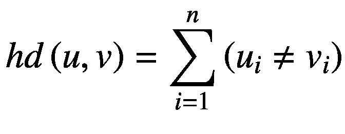

如果需要，你也可以通过将不匹配数除以术语的总长度来进行归一化。这样就得到了归一化的汉明距离，表示如下：

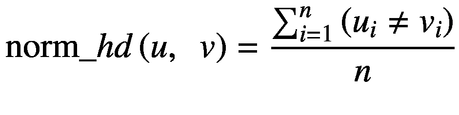

注意，`n`表示术语的长度。下面的函数计算两个术语之间的汉明距离，并且具备计算归一化距离的能力。

```python
def hamming_distance(u, v, norm=False):
    if u.shape != v.shape:
        raise ValueError('The vectors must have equal lengths.')
    return (u != v).sum() if not norm else (u != v).mean()
```

我们可以使用以下代码片段来测量根词与其他术语之间的汉明距离。

```python
```

# 计算汉明距离

```
for term, term_vector in zip(other_terms, other_term_vecs):

    print('Hamming distance between root: {} and term: {} is {}'.format(root_term, term, hamming_distance(root_term_vec, term_vector, norm=False)))
```

# 汉明距离 根词: `Believe` 与 术语: `beleive` 的距离是 2

# 汉明距离 根词: Believe 与 术语: bargain 的距离是 6

# Traceback (most recent call last):

# File "<stdin>", line 4, in <module>

```
#   File "<stdin>", line 4, in <module>
```

```markdown
`hamming_distance(root_vector, vector_term, norm=False)`
```

# `ValueError`: The vectors must have equal lengths.

# 计算归一化汉明距离

```
for term, term_vector in zip(other_terms, other_term_vecs):

    print('Normalized Hamming distance between root: {} and term: {} is {}'.format(root_term, term, round(hamming_distance(root_term_vec, term_vector, norm=True), 2)))
```

# 归一化汉明距离
根词: `Believe` 与 术语: `beleive` 的距离是 0.29

# 归一化汉明距离 根词: Believe 与 术语: bargain 的距离是 0.86

# Traceback (most recent call last):

# File "<stdin>", line 4, in `<module>`

# `round(hamming_distance(root_vector, vector_term, norm=True), 2))`

```
round(hamming_distance(root_vector, vector_term, norm=True), 2))
```

# 曼哈顿距离

## ValueError: The vectors must have equal lengths

```
从输出中可以看出，术语"Believe"和"beleive"最为相似，汉明距离为 2 或 0.29，而术语"bargain"的得分为 6 或 0.86（分数越小，术语越相似）。同样地，术语"Elephant"会抛出异常，因为其长度与根词"Believe"不同。由于字符串长度不相等，无法计算汉明距离。
```

*曼哈顿距离*度量在概念上与汉明距离相似，区别在于不是计算不匹配的字符数，而是将两个字符串在每个位置上每对字符的差值相减。形式上，曼哈顿距离也称为城市街区距离、`L1`范数或出租车度量，它被定义为网格中两点之间基于严格水平或垂直路径的距离。这取代了通常由欧几里得距离度量计算的对角线距离。数学上可表示如下：

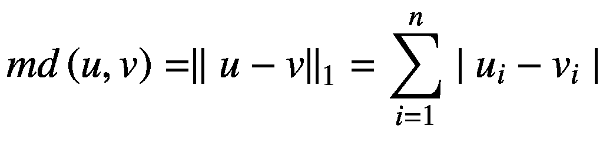

其中 `u` 和 `v` 是长度为 `n` 的两个项。汉明距离中关于两个项长度相等的假设在此同样适用。我们还可以通过将绝对差值之和除以项的长度来计算归一化曼哈顿距离。这可以表示为：

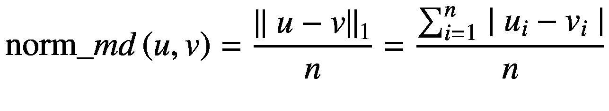

其中 `n` 是每个项 `u` 和 `v` 的长度。以下函数帮助我们实现曼哈顿距离，并具备计算归一化曼哈顿距离的能力。

```python
def manhattan_distance(u, v, norm=False):
    if u.shape != v.shape:
        raise ValueError('The vectors must have equal lengths.')
    return abs(u - v).sum() if not norm else abs(u - v).mean()
```

现在，我们将使用下面代码片段中描述的函数，计算我们的根项与其他项之间的曼哈顿距离。

```python
```

# compute Manhattan distance

```python
for term, term_vector in zip(other_terms, other_term_vecs):
    print('Manhattan distance between root: {} and term: {} is {}'.format(root_term, term, manhattan_distance(root_term_vec, term_vector, norm=False)))
```

Manhattan distance between root: Believe and term: beleive is 8

Manhattan distance between root: Believe and term: bargain is 38

```
Traceback (most recent call last):
  File "<stdin>", line 4, in <module>
    manhattan_distance(root_vector, vector_term, norm=False))
ValueError: The vectors must have equal lengths.
```

# compute normalized Manhattan distance

```python
for term, term_vector in zip(other_terms, other_term_vecs):
    print('Normalized Manhattan distance between root: {} and term: {} is {}'.format(root_term, term, round(manhattan_distance(root_term_vec, term_vector, norm=True), 2)))
```

Normalized Manhattan distance between root: Believe and term: beleive is 1.14
Normalized Manhattan distance between root: Believe and term: bargain is 5.43

```
Traceback (most recent call last):
  File "<stdin>", line 4, in <module>
    round(manhattan_distance(root_vector, vector_term, norm=True),2))
ValueError: The vectors must have equal lengths.
```

从这些结果可以看出，正如预期的那样，“Believe”和“beleive”最为相似，得分为 8 或 1.14，而“bargain”的得分为 38 或 5.43。项“Elephant”会产生错误，因为其长度与基本项不同。

# 欧几里得距离

我们在前一节比较曼哈顿距离时简要提到了*欧几里得距离*。形式上，欧几里得距离也称为欧几里得范数、`L2`范数或 `L2`距离。它被定义为两点之间的最短直线距离。数学上可表示如下：

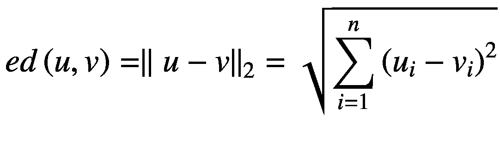

其中在我们的场景中，两个点 `u` 和 `v` 是长度为 `n` 的向量化文本项。以下函数帮助我们计算两个项之间的欧几里得距离。

```python
def euclidean_distance(u, v):
    if u.shape != v.shape:
        raise ValueError('The vectors must have equal lengths.')
    distance = np.sqrt(np.sum(np.square(u - v)))
    return distance
```

现在，我们可以使用下面代码片段中描述的这个函数，来比较各项之间的欧几里得距离。

```python
```

# compute Euclidean distance

```python
for term, term_vector in zip(other_terms, other_term_vecs):
    print('Euclidean distance between root: {} and term: {} is {}'.format(root_term, term, round(euclidean_distance(root_term_vec, term_vector), 2)))
```

```
Euclidean distance between root: Believe and term: beleive is 5.66
Euclidean distance between root: Believe and term: bargain is 17.94
Traceback (most recent call last):
  File "<stdin>", line 4, in <module>
    round(euclidean_distance(root_vector, vector_term),2))
ValueError: The vectors must have equal lengths.
```

从这些输出中可以看到，项“Believe”和“beleive”最为相似，得分为 5.66，而“bargain”的得分为 17.94。同样，字符串“Elephant”会抛出`ValueError`，因为它的长度不同。到目前为止，我们使用的所有距离度量都适用于长度相同的字符串，当字符串长度不相等时就会失败。那么，我们该如何处理这个问题呢？接下来，我们将介绍几种即使在字符串长度不等时也能衡量相似度的距离度量。

## 莱文斯坦编辑距离

*莱文斯坦编辑距离*（通常简称为*莱文斯坦距离*）属于基于编辑距离的度量族，用于根据两个字符串序列之间的差异来衡量它们的距离，其概念与汉明距离类似。两个词项之间的莱文斯坦编辑距离可以定义为：通过添加、删除或替换的形式，将一个词项更改为另一个词项所需的最少编辑次数。这些替换是基于字符的替换，即每次操作可以编辑单个字符。如前所述，两个词项的长度不必相等。在数学上，我们可以将两个词项之间的莱文斯坦编辑距离表示为`ldu, v`，其中`u`和`v`是我们的两个词项，`|u|`和`|v|`是它们的长度。该距离可以用以下公式表示：


其中`i`和`j`基本上是指词项`u`和`v`的索引。最小值中的第三个方程包含一个代价函数，记为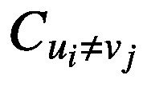，它具有以下条件：

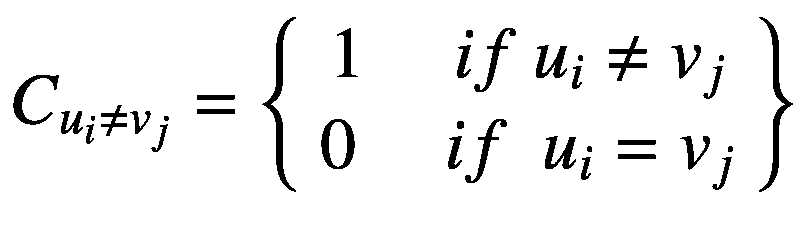

这表示一个指示函数，描述了为两个词项匹配两个字符时相关的代价（该方程表示匹配或不匹配操作）。最小值中的第一个方程确定删除操作，第二个方程确定插入操作。

因此，函数`ldu, v`涵盖了插入、删除和添加这三种操作。它也表示了在词项`u`的前`i`个字符和词项`v`的前`j`个字符之间测量的莱文斯坦距离。关于莱文斯坦编辑距离，还有一些有趣的边界条件。如下所示：

* 两个词项之间编辑距离的最小值是两个词项的长度之差
* 两个词项之间编辑距离的最大值可以是较长词项的长度
* 如果两个词项相等，则编辑距离为零
* 当且仅当两个词项长度相等时，两个词项之间的汉明距离是莱文斯坦编辑距离的一个上界
* 作为一种距离度量，它也满足三角不等式性质，这在我们之前讨论距离度量时已经提到过

有多种方法可以实现词项的莱文斯坦距离计算。这里我们从两个词项的示例开始。考虑根词项`"believe"`和另一个词项`"beleive"`（计算中忽略大小写），编辑距离将为 2，因为我们需要以下两次操作。

* bel`e`ive → bel`i`ive（将`e`替换为`i`）
* beli`i`ve → beli`e`ve（将`i`替换为`e`）

为了实现这一点，我们构建一个矩阵，通过比较第一个词项的每个字符与第二个词项的字符，来计算两个词项所有字符之间的莱文斯坦距离。在计算中，我们采用动态规划方法，以便基于最后计算出的值得到两个词项之间的编辑距离。对于这两个词项，我们的算法应生成的莱文斯坦编辑距离矩阵如图 7-1 所示。

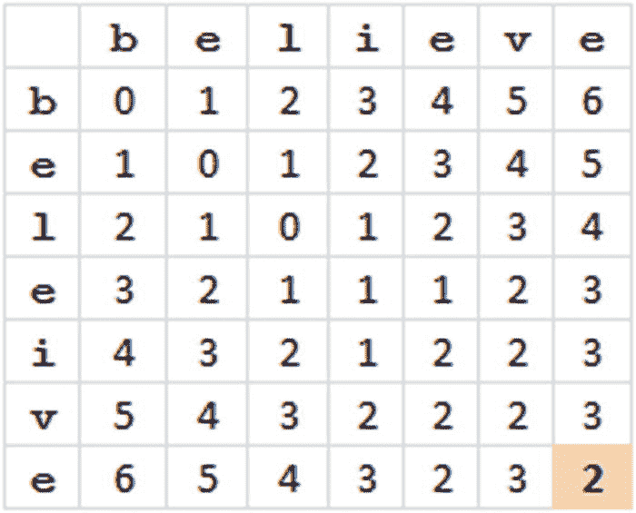

图 7-1 词项之间的莱文斯坦编辑距离矩阵

从图 7-1 中可以看出，编辑距离是针对词项中每对字符计算的，而最终的编辑距离值（在图中突出显示）给出了两个词项之间的实际编辑距离。该算法也称为*瓦格纳-费歇尔算法*，出自 R. Wagner 和 M. Fischer 的论文《字符串到字符串的校正问题》，如果你对细节感兴趣，可以参考该论文。伪代码如下所示，源自该论文。

```
function levenshtein_distance(char u[1..m], char v[1..n]):
```

# 对于所有 `i` 和 `j`，`d[i,j]` 将保存 `u` 的前 `i` 个字符与 `v` 的前 `j` 个字符之间的莱文斯坦距离，注意 `d` 有 `(m+1)*(n+1)` 个值

```
int d[0..m, 0..n]
```


# 将 `d` 中的每个元素设置为零

```
d[0..m, 0..n] := 0
```


# 源前缀可以通过删除所有字符转换为空字符串

```
for i from 1 to m:
    d[i, 0] := i
```

# 目标前缀可以通过插入每个字符从空源前缀得到

```
for j from 1 to n:

d[0, j] := j
```

# 构建编辑距离矩阵

```
for j from 1 to n:
    for i from 1 to m:
        if s[i] = t[j]:
            substitutionCost := 0
        else:
            substitutionCost := 1
        d[i, j] := minimum(d[i-1, j] + 1,                  # 删除
                           d[i, j-1] + 1,                 # 插入
                           d[i-1, j-1] + substitutionCost)  # 替换
```

# 矩阵的最终值是词项之间的编辑距离

`return d[m, n]`

从函数定义的伪代码中可以看到，我们如何捕捉之前用于定义莱文斯坦编辑距离的必备公式。我们现在将用 Python 实现这个伪代码。该算法使用 `O(mn)` 空间，因为它存储了整个距离矩阵，但为了得到最终结果，只需存储距离的前一行和当前行就足够了。我们在代码中也会这样做，但为了最终能够可视化结果，我们还会将结果存储在一个矩阵中。以下函数实现了莱文斯坦编辑距离。

```python
import copy
import pandas as pd

def levenshtein_edit_distance(u, v):
```

# 转换为小写

```
u = u.lower()
v = v.lower()
```

# 基本情况

```
if `u` == `v`: return 0

elif len(`u`) == 0: return len(`v`)

elif len(`v`) == 0: return len(`u`)
```

# 初始化编辑距离矩阵

```
edit_matrix = []
```

# 初始化两个距离矩阵

```
du = [0] * (len(v) + 1)

dv = [0] * (len(v) + 1)
```

# du: 编辑距离的前一行

```
for i in range(len(du)):
    du[i] = i
```

# dv : 编辑距离的当前行

```
for i in range(len(u)):

dv[0] = i + 1
```

# 根据算法计算代价

```
for j in range(len(v)):

cost = 0 if u[i] == v[j] else 1

dv[j + 1] = min(dv[j] + 1, du[j + 1] + 1, du[j] + cost)
```

# 将`dv`赋值给`du`以供下一次迭代

```
for j in range(len(du)):
    du[j] = dv[j]
```

# 将 `dv` 复制到编辑矩阵

```
edit_matrix.append(copy.copy(dv))
```

# 计算最终的编辑距离和编辑矩阵

```python
distance = dv[len(v)]

edit_matrix = np.array(edit_matrix)

edit_matrix = edit_matrix.T

edit_matrix = edit_matrix[1:,]

edit_matrix = pd.DataFrame(data=edit_matrix,
                           index=list(v),
                           columns=list(u))
return distance, edit_matrix
```

该函数返回两个输入项 `u` 和 `v` 之间的最终 Levenshtein 编辑距离及完整的编辑矩阵。请注意，我们需要直接传递原始字符串格式的项，而非其向量表示。同时，此处不区分字符串的大小写，并将它们转换为小写。以下代码片段使用前述函数计算示例项之间的 Levenshtein 编辑距离。

```python
for term in other_terms:
    edit_d, edit_m = levenshtein_edit_distance(root_term, term)
    print('Computing distance between root: {} and term: {}'.format(root_term, term))
    print('Levenshtein edit distance is {}'.format(edit_d))
    print('The complete edit distance matrix is depicted below')
    print(edit_m)
    print('-'*30)
```

```
Computing distance between root: Believe and term: beleive
Levenshtein edit distance is 2
The complete edit distance matrix is depicted below
b  e  l  i  e  v  e
b  0  1  2  3  4  5  6
e  1  0  1  2  3  4  5
l  2  1  0  1  2  3  4
e  3  2  1  1  1  2  3
i  4  3  2  1  2  2  3
v  5  4  3  2  2  2  3
e  6  5  4  3  2  3  2
------------------------------
Computing distance between root: Believe and term: bargain
Levenshtein edit distance is 6
The complete edit distance matrix is depicted below
b  e  l  i  e  v  e
b  0  1  2  3  4  5  6
a  1  1  2  3  4  5  6
r  2  2  2  3  4  5  6
g  3  3  3  3  4  5  6
a  4  4  4  4  4  5  6
i  5  5  5  4  5  5  6
n  6  6  6  5  5  6  6
------------------------------
Computing distance between root: Believe and term: Elephant
Levenshtein edit distance is 7
The complete edit distance matrix is depicted below
b  e  l  i  e  v  e
e  1  1  2  3  4  5  6
l  2  2  1  2  3  4  5
e  3  2  2  2  2  3  4
p  4  3  3  3  3  3  4
h  5  4  4  4  4  4  4
a  6  5  5  5  5  5  5
n  7  6  6  6  6  6  6
t  8  7  7  7  7  7  7
```

从输出可以看出，“Believe”和“beleive”最为接近，编辑距离为 2；而“Believe”与“bargain”和“Elephant”之间的距离均为 6，表示共需 6 次编辑操作。编辑矩阵则提供了算法每次迭代如何计算距离的更详细洞察。

## Cosine 距离与相似度

Cosine 距离是一个可以从 Cosine 相似度推导出的度量，反之亦然。假设我们有两个以向量形式表示的项（字符包向量，我们稍后会描述，其中字符的顺序无关紧要）。Cosine 相似度给出了当它们表示为内积空间中的非零正向量时，两者之间夹角的余弦值。因此，方向相似的项向量得分将更接近 1（`cos 0°`），表示向量在同一方向上非常接近（夹角接近零度）。相似度得分接近 0（`cos 90°`）的项向量表示不相关的项，其夹角接近正交。相似度得分接近 -1（`cos 180°`）的项向量表示方向完全相反的项。图 7-2 更清晰地说明了这一点，其中 `u` 和 `v` 是向量空间中的项向量。

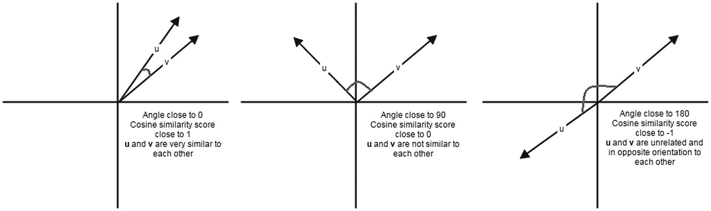

因此，你可以从向量的位置看出，这些图更清晰地展示了向量之间的距离远近，而向量之间夹角的余弦值则给出了 Cosine 相似度度量。现在，我们可以正式将 Cosine 相似度定义为两个项向量 `u` 和 `v` 的点积，除以其 L2 范数的乘积。数学上，我们可以将两个向量之间的点积表示如下：

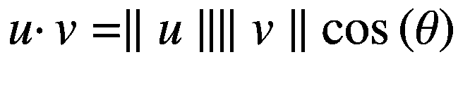

其中，θ 是 `u` 和 `v` 之间的夹角，`∥u∥` 表示向量 `u` 的 L2 范数，`∥v∥` 是向量 `v` 的 L2 范数。因此，我们可以从该公式推导出 Cosine 相似度如下：

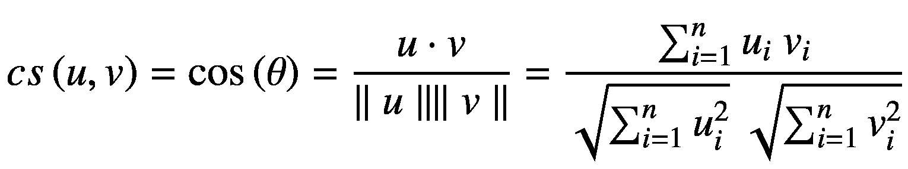

其中，`cs(u, v)` 是 `u` 和 `v` 之间的 Cosine 相似度得分。这里 `u[i]` 和 `v[i]` 是两个向量的各个特征，这些特征或分量的总数为 `n`。在我们的案例中，我们使用字符包向量化来构建这些项向量，`n` 是分析中所有项中唯一字符的数量。

字符包向量化与词袋模型非常相似，不同之处在于我们计算的是单词中每个字符的频率。此处不考虑序列或单词顺序。以下函数有助于计算这一点。

```python
from scipy.stats import itemfreq

def boc_term_vectors(word_list):
    word_list = [word.lower() for word in word_list]
    unique_chars = np.unique(
        np.hstack([list(word)
                   for word in word_list]))
    word_list_term_counts = [{char: count
                              for char, count in np.stack(
                                  np.unique(list(word), return_counts=True), axis=1)}
                             for word in word_list]
    boc_vectors = [np.array([int(word_term_counts.get(char, 0))
                             for char in unique_chars])
                   for word_term_counts in word_list_term_counts]
    return list(unique_chars), boc_vectors
```

# 字符袋向量化

在这个函数中，我们接收一个单词或项列表，并从中提取唯一字符。这成为我们的特征列表，就像我们在词袋模型中所做的那样。不过，这里唯一单词将作为特征，而不是字符。一旦我们有了`unique_chars`列表，我们就获取每个单词中每个字符的计数，并构建我们的字符包向量。以下代码利用前面的函数为我们的示例项构建字符包向量。

```python
import pandas as pd

feature_names, feature_vectors = boc_term_vectors(terms)

boc_df = pd.DataFrame(feature_vectors, columns=feature_names, index=terms)

print(boc_df)
```

输出：

```
a  b  e  g  h  i  l  n  p  r  t  v
Believe   0  1  3  0  0  1  1  0  0  0  0  1
beleive   0  1  3  0  0  1  1  0  0  0  0  1
bargain   2  1  0  1  0  1  0  1  0  1  0  0
Elephant  1  0  2  0  1  0  1  1  1  0  1  0
```

就像我们预期的那样，每个向量本质上是一个无序的字符袋，描述了每个字符在对应单词中出现的频率。在计算余弦距离之前，我们先将这些向量存储到特定的变量中。

```python
root_term_boc = boc_df[vec_df.index == root_term].values[0]

other_term_bocs = [boc_df[vec_df.index == term].values[0]
                   for term in other_terms]
```

一个重要的点是：余弦相似度评分通常范围在 -1 到 +1 之间，但如果使用基于字符袋的字符频率（针对术语）或基于词袋的词频（针对文档），评分范围将是 0 到 1。这是因为频率向量永远不会为负，因此两个向量之间的夹角不会超过 90°。余弦距离是相似度评分的互补值，可以通过以下公式计算：

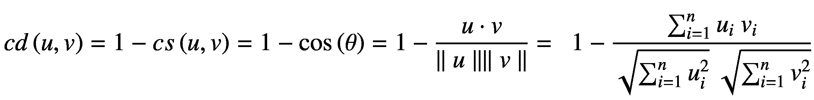

其中 `cd(u, v)` 表示术语向量 **u** 和 **v** 之间的余弦距离。以下函数实现了基于该公式的余弦距离计算。

```python
def cosine_distance(u, v):
    distance = 1.0 - (np.dot(u, v) /
                     (np.sqrt(sum(np.square(u))) * np.sqrt(sum(np.square(v))))
                     )
    return distance
```

现在我们使用之前创建的基于字符袋的表示（存储在`boc_root_vector`和`boc_vector_terms`变量中）来测试示例术语之间的相似度：

```python
for term, boc_term in zip(other_terms, other_term_bocs):
    print('Analyzing similarity between root: {} and term: {}'.format(root_term, term))
    distance = round(cosine_distance(root_term_boc, boc_term), 2)
    similarity = round(1 - distance, 2)
    print('Cosine distance  is {}'.format(distance))
    print('Cosine similarity  is {}'.format(similarity))
    print('-'*40)
```

输出：

```
Analyzing similarity between root: Believe and term: beleive
Cosine distance  is -0.0
Cosine similarity  is 1.0
Analyzing similarity between root: Believe and term: bargain
Cosine distance  is 0.82
Cosine similarity  is 0.18
Analyzing similarity between root: Believe and term: Elephant
Cosine distance  is 0.39
Cosine similarity  is 0.61
```

这些向量表示没有考虑字符的顺序，因此“Believe”和“beleive”这两个术语之间的相似度为 1.0，即 100% 完美匹配。你可以看到，如何将其与 WordNet 这样的语义词典结合使用，提供正确的拼写建议。当用户拼写错误时，它通过测量词语之间的相似度，从词汇表中推荐语义和语法都正确的单词。

你甚至可以尝试使用不同的特征来代替单个字符频率，例如每次取两个字符并计算它们的频率来构建术语向量。这将考虑到字符在各个术语中保持的某些序列。尝试不同的可能性并比较结果！这种距离度量在衡量大型文档或句子之间的相似度时效果非常好，我们将在下一节讨论文档相似度时看到这一点。

# 分析文档相似度

在前面的章节中，我们使用各种相似度和距离度量分析了术语之间的相似度。我们还看到向量化是如何使数学计算变得更容易，特别是在计算向量之间的距离时。在本节中，我们将尝试分析文档之间的相似度。到目前为止，你一定知道文档被定义为一篇文本主体，可以包含句子或段落。为了分析文档相似度，我们将进行一些基本的文本预处理，使用 TF-IDF 方案对文档进行向量化，类似于我们之前对文本文档进行分类或总结整个文档时所做的那样。一旦我们有了各种文档的向量表示，我们就可以使用一些标准的距离或相似度度量来计算文档之间的相似度。本节涵盖的度量如下：

- 余弦相似度
- Okapi BM25 排序

像往常一样，我们将介绍每个度量背后的概念，查看数学表示和定义，然后使用 Python 实现它们。为了增加趣味性，我们将通过一个构建电影推荐系统的实际例子来展示这些方法！你可以将其视为一个迷你模拟：当你在线搜索或观看一部电影时，系统会根据电影描述和内容向你推荐类似的电影。在现实世界中，你显然会有更多的参数和特征，如评分、类型、用户偏好历史等，但我们构建的推荐器将展示文档相似度如何帮助构建简单但令人惊叹的推荐器。

# 构建电影推荐器

推荐系统是机器学习中最流行和应用最广泛的领域之一。它们通常用于向用户推荐实体。这些实体可以是任何东西，如产品、电影、服务等。常见的推荐示例包括：

- 亚马逊在其网站上推荐产品
- Amazon Prime、Netflix 和 Hotstar 推荐电影/节目
- YouTube 推荐观看视频

推荐系统通常可以通过三种方式实现：

- **简单的基于规则的推荐器：** 基于特定的全局度量和阈值，如电影流行度、全球评分等。
- **基于内容的推荐器：** 基于特定感兴趣的实体提供相似的实体。可以在这里使用内容元数据，如电影描述、类型、演员、导演等。
- **协同过滤推荐器：** 我们不需要元数据，而是根据不同用户和特定项目的历史评分来预测推荐和评分。

我们将构建一个电影推荐系统，根据与不同电影相关的数据/元数据，尝试推荐类似的感兴趣的电影。参见图 7-3。


图 7-3 典型的电影或电视节目推荐

由于我们的重点不是推荐引擎，而是 NLP，我们将利用每部电影的基于文本的元数据，尝试根据特定的感兴趣电影推荐相似的电影。这属于基于内容的推荐器。我们将采用逐步的方法，结合文档相似度来构建这个推荐系统。

### 加载与查看数据集

本实验将使用广受欢迎的 TMDB 5000 电影数据集，您可以在 Kaggle 上的 [`https://www.kaggle.com/tmdb/tmdb-movie-metadata/home`](https://www.kaggle.com/tmdb/tmdb-movie-metadata/home) 找到它。同时，我们在官方 GitHub 仓库中也提供了该数据集的压缩版本，您可以通过 [`https://github.com/dipanjanS/text-analytics-with-python`](https://github.com/dipanjanS/text-analytics-with-python) 获取。现在，让我们加载并查看这个数据集。见图 7-4。

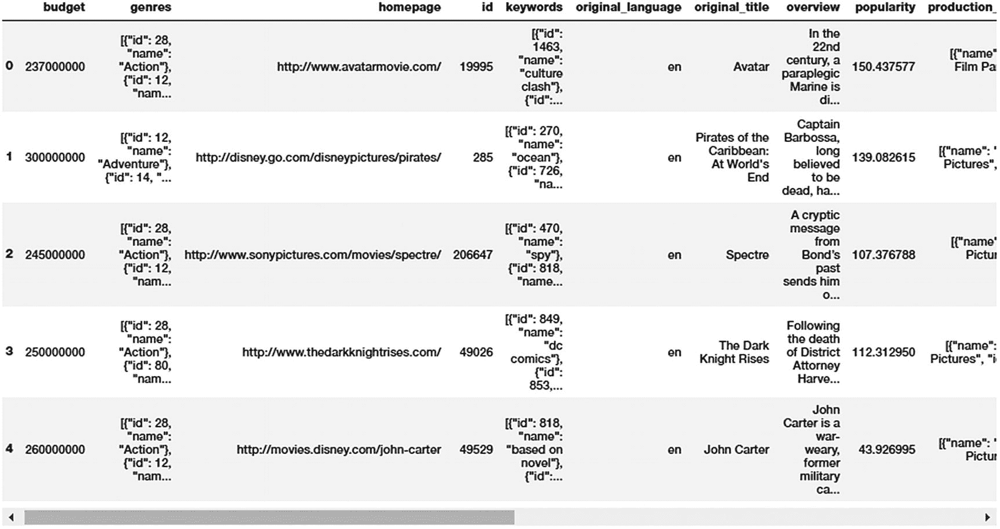

图 7-4 TMDB 5000 电影数据集

```python
import pandas as pd

df = pd.read_csv('tmdb_5000_movies.csv.gz', compression="gzip")

df.info()

RangeIndex: 4803 entries, 0 to 4802

Data columns (total 20 columns):

budget                  4803 non-null int64

genres                  4803 non-null object

homepage                1712 non-null object

id                      4803 non-null int64

keywords                4803 non-null object

original_language       4803 non-null object

original_title          4803 non-null object

overview                4800 non-null object

popularity              4803 non-null float64

production_companies    4803 non-null object

production_countries    4803 non-null object

release_date            4802 non-null object

revenue                 4803 non-null int64

runtime                 4801 non-null float64

spoken_languages        4803 non-null object

status                  4803 non-null object

tagline                 3959 non-null object

title                   4803 non-null object

vote_average            4803 non-null float64

vote_count              4803 non-null int64

dtypes: float64(3), int64(4), object(13)

memory usage: 750.5+ KB

df.head()
```

显然，对于基于简单内容的文档相似度电影推荐系统而言，我们并不需要分析所有这些字段（尽管若想构建更复杂的系统，它们可能很有用）。我们将把电影 `tagline` 列和 `overview` 列的文本内容合并成一个新列，命名为 `description`。见图 7-5。

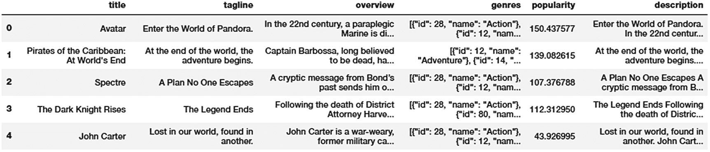

图 7-5 包含相关属性的 TMDB 5000 电影数据集

```python
df = df[['title', 'tagline', 'overview', 'genres', 'popularity']]

df.tagline.fillna(", inplace=True)

df['description'] = df['tagline'].map(str) + ' ' + df['overview']

df.dropna(inplace=True)

df.info()

Int64Index: 4800 entries, 0 to 4802

Data columns (total 6 columns):

title          4800 non-null object

tagline        4800 non-null object

overview       4800 non-null object

genres         4800 non-null object

popularity     4800 non-null float64

description    4800 non-null object

dtypes: float64(1), object(5)

memory usage: 262.5+ KB

df.head()
```

现在，我们将构建自己的电影推荐系统。其流程中的主要组件如下：

- 文本预处理
- 特征工程
- 文档相似度计算
- 基于样片查找最相似的电影
- 构建电影推荐器

推荐的核心在于理解那些使我们偏爱某一选择而非另一选择的内在特征。项目之间的相似性（在本例中为电影）是理解我们为何选择一部电影而非另一部的一种方式。计算两个项目相似度的方法有多种。最广泛使用的度量之一就是余弦相似度，我们之前使用过，很快将再次使用。

### 文本预处理

在构建特征之前，我们将对电影描述进行一些基本的文本预处理。不需要太复杂，因为此处的重点在于文档相似度，而非文本处理本身。

```python
import nltk
import re
import numpy as np

stop_words = nltk.corpus.stopwords.words('english')

def normalize_document(doc):
```

## 转为小写并移除特殊字符/空白

```python
doc = re.sub(r'[^a-zA-Z0-9\s]', "", doc, re.I|re.A)
doc = doc.lower()
doc = doc.strip()
```

## 分词

```python
tokens = nltk.word_tokenize(doc)
```

# 过滤停用词

```
filtered_tokens = [token for token in tokens if token not in stop_words]
```

# 从过滤后的词元重新生成文档

```python
doc = ' '.join(filtered_tokens)
return doc
```

```python
normalize_corpus = np.vectorize(normalize_document)
norm_corpus = normalize_corpus(list(df['description']))
len(norm_corpus)
```

## 文本表示

接下来，我们进行文本表示，这可以通过利用像 TF-IDF 这样的特征工程方案来实现。

### 提取 TF-IDF 特征

我们在第 4 章中详细讨论了 TF-IDF 表示方案。在此，我们利用它来向量化预处理后的电影描述，从而将其转换为数值向量。

```python
from sklearn.feature_extraction.text import TfidfVectorizer

tf = TfidfVectorizer(ngram_range=(1, 2), min_df=2)
tfidf_matrix = tf.fit_transform(norm_corpus)
tfidf_matrix.shape
```

```
(4800, 20667)
```

我们采用一元分词和二元分词作为特征，并移除在整个语料库中仅出现在一个文档中的词汇。现在，我们已经使用基于 `tf-idf` 的向量表示对文档进行了标准化和向量化处理，接下来将探讨如何使用余弦相似度计算文档相似度。

### 用于成对文档相似度的余弦相似度

我们已经了解了计算余弦相似度的概念，并将其应用于术语相似度。在此，我们复用相同的概念来计算文档之间的余弦相似度得分，而非术语。文档向量将是基于词袋模型的向量，但其中的值采用 TF-IDF 值而非词频。因此，最终我们将得到一个 *N x N* 的矩阵，其中 *N* 等于电影数量，即 4,800。见图 7-6。

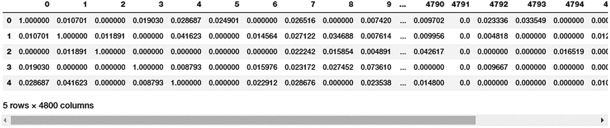

图 7-6 成对文档余弦相似度

```python
from sklearn.metrics.pairwise import cosine_similarity

doc_sim = cosine_similarity(tfidf_matrix)
doc_sim_df = pd.DataFrame(doc_sim)
doc_sim_df.head()
```

现在，在构建电影推荐系统之前，我们将构建一个工作流，用于确定与样片最相似且值得推荐的电影。在此之前，我们先构建数据集中所有电影标题的列表。

```python
movies_list = df['title'].values
movies_list, movies_list.shape
```

```
(array(['Avatar', "Pirates of the Caribbean: At World's End", 'Spectre',
       ..., 'Signed, Sealed, Delivered', 'Shanghai Calling',
       'My Date with Drew'], dtype=object), (4800,))
```

通常，我们可以索引成对相似度矩阵来获取用于推荐的文档相似度。

### 查找样片的最相似电影

以最受欢迎的电影之一《神偷奶爸》为例，尝试找出最相似的可推荐电影。以下是主要步骤，后续将有助于我们构建通用函数。

#### 查找电影 ID

由于我们拥有电影列表，因此在数据集中找到该电影的位置索引非常简单。

```python
movie_idx = np.where(movies_list == 'Minions')[0][0]
movie_idx
```

#### 获取电影相似度

现在，我们将使用这个位置索引来获取与所有电影（与索引为 546 的电影《神偷奶爸》相关）的成对电影相似度向量。

```python
movie_similarities = doc_sim_df.iloc[movie_idx].values
movie_similarities
```

```
array([0.0104544 , 0.01072835, 0\.        , ..., 0.00690954, 0\.        ,
       0\.        ])
```

### 获取最相似的五个电影 ID

现在，我们开始获取与电影*小黄人大眼萌*最相似的前五部电影。请记住，我们关注的是获取电影索引，而非显示相似度数值。

```python
similar_movie_idxs = np.argsort(-movie_similarities)[1:6]
similar_movie_idxs
```

```
array([506, 614, 241, 813, 154], dtype=int64)
```

### 获取最相似的五个电影名称

由于我们已经掌握了电影索引位置，可以轻松获得与*小黄人大眼萌*最相似的前五部电影。

```python
similar_movies = movies_list[similar_movie_idxs]
similar_movies
```

```
array(['Despicable Me 2', 'Despicable Me',
       'Teenage Mutant Ninja Turtles: Out of the Shadows', 'Superman',
       'Rise of the Guardians'], dtype=object)
```

效果不错！排名前两位的电影与*小黄人大眼萌*确实高度相似，事实上它们都属于*神偷奶爸*系列。

## 构建电影推荐系统

现在，是时候整合我们学到的所有知识，构建一个电影推荐系统了。我们将创建一个电影推荐函数，它需要将电影标题、电影标题列表以及文档相似度矩阵数据框作为输入参数。

```python
def movie_recommender(movie_title, movies=movies_list, doc_sims=doc_sim_df):
    # 查找电影 ID
    movie_idx = np.where(movies == movie_title)[0][0]
    # 获取电影相似度
    movie_similarities = doc_sims.iloc[movie_idx].values
```

# 获取前 5 个相似电影 ID

```
similar_movie_idxs = np.argsort(-movie_similarities)[1:6]
```

# 获取前 5 部电影

```
similar_movies = movies[similar_movie_idxs]
```

# 返回前 5 部电影

```python
return similar_movies
```

## 获取热门电影列表

我们可以根据流行度评分对电影数据集进行排序，并选取一些最受欢迎的电影。然后，查看这些电影的推荐结果可能会发现一些有趣的现象！参见图 7-7。

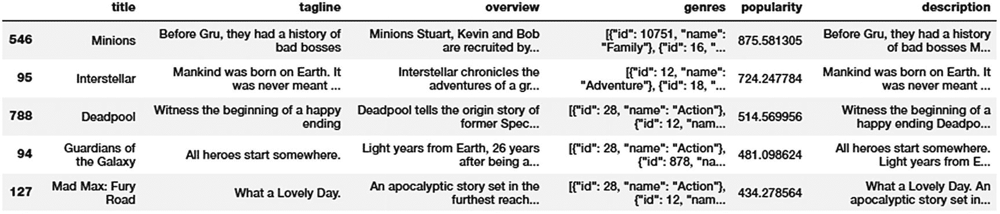

**图 7-7** 热门电影

```python
pop_movies = df.sort_values(by='popularity', ascending=False)
pop_movies.head()
```

我根据电影的流行度评分及其可能的有趣程度，选择了以下电影。你也可以随意替换为自己喜欢的电影。

```python
popular_movies = ['Minions', 'Interstellar', 'Deadpool', 'Jurassic World', 'Pirates of the Caribbean: The Curse of the Black Pearl', 'Dawn of the Planet of the Apes', 'The Hunger Games: Mockingjay - Part 1', 'Terminator Genisys', 'Captain America: Civil War', 'The Dark Knight', 'The Martian', 'Batman v Superman: Dawn of Justice', 'Pulp Fiction', 'The Godfather', 'The Shawshank Redemption', 'The Lord of the Rings: The Fellowship of the Ring', 'Harry Potter and the Chamber of Secrets', 'Star Wars', 'The Hobbit: The Battle of the Five Armies', 'Iron Man']
```

现在，让我们使用电影推荐函数为这些电影分别获取前五部推荐影片。

```python
for movie in popular_movies:
    print('Movie:', movie)
    print('Top 5 recommended Movies:', movie_recommender(movie_title=movie))
    print()
```

```
Movie: Minions
Top 5 recommended Movies: ['Despicable Me 2' 'Despicable Me'
 'Teenage Mutant Ninja Turtles: Out of the Shadows' 'Superman'
 'Rise of the Guardians']
...
...
Movie: Jurassic World
Top 5 recommended Movies: ['Jurassic Park' 'The Lost World: Jurassic Park' 'The Nut Job'
 "National Lampoon's Vacation" 'Vacation']
Movie: Pirates of the Caribbean: The Curse of the Black Pearl
Top 5 recommended Movies: ["Pirates of the Caribbean: Dead Man's Chest" 'The Pirate'
 'Pirates of the Caribbean: On Stranger Tides'
 'The Pirates! In an Adventure with Scientists!' 'Joyful Noise']
...
...
Movie: Captain America: Civil War
Top 5 recommended Movies: ['Captain America: The Winter Soldier' 'This Means War'
 'Avengers: Age of Ultron' 'Iron Man 2' 'Escape from Tomorrow']
Movie: The Dark Knight
Top 5 recommended Movies: ['The Dark Knight Rises' 'Batman Forever' 'Batman Returns'
 'Batman: The Dark Knight Returns, Part 2' 'Slow Burn']
Movie: The Martian
Top 5 recommended Movies: ['The Last Days on Mars' 'Swept Away' 'Alive' 'All Is Lost' 'Red Planet']
...
...
Movie: The Lord of the Rings: The Fellowship of the Ring
Top 5 recommended Movies: ['The Lord of the Rings: The Two Towers'
 'The Hobbit: The Desolation of Smaug'
 'The Lord of the Rings: The Return of the King'
 "What's the Worst That Could Happen?" 'The Hobbit: An Unexpected Journey']
Movie: Harry Potter and the Chamber of Secrets
Top 5 recommended Movies: ['Harry Potter and the Prisoner of Azkaban'
 'Harry Potter and the Goblet of Fire'
 'Harry Potter and the Order of the Phoenix'
 'Harry Potter and the Half-Blood Prince'
 "Harry Potter and the Philosopher's Stone"]
Movie: Star Wars
Top 5 recommended Movies: ['The Empire Strikes Back' 'Return of the Jedi' 'Shrek the Third'
 'The Ice Pirates' 'The Tale of Despereaux']
Movie: The Hobbit: The Battle of the Five Armies
Top 5 recommended Movies: ['The Hobbit: The Desolation of Smaug' 'The Hobbit: An Unexpected Journey'
 "Dragon Nest: Warriors' Dawn"
 'A Funny Thing Happened on the Way to the Forum' 'X-Men: Apocalypse']
Movie: Iron Man
Top 5 recommended Movies: ['Iron Man 2' 'Avengers: Age of Ultron' 'Hostage' 'Iron Man 3'
 'Baahubali: The Beginning']
```

从结果来看，可以清晰地发现，我们基于文档相似度的简单推荐系统表现非常出色！我们推荐使用 Scikit-Learn 的 `cosine_similarity()` 工具函数，它非常实用。你也可以直接使用 Gensim 的 `similarities` 模块或 `gensim.matutils` 模块中提供的 `cossim()` 函数。

## 用于成对文档相似度的 Okapi BM25 排序

在信息检索和搜索引擎中有几种非常流行的技术，包括 PageRank 和 Okapi BM25。术语 BM 代表`最佳匹配`。这项技术也简称为 BM25，但为完整起见，我们称之为`Okapi BM25`，因为尽管`BM25`函数背后的概念最初是理论性的，但伦敦城市大学在 1980-90 年代建立了`Okapi`信息检索系统，该系统实施此技术以在实际真实数据上检索文档。

此技术也可称为基于概率相关性的框架或模型，由包括计算机科学家`S. Robertson`和`K. Jones`在内的数人在 1970-80 年代开发。有多种基于不同因素对文档进行排名的函数，`BM25`是其中之一。其较新变体是`BM25F`，其他一些变体包括`BM15`和`BM25+`。

`Okapi BM25`技术可正式定义为一种基于词袋模型的文档排名与检索函数，用于根据用户输入查询检索相关文档。该查询可以是包含一个句子或一组句子的文档，甚至可以只是几个词。`Okapi BM25`实际上并非单一函数，而是一个由整个评分函数集合组成的框架，这些函数被组合使用。

考虑我们有一个查询文档`QD`，其中`QD = (q[1], q[2], … , q[n])`包含`n`个术语或关键词，并且我们有一个语料库文档`CD`，我们希望从中基于相似度分数检索与查询文档最相关的文档。假设我们有这些，我们可以数学上将这两个文档之间的`BM25`分数定义如下：

```
bm25(CD, QD) = Σ_{i=1}^{n} idf(q_i) · [f(q_i, CD) · (k1 + 1)] / [f(q_i, CD) + k1 · (1 - b + b · (|CD| / avgdl))]
```

其中函数`bm25(CD, QD)`计算文档`CD`基于查询文档`QD`的`BM25`排名或分数。函数`idf(q[i])`给出术语`q[i]`在语料库中的逆文档频率（`idf`），该语料库包含`CD`，我们将从中检索相关文档。如果你还记得，我们在第 4 章实现`tf-idf`特征提取器时计算了`idfs`。为了刷新记忆，它可以表示为：

```
idf(t) = 1 + log(C / (1 + df(t)))
```

其中`idf(t)`表示术语`t`的`idf`，`C`表示语料库中文档的总数，`df(t)`表示包含术语`t`的文档数量。还有其他实现`idf`的方法，但我们将使用这一种。

附带说明，不同实现的最终结果非常相似。函数`f(q[i], CD)`给出术语`q[i]`在语料库文档`CD`中的频率。表达式`|CD|`表示文档`CD`的总长度，以单词数衡量，而`avgdl`表示我们将从中检索文档的语料库的平均文档长度。此外，你还会观察到有两个自由参数——`k[1]`通常在[1.2，2.0]范围内，`b`通常取 0.75。在我们的实现中，将基于`Gensim`框架中`BM25`算法的流行实现，将`k[1]`的值取为 2.5，`b`取为 0.85。

要成功实现并计算文档的`BM25`分数，我们必须经历几个步骤：

1. 计算文档和语料库中术语的频率。
2. 计算术语的逆文档频率。
3. 获取语料库文档和查询文档的基于词袋的特征。
4. 构建一个函数，用于计算给定文档相对于语料库中特定文档的`BM25`分数。
5. 构建一个函数，利用步骤 4 中的函数，计算并返回给定文档相对于语料库中每个其他文档的`BM25`分数（类似于每个文档的相似度向量）。
6. 构建一个函数，返回语料库中所有文档的成对`BM25`相似度分数（权重）（利用步骤 5 中的函数）。

我们在此实现的代码实际上源自`Gensim`框架，如果你有兴趣利用`BM25`相似度，我们强烈推荐它。我们展示了相似度框架的内部结构，以便你可以将其与先前定义的概念相关联。以下类有助于在我们定义的工作流程中实现从步骤 1 到步骤 5 的所有组件。

```python
"""

Data:

.. data:: PARAM_K1 - Okapi BM25 的自由平滑参数。

.. data:: PARAM_B - Okapi BM25 的自由平滑参数。

.. data:: EPSILON - 用于语料库中文档负 idf 的常量。

"""

import math

from six import iteritems

from six.moves import xrange

PARAM_K1 = 2.5

PARAM_B = 0.85

EPSILON = 0.2

class BM25(object):

    """最佳匹配 25 排序函数的实现。

    属性

    corpus_size : int

        语料库的大小（文档数量）。

    avgdl : float

        `corpus`中文档的平均长度。

    corpus : list of list of str

        文档语料库。

    f : list of dicts of int

        `corpus`中每个文档的术语频率字典。

        单词作为键，频率作为值。

    df : dict

        整个`corpus`的术语频率字典。

        单词作为键，频率作为值。

    idf : dict

        整个`corpus`的逆术语频率字典。

        单词作为键，频率作为值。

    doc_len : list of int

        文档长度列表。

    """

    def __init__(self, corpus):

        """

        参数

        corpus : list of list of str

            给定的语料库。

        """

        self.corpus_size = len(corpus)

        self.avgdl = sum(float(len(x)) for x in corpus) / self.corpus_size

        self.corpus = corpus

        self.f = []

        self.df = {}

        self.idf = {}

        self.doc_len = []

        self.initialize()

    def initialize(self):

        """计算文档和语料库中的术语频率。

        同时计算逆文档频率。"""

        for document in self.corpus:

            frequencies = {}

            self.doc_len.append(len(document))

            for word in document:

                if word not in frequencies:

                    frequencies[word] = 0

                frequencies[word] += 1

            self.f.append(frequencies)

            for word, freq in iteritems(frequencies):

                if word not in self.df:

                    self.df[word] = 0

                self.df[word] += 1

        for word, freq in iteritems(self.df):

            self.idf[word] = math.log(self.corpus_size - freq + 0.5) - math.log(freq + 0.5)

    def get_score(self, document, index, average_idf):

        """计算给定`document`相对于由`index`选定的语料库文档的 BM25 分数。

        参数

        document : list of str

            待评分的文档。

        index : int

            语料库中与`document`进行评分比对的文档索引。

        average_idf : float

            语料库中的平均 idf。

        返回

        float

            BM25 分数。

        """

        score = 0

        for word in document:

            if word not in self.f[index]:

                continue

            idf = self.idf[word] if self.idf[word] >= 0 else EPSILON * average_idf

            score += (idf * self.f[index][word] * (PARAM_K1 + 1)

                      / (self.f[index][word] + PARAM_K1 * (1 - PARAM_B + PARAM_B * self.doc_len[index] / self.avgdl)))

        return score

    def get_scores(self, document, average_idf):

        """计算并返回给定`document`相对于语料库中每个文档的 BM25 分数。

        参数

        document : list of str

            待评分的文档。

        average_idf : float

            语料库中的平均 idf。

        返回

        list of float

            BM25 分数列表。

        """

        scores = []

        for index in range(self.corpus_size):

            scores.append(self.get_score(document, index, average_idf))

        return scores
```

```markdown
scores = []

for index in xrange(self.corpus_size):
    score = self.get_score(document, index, average_idf)
    scores.append(score)

return scores
```

我们现在已经在工作流程中实现了步骤 6 的函数，用于计算文档间成对的 `BM25` 相似度得分，这正是我们所需要的！

```python
def get_bm25_weights(corpus):
    """Returns BM25 scores (weights) of documents in corpus.

    Each document has to be weighted with every document in given corpus.

    Parameters
    ----------
    corpus : list of list of str
        Corpus of documents.

    Returns
    -------
    list of list of float
        BM25 scores.

    Examples
    --------
    >>> from gensim.summarization.bm25 import get_bm25_weights
    >>> corpus = [
    ...     ["black", "cat", "white", "cat"],
    ...     ["cat", "outer", "space"],
    ...     ["wag", "dog"]
    ... ]
    >>> result = get_bm25_weights(corpus)
    """
    bm25 = BM25(corpus)
    average_idf = sum(float(val) for val in bm25.idf.values()) / len(bm25.idf)
    weights = []
    for doc in corpus:
        scores = bm25.get_scores(doc, average_idf)
        weights.append(scores)
    return weights
```

根据文档说明，要使用此函数，首先需要分词语料库，如下所示：

```python
norm_corpus_tokens = np.array([nltk.word_tokenize(doc) for doc in norm_corpus])
norm_corpus_tokens[:3]
```

array([list(['enter', 'world', 'pandora', '22nd', 'century', 'paraplegic', 'marine', 'dispatched', 'moon', 'pandora', 'unique', 'mission', 'becomes', 'torn', 'following', 'orders', 'protecting', 'alien', 'civilization']),

```python
list(['end', 'world', 'adventure', 'begins', 'captain', 'barbossa', 'long', 'believed', 'dead', 'come', 'back', 'life', 'headed', 'edge', 'earth', 'turner', 'elizabeth', 'swann', 'nothing', 'quite', 'seems'])
```

# list(['plan', 'one', 'escapes', 'cryptic', 'message', 'bonds', 'past', 'sends', 'trail', 'uncover', 'sinister', 'organization', 'battles', 'political', 'forces', 'keep', 'secret', 'service', 'alive', 'bond', 'peels', 'back', 'layers', 'deceit', 'reveal', 'terrible', 'truth', 'behind', 'spectre'])], dtype=object)

现在，我们可以使用之前定义的`get_bm25_weights(...)`函数来构建成对文档相似度矩阵。请注意，根据语料库大小，这可能需要相当长的时间来计算。具体请参见图 7-8。

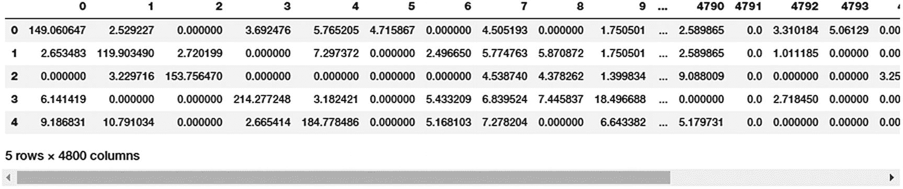

图 7-8：我们的成对 BM25 文档相似度矩阵

```python
%%time

wts = get_bm25_weights(norm_corpus_tokens)
```

# Wall time: 2min 28s

# 查看相似度矩阵

`bm25_wts_df` = `pd.DataFrame`(`wts`)

`bm25_wts_df`.`head`()

```python
```

现在我们使用电影推荐函数，为我们之前选定的热门电影获取前 5 个推荐结果：

```python
for movie in popular_movies:
    print('Movie:', movie)
    print('Top 5 recommended Movies:', `movie_recommender`(`movie_title`=movie,
                                                         `doc_sims`=`bm25_wts_df`))
    print()
```

# Movie: Minions

# Top 5 recommended Movies: ['`Despicable Me 2`' '`Despicable Me`']

# 'Teenage Mutant Ninja Turtles: Out of the Shadows' 'Intolerance'

# Superman

# Movie: Interstellar

# Top 5 recommended Movies:
- Space Pirate Captain Harlock
- Prometheus
- Starship Troopers
- Gattaca

# 'Space Cowboys']

# ...

# Movie: The Lord of the Rings: The Fellowship of the Ring

# Top 5 recommended Movies:
['The Lord of the Rings: The Two Towers'

# 'The Lord of the Rings: The Return of the King'

# 'The Hobbit: The Desolation of Smaug' 'The Hobbit: An Unexpected Journey'

# "What's the Worst That Could Happen?"]

# Movie: Harry Potter and the Chamber of Secrets

# Top 5 Recommended Movies

- Harry Potter and the Goblet of Fire

# 'Harry Potter and the Prisoner of Azkaban'

# Harry Potter and the Half-Blood Prince

# 'Harry Potter and the Order of the Phoenix'

# "Harry Potter and the Philosopher's Stone"

# Movie: Star Wars

# Top 5 recommended Movies: ['The Empire Strikes Back' 'Return of the Jedi' 'Shanghai Noon'

# 'The Ice Pirates' 'The Tale of Despereaux']

# Movie: The Hobbit: The Battle of the Five Armies

# Top 5 recommended Movies:

- The Hobbit: The Desolation of Smaug
- The Hobbit: An Unexpected Journey

# "Dragon Nest: Warriors' Dawn" 'Harry Potter and the Order of the Phoenix'

# '300: Rise of an Empire'

# Movie: Iron Man

# Top 5 recommended Movies: ['Iron Man 2' 'Avengers: Age of Ultron' 'Iron Man 3' 'Batman Begins'

# 'Street Fighter'

我们建议使用`gensim.summarization`模块下的`bm25`模块。如果你感兴趣，不妨一试。

尝试加载一个更大的文档语料库，并在一些示例查询字符串和文档上测试这些函数。事实上，像 Solr 和 ElasticSearch 这样的信息检索框架都构建在 Lucene 之上，它们使用这类排序算法从存储文档的索引中返回相关文档。你可以用它们构建自己的搜索引擎！感兴趣的读者可以查看[elastic.co](https://www.elastic.co/blog/found-bm-vs-lucene-default-similarity)提供的这个链接，该网站是流行产品 ElasticSearch 的母公司。BM25 的性能远优于 Lucene 默认的相似度排序实现。

# 文档聚类

文档聚类或`聚类分析`是自然语言处理和文本分析中一个引人入胜的领域，它运用了无监督机器学习的理念和技术。文档聚类的主要前提与文档分类类似，即从整个文档语料库出发，任务是根据文档的某些独特属性、特征和特性将其划分为不同的组别。文档分类需要带标签的训练数据来构建模型，然后对文档进行分类。而文档聚类则使用无监督机器学习算法将文档划分为不同的簇。这些簇的特性是：与属于其他簇的文档相比，同一簇内的文档彼此之间更加相似和关联。图 7-9（由 Scikit-Learn 提供）直观展示了一个根据特征将数据点聚类为三个簇的示例。

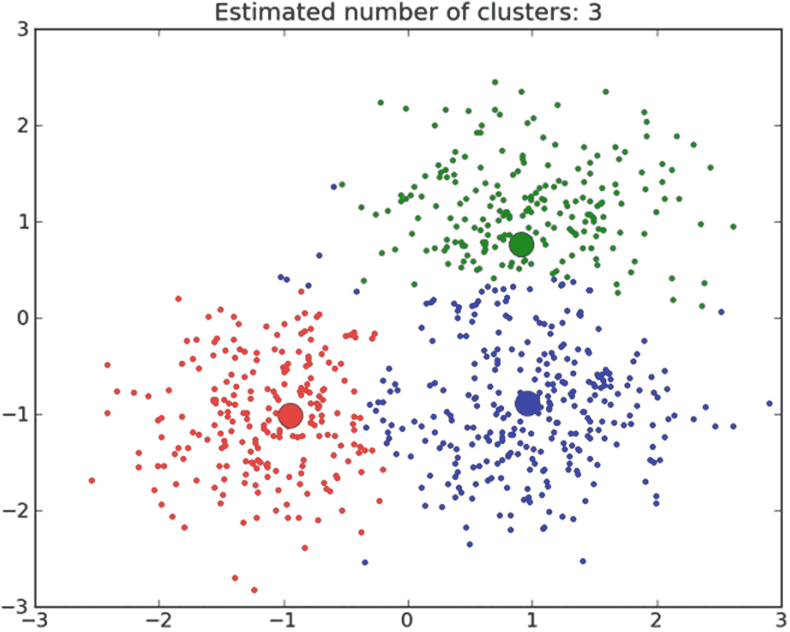

图 7-9

聚类分析结果示例（来源：Scikit-Learn）

此聚类分析描绘了数据点中的三个簇，并用不同颜色进行了可视化。这里需要记住的一个重要点是，聚类是一种无监督学习技术，并且从图 7-9 可以很清楚地看出，由于不存在完美簇的定义，簇之间总会存在一些重叠。所有技术都基于数学、启发式方法以及与生成簇相关的一些固有属性。它们永远不可能达到 100% 完美。因此，存在多种寻找簇的技术或方法。下面简要介绍几种比较流行的聚类算法：

*   `层次聚类模型`：这些聚类模型也称为`基于连通性的聚类方法`，其核心概念是相似的物体在向量空间中距离较近，而不相关的物体则距离较远。簇是通过根据对象之间的距离连接对象而形成的，并且可以使用树状图进行可视化。这些模型的输出是一个完整的、详尽的簇层次结构。它们又细分为凝聚式聚类模型和分裂式聚类模型。

*   `基于划分或基于质心的聚类模型`：这些模型构建簇的方式是，每个簇都有一个核心代表成员，该成员代表了该簇，并具有将该簇与其他簇区分开来的特征。其中包含多种算法，例如 `k-means`、`k-mediods` 等，在这些算法中，我们需要预先设定簇的数量 (`k`)。需要最小化距离度量，例如每个数据点到质心的距离平方。这些模型的缺点是需要预先指定簇的数量 `k`，这可能导致陷入局部最优解，并且可能无法得到数据真实的聚类表示。

*   `基于分布的聚类模型`：这些模型在聚类数据点时使用概率分布的概念。其思想是，具有相似分布的对象可以被聚类到同一组或簇中。高斯混合模型（`GMM`）使用诸如期望最大化算法之类的算法来构建这些簇。这些模型也可以捕获特征和属性的相关性与依赖性，但容易出现过拟合。

*   `基于密度的聚类模型`：这些聚类模型从数据点中生成簇，这些簇在数据点密度较高的区域聚集在一起，而其他数据点则可能随机分布在向量空间中较为稀疏的区域。这些稀疏区域被视为噪声，并用作分隔簇的边界点。该领域中两种流行的算法包括 `DBSCAN` 和 `OPTICS`。

还有其他一些较新的聚类模型，例如 `BIRCH` 和 `CLARANS`。仅仅关于聚类这个主题就已经有整本书籍和期刊出版，因为它确实是一个极具价值的有趣话题。在当前范围内，我们不可能涵盖所有方法，因此，我们将总共介绍三种聚类算法，并用真实世界的数据进行说明，以便更好地理解：

*   `K-means` 聚类
*   亲和传播
*   Ward 凝聚层次聚类

我们将像之前介绍其他方法一样，逐一介绍每种算法的理论概念。我们还会将每种聚类算法应用于真实世界的数据，这些数据涉及我们之前使用的 TMDB 电影数据集中的电影及其描述。

## 电影聚类

我们将对总共 4800 部电影进行聚类，这些电影我们已经在前面的步骤中进行过清洗和预处理。这些数据存储在数据框 `df` 中，预处理后的语料库存储在变量 `norm_corpus` 中。主要思路是利用电影的描述作为原始输入，将这些电影分组到不同的簇中。我们将从这些描述中提取特征，如 TF-IDF 或文档相似度，并对它们应用无监督学习算法进行聚类。我们在输出中显示的电影标题仅用于展示，当我们想要查看每个簇中的电影时，这些标题会很有用。需要明确的是，输入到聚类算法的数据是从电影描述中提取的特征。

### 特征工程

在进入每种聚类方法之前，我们将遵循与之前相同的文本预处理和特征工程流程。我们在上一节的文档相似性分析中已经完成了预处理，因此我们将使用包含预处理后电影描述的同一个 `norm_corpus` 变量。现在，我们将像在文档相似度计算时那样提取基于词袋的特征，但会进行一些修改。

```python
import nltk
from sklearn.feature_extraction.text import CountVectorizer

stop_words = nltk.corpus.stopwords.words('english')
stop_words = stop_words + ['one', 'two', 'get']

cv = CountVectorizer(ngram_range=(1, 2), min_df=10, max_df=0.8, stop_words=stop_words)
cv_matrix = cv.fit_transform(norm_corpus)
cv_matrix.shape
(4800, 3012)
```

根据上述代码片段和输出结果，我们保留规范化文本中的文本词元，并提取基于词袋计数的特征（包括单字和双字），使得每个特征至少出现在 10 个文档中，且最多出现在 80% 的文档中（使用参数 `min_df` 和 `max_df`）。我们可以看到，针对这 4800 部电影，总共有 4800 行数据，每部电影共有 3012 个特征。现在，我们的特征和文档都已准备就绪，可以开始聚类分析了。

## K-Means 聚类

`k-means`聚类算法是一种基于质心的聚类模型，它试图将数据划分为方差相等的组或簇。该算法试图最小化的准则或度量是*惯性*，也称为*簇内平方和*。该算法的一个主要缺点是，与所有基于质心的聚类模型一样，需要预先指定簇的数量（`k`）。该算法可能是最流行的聚类算法，因为它易于使用，并且能够处理大规模数据。

我们现在可以正式定义 k-means 聚类算法及其数学符号。假设我们有一个数据集 `X`，包含 `N` 个数据点或样本，我们希望将它们分成 `K` 个簇，其中 `K` 是用户指定的参数。k-means 聚类算法会将这 `N` 个数据点划分为 `K` 个互不相交的独立簇 `C[k]`，每个簇可以用其样本的均值来描述。这些均值成为簇质心 `μ[k]`，且这些质心不受限于必须是 `X` 中 `N` 个样本里的实际数据点。该算法选择这些质心并构建簇，目的是使惯性或簇内平方和最小化。数学上可以表示如下：

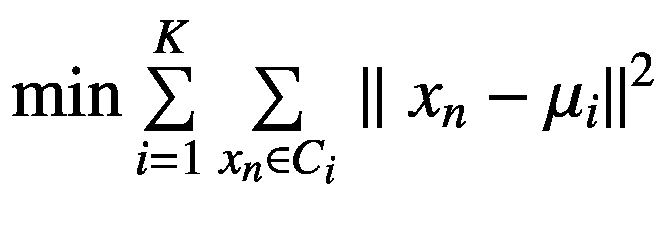

其中，`C[i]` 代表簇，`μ[i]` 代表质心，且 `i ∈ {1, 2, … , k}`。对于所有的算法爱好者来说，这个优化问题是一个 NP 难题。Lloyd 算法是解决该问题的一种方法。它是一个迭代过程，包含以下步骤：

1.  从数据集 `X` 中随机抽取 `k` 个样本，作为初始的 `k` 个质心 `μ[k]`。

2.  通过将每个数据点或样本分配到其最近的质心点来更新簇。数学上可以表示如下：

    `C[k] = { x[n] : || x[n] - μ[k] || ≤ all || x[n] - μ[l] || }`

    其中 `C[k]` 表示簇。

3.  基于从步骤 2 获得的每个簇的新簇数据点，重新计算并更新簇。数学上可以表示如下：

    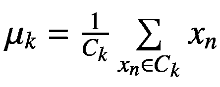

    其中 `μ[k]` 表示质心。

这些步骤以迭代方式重复执行，直到步骤 2 和步骤 3 的输出不再变化。这种方法的一个注意事项是，尽管优化过程保证收敛，但可能会收敛到局部最小值。因此，在实际应用中，该算法通常会运行多次，包含多个轮次和迭代，如果需要，结果可能取其平均值。

局部最小值的收敛和出现高度依赖于步骤 1 中初始质心的初始化。一种方法是使用多次随机初始化进行多次迭代，并取平均值。另一种方法是使用 `kmeans++` 方案（如 Scikit-Learn 中所实现的），该方案将初始质心初始化得彼此相距较远，已被证明是有效的。我们现在使用 k-means 聚类对电影数据进行聚类。

```python
from sklearn.cluster import KMeans

NUM_CLUSTERS = 6

km = KMeans(n_clusters=NUM_CLUSTERS, max_iter=10000, n_init=50, random_state=42).fit(cv_matrix)

km

KMeans(algorithm='auto', copy_x=True, init='k-means++', max_iter=10000,
n_clusters=6, n_init=50, n_jobs=None, precompute_distances="auto",
random_state=42, tol=0.0001, verbose=0)

df['kmeans_cluster'] = km.labels_
```

这段代码使用我们实现的 k-means 函数，根据电影描述的词袋特征对电影进行聚类。我们通过将聚类分析结果中每个电影的簇标签存储到 `df` 数据框的 `kmeans_cluster` 列中，来为每个电影分配簇标签。可以看到，在我们的分析中，我们设定 `k` 为 6。现在我们可以使用以下代码查看六个簇中每个簇的电影总数。

```python
```

# viewing distribution of movies across the clusters

```python
from collections import Counter

Counter(km.labels_)
```

输出结果为：

```
Counter({2: 429, 1: 2832, 3: 539, 5: 238, 4: 706, 0: 56})
```

可以看到，正如预期，有六个簇标签，从 0 到 5，每个簇都有一些电影属于该簇。看起来每个簇中的电影分布情况良好。现在，我们将通过展示导致电影被聚类在一起的重要特征，对我们的聚类结果进行一些更深入的分析。我们还会查看每个簇中最受欢迎的一些电影！

```python
movie_clusters = (df[['title', 'kmeans_cluster', 'popularity']]
                  .sort_values(by=['kmeans_cluster', 'popularity'],
                               ascending=False)
                  .groupby('kmeans_cluster').head(20))

movie_clusters = movie_clusters.copy(deep=True)

feature_names = cv.get_feature_names()

topn_features = 15

ordered_centroids = km.cluster_centers_.argsort()[:, ::-1]
```

# get key features for each cluster

# get movies belonging to each cluster

```python
for cluster_num in range(NUM_CLUSTERS):
    key_features = [feature_names[index]
                    for index in ordered_centroids[cluster_num, :topn_features]]
    movies = movie_clusters[movie_clusters['kmeans_cluster'] ==
                            cluster_num]['title'].values.tolist()
    print('CLUSTER #'+str(cluster_num+1))
    print('Key Features:', key_features)
    print('Popular Movies:', movies)
    print('-'*80)
```

上述代码的输出如下：

```
CLUSTER #1
Key Features: ['film', 'movie', 'story', 'first', 'love', 'making', 'director', 'new', 'time', 'feature', 'made', 'young', '3d', 'american', 'america']
Popular Movies: ['Contact', 'Snatch', 'The Pianist', 'Boyhood', 'Tropic Thunder', 'Movie 43', 'Night of the Living Dead', 'Almost Famous', 'My Week with Marilyn', 'Jackass 3D', 'Inside Job', 'Grindhouse', 'The Young Victoria', 'Disaster Movie', 'Jersey Boys', 'Seed of Chucky', 'Bowling for Columbine', 'Walking With Dinosaurs', 'Me and You and Everyone We Know', 'Urban Legends: Final Cut']

CLUSTER #2
Key Features: ['young', 'man', 'story', 'love', 'family', 'find', 'must', 'time', 'back', 'friends', 'way', 'years', 'help', 'father', 'take']
Popular Movies: ['Interstellar', 'Guardians of the Galaxy', 'Pirates of the Caribbean: The Curse of the Black Pearl', 'Dawn of the Planet of the Apes', 'The Hunger Games: Mockingjay - Part 1', 'Big Hero 6', 'Whiplash', 'The Martian', 'Frozen', "Pirates of the Caribbean: Dead Man's Chest", 'Gone Girl', 'X-Men: Apocalypse', 'Rise of the Planet of the Apes', 'The Lord of the Rings: The Fellowship of the Ring', 'Pirates of the Caribbean: On Stranger Tides', "One Flew Over the Cuckoo's Nest", 'Star Wars', 'Brave', 'The Lord of the Rings: The Return of the King', 'Pulp Fiction']

CLUSTER #3
Key Features: ['world', 'young', 'find', 'story', 'man', 'new', 'must', 'save', 'way', 'time', 'life', 'evil', 'love', 'family', 'finds']
Popular Movies: ['Minions', 'Jurassic World', 'Captain America: Civil War', 'Avatar', 'The Avengers', "Pirates of the Caribbean: At World's End", 'The Maze Runner', 'Tomorrowland', 'Ant-Man', 'Spirited Away', 'Chappie', 'Monsters, Inc.', 'The Matrix', 'Man of Steel', 'Skyfall', 'The Adventures of Tintin', 'Nightcrawler', 'Allegiant', 'V for Vendetta', 'Penguins of Madagascar']
```

# 集群 #4
关键特征：`['new', 'york', 'new york', 'city', 'young', 'family', 'love', 'man', 'york city', 'find', 'friends', 'years', 'home', 'must', 'story']`
热门电影：`['Terminator Genisys', 'Fight Club', 'Teenage Mutant Ninja Turtles', 'Pixels', 'Despicable Me 2', 'Avengers: Age of Ultron', 'Night at the Museum: Secret of the Tomb', 'Batman Begins', 'The Dark Knight Rises', 'The Lord of the Rings: The Two Towers', 'The Godfather: Part II', 'How to Train Your Dragon 2', '12 Years a Slave', 'The Wolf of Wall Street', 'Men in Black II', "Pan's Labyrinth", 'The Bourne Legacy', 'The Amazing Spider-Man 2', 'The Devil Wears Prada', 'Non-Stop']`

# 集群 #5
关键特征：`['life', 'love', 'man', 'family', 'story', 'young', 'new', 'back', 'years', 'finds', 'hes', 'time', 'find', 'way', 'father']`
热门电影：`['Deadpool', 'Mad Max: Fury Road', 'Inception', 'The Godfather', 'Forrest Gump', 'The Shawshank Redemption', 'Harry Potter and the Chamber of Secrets', 'Inside Out', 'Twilight', 'Maleficent', "Harry Potter and the Philosopher's Stone", 'Bruce Almighty', 'The Hobbit: An Unexpected Journey', 'The Twilight Saga: Eclipse', 'Titanic', 'Fifty Shades of Grey', 'Blade Runner', 'Psycho', 'Up', 'The Lion King']`

# 集群 #6
关键特征：`['war', 'world', 'world war', 'ii', 'war ii', 'story', 'young', 'man', 'love', 'army', 'find', 'american', 'battle', 'first', 'must']`
热门电影：`['The Dark Knight', 'Batman v Superman: Dawn of Justice', 'The Imitation Game', 'Fury', 'The Hunger Games: Mockingjay - Part 2', 'X-Men: Days of Future Past', 'Transformers: Age of Extinction', "Schindler's List", 'The Good, the Bad and the Ugly', 'American Sniper', 'Thor', 'Shutter Island', 'Underworld', 'Indiana Jones and the Kingdom of the Crystal Skull', 'Captain America: The First Avenger', 'The Matrix Revolutions', 'Inglourious Basterds', '300: Rise of an Empire', 'The Matrix Reloaded', 'Oblivion']`

以上输出展示了每个集群的关键特征及所属的电影。每个集群由其主要主题描述，这些主题通过其最突出的特征来定义。你可以看到热门电影根据一些关键共同特征被聚类在一起。你能否发现任何有趣的模式？

我们也可以使用其他特征方案，比如两两文档相似度，将相似电影归入同一集群。以下代码有助于实现这一点。

```python
from sklearn.metrics.pairwise import cosine_similarity

cosine_sim_features = cosine_similarity(cv_matrix)

km = KMeans(n_clusters=NUM_CLUSTERS, max_iter=10000, n_init=50, random_state=42).fit(cosine_sim_features)

Counter(km.labels_)

Counter({4: 427, 3: 724, 1: 1913, 2: 504, 0: 879, 5: 353})

df['kmeans_cluster'] = km.labels_

movie_clusters = (df[['title', 'kmeans_cluster', 'popularity']]

.sort_values(by=['kmeans_cluster', 'popularity'],

ascending=False)

.groupby('kmeans_cluster').head(20))

movie_clusters = movie_clusters.copy(deep=True)
```

# 获取属于每个集群的电影

```python
for cluster_num in range(NUM_CLUSTERS):
    movies = movie_clusters[movie_clusters['kmeans_cluster'] == cluster_num]['title'].values.tolist()
    print('CLUSTER #'+str(cluster_num+1))
    print('Popular Movies:', movies)
    print('-'*80)
```

# 集群分析

## 集群 #1
热门电影：`['Pirates of the Caribbean: The Curse of the Black Pearl', 'Whiplash', 'The Martian', 'Frozen', 'Gone Girl', 'The Lord of the Rings: The Fellowship of the Ring', 'Pirates of the Caribbean: On Stranger Tides', 'Pulp Fiction', 'The Fifth Element', 'Quantum of Solace', 'Furious 7', 'Cinderella', 'Man of Steel', 'Gladiator', 'Aladdin', 'The Amazing Spider-Man', 'Prisoners', 'The Good, the Bad and the Ugly', 'American Sniper', 'Finding Nemo']`

## 集群 #2
热门电影：`['Interstellar', 'Guardians of the Galaxy', 'Dawn of the Planet of the Apes', 'The Hunger Games: Mockingjay - Part 1', 'Big Hero 6', 'The Dark Knight', "Pirates of the Caribbean: Dead Man's Chest", 'X-Men: Apocalypse', 'Rise of the Planet of the Apes', "One Flew Over the Cuckoo's Nest", 'The Hunger Games: Mockingjay - Part 2', 'Star Wars', 'Brave', 'The Lord of the Rings: The Return of the King', 'The Hobbit: The Battle of the Five Armies', 'Iron Man', 'X-Men: Days of Future Past', 'Transformers: Age of Extinction', 'Spider-Man 3', 'Lucy']`

## 集群 #3
热门电影：`['Terminator Genisys', 'Fight Club', 'Teenage Mutant Ninja Turtles', 'Pixels', 'Despicable Me 2', 'Avengers: Age of Ultron', 'Night at the Museum: Secret of the Tomb', 'Batman Begins', 'The Dark Knight Rises', 'The Lord of the Rings: The Two Towers', 'The Godfather: Part II', 'How to Train Your Dragon 2', '12 Years a Slave', 'The Wolf of Wall Street', 'Men in Black II', "Pan's Labyrinth", 'The Bourne Legacy', 'The Amazing Spider-Man 2', 'The Devil Wears Prada', 'Non-Stop']`

## 集群 #4
热门电影：`['Deadpool', 'Mad Max: Fury Road', 'Inception', 'The Godfather', "Pirates of the Caribbean: At World's End", 'Forrest Gump', 'The Shawshank Redemption', 'Harry Potter and the Chamber of Secrets', 'Inside Out', 'Twilight', 'Maleficent', "Harry Potter and the Philosopher's Stone", 'Bruce Almighty', 'The Hobbit: An Unexpected Journey', 'The Twilight Saga: Eclipse', 'Fifty Shades of Grey', 'Blade Runner', 'Psycho', 'Up', 'The Lion King']`

## 集群 #5
热门电影：`['Minions', 'Jurassic World', 'Captain America: Civil War', 'Batman v Superman: Dawn of Justice', 'Avatar', 'The Avengers', 'Fury', 'The Maze Runner', 'Tomorrowland', 'Ant-Man', 'Spirited Away', 'Chappie', 'Monsters, Inc.', "Schindler's List", 'The Matrix', 'Skyfall', 'The Adventures of Tintin', 'Nightcrawler', 'Thor', 'Allegiant']`

## 集群 #6
热门电影：`['The Imitation Game', 'Titanic', 'The Pursuit of Happyness', 'The Prestige', 'The Grand Budapest Hotel', 'The Fault in Our Stars', 'Catch Me If You Can', 'Cloud Atlas', 'The Conjuring 2', 'Apollo 13', 'Aliens', 'The Usual Suspects', 'GoodFellas', 'The Princess and the Frog', 'The Theory of Everything', "The Huntsman: Winter's War", 'Mary Poppins', 'The Lego Movie', 'Starship Troopers', 'The Big Short']`

显然，我们使用了成对文档相似度作为特征，因此我们无法像之前那样为每个集群描述具体的基于术语的特征。不过，我们仍然可以在上述输出中看到每个相似电影集群的构成。

# 亲和传播

`k-means` 算法虽然非常流行，但存在一个缺点，即用户必须预先定义簇的数量。如果簇的数量发生变化怎么办？有些方法可以检查簇的质量，并确定最优 `k` 值可能为多少。感兴趣的读者可以了解一下肘部法和轮廓系数，它们是确定最优 `k` 值的流行方法。

这里，我们讨论一种基于数据固有属性来构建簇的算法，该算法不对簇的数量做任何假设。亲和传播 (AP) 算法基于在各个待聚类数据点之间进行“消息传递”的概念，并且不对可能的簇数量做任何假设。

AP 通过在成对数据点之间传递消息来创建这些簇，直到达到收敛。整个数据集随后由少量代表点表示，这些代表点充当样本的代表。这些代表点类似于从 `k-means` 或 `k-medoids` 算法中获得的质心。在成对点之间传递的消息表示了其中一个点作为另一个数据点的代表点或代表的合适程度。每次迭代都会更新这一信息，直到达到收敛，最终的代表点成为每个簇的代表。请记住，这种方法的一个缺点是计算量大。消息在整个数据集的每对数据点之间传递，对于大型数据集，收敛可能需要大量时间。

我们现在可以定义 AP 算法中涉及的步骤（致谢 Scikit-Learn）。假设我们有一个数据集 `X`，其中包含 `n` 个数据点，即 `X = {x[1], x[2], … , x[n]}`，并且我们设 `sim(x, y)` 为相似度函数，它量化了两个点 `x` 和 `y` 之间的相似度。在我们的实现中，我们再次使用余弦相似度。AP 算法通过迭代执行以下两个消息传递步骤来进行。

1.  首先发送责任更新，其数学表示为

    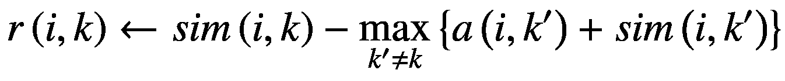

    其中责任矩阵是 `R`，而 `r(i, k)` 是一个度量，用于量化 `x[k]` 与其他候选点相比，作为 `x[i]` 的代表点或代表的合适程度。

2.  然后发送可用性更新，其数学表示为

    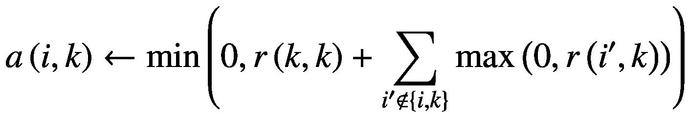

    对于 `i ≠ k` 的情况，而 `i = k` 时的可用性表示为

    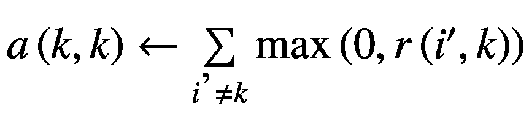

    其中可用性矩阵是 `A`，而 `a(i, k)` 表示考虑到所有其他点都倾向于选择 `x[k]` 作为代表点时，`x[i]` 选择 `x[k]` 作为其代表点的合适程度。

这两个步骤在每次迭代中持续进行，直到达到收敛。该算法的主要缺点之一是最终可能会得到过多的簇。我们在这里只展示最大的十个簇：

```

```python
from sklearn.cluster import AffinityPropagation

ap = AffinityPropagation(max_iter=1000)

ap.fit(cosine_sim_features)

res = Counter(ap.labels_)

res.most_common(10)
```

```
[(183, 1355), (182, 93), (159, 80), (54, 74), (81, 57),
 (16, 51), (26, 47), (24, 45), (48, 43), (89, 42)]
```

现在，让我们尝试展示这十个簇各自的热门电影（这里我们不考虑包含电影数量较少的簇）。

```python
df['affprop_cluster'] = ap.labels_

filtered_clusters = [item[0] for item in res.most_common(8)]

filtered_df = df[df['affprop_cluster'].isin(filtered_clusters)]

movie_clusters = (filtered_df[['title', 'affprop_cluster', 'popularity']]
                  .sort_values(by=['affprop_cluster', 'popularity'],
                               ascending=False)
                  .groupby('affprop_cluster').head(20))

movie_clusters = movie_clusters.copy(deep=True)
```

# 获取每个簇的关键特征

# 获取属于每个簇的电影

```python
for cluster_num in range(len(filtered_clusters)):
    movies = movie_clusters[movie_clusters['affprop_cluster'] == filtered_clusters[cluster_num]]['title'].values.tolist()
    print('簇 #'+str(filtered_clusters[cluster_num]))
    print('热门电影:', movies)
    print('-'*80)
```

簇 #183
热门电影: ['星际穿越', '猩球崛起：黎明之战', '超能陆战队', '蝙蝠侠：黑暗骑士', '加勒比海盗：聚魂棺', '饥饿游戏 3：嘲笑鸟(下)', '星球大战', '勇敢传说', '指环王：王者无敌', '霍比特人：五军之战', '钢铁侠', '变形金刚 4：绝迹重生', '超体', '碟中谍 5：神秘国度', '移动迷宫 2：烧痕审判', '007：幽灵党', '绿里奇迹', '终结者 2：审判日', '出埃及记：法老与众神', '哈利·波特与火焰杯']

簇 #182
热门电影: ['盗梦空间', '哈利·波特与密室', '霍比特人：意外之旅', '被解救的姜戈', '美国丽人', '雪国列车', '猜火车', '第一滴血', '谍影重重 2', '好好先生', '白日梦想家', '赤焰战场', '赌城风云', '耶稣受难记', '安妮', '幻想曲', '午夜巴塞罗那', '白宫管家', '爱宠大机密', '黑暗边缘']

簇 #159
热门电影: ['消失的爱人', '低俗小说', '角斗士', '拯救大兵瑞恩', '心理游戏', '侠探杰克', '亡命天涯', '人类清除计划 3：大选之年', '怪形', '勇闯夺命岛', '决战犹马镇', '王牌保镖', '黑帽骇客', '骑士与白天', '撕裂的末日', '黑鹰坠落', '惊天战神', '1408 幻影凶间', '夺命来电', '在云端']

簇 #54
热门电影: ['神偷奶爸 2', '指环王：双塔奇兵', '谍影重重 4：伯恩的遗产', '恶老板 2', '大侦探福尔摩斯 2：诡影游戏', '十一罗汉', '夺宝奇兵', '星际迷航 3：超越星辰', '神奇四侠 2：银影侠现身', '大侦探福尔摩斯', '死亡诗社', '蝙蝠侠与罗宾', '马达加斯加 2：逃往非洲', '百货战警 2', '海扁王 2', '王牌播音员 2：传奇继续', '超级奶爸', '魔鬼代言人', '异形魔怪', '荒野大飚客']

簇 #81
热门电影: ['爆裂鼓手', '边境杀手', '杰克·莱恩：诡影特工', '铁面无私', '新科学怪人', '惊爆点', '8 英里', '死神来了 4', '野蛮人', '史酷比', '艺术家', '末代独裁', '险恶 2', '另一个地球', '至暗之时', '华尔街：金钱永不眠', '鬼计神偷', '虐童疑云', '革命之路', '赤色风暴']

簇 #16
热门电影: ['肖申克的救赎', '头脑特工队', '蝙蝠侠：侠影之谜', '惊魂记', '赛车总动员', '冰川时代 3：恐龙的黎明', '纳尼亚传奇 2：凯斯宾王子', '功夫熊猫 2', '女巫', '马达加斯加', '涉足荒野', '羞耻', '惊声尖叫 2', '16 街区', '幻影英雄', '情归新泽西', '第 25 小时', '校园兔女郎', '灵幻夹克', '挑战星期天']

簇 #26
热门电影: ['小黄人大眼萌', '阿凡达', '马达加斯加的企鹅', '钢铁侠 3', '伦敦陷落', '了不起的盖茨比', '超验骇客', '第五波', '丧尸乐园', '精灵旅社', '灵魂战车 2：复仇时刻', '温暖的尸体', '保罗', '末日危途', '亚历山大', '世界末日', 'BJ 单身日记', '特种部队：眼镜蛇的崛起', '发胶', '舞出我人生之舞动革命']

## 沃德凝聚层次聚类

层次聚类算法族与之前讨论的其他聚类模型略有不同。层次聚类试图通过连续合并或分裂来构建一个嵌套的聚类层级结构。层次聚类主要有两种策略：

- 凝聚式：这类算法采用自底向上的方法。所有数据点最初都属于自己的独立簇，然后从这一底层开始，我们逐步合并簇，从而在上升过程中构建出簇的层级。
- 分裂式：这类算法采用自顶向下的方法。所有数据点最初都属于一个单一的大簇，然后随着我们逐步向下，开始递归地对其进行划分。这会产生一个自上而下的簇层级结构。

合并和分裂通常使用贪心算法进行，簇层级结构的最终结果可以可视化为一种树状结构，称为`树状图`。图 7-10 展示了如何使用凝聚层次聚类构建树状图。


图 7-10：凝聚层次聚类表示

图 7-10 清晰地展示了六个独立的数据点如何作为六个簇开始，然后我们如何在每一步，遵循自底向上的方法，缓慢地开始将它们分组。本节我们将使用凝聚层次聚类算法。在凝聚聚类中，当从单个数据点簇开始时，为了决定应该合并哪些簇，我们需要两样东西：

- 一个距离度量，用于衡量数据点之间的相似度或不相似度。在我们的实现中，将使用余弦距离/相似度。
- 一个链接准则，它决定了用于簇合并策略的度量标准。这里我们将使用沃德方法。

沃德链接准则最小化所有簇内离差平方和的总和，是一种最小化方差的方法。这也被称为沃德最小方差法，最初由 J. Ward 提出。其思想是使用像两点间 L2 范数距离这样的目标函数来最小化每个簇内的方差。我们可以通过以下公式计算每对点之间的初始簇距离：

```
$$ {d}_{ij}=d\left(\left\{{C}_i,{C}_j\right\}\right)=\parallel {C}_i-{C}_j{\parallel}² $$
```

其中初始时 `C[i]` 表示包含一个文档的簇 `i`，并且在每次迭代中。我们找到那些在合并后导致该簇方差增加最少的簇对。如上公式所示的加权平方欧氏距离（或 L2 范数）足以满足此算法。我们使用余弦相似度来计算数据集中每对电影之间的余弦距离。以下函数实现了沃德凝聚层次聚类：

```python
from scipy.cluster.hierarchy import ward, dendrogram
from sklearn.metrics.pairwise import cosine_similarity

def ward_hierarchical_clustering(feature_matrix):
    cosine_distance = 1 - cosine_similarity(feature_matrix)
    linkage_matrix = ward(cosine_distance)
    return linkage_matrix
```

要查看层次聚类的结果，我们需要使用链接矩阵绘制树状图。因此，我们实现以下函数，从层次聚类链接矩阵构建并绘制树状图。

```python
def plot_hierarchical_clusters(linkage_matrix, movie_data, p=100, figure_size=(8,12)):
    # set size
    fig, ax = plt.subplots(figsize=figure_size)
    movie_titles = movie_data['title'].values.tolist()
    # plot dendrogram
    R = dendrogram(linkage_matrix, orientation="left", labels=movie_titles,
                   truncate_mode='lastp',
                   p=p,
                   no_plot=True)
    temp = {R["leaves"][ii]: movie_titles[ii] for ii in range(len(R["leaves"]))}
    def llf(xx):
        return "{}".format(temp[xx])
    ax = dendrogram(
        linkage_matrix,
        truncate_mode='lastp',
        orientation="left",
        p=p,
        leaf_label_func=llf,
        leaf_font_size=10.,
    )
    plt.tick_params(axis= 'x',
                    which='both',
                    bottom='off',
```

现在我们准备对我们的电影数据执行层次聚类！以下代码片段展示了沃德聚类的实际应用。

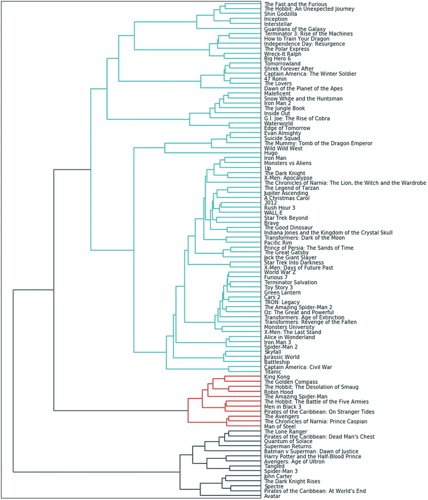

图 7-11：我们电影数据集上的沃德聚类树状图

```python
linkage_matrix = ward_hierarchical_clustering(cv_matrix)

plot_hierarchical_clusters(linkage_matrix,
                           p=100,
                           movie_data=df,
                           figure_size=(12, 14))
```

```python
top='off',
labelbottom='off')

plt.tight_layout()

plt.savefig('movie_hierachical_clusters.png', dpi=200)
```

图 7-11 中的树状图向我们展示了聚类分析结果。颜色表明有三个主要簇，它们进一步细分为更细粒度的簇，从而维持了一个层级结构。如果您难以阅读小字体或看不到颜色，您可以查看本章代码文件中提供的名为 `movie_hierachical_clusters.png` 的相同图形。由于可视化空间有限，我们仅在树状图中显示最后 100 部电影。

## 总结

我们在本章中涵盖了大量内容，包括极具挑战性但非常有趣的无监督机器学习领域的多个主题。您现在知道了如何计算文本相似度，以及各种距离度量。我们还研究了与距离度量和度量相关的重要概念，以及使度量成为度量的属性。我们还研究了与无监督机器学习相关的概念，以及如何将这些技术应用于文档聚类。

我们还涵盖了衡量术语和文档相似度的各种方法，并利用 Python 和几个开源库的强大功能，通过成功地将数学方程转换为代码，实现了其中的几种技术。我们详细讨论了文档聚类，研究了聚类模型的各种概念和类型。

最后，我们以使用 IMDB 电影剧情数据对史上最伟大的 100 部电影进行聚类为实际案例，使用了不同的聚类模型，如 k-means、亲和传播和沃德层次聚类，来构建、分析和可视化聚类。这应该足以让您开始分析文档相似度和聚类。您甚至可以开始将到目前为止各章所涵盖的各种技术结合起来。（提示：结合聚类的话题模型、通过结合监督和无监督学习构建分类器、以及使用文档聚类增强推荐系统，仅举几例！）
