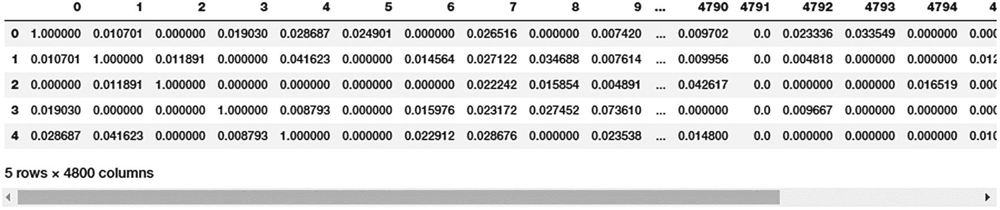

# 从过滤后的词元重新生成文档
doc = ' '.join(filtered_tokens)
return doc
normalize_corpus = np.vectorize(normalize_document)
norm_corpus = normalize_corpus(list(df['description']))
len(norm_corpus)
```

接下来，我们进行文本表示，这可以通过利用像 TF-IDF 这样的特征工程方案来实现。

### 提取 TF-IDF 特征

我们在第 4 章中详细讨论了 TF-IDF 表示方案。在此，我们利用它来向量化预处理后的电影描述，从而将其转换为数值向量。

```
from sklearn.feature_extraction.text import TfidfVectorizer
tf = TfidfVectorizer(ngram_range=(1, 2), min_df=2)
tfidf_matrix = tf.fit_transform(norm_corpus)
tfidf_matrix.shape
(4800, 20667)
```

我们采用一元分词和二元分词作为特征，并移除在整个语料库中仅出现在一个文档中的词汇。现在，我们已经使用基于 `tf-idf` 的向量表示对文档进行了标准化和向量化处理，接下来将探讨如何使用余弦相似度计算文档相似度。

### 用于成对文档相似度的余弦相似度

我们已经了解了计算余弦相似度的概念，并将其应用于术语相似度。在此，我们复用相同的概念来计算文档之间的余弦相似度得分，而非术语。文档向量将是基于词袋模型的向量，但其中的值采用 TF-IDF 值而非词频。因此，最终我们将得到一个 *N x N* 的矩阵，其中 *N* 等于电影数量，即 4,800。见图 7-6。



图 7-6  
成对文档余弦相似度

```
from sklearn.metrics.pairwise import cosine_similarity
doc_sim = cosine_similarity(tfidf_matrix)
doc_sim_df = pd.DataFrame(doc_sim)
doc_sim_df.head()
```

现在，在构建电影推荐系统之前，我们将构建一个工作流，用于确定与样片最相似且值得推荐的电影。在此之前，我们先构建数据集中所有电影标题的列表。

```
movies_list = df['title'].values
movies_list, movies_list.shape
(array(['Avatar', "Pirates of the Caribbean: At World's End", 'Spectre',
..., 'Signed, Sealed, Delivered', 'Shanghai Calling',
'My Date with Drew'], dtype=object), (4800,))
```

通常，我们可以索引成对相似度矩阵来获取用于推荐的文档相似度。

### 查找样片的最相似电影

以最受欢迎的电影之一《神偷奶爸》为例，尝试找出最相似的可推荐电影。以下是主要步骤，后续将有助于我们构建通用函数。

#### 查找电影 ID

由于我们拥有电影列表，因此在数据集中找到该电影的位置索引非常简单。

```
movie_idx = np.where(movies_list == 'Minions')[0][0]
movie_idx
```

#### 获取电影相似度

现在，我们将使用这个位置索引来获取与所有电影（与索引为 546 的电影《神偷奶爸》相关）的成对电影相似度向量。

```
movie_similarities = doc_sim_df.iloc[movie_idx].values
movie_similarities
array([0.0104544 , 0.01072835, 0\.        , ..., 0.00690954, 0\.        ,
0\.        ])
```


### 获取最相似的五个电影 ID

现在，我们开始获取与电影*小黄人大眼萌*最相似的前五部电影。请记住，我们关注的是获取电影索引，而非显示相似度数值。

```
similar_movie_idxs = np.argsort(-movie_similarities)[1:6]
similar_movie_idxs
array([506, 614, 241, 813, 154], dtype=int64)
```

### 获取最相似的五个电影名称

由于我们已经掌握了电影索引位置，可以轻松获得与*小黄人大眼萌*最相似的前五部电影。

```
similar_movies = movies_list[similar_movie_idxs]
similar_movies
array(['Despicable Me 2', 'Despicable Me',
'Teenage Mutant Ninja Turtles: Out of the Shadows', 'Superman',
'Rise of the Guardians'], dtype=object)
```

效果不错！排名前两位的电影与*小黄人大眼萌*确实高度相似，事实上它们都属于*神偷奶爸*系列。

### 构建电影推荐系统

现在，是时候整合我们学到的所有知识，构建一个电影推荐系统了。我们将创建一个电影推荐函数，它需要将电影标题、电影标题列表以及文档相似度矩阵数据框作为输入参数。

```
def movie_recommender(movie_title, movies=movies_list, doc_sims=doc_sim_df):
#### 查找电影 ID
movie_idx = np.where(movies == movie_title)[0][0]
#### 获取电影相似度
movie_similarities = doc_sims.iloc[movie_idx].values
