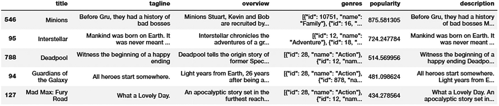

# 返回前 5 部电影
return similar_movies
```

### 获取热门电影列表

我们可以根据流行度评分对电影数据集进行排序，并选取一些最受欢迎的电影。然后，查看这些电影的推荐结果可能会发现一些有趣的现象！参见图 7-7。



**图 7-7** 热门电影

```
pop_movies = df.sort_values(by='popularity', ascending=False)
pop_movies.head()
```

我根据电影的流行度评分及其可能的有趣程度，选择了以下电影。你也可以随意替换为自己喜欢的电影。

```
popular_movies = ['Minions', 'Interstellar', 'Deadpool', 'Jurassic World', 'Pirates of the Caribbean: The Curse of the Black Pearl', 'Dawn of the Planet of the Apes', 'The Hunger Games: Mockingjay - Part 1', 'Terminator Genisys', 'Captain America: Civil War', 'The Dark Knight', 'The Martian', 'Batman v Superman: Dawn of Justice', 'Pulp Fiction', 'The Godfather', 'The Shawshank Redemption', 'The Lord of the Rings: The Fellowship of the Ring', 'Harry Potter and the Chamber of Secrets', 'Star Wars', 'The Hobbit: The Battle of the Five Armies', 'Iron Man']
```

现在，让我们使用电影推荐函数为这些电影分别获取前五部推荐影片。

```
for movie in popular_movies:
print('Movie:', movie)
print('Top 5 recommended Movies:', movie_recommender(movie_title=movie))
print()
Movie: Minions
Top 5 recommended Movies: ['Despicable Me 2' 'Despicable Me'
'Teenage Mutant Ninja Turtles: Out of the Shadows' 'Superman'
'Rise of the Guardians']
...
...
Movie: Jurassic World
Top 5 recommended Movies: ['Jurassic Park' 'The Lost World: Jurassic Park' 'The Nut Job'
"National Lampoon's Vacation" 'Vacation']
Movie: Pirates of the Caribbean: The Curse of the Black Pearl
Top 5 recommended Movies: ["Pirates of the Caribbean: Dead Man's Chest" 'The Pirate'
'Pirates of the Caribbean: On Stranger Tides'
'The Pirates! In an Adventure with Scientists!' 'Joyful Noise']
...
...
Movie: Captain America: Civil War
Top 5 recommended Movies: ['Captain America: The Winter Soldier' 'This Means War'
'Avengers: Age of Ultron' 'Iron Man 2' 'Escape from Tomorrow']
Movie: The Dark Knight
Top 5 recommended Movies: ['The Dark Knight Rises' 'Batman Forever' 'Batman Returns'
'Batman: The Dark Knight Returns, Part 2' 'Slow Burn']
Movie: The Martian
Top 5 recommended Movies: ['The Last Days on Mars' 'Swept Away' 'Alive' 'All Is Lost' 'Red Planet']
...
...
Movie: The Lord of the Rings: The Fellowship of the Ring
Top 5 recommended Movies: ['The Lord of the Rings: The Two Towers'
'The Hobbit: The Desolation of Smaug'
'The Lord of the Rings: The Return of the King'
"What's the Worst That Could Happen?" 'The Hobbit: An Unexpected Journey']
Movie: Harry Potter and the Chamber of Secrets
Top 5 recommended Movies: ['Harry Potter and the Prisoner of Azkaban'
'Harry Potter and the Goblet of Fire'
'Harry Potter and the Order of the Phoenix'
'Harry Potter and the Half-Blood Prince'
"Harry Potter and the Philosopher's Stone"]
Movie: Star Wars
Top 5 recommended Movies: ['The Empire Strikes Back' 'Return of the Jedi' 'Shrek the Third'
'The Ice Pirates' 'The Tale of Despereaux']
Movie: The Hobbit: The Battle of the Five Armies
Top 5 recommended Movies: ['The Hobbit: The Desolation of Smaug' 'The Hobbit: An Unexpected Journey'
"Dragon Nest: Warriors' Dawn"
'A Funny Thing Happened on the Way to the Forum' 'X-Men: Apocalypse']
Movie: Iron Man
Top 5 recommended Movies: ['Iron Man 2' 'Avengers: Age of Ultron' 'Hostage' 'Iron Man 3'
'Baahubali: The Beginning']
```

从结果来看，可以清晰地发现，我们基于文档相似度的简单推荐系统表现非常出色！我们推荐使用 Scikit-Learn 的 `cosine_similarity()` 工具函数，它非常实用。你也可以直接使用 Gensim 的 `similarities` 模块或 `gensim.matutils` 模块中提供的 `cossim()` 函数。


### 用于成对文档相似度的 Okapi BM25 排序

在信息检索和搜索引擎中有几种非常流行的技术，包括 PageRank 和 Okapi BM25。术语 BM 代表*最佳匹配*。这项技术也简称为 BM25，但为完整起见，我们称之为`Okapi BM25`，因为尽管`BM25`函数背后的概念最初是理论性的，但伦敦城市大学在 1980-90 年代建立了`Okapi`信息检索系统，该系统实施此技术以在实际真实数据上检索文档。

此技术也可称为基于概率相关性的框架或模型，由包括计算机科学家`S. Robertson`和`K. Jones`在内的数人在 1970-80 年代开发。有多种基于不同因素对文档进行排名的函数，`BM25`是其中之一。其较新变体是`BM25F`，其他一些变体包括`BM15`和`BM25+`。

`Okapi BM25`技术可正式定义为一种基于词袋模型的文档排名与检索函数，用于根据用户输入查询检索相关文档。该查询可以是包含一个句子或一组句子的文档，甚至可以只是几个词。`Okapi BM25`实际上并非单一函数，而是一个由整个评分函数集合组成的框架，这些函数被组合使用。

考虑我们有一个查询文档`QD`，其中`QD = (q[1], q[2], … , q[n])`包含`n`个术语或关键词，并且我们有一个语料库文档`CD`，我们希望从中基于相似度分数检索与查询文档最相关的文档。假设我们有这些，我们可以数学上将这两个文档之间的`BM25`分数定义如下：

```
bm25(CD, QD) = Σ_{i=1}^{n} idf(q_i) · [f(q_i, CD) · (k1 + 1)] / [f(q_i, CD) + k1 · (1 - b + b · (|CD| / avgdl))]
```

其中函数`bm25(CD, QD)`计算文档`CD`基于查询文档`QD`的`BM25`排名或分数。函数`idf(q[i])`给出术语`q[i]`在语料库中的逆文档频率（`idf`），该语料库包含`CD`，我们将从中检索相关文档。如果你还记得，我们在第 4 章实现`tf-idf`特征提取器时计算了`idfs`。为了刷新记忆，它可以表示为：

```
idf(t) = 1 + log(C / (1 + df(t)))
```

其中`idf(t)`表示术语`t`的`idf`，`C`表示语料库中文档的总数，`df(t)`表示包含术语`t`的文档数量。还有其他实现`idf`的方法，但我们将使用这一种。

附带说明，不同实现的最终结果非常相似。函数`f(q[i], CD)`给出术语`q[i]`在语料库文档`CD`中的频率。表达式`|CD|`表示文档`CD`的总长度，以单词数衡量，而`avgdl`表示我们将从中检索文档的语料库的平均文档长度。此外，你还会观察到有两个自由参数——`k[1]`通常在[1.2，2.0]范围内，`b`通常取 0.75。在我们的实现中，将基于`Gensim`框架中`BM25`算法的流行实现，将`k[1]`的值取为 2.5，`b`取为 0.85。

要成功实现并计算文档的`BM25`分数，我们必须经历几个步骤：

1. 计算文档和语料库中术语的频率。
2. 计算术语的逆文档频率。
3. 获取语料库文档和查询文档的基于词袋的特征。
4. 构建一个函数，用于计算给定文档相对于语料库中特定文档的`BM25`分数。
5. 构建一个函数，利用步骤 4 中的函数，计算并返回给定文档相对于语料库中每个其他文档的`BM25`分数（类似于每个文档的相似度向量）。
6. 构建一个函数，返回语料库中所有文档的成对`BM25`相似度分数（权重）（利用步骤 5 中的函数）。

我们在此实现的代码实际上源自`Gensim`框架，如果你有兴趣利用`BM25`相似度，我们强烈推荐它。我们展示了相似度框架的内部结构，以便你可以将其与先前定义的概念相关联。以下类有助于在我们定义的工作流程中实现从步骤 1 到步骤 5 的所有组件。

```
"""
Data:

.. data:: PARAM_K1 - Okapi BM25 的自由平滑参数。
.. data:: PARAM_B - Okapi BM25 的自由平滑参数。
.. data:: EPSILON - 用于语料库中文档负 idf 的常量。
"""
import math
from six import iteritems
from six.moves import xrange
PARAM_K1 = 2.5
PARAM_B = 0.85
EPSILON = 0.2
class BM25(object):
"""最佳匹配 25 排序函数的实现。
属性

corpus_size : int
语料库的大小（文档数量）。
avgdl : float
`corpus`中文档的平均长度。
corpus : list of list of str
文档语料库。
f : list of dicts of int
`corpus`中每个文档的术语频率字典。
单词作为键，频率作为值。
df : dict
整个`corpus`的术语频率字典。
单词作为键，频率作为值。
idf : dict
整个`corpus`的逆术语频率字典。
单词作为键，频率作为值。
doc_len : list of int
文档长度列表。
"""
def __init__(self, corpus):
"""
参数

corpus : list of list of str
给定的语料库。
"""
self.corpus_size = len(corpus)
self.avgdl = sum(float(len(x)) for x in corpus) / self.corpus_size
self.corpus = corpus
self.f = []
self.df = {}
self.idf = {}
self.doc_len = []
self.initialize()
def initialize(self):
"""计算文档和语料库中的术语频率。
同时计算逆文档频率。"""
for document in self.corpus:
frequencies = {}
self.doc_len.append(len(document))
for word in document:
if word not in frequencies:
frequencies[word] = 0
frequencies[word] += 1
self.f.append(frequencies)
for word, freq in iteritems(frequencies):
if word not in self.df:
self.df[word] = 0
self.df[word] += 1
for word, freq in iteritems(self.df):
self.idf[word] = math.log(self.corpus_size - freq + 0.5) - math.log(freq + 0.5)
def get_score(self, document, index, average_idf):
"""计算给定`document`相对于由`index`选定的语料库文档的 BM25 分数。
参数

document : list of str
待评分的文档。
index : int
语料库中与`document`进行评分比对的文档索引。
average_idf : float
语料库中的平均 idf。
返回

float
BM25 分数。
"""
score = 0
for word in document:
if word not in self.f[index]:
continue
idf = self.idf[word] if self.idf[word] >= 0 else EPSILON * average_idf
score += (idf * self.f[index][word] * (PARAM_K1 + 1)
/ (self.f[index][word] + PARAM_K1 * (1 - PARAM_B + PARAM_B * self.doc_len[index] / self.avgdl)))
return score
def get_scores(self, document, average_idf):
"""计算并返回给定`document`相对于语料库中每个文档的 BM25 分数。
参数

document : list of str
待评分的文档。
average_idf : float
语料库中的平均 idf。
返回

list of float
BM25 分数列表。
"""
scores = []
for index in xrange(self.corpus_size):
score = self.get_score(document, index, average_idf)
scores.append(score)
return scores
```


我们现在已经在工作流程中实现了步骤 6 的函数，用于计算文档间成对的 BM25 相似度得分，这正是我们所需要的！

```python
def get_bm25_weights(corpus):
    """Returns BM25 scores (weights) of documents in corpus.
    Each document has to be weighted with every document in given corpus.
    Parameters

    corpus : list of list of str
        Corpus of documents.
    Returns

    list of list of float
        BM25 scores.
    Examples

    >>> from gensim.summarization.bm25 import get_bm25_weights
    >>> corpus = [
    ...     ["black", "cat", "white", "cat"],
    ...     ["cat", "outer", "space"],
    ...     ["wag", "dog"]
    ... ]
    >>> result = get_bm25_weights(corpus)
    """
    bm25 = BM25(corpus)
    average_idf = sum(float(val) for val in bm25.idf.values()) / len(bm25.idf)
    weights = []
    for doc in corpus:
        scores = bm25.get_scores(doc, average_idf)
        weights.append(scores)
    return weights
```

根据文档说明，要使用此函数，首先需要分词语料库，如下所示：

```python
norm_corpus_tokens = np.array([nltk.word_tokenize(doc) for doc in norm_corpus])
norm_corpus_tokens[:3]
