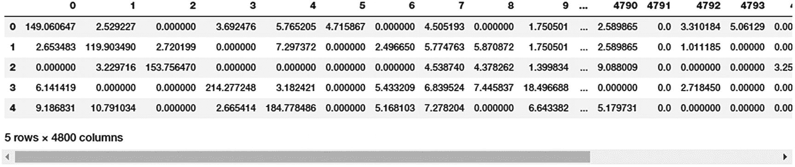

# list(['plan', 'one', 'escapes', 'cryptic', 'message', 'bonds', 'past', 'sends', 'trail', 'uncover', 'sinister', 'organization', 'battles', 'political', 'forces', 'keep', 'secret', 'service', 'alive', 'bond', 'peels', 'back', 'layers', 'deceit', 'reveal', 'terrible', 'truth', 'behind', 'spectre'])], dtype=object)
```

现在，我们可以使用之前定义的`get_bm25_weights(...)`函数来构建成对文档相似度矩阵。请注意，根据语料库大小，这可能需要相当长的时间来计算。具体请参见图 7-8。



图 7-8：我们的成对 BM25 文档相似度矩阵

```python
%%time
wts = get_bm25_weights(norm_corpus_tokens)
