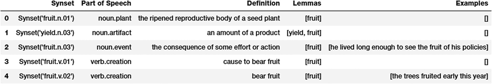
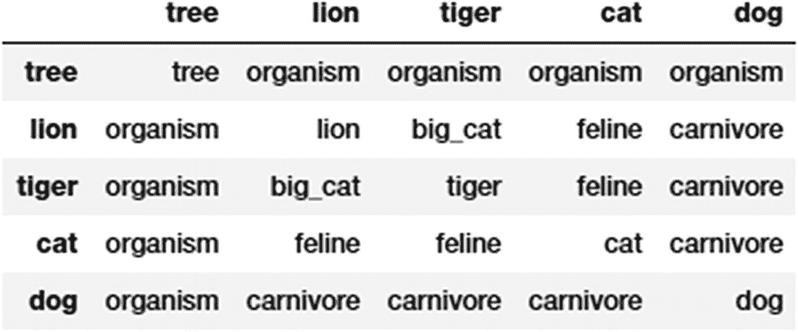
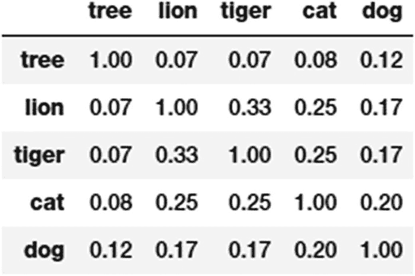
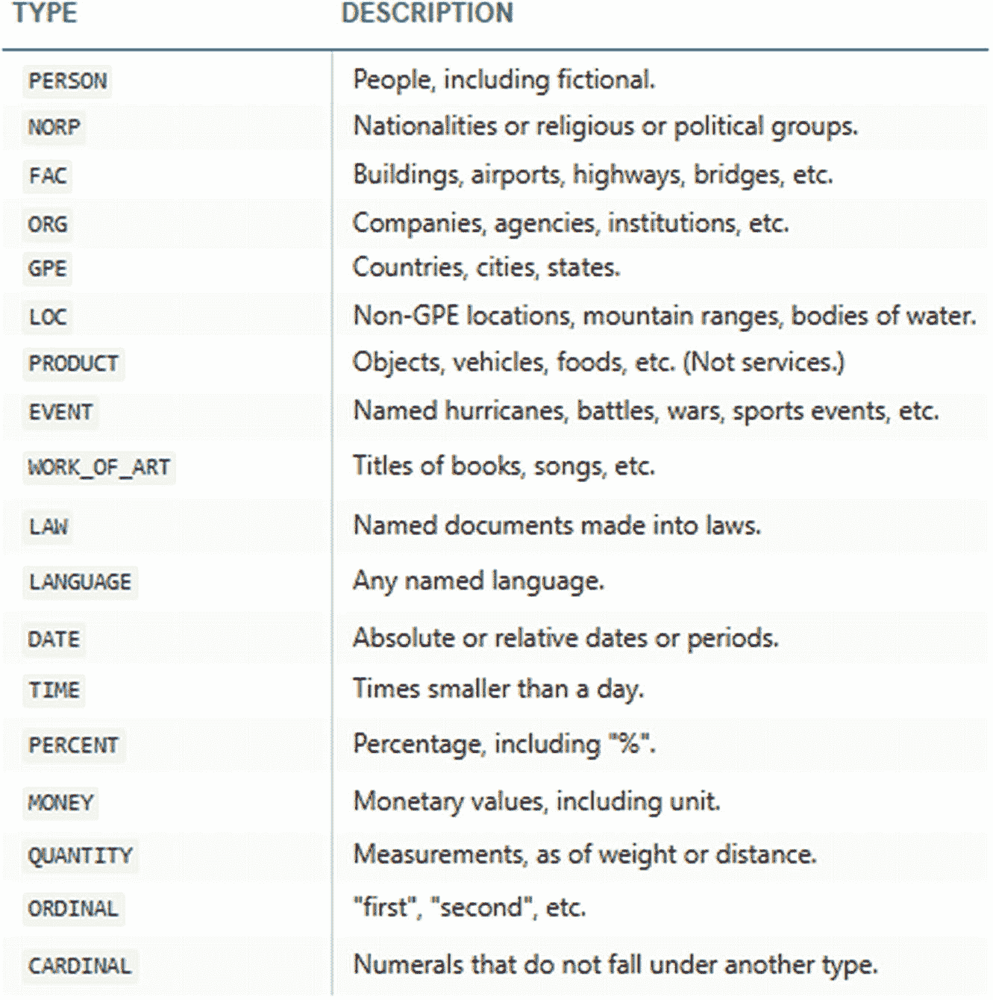
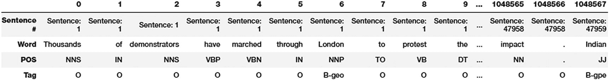
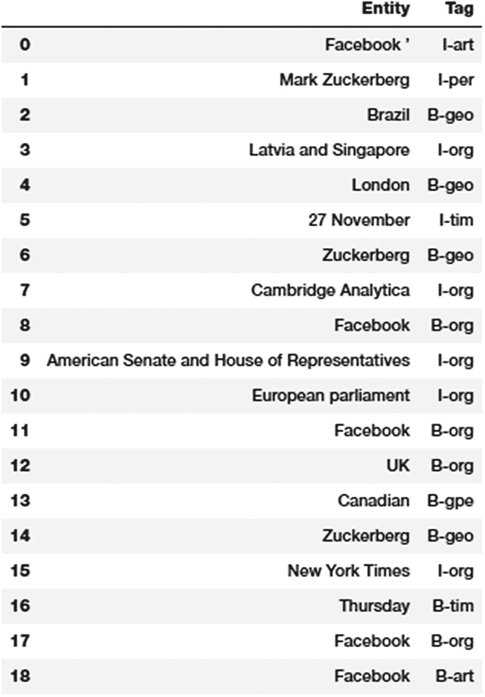

# 8. 语义分析

随着机器学习的兴起以及深度学习和人工智能等进一步的发展，自然语言理解在过去十年中获得了显著的重要性。计算机（或泛指机器）可以被编程以学习特定事物或执行特定操作。然而，关键的限制在于它们无法像人类一样感知、理解和领悟事物。随着神经网络的重新流行以及计算机架构的进步，我们现在拥有快速发展的深度学习和人工智能，我们一直在让机器自主学习、感知、理解和执行操作。你可能已经看到或听到过许多这样的成果，例如自动驾驶汽车、在象棋和围棋等游戏中击败资深玩家的计算机，以及最近的聊天机器人。到目前为止，我们已经研究了各种计算、语言处理和机器学习技术来对文本进行分类、聚类和摘要。我们还开发了一些方法和程序来分析理解文本的句法和结构。本章将探讨试图回答这样一个问题的方法：“我们能否分析和理解一段文本背后的含义和情感？”

自然语言处理有着广泛的应用。人们试图利用自然语言理解来推断文本背后的含义和上下文，并解决各种问题。我们在第 1 章中简要讨论了其中的一些应用。为了唤起你的记忆，以下应用需要从语义角度进行深入理解。

*   问答系统
*   上下文识别
*   语音识别（针对某些应用）

文本语义专门处理理解文本或语言的含义。词汇在组合成句子时，会产生一些词汇关系和上下文关系。这导致了各种类型的关系和层次结构。语义学处于这一切的核心，因为它试图分析和理解这些关系，并从中推断出含义。我们将探索自然语言中各种类型的语义关系，并研究一些基于自然语言处理的技术，用于从文本中推断和提取有意义的语义信息。语义学纯粹关注上下文和含义，文本结构在此意义不大。然而，有时单词的句法或排列顺序有助于我们推断单词的上下文，并帮助我们区分诸如作为金属的“lead”和作为电影主角的“lead”这类词语！

在本章中，我们将涵盖语义分析的几个方面。我们首先探索 `WordNet`（一个词汇数据库），并介绍一个称为同义词集的新概念。我们还将探索自然语言中的各种语义关系和表示。我们将涵盖如词义消歧和命名实体识别（NER）等技术，你甚至将从头开始构建你自己的 NER！让我们开始吧。本章展示的所有代码示例均可在本书的官方 GitHub 仓库中找到，你可以通过 [`https://github.com/dipanjanS/text-analytics-with-python/tree/master/New-Second-Edition`](https://github.com/dipanjanS/text-analytics-with-python/tree/master/New-Second-Edition) 访问。

## 语义分析

我们已经了解了术语或单词如何被分组为短语，进而形成从句，最后形成句子。第 3 章向我们展示了自然语言中的各种结构成分，包括词性、组块和语法。所有这些概念都属于文本数据的句法和结构分析范畴。虽然我们确实探索了单词、短语和从句的关系，但这些纯粹是基于它们的位置、句法和结构。语义分析更侧重于理解文本中单词背后的实际上下文和含义，以及它们如何与其他单词关联并作为一个整体传达某些信息。

正如第 1 章所述，语义学是研究意义的学科。语言语义学是语言学中一个完整的分支，专门研究自然语言中的意义。这包括探索单词、短语和符号之间的关系。除此之外，还有多种方式来表示与陈述和命题相关的语义。我们将在语义分析下广泛涵盖以下主题：

*   探索 `WordNet` 和同义词集
*   分析词汇语义关系
*   词义消歧
*   命名实体识别
*   分析语义表示

这些主题的主要目标是让你清楚了解可用于语义分析的方法论，以及如何使用它们。你可以通过重新阅读第 1 章中的“语言语义学”部分来唤起回忆。我们将在本章中结合实际案例再次回顾其中的一些概念。事不宜迟，让我们开始吧！

## 探索 WordNet

`WordNet` 是一个庞大的英语词汇数据库。该数据库属于普林斯顿大学，你可以通过 [`https://wordnet.princeton.edu/`](https://wordnet.princeton.edu/)（`WordNet` 的官方网站）获取更详细的信息。它最初于 1985 年在普林斯顿大学认知科学实验室由 G.A. Miller 教授指导下创建。该词汇数据库包含名词、形容词、动词和副词。相关的词汇术语根据共同概念被分组到集合中。这些集合被称为认知同义词集或同义词集，每一个都表达了一个独特、明确的概念。

在高层面上，`WordNet` 可以比作一个提供单词及其同义词的同义词库或词典，但在更深的层面上，它的功能远不止于此。同义词集及其对应的术语基于其语义含义具有详细的关系和层次结构。`WordNet` 在文本分析、自然语言处理和基于人工智能的应用中被广泛用作词汇数据库。

`WordNet` 数据库包含超过 155,000 个单词，它们分布在 117,000 个同义词集中，并包含超过 206,000 个词-义对。该数据库大约 12MB，可以通过各种接口和 API 访问。官方网站有一个网络应用界面，用于访问与单词、同义词集和概念相关的各种详细信息。你可以通过 [`http://wordnetweb.princeton.edu/perl/webwn`](http://wordnetweb.princeton.edu/perl/webwn) 访问它，或者从 [`https://wordnet.princeton.edu/wordnet/download/`](https://wordnet.princeton.edu/wordnet/download/) 下载，那里包含与 `WordNet` 相关的各种包、文件和工具。我们将使用 `NLTK` 包提供的接口，以编程方式访问 `WordNet`。我们首先探索同义词集，然后利用同义词集探索各种语义关系。

### 理解同义词集

我们开始通过查看同义词集来探索 WordNet，因为它们可能是最重要的结构之一，并将所有内容联系在一起。通常，基于自然语言处理和信息检索的概念，同义词集被定义为一系列语义上相似的数据实体集合。这并不意味着它们完全相同，而是它们都围绕相似的语境和概念。具体到 WordNet 的上下文，同义词集被定义为一组可互换的、围绕特定概念的同义词集合。同义词集不仅包含简单的词汇，还包括搭配词。多义词形式（即读音和写法相同，但具有不同但相关的含义的词）会根据其含义被分配到不同的同义词集中。同义词集之间通过语义关系相互连接，我们将在后续章节中探讨这些关系。通常，每个同义词集都包含词汇本身、解释词汇含义的定义、一些可选示例以及与该词汇相关的词元（同义词集合）。某些词汇可能对应多个同义词集，每个同义词集都带有特定的上下文。

让我们通过使用 NLTK 的 WordNet 接口来查看一个实际示例，探索与单词“fruit”相关的同义词集。我们可以通过以下代码片段来实现。

```python
from nltk.corpus import wordnet as wn
import pandas as pd

term = 'fruit'
synsets = wn.synsets(term)
```

# 显示总同义词集数量

```python
print('Total Synsets:', len(synsets))
```

```
Total Synsets: 5
```

我们可以看到，单词“fruit”总共关联了五个同义词集。这些同义词集能说明什么？我们可以使用以下代码片段进一步深入了解每个同义词集及其组成部分（见图 8-1）。



图 8-1 探索 WordNet 同义词集

```python
pd.options.display.max_colwidth = 200

fruit_df = pd.DataFrame([{'Synset': synset,
                          'Part of Speech': synset.lexname(),
                          'Definition': synset.definition(),
                          'Lemmas': synset.lemma_names(),
                          'Examples': synset.examples()}
                         for synset in synsets])

fruit_df = fruit_df[['Synset', 'Part of Speech', 'Definition', 'Lemmas', 'Examples']]

fruit_df
```

输出结果显示了与单词“fruit”相关的每个同义词集的详细信息，定义则给出了每个同义词集的含义及其关联的词元。同时还提到了每个同义词集的词性，包括名词和动词。输出中的一些示例展示了该词汇在实际句子中的用法。现在我们对同义词集有了更好的理解，接下来让我们开始探索各种语义关系。

### 分析词汇语义关系

文本语义本身指的是对意义和语境的研究。同义词集为各种词汇提供了良好的抽象，并提供了有用的信息，如定义、示例、词性和词元。但是，我们能利用同义词集探索实体间的语义关系吗？答案是肯定的。我们将涵盖许多与语义关系相关的概念，这些概念我们在第 1 章的“语言语义学”部分下的“词汇语义关系”小节中已经详细阐述过。当我们在这里用实际案例进行说明时，快速浏览一下那个章节将有助于你更好地理解每个概念。我们在此使用 NLTK 的 WordNet 资源，但你也可以使用`pattern`包中的同一个 WordNet 资源，因为它提供了与 NLTK 类似的接口。

#### 蕴涵关系

*蕴涵*这一术语通常指某个事件或动作从逻辑上涉及或关联到已发生或将要发生的其他动作或事件。理想情况下，这非常适用于表示特定动作的动词。以下代码片段展示了如何获取蕴涵关系。

```python
for action in ['walk', 'eat', 'digest']:
    action_syn = wn.synsets(action, pos="v")[0]
    print(action_syn, '-- entails -->', action_syn.entailments())
```

```
Synset('walk.v.01') -- entails --> [Synset('step.v.01')]
Synset('eat.v.01') -- entails --> [Synset('chew.v.01'), Synset('swallow.v.01')]
Synset('digest.v.01') -- entails --> [Synset('consume.v.02')]
```

从输出中可以看到相关的同义词集如何展示了蕴涵关系的概念。蕴涵关系描绘了相关联的动作，比如走路涉及或蕴涵着迈步，而吃东西则蕴涵着咀嚼和吞咽。

#### 同形同音异义词与同形异义词

在较高层次上，*同形同音异义词*指具有相同书写形式或发音但含义不同的单词。它们是*同形异义词*的超集，后者指拼写相同但发音或含义不同的单词。以下代码片段展示了我们如何获取同形同音异义词/同形异义词。

```python
for synset in wn.synsets('bank'):
    print(synset.name(), '-', synset.definition())
```

```
bank.n.01 - 倾斜的土地（尤指水体旁的坡地）
depository_financial_institution.n.01 - 接受存款并将资金用于贷款活动的金融机构
bank.n.03 - 长条形的脊状物或堆状物
bank.n.04 - 一排或一层相似物体的排列
...
...
deposit.v.02 - 存入银行账户
bank.v.07 - 用灰覆盖以控制燃烧速率
trust.v.01 - 对……有信心或信任
```

此输出显示了单词“bank”的各种同形异义词所获得的部分结果。可以看到单词“bank”关联了多种不同的含义，这正是同形异义词的核心概念。

#### 同义词与反义词

你可能已经知道，*同义词*是含义相似的单词，而*反义词*是含义相反或相对的单词。以下代码片段展示了同义词和反义词。

```python
term = 'large'
synsets = wn.synsets(term)
adj_large = synsets[1]
adj_large = adj_large.lemmas()[0]
adj_large_synonym = adj_large.synset()
adj_large_antonym = adj_large.antonyms()[0].synset()
print('Synonym:', adj_large_synonym.name())
print('Definition:', adj_large_synonym.definition())
print('Antonym:', adj_large_antonym.name())
print('Definition:', adj_large_antonym.definition())
print()
```

```
Synonym: large.a.01
Definition: 在尺寸、数量、量级或程度上高于平均水平
Antonym: small.a.01
Definition: 在数量、量级或程度上有限或低于平均水平
```

```python
term = 'rich'
synsets = wn.synsets(term)[:3]
for synset in synsets:
    rich = synset.lemmas()[0]
    rich_synonym = rich.synset()
    rich_antonym = rich.antonyms()[0].synset()
    print('Synonym:', rich_synonym.name())
    print('Definition:', rich_synonym.definition())
    print('Antonym:', rich_antonym.name())
    print('Definition:', rich_antonym.definition())
    print()
```

```
Synonym: rich_people.n.01
Definition: 拥有财产和财富的人（视为一个群体）
Antonym: poor_people.n.01
Definition: 没有财产或财富的人（视为一个群体）

Synonym: rich.a.01
Definition: 拥有物质财富
Antonym: poor.a.02
Definition: 拥有很少钱或很少财产

Synonym: rich.a.02
Definition: 拥有丰富的理想品质或物质（尤其是自然资源）
Antonym: poor.a.04
Definition: 缺乏特定资源、品质或物质
```

这些输出展示了单词“large”和“rich”的示例同义词和反义词。此外，我们探索了与词汇或概念“rich”相关的几个同义词集，它们提供了不同的同义词及其对应的反义词。

#### 下位词（Hyponyms）与上位词（Hypernyms）

`Synset`对象代表具有独特语义和概念的同义词集，它们基于某些相似性相互关联。除了具体实体外，其中一些同义词集也代表抽象和通用概念。通常，它们以层级结构相互链接，表示“是一种（is-a）”关系。*下位词*和*上位词*帮助我们通过浏览该层级结构来探索相关概念。具体来说，`hyponyms`指代作为更高阶概念子类的实体或概念，与其超类相比，具有非常特定的含义或上下文。以下代码片段展示了单词“`tree`”的下位词。

```python
term = 'tree'
synsets = wn.synsets(term)
tree = synsets[0]
print('Name:', tree.name())
print('Definition:', tree.definition())
```

```
Name: tree.n.01
```

Definition: a tall perennial woody plant having a main trunk and branches forming a distinct elevated crown; includes both gymnosperms and angiosperms

```python
hyponyms = tree.hyponyms()

print('Total Hyponyms:', len(hyponyms))

print('Sample Hyponyms')

for hyponym in hyponyms[:10]:

    print(hyponym.name(), '-', hyponym.definition())

    print()
```

```
Total Hyponyms: 180

Sample Hyponyms

aalii.n.01 - a small Hawaiian tree with hard dark wood

acacia.n.01 - any of various spiny trees or shrubs of the genus Acacia

african_walnut.n.01 - tropical African timber tree with wood that resembles mahogany

albizzia.n.01 - any of numerous trees of the genus Albizia

alder.n.02 - north temperate shrubs or trees having toothed leaves and conelike fruit; bark is used in tanning and dyeing and the wood is rot-resistant

angelim.n.01 - any of several tropical American trees of the genus Andira

angiospermous_tree.n.01 - any tree having seeds and ovules contained in the ovary

anise_tree.n.01 - any of several evergreen shrubs and small trees of the genus Illicium

arbor.n.01 - tree (as opposed to shrub)

aroeira_blanca.n.01 - small resinous tree or shrub of Brazil
```

该输出告诉我们，单词“`tree`”共有 180 个下位词，我们看到了其中一些示例下位词及其定义。正如预期，每个下位词都是树的一种特定类型。`上位词（hypernyms）`是充当`hyponyms`超类的实体或概念，具有更通用的含义或上下文。以下代码片段展示了“`tree`”的直接超类上位词。

```python
hypernyms = tree.hypernyms()

print(hypernyms)
```

```
[Synset('woody_plant.n.01')]
```

你甚至可以向上浏览整个实体/概念层级结构，并通过以下代码片段展示“`tree`”的所有上位词或父类。

```python
```

# get total hierarchy pathways for 'tree'

```python
hypernym_paths = tree.hypernym_paths()
print('Total Hypernym paths:', len(hypernym_paths))
```

Total Hypernym paths: 1

# 打印完整的上位词层次结构

打印上位词层次结构：

```python
print('Hypernym Hierarchy')
print(' -> '.join(synset.name() for synset in hypernym_paths[0]))
```

输出：

```
Hypernym Hierarchy
entity.n.01 -> physical_entity.n.01 -> object.n.01 -> whole.n.02 -> living_thing.n.01 -> organism.n.01 -> plant.n.02 -> vascular_plant.n.01 -> woody_plant.n.01 -> tree.n.01
```

从该输出中，你可以看到 `entity` 是 `tree` 所属的最通用概念，并且展示了完整的上下位层级结构，其中显示了每一层级对应的上位词或超类。当你进一步向下浏览时，会得到更具体的概念/实体；如果反向浏览，则会得到更通用的概念/实体。

### 整体词（Holonyms）与部分词（Meronyms）

整体词包含一个特定的关注实体。基本上，它们被定义为表示整体的实体与表示整体特定部分的术语之间的关系。以下代码片段展示了 `tree` 的整体词。

```python
member_holonyms = tree.member_holonyms()
print('Total Member Holonyms:', len(member_holonyms))
print('Member Holonyms for [tree]:-')
for holonym in member_holonyms:
    print(holonym.name(), '-', holonym.definition())
print()
```

输出：

```
Total Member Holonyms: 1
Member Holonyms for [tree]:-
forest.n.01 - the trees and other plants in a large densely wooded area
```

从输出中，我们可以看到 `forest` 是 `tree` 的一个整体词，这在语义上是正确的。这很合理，因为森林是树木的集合。部分词是语义关系，它将一个术语或实体关联为另一个术语或实体的组成部分或构成部分。以下代码片段展示了单词 `tree` 的不同类型的部分词。

```python
part_meronyms = tree.part_meronyms()
print('Total Part Meronyms:', len(part_meronyms))
print('Part Meronyms for [tree]:-')
for meronym in part_meronyms:
    print(meronym.name(), '-', meronym.definition())
print()
```

输出：

```
Total Part Meronyms: 5
Part Meronyms for [tree]:-
burl.n.02 - a large rounded outgrowth on the trunk or branch of a tree
crown.n.07 - the upper branches and leaves of a tree or other plant
limb.n.02 - any of the main branches arising from the trunk or a bough of a tree
stump.n.01 - the base part of a tree that remains standing after the tree has been felled
trunk.n.01 - the main stem of a tree; usually covered with bark; the bole is usually the part that is commercially useful for lumber
```

# substance based meronyms for tree

`substance_meronyms = tree.substance_meronyms()`

`print('Total Substance Meronyms:', len(substance_meronyms))`

`print('Substance Meronyms for [tree]:-')`

`for meronym in substance_meronyms:`

`    print(meronym.name(), '-', meronym.definition())`

`    print()`

```
Total Substance Meronyms: 2

Substance Meronyms for [tree]:-

heartwood.n.01 - the older inactive central wood of a tree or woody plant; usually darker and denser than the surrounding sapwood

sapwood.n.01 - newly formed outer wood lying between the cambium and the heartwood of a tree or woody plant; usually light colored; active in water conduction
```

该输出展示了部分词，包括树的各种构成部分，如“`stump`”和“`trunk`”，以及从树中衍生的各种物质，如“`heartwood`”和“`sapwood`”。

## 语义关系与相似性

在前几节中，我们探讨了与词汇语义关系相关的各种概念。现在，我们将研究如何根据实体间的语义关系来连接相似实体，并衡量它们之间的语义相似度。语义相似性不同于我们在第 6 章中讨论的传统相似性度量方法。我们将使用一些与生物实体相关的示例同义词集（如以下代码片段所示）进行分析。

```
tree = wn.synset('tree.n.01')

lion = wn.synset('lion.n.01')

tiger = wn.synset('tiger.n.02')

cat = wn.synset('cat.n.01')

dog = wn.synset('dog.n.01')
```

# 创建实体并提取名称和定义

```python
entities = [tree, lion, tiger, cat, dog]

entity_names = [entity.name().split('.')[0] for entity in entities]

entity_definitions = [entity.definition() for entity in entities]
```

# 打印实体及其定义

```python
for entity, definition in zip(entity_names, entity_definitions):
    print(entity, '-', definition)
    print()
```

`tree` - a tall perennial woody plant having a main trunk and branches forming a distinct elevated crown; includes both gymnosperms and angiosperms

`lion` - large gregarious predatory feline of Africa and India having a tawny coat with a shaggy mane in the male

`tiger` - large feline of forests in most of Asia having a tawny coat with black stripes; endangered

`cat` - feline mammal usually having thick soft fur and no ability to roar: domestic cats; wildcats

`dog` - a member of the genus Canis (probably descended from the common wolf) that has been domesticated by man since prehistoric times; occurs in many breeds

现在我们对这些实体有了更多了解，我们将尝试基于共同上位词来关联它们。对于每一对实体，我们将在关系层级树中寻找它们的最低共同上位词。关联密切的实体应具有非常具体的上位词，而不相关的实体则应具有非常抽象或通用的上位词。以下代码片段展示了这一点。



图 8-2 成对共同上位词矩阵

```python
common_hypernyms = []
for entity in entities:
    # 获取成对的最低共同上位词
    common_hypernyms.append([entity.lowest_common_hypernyms(compared_entity)[0].name().split('.')[0]
                            for compared_entity in entities])
```

# 构建成对最低共同上位词矩阵

`common_hypernym_frame` = `pd.DataFrame`(`common_hypernyms`, index=`entity_names`, columns=`entity_names`)

`common_hypernym_frame`

忽略矩阵的主对角线，对于每一对实体，我们可以看到它们的最低共同上位词，该词揭示了它们之间关系的本质（见图 8-2）。树木与其他动物除了同属生物体外并无关联，因此我们得到了它们之间的“生物体”关系。猫与狮子、老虎有关联，因为它们都是猫科动物，在输出结果中我们也能看到这一点。老虎和狮子通过“大型猫科动物”关系相互连接。最后，我们可以看到狗与其他动物之间存在“食肉动物”的关系，因为它们通常都吃肉。

我们还可以使用各种语义概念来衡量这些实体之间的语义相似性。我们将使用`路径相似度`，它基于连接两个术语的最短路径（根据它们的上位词/下位词分类体系）返回一个介于 `[0, 1]` 之间的值。以下代码片段展示了如何生成这个相似性矩阵（见图 8-3）。



图 8-3

成对相似性矩阵

```
similarities = []

for entity in entities:

    # 获取成对相似性

    similarities.append([round(`entity.path_similarity`(`compared_entity`), 2)

                        for compared_entity in entities])
```

# 构建成对相似性矩阵

```python
similarity_frame = pd.DataFrame(similarities, index=entity_names,
                                columns=entity_names)
similarity_frame
```

从图 8-3 的输出结果来看，正如预期，`lion` 和 `tiger` 最为相似，相似度值为 `0.33`；其次是它们与 `cat` 的语义相似度，值为 `0.25`。与其他动物相比，`Tree` 的语义相似度值最低。至此，我们关于词汇语义关系分析的讨论就结束了。我们鼓励您利用 WordNet，通过不同的示例探索更多相关概念。

## 词义消歧

在上一节中，我们探讨了同形异义词和同音异义词，这些词基本是指外观或发音相似但含义截然不同的词语。其含义取决于词语的使用语境，并依赖于词语语义，也称为*词义*。根据词语的用法识别其正确语义或含义的过程被称为*词义消歧*，其前提是该词语根据语境具有多种含义。这是 NLP 中一个非常常见的问题，广泛应用于各种场景，例如提高搜索引擎结果的相关性、增强文本连贯性等。

解决该问题有多种方法，包括基于词典和词库的方法，以及有监督和无监督的机器学习方法。全面涵盖所有方法超出了本文范围，因此我们将使用 Lesk 算法来演示词义消歧。Lesk 算法是由 M. E. Lesk 于 1986 年提出的经典算法。该算法的基本原理是利用词典或词汇定义来解释文本中待消歧的词语，并将这些定义中的词语与我们感兴趣的词语周围的一段文本进行比较。我们将使用 WordNet 词义库中的定义，而非普通词典。主要目标是返回与目标词语的语境句子及每个词义集的不同定义之间重叠词语或术语数量最多的词义集。以下代码片段利用 NLTK 演示了如何对多个示例进行词义消歧。

```python
from nltk.wsd import lesk
from nltk import word_tokenize
```

# 待消歧的样本文本和词语
```
samples = [('The fruits on that plant have ripened', 'n'),
           ('He finally reaped the fruit of his hard work as he won the race', 'n')]
```

# 执行词义消歧

```python
word = 'fruit'

for sentence, pos_tag in samples:
    word_syn = lesk(word_tokenize(sentence.lower()), word, pos_tag)
    print('Sentence:', sentence)
    print('Word synset:', word_syn)
    print('Corresponding definition:', word_syn.definition())
    print()
```

```
Sentence: The fruits on that plant have ripened
Word synset: Synset('fruit.n.01')
Corresponding definition: the ripened reproductive body of a seed plant

Sentence: He finally reaped the fruit of his hard work as he won the race
Word synset: Synset('fruit.n.03')
Corresponding definition: the consequence of some effort or action
```

# 待消歧的样本文本和词语

```
samples = [('Lead is a very soft, malleable metal', 'n'),
           ('John is the actor who plays the lead in that movie', 'n'),
           ('This road leads to nowhere', 'v')]

word = 'lead'
```

# 执行词义消歧

```python
for sentence, pos_tag in samples:
    word_syn = lesk(word_tokenize(sentence.lower()), word, pos_tag)
    print('Sentence:', sentence)
    print('Word synset:', word_syn)
    print('Corresponding defition:', word_syn.definition())
    print()
```

```
Sentence: Lead is a very soft, malleable metal
Word synset: Synset('lead.n.02')
Corresponding definition: a soft heavy toxic malleable metallic element; bluish white when freshly cut but tarnishes readily to dull grey

Sentence: John is the actor who plays the lead in that movie
Word synset: Synset('star.n.04')
Corresponding definition: an actor who plays a principal role

Sentence: This road leads to nowhere
Word synset: Synset('run.v.23')
Corresponding definition: cause something to pass or lead somewhere
```

在这些示例中，我们尝试对两个词语——`fruit` 和 `lead`——在不同文本中进行消歧。你可以看到我们如何使用 `lesk` 算法，根据待消歧词语在每个文档中的用法和语境，获取其正确的词义。这表明 `fruit` 既可以指一种可食用的实体，也可以指付出努力后所面临的某种后果。我们还看到了 `lead` 如何既可以指柔软的金属，表示促使某物/某人前往某地，甚至可以指在戏剧或电影中扮演主要角色的演员！

# 命名实体识别

在任何文本文档中，都存在一些特定术语，它们代表更具信息量的实体，并且与文本的其他部分相比具有独特的语境。这些实体被称为命名实体，它们更具体地表示现实世界中的对象，例如人物、地点、组织等，通常由专有名词表示。我们可以通过查找文本文档中的名词短语来发现它们。命名实体识别，也称为实体组块/提取，是信息提取中一种常用的技术，用于识别和分割命名实体，并将其分类或归类到各种预定义的类别下。`SpaCy` 在命名实体识别方面具有出色的能力，你可以在其网站上找到有关他们常用标注方案的详细信息：[`https://spacy.io/api/annotation#named-entities`](https://spacy.io/api/annotation#named-entities)。我们在图 8-4 所示的表格中列出了主要的命名实体标签。



**图 8-4** 常见命名实体

`SpaCy` 提供了一种基于多种技术的快速 NER 标注器。其具体算法并未被详细讨论，但文档指出“该算法是多种知名方法的混合体，目前没有在任何单一出版物中描述过”。现在，让我们尝试在一个样本语料库上进行命名实体识别（NER）。为此，我们定义一个示例新闻文档如下。

```python
text = """Three more countries have joined an "international grand committee" of parliaments, adding to calls for Facebook's boss, Mark Zuckerberg, to give evidence on misinformation to the coalition. Brazil, Latvia and Singapore bring the total to eight different parliaments across the world, with plans to send representatives to London on 27 November with the intention of hearing from Zuckerberg. Since the Cambridge Analytica scandal broke, the Facebook chief has only appeared in front of two legislatures: the American Senate and House of Representatives, and the European parliament. Facebook has consistently rebuffed attempts from others, including the UK and Canadian parliaments, to hear from Zuckerberg.He added that an article in the New York Times on Thursday, in which the paper alleged a pattern of behaviour from Facebook to "delay, deny and deflect" negative news stories, "raises further questions about how recent data breaches were allegedly dealt with within Facebook."
"""
```

多亏了 `spaCy`，获取命名实体现在变得非常简单。我们执行了一些基本的文本处理，并使用 `spaCy` 获得了 NER 标签，如下所示。

```python
import spacy
import re
text = re.sub(r'\n', ", text) # 移除多余换行符
nlp = spacy.load('en')
text_nlp = nlp(text)
```

# 打印文章中的命名实体

```python
ner_tagged = [(word.text, word.ent_type_) for word in text_nlp]

print(ner_tagged)
```

输出结果如下：

```
[('Three', 'CARDINAL'), ('more', ''), ('countries', ''), ('have', ''), ('joined', ''), ('an', ''), ('''', ''), ('international', ''), ('grand', ''), ('committee', ''), ('"', ''), ('of', ''), ('parliaments', ''), (',', ''), ('adding', ''), ('to', ''), ('calls', ''), ('for', ''), ('Facebook', 'ORG'), ("s', ''), ('boss', ''), (',', ''), ('Mark', 'PERSON'), ('Zuckerberg', 'PERSON'), (',', ''), ('to', ''), ('give', ''), ('evidence', ''), ('on', ''), ('misinformation', ''), ('to', ''), ('the', ''), ('coalition', ''), ('.', ''), ('Brazil', 'GPE'), (',', ''), ('Latvia', 'GPE'), ('and', ''), ('Singapore', 'GPE'), ('bring', ''), ('the', ''), ('total', ''), ('to', ''), ('eight', 'CARDINAL'), ('different', ''), ('parliaments', ''), ('across', ''), ('the', ''), ('world', ''), (',', ''), ('with', ''), ('plans', ''), ('to', ''), ('send', ''), ('representatives', ''), ('to', ''), ('London', 'GPE'), ('on', ''), ('27', 'DATE'), ('November', 'DATE'), ('with', ''), ('the', ''), ('intention', ''), ('of', ''), ('hearing', ''), ('from', ''), ('Zuckerberg', 'PERSON'), ('.', ''), ('Since', ''), ('the', ''), ('Cambridge', 'GPE'), ('Analytica', ''), ('scandal', ''), ('broke', ''), (',', ''), ('the', ''), ('Facebook', 'ORG'), ('chief', ''), ('has', ''), ('only', ''), ('appeared', ''), ('in', ''), ('front', ''), ('of', ''), ('two', 'CARDINAL'), ('legislatures', ''), (':', ''), ('the', ''), ('American', 'NORP'), ('Senate', 'ORG'), ('and', ''), ('House', 'ORG'), ('of', 'ORG'), ('Representatives', 'ORG'), (',', ''), ('and', ''), ('the', ''), ('European', 'NORP'), ('parliament', ''), ('.', ''), ('Facebook', 'ORG'), ('has', ''), ('consistently', ''), ('rebuffed', ''), ('attempts', ''), ('from', ''), ('others', ''), (',', ''), ('including', ''), ('the', ''), ('UK', 'GPE'), ('and', ''), ('Canadian', 'NORP'), ('parliaments', ''), (',', ''), ('to', ''), ('hear', ''), ('from', ''), ('Zuckerberg', 'PERSON'), ('.', ''), ('He', ''), ('added', ''), ('that', ''), ('an', ''), ('article', ''), ('in', ''), ('the', 'ORG'), ('New', 'ORG'), ('York', 'ORG'), ('Times', 'ORG'), ('on', ''), ('Thursday', 'DATE'), (',', ''), ('in', ''), ('which', ''), ('the', ''), ('paper', ''), ('alleged', ''), ('a', ''), ('pattern', ''), ('of', ''), ('behaviour', ''), ('from', ''), ('Facebook', 'ORG'), ('to', ''), ('''', ''), ('delay', ''), (',', ''), ('deny', ''), ('and', ''), ('deflect', ''), ('"', ''), ('negative', ''), ('news', ''), ('stories', ''), (',', ''), ('''', ''), ('raises', ''), ('further', ''), ('questions', ''), ('about', ''), ('how', ''), ('recent', ''), ('data', ''), ('breaches', ''), ('were', ''), ('allegedly', ''), ('dealt', ''), ('with', ''), ('within', ''), ('Facebook', 'ORG'), ('.', ''), ('"', '')]
```

从上述输出中，你可以清晰地看到文本词元中被识别出的多个实体。`SpaCy` 还提供了一个优秀的框架，能以可视化的方式呈现这些信息，如下所示。


**图 8-5** spaCy 标记的命名实体

```python
from spacy import displacy
```

# 可视化命名实体

`displacy.render(text_nlp, style="ent", jupyter=True)`

在图 8-5 的清晰可视化效果中，我们可以看到所有主要命名实体均已被标记。其中大部分识别得非常准确，但也有一些略有偏差。我们还可以通过编程方式提取这些命名实体，使用以下代码通常更为实用。

## 提取命名实体

```python
named_entities = []
temp_entity_name = " "
temp_named_entity = None

for term, tag in ner_tagged:
    if tag:
        temp_entity_name = ' '.join([temp_entity_name, term]).strip()
        temp_named_entity = (temp_entity_name, tag)
    else:
        if temp_named_entity:
            named_entities.append(temp_named_entity)
        temp_entity_name = " "
        temp_named_entity = None

print(named_entities)
```

## 输出结果

```
[('Three', 'CARDINAL'), ('Facebook', 'ORG'), ('Mark Zuckerberg', 'PERSON'), ('Brazil', 'GPE'), ('Latvia', 'GPE'), ('Singapore', 'GPE'), ('eight', 'CARDINAL'), ('London', 'GPE'), ('27 November', 'DATE'), ('Zuckerberg', 'PERSON'), ('Cambridge', 'GPE'), ('Facebook', 'ORG'), ('two', 'CARDINAL'), ('American Senate', 'ORG'), ('House of Representatives', 'ORG'), ('European', 'NORP'), ('Facebook', 'ORG'), ('UK', 'GPE'), ('Canadian', 'NORP'), ('Zuckerberg', 'PERSON'), ('the New York Times', 'ORG'), ('Thursday', 'DATE'), ('Facebook', 'ORG'), ('Facebook', 'ORG')]
```

# 查看主要实体类型

```python
from collections import Counter

c = Counter([item[1] for item in named_entities])

c.most_common()
```

输出结果如下：
```
[('ORG', 8), ('GPE', 6), ('CARDINAL', 3), ('PERSON', 3), ('DATE', 2), ('NORP', 2)]
```

## 使用spaCy进行命名实体识别

这让我们很好地理解了如何利用`spaCy`进行命名实体识别。现在，我们尝试使用相关的JAR文件和相应的NLTK封装器，来利用基础的Stanford NLP NER标注器。Stanford命名实体识别器基于线性链*条件随机场*（CRF）序列模型的实现。前提条件显然包括下载官方的Stanford NER标注器JAR依赖项，你可以从[`http://nlp.stanford.edu/software/stanford-ner-2014-08-27.zip`](http://nlp.stanford.edu/software/stanford-ner-2014-08-27.zip)获取，或者从[`https://nlp.stanford.edu/software/CRF-NER.shtml#Download`](https://nlp.stanford.edu/software/CRF-NER.shtml#Download)下载最新版本。下载完成后，在NLTK中按如下方式加载它。

```python
import os

from nltk.tag import StanfordNERTagger

JAVA_PATH = r'C:\Program Files\Java\jre1.8.0_192\bin\java.exe'

os.environ['JAVAHOME'] = JAVA_PATH

STANFORD_CLASSIFIER_PATH = 'E:/stanford/stanford-ner-2014-08-27/classifiers/english.all.3class.distsim.crf.ser.gz'

STANFORD_NER_JAR_PATH = 'E:/stanford/stanford-ner-2014-08-27/stanford-ner.jar'

sn = StanfordNERTagger(STANFORD_CLASSIFIER_PATH,
                       path_to_jar=STANFORD_NER_JAR_PATH)
```

现在，我们可以使用以下代码片段执行NER标注并提取相关实体。

```python
text_enc = text.encode('ascii', errors="ignore").decode('utf-8')

ner_tagged = sn.tag(text_enc.split())

named_entities = []

temp_entity_name = " "

temp_named_entity = None

for term, tag in ner_tagged:
    if tag != 'O':
        temp_entity_name = ' '.join([temp_entity_name, term]).strip()
        temp_named_entity = (temp_entity_name, tag)
    else:
        if temp_named_entity:
            named_entities.append(temp_named_entity)
        temp_entity_name = " "
        temp_named_entity = None

print(named_entities)
```

输出结果如下：
```
[('Facebook', 'ORGANIZATION'), ('Latvia', 'LOCATION'), ('Singapore', 'LOCATION'), ('London', 'LOCATION'), ('Cambridge Analytica', 'ORGANIZATION'), ('Facebook', 'ORGANIZATION'), ('Senate', 'ORGANIZATION'), ('Facebook', 'ORGANIZATION'), ('UK', 'LOCATION'), ('New York Times', 'ORGANIZATION'), ('Facebook', 'ORGANIZATION')]
```

# 获取最常见的实体

`c = Counter([item[1] for item in named_entities])`

`c.most_common()`

`[('ORGANIZATION', 7), ('LOCATION', 4)]`

然而，这有一个限制。该模型仅针对 `PERSON`、`ORGANIZATION` 和 `LOCATION` 类型的实例进行了训练，与 spaCy 相比显得局限。幸运的是，已有更新版本的 Stanford Core NLP 可用，并且 NLTK 中的新 API 推荐使用它。但要在 Python 中通过 NLTK 使用 Stanford Core NLP，我们需要在本地下载并启动一个 Core NLP 服务器。为什么需要这样做？NLTK 正在逐步弃用旧的斯坦福解析器，转而支持更活跃的 Stanford Core NLP 项目。该旧解析器甚至可能在 NLTK 3.4 版本后被移除，因此最好保持更新。你可以在 NLTK 的 GitHub Issue [`https://github.com/nltk/nltk/issues/1839`](https://github.com/nltk/nltk/issues/1839) 中找到更多详细信息。

我们将从 [`https://stanfordnlp.github.io/CoreNLP/`](https://stanfordnlp.github.io/CoreNLP/) 下载 Stanford Core NLP 套件。下载并解压目录后，进入该目录，并在终端中使用以下命令启动 Core NLP 服务器。

```
E:\> java -mx4g -cp "*" edu.stanford.nlp.pipeline.StanfordCoreNLPServer -preload tokenize,ssplit,pos,lemma,ner,parse,depparse -status_port 9000 -port 9000 -timeout 15000
```

如果运行成功，启动时你应该会在终端上看到以下消息。

```
E:\stanford\stanford-corenlp-full-2018-02-27>java -mx4g -cp "*" edu.stanford.nlp.pipeline.StanfordCoreNLPServer -preload tokenize,ssplit,pos,lemma,ner,parse,depparse -status_port 9000 -port 9000 -timeout 15000

[main] INFO CoreNLP - --- StanfordCoreNLPServer#main() called ---

...

...

[main] INFO edu.stanford.nlp.pipeline.TokensRegexNERAnnotator - TokensRegexNERAnnotator ner.fine.regexner: Read 580641 unique entries out of 581790 from edu/stanford/nlp/models/kbp/regexner_caseless.tab, 0 TokensRegex patterns.

...

...

[main] INFO CoreNLP - Starting server...

[main] INFO CoreNLP - StanfordCoreNLPServer listening at /0:0:0:0:0:0:0:0:9000
```

如果你感兴趣，可以前往 `http://localhost:9000`，体验其直观的用户界面，如图 8-6 所示。


**图 8-6** 探索 Stanford Core NLP

你可以使用图 8-6 所示的用户界面，以交互方式可视化文本注释和标签。接下来，我们将通过 NLTK 在 Python 中使用它，如下所示。

```
from nltk.parse import CoreNLPParser

import nltk
```

# NER 标注

```
ner_tagger = CoreNLPParser(url='http://localhost:9000', tagtype="ner")

tags = list(ner_tagger.raw_tag_sents(nltk.sent_tokenize(text)))

tags = [sublist[0] for sublist in tags]

tags = [word_tag for sublist in tags for word_tag in sublist]
```

# 提取命名实体

```python
named_entities = []

temp_entity_name = ""

temp_named_entity = None

for term, tag in tags:

    if tag != 'O':
        temp_entity_name = ' '.join([temp_entity_name, term]).strip()
        temp_named_entity = (temp_entity_name, tag)
    else:
        if temp_named_entity:
            named_entities.append(temp_named_entity)
        temp_entity_name = ""
        temp_named_entity = None

print(named_entities)
```

```
[('Three', 'NUMBER'), ('Facebook', 'ORGANIZATION'), ('boss', 'TITLE'), ('Mark Zuckerberg', 'PERSON'), ('Brazil', 'COUNTRY'), ('Latvia', 'COUNTRY'), ('Singapore', 'COUNTRY'), ('eight', 'NUMBER'), ('London', 'CITY'), ('27 November', 'DATE'), ('Zuckerberg', 'PERSON'), ('Cambridge Analytica', 'ORGANIZATION'), ('Facebook', 'ORGANIZATION'), ('two', 'NUMBER'), ('American Senate', 'ORGANIZATION'), ('House of Representatives', 'ORGANIZATION'), ('European', 'NATIONALITY'), ('Facebook', 'ORGANIZATION'), ('UK', 'COUNTRY'), ('Canadian', 'NATIONALITY'), ('Zuckerberg', 'PERSON'), ('New York Times', 'ORGANIZATION'), ('Thursday', 'DATE'), ('Facebook', 'ORGANIZATION'), ('Facebook', 'ORGANIZATION')]
```

# 找出主要的命名实体类型

`c = Counter([item[1] for item in named_entities])`

`c.most_common()`

```
[('ORGANIZATION', 9), ('COUNTRY', 4), ('NUMBER', 3), ('PERSON', 3),
 ('DATE', 2), ('NATIONALITY', 2), ('TITLE', 1), ('CITY', 1)]
```

因此，你可以看到 Core NLP 相比之前的版本拥有更多的标签类型。事实上，它能识别命名实体（`PERSON`、`LOCATION`、`ORGANIZATION` 和 `MISC`）、数值实体（`MONEY`、`NUMBER`、`ORDINAL` 和 `PERCENT`）以及时间实体（`DATE`、`TIME`、`DURATION` 和 `SET`）。总共有 12 个类别。

# 从零开始构建命名实体识别标注器

市场上有多种现成的解决方案能够执行命名实体提取（其中一些我们在前几节已经讨论过）。然而，有时业务需求会超出现成分类器的能力范围。在本节中，我们将通过一个练习，使用条件随机场（CRF）来构建我们自己的命名实体识别器。我们将使用一个名为 `sklearn_crfsuite` 的流行框架来开发我们的命名实体识别器。

这里需要记住的关键点是，命名实体识别本质上是一个序列建模问题。它更接近于分类问题类别，我们需要一个带有标签的数据集来训练分类器。没有训练数据，就没有命名实体识别模型！针对命名实体识别这类问题，有各种带标签的数据集。在本教程中，我们使用的是 GMB（格罗宁根语义库）语料库的一个预处理版本。预处理后的版本可在 [`https://www.kaggle.com/abhinavwalia95/entity-annotated-corpus`](https://www.kaggle.com/abhinavwalia95/entity-annotated-corpus) 获取。为了方便使用，我们也在 GitHub 仓库 [`https://github.com/dipanjanS/text-analytics-with-python`](https://github.com/dipanjanS/text-analytics-with-python) 中提供了该数据集。加载数据集后，我们可以按如下方式检查主要字段。

```python
import pandas as pd

df = pd.read_csv('ner_dataset.csv.gz', compression="gzip", encoding='ISO-8859-1')
df = df.fillna(method='ffill')
df.info()
```

```
RangeIndex: 1048575 entries, 0 to 1048574
Data columns (total 4 columns):
 #   Column       Non-Null Count    Dtype 
---  ------       --------------    ----- 
 0   Sentence #   1048575 non-null  object
 1   Word         1048575 non-null  object
 2   POS          1048575 non-null  object
 3   Tag          1048575 non-null  object
dtypes: object(4)
memory usage: 32.0+ MB
```

我们还可以通过以下代码来查看实际数据集。请参见图 8-7。



图 8-7 GMB 命名实体识别数据集

```python
df.T
```

为了更深入地了解我们正在处理的数据以及注释标签的总数，我们可以使用以下代码。

```python
df['Sentence #'].nunique(), df.Word.nunique(), df.POS.nunique(), df.Tag.nunique()
```

```
(47959, 35178, 42, 17)
```

这告诉我们，我们有 47,959 个句子，包含 35,178 个独特的单词。这些句子总共有 42 个独特的词性标签和 17 个独特的命名实体识别标签。我们可以按如下方式查看语料库中独特的命名实体识别标签分布。

```python
df.Tag.value_counts()
```

```
O        887908
B-geo     37644
B-tim     20333
B-org     20143
I-per     17251
B-per     16990
I-org     16784
B-gpe     15870
I-geo      7414
I-tim      6528
B-art       402
B-eve       308
I-art       297
I-eve       253
B-nat       201
I-gpe       198
I-nat        51
Name: Tag, dtype: int64
```

上述输出显示了数据集中不同标签不均衡的分布情况。GMB 数据集使用了 *IOB 标注*（内部、外部、开始）。IOB 是一种常见的用于标注令牌的格式，我们在第 3 章中讨论过。为了帮你复习一下：

- 标签前的 `I-` 前缀表示该标签位于一个组块内部。
- 标签前的 `B-` 前缀表示该标签是一个组块的开头。
- `O-` 标签表示一个令牌不属于任何组块（外部）。

该数据集中的命名实体识别标签可以使用以下符号来解释，这与你迄今为止见过的命名实体识别标签类似：

- `geo` = 地理实体
- `org` = 组织机构
- `per` = 人物
- `gpe` = 地缘政治实体
- `tim` = 时间指示符
- `art` = 人工制品
- `eve` = 事件
- `nat` = 自然现象

这些类别之外的任何内容都被称为 *other*，表示为 `O`。如前所述，命名实体识别属于序列建模问题类别。有不同的算法可以处理序列建模，而 CRF（条件随机场）就是其中之一。事实证明，CRF 在命名实体识别及相关领域表现极其出色。在本教程中，我们将尝试基于 CRF 开发我们自己的命名实体识别器。详细讨论 CRF 超出了本书的范围，因为这不是一本硬核的机器学习书籍。但为了激起你的兴趣，CRF 是一种无向图模型，其节点可以精确地划分为两个不相交的集合 `X` 和 `Y`，分别表示观测变量和输出变量；然后对条件分布 `p(Y | X)` 进行建模。我们建议感兴趣的读者查阅以下关于 CRF 的文献以深入了解：[`https://repository.upenn.edu/cgi/viewcontent.cgi?article=1162&context=cis_papers`](https://repository.upenn.edu/cgi/viewcontent.cgi%253Farticle%253D1162%2526context=cis_papers)。

特征工程对于构建任何机器学习或统计模型都至关重要，因为没有特征，就没有学习。同样，CRF 模型训练输入特征序列，以学习从一个状态（标签）到另一个状态的转换。为了支持这种算法，我们需要定义特征，这些特征需要考虑不同的转换。我们将开发一个名为 `word2features()` 的函数，在该函数中，我们将每个单词转换为一个特征字典，描述以下属性或特征：

- 单词的小写版本
- 包含最后三个字符的后缀
- 包含最后两个字符的后缀
- 用于判断大写、标题大小写、数字数据和词性标签的标志

我们还附加了与前一个或下一个单词或标签相关的属性，以判断句首（BOS）或句尾（EOS）。这些是基于最佳实践的特征，你可以通过实验添加自己的特征。请始终记住，特征工程既是一门艺术，也是一门科学。

```python
def word2features(sent, i):
    word = sent[i][0]
    postag = sent[i][1]

    features = {
        'bias': 1.0,
        'word.lower()': word.lower(),
        'word[-3:]': word[-3:],
        'word[-2:]': word[-2:],
        'word.isupper()': word.isupper(),
        'word.istitle()': word.istitle(),
        'word.isdigit()': word.isdigit(),
        'postag': postag,
        'postag[:2]': postag[:2],
    }

    if i > 0:
        word1 = sent[i-1][0]
        postag1 = sent[i-1][1]
        features.update({
            '-1:word.lower()': word1.lower(),
            '-1:word.istitle()': word1.istitle(),
            '-1:word.isupper()': word1.isupper(),
            '-1:postag': postag1,
```

```python
features.update({
    '-1:postag[:2]': postag1[:2],
})

else:
    features['BOS'] = True

if i < len(sent) - 1:
    word1 = sent[i + 1][0]
    postag1 = sent[i + 1][1]
    features.update({
        '+1:word.lower()': word1.lower(),
        '+1:word.istitle()': word1.istitle(),
        '+1:word.isupper()': word1.isupper(),
        '+1:postag': postag1,
        '+1:postag[:2]': postag1[:2],
    })
else:
    features['EOS'] = True

return features
```

# 将输入句子转换为特征

```python
def sent2features(sent):
    return [word2features(sent, i) for i in range(len(sent))]
```

# 获取输入句子对应的输出命名实体识别标签

## 定义函数提取三元组

现在让我们定义一个函数，从句子中提取我们的单词、词性标签和命名实体识别标签三元组。我们将对所有输入句子应用此函数。

```python
def sent2labels(sent):
    return [label for token, postag, label in sent]

agg_func = lambda s: [(w, p, t) for w, p, t in zip(s['Word'].values.tolist(),
                                                    s['POS'].values.tolist(),
                                                    s['Tag'].values.tolist())]
grouped_df = df.groupby('Sentence #').apply(agg_func)
```

## 查看示例句子

我们现在可以通过以下代码查看数据集中的一个带注释的示例句子。

```python
sentences = [s for s in grouped_df]
sentences[0]
```

输出：
```
(('of', 'IN', 'O'), ('demonstrators', 'NNS', 'O'), ('have', 'VBP', 'O'), ('marched', 'VBN', 'O'), ('through', 'IN', 'O'), ('London', 'NNP', 'B-geo'), ('to', 'TO', 'O'), ('protest', 'VB', 'O'), ('the', 'DT', 'O'), ('war', 'NN', 'O'), ('in', 'IN', 'O'), ('Iraq', 'NNP', 'B-geo'), ('and', 'CC', 'O'), ('demand', 'VB', 'O'), ('the', 'DT', 'O'), ('withdrawal', 'NN', 'O'), ('of', 'IN', 'O'), ('British', 'JJ', 'B-gpe'), ('troops', 'NNS', 'O'), ('from', 'IN', 'O'), ('that', 'DT', 'O'), ('country', 'NN', 'O'), ('.', '.', 'O'))
```

上述输出展示了一个带有词性标注和命名实体识别标签的标准化分词句子。我们来看看如何使用之前定义的函数，将每个已标注的分词句子用于特征工程。

```python
sent2features(sentences[0][5:7])
```

输出：
```
[{'bias': 1.0, 'word.lower()': 'through', 'word[-3:]': 'ugh', 'word[-2:]': 'gh',
  'word.isupper()': False, 'word.istitle()': False, 'word.isdigit()': False,
  'postag': 'IN', 'postag[:2]': 'IN', 'BOS': True, '+1:word.lower()': 'london',
  '+1:word.istitle()': True, '+1:word.isupper()': False, '+1:postag': 'NNP',
  '+1:postag[:2]': 'NN'},
 {'bias': 1.0, 'word.lower()': 'london', 'word[-3:]': 'don', 'word[-2:]': 'on',
  'word.isupper()': False, 'word.istitle()': True, 'word.isdigit()': False,
  'postag': 'NNP', 'postag[:2]': 'NN', '-1:word.lower()': 'through',
  '-1:word.istitle()': False, '-1:word.isupper()': False, '-1:postag': 'IN',
  '-1:postag[:2]': 'IN', 'EOS': True}]

sent2labels(sentences[0][5:7])
```

输出：
```
['O', 'B-geo']
```

上述输出展示了对两个样本词元及其相应命名实体识别标签所提取的特征。现在，我们通过对输入句子进行特征工程，并获取相应的命名实体识别标签来进行预测，从而准备好训练数据集和测试数据集。

## 准备训练数据

```python
from sklearn.model_selection import train_test_split
import numpy as np

X = np.array([sent2features(s) for s in sentences])
y = np.array([sent2labels(s) for s in sentences])

X_train, X_test, y_train, y_test = train_test_split(X, y, test_size=0.25, random_state=42)

X_train.shape, X_test.shape
```

输出：
```
((35969,), (11990,))
```

## 训练模型

现在该开始训练我们的模型了。为此，我们使用之前提到的 `sklearn-crfsuite`。`sklearn-crfsuite` 框架是一个轻量级的 [CRFsuite（`python-crfsuite`）](https://github.com/scrapinghub/python-crfsuite) 封装器，它提供了一个与 Scikit-Learn 兼容的 `sklearn_crfsuite.CRF estimator`。因此，你可以使用它配合 Scikit-Learn 的模型选择工具（交叉验证和超参数优化），并使用 `joblib` 保存/加载 CRF 模型。你可以通过 `pip install sklearn_crfsuite` 命令来安装这个库。

现在，我们将使用 `sklearn-crfsuite` API 文档中提到的默认配置来训练模型，你可以通过 [`https://sklearn-crfsuite.readthedocs.io/en/latest/api.html`](https://sklearn-crfsuite.readthedocs.io/en/latest/api.html) 访问该文档。此处的目标是命名实体识别标注，所以我们不会过多关注模型的调优。这里提到了一些关键的**超参数**和模型参数：

*   `algorithm`：训练算法。我们使用 `L-BFGS` 进行梯度下降来优化并获取模型参数。
*   `c1`：套索（L1）正则化的系数。
*   `c2`：岭（L2）正则化的系数。
*   `all_possible_transitions`：指定 CRFsuite 是否生成训练数据中未出现的转移特征。

```python
import sklearn_crfsuite

crf = sklearn_crfsuite.CRF(algorithm='lbfgs',
                           c1=0.1,
                           c2=0.1,
                           max_iterations=100,
                           all_possible_transitions=True,
                           verbose=True)
crf.fit(X_train, y_train)
```

输出：
```
loading training data to CRFsuite: 100%|██| 35969/35969 [00:15<00:00, 2384.94it/s]
type: CRF1d
Number of features: 133629
Seconds required: 3.486

L-BFGS optimization
c1: 0.100000
c2: 0.100000
num_memories: 6
max_iterations: 100
epsilon: 0.000010
stop: 10
delta: 0.000010
linesearch: MoreThuente
linesearch.max_iterations: 20

Iter 1   time=4.01  loss=1264028.26 active=132637 feature_norm=1.00
Iter 2   time=3.99  loss=994059.01 active=131294 feature_norm=4.42
...
...
Iter 99  time=2.07  loss=32324.92 active=58249 feature_norm=219.98
Iter 100 time=2.09  loss=32316.67 active=58226 feature_norm=220.04
L-BFGS terminated with the maximum number of iterations
Total seconds required for training: 228.530

Storing the model
Number of active features: 58226 (133629)
Number of active attributes: 29279 (90250)
```

Number of active labels: 17 (17)

## 模型保存与加载

现在，你可以使用以下代码保存此模型，该代码利用了 `joblib` 框架。

```python
from sklearn.externals import joblib

joblib.dump(crf, 'ner_model.pkl')
```

如果这个模型训练时间过长，你可以使用以下代码加载我们 GitHub 仓库中提供的预训练模型，仓库地址为 `https://github.com/dipanjanS/text-analytics-with-python`。

```python
crf = joblib.load('ner_model.pkl')
```

## 模型性能评估

现在，让我们在测试数据上评估我们的模型在命名实体识别标注上的性能！下面的代码展示了一个样本预测结果和实际标签。看起来我们表现不错！

```python
y_pred = crf.predict(X_test)

print(y_pred[0])
```

```
['O', 'O', 'O', 'O', 'B-per', 'I-per', 'O', 'B-org', 'O', 'O', 'B-gpe', 'O', 'O', 'O', 'O', 'O', 'O', 'O', 'O', 'O', 'O', 'O', 'O', 'O', 'O', 'O', 'O', 'O', 'O']
```

```python
print(y_test[0])
```

```
['O', 'O', 'O', 'O', 'B-per', 'I-per', 'O', 'B-org', 'O', 'O', 'B-gpe', 'O', 'O', 'O', 'O', 'O', 'O', 'O', 'O', 'O', 'O', 'O', 'O', 'O', 'O', 'O', 'O', 'O', 'O']
```

下面的代码帮助我们评估模型在整个测试数据集上的性能，并获取关键的分类模型性能指标。

```python
from sklearn_crfsuite import metrics as crf_metrics

labels = list(crf.classes_)

labels.remove('O')

print(crf_metrics.flat_classification_report(y_test, y_pred, labels=labels))
```

```
              precision    recall  f1-score   support

       B-org       0.81      0.73      0.77      5116
       B-per       0.85      0.84      0.84      4239
       I-per       0.85      0.90      0.88      4273
       B-geo       0.86      0.91      0.89      9403
       I-geo       0.81      0.80      0.81      1826
       B-tim       0.93      0.89      0.91      5095
       I-org       0.82      0.79      0.80      4195
       B-gpe       0.97      0.94      0.96      3961
       I-tim       0.84      0.81      0.82      1604
       B-nat       0.50      0.24      0.32        55
       B-eve       0.51      0.33      0.40        80
       B-art       0.36      0.14      0.20       102
       I-art       0.24      0.07      0.10        90
       I-eve       0.45      0.19      0.27        74
       I-gpe       0.86      0.53      0.66        36
       I-nat       0.57      0.22      0.32        18

   micro avg       0.86      0.85      0.86     40167
   macro avg       0.70      0.58      0.62     40167
weighted avg       0.86      0.85      0.85     40167
```

我们有意省略了 `Others` 标签，以便了解模型在其余关键标签上的表现。评估统计数据表明，该模型似乎很好地学习了转移特征，总体 F1 分数达到了 85%！我们可以通过微调特征工程步骤以及超参数调优来获得更好的结果。

# 使用我们训练的 NER 模型构建端到端命名实体识别标注器

如果我们无法在将来用模型标注新句子（假设我们希望将该模型投入生产），那就毫无乐趣（或价值！）可言了。让我们尝试构建一个端到端的工作流，对示例文档进行 NER 标注。为便于回顾，我们的示例文档内容如下。

```python
import re

text = """Three more countries have joined an "international grand committee" of parliaments, adding to calls forFacebook’s boss, Mark Zuckerberg, to give evidence on misinformation to the coalition. Brazil, Latvia and Singapore bring the total to eight different parliaments across the world, with plans to send representatives to London on 27 November with the intention of hearing from Zuckerberg. Since the Cambridge Analytica scandal broke, the Facebook chief has only appeared in front of two legislatures: the American Senate and House of Representatives, and the European parliament. Facebook has consistently rebuffed attempts from others, including the UK and Canadian parliaments, to hear from Zuckerberg. He added that an article in the New York Times on Thursday, in which the paper alleged a pattern of behaviour from Facebook to "delay, deny and deflect" negative news stories, "raises further questions about how recent data breaches were allegedly dealt with within Facebook."

"""

text = re.sub(r'\n', ", text)
```

流程的第一步是分词并进行词性标注，代码如下所示。

```python
import nltk

text_tokens = nltk.word_tokenize(text)

text_pos = nltk.pos_tag(text_tokens)

text_pos[:10]
```

```
[('Three', 'CD'), ('more', 'JJR'), ('countries', 'NNS'), ('have', 'VBP'), ('joined', 'VBN'), ('an', 'DT'), ('"', 'NNP'), ('international', 'JJ'), ('grand', 'JJ'), ('committee', 'NN')]
```

下一步是从经过词性标注的文本文档中提取特征，我们可以使用之前定义的函数来完成。

```python
features = [sent2features(text_pos)]

features[0][0]
```

```
{'bias': 1.0, 'word.lower()': 'three', 'word[-3:]': 'ree', 'word[-2:]': 'ee',
'word.isupper()': False, 'word.istitle()': True, 'word.isdigit()': False,
```

现在该用我们刚刚训练的 CRF 模型来预测从示例文档中提取的特征了。

```
'postag': 'CD', 'postag[:2]': 'CD', 'BOS': True, '+1:word.lower()': 'more',
'+1:word.istitle()': False, '+1:word.isupper()': False, '+1:postag': 'JJR',
'+1:postag[:2]': 'JJ'}
```

```
labels = crf.predict(features)
doc_labels = labels[0]
doc_labels[10:20]
```

```
['O', 'O', 'O', 'O', 'O', 'O', 'O', 'O', 'B-art', 'I-art']
```

## 最后一步是将实际文本词元与对应的 NER 标签相结合，并从 NER 标签中提取相关命名实体。见图 8-8。



图 8-8 来自 NER 模型的命名实体

```
text_ner = [(token, tag) for token, tag in zip(text_tokens, doc_labels)]
print(text_ner)
```

```
[('Three', 'O'), ('more', 'O'), ('countries', 'O'), ..., ('Facebook', 'B-art'), ("', 'I-art'), ('s', 'O'), ('boss', 'O'), (',', 'O'), ('Mark', 'B-per'), ('Zuckerberg', 'I-per'), (',', 'O'), ('to', 'O'), ('give', 'O'), ('evidence', 'O'), ('on', 'O'), ('misinformation', 'O'), ('to', 'O'), ('the', 'O'), ('coalition', 'O'), ('.', 'O'), ('Brazil', 'B-geo'), ...]
```

# 提取并显示所有命名实体

```python
named_entities = []

temp_entity_name = "

temp_named_entity = None

for term, tag in text_ner:

if tag != 'O':

temp_entity_name = ' '.join([temp_entity_name, term]).strip()

temp_named_entity = (temp_entity_name, tag)

else:

if temp_named_entity:

named_entities.append(temp_named_entity)

temp_entity_name = "

temp_named_entity = None

import pandas as pd

pd.DataFrame(named_entities, columns=['Entity', 'Tag'])
```

恭喜！你已从零开始构建了自己的 NER 标注器，并且它表现得相当不错。这应该能帮助你构建更复杂的 NER 标注器，或许可以应用于你自己的专业领域。

## 分析语义表示

我们通常以消息的形式进行交流，无论是口语还是书面形式，与他人或界面交互。这些消息通常是词语、短语和句子的集合。它们具有自身的语义和语境。到目前为止，我们讨论了语义以及各种词汇单元之间的关系。但如何表示一条或多条消息所传达的语义含义呢？人类如何理解他人告诉他们的内容？我们如何相信陈述和命题，评估结果并决定采取什么行动？这很容易，因为大脑帮助我们进行逻辑和推理，但在计算上我们能做同样的事情吗？答案是肯定的。像命题逻辑和一阶逻辑这样的框架帮助我们表示语义。我们在第 1 章的“语言语义学”部分下的“语义表示”小节中详细讨论过这一点。我们鼓励你再次阅读该部分以加深记忆。在接下来的部分中，我们将通过实际示例和代码，介绍表示命题逻辑和一阶逻辑的方法，以证明或反驳命题、陈述和谓词。

### 命题逻辑

我们已经解释过，命题逻辑是研究命题、陈述和句子的学科。命题通常是陈述性的，具有真或假的二值。还存在各种逻辑运算符，如合取、析取、蕴含和等价，我们研究将这些运算符应用于多个命题后其行为和结果的影响。让我们以第 1 章中关于两个命题 `P` 和 `Q` 的例子为例，它们可以表示如下。

**P**：他饿了  
**Q**：他会吃一个三明治

现在，我们将基于第 1 章中讨论的各种逻辑运算符（更多详情请参阅“命题逻辑”一节），尝试使用 `NLTK` 为这些命题的运算构建真值表，然后通过计算方式推导出结果。

```python
import nltk

import pandas as pd

import os
```

# 分配符号和命题

`symbol_P` = `'P'`

`symbol_Q` = `'Q'`

`proposition_P` = `'He is hungry'`

`propositon_Q` = `'He will eat a sandwich'`

# 为命题分配各种真值

```
p_statuses = [False, False, True, True]
q_statuses = [False, True, False, True]
```

# 分配结合了逻辑运算符的各种表达式

`conjunction = '(P & Q)'`

`disjunction = '(P | Q)'`

`implication = '(P -> Q)'`

`equivalence = '(P  Q)'`

`expressions = [conjunction, disjunction, implication, equivalence]`

`expressions`

```
['(P & Q)', '(P | Q)', '(P -> Q)', '(P  Q)']
```

# 使用命题逻辑评估每个表达式

```python
results = []

for status_p, status_q in zip(p_statuses, q_statuses):
    dom = set([])
    val = nltk.Valuation([(symbol_P, status_p), (symbol_Q, status_q)])
    assignments = nltk.Assignment(dom)
    model = nltk.Model(dom, val)
    row = [status_p, status_q]
    for expression in expressions:
        # 基于命题真值评估每个表达式
        result = model.evaluate(expression, assignments)
        row.append(result)
    results.append(row)
```

# 构建结果表

```
columns = [symbol_P, symbol_Q, conjunction, disjunction, implication, equivalence]
result_frame = pd.DataFrame(results, columns=columns)
```

# 显示结果

```python
print('P:', proposition_P)
print('Q:', propositon_Q)
print()
print('表达式结果：-')
print(result_frame)
```

```
P: He is hungry
Q: He will eat a sandwich
Expression Outcomes:-
P      Q (P & Q) (P | Q) (P -> Q) (P  Q)
0  False  False   False   False     True      True
1  False   True   False    True     True     False
2   True  False   False    True    False     False
3   True   True    True    True     True      True
```

## 代码输出与解释

此输出描述了这两个命题的各种真值。当我们用各种逻辑运算符组合它们时，你会发现结果与我们第 1 章中手动评估的结果一致。例如，`P & Q` 表示“他饿了并且他会吃一个三明治”只有在两个独立命题都为真时才为真。我们使用 NLTK 的 `Valuation` 类来创建命题及其各种结果状态的字典。我们使用 `Model` 类来评估每个表达式，其中 `evaluate()` 函数内部调用递归函数 `satisfy()`，该函数有助于根据分配的真值评估每个表达式与命题的结果。

### 一阶逻辑

命题逻辑 (PL) 有几个局限性，例如无法表示事实或复杂的关系与推理。PL 的表达能力也有限，因为对于每个新命题，我们都需要一个独特的符号表示，这使得很难概括事实。而一阶逻辑 (FOL) 凭借其函数、量词、关系、连接词和符号等特性，在这方面表现出色。它为语义信息提供了更丰富、更强大的表示。第 1 章中“语义表示”下的“一阶逻辑”子节详细介绍了 FOL 的工作原理。

在本节中，我们将构建几个 FOL 表示，类似于我们在第 1 章中使用数学表示手动构建的方式。在这里，我们使用类似的语法在代码中构建它们，并利用 NLTK 和某些定理证明器，基于预定义的条件和关系来证明各种表达式的结果，类似于我们对 PL 所做的。

你从本节应该获得的关键收获是了解如何在 Python 中表示 FOL 表示，以及如何基于某个目标和预定义的规则与事件，通过证明来执行一阶逻辑推理。你可以使用多个定理证明器来评估表达式和证明定理。NLTK 包提供了三个证明器，即 `Prover9`、`TableauProver` 和 `ResolutionProver`。第一个是免费的，可以从 `https://www.cs.unm.edu/~mccune/prover9/download/` 下载。你可以将其内容提取到你选择的任何位置。在我们的示例中，我们将同时使用 `ResolutionProver` 和 `Prover9`。以下代码片段有助于设置 FOL 表达式和评估所需的依赖项。

```python
import nltk
import os
```

# 用于读取 FOL 表达式

```
read_expr = nltk.sem.Expression.fromstring
```

# 初始化定理证明器（你可以选择任何一个）

```
os.environ['PROVER9'] = r'E:/prover9/bin'

prover = nltk.Prover9()
```

# 我在示例中使用以下这个证明器

`prover = nltk.ResolutionProver()`

现在我们已经准备好了依赖项，让我们评估一些 FOL 表达式。考虑一个简单的表达式：“如果一个实体跳过了另一个实体，则反向情况不可能发生”。假设实体为 `x` 和 `y`，我们在 FOL 中可以将其表示为 ∀`x` ∀`y` (`jumps_over(x, y)` → ¬`jumps_over(y, x)`)，这意味着对于所有 `x` 和 `y`，如果 `x` 跳过了 `y`，则意味着 `y` 不能跳过 `x`。现在考虑我们有两个实体——`fox` 和 `dog`——并且 `fox` 跳过了 `dog`。这个事件可以用 `jumps_over(fox, dog)` 表示。我们的目标是评估在这个表达式和已发生事件的条件下，`jumps_over(dog, fox)` 的结果。以下代码片段展示了我们如何做到这一点。

```

# 设置规则表达式

```
`rule` = `read_expr`('all x. all y. (`jumps_over`(x, y) -> -`jumps_over`(y, x))')
```

# 设置已发生的事件

```
event = read_expr('jumps_over(fox, dog)')
```

# 设置我们想要评估的结果——目标

```
test_outcome = read_expr('jumps_over(dog, fox)')
```

# 获取结果

`prover.prove(goal=test_outcome, assumptions=[event, rule], verbose=True)`

```
[1] {-jumps_over(dog,fox)}                    A
[2] {jumps_over(fox,dog)}                     A
[3] {-jumps_over(z4,z3), -jumps_over(z3,z4)}  A
[4] {-jumps_over(dog,fox)}                    (2, 3)
Out[9]: False
```

此输出显示，我们的目标 `test_outcome` 的最终结果为 `False`，即如果 `fox` 已经跳过了 `dog`，那么 `dog` 就不能跳过 `fox`。这基于我们的规则表达式以及分配给证明器中 `assumptions` 参数的事件。输出中还显示了通向该结果的步骤序列。

现在让我们考虑另一个 FOL 表达式规则：`∀x studies(x, exam) → pass(x, exam)`。这告诉我们，对于所有 `x` 的实例，如果 `x` 为考试而学习，他/她将通过考试。让我们表示这个规则，并考虑两名学生——John 和 Pierre，假设 John 没有为考试学习，但 Pierre 学习了。那么，我们能根据这个表达式规则判断他们是否会通过考试吗？以下代码片段显示了结果。

```

# 设置规则表达式
```
rule = read_expr('all x. (studies(x, exam) -> pass(x, exam))')
```

# 设置要判断的事件和结果

```
event1 = read_expr('-studies(John, exam)')
test_outcome1 = read_expr('pass(John, exam)')
```

# 获取结果

```
prover.prove(goal=test_outcome1,
             assumptions=[event1, rule],
             verbose=True)
```

```
[1] {-pass(John,exam)}                  A
[2] {-studies(John,exam)}               A
[3] {-studies(z6,exam), pass(z6,exam)}  A
[4] {-studies(John,exam)}               (1, 3)
Out[10]: False
```

# 设置要判断的事件和结果

```
event2 = read_expr('studies(Pierre, exam)')
test_outcome2 = read_expr('pass(Pierre, exam)')
```

# 获取结果

```
prover.prove(goal=test_outcome2,
             assumptions=[event2, rule],
             verbose=True)
```

```
[1] {-pass(Pierre,exam)}                A
[2] {studies(Pierre,exam)}              A
[3] {-studies(z8,exam), pass(z8,exam)}  A
[4] {-studies(Pierre,exam)}             (1, 3)
[5] {pass(Pierre,exam)}                 (2, 3)
[6] {}                                  (1, 5)
```

Out[11]: True

因此，从这些评估中你可以看到，Pierre 确实通过了考试，因为他为考试学习了。然而，John 没有通过考试，因为他没有为考试学习。让我们考虑一个更复杂的例子，涉及多个执行多个动作的实体，如下所示。

* 有两只狗，Rover（`r`）和 Alex（`a`）
* 有一只猫，Garfield（`g`）
* 有一只狐狸，Felix（`f`）
* 两只动物——Alex（`a`）和 Felix（`f`）——在跑，由 `runs()` 函数表示
* 两只动物——Rover（`r`）和 Garfield（`g`）——在睡觉，由 `sleeps()` 函数表示
* 两只动物——Felix（`f`）和 Alex（`a`）——可以跳过另外两只动物，由 `jumps_over()` 函数表示

基于所有这些假设，以下代码片段构建了一个基于 FOL 的模型，其中包含基于实体和函数的域和赋值。一旦我们构建了这个模型，我们就评估各种基于 FOL 的表达式以确定它们的结果并证明定理，就像我们之前做的那样。

```

# 定义符号（实体/函数）及其值

`rules` = """
rover => r
felix => f
garfield => g
alex => a
dog => {r, a}
cat => {g}
fox => {f}
runs => {a, f}
sleeps => {r, g}
jumps_over => {(f, g), (a, g), (f, r), (a, r)}
"""

`val` = `nltk.Valuation.fromstring(rules)`

# 查看符号及其赋值（字典）的估值对象

`Val`

{'rover': 'r', 'runs': set([('f',), ('a',)]), 'alex': 'a', 'sleeps': set([('r',), ('g',)]), 'felix': 'f', 'fox': set([('f',)]), 'dog': set([('a',), ('r',)]), 'jumps_over': set([('a', 'g'), ('f', 'g'), ('a', 'r'), ('f', 'r')]), 'cat': set([('g',)]), 'garfield': 'g'}

# 定义域并构建基于 FOL 的模型

```
dom = {'r', 'f', 'g', 'a'}
m = nltk.Model(dom, val)
```

# 评估各种表达式

`m.evaluate('jumps_over(felix, rover) & dog(rover) & runs(rover)', None)`

False

`m.evaluate('jumps_over(felix, rover) & dog(rover) & -runs(rover)', None)`

True

`m.evaluate('jumps_over(alex, garfield) & dog(alex) & cat(garfield) & sleeps(garfield)', None)`

True

# 将域中的 rover 赋给 x，felix 赋给 y

`g = nltk.Assignment(dom, [('x', 'r'), ('y', 'f')])`

# 基于上述赋值的符号评估更多表达式

```python
m.evaluate('runs(y) & jumps_over(y, x) & sleeps(x)', g)
```
```
True
```

```python
m.evaluate('exists y. (fox(y) & runs(y))', g)
```
```
True
```

此代码片段基于不同符号的估值，根据规则和域描绘了表达式的评估。我们创建基于 FOL 的表达式，并根据预定义的假设查看它们的结果。例如，第一个表达式返回假，因为 Rover 从不`runs()`，第二个和第三个表达式为真，因为它们满足了所有条件，比如 Felix 和 Alex 可以跳过 Rover 或 Garfield，Rover 是一只狗且不跑，而 Garfield 是一只猫。

第二组表达式是基于将 Felix 和 Rover 赋值给域（`dom`）中的特定符号，并在评估表达式时传递该变量（`g`）来进行评估的。我们甚至可以使用`satisfiers()`函数来满足开放公式或表达式，如下所示：

```python
```

# 哪些动物在跑？

`formula = read_expr('runs(x)')`

`m.satisfiers(formula, 'x', g)`

`{'a', 'f'}`

# 跑且又是狐狸的动物？

`formula = read_expr('runs(x) & fox(x)')`

`m.satisfiers(formula, 'x', g)`

```
{'f'}
```

这些输出不言自明，其中我们评估了一些开放性问题，比如哪些动物在跑？哪些动物既能跑又是狐狸？我们在输出中得到了相关的符号，可以将其映射回实际的动物名称（提示：`a: alex, f: felix`）。我们鼓励你通过构建自己的假设、域和规则，尝试更多命题和 FOL 表达式。

## 总结

在本章中，我们涵盖了专注于文本数据语义分析的多个主题。我们重新回顾了第 1 章中关于语言语义的一些概念。我们详细查看了 `WordNet` 语料库，并通过实际示例探索了同义词集的概念。我们还使用同义词集和现实世界的例子分析了第 1 章中的各种词汇语义关系。我们研究了包括蕴涵、同音异义词和同形异义词、同义词和反义词、下义词和上义词、以及整体词和部分词在内的关系。

语义关系和相似度计算技术也通过利用各种同义词集之间的共同上义词的示例进行了详细讨论。我们还讨论了一些在语义和信息提取中广泛使用的流行技术，包括词义消歧和命名实体识别。我们查看了来自 `spaCy` 和 `NLTK` 的最先进的预训练 NER 模型，包括利用 `Stanford Core NLP` NER 模型。我们还学习了如何从头开始构建我们自己的 NER 标注模型！除了语义关系，我们还重新回顾了与语义表示相关的概念，即命题逻辑和一阶逻辑。我们利用定理证明器，并通过计算方式评估了命题和逻辑表达式。下一章将聚焦于 NLP 中最流行的应用之一——情感分析。敬请期待！
