# 10. 深度学习的展望

本书的重点主要是让您快速掌握自然语言处理的基本技术，因此详细讲解利用深度学习进行 NLP 的应用程序不在当前范围内。然而，我们仍然尝试在本书中展示一些有趣的 NLP 应用，包括第 4 章，我们在其中介绍了使用深度学习方法（如 `Word2Vec`、`GloVe` 和 `FastText`）处理词嵌入的有趣方法，以及第 5 章，我们使用深度学习构建了文本分类模型。本章的目的是充分讨论在深度学习的帮助下 NLP 领域的最新进展，以及它在构建更好的模型、解决更复杂的问题以及帮助我们构建更好、更智能的系统方面所展现的前景。

关于深度学习和人工智能（AI），一直存在很多炒作，怀疑论者将其描绘为失败，而媒体则描绘了失业和所谓杀人机器人崛起的暗淡未来。本章的目的是破除炒作，聚焦于这些方法如何在特征工程和复杂建模等方面以更少的努力帮助构建更好、更通用的系统的现实。深度学习已经在机器翻译、文本生成、文本摘要和语音识别等领域持续取得成功，这些在过去都是非常棘手的问题。除了解决这些问题，它们还使得我们在过去几年中达到了人类水平的准确率！

另一个有趣的方面是构建通用模型或表示的范围，这样我们可以用极少的特征工程工作，在向量空间中表示任何文本语料库。其思想是利用某种形式的迁移学习，使我们能够在处理新文本数据时使用预训练模型（该模型已在大型、丰富的文本语料库上进行了训练）来泛化表示，特别是在数据缺乏的问题中。计算机视觉最好的部分是，我们拥有像 ImageNet 这样的大型数据集，以及一套预训练好的、精确的模型，如 VGG、Inception 和 ResNet，它们可以作为新问题的特征提取器。但 NLP 呢？考虑到文本数据如此多样化、嘈杂且非结构化，这本身就是一个固有的挑战。我们在词嵌入方面取得了一些近期的成功，包括像 `Word2Vec`、`GloVe` 和 `FastText` 这样的方法，这些都在第 4 章中介绍过。在本章中，我们将展示几种最先进的通用句子嵌入编码器，与词嵌入模型相比，它们在处理迁移学习任务时，尤其是在小数据量情况下，往往表现出令人惊讶的良好性能。这将展示深度学习为 NLP 带来的前景。我们将介绍以下模型：

-   平均句子嵌入
-   `Doc2Vec`
-   神经网络语言模型 (动手实践演示!)
-   Skip-thought 向量
-   Quick-thought 向量
-   `InferSent`
-   通用句子编码器

我们涵盖了基本概念，并展示了一些基于前一章数据集、聚焦情感分析的文本分类问题的动手实践示例，这些示例利用了 Python 和 TensorFlow。本章基于我最近在一篇热门文章中阐述的想法，如果您感兴趣，也可以在此处访问：[`towardsdatascience.com/deep-transfer-learning-for-natural-language-processing-text-classification-with-universal-1a2c69e5baa9`](https://towardsdatascience.com/deep-transfer-learning-for-natural-language-processing-text-classification-with-universal-1a2c69e5baa9)。本章的目的不仅是讨论一些关于 NLP 深度学习的通用内容，而且还要通过真实世界的动手实践示例，展示面向 NLP 的尖端、最先进的深度迁移学习模型。让我们开始吧！本章展示的所有代码示例都可以在本书的官方 GitHub 仓库中找到，您可以在此处访问：[`github.com/dipanjanS/text-analytics-with-python/tree/master/New-Second-Edition`](https://github.com/dipanjanS/text-analytics-with-python/tree/master/New-Second-Edition)。

## 我们为何痴迷于嵌入？

嵌入背后这股突如其来的热潮是什么？我相信你们中的许多人都经常听到这个词。让我们先理清基础知识，破除炒作。

*嵌入是一种固定长度的向量，通常用于编码和表示一个实体（文档、句子、单词、图！）。*

我已经在第 4 章和我的[一篇文章](https://towardsdatascience.com/understanding-feature-engineering-part-4-deep-learning-methods-for-text-data-96c44370bbfa) (位于 [`towardsdatascience.com/understanding-feature-engineering-part-4-deep-learning-methods-for-text-data-96c44370bbfa`](https://towardsdatascience.com/understanding-feature-engineering-part-4-deep-learning-methods-for-text-data-96c44370bbfa)) 中，在文本数据和 NLP 的背景下讨论了嵌入的必要性。但为了方便起见，我在此简要重申一下。对于语音或图像识别系统，我们已经在高维数据集中以丰富的密集特征向量（如音频频谱图和图像像素强度）的形式获得了信息。然而，对于原始文本数据，特别是像词袋（BoW）这样的基于计数的模型，我们处理的是各自拥有独立标识符的单个词，这些标识符无法捕捉词之间的语义关系。这就导致了文本数据产生巨大的稀疏词向量，因此，如果没有足够的数据，我们可能会得到较差的模型，甚至会因为维度灾难而导致过拟合。见图 10-1。

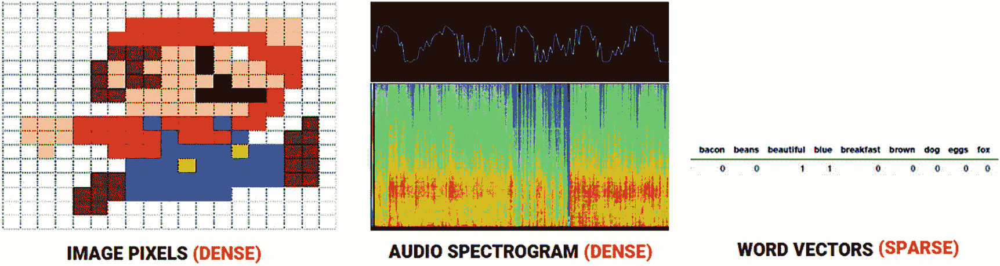

**图 10-1**  比较音频、图像和文本的特征表示

像*基于神经网络的语言模型*这样的*预测方法*，试图通过查看语料库中的词序列，从相邻词中预测目标词。在此过程中，它学习到了分布式表示，从而为我们提供了密集的词嵌入。

现在你可能会想，这有什么了不起的，我们只是从文本中得到了很多向量。然后呢？嗯，如果我们有良好的文本数据数值表示，能够捕捉到上下文和语义，我们就可以将其用于各种下游真实世界的任务，例如情感分析、文本分类、聚类、摘要、翻译等等。事实是，机器学习或深度学习模型运行在数字上，而嵌入（见图 10-2）是将文本数据编码以供这些模型使用的关键。

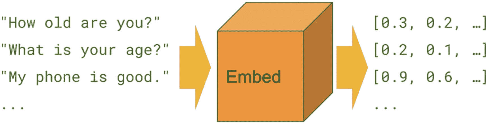

**图 10-2**  文本嵌入

这里的一个大趋势是寻找所谓的“通用嵌入”，这本质上是在大型语料库上训练深度学习模型获得的预训练嵌入。这使我们能够在各种各样的任务中使用这些预训练的（通用的）嵌入，包括在缺乏足够数据等限制条件下。这是迁移学习的一个完美例子，它涉及利用来自预训练嵌入的先验知识来解决一个全新的任务！下图展示了通用词和句子嵌入的一些最新趋势，感谢 [HuggingFace](https://medium.com/huggingface) 团队提供的[一篇精彩文章](https://medium.com/huggingface/universal-word-sentence-embeddings-ce48ddc8fc3a)（[`medium.com/huggingface/universal-word-sentence-embeddings-ce48ddc8fc3a`](https://medium.com/huggingface/universal-word-sentence-embeddings-ce48ddc8fc3a)）（见图 10-3）！

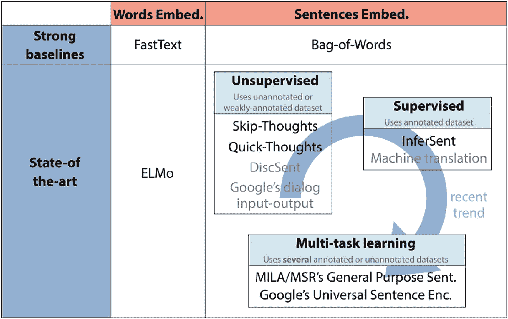

**图 10-3**  通用词和句子嵌入的最新趋势（来源：[`medium.com/huggingface/universal-word-sentence-embeddings-ce48ddc8fc3a`](https://medium.com/huggingface/universal-word-sentence-embeddings-ce48ddc8fc3a)）

图 10-3 展示了一些有趣的趋势，包括谷歌的通用句子编码器，我们将详细探讨它。在深入探讨通用句子编码器之前，让我们简要回顾一下词和句子嵌入模型的趋势和发展。

## 词嵌入模型的趋势

词嵌入模型或许是一些更成熟、更早期的模型，其发展始于 2013 年的 `Word2Vec`。利用深度学习（无监督方法），基于在连续向量空间中根据语义和上下文相似性嵌入词向量的三个最常见的模型是：

-   `Word2Vec`
-   `GloVe`
-   `FastText`

这些模型基于*分布式语义学*领域的*分布式假设*，该假设告诉我们，在同一上下文中出现和使用的词彼此语义相似，并具有相似的含义（*“一个词由其伴随的伙伴所表征”*）。如果你对细节感兴趣，请务必参阅我关于词嵌入的文章，其中详细介绍了这三种方法！

该领域近期开发的另一个有趣的模型是 [ELMo](https://allennlp.org/elmo)（[`allennlp.org/elmo`](https://allennlp.org/elmo)）。它由艾伦人工智能研究所开发。ELMo 取自著名布偶剧《芝麻街》中的同名角色，但同时也是“来自语言模型的嵌入”（Embeddings from Language Models）的缩写。

ELMo 为我们提供了从深度双向语言模型（biLM）学习到的词嵌入，该模型通常在大规模文本语料库上进行预训练，从而实现迁移学习，并使这些嵌入能够跨不同的 NLP 任务使用。艾伦人工智能告诉我们，ELMo 表示是上下文相关的、深层的且基于字符的。它利用形态学线索为即使是 OOV（词汇表外）的标记也形成表示。

## 通用句子嵌入模型的趋势

句子嵌入的概念并不新鲜，因为早在构建词嵌入的时候，构建基线句子嵌入模型的最简单方法之一就是使用平均法。

一个*基线句子嵌入模型*可以通过对每个句子/文档的单个词嵌入取平均来构建（这有点类似于词袋模型，我们丢失了句子中固有的上下文和词序）。我在[我的文章](https://towardsdatascience.com/understanding-feature-engineering-part-4-deep-learning-methods-for-text-data-96c44370bbfa)（[`towardsdatascience.com/understanding-feature-engineering-part-4-deep-learning-methods-for-text-data-96c44370bbfa`](https://towardsdatascience.com/understanding-feature-engineering-part-4-deep-learning-methods-for-text-data-96c44370bbfa)）以及第 5 章中都有详细介绍。图 10-4 展示了一种实现方法。

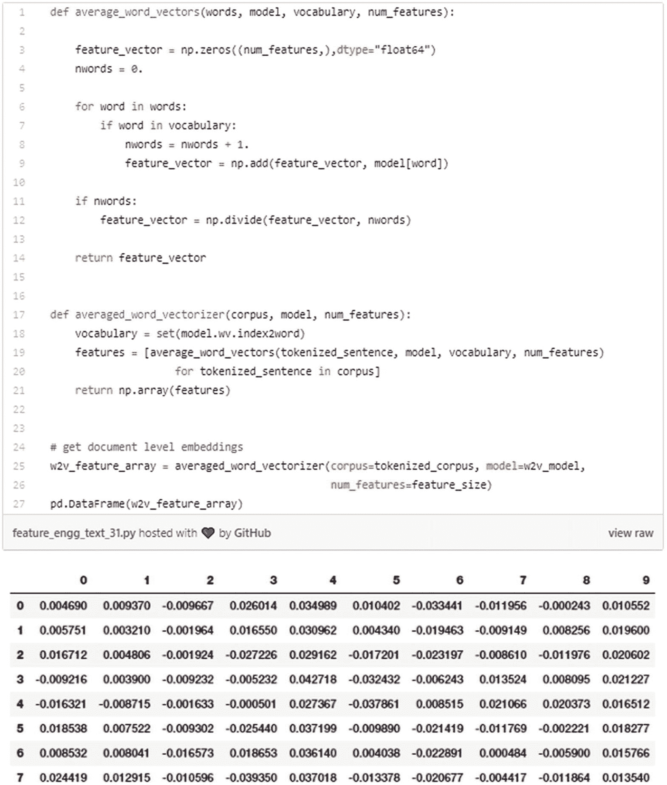

**图 10-4**  基线句子嵌入模型

当然，还有更复杂的方法，比如将句子编码为其词嵌入的线性加权组合，然后移除一些常见的主成分。详情请参阅 [“A Simple but Tough-to-Beat Baseline for Sentence Embeddings”](https://openreview.net/forum?id=SyK00v5xx) at [`openreview.net/forum?id=SyK00v5xx`](https://openreview.net/forum?id=SyK00v5xx)。

`Doc2Vec` 也是一个非常流行的方法，由 Mikolov 等人在其论文 [“Distributed Representations of Sentences and Documents”](https://arxiv.org/abs/1405.4053) 中提出。在此，他们提出了段落向量，这是一种无监督算法，可以从可变长度的文本片段（如句子、段落和文档）中学习固定长度的特征嵌入（见图 10-5）。

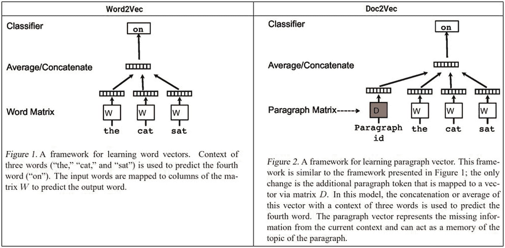

**图 10-5**  `Word2Vec` vs. `Doc2Vec` (来源: [`arxiv.org/abs/1405.4053`](https://arxiv.org/abs/1405.4053))

基于这种描述，该模型用密集向量表示每个文档，该向量经过训练以预测文档中的词。唯一的区别是，除了常规的词标记之外，还使用了段落或文档 ID 来构建嵌入。这种设计使该模型能够克服词袋模型的弱点。

*神经网络语言模型（NNLM）* 是一个非常早期的想法，基于 Bengio 等人在其 2013 年的论文“A Neural Probabilistic Language Model”中提出的神经概率语言模型，他们在其中讨论了学习词的分布式表示，允许每个训练句子向模型提供关于指数级数量语义相邻句子的信息。该模型同时为每个词学习一个分布式表示，以及用这些表示来表达的词序列的概率函数。泛化之所以实现，是因为如果一个从未见过的词序列由与已见过句子中的词相似（在表示相近的意义上）的词组成，那么它就会获得高概率。

谷歌构建了一个通用句子嵌入模型 `nnlm-en-dim128` ([`tfhub.dev/google/nnlm-en-dim128/1`](https://tfhub.dev/google/nnlm-en-dim128/1))，这是一个基于标记的文本嵌入模型，通过在三层隐藏层前馈神经网络语言模型上使用英语 Google News 200B 语料库训练而成。该模型可以将任何文本映射到 128 维嵌入。稍后我们将在动手实践中使用它！

*Skip-thought 向量* 也是基于无监督学习的通用句子编码器领域的首批模型之一。在他们提出的论文 [“Skip-Thought Vectors”](https://arxiv.org/abs/1506.06726) 中，他们利用文本（来自书籍）的连续性，训练了一个编码器-解码器模型，该模型试图重建已编码段落的周围句子。具有相似语义和句法属性的句子被映射到相似的向量表示。见图 10-6。

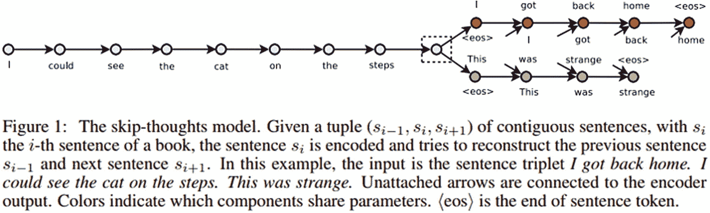

**图 10-6**  `Word2Vec` vs. `Doc2Vec` (来源: [`arxiv.org/abs/1405.4053`](https://arxiv.org/abs/1405.4053))

这就像 Word2Vec 的 Skip-gram 模型，但用于句子，我们试图预测给定源句子的周围句子。

*Quick-thought 向量* 是一种更新的、用于学习句子嵌入的无监督方法（见图 10-7）。详情请参见论文 “An efficient framework for learning sentence representations”。有趣的是，他们通过用分类器替换常规编码器-解码器架构中的解码器，将预测句子出现上下文的问题重新表述为一个分类问题。

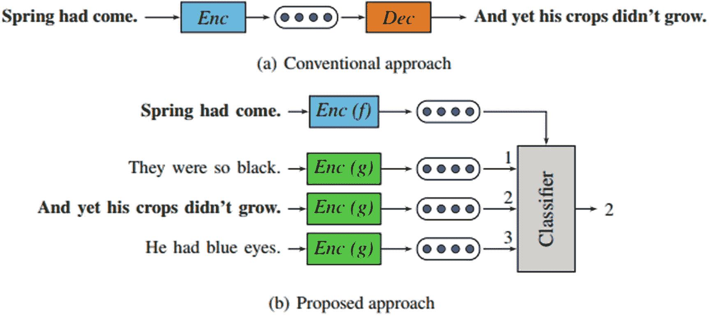

**图 10-7**  Quick-thought 向量 (来源: [`openreview.net/forum?id=rJvJXZb0W`](https://openreview.net/forum?id=rJvJXZb0W))

因此，给定一个句子及其出现的上下文，一个分类器根据其嵌入表示将上下文句子与其他对比句子区分开来。输入句子首先通过某种函数进行编码。但是，模型不是生成目标句子，而是从一组候选句子中选择正确的目标句子。将生成视为从所有可能的句子中选择一个句子，这可以看作是生成问题的判别式近似。

*InferSent* 有趣地采用了有监督学习方法，使用自然语言推理数据来学习通用句子嵌入。这是硬核的有监督迁移学习，就像我们拥有在计算机视觉的 `ImageNet` 数据集上训练的预训练模型一样，他们拥有使用来自斯坦福自然语言推理数据集的监督数据训练得到的通用句子表示。详情请参见他们的论文 [“Supervised Learning of Universal Sentence Representations from Natural Language Inference Data”](https://arxiv.org/abs/1705.02364)。

该模型使用的数据集是 SNLI 数据集，包含 570,000 个由人工生成的英语句子对，并手动标记为三类之一：蕴含、矛盾或中立。它捕获了对理解句子语义有用的自然语言推理。见图 10-8。

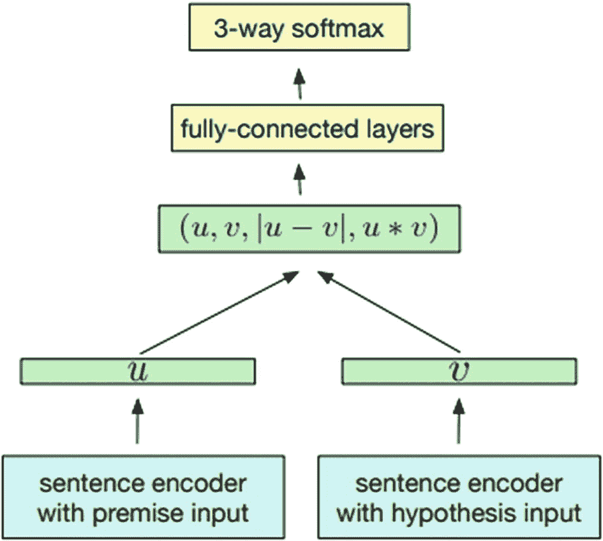

**图 10-8**  `InferSent` 训练方案 (来源: [`arxiv.org/abs/1705.02364`](https://arxiv.org/abs/1705.02364))

基于图 10-8 所示的架构，我们可以看到它使用了一个共享的句子编码器，输出前提 *u* 和假设 *v* 的表示。一旦生成了句子向量，就会应用三种匹配方法来提取 *u* 和 *v* 之间的关系：

-   拼接 **(u, v)**
-   逐元素乘积 **u** * **v**
-   绝对逐元素差 **|u - v|**

结果向量然后被馈送到一个三分类器中，该分类器由多个全连接层组成，最后是一个 softmax 层。

来自谷歌的通用句子编码器是最好且最新的通用句子嵌入模型之一，于 2018 年初发布！通用句子编码器将任何文本编码为 512 维嵌入，可用于各种 NLP 任务，包括文本分类、语义相似度和聚类。它基于多种数据源和多种任务进行训练，旨在动态适应各种需要建模词序列（而不仅仅是单个词）意义的自然语言理解任务。他们的关键发现是，使用句子嵌入的迁移学习往往优于词嵌入级别的迁移。更多详情请查阅他们的论文 [“Universal Sentence Encoder”](https://arxiv.org/abs/1803.11175)。本质上，他们在 [TF-Hub](https://tfhub.dev/) 上提供了他们模型的两个版本，分别为 [`universal-sentence-encoder`](https://tfhub.dev/google/universal-sentence-encoder/2)（[`tfhub.dev/google/universal-sentence-encoder/2`](https://tfhub.dev/google/universal-sentence-encoder/2)）。版本 1 使用基于 transformer 网络的句子编码模型，版本 2 使用深度平均网络（DAN），其中单词和二元组的输入嵌入被平均在一起，然后通过一个前馈深度神经网络（DNN）以生成句子嵌入。稍后我们将在动手实践中使用版本 2。

## 理解我们的文本分类问题

是时候将其中一些通用句子编码器付诸实践了！正如文章所述，我们在此演示的前提是聚焦于一个非常流行的 NLP 任务——文本分类，并将其应用于情感分析。我们将使用基准的 [IMDB 大型电影评论数据集](http://ai.stanford.edu/%257Eamaas/data/sentiment/)。请随意从 [`ai.stanford.edu/~amaas/data/sentiment/`](http://ai.stanford.edu/~amaas/data/sentiment/) 下载，或者您也可以从我的 GitHub 仓库 [`github.com/dipanjanS/data_science_for_all/tree/master/tds_deep_transfer_learning_nlp_classification`](https://github.com/dipanjanS/data_science_for_all/tree/master/tds_deep_transfer_learning_nlp_classification) 下载。见图 10-9。


**图 10-9**  电影评论情感分析

该数据集总共包含 50,000 条电影评论，其中 25,000 条为正面情感，25,000 条为负面情感。我们将总共使用 30,000 条评论作为训练数据集来训练模型，使用 5,000 条评论进行验证，并使用 15,000 条评论作为测试数据集。主要目标是正确预测每条评论的情感是正面还是负面。

## 通用句子嵌入的实际应用

既然我们已经定义了主要目标，让我们将通用句子编码器付诸实践！代码可在本书的 GitHub 仓库 [`github.com/dipanjanS/text-analytics-with-python`](https://github.com/dipanjanS/text-analytics-with-python) 中找到。请随意操作。我建议使用基于 GPU 的实例。我喜欢使用 [Paperspace](https://www.paperspace.com/)，你可以在云端启动 notebook，而无需担心手动配置实例。我的设置是 8 核 CPU、30GB 内存、250GB SSD 和一块 [NVIDIA Quadro P4000](https://www.leadtek.com/eng/products/workstation_graphics%25282%2529/NVIDIA_Quadro_P4000_%252810775%2529/detail)，这通常比大多数 AWS GPU 实例便宜（但我仍然喜欢 AWS！）。

### 加载依赖项

我们首先安装 `tensorflow-hub`，它能让我们轻松使用这些句子编码器。

```python
```

!pip install tensorflow-hub

```
Collecting tensorflow-hub
Downloading https://files.pythonhosted.org/packages/5f/22/64f246ef80e64b1a13b2f463cefa44f397a51c49a303294f5f3d04ac39ac/tensorflow_hub-0.1.1-py2.py3-none-any.whl (52kB)
100% |################################| 61kB 8.5MB/s ta 0:00:011
Requirement already satisfied: numpy>=1.12.0 in /usr/local/lib/python3.6/dist-packages (from tensorflow-hub) (1.14.3)
Requirement already satisfied: six>=1.10.0 in /usr/local/lib/python3.6/dist-packages (from tensorflow-hub) (1.11.0)
Requirement already satisfied: protobuf>=3.4.0 in /usr/local/lib/python3.6/dist-packages (from tensorflow-hub) (3.5.2.post1)
Requirement already satisfied: setuptools in /usr/local/lib/python3.6/dist-packages (from protobuf>=3.4.0->tensorflow-hub) (39.1.0)
Installing collected packages: tensorflow-hub
Successfully installed tensorflow-hub-0.1.1
```

现在让我们加载本教程所需的基本依赖项！

```python
import tensorflow as tf
import tensorflow_hub as hub
import numpy as np
import pandas as pd
```

以下命令帮助您检查`tensorflow`是否会使用GPU（如果您已经设置好了）：

```python
In [12]: tf.test.is_gpu_available()
Out[12]: True

In [13]: tf.test.gpu_device_name()
Out[13]: '/device:GPU:0'
```

### 加载并查看数据集

我们现在可以使用`pandas`加载并查看数据集。我在我的仓库中提供了一个压缩版本的数据集，您可以按如下方式使用。

```python
dataset = pd.read_csv('movie_reviews.csv.bz2', compression="bz2")
dataset.info()
```

```
RangeIndex: 50000 entries, 0 to 49999
Data columns (total 2 columns):
 #   Column     Non-Null Count  Dtype 
---  ------     --------------  ----- 
 0   review     50000 non-null  object
 1   sentiment  50000 non-null  object
dtypes: object(2)
memory usage: 781.3+ KB
```

我们将情感列编码为1和0，只是为了让模型开发阶段更容易（标签编码）。见图10-10。

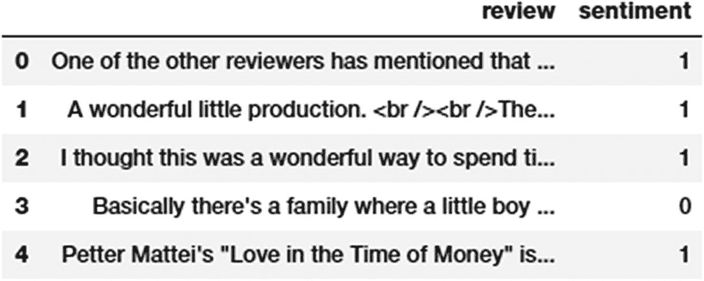

**图10-10** 我们的电影评论数据集

```python
dataset['sentiment'] = [1 if sentiment == 'positive' else 0 for sentiment in dataset['sentiment'].values]
dataset.head()
```

### 构建训练、验证和测试数据集

在我们开始建模之前，我们将创建训练、验证和测试数据集。我们将使用30,000条评论作为训练数据集，5,000条作为验证数据集，15,000条作为测试数据集。您也可以使用`train-test`分割函数，例如`scikit-learn`中的`train_test_split()`。

```python
reviews = dataset['review'].values
sentiments = dataset['sentiment'].values

train_reviews = reviews[:30000]
train_sentiments = sentiments[:30000]

val_reviews = reviews[30000:35000]
val_sentiments = sentiments[30000:35000]

test_reviews = reviews[35000:]
test_sentiments = sentiments[35000:]

train_reviews.shape, val_reviews.shape, test_reviews.shape
((30000,), (5000,), (15000,))
```

### 基本文本整理

我们需要进行一些基本的文本整理和预处理，以去除文本中的一些噪声，如缩写、不必要的特殊字符、HTML标签等。以下代码帮助我们构建一个简单而有效的文本整理系统。如果您没有以下库，请安装。如果您愿意，也可以重用我们在第3章中构建的文本整理模块。

```python
!pip install contractions
!pip install beautifulsoup4
```

以下函数帮助我们构建文本整理系统。

```python
import contractions
from bs4 import BeautifulSoup
import unicodedata
import re

def strip_html_tags(text):
    soup = BeautifulSoup(text, "html.parser")
    [s.extract() for s in soup(['iframe', 'script'])]
    stripped_text = soup.get_text()
    stripped_text = re.sub(r'[\r|\n|\r\n]+', '\n', stripped_text)
    return stripped_text

def remove_accented_chars(text):
    text = unicodedata.normalize('NFKD', text).encode('ascii', 'ignore').decode('utf-8', 'ignore')
    return text

def expand_contractions(text):
    return contractions.fix(text)

def remove_special_characters(text, remove_digits=False):
    pattern = r'[^a-zA-Z0-9\s]' if not remove_digits else r'[^a-zA-Z\s]'
    text = re.sub(pattern, "", text)
    return text

def pre_process_document(document):
```

### 移除 HTML 标签
`document = strip_html_tags(document)`

### 转换为小写
`document = document.lower()`

### 移除多余换行符（在噪声较多的文本中常出现）
`document = document.translate(document.maketrans("\n\t\r", "   "))`

### 移除变音符字符
`document = remove_accented_chars(document)`

### 展开缩写
`document = expand_contractions(document)`

### 移除特殊字符和/或数字
在特殊字符之间插入空格以隔开它们：
```python
special_char_pattern = re.compile(r'([{.(-)!}])')
document = special_char_pattern.sub(" \\1 ", document)
document = remove_special_characters(document, remove_digits=True)
```

### 移除多余空白
```python
document = re.sub(' +', ' ', document)
document = document.strip()
return document
pre_process_corpus = np.vectorize(pre_process_document)
```

现在，让我们使用上面实现的函数来预处理我们的数据集。
```python
train_reviews = pre_process_corpus(train_reviews)
val_reviews = pre_process_corpus(val_reviews)
test_reviews = pre_process_corpus(test_reviews)
```

## 构建数据摄入函数
由于我们将使用 `tf.estimator` API 在 `tensorflow` 中实现模型，我们需要定义一些函数来构建数据和特征工程流水线，以便在训练期间使数据能够流入模型。以下函数将帮助我们实现这一目标。我们利用 `numpy_input_fn()` 函数，该函数将 `numpy` 数组字典输入模型。

# 在整个训练集上训练，不限制训练轮数

`train_input_fn` = `tf.estimator.inputs.numpy_input_fn`(
    {'sentence': `train_reviews`}, `train_sentiments`,
    batch_size=256, num_epochs=None, shuffle=True)

# 对整个训练集进行预测

```
predict_train_input_fn = tf.estimator.inputs.numpy_input_fn(
{'sentence': train_reviews}, train_sentiments, shuffle=False)
```

# 对整个验证集进行预测

```
predict_val_input_fn = tf.estimator.inputs.numpy_input_fn(
    {'sentence': val_reviews}, val_sentiments, shuffle=False)
```

# 对测试集进行预测

`predict_test_input_fn = tf.estimator.inputs.numpy_input_fn({'sentence': test_reviews}, test_sentiments, shuffle=False)`

现在，我们已经准备好构建模型了！

## 使用通用句子编码器构建深度学习模型

在构建模型之前，我们首先需要定义利用通用句子编码器的句子嵌入特征。我们可以通过以下代码来实现这一点。

```
embedding_feature = hub.text_embedding_column(
    key='sentence',
    module_spec="https://tfhub.dev/google/universal-sentence-encoder/2",
    trainable=False)
```

`INFO:tensorflow:Using /tmp/tfhub_modules to cache modules.`

正如我们之前讨论的，我们使用通用句子编码器版本 2，它作用于输入字典中的 `sentence` 属性，该属性将是一个由我们的评论组成的 `numpy` 数组。现在，我们将构建一个包含两个隐藏层的简单前馈深度神经网络。这是一个标准模型，并不复杂，因为我们想看看即使是在简单模型上，这些嵌入的效果如何。在这里，我们利用预训练嵌入的形式进行迁移学习。通过设置 `trainable=False` 保持嵌入权重固定，我们不进行微调。

```
dnn = tf.estimator.DNNClassifier(
    hidden_units=[512, 128],
    feature_columns=[embedding_feature],
    n_classes=2,
    activation_fn=tf.nn.relu,
    dropout=0.1,
    optimizer=tf.train.AdagradOptimizer(learning_rate=0.005))
```

# 训练约 12 个周期

`256*1500 / 30000 == 12.8`

```python
We had set our `batch_size` to 256 and
we will be flowing in data in batches of 256 records for 1,500 steps.
This translates to roughly 12–13 epochs.
```

## 模型训练

接下来，我们在训练数据集上训练模型，并每隔 100 步评估一次训练集和验证集。

```python
tf.logging.set_verbosity(tf.logging.ERROR)

import time

TOTAL_STEPS = 1500
STEP_SIZE = 100

for step in range(0, TOTAL_STEPS+1, STEP_SIZE):
    print()
    print('-'*100)
    print('Training for step =', step)
    start_time = time.time()
    dnn.train(input_fn=train_input_fn, steps=STEP_SIZE)
    elapsed_time = time.time() - start_time
    print('Train Time (s):', elapsed_time)
    print('Eval Metrics (Train):', dnn.evaluate(input_fn=predict_train_input_fn))
    print('Eval Metrics (Validation):', dnn.evaluate(input_fn=predict_val_input_fn))
```

```text
Training for step = 0
Train Time (s): 78.62789511680603
Eval Metrics (Train): {'accuracy': 0.84863335, 'accuracy_baseline': 0.5005, 'auc': 0.9279859, 'auc_precision_recall': 0.92819566, 'average_loss': 0.34581015, 'label/mean': 0.5005, 'loss': 44.145977, 'precision': 0.86890674, 'prediction/mean': 0.47957155, 'recall': 0.8215118, 'global_step': 100}
Eval Metrics (Validation): {'accuracy': 0.8454, 'accuracy_baseline': 0.505, 'auc': 0.92413086, 'auc_precision_recall': 0.9200026, 'average_loss': 0.35258815, 'label/mean': 0.495, 'loss': 44.073517, 'precision': 0.8522351, 'prediction/mean': 0.48447067, 'recall': 0.8319192, 'global_step': 100}
Training for step = 100
Train Time (s): 76.1651611328125
Eval Metrics (Train): {'accuracy': 0.85436666, 'accuracy_baseline': 0.5005, 'auc': 0.9321357, 'auc_precision_recall': 0.93224275, 'average_loss': 0.3330773, 'label/mean': 0.5005, 'loss': 42.520508, 'precision': 0.8501513, 'prediction/mean': 0.5098621, 'recall': 0.86073923, 'global_step': 200}
Eval Metrics (Validation): {'accuracy': 0.8494, 'accuracy_baseline': 0.505, 'auc': 0.92772096, 'auc_precision_recall': 0.92323804, 'average_loss': 0.34418356, 'label/mean': 0.495, 'loss': 43.022945, 'precision': 0.83501947, 'prediction/mean': 0.5149463, 'recall': 0.86707073, 'global_step': 200}
...
...
...
Training for step = 1400
Train Time (s): 85.99037742614746
Eval Metrics (Train): {'accuracy': 0.8783, 'accuracy_baseline': 0.5005, 'auc': 0.9500882, 'auc_precision_recall': 0.94986326, 'average_loss': 0.28882334, 'label/mean': 0.5005, 'loss': 36.871063, 'precision': 0.865308, 'prediction/mean': 0.5196238, 'recall': 0.8963703, 'global_step': 1500}
Eval Metrics (Validation): {'accuracy': 0.8626, 'accuracy_baseline': 0.505, 'auc': 0.93708724, 'auc_precision_recall': 0.9336051, 'average_loss': 0.32389137, 'label/mean': 0.495, 'loss': 40.486423, 'precision': 0.84044176, 'prediction/mean': 0.5226699, 'recall': 0.8917172, 'global_step': 1500}
Training for step = 1500
Train Time (s): 86.91469407081604
Eval Metrics (Train): {'accuracy': 0.8802, 'accuracy_baseline': 0.5005, 'auc': 0.95115364, 'auc_precision_recall': 0.950775, 'average_loss': 0.2844779, 'label/mean': 0.5005, 'loss': 36.316326, 'precision': 0.8735527, 'prediction/mean': 0.51057553, 'recall': 0.8893773, 'global_step': 1600}
Eval Metrics (Validation): {'accuracy': 0.8626, 'accuracy_baseline': 0.505, 'auc': 0.9373224, 'auc_precision_recall': 0.9336302, 'average_loss': 0.32108024, 'label/mean': 0.495, 'loss': 40.135033, 'precision': 0.8478599, 'prediction/mean': 0.5134171, 'recall': 0.88040406, 'global_step': 1600}
```

根据输出日志，我们可以看到在验证数据集上总体准确率接近 87%，AUC 达到了 94%，对于这样一个简单的模型来说，效果相当不错！

## 模型评估

现在我们来评估模型，并检查其在训练集和测试集上的整体性能。

```python
dnn.evaluate(input_fn=predict_train_input_fn)
```

```text
{'accuracy': 0.8802, 'accuracy_baseline': 0.5005, 'auc': 0.95115364,
 'auc_precision_recall': 0.950775, 'average_loss': 0.2844779,
 'label/mean': 0.5005, 'loss': 36.316326, 'precision': 0.8735527,
 'prediction/mean': 0.51057553, 'recall': 0.8893773, 'global_step': 1600}
```

```python
dnn.evaluate(input_fn=predict_test_input_fn)
```

```text
```

# 模型评估与迁移学习实验

{'accuracy': 0.8663333, 'accuracy_baseline': 0.5006667, 'auc': 0.9406502, 'auc_precision_recall': 0.93988097, 'average_loss': 0.31214723, 'label/mean': 0.5006667, 'loss': 39.679733, 'precision': 0.8597569, 'prediction/mean': 0.5120608, 'recall': 0.8758988, 'global_step': 1600}

我们在测试数据上获得了接近 87%的总体准确率，这与我们之前在验证数据集上观察到的结果一致。因此，这应该能让你了解，利用预训练的通用句子嵌入是多么容易，无需担心特征工程或复杂建模的麻烦。

## 扩展：使用不同通用句子嵌入的迁移学习

现在，我们尝试根据不同的句子嵌入来构建不同的深度学习分类器。我们将尝试以下模型：

* `NNLM-128`
* `USE-512`

我们还将介绍两种最主流的迁移学习方法。

* 使用冻结的预训练句子嵌入构建模型
* 构建一个在训练期间微调并更新预训练句子嵌入的模型

以下通用函数可以即插即用地从`tensorflow-hub`中加载不同的通用句子编码器。

```python
import time

TOTAL_STEPS = 1500
STEP_SIZE = 500

my_checkpointing_config = tf.estimator.RunConfig(
    keep_checkpoint_max = 2,       # 保留最近 2 个检查点。
)

def train_and_evaluate_with_sentence_encoder(hub_module, train_module=False, path=""):
    embedding_feature = hub.text_embedding_column(
        key='sentence', module_spec=hub_module, trainable=train_module)

    print()
    print('='*100)
    print('Training with', hub_module)
    print('Trainable is:', train_module)
    print('='*100)

    dnn = tf.estimator.DNNClassifier(
        hidden_units=[512, 128],
        feature_columns=[embedding_feature],
        n_classes=2,
        activation_fn=tf.nn.relu,
        dropout=0.1,
        optimizer=tf.train.AdagradOptimizer(learning_rate=0.005),
        model_dir=path,
        config=my_checkpointing_config)

    for step in range(0, TOTAL_STEPS+1, STEP_SIZE):
        print('-'*100)
        print('Training for step =', step)
        start_time = time.time()
        dnn.train(input_fn=train_input_fn, steps=STEP_SIZE)
        elapsed_time = time.time() - start_time
        print('Train Time (s):', elapsed_time)
        print('Eval Metrics (Train):', dnn.evaluate(input_fn=predict_train_input_fn))
        print('Eval Metrics (Validation):', dnn.evaluate(input_fn=predict_val_input_fn))

    train_eval_result = dnn.evaluate(input_fn=predict_train_input_fn)
    test_eval_result = dnn.evaluate(input_fn=predict_test_input_fn)

    return {
        "Model Dir": dnn.model_dir,
        "Training Accuracy": train_eval_result["accuracy"],
        "Test Accuracy": test_eval_result["accuracy"],
        "Training AUC": train_eval_result["auc"],
        "Test AUC": test_eval_result["auc"],
        "Training Precision": train_eval_result["precision"],
        "Test Precision": test_eval_result["precision"],
        "Training Recall": train_eval_result["recall"],
        "Test Recall": test_eval_result["recall"]
    }
```

现在我们可以使用这些定义好的方法来训练我们的模型。

```python
tf.logging.set_verbosity(tf.logging.ERROR)
results = {}

results["nnlm-en-dim128"] = train_and_evaluate_with_sentence_encoder(
    "https://tfhub.dev/google/nnlm-en-dim128/1", path='/storage/models/nnlm-en-dim128_f/')
results["nnlm-en-dim128-with-training"] = train_and_evaluate_with_sentence_encoder(
    "https://tfhub.dev/google/nnlm-en-dim128/1", train_module=True, path='/storage/models/nnlm-en-dim128_t/')
results["use-512"] = train_and_evaluate_with_sentence_encoder(
    "https://tfhub.dev/google/universal-sentence-encoder/2", path='/storage/models/use-512_f/')
results["use-512-with-training"] = train_and_evaluate_with_sentence_encoder(
    "https://tfhub.dev/google/universal-sentence-encoder/2", train_module=True, path='/storage/models/use-512_t/')
```

```text
====================================================================
Training with https://tfhub.dev/google/nnlm-en-dim128/1
Trainable is: False
====================================================================
Training for step = 0
Train Time (s): 30.525171756744385
Eval Metrics (Train): {'accuracy': 0.8480667, 'auc': 0.9287864, 'precision': 0.8288572, 'recall': 0.8776557}
Eval Metrics (Validation): {'accuracy': 0.8288, 'auc': 0.91452694, 'precision': 0.7999259, 'recall': 0.8723232}
...
...
Training for step = 1500
Train Time (s): 28.242169618606567
```

# 模型评估与最佳模型加载

## 训练配置与评估指标

### 使用 `nnlm-en-dim128` 模型（可训练）

**初始评估指标：**
- 训练集：`{'accuracy': 0.8616, 'auc': 0.9385461, 'precision': 0.8443543, 'recall': 0.8869797}`
- 验证集：`{'accuracy': 0.828, 'auc': 0.91572505, 'precision': 0.80322945, 'recall': 0.86424243}`

**训练步骤 0：**
- 训练时间：`45.97756814956665` 秒
- 训练集指标：`{'accuracy': 0.9997, 'auc': 0.9998141, 'precision': 0.99980015, 'recall': 0.9996004}`
- 验证集指标：`{'accuracy': 0.877, 'auc': 0.9225529, 'precision': 0.86671925, 'recall': 0.88808084}`

**训练步骤 1500：**
- 训练时间：`44.654765605926514` 秒
- 训练集指标：`{'accuracy': 1.0, 'auc': 1.0, 'precision': 1.0, 'recall': 1.0}`
- 验证集指标：`{'accuracy': 0.875, 'auc': 0.91479605, 'precision': 0.8661916, 'recall': 0.8840404}`

### 使用 `universal-sentence-encoder` 模型（不可训练）

**初始评估指标：**
- 训练集：`{'accuracy': 0.8591, 'auc': 0.9373971, 'precision': 0.8820655, 'recall': 0.8293706}`
- 验证集：`{'accuracy': 0.8522, 'auc': 0.93081224, 'precision': 0.8631799, 'recall': 0.8335354}`

**训练步骤 0：**
- 训练时间：`261.7671597003937` 秒
- 训练集指标：`{'accuracy': 0.8591, 'auc': 0.9373971, 'precision': 0.8820655, 'recall': 0.8293706}`
- 验证集指标：`{'accuracy': 0.8522, 'auc': 0.93081224, 'precision': 0.8631799, 'recall': 0.8335354}`

**训练步骤 1500：**
- 训练时间：`258.4421606063843` 秒
- 训练集指标：`{'accuracy': 0.88733333, 'auc': 0.9558296, 'precision': 0.8979955, 'recall': 0.8741925}`
- 验证集指标：`{'accuracy': 0.864, 'auc': 0.938815, 'precision': 0.864393, 'recall': 0.860202}`

### 使用 `universal-sentence-encoder` 模型（可训练）

**初始评估指标：**
- 训练集：`{'accuracy': 0.99916667, 'auc': 0.9996535, 'precision': 0.9989349, 'recall': 0.9994006}`
- 验证集：`{'accuracy': 0.9056, 'auc': 0.95068294, 'precision': 0.9020474, 'recall': 0.9078788}`

**训练步骤 0：**
- 训练时间：`313.1993100643158` 秒
- 训练集指标：`{'accuracy': 0.99916667, 'auc': 0.9996535, 'precision': 0.9989349, 'recall': 0.9994006}`
- 验证集指标：`{'accuracy': 0.9056, 'auc': 0.95068294, 'precision': 0.9020474, 'recall': 0.9078788}`

**训练步骤 1500：**
- 训练时间：`305.9913341999054` 秒
- 训练集指标：`{'accuracy': 1.0, 'auc': 1.0, 'precision': 1.0, 'recall': 1.0}`
- 验证集指标：`{'accuracy': 0.9032, 'auc': 0.929281, 'precision': 0.8986784, 'recall': 0.9066667}`

## 结果分析与最佳模型加载

我已在输出中列出了重要的评估指标，可以看到我们的模型确实取得了不错的结果。图 10-11 中的表格清晰地总结了这些对比结果。

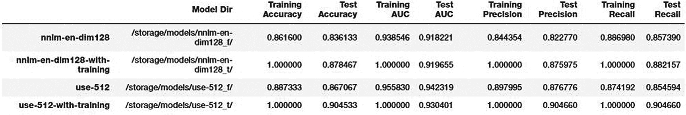

**图 10-11** 比较不同通用句子编码器的结果

```python
results_df = pd.DataFrame.from_dict(results, orient="index")
results_df
```

看来，经过微调的谷歌通用句子编码器在测试数据上为我们提供了最佳结果。让我们加载这个保存的模型，并在测试数据上运行评估。

```python
# 获取最佳保存模型的位置
best_model_dir = results_df[results_df['Test Accuracy'] == results_df['Test Accuracy'].max()]['Model Dir'].values[0]

# 加载模型
embedding_feature = hub.text_embedding_column(key='sentence', module_spec="https://tfhub.dev/google/universal-sentence-encoder/2", trainable=True)
dnn = tf.estimator.DNNClassifier(hidden_units=[512, 128], feature_columns=[embedding_feature], n_classes=2, activation_fn=tf.nn.relu, dropout=0.1, optimizer=tf.train.AdagradOptimizer(learning_rate=0.005), model_dir=best_model_dir)

# 定义获取模型预测的函数
def get_predictions(estimator, input_fn):
    return [x["class_ids"][0] for x in estimator.predict(input_fn=input_fn)]

# 获取模型对测试数据的预测
predictions = get_predictions(estimator=dnn, input_fn=predict_test_input_fn)
predictions[:10]
```

输出：
```
[0, 1, 0, 1, 1, 0, 1, 1, 1, 1]
```

评估模型性能的最佳方法之一是以混淆矩阵的形式可视化模型预测（见图 10-12）。

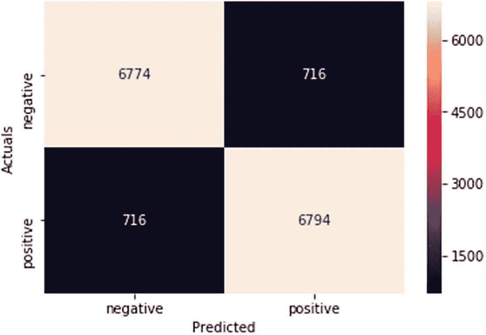

图 10-12：基于最佳模型预测的混淆矩阵

```python
import seaborn as sns
import matplotlib.pyplot as plt
%matplotlib inline
```

```python
with tf.Session() as session:
    cm = tf.confusion_matrix(test_sentiments, predictions).eval()
    LABELS = ['negative', 'positive']
    sns.heatmap(cm, annot=True, xticklabels=LABELS, yticklabels=LABELS, fmt="g")
    xl = plt.xlabel("Predicted")
    yl = plt.ylabel("Actuals")
```

我们还可以使用 Scikit-Learn 打印模型的分类报告，以描述可从混淆矩阵推导出的其他重要指标，包括精确率、召回率和 F1 分数。

```python
from sklearn.metrics import classification_report
print(classification_report(y_true=test_sentiments, y_pred=predictions, target_names=LABELS))
```

```
          precision    recall  f1-score   support

negative       0.90      0.90      0.90      7490
positive       0.90      0.90      0.90      7510
avg / total    0.90      0.90      0.90     15000
```

模型在测试数据上的整体准确率和 F1 分数达到了 90%，效果非常不错。你可以亲自尝试一下，或许能得到更高的分数；如果是这样，请告诉我！

## 总结与未来展望

通用语句嵌入无疑是推动迁移学习在各种 NLP 任务中应用的一大步。事实上，我们已经看到像 ELMo、Universal Sentence Encoder 和 ULMFiT 这样的模型通过展示预训练模型可用于在 NLP 任务中取得最优结果而登上了头条。我对 NLP 进一步泛化以及使我们能够轻松解决复杂任务的未来前景感到无比兴奋。

本书最后一章到此结束。希望这能帮助你在现实世界中应用在这里学到的一些知识，来解决你自己在 NLP 领域的实际问题。永远记住`奥卡姆剃刀`原则，即最简单的解决方案通常是最好的解决方案。尽管深度学习方法当下可能很热门，但它们并非解决所有问题的万能钥匙。只有当你认为这样做完全合理时，才应该利用它们；随着时间推移，通过直觉、实验、练习和阅读，你会更好地理解这一点。现在，去解决一些有趣的 NLP 问题，并告诉我你的成果吧！
