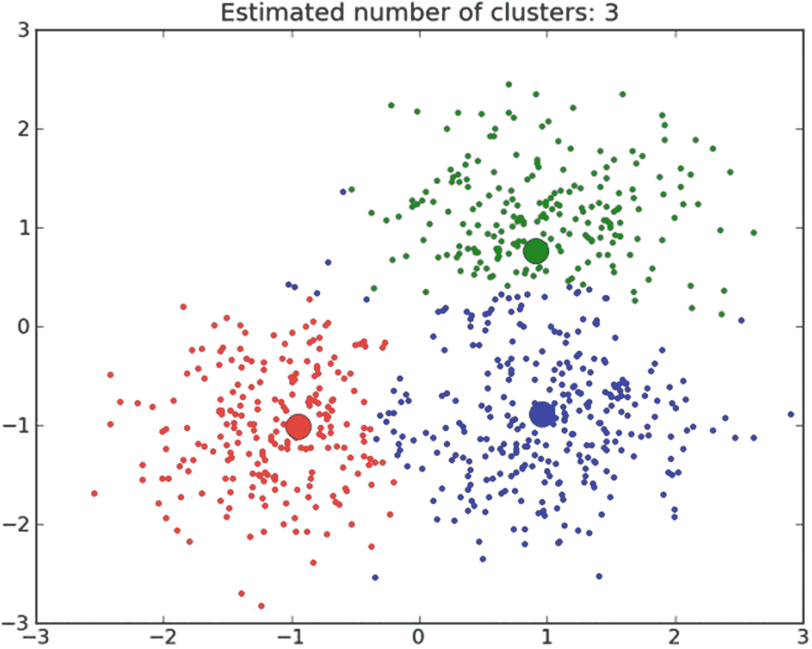
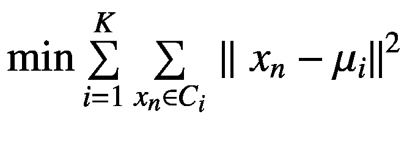
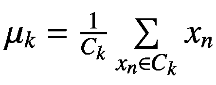

# 'Street Fighter'

我们建议使用`gensim.summarization`模块下的`bm25`模块。如果你感兴趣，不妨一试。

尝试加载一个更大的文档语料库，并在一些示例查询字符串和文档上测试这些函数。事实上，像 Solr 和 ElasticSearch 这样的信息检索框架都构建在 Lucene 之上，它们使用这类排序算法从存储文档的索引中返回相关文档。你可以用它们构建自己的搜索引擎！感兴趣的读者可以查看[elastic.co](https://www.elastic.co/blog/found-bm-vs-lucene-default-similarity)提供的这个链接，该网站是流行产品 ElasticSearch 的母公司。BM25 的性能远优于 Lucene 默认的相似度排序实现。

# 文档聚类

文档聚类或`聚类分析`是自然语言处理和文本分析中一个引人入胜的领域，它运用了无监督机器学习的理念和技术。文档聚类的主要前提与文档分类类似，即从整个文档语料库出发，任务是根据文档的某些独特属性、特征和特性将其划分为不同的组别。文档分类需要带标签的训练数据来构建模型，然后对文档进行分类。而文档聚类则使用无监督机器学习算法将文档划分为不同的簇。这些簇的特性是：与属于其他簇的文档相比，同一簇内的文档彼此之间更加相似和关联。图 7-9（由 Scikit-Learn 提供）直观展示了一个根据特征将数据点聚类为三个簇的示例。



图 7-9

聚类分析结果示例（来源：Scikit-Learn）

此聚类分析描绘了数据点中的三个簇，并用不同颜色进行了可视化。这里需要记住的一个重要点是，聚类是一种无监督学习技术，并且从图 7-9 可以很清楚地看出，由于不存在完美簇的定义，簇之间总会存在一些重叠。所有技术都基于数学、启发式方法以及与生成簇相关的一些固有属性。它们永远不可能达到 100% 完美。因此，存在多种寻找簇的技术或方法。下面简要介绍几种比较流行的聚类算法：

*   `层次聚类模型`：这些聚类模型也称为`基于连通性的聚类方法`，其核心概念是相似的物体在向量空间中距离较近，而不相关的物体则距离较远。簇是通过根据对象之间的距离连接对象而形成的，并且可以使用树状图进行可视化。这些模型的输出是一个完整的、详尽的簇层次结构。它们又细分为凝聚式聚类模型和分裂式聚类模型。

*   `基于划分或基于质心的聚类模型`：这些模型构建簇的方式是，每个簇都有一个核心代表成员，该成员代表了该簇，并具有将该簇与其他簇区分开来的特征。其中包含多种算法，例如 `k-means`、`k-mediods` 等，在这些算法中，我们需要预先设定簇的数量 (`k`)。需要最小化距离度量，例如每个数据点到质心的距离平方。这些模型的缺点是需要预先指定簇的数量 `k`，这可能导致陷入局部最优解，并且可能无法得到数据真实的聚类表示。

*   `基于分布的聚类模型`：这些模型在聚类数据点时使用概率分布的概念。其思想是，具有相似分布的对象可以被聚类到同一组或簇中。高斯混合模型（`GMM`）使用诸如期望最大化算法之类的算法来构建这些簇。这些模型也可以捕获特征和属性的相关性与依赖性，但容易出现过拟合。

*   `基于密度的聚类模型`：这些聚类模型从数据点中生成簇，这些簇在数据点密度较高的区域聚集在一起，而其他数据点则可能随机分布在向量空间中较为稀疏的区域。这些稀疏区域被视为噪声，并用作分隔簇的边界点。该领域中两种流行的算法包括 `DBSCAN` 和 `OPTICS`。

还有其他一些较新的聚类模型，例如 `BIRCH` 和 `CLARANS`。仅仅关于聚类这个主题就已经有整本书籍和期刊出版，因为它确实是一个极具价值的有趣话题。在当前范围内，我们不可能涵盖所有方法，因此，我们将总共介绍三种聚类算法，并用真实世界的数据进行说明，以便更好地理解：

*   `K-means` 聚类
*   亲和传播
*   Ward 凝聚层次聚类

我们将像之前介绍其他方法一样，逐一介绍每种算法的理论概念。我们还会将每种聚类算法应用于真实世界的数据，这些数据涉及我们之前使用的 TMDB 电影数据集中的电影及其描述。

## 电影聚类

我们将对总共 4800 部电影进行聚类，这些电影我们已经在前面的步骤中进行过清洗和预处理。这些数据存储在数据框 `df` 中，预处理后的语料库存储在变量 `norm_corpus` 中。主要思路是利用电影的描述作为原始输入，将这些电影分组到不同的簇中。我们将从这些描述中提取特征，如 TF-IDF 或文档相似度，并对它们应用无监督学习算法进行聚类。我们在输出中显示的电影标题仅用于展示，当我们想要查看每个簇中的电影时，这些标题会很有用。需要明确的是，输入到聚类算法的数据是从电影描述中提取的特征。

### 特征工程

在进入每种聚类方法之前，我们将遵循与之前相同的文本预处理和特征工程流程。我们在上一节的文档相似性分析中已经完成了预处理，因此我们将使用包含预处理后电影描述的同一个 `norm_corpus` 变量。现在，我们将像在文档相似度计算时那样提取基于词袋的特征，但会进行一些修改。

```python
import nltk
from sklearn.feature_extraction.text import CountVectorizer

stop_words = nltk.corpus.stopwords.words('english')
stop_words = stop_words + ['one', 'two', 'get']

cv = CountVectorizer(ngram_range=(1, 2), min_df=10, max_df=0.8, stop_words=stop_words)
cv_matrix = cv.fit_transform(norm_corpus)
cv_matrix.shape
(4800, 3012)
```

根据上述代码片段和输出结果，我们保留规范化文本中的文本词元，并提取基于词袋计数的特征（包括单字和双字），使得每个特征至少出现在 10 个文档中，且最多出现在 80% 的文档中（使用参数 `min_df` 和 `max_df`）。我们可以看到，针对这 4800 部电影，总共有 4800 行数据，每部电影共有 3012 个特征。现在，我们的特征和文档都已准备就绪，可以开始聚类分析了。

## K-Means 聚类

`k-means`聚类算法是一种基于质心的聚类模型，它试图将数据划分为方差相等的组或簇。该算法试图最小化的准则或度量是*惯性*，也称为*簇内平方和*。该算法的一个主要缺点是，与所有基于质心的聚类模型一样，需要预先指定簇的数量（`k`）。该算法可能是最流行的聚类算法，因为它易于使用，并且能够处理大规模数据。

我们现在可以正式定义 k-means 聚类算法及其数学符号。假设我们有一个数据集 `X`，包含 `N` 个数据点或样本，我们希望将它们分成 `K` 个簇，其中 `K` 是用户指定的参数。k-means 聚类算法会将这 `N` 个数据点划分为 `K` 个互不相交的独立簇 `C[k]`，每个簇可以用其样本的均值来描述。这些均值成为簇质心 `μ[k]`，且这些质心不受限于必须是 `X` 中 `N` 个样本里的实际数据点。该算法选择这些质心并构建簇，目的是使惯性或簇内平方和最小化。数学上可以表示如下：



其中，`C[i]` 代表簇，`μ[i]` 代表质心，且 `i ∈ {1, 2, … , k}`。对于所有的算法爱好者来说，这个优化问题是一个 NP 难题。Lloyd 算法是解决该问题的一种方法。它是一个迭代过程，包含以下步骤：

1.  从数据集 `X` 中随机抽取 `k` 个样本，作为初始的 `k` 个质心 `μ[k]`。

2.  通过将每个数据点或样本分配到其最近的质心点来更新簇。数学上可以表示如下：

    `C[k] = { x[n] : || x[n] - μ[k] || ≤ all || x[n] - μ[l] || }`

    其中 `C[k]` 表示簇。

3.  基于从步骤 2 获得的每个簇的新簇数据点，重新计算并更新簇。数学上可以表示如下：

    

    其中 `μ[k]` 表示质心。

这些步骤以迭代方式重复执行，直到步骤 2 和步骤 3 的输出不再变化。这种方法的一个注意事项是，尽管优化过程保证收敛，但可能会收敛到局部最小值。因此，在实际应用中，该算法通常会运行多次，包含多个轮次和迭代，如果需要，结果可能取其平均值。

局部最小值的收敛和出现高度依赖于步骤 1 中初始质心的初始化。一种方法是使用多次随机初始化进行多次迭代，并取平均值。另一种方法是使用 `kmeans++` 方案（如 Scikit-Learn 中所实现的），该方案将初始质心初始化得彼此相距较远，已被证明是有效的。我们现在使用 k-means 聚类对电影数据进行聚类。

```python
from sklearn.cluster import KMeans

NUM_CLUSTERS = 6

km = KMeans(n_clusters=NUM_CLUSTERS, max_iter=10000, n_init=50, random_state=42).fit(cv_matrix)

km

KMeans(algorithm='auto', copy_x=True, init='k-means++', max_iter=10000,
n_clusters=6, n_init=50, n_jobs=None, precompute_distances="auto",
random_state=42, tol=0.0001, verbose=0)

df['kmeans_cluster'] = km.labels_
```

这段代码使用我们实现的 k-means 函数，根据电影描述的词袋特征对电影进行聚类。我们通过将聚类分析结果中每个电影的簇标签存储到 `df` 数据框的 `kmeans_cluster` 列中，来为每个电影分配簇标签。可以看到，在我们的分析中，我们设定 `k` 为 6。现在我们可以使用以下代码查看六个簇中每个簇的电影总数。

```python
```