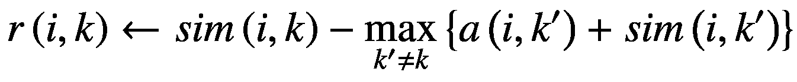
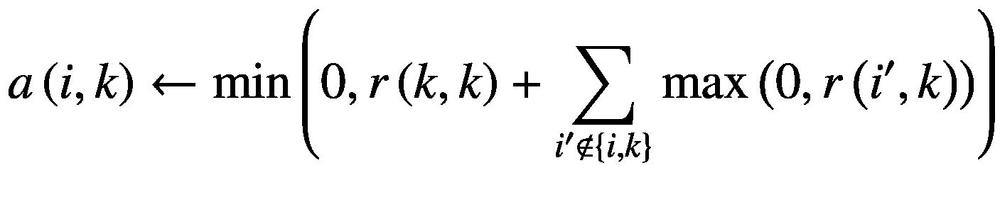
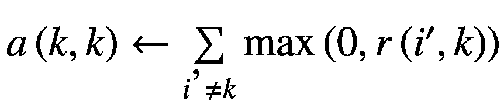

# 获取属于每个集群的电影
for cluster_num in range(NUM_CLUSTERS):
    movies = movie_clusters[movie_clusters['kmeans_cluster'] == cluster_num]['title'].values.tolist()
    print('CLUSTER #'+str(cluster_num+1))
    print('Popular Movies:', movies)
    print('-'*80)
```

集群 #1
热门电影：`['Pirates of the Caribbean: The Curse of the Black Pearl', 'Whiplash', 'The Martian', 'Frozen', 'Gone Girl', 'The Lord of the Rings: The Fellowship of the Ring', 'Pirates of the Caribbean: On Stranger Tides', 'Pulp Fiction', 'The Fifth Element', 'Quantum of Solace', 'Furious 7', 'Cinderella', 'Man of Steel', 'Gladiator', 'Aladdin', 'The Amazing Spider-Man', 'Prisoners', 'The Good, the Bad and the Ugly', 'American Sniper', 'Finding Nemo']`

集群 #2
热门电影：`['Interstellar', 'Guardians of the Galaxy', 'Dawn of the Planet of the Apes', 'The Hunger Games: Mockingjay - Part 1', 'Big Hero 6', 'The Dark Knight', "Pirates of the Caribbean: Dead Man's Chest", 'X-Men: Apocalypse', 'Rise of the Planet of the Apes', "One Flew Over the Cuckoo's Nest", 'The Hunger Games: Mockingjay - Part 2', 'Star Wars', 'Brave', 'The Lord of the Rings: The Return of the King', 'The Hobbit: The Battle of the Five Armies', 'Iron Man', 'X-Men: Days of Future Past', 'Transformers: Age of Extinction', 'Spider-Man 3', 'Lucy']`

集群 #3
热门电影：`['Terminator Genisys', 'Fight Club', 'Teenage Mutant Ninja Turtles', 'Pixels', 'Despicable Me 2', 'Avengers: Age of Ultron', 'Night at the Museum: Secret of the Tomb', 'Batman Begins', 'The Dark Knight Rises', 'The Lord of the Rings: The Two Towers', 'The Godfather: Part II', 'How to Train Your Dragon 2', '12 Years a Slave', 'The Wolf of Wall Street', 'Men in Black II', "Pan's Labyrinth", 'The Bourne Legacy', 'The Amazing Spider-Man 2', 'The Devil Wears Prada', 'Non-Stop']`

集群 #4
热门电影：`['Deadpool', 'Mad Max: Fury Road', 'Inception', 'The Godfather', "Pirates of the Caribbean: At World's End", 'Forrest Gump', 'The Shawshank Redemption', 'Harry Potter and the Chamber of Secrets', 'Inside Out', 'Twilight', 'Maleficent', "Harry Potter and the Philosopher's Stone", 'Bruce Almighty', 'The Hobbit: An Unexpected Journey', 'The Twilight Saga: Eclipse', 'Fifty Shades of Grey', 'Blade Runner', 'Psycho', 'Up', 'The Lion King']`

集群 #5
热门电影：`['Minions', 'Jurassic World', 'Captain America: Civil War', 'Batman v Superman: Dawn of Justice', 'Avatar', 'The Avengers', 'Fury', 'The Maze Runner', 'Tomorrowland', 'Ant-Man', 'Spirited Away', 'Chappie', 'Monsters, Inc.', "Schindler's List", 'The Matrix', 'Skyfall', 'The Adventures of Tintin', 'Nightcrawler', 'Thor', 'Allegiant']`

集群 #6
热门电影：`['The Imitation Game', 'Titanic', 'The Pursuit of Happyness', 'The Prestige', 'The Grand Budapest Hotel', 'The Fault in Our Stars', 'Catch Me If You Can', 'Cloud Atlas', 'The Conjuring 2', 'Apollo 13', 'Aliens', 'The Usual Suspects', 'GoodFellas', 'The Princess and the Frog', 'The Theory of Everything', "The Huntsman: Winter's War", 'Mary Poppins', 'The Lego Movie', 'Starship Troopers', 'The Big Short']`

显然，我们使用了成对文档相似度作为特征，因此我们无法像之前那样为每个集群描述具体的基于术语的特征。不过，我们仍然可以在上述输出中看到每个相似电影集群的构成。


### 亲和传播

k-means 算法虽然非常流行，但存在一个缺点，即用户必须预先定义簇的数量。如果簇的数量发生变化怎么办？有些方法可以检查簇的质量，并确定最优 `k` 值可能为多少。感兴趣的读者可以了解一下肘部法和轮廓系数，它们是确定最优 `k` 值的流行方法。

这里，我们讨论一种基于数据固有属性来构建簇的算法，该算法不对簇的数量做任何假设。亲和传播 (AP) 算法基于在各个待聚类数据点之间进行“消息传递”的概念，并且不对可能的簇数量做任何假设。

AP 通过在成对数据点之间传递消息来创建这些簇，直到达到收敛。整个数据集随后由少量代表点表示，这些代表点充当样本的代表。这些代表点类似于从 k-means 或 k-medoids 算法中获得的质心。在成对点之间传递的消息表示了其中一个点作为另一个数据点的代表点或代表的合适程度。每次迭代都会更新这一信息，直到达到收敛，最终的代表点成为每个簇的代表。请记住，这种方法的一个缺点是计算量大。消息在整个数据集的每对数据点之间传递，对于大型数据集，收敛可能需要大量时间。

我们现在可以定义 AP 算法中涉及的步骤（致谢 Scikit-Learn）。假设我们有一个数据集 `X`，其中包含 `n` 个数据点，即 `X = {x[1], x[2], … , x[n]}`，并且我们设 `sim(x, y)` 为相似度函数，它量化了两个点 `x` 和 `y` 之间的相似度。在我们的实现中，我们再次使用余弦相似度。AP 算法通过迭代执行以下两个消息传递步骤来进行。

1.  首先发送责任更新，其数学表示为

    

    其中责任矩阵是 `R`，而 `r(i, k)` 是一个度量，用于量化 `x[k]` 与其他候选点相比，作为 `x[i]` 的代表点或代表的合适程度。

2.  然后发送可用性更新，其数学表示为

    

    对于 `i ≠ k` 的情况，而 `i = k` 时的可用性表示为

    

    其中可用性矩阵是 `A`，而 `a(i, k)` 表示考虑到所有其他点都倾向于选择 `x[k]` 作为代表点时，`x[i]` 选择 `x[k]` 作为其代表点的合适程度。

这两个步骤在每次迭代中持续进行，直到达到收敛。该算法的主要缺点之一是最终可能会得到过多的簇。我们在这里只展示最大的十个簇：

```
from sklearn.cluster import AffinityPropagation
ap = AffinityPropagation(max_iter=1000)
ap.fit(cosine_sim_features)
res = Counter(ap.labels_)
res.most_common(10)
[(183, 1355), (182, 93), (159, 80), (54, 74), (81, 57),
(16, 51), (26, 47), (24, 45), (48, 43), (89, 42)]
```

现在，让我们尝试展示这十个簇各自的热门电影（这里我们不考虑包含电影数量较少的簇）。

```
df['affprop_cluster'] = ap.labels_
filtered_clusters = [item[0] for item in res.most_common(8)]
filtered_df = df[df['affprop_cluster'].isin(filtered_clusters)]
movie_clusters = (filtered_df[['title', 'affprop_cluster', 'popularity']]
.sort_values(by=['affprop_cluster', 'popularity'],
ascending=False)
.groupby('affprop_cluster').head(20))
movie_clusters = movie_clusters.copy(deep=True)
