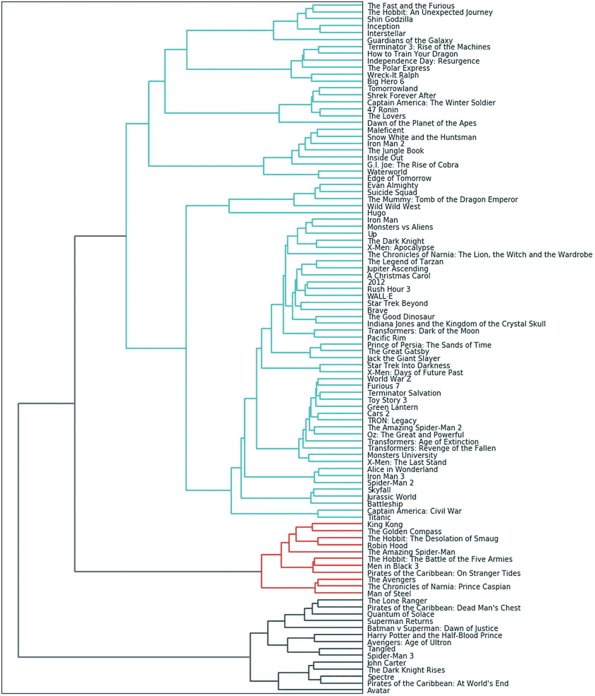

# 获取属于每个簇的电影

```python
for cluster_num in range(len(filtered_clusters)):
    movies = movie_clusters[movie_clusters['affprop_cluster'] == filtered_clusters[cluster_num]]['title'].values.tolist()
    print('簇 #'+str(filtered_clusters[cluster_num]))
    print('热门电影:', movies)
    print('-'*80)
```

簇 #183
热门电影: ['星际穿越', '猩球崛起：黎明之战', '超能陆战队', '蝙蝠侠：黑暗骑士', '加勒比海盗：聚魂棺', '饥饿游戏 3：嘲笑鸟(下)', '星球大战', '勇敢传说', '指环王：王者无敌', '霍比特人：五军之战', '钢铁侠', '变形金刚 4：绝迹重生', '超体', '碟中谍 5：神秘国度', '移动迷宫 2：烧痕审判', '007：幽灵党', '绿里奇迹', '终结者 2：审判日', '出埃及记：法老与众神', '哈利·波特与火焰杯']

簇 #182
热门电影: ['盗梦空间', '哈利·波特与密室', '霍比特人：意外之旅', '被解救的姜戈', '美国丽人', '雪国列车', '猜火车', '第一滴血', '谍影重重 2', '好好先生', '白日梦想家', '赤焰战场', '赌城风云', '耶稣受难记', '安妮', '幻想曲', '午夜巴塞罗那', '白宫管家', '爱宠大机密', '黑暗边缘']

簇 #159
热门电影: ['消失的爱人', '低俗小说', '角斗士', '拯救大兵瑞恩', '心理游戏', '侠探杰克', '亡命天涯', '人类清除计划 3：大选之年', '怪形', '勇闯夺命岛', '决战犹马镇', '王牌保镖', '黑帽骇客', '骑士与白天', '撕裂的末日', '黑鹰坠落', '惊天战神', '1408 幻影凶间', '夺命来电', '在云端']

簇 #54
热门电影: ['神偷奶爸 2', '指环王：双塔奇兵', '谍影重重 4：伯恩的遗产', '恶老板 2', '大侦探福尔摩斯 2：诡影游戏', '十一罗汉', '夺宝奇兵', '星际迷航 3：超越星辰', '神奇四侠 2：银影侠现身', '大侦探福尔摩斯', '死亡诗社', '蝙蝠侠与罗宾', '马达加斯加 2：逃往非洲', '百货战警 2', '海扁王 2', '王牌播音员 2：传奇继续', '超级奶爸', '魔鬼代言人', '异形魔怪', '荒野大飚客']

簇 #81
热门电影: ['爆裂鼓手', '边境杀手', '杰克·莱恩：诡影特工', '铁面无私', '新科学怪人', '惊爆点', '8 英里', '死神来了 4', '野蛮人', '史酷比', '艺术家', '末代独裁', '险恶 2', '另一个地球', '至暗之时', '华尔街：金钱永不眠', '鬼计神偷', '虐童疑云', '革命之路', '赤色风暴']

簇 #16
热门电影: ['肖申克的救赎', '头脑特工队', '蝙蝠侠：侠影之谜', '惊魂记', '赛车总动员', '冰川时代 3：恐龙的黎明', '纳尼亚传奇 2：凯斯宾王子', '功夫熊猫 2', '女巫', '马达加斯加', '涉足荒野', '羞耻', '惊声尖叫 2', '16 街区', '幻影英雄', '情归新泽西', '第 25 小时', '校园兔女郎', '灵幻夹克', '挑战星期天']

簇 #26
热门电影: ['小黄人大眼萌', '阿凡达', '马达加斯加的企鹅', '钢铁侠 3', '伦敦陷落', '了不起的盖茨比', '超验骇客', '第五波', '丧尸乐园', '精灵旅社', '灵魂战车 2：复仇时刻', '温暖的尸体', '保罗', '末日危途', '亚历山大', '世界末日', 'BJ 单身日记', '特种部队：眼镜蛇的崛起', '发胶', '舞出我人生之舞动革命']

## 沃德凝聚层次聚类

层次聚类算法族与之前讨论的其他聚类模型略有不同。层次聚类试图通过连续合并或分裂来构建一个嵌套的聚类层级结构。层次聚类主要有两种策略：

- 凝聚式：这类算法采用自底向上的方法。所有数据点最初都属于自己的独立簇，然后从这一底层开始，我们逐步合并簇，从而在上升过程中构建出簇的层级。
- 分裂式：这类算法采用自顶向下的方法。所有数据点最初都属于一个单一的大簇，然后随着我们逐步向下，开始递归地对其进行划分。这会产生一个自上而下的簇层级结构。

合并和分裂通常使用贪心算法进行，簇层级结构的最终结果可以可视化为一种树状结构，称为`树状图`。图 7-10 展示了如何使用凝聚层次聚类构建树状图。


图 7-10：凝聚层次聚类表示

图 7-10 清晰地展示了六个独立的数据点如何作为六个簇开始，然后我们如何在每一步，遵循自底向上的方法，缓慢地开始将它们分组。本节我们将使用凝聚层次聚类算法。在凝聚聚类中，当从单个数据点簇开始时，为了决定应该合并哪些簇，我们需要两样东西：

- 一个距离度量，用于衡量数据点之间的相似度或不相似度。在我们的实现中，将使用余弦距离/相似度。
- 一个链接准则，它决定了用于簇合并策略的度量标准。这里我们将使用沃德方法。

沃德链接准则最小化所有簇内离差平方和的总和，是一种最小化方差的方法。这也被称为沃德最小方差法，最初由 J. Ward 提出。其思想是使用像两点间 L2 范数距离这样的目标函数来最小化每个簇内的方差。我们可以通过以下公式计算每对点之间的初始簇距离：

```
$$ {d}_{ij}=d\left(\left\{{C}_i,{C}_j\right\}\right)=\parallel {C}_i-{C}_j{\parallel}² $$
```

其中初始时 `C[i]` 表示包含一个文档的簇 `i`，并且在每次迭代中。我们找到那些在合并后导致该簇方差增加最少的簇对。如上公式所示的加权平方欧氏距离（或 L2 范数）足以满足此算法。我们使用余弦相似度来计算数据集中每对电影之间的余弦距离。以下函数实现了沃德凝聚层次聚类：

```python
from scipy.cluster.hierarchy import ward, dendrogram
from sklearn.metrics.pairwise import cosine_similarity

def ward_hierarchical_clustering(feature_matrix):
    cosine_distance = 1 - cosine_similarity(feature_matrix)
    linkage_matrix = ward(cosine_distance)
    return linkage_matrix
```

要查看层次聚类的结果，我们需要使用链接矩阵绘制树状图。因此，我们实现以下函数，从层次聚类链接矩阵构建并绘制树状图。

```python
def plot_hierarchical_clusters(linkage_matrix, movie_data, p=100, figure_size=(8,12)):
    # set size
    fig, ax = plt.subplots(figsize=figure_size)
    movie_titles = movie_data['title'].values.tolist()
    # plot dendrogram
    R = dendrogram(linkage_matrix, orientation="left", labels=movie_titles,
                   truncate_mode='lastp',
                   p=p,
                   no_plot=True)
    temp = {R["leaves"][ii]: movie_titles[ii] for ii in range(len(R["leaves"]))}
    def llf(xx):
        return "{}".format(temp[xx])
    ax = dendrogram(
        linkage_matrix,
        truncate_mode='lastp',
        orientation="left",
        p=p,
        leaf_label_func=llf,
        leaf_font_size=10.,
    )
    plt.tick_params(axis= 'x',
                    which='both',
                    bottom='off',
```

现在我们准备对我们的电影数据执行层次聚类！以下代码片段展示了沃德聚类的实际应用。



图 7-11：我们电影数据集上的沃德聚类树状图

```python
linkage_matrix = ward_hierarchical_clustering(cv_matrix)

plot_hierarchical_clusters(linkage_matrix,
                           p=100,
                           movie_data=df,
                           figure_size=(12, 14))
```

```python
top='off',
labelbottom='off')

plt.tight_layout()

plt.savefig('movie_hierachical_clusters.png', dpi=200)
```

图 7-11 中的树状图向我们展示了聚类分析结果。颜色表明有三个主要簇，它们进一步细分为更细粒度的簇，从而维持了一个层级结构。如果您难以阅读小字体或看不到颜色，您可以查看本章代码文件中提供的名为 `movie_hierachical_clusters.png` 的相同图形。由于可视化空间有限，我们仅在树状图中显示最后 100 部电影。

## 总结

我们在本章中涵盖了大量内容，包括极具挑战性但非常有趣的无监督机器学习领域的多个主题。您现在知道了如何计算文本相似度，以及各种距离度量。我们还研究了与距离度量和度量相关的重要概念，以及使度量成为度量的属性。我们还研究了与无监督机器学习相关的概念，以及如何将这些技术应用于文档聚类。

我们还涵盖了衡量术语和文档相似度的各种方法，并利用 Python 和几个开源库的强大功能，通过成功地将数学方程转换为代码，实现了其中的几种技术。我们详细讨论了文档聚类，研究了聚类模型的各种概念和类型。

最后，我们以使用 IMDB 电影剧情数据对史上最伟大的 100 部电影进行聚类为实际案例，使用了不同的聚类模型，如 k-means、亲和传播和沃德层次聚类，来构建、分析和可视化聚类。这应该足以让您开始分析文档相似度和聚类。您甚至可以开始将到目前为止各章所涵盖的各种技术结合起来。（提示：结合聚类的话题模型、通过结合监督和无监督学习构建分类器、以及使用文档聚类增强推荐系统，仅举几例！）

# 8. 语义分析

随着机器学习的兴起以及深度学习和人工智能等进一步的发展，自然语言理解在过去十年中获得了显著的重要性。计算机（或泛指机器）可以被编程以学习特定事物或执行特定操作。然而，关键的限制在于它们无法像人类一样感知、理解和领悟事物。随着神经网络的重新流行以及计算机架构的进步，我们现在拥有快速发展的深度学习和人工智能，我们一直在让机器自主学习、感知、理解和执行操作。你可能已经看到或听到过许多这样的成果，例如自动驾驶汽车、在象棋和围棋等游戏中击败资深玩家的计算机，以及最近的聊天机器人。到目前为止，我们已经研究了各种计算、语言处理和机器学习技术来对文本进行分类、聚类和摘要。我们还开发了一些方法和程序来分析理解文本的句法和结构。本章将探讨试图回答这样一个问题的方法：“我们能否分析和理解一段文本背后的含义和情感？”

自然语言处理有着广泛的应用。人们试图利用自然语言理解来推断文本背后的含义和上下文，并解决各种问题。我们在第 1 章中简要讨论了其中的一些应用。为了唤起你的记忆，以下应用需要从语义角度进行深入理解。

*   问答系统
*   上下文识别
*   语音识别（针对某些应用）

文本语义专门处理理解文本或语言的含义。词汇在组合成句子时，会产生一些词汇关系和上下文关系。这导致了各种类型的关系和层次结构。语义学处于这一切的核心，因为它试图分析和理解这些关系，并从中推断出含义。我们将探索自然语言中各种类型的语义关系，并研究一些基于自然语言处理的技术，用于从文本中推断和提取有意义的语义信息。语义学纯粹关注上下文和含义，文本结构在此意义不大。然而，有时单词的句法或排列顺序有助于我们推断单词的上下文，并帮助我们区分诸如作为金属的“lead”和作为电影主角的“lead”这类词语！

在本章中，我们将涵盖语义分析的几个方面。我们首先探索 `WordNet`（一个词汇数据库），并介绍一个称为同义词集的新概念。我们还将探索自然语言中的各种语义关系和表示。我们将涵盖如词义消歧和命名实体识别（NER）等技术，你甚至将从头开始构建你自己的 NER！让我们开始吧。本章展示的所有代码示例均可在本书的官方 GitHub 仓库中找到，你可以通过 [`https://github.com/dipanjanS/text-analytics-with-python/tree/master/New-Second-Edition`](https://github.com/dipanjanS/text-analytics-with-python/tree/master/New-Second-Edition) 访问。

## 语义分析

我们已经了解了术语或单词如何被分组为短语，进而形成从句，最后形成句子。第 3 章向我们展示了自然语言中的各种结构成分，包括词性、组块和语法。所有这些概念都属于文本数据的句法和结构分析范畴。虽然我们确实探索了单词、短语和从句的关系，但这些纯粹是基于它们的位置、句法和结构。语义分析更侧重于理解文本中单词背后的实际上下文和含义，以及它们如何与其他单词关联并作为一个整体传达某些信息。

正如第 1 章所述，语义学是研究意义的学科。语言语义学是语言学中一个完整的分支，专门研究自然语言中的意义。这包括探索单词、短语和符号之间的关系。除此之外，还有多种方式来表示与陈述和命题相关的语义。我们将在语义分析下广泛涵盖以下主题：

*   探索 `WordNet` 和同义词集
*   分析词汇语义关系
*   词义消歧
*   命名实体识别
*   分析语义表示

这些主题的主要目标是让你清楚了解可用于语义分析的方法论，以及如何使用它们。你可以通过重新阅读第 1 章中的“语言语义学”部分来唤起回忆。我们将在本章中结合实际案例再次回顾其中的一些概念。事不宜迟，让我们开始吧！

## 探索 WordNet

`WordNet` 是一个庞大的英语词汇数据库。该数据库属于普林斯顿大学，你可以通过 [`https://wordnet.princeton.edu/`](https://wordnet.princeton.edu/)（`WordNet` 的官方网站）获取更详细的信息。它最初于 1985 年在普林斯顿大学认知科学实验室由 G.A. Miller 教授指导下创建。该词汇数据库包含名词、形容词、动词和副词。相关的词汇术语根据共同概念被分组到集合中。这些集合被称为认知同义词集或同义词集，每一个都表达了一个独特、明确的概念。

在高层面上，`WordNet` 可以比作一个提供单词及其同义词的同义词库或词典，但在更深的层面上，它的功能远不止于此。同义词集及其对应的术语基于其语义含义具有详细的关系和层次结构。`WordNet` 在文本分析、自然语言处理和基于人工智能的应用中被广泛用作词汇数据库。

`WordNet` 数据库包含超过 155,000 个单词，它们分布在 117,000 个同义词集中，并包含超过 206,000 个词-义对。该数据库大约 12MB，可以通过各种接口和 API 访问。官方网站有一个网络应用界面，用于访问与单词、同义词集和概念相关的各种详细信息。你可以通过 [`http://wordnetweb.princeton.edu/perl/webwn`](http://wordnetweb.princeton.edu/perl/webwn) 访问它，或者从 [`https://wordnet.princeton.edu/wordnet/download/`](https://wordnet.princeton.edu/wordnet/download/) 下载，那里包含与 `WordNet` 相关的各种包、文件和工具。我们将使用 `NLTK` 包提供的接口，以编程方式访问 `WordNet`。我们首先探索同义词集，然后利用同义词集探索各种语义关系。

### 理解同义词集

我们开始通过查看同义词集来探索 WordNet，因为它们可能是最重要的结构之一，并将所有内容联系在一起。通常，基于自然语言处理和信息检索的概念，同义词集被定义为一系列语义上相似的数据实体集合。这并不意味着它们完全相同，而是它们都围绕相似的语境和概念。具体到 WordNet 的上下文，同义词集被定义为一组可互换的、围绕特定概念的同义词集合。同义词集不仅包含简单的词汇，还包括搭配词。多义词形式（即读音和写法相同，但具有不同但相关的含义的词）会根据其含义被分配到不同的同义词集中。同义词集之间通过语义关系相互连接，我们将在后续章节中探讨这些关系。通常，每个同义词集都包含词汇本身、解释词汇含义的定义、一些可选示例以及与该词汇相关的词元（同义词集合）。某些词汇可能对应多个同义词集，每个同义词集都带有特定的上下文。

让我们通过使用 NLTK 的 WordNet 接口来查看一个实际示例，探索与单词“fruit”相关的同义词集。我们可以通过以下代码片段来实现。

```python
from nltk.corpus import wordnet as wn
import pandas as pd

term = 'fruit'
synsets = wn.synsets(term)
```