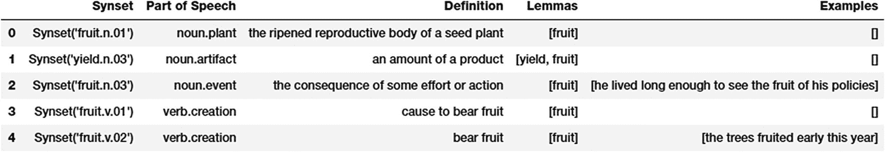

# 显示总同义词集数量
print 'Total Synsets:', len(synsets)
Total Synsets: 5
```

我们可以看到，单词“fruit”总共关联了五个同义词集。这些同义词集能说明什么？我们可以使用以下代码片段进一步深入了解每个同义词集及其组成部分（见图 8-1）。



图 8-1

探索 WordNet 同义词集

```
pd.options.display.max_colwidth = 200
fruit_df = pd.DataFrame([{'Synset': synset,
'Part of Speech': synset.lexname(),
'Definition': synset.definition(),
'Lemmas': synset.lemma_names(),
'Examples': synset.examples()}
for synset in synsets])
fruit_df = fruit_df[['Synset', 'Part of Speech', 'Definition', 'Lemmas', 'Examples']]
fruit_df
```

输出结果显示了与单词“fruit”相关的每个同义词集的详细信息，定义则给出了每个同义词集的含义及其关联的词元。同时还提到了每个同义词集的词性，包括名词和动词。输出中的一些示例展示了该词汇在实际句子中的用法。现在我们对同义词集有了更好的理解，接下来让我们开始探索各种语义关系。

### 分析词汇语义关系

文本语义本身指的是对意义和语境的研究。同义词集为各种词汇提供了良好的抽象，并提供了有用的信息，如定义、示例、词性和词元。但是，我们能利用同义词集探索实体间的语义关系吗？答案是肯定的。我们将涵盖许多与语义关系相关的概念，这些概念我们在第 1 章的“语言语义学”部分下的“词汇语义关系”小节中已经详细阐述过。当我们在这里用实际案例进行说明时，快速浏览一下那个章节将有助于你更好地理解每个概念。我们在此使用 NLTK 的 WordNet 资源，但你也可以使用`pattern`包中的同一个 WordNet 资源，因为它提供了与 NLTK 类似的接口。

#### 蕴涵关系

*蕴涵*这一术语通常指某个事件或动作从逻辑上涉及或关联到已发生或将要发生的其他动作或事件。理想情况下，这非常适用于表示特定动作的动词。以下代码片段展示了如何获取蕴涵关系。

```
#### 蕴涵关系
for action in ['walk', 'eat', 'digest']:
action_syn = wn.synsets(action, pos="v")[0]
print(action_syn, '-- entails -->', action_syn.entailments())
Synset('walk.v.01') -- entails --> [Synset('step.v.01')]
Synset('eat.v.01') -- entails --> [Synset('chew.v.01'), Synset('swallow.v.01')]
Synset('digest.v.01') -- entails --> [Synset('consume.v.02')]
```

从输出中可以看到相关的同义词集如何展示了蕴涵关系的概念。蕴涵关系描绘了相关联的动作，比如走路涉及或蕴涵着迈步，而吃东西则蕴涵着咀嚼和吞咽。

#### 同形同音异义词与同形异义词

在较高层次上，*同形同音异义词*指具有相同书写形式或发音但含义不同的单词。它们是*同形异义词*的超集，后者指拼写相同但发音或含义不同的单词。以下代码片段展示了我们如何获取同形同音异义词/同形异义词。

```
for synset in wn.synsets('bank'):
print(synset.name(),'-',synset.definition())
bank.n.01 - 倾斜的土地（尤指水体旁的坡地）
depository_financial_institution.n.01 - 接受存款并将资金用于贷款活动的金融机构
bank.n.03 - 长条形的脊状物或堆状物
bank.n.04 - 一排或一层相似物体的排列
...
...
deposit.v.02 - 存入银行账户
bank.v.07 - 用灰覆盖以控制燃烧速率
trust.v.01 - 对……有信心或信任
```

此输出显示了单词“bank”的各种同形异义词所获得的部分结果。可以看到单词“bank”关联了多种不同的含义，这正是同形异义词的核心概念。

#### 同义词与反义词

你可能已经知道，*同义词*是含义相似的单词，而*反义词*是含义相反或相对的单词。以下代码片段展示了同义词和反义词。

```
term = 'large'
synsets = wn.synsets(term)
adj_large = synsets[1]
adj_large = adj_large.lemmas()[0]
adj_large_synonym = adj_large.synset()
adj_large_antonym = adj_large.antonyms()[0].synset()
print('Synonym:', adj_large_synonym.name())
print('Definition:', adj_large_synonym.definition())
print('Antonym:', adj_large_antonym.name())
print('Definition:', adj_large_antonym.definition())
print()
Synonym: large.a.01
Definition: 在尺寸、数量、量级或程度上高于平均水平
Antonym: small.a.01
Definition: 在数量、量级或程度上有限或低于平均水平
term = 'rich'
synsets = wn.synsets(term)[:3]
for synset in synsets:
rich = synset.lemmas()[0]
rich_synonym = rich.synset()
rich_antonym = rich.antonyms()[0].synset()
print('Synonym:', rich_synonym.name())
print('Definition:', rich_synonym.definition())
print('Antonym:', rich_antonym.name())
print('Definition:', rich_antonym.definition())
print()
Synonym: rich_people.n.01
Definition: 拥有财产和财富的人（视为一个群体）
Antonym: poor_people.n.01
Definition: 没有财产或财富的人（视为一个群体）
Synonym: rich.a.01
Definition: 拥有物质财富
Antonym: poor.a.02
Definition: 拥有很少钱或很少财产
Synonym: rich.a.02
Definition: 拥有丰富的理想品质或物质（尤其是自然资源）
Antonym: poor.a.04
Definition: 缺乏特定资源、品质或物质
```

这些输出展示了单词“large”和“rich”的示例同义词和反义词。此外，我们探索了与词汇或概念“rich”相关的几个同义词集，它们提供了不同的同义词及其对应的反义词。


#### 下位词（Hyponyms）与上位词（Hypernyms）

`Synset`对象代表具有独特语义和概念的同义词集，它们基于某些相似性相互关联。除了具体实体外，其中一些同义词集也代表抽象和通用概念。通常，它们以层级结构相互链接，表示“是一种（is-a）”关系。*下位词*和*上位词*帮助我们通过浏览该层级结构来探索相关概念。具体来说，`hyponyms`指代作为更高阶概念子类的实体或概念，与其超类相比，具有非常特定的含义或上下文。以下代码片段展示了单词“`tree`”的下位词。

```python
term = 'tree'
synsets = wn.synsets(term)
tree = synsets[0]
print('Name:', tree.name())
print('Definition:', tree.definition())
Name: tree.n.01
Definition: a tall perennial woody plant having a main trunk and branches forming a distinct elevated crown; includes both gymnosperms and angiosperms
hyponyms = tree.hyponyms()
print('Total Hyponyms:', len(hyponyms))
print('Sample Hyponyms')
for hyponym in hyponyms[:10]:
print(hyponym.name(), '-', hyponym.definition())
print()
Total Hyponyms: 180
Sample Hyponyms
aalii.n.01 - a small Hawaiian tree with hard dark wood
acacia.n.01 - any of various spiny trees or shrubs of the genus Acacia
african_walnut.n.01 - tropical African timber tree with wood that resembles mahogany
albizzia.n.01 - any of numerous trees of the genus Albizia
alder.n.02 - north temperate shrubs or trees having toothed leaves and conelike fruit; bark is used in tanning and dyeing and the wood is rot-resistant
angelim.n.01 - any of several tropical American trees of the genus Andira
angiospermous_tree.n.01 - any tree having seeds and ovules contained in the ovary
anise_tree.n.01 - any of several evergreen shrubs and small trees of the genus Illicium
arbor.n.01 - tree (as opposed to shrub)
aroeira_blanca.n.01 - small resinous tree or shrub of Brazil
```

该输出告诉我们，单词“`tree`”共有 180 个下位词，我们看到了其中一些示例下位词及其定义。正如预期，每个下位词都是树的一种特定类型。`上位词（hypernyms）`是充当`hyponyms`超类的实体或概念，具有更通用的含义或上下文。以下代码片段展示了“`tree`”的直接超类上位词。

```python
hypernyms = tree.hypernyms()
print(hypernyms)
[Synset('woody_plant.n.01')]
```

你甚至可以向上浏览整个实体/概念层级结构，并通过以下代码片段展示“`tree`”的所有上位词或父类。

```python
