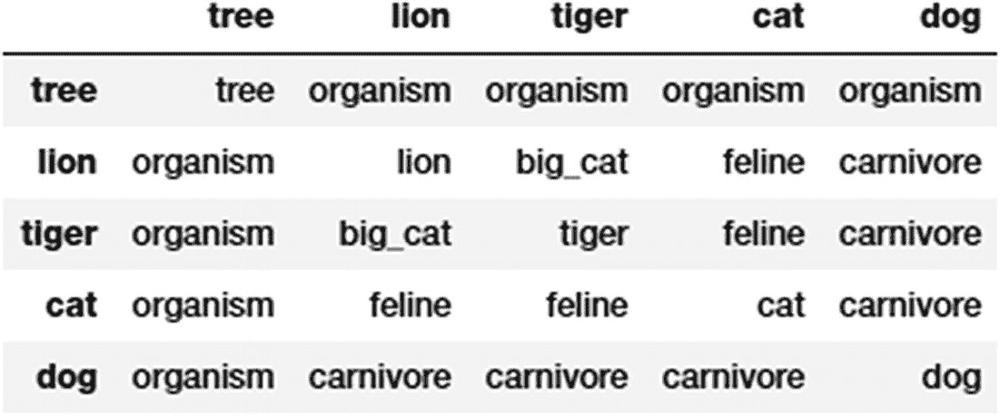

# 打印实体及其定义

```python
for entity, definition in zip(entity_names, entity_definitions):
    print(entity, '-', definition)
    print()
```

`tree` - a tall perennial woody plant having a main trunk and branches forming a distinct elevated crown; includes both gymnosperms and angiosperms

`lion` - large gregarious predatory feline of Africa and India having a tawny coat with a shaggy mane in the male

`tiger` - large feline of forests in most of Asia having a tawny coat with black stripes; endangered

`cat` - feline mammal usually having thick soft fur and no ability to roar: domestic cats; wildcats

`dog` - a member of the genus Canis (probably descended from the common wolf) that has been domesticated by man since prehistoric times; occurs in many breeds

现在我们对这些实体有了更多了解，我们将尝试基于共同上位词来关联它们。对于每一对实体，我们将在关系层级树中寻找它们的最低共同上位词。关联密切的实体应具有非常具体的上位词，而不相关的实体则应具有非常抽象或通用的上位词。以下代码片段展示了这一点。



图 8-2 成对共同上位词矩阵

```python
common_hypernyms = []
for entity in entities:
    # 获取成对的最低共同上位词
    common_hypernyms.append([entity.lowest_common_hypernyms(compared_entity)[0].name().split('.')[0]
                            for compared_entity in entities])
```