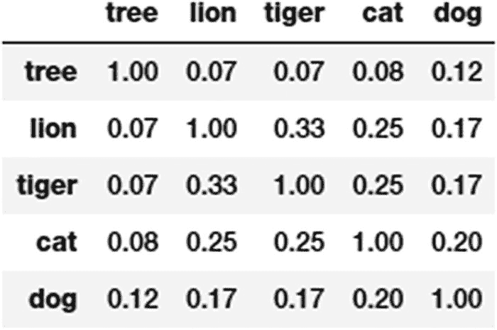

# 构建成对最低共同上位词矩阵

`common_hypernym_frame` = `pd.DataFrame`(`common_hypernyms`, index=`entity_names`, columns=`entity_names`)

`common_hypernym_frame`

忽略矩阵的主对角线，对于每一对实体，我们可以看到它们的最低共同上位词，该词揭示了它们之间关系的本质（见图 8-2）。树木与其他动物除了同属生物体外并无关联，因此我们得到了它们之间的“生物体”关系。猫与狮子、老虎有关联，因为它们都是猫科动物，在输出结果中我们也能看到这一点。老虎和狮子通过“大型猫科动物”关系相互连接。最后，我们可以看到狗与其他动物之间存在“食肉动物”的关系，因为它们通常都吃肉。

我们还可以使用各种语义概念来衡量这些实体之间的语义相似性。我们将使用`路径相似度`，它基于连接两个术语的最短路径（根据它们的上位词/下位词分类体系）返回一个介于 `[0, 1]` 之间的值。以下代码片段展示了如何生成这个相似性矩阵（见图 8-3）。



图 8-3

成对相似性矩阵

```
similarities = []

for entity in entities:

    # 获取成对相似性

    similarities.append([round(`entity.path_similarity`(`compared_entity`), 2)

                        for compared_entity in entities])
```