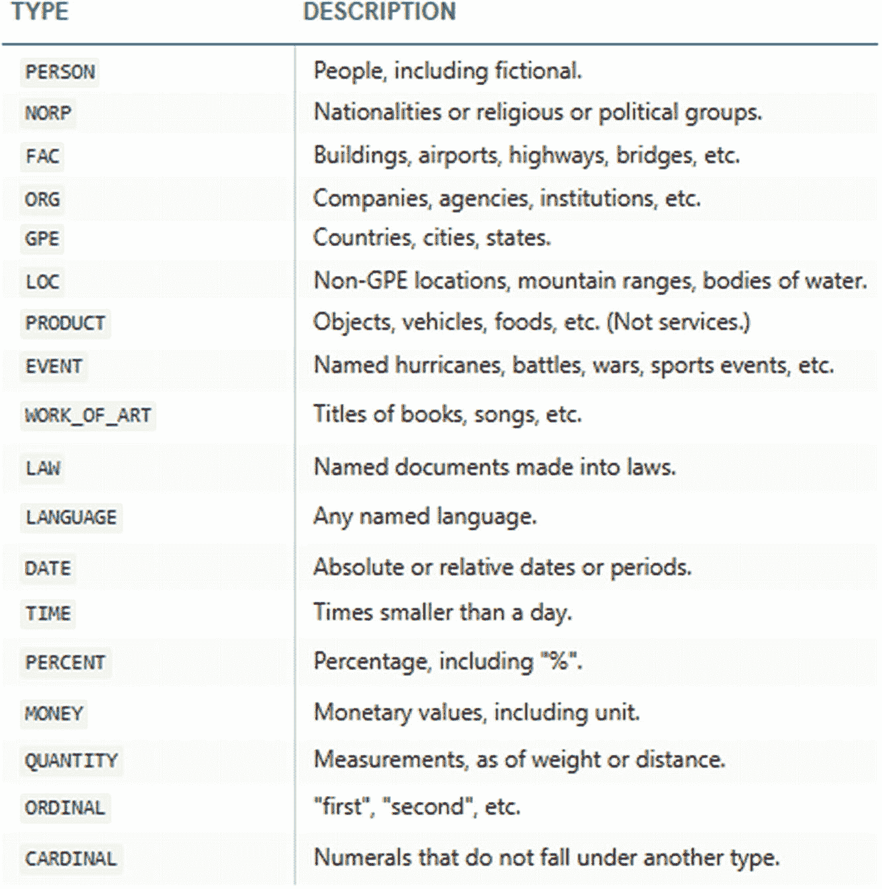

# 执行词义消歧

```python
for sentence, pos_tag in samples:
    word_syn = lesk(word_tokenize(sentence.lower()), word, pos_tag)
    print('Sentence:', sentence)
    print('Word synset:', word_syn)
    print('Corresponding defition:', word_syn.definition())
    print()
```

```
Sentence: Lead is a very soft, malleable metal
Word synset: Synset('lead.n.02')
Corresponding definition: a soft heavy toxic malleable metallic element; bluish white when freshly cut but tarnishes readily to dull grey

Sentence: John is the actor who plays the lead in that movie
Word synset: Synset('star.n.04')
Corresponding definition: an actor who plays a principal role

Sentence: This road leads to nowhere
Word synset: Synset('run.v.23')
Corresponding definition: cause something to pass or lead somewhere
```

在这些示例中，我们尝试对两个词语——`fruit` 和 `lead`——在不同文本中进行消歧。你可以看到我们如何使用 `lesk` 算法，根据待消歧词语在每个文档中的用法和语境，获取其正确的词义。这表明 `fruit` 既可以指一种可食用的实体，也可以指付出努力后所面临的某种后果。我们还看到了 `lead` 如何既可以指柔软的金属，表示促使某物/某人前往某地，甚至可以指在戏剧或电影中扮演主要角色的演员！

# 命名实体识别

在任何文本文档中，都存在一些特定术语，它们代表更具信息量的实体，并且与文本的其他部分相比具有独特的语境。这些实体被称为命名实体，它们更具体地表示现实世界中的对象，例如人物、地点、组织等，通常由专有名词表示。我们可以通过查找文本文档中的名词短语来发现它们。命名实体识别，也称为实体组块/提取，是信息提取中一种常用的技术，用于识别和分割命名实体，并将其分类或归类到各种预定义的类别下。`SpaCy` 在命名实体识别方面具有出色的能力，你可以在其网站上找到有关他们常用标注方案的详细信息：[`https://spacy.io/api/annotation#named-entities`](https://spacy.io/api/annotation#named-entities)。我们在图 8-4 所示的表格中列出了主要的命名实体标签。



**图 8-4** 常见命名实体

`SpaCy` 提供了一种基于多种技术的快速 NER 标注器。其具体算法并未被详细讨论，但文档指出“该算法是多种知名方法的混合体，目前没有在任何单一出版物中描述过”。现在，让我们尝试在一个样本语料库上进行命名实体识别（NER）。为此，我们定义一个示例新闻文档如下。

```python
text = """Three more countries have joined an "international grand committee" of parliaments, adding to calls for Facebook's boss, Mark Zuckerberg, to give evidence on misinformation to the coalition. Brazil, Latvia and Singapore bring the total to eight different parliaments across the world, with plans to send representatives to London on 27 November with the intention of hearing from Zuckerberg. Since the Cambridge Analytica scandal broke, the Facebook chief has only appeared in front of two legislatures: the American Senate and House of Representatives, and the European parliament. Facebook has consistently rebuffed attempts from others, including the UK and Canadian parliaments, to hear from Zuckerberg.He added that an article in the New York Times on Thursday, in which the paper alleged a pattern of behaviour from Facebook to "delay, deny and deflect" negative news stories, "raises further questions about how recent data breaches were allegedly dealt with within Facebook."
"""
```

多亏了 `spaCy`，获取命名实体现在变得非常简单。我们执行了一些基本的文本处理，并使用 `spaCy` 获得了 NER 标签，如下所示。

```python
import spacy
import re
text = re.sub(r'\n', ", text) # 移除多余换行符
nlp = spacy.load('en')
text_nlp = nlp(text)
```