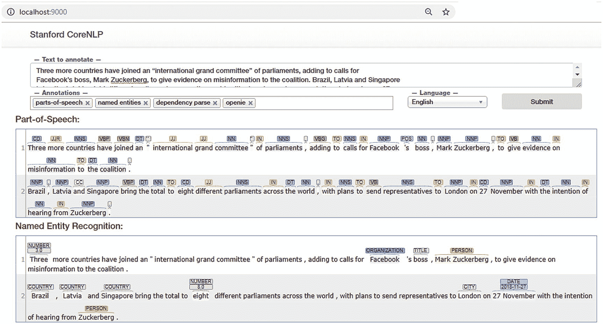

# 获取最常见的实体

`c = Counter([item[1] for item in named_entities])`

`c.most_common()`

`[('ORGANIZATION', 7), ('LOCATION', 4)]`

然而，这有一个限制。该模型仅针对 `PERSON`、`ORGANIZATION` 和 `LOCATION` 类型的实例进行了训练，与 spaCy 相比显得局限。幸运的是，已有更新版本的 Stanford Core NLP 可用，并且 NLTK 中的新 API 推荐使用它。但要在 Python 中通过 NLTK 使用 Stanford Core NLP，我们需要在本地下载并启动一个 Core NLP 服务器。为什么需要这样做？NLTK 正在逐步弃用旧的斯坦福解析器，转而支持更活跃的 Stanford Core NLP 项目。该旧解析器甚至可能在 NLTK 3.4 版本后被移除，因此最好保持更新。你可以在 NLTK 的 GitHub Issue [`https://github.com/nltk/nltk/issues/1839`](https://github.com/nltk/nltk/issues/1839) 中找到更多详细信息。

我们将从 [`https://stanfordnlp.github.io/CoreNLP/`](https://stanfordnlp.github.io/CoreNLP/) 下载 Stanford Core NLP 套件。下载并解压目录后，进入该目录，并在终端中使用以下命令启动 Core NLP 服务器。

```
E:\> java -mx4g -cp "*" edu.stanford.nlp.pipeline.StanfordCoreNLPServer -preload tokenize,ssplit,pos,lemma,ner,parse,depparse -status_port 9000 -port 9000 -timeout 15000
```

如果运行成功，启动时你应该会在终端上看到以下消息。

```
E:\stanford\stanford-corenlp-full-2018-02-27>java -mx4g -cp "*" edu.stanford.nlp.pipeline.StanfordCoreNLPServer -preload tokenize,ssplit,pos,lemma,ner,parse,depparse -status_port 9000 -port 9000 -timeout 15000

[main] INFO CoreNLP - --- StanfordCoreNLPServer#main() called ---

...

...

[main] INFO edu.stanford.nlp.pipeline.TokensRegexNERAnnotator - TokensRegexNERAnnotator ner.fine.regexner: Read 580641 unique entries out of 581790 from edu/stanford/nlp/models/kbp/regexner_caseless.tab, 0 TokensRegex patterns.

...

...

[main] INFO CoreNLP - Starting server...

[main] INFO CoreNLP - StanfordCoreNLPServer listening at /0:0:0:0:0:0:0:0:9000
```

如果你感兴趣，可以前往 `http://localhost:9000`，体验其直观的用户界面，如图 8-6 所示。



**图 8-6** 探索 Stanford Core NLP

你可以使用图 8-6 所示的用户界面，以交互方式可视化文本注释和标签。接下来，我们将通过 NLTK 在 Python 中使用它，如下所示。

```
from nltk.parse import CoreNLPParser

import nltk
```