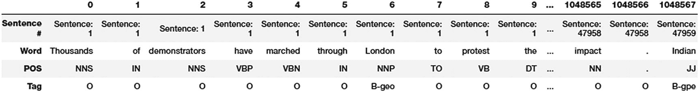

# 找出主要的命名实体类型
c = Counter([item[1] for item in named_entities])
c.most_common()
[('ORGANIZATION', 9), ('COUNTRY', 4), ('NUMBER', 3), ('PERSON', 3),
('DATE', 2), ('NATIONALITY', 2), ('TITLE', 1), ('CITY', 1)]
```

因此，你可以看到 Core NLP 相比之前的版本拥有更多的标签类型。事实上，它能识别命名实体（`PERSON`、`LOCATION`、`ORGANIZATION` 和 `MISC`）、数值实体（`MONEY`、`NUMBER`、`ORDINAL` 和 `PERCENT`）以及时间实体（`DATE`、`TIME`、`DURATION` 和 `SET`）。总共有 12 个类别。


# 从零开始构建命名实体识别标注器

市场上有多种现成的解决方案能够执行命名实体提取（其中一些我们在前几节已经讨论过）。然而，有时业务需求会超出现成分类器的能力范围。在本节中，我们将通过一个练习，使用条件随机场（CRF）来构建我们自己的命名实体识别器。我们将使用一个名为 `sklearn_crfsuite` 的流行框架来开发我们的命名实体识别器。

这里需要记住的关键点是，命名实体识别本质上是一个序列建模问题。它更接近于分类问题类别，我们需要一个带有标签的数据集来训练分类器。没有训练数据，就没有命名实体识别模型！针对命名实体识别这类问题，有各种带标签的数据集。在本教程中，我们使用的是 GMB（格罗宁根语义库）语料库的一个预处理版本。预处理后的版本可在 [`https://www.kaggle.com/abhinavwalia95/entity-annotated-corpus`](https://www.kaggle.com/abhinavwalia95/entity-annotated-corpus) 获取。为了方便使用，我们也在 GitHub 仓库 [`https://github.com/dipanjanS/text-analytics-with-python`](https://github.com/dipanjanS/text-analytics-with-python) 中提供了该数据集。加载数据集后，我们可以按如下方式检查主要字段。

```
import pandas as pd
df = pd.read_csv('ner_dataset.csv.gz', compression="gzip", encoding='ISO-8859-1')
df = df.fillna(method='ffill')
df.info()

RangeIndex: 1048575 entries, 0 to 1048574
Data columns (total 4 columns):
Sentence #    1048575 non-null object
Word          1048575 non-null object
POS           1048575 non-null object
Tag           1048575 non-null object
dtypes: object(4)
memory usage: 32.0+ MB
```

我们还可以通过以下代码来查看实际数据集。请参见图 8-7。



图 8-7

GMB 命名实体识别数据集

```
df.T
```

为了更深入地了解我们正在处理的数据以及注释标签的总数，我们可以使用以下代码。

```
df['Sentence #'].nunique(), df.Word.nunique(), df.POS.nunique(), df.Tag.nunique()
(47959, 35178, 42, 17)
```

这告诉我们，我们有 47,959 个句子，包含 35,178 个独特的单词。这些句子总共有 42 个独特的词性标签和 17 个独特的命名实体识别标签。我们可以按如下方式查看语料库中独特的命名实体识别标签分布。

```
df.Tag.value_counts()
O        887908
B-geo     37644
B-tim     20333
B-org     20143
I-per     17251
B-per     16990
I-org     16784
B-gpe     15870
I-geo      7414
I-tim      6528
B-art       402
B-eve       308
I-art       297
I-eve       253
B-nat       201
I-gpe       198
I-nat        51
Name: Tag, dtype: int64
```

上述输出显示了数据集中不同标签不均衡的分布情况。GMB 数据集使用了 *IOB 标注*（内部、外部、开始）。IOB 是一种常见的用于标注令牌的格式，我们在第 3 章中讨论过。为了帮你复习一下：

- 标签前的 `I-` 前缀表示该标签位于一个组块内部。
- 标签前的 `B-` 前缀表示该标签是一个组块的开头。
- `O-` 标签表示一个令牌不属于任何组块（外部）。

该数据集中的命名实体识别标签可以使用以下符号来解释，这与你迄今为止见过的命名实体识别标签类似：

- `geo` = 地理实体
- `org` = 组织机构
- `per` = 人物
- `gpe` = 地缘政治实体
- `tim` = 时间指示符
- `art` = 人工制品
- `eve` = 事件
- `nat` = 自然现象

这些类别之外的任何内容都被称为 *other*，表示为 `O`。如前所述，命名实体识别属于序列建模问题类别。有不同的算法可以处理序列建模，而 CRF（条件随机场）就是其中之一。事实证明，CRF 在命名实体识别及相关领域表现极其出色。在本教程中，我们将尝试基于 CRF 开发我们自己的命名实体识别器。详细讨论 CRF 超出了本书的范围，因为这不是一本硬核的机器学习书籍。但为了激起你的兴趣，CRF 是一种无向图模型，其节点可以精确地划分为两个不相交的集合 `X` 和 `Y`，分别表示观测变量和输出变量；然后对条件分布 `p(Y | X)` 进行建模。我们建议感兴趣的读者查阅以下关于 CRF 的文献以深入了解：[`https://repository.upenn.edu/cgi/viewcontent.cgi?article=1162&context=cis_papers`](https://repository.upenn.edu/cgi/viewcontent.cgi%253Farticle%253D1162%2526context=cis_papers)。

特征工程对于构建任何机器学习或统计模型都至关重要，因为没有特征，就没有学习。同样，CRF 模型训练输入特征序列，以学习从一个状态（标签）到另一个状态的转换。为了支持这种算法，我们需要定义特征，这些特征需要考虑不同的转换。我们将开发一个名为 `word2features()` 的函数，在该函数中，我们将每个单词转换为一个特征字典，描述以下属性或特征：

- 单词的小写版本
- 包含最后三个字符的后缀
- 包含最后两个字符的后缀
- 用于判断大写、标题大小写、数字数据和词性标签的标志

我们还附加了与前一个或下一个单词或标签相关的属性，以判断句首（BOS）或句尾（EOS）。这些是基于最佳实践的特征，你可以通过实验添加自己的特征。请始终记住，特征工程既是一门艺术，也是一门科学。

```
def word2features(sent, i):
word = sent[i][0]
postag = sent[i][1]
features = {
'bias': 1.0,
'word.lower()': word.lower(),
'word[-3:]': word[-3:],
'word[-2:]': word[-2:],
'word.isupper()': word.isupper(),
'word.istitle()': word.istitle(),
'word.isdigit()': word.isdigit(),
'postag': postag,
'postag[:2]': postag[:2],
}
if i > 0:
word1 = sent[i-1][0]
postag1 = sent[i-1][1]
features.update({
'-1:word.lower()': word1.lower(),
'-1:word.istitle()': word1.istitle(),
'-1:word.isupper()': word1.isupper(),
'-1:postag': postag1,
'-1:postag[:2]': postag1[:2],
})
else:
features['BOS'] = True
if i < len(sent)-1:
word1 = sent[i+1][0]
postag1 = sent[i+1][1]
features.update({
'+1:word.lower()': word1.lower(),
'+1:word.istitle()': word1.istitle(),
'+1:word.isupper()': word1.isupper(),
'+1:postag': postag1,
'+1:postag[:2]': postag1[:2],
})
else:
features['EOS'] = True
return features
